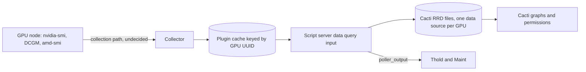

# plugin_gpu

A proposed Cacti 1.2 plugin that brings per-GPU utilization, memory, temperature, power, ECC errors, XID errors, and throttling reasons from NVIDIA and AMD tools into Cacti. Each GPU becomes an index of a data query on its node's device, so GPU graphs sit next to the node's other graphs under Cacti's permissions, and Thold and Maint can alert on and suppress them.

> **Status: proposal.** This repository contains no plugin code yet. It holds the design, its decision records, and the requirements tracked as issues and milestones. Nothing below describes shipped behavior.

## Why

GPU nodes are usually already in Cacti for CPU, memory, and interfaces. GPU health is a separate question that the node's SNMP data does not answer: a card can be thermally throttled, accumulate ECC errors, or report an XID fault while the node itself looks healthy. Vendor tools report it (`nvidia-smi`, DCGM, `amd-smi`), but their output lives outside Cacti's graphs, permissions, and alerting.

The plugin closes that gap by turning vendor tool output into Cacti data sources, keyed by each GPU's identity rather than its position, so a reboot that reorders GPUs does not attach one card's history to another. It reuses Cacti's graphing, permissions, remote data collectors, Thold, and Maint rather than building parallel versions of them.

## Planned scope

| Phase | Scope | Milestones |
|---|---|---|
| 0, research | Vendor tool output, XID and throttle signals, GPU identity, privileges, collection path decision | [M1](https://github.com/somethingwithproof/plugin_gpu/milestone/1) |
| 1, nvidia | `nvidia-smi` collection, inventory by UUID, graphs, throttle, ECC and XID signals, Thold and Maint, health page | [M2](https://github.com/somethingwithproof/plugin_gpu/milestone/2), [M3](https://github.com/somethingwithproof/plugin_gpu/milestone/3), [M4](https://github.com/somethingwithproof/plugin_gpu/milestone/4) |
| 2, backends | DCGM backend, `amd-smi` backend | [M5](https://github.com/somethingwithproof/plugin_gpu/milestone/5) |
| 3, mig and remote | MIG instances, Cacti remote data collectors | [M6](https://github.com/somethingwithproof/plugin_gpu/milestone/6) |

Out of scope: any command that changes a GPU or node (clocks, power limits, resets, MIG layout), a plugin-owned alerting engine, a custom daemon or network protocol, and scheduler or job accounting. See the plan for the research backlog.

## Open question: how metrics reach Cacti

The largest undecided choice is the collection path: a Cacti poller on the GPU node, SNMP `extend`, scraping `dcgm-exporter`, or something else. Each puts the trust boundary in a different place. It is tracked as decision [#7](https://github.com/somethingwithproof/plugin_gpu/issues/7) and gated on measurements in milestone 1. The plan describes the options under [Collection paths](docs/PLAN.md#collection-paths).

## Compatibility targets

| Component | Target |
|---|---|
| Cacti | 1.2.31 or later, no core patches |
| PHP | 8.2 or later; `setup.php` stays parseable on 8.0 so an unsupported runtime gets a refusal instead of a broken Cacti UI |
| NVIDIA | Driver and tool lines to be set by research [#26](https://github.com/somethingwithproof/plugin_gpu/issues/26); DCGM field IDs checked at v3.3.9 and v4.7.0 |
| AMD | `amd-smi` on ROCm releases to be set by research [#26](https://github.com/somethingwithproof/plugin_gpu/issues/26) |
| Thold, Maint | No changes required |

## Design

- [docs/PLAN.md](docs/PLAN.md) is the full plan: architecture, upstream facts it depends on (with sources), identity model, security boundaries, performance arithmetic, testing, and risks.
- [docs/decisions/](docs/decisions/) holds architecture decision records for choices already made.
- [docs/REQUIREMENTS.md](docs/REQUIREMENTS.md) maps every requirement ID to its issue.

## How work is tracked

- **Milestones** follow the plan's milestones. Each has an epic issue listing its sub-issues and exit evidence.
- **Issues** are typed by label: `type: requirement`, `type: research`, `type: decision`, `type: epic`. Requirement issues state numbered, testable requirements (`REQ-AREA-NNN`) and acceptance criteria.
- **Labels** also carry `area:`, `phase:`, `priority:`, and `status:`. See [CONTRIBUTING.md](CONTRIBUTING.md#labels).
- The [project board](https://github.com/users/somethingwithproof/projects/9) shows all issues across milestones.

## Contributing

Read [CONTRIBUTING.md](CONTRIBUTING.md). Commits need a DCO sign-off. Design discussion happens on issues; open decisions carry the `type: decision` label. Captured output from real GPU tools is the most useful contribution to milestone 1; strip hostnames, serial numbers, and UUIDs first.

## Security

Report vulnerabilities privately; see [SECURITY.md](SECURITY.md).

## License

GNU General Public License v2.0, the same license as Cacti and its plugins. See [LICENSE](LICENSE).
