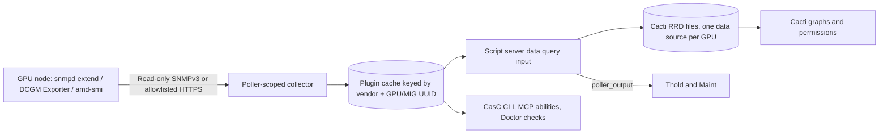

<!-- translations:start -->
[English](README.md) | [简体中文](docs/i18n/zh-CN/README.md) | [हिन्दी](docs/i18n/hi-IN/README.md) | [Español (España)](docs/i18n/es-ES/README.md) | [Español (Latinoamérica)](docs/i18n/es-419/README.md) | [العربية (السعودية)](docs/i18n/ar-SA/README.md) | [Afrikaans](docs/i18n/af-ZA/README.md) | [አማርኛ](docs/i18n/am-ET/README.md) | [العربية (مصر)](docs/i18n/ar-EG/README.md) | [العربية (المغرب)](docs/i18n/ar-MA/README.md) | [Български](docs/i18n/bg-BG/README.md) | [বাংলা](docs/i18n/bn-BD/README.md) | [Bosanski](docs/i18n/bs-BA/README.md) | [Deutsch](docs/i18n/de-DE/README.md) | [Ελληνικά](docs/i18n/el-GR/README.md) | [فارسی](docs/i18n/fa-IR/README.md) | [Filipino](docs/i18n/fil-PH/README.md) | [Français](docs/i18n/fr-FR/README.md) | [Français (Maroc)](docs/i18n/fr-MA/README.md) | [Français (Sénégal)](docs/i18n/fr-SN/README.md) | [Hausa](docs/i18n/ha-NG/README.md) | [עברית](docs/i18n/he-IL/README.md) | [Hrvatski](docs/i18n/hr-HR/README.md) | [Bahasa Indonesia](docs/i18n/id-ID/README.md) | [Igbo](docs/i18n/ig-NG/README.md) | [Italiano](docs/i18n/it-IT/README.md) | [日本語](docs/i18n/ja-JP/README.md) | [ქართული](docs/i18n/ka-GE/README.md) | [한국어](docs/i18n/ko-KR/README.md) | [Latviešu](docs/i18n/lv-LV/README.md) | [Malagasy](docs/i18n/mg-MG/README.md) | [मराठी](docs/i18n/mr-IN/README.md) | [Bahasa Melayu](docs/i18n/ms-MY/README.md) | [Nederlands](docs/i18n/nl-NL/README.md) | [Polski](docs/i18n/pl-PL/README.md) | [Português (Brasil)](docs/i18n/pt-BR/README.md) | [Português (Portugal)](docs/i18n/pt-PT/README.md) | [Русский](docs/i18n/ru-RU/README.md) | [Kinyarwanda](docs/i18n/rw-RW/README.md) | [Soomaali](docs/i18n/so-SO/README.md) | [Српски](docs/i18n/sr-RS/README.md) | [Svenska](docs/i18n/sv-SE/README.md) | [Kiswahili](docs/i18n/sw-KE/README.md) | [தமிழ்](docs/i18n/ta-IN/README.md) | [తెలుగు](docs/i18n/te-IN/README.md) | [ไทย](docs/i18n/th-TH/README.md) | [Türkçe](docs/i18n/tr-TR/README.md) | [Українська](docs/i18n/uk-UA/README.md) | [اردو](docs/i18n/ur-PK/README.md) | [Tiếng Việt](docs/i18n/vi-VN/README.md) | [isiXhosa](docs/i18n/xh-ZA/README.md) | [Yorùbá](docs/i18n/yo-NG/README.md) | [繁體中文](docs/i18n/zh-TW/README.md) | [isiZulu](docs/i18n/zu-ZA/README.md)
<!-- translations:end -->

# plugin_gpu

A Cacti 1.2 plugin that brings per-GPU utilization, memory, temperature, power, ECC errors, and throttling reasons from NVIDIA and AMD tools into Cacti. Each GPU (or MIG instance) becomes an index of a data query on its node's device, so GPU graphs sit next to the node's other graphs under Cacti's permissions, and Thold and Maint can alert on and suppress them.

> **Status: phases 1 through 3 implemented in code, not yet released.** Phase 1 (NVIDIA `nvidia-smi` via SNMP extend, identity tracking, graphs, throttle and ECC signals, Thold and Maint alerting, health page), Phase 2 (read-only NVIDIA DCGM Exporter HTTP(S) parser/client and AMD `amd-smi` parser), Phase 3 (MIG instance identity tracking, Schema v4 columns, poller-scoped remote collector execution, `replicate_out` and `remote_agent` hooks), the CasC operator CLI (`cli/gpu.php`), and ecosystem hooks (`abilities_register`, `doctor_register_checks`, `casc_register_providers`) are implemented and covered by unit, security, and disposable-Cacti integration tests. Live runs so far use synthetic `snmpd` and fixture payloads rather than physical GPU hardware. Still open before tagging a release: pilots on real hardware ([docs/pilot-plan.md](docs/pilot-plan.md), #54), an external security review ([docs/security-review.md](docs/security-review.md)), fixtures captured from real tools (#14), and scale measurements on production-sized hardware ([docs/performance.md](docs/performance.md)). XID error collection remains open under decision #8.

## Access roles

| Realm | Access |
| --- | --- |
| GPU View | Existing monitoring pages. |
| GPU Operator | Monitoring plus the Operations page and personal triage acknowledgments. |
| GPU Admin | Operator access plus the existing configuration and administrative actions. |

After copying upgrade files, open the Plugins page as an administrator to register
the new realm. Assign the Operator realm explicitly under **Configuration > Users** or user groups.
Upgrades retain the existing View and Admin realm IDs and grants. Admin access
inherits Operator access, and Operator access inherits View access on each request;
this does not add stored grants to users or groups. Plugin settings also require
GPU Admin access in addition to Cacti's Settings permission.

Cacti device permissions still limit the rows and actions available to each user; unmapped objects require an administrator.
Credentials, configuration, mapping, deletion and other administrative changes
remain in the administrative pages. Acknowledgments last only in the current
user's session, for at most one hour and only while the same observation remains
fresh. New or changed observations invalidate them. They never mark a failed
measurement healthy or suppress alerts.

## Why

GPU nodes are usually already in Cacti for CPU, memory, and interfaces. GPU health is a separate question that the node's SNMP data does not answer: a card can be thermally throttled, accumulate ECC errors, or report an XID fault while the node itself looks healthy. Vendor tools report it (`nvidia-smi`, DCGM, `amd-smi`), but their output lives outside Cacti's graphs, permissions, and alerting.

The plugin closes that gap by turning vendor tool output into Cacti data sources, keyed by each GPU's identity rather than its position, so a reboot that reorders GPUs does not attach one card's history to another. It reuses Cacti's graphing, permissions, remote data collectors, Thold, and Maint rather than building parallel versions of them.

## Planned scope

| Phase | Scope | Status | Milestones |
|---|---|---|---|
| 0, research | Vendor tool output, XID and throttle signals, GPU identity, privileges, collection path decision | Complete | [M1](https://github.com/somethingwithproof/plugin_gpu/milestone/1) |
| 1, nvidia | `nvidia-smi` collection, inventory by UUID, graphs, throttle and ECC signals, Thold and Maint, health page | Implemented (fixture-tested) | [M2](https://github.com/somethingwithproof/plugin_gpu/milestone/2), [M3](https://github.com/somethingwithproof/plugin_gpu/milestone/3), [M4](https://github.com/somethingwithproof/plugin_gpu/milestone/4) |
| 2, backends | Read-only DCGM Exporter HTTP(S) parser/client (`lib/DcgmExporterParser.php`, `lib/DcgmExporterClient.php`), AMD `amd-smi` parser (`lib/AmdSmiParser.php`) | Implemented (unit-tested) | [M5](https://github.com/somethingwithproof/plugin_gpu/milestone/5) |
| 3, mig, remote, and ecosystem | MIG instance identity tracking, remote data collectors (`INFO`, `poller_gpu.php --poller=N`, `replicate_out`, `remote_agent`), CasC CLI (`cli/gpu.php`), MCP/Doctor/CasC hooks | Implemented (unit and CI integration tested) | [M6](https://github.com/somethingwithproof/plugin_gpu/milestone/6) |

Out of scope: any command that changes a GPU or node (clocks, power limits, resets, MIG layout), a plugin-owned alerting engine, a custom daemon or network protocol, and scheduler or job accounting. See the plan for the research backlog.

## What milestone 4 adds

- **NVIDIA DCGM Exporter read-only collector** (`lib/DcgmExporterParser.php`, `lib/DcgmExporterClient.php`). Parses Prometheus text exposition metrics (`DCGM_FI_DEV_GPU_UTIL`, `DCGM_FI_DEV_FB_USED`, `DCGM_FI_DEV_FB_FREE`, `DCGM_FI_DEV_POWER_USAGE`, `DCGM_FI_DEV_GPU_TEMP`, `DCGM_FI_DEV_ECC_DBE_VOL_TOTAL`, `DCGM_FI_DEV_CLOCK_THROTTLE_REASONS`, and MIG labels `GPU_I_ID` and `GPU_I_PROFILE`). The HTTP(S) client enforces an explicit endpoint host/CIDR allowlist, verifies TLS peer certificates by default, caps timeouts and response size, disables redirects, and rejects non-HTTP(S) schemes.
- **AMD `amd-smi` read-only parser** (`lib/AmdSmiParser.php`). Normalizes `amd-smi` JSON/SNMP-extend output (utilization, VRAM, power, junction/edge temperature, ECC, partition metadata, and separate throttle accumulators via `Reading::$vendorExtensions`) into the common metric model under `Vendor::Amd`.
- **MIG instance tracking and Schema v4** (`lib/GpuReport.php`, `lib/GpuSnapshot.php`, `lib/GpuRecord.php`, `lib/Schema.php`, `lib/ScriptServer.php`). Tracks MIG instance UUIDs (`MIG-<uuid>` and `MIG-GPU-<parent>/<gi>/<ci>`), `mig_mode`, `mig_instance_id`, `mig_profile`, `parent_uuid`, and `partition_info` alongside parent GPUs while keeping immutable identity keys (`vendor`, `uuid`, `parent_uuid`) protected on updates and validated before database queries.
- **Remote data collectors** (`INFO`, `poller_gpu.php`, `lib/Poller.php`, `lib/ReplicationRepository.php`, `setup.php`). Declares `remote_collect:1, remote_poller:1` in `INFO`, supports poller-scoped execution via `php plugins/gpu/poller_gpu.php --poller=N`, skips Cacti object provisioning on non-main pollers, replicates poller-scoped tables through `replicate_out`, and answers read-only `gpu_health` and `gpu_inventory` actions through `remote_agent`.
- **Operator and CasC CLI** (`cli/gpu.php`, `lib/CascProvider.php`). Runs on PHP 8.2+ (parses on PHP 8.0) with zero external Composer dependencies: `php plugins/gpu/cli/gpu.php export [--format=yaml|xml]`, `validate <file> [--format=yaml|xml]`, `plan <file> [--format=yaml|xml] [--output=text|json]`, `apply <file> --confirm=<PLAN_HASH> [--format=yaml|xml]`, and `health [--format=text|json]`. Plans compute a deterministic SHA-256 confirmation hash, apply fails closed on hash mismatch, and XML parsing rejects `DOCTYPE` and `ENTITY` declarations.
- **Ecosystem integration hooks** (`lib/EcosystemIntegration.php`, `setup.php`). Registers `abilities_register` (`gpu-list-nodes`, `gpu-list-devices`, `gpu-get-health`; read-only, gated on the `GPU View` realm and Cacti device permissions), `doctor_register_checks` (`gpu_schema`, `gpu_poller_freshness`, `gpu_node_health`), and `casc_register_providers`.
- **Throttle reasons and ECC as alert values** ([docs/metrics.md](docs/metrics.md)). Decodes clock event masks into 0/1 indicators and computes per-interval new corrected/uncorrected ECC errors as gauges so Thold 1.8.2 and Maint 1.3 alert and suppress without negative counters or reset spikes ([docs/alerting.md](docs/alerting.md)).
- **GPU Health, permissions, failure/restore, and scale.** GPU Health (GPU View) shows stored freshness, last collection outcome, Maint state, backend, versions, and raw throttle masks without contacting nodes. Scripted end-to-end tests verify permissions, agent/DB/RRD failure recovery ([docs/backup.md](docs/backup.md)), and a 100-GPU scale run in CI ([docs/performance.md](docs/performance.md), [docs/operations.md](docs/operations.md), [CHANGELOG.md](CHANGELOG.md)).

## What milestone 3 adds

- **Collection through SNMP extend** ([ADR 0008](docs/decisions/0008-collect-through-snmp-extend.md)). The node's administrator adds two fixed `extend` lines to `snmpd.conf` ([docs/node-setup.md](docs/node-setup.md)); the plugin reads NET-SNMP-EXTEND-MIB through Cacti's SNMP functions with the device's own credentials, SNMPv3 recommended. It runs nothing on the Cacti server or the node.
- **Strict parsing.** Fields are read by position, each line names its GPU by UUID, and a nonzero exit status, a timeout, truncated output, a line with the wrong field count, or merged error text fails the whole collection: values become `U`, no GPU is marked absent, and GPU Nodes shows why.
- **A collector after each poller cycle.** It reads each enabled node's agent, updates the identity records, and caches the latest sample. The script server input reads only that cache, so a Cacti poll never waits on a GPU node.
- **Cacti objects** ([ADR 0010](docs/decisions/0010-attach-to-existing-node-devices.md)). The templates and the *GPU - Devices* data query ship as XML and are imported on install and upgrade. Saving a node attaches the data query to its existing device with reindex method None; GPU Nodes can create a device only when the node has none. Each GPU is an index keyed by vendor and UUID, with one data source shared by its Utilization, Memory, Temperature, Power, Power Percent, Clocks, Throttle, ECC Errors, New ECC Errors, Retired Pages, and Sample Age graphs. Every model field is drawn by some graph, because Cacti stores only the fields a graph uses. The plugin reindexes after every GPU change, keeps a reindex Cacti skipped while the device was Down or disabled and runs it once the device is Up, and creates graphs for new GPUs.
- **History stays with the card.** An absent GPU stays an index, so its graphs show a gap and resume in the same RRD file when it returns. A replacement card in the same slot gets its own data source. **Remove from Data Query** on the node's page takes an absent GPU out of the listing; its RRD files and graphs are kept until you delete them.
- **Device permissions on GPU Nodes.** A GPU Admin sees, changes, exports, and moves only nodes and GPUs on devices they may see in Cacti; a GPU move needs both nodes. A node whose device was deleted can be disabled or deleted.
- **The common metric model** ([ADR 0009](docs/decisions/0009-common-metric-core-with-vendor-extensions.md), [docs/metrics.md](docs/metrics.md)). Memory is in bytes, the clock event mask is decoded into `thr_*` indicators, and `age` is the age of the GPU's own sample time, or `U` when unknown.

The installing (web server) user must be able to write `<cacti>/resource/script_server/`, where the plugin places its data query XML; install and upgrade stop with a message otherwise and retry on the next attempt. Uninstall removes the templates and the XML only when *Remove the plugin's Cacti objects on uninstall* is checked, and never deletes RRD files, devices, graphs, or data sources ([docs/operations.md](docs/operations.md#uninstall)). Nodes on remote data collectors run scoped to their assigned `poller_id`.

## What milestone 2 ships

- **A guarded install.** On PHP below 8.2, install and enable are refused with a message naming the required version, and the rest of Cacti keeps working. `setup.php` and the page scripts parse on PHP 8.0.
- **Lifecycle.** Install, upgrade, disable, and uninstall through Cacti's Plugins page. Upgrades are ordered, finish after an interruption, and change the recorded version only after they succeed. Uninstall keeps the plugin's tables unless you clear *Keep Plugin Tables on Uninstall*; it never touches a Cacti device, data source, graph, or RRD file.
- **Separate realms.** *GPU Admin* opens **GPU Nodes**, where you register Cacti devices as GPU nodes, confirm or reject GPU moves between nodes, and export every record as JSON. *GPU View* opens **GPU Inventory**, which lists GPUs only on devices the viewer may see. Both pages are under Management, and every change is a POST checked by csrf-magic.
- **GPU identity records.** Each GPU is keyed by vendor and UUID. Index, PCI bus ID, name, driver, and the reporting tool are attributes that change in place. A new UUID in a known slot is flagged as a possible replacement and starts its own history; a GPU seen at another node moves only when an operator confirms; a GPU missing from successful collections is marked absent after a configurable count and never deleted. Only NVIDIA whole-GPU UUIDs are accepted for now; MIG instances wait on decision #13, and AMD on research #19. The rules are exercised by fixture sequences, since no collector feeds them yet.
- **Tests and CI.** Unit and source-rule suites with no GPU or database, lifecycle and page-permission checks against Cacti 1.2.31 and current 1.2.x on PHP 8.2 to 8.5, a PHP 8.1 refusal job, a PHP 8.0 lint of the entry points, PHPStan at level 9, and REUSE. The harness is provisional until #12 is decided.

### Install for evaluation

These steps install the current code to try it; [docs/operations.md](docs/operations.md) has the full operator guide. They require Cacti 1.2.31 or later on PHP 8.2 or later.

1. Copy the repository to `plugins/gpu` under your Cacti directory. The directory must be named `gpu`.
2. In Cacti, open **Configuration > Plugins**, then install and enable **GPU**.
3. Give users the *GPU View*, *GPU Operator*, or *GPU Admin* realm under **Configuration > Users**, according to their role. The installing user receives View and Admin; Admin includes Operator access.
4. Set up each GPU node's SNMP agent as described in [docs/node-setup.md](docs/node-setup.md), then add the node under **Management > GPU Nodes**.
5. For alerts, import the shipped Thold templates as [docs/alerting.md](docs/alerting.md) describes.
6. Optionally adjust **Configuration > Settings > GPU**: *Mark Absent After* (default 3 successful collections, from 1 to 100), *Stale After* (how old a sample may be before its values print `U`), and *Keep Plugin Tables on Uninstall* (default on).

## How metrics reach Cacti

Decision [#7](https://github.com/somethingwithproof/plugin_gpu/issues/7) chose SNMP `extend` ([ADR 0008](docs/decisions/0008-collect-through-snmp-extend.md)): the node's own agent runs a fixed `nvidia-smi` command and the plugin only reads the result. The plan compares the options under [Collection paths](docs/PLAN.md#collection-paths).

## Compatibility targets

| Component | Target |
|---|---|
| Cacti | 1.2.31 or later, no core patches |
| PHP | 8.2 or later; `setup.php` stays parseable on 8.0 so an unsupported runtime gets a refusal instead of a broken Cacti UI |
| NVIDIA | Driver and tool lines to be set by research [#26](https://github.com/somethingwithproof/plugin_gpu/issues/26); DCGM field IDs checked at v3.3.9 and v4.7.0 |
| AMD | `amd-smi` on ROCm releases to be set by research [#26](https://github.com/somethingwithproof/plugin_gpu/issues/26) |
| Thold, Maint | Thold 1.8.2 and Maint 1.3, unchanged, tested end to end ([docs/alerting.md](docs/alerting.md)) |

## Design

- [docs/PLAN.md](docs/PLAN.md) is the full plan: architecture, upstream facts it depends on (with sources), identity model, security boundaries, performance arithmetic, testing, and risks.
- [docs/decisions/](docs/decisions/) holds architecture decision records for choices already made.
- [docs/REQUIREMENTS.md](docs/REQUIREMENTS.md) maps every requirement ID to its issue.

## How work is tracked

- **Milestones** follow the plan's milestones. Each has an epic issue listing its sub-issues and exit evidence.
- **Issues** are typed by label: `type: requirement`, `type: research`, `type: decision`, `type: epic`. Requirement issues state numbered, testable requirements (`REQ-AREA-NNN`) and acceptance criteria.
- **Labels** also carry `area:`, `phase:`, `priority:`, and `status:`. See [CONTRIBUTING.md](CONTRIBUTING.md#labels).
- The [project board](https://github.com/users/somethingwithproof/projects/9) shows all issues across milestones.

## Contributing

Read [CONTRIBUTING.md](CONTRIBUTING.md). Commits need a DCO sign-off. Design discussion happens on issues; open decisions carry the `type: decision` label. Captured output from real GPU tools is the most useful contribution to milestone 1; strip hostnames, serial numbers, and UUIDs first.

## Security

Report vulnerabilities privately; see [SECURITY.md](SECURITY.md).

## License

GNU General Public License v2.0, the same license as Cacti and its plugins. See [LICENSE](LICENSE).
