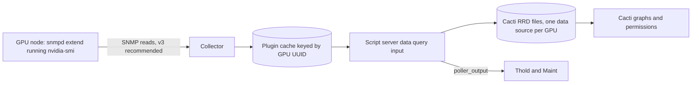

# plugin_gpu

A Cacti 1.2 plugin that brings per-GPU utilization, memory, temperature, power, ECC errors, XID errors, and throttling reasons from NVIDIA and AMD tools into Cacti. Each GPU becomes an index of a data query on its node's device, so GPU graphs sit next to the node's other graphs under Cacti's permissions, and Thold and Maint can alert on and suppress them.

> **Status: in development, no release yet.** Milestones 2 (foundation) and 3 (NVIDIA collection and Cacti objects) are merged on `main`. The plugin reads `nvidia-smi` on each GPU node through the node's SNMP agent, keeps GPU identity records, and creates one data query index, one data source, and eight graphs per GPU. It has been run only against a real `snmpd` with a fake `nvidia-smi` printing synthetic output, never on GPU hardware. Alerting, the health page, and the phase 1 release are milestone 4. Milestone 1 research is written up from documentation and source; checks that need GPU hardware are still open. Do not run it in production.

## Why

GPU nodes are usually already in Cacti for CPU, memory, and interfaces. GPU health is a separate question that the node's SNMP data does not answer: a card can be thermally throttled, accumulate ECC errors, or report an XID fault while the node itself looks healthy. Vendor tools report it (`nvidia-smi`, DCGM, `amd-smi`), but their output lives outside Cacti's graphs, permissions, and alerting.

The plugin closes that gap by turning vendor tool output into Cacti data sources, keyed by each GPU's identity rather than its position, so a reboot that reorders GPUs does not attach one card's history to another. It reuses Cacti's graphing, permissions, remote data collectors, Thold, and Maint rather than building parallel versions of them.

## Planned scope

| Phase | Scope | Milestones |
|---|---|---|
| 0, research | Vendor tool output, XID and throttle signals, GPU identity, privileges, collection path decision | [M1](https://github.com/somethingwithproof/plugin_gpu/milestone/1) |
| 1, nvidia | `nvidia-smi` collection, inventory by UUID, graphs, throttle, ECC and XID signals, Thold and Maint, health page | [M2](https://github.com/somethingwithproof/plugin_gpu/milestone/2), [M3](https://github.com/somethingwithproof/plugin_gpu/milestone/3), [M4](https://github.com/somethingwithproof/plugin_gpu/milestone/4) |
| 2, backends | DCGM backend, `amd-smi` backend | [M5](https://github.com/somethingwithproof/plugin_gpu/milestone/5) |
| 3, mig and remote | MIG instances, Cacti remote data collectors | [M6](https://github.com/somethingwithproof/plugin_gpu/milestone/6) |

Out of scope: any command that changes a GPU or node (clocks, power limits, resets, MIG layout), a plugin-owned alerting engine, a custom daemon or network protocol, and scheduler or job accounting. See the plan for the research backlog.

## What milestone 3 adds

- **Collection through SNMP extend** ([ADR 0008](docs/decisions/0008-collect-through-snmp-extend.md)). The node's administrator adds two fixed `extend` lines to `snmpd.conf` ([docs/node-setup.md](docs/node-setup.md)); the plugin reads NET-SNMP-EXTEND-MIB through Cacti's SNMP functions with the device's own credentials, SNMPv3 recommended. It runs nothing on the Cacti server or the node.
- **Strict parsing.** Fields are read by position, each line names its GPU by UUID, and a nonzero exit status, a timeout, truncated output, a line with the wrong field count, or merged error text fails the whole collection: values become `U`, no GPU is marked absent, and GPU Nodes shows why.
- **A collector after each poller cycle.** It reads each enabled node's agent, updates the identity records, and caches the latest sample. The script server input reads only that cache, so a Cacti poll never waits on a GPU node.
- **Cacti objects** ([ADR 0010](docs/decisions/0010-attach-to-existing-node-devices.md)). The templates and the *GPU - Devices* data query ship as XML and are imported on install and upgrade. Saving a node attaches the data query to its existing device with reindex method None; GPU Nodes can create a device only when the node has none. Each GPU is an index keyed by vendor and UUID, with one data source shared by its Utilization, Memory, Temperature, Power, Clocks, Throttle, ECC Errors, and Sample Age graphs. Every model field is drawn by some graph, because Cacti stores only the fields a graph uses. The plugin reindexes after every GPU change, keeps a reindex Cacti skipped while the device was Down or disabled and runs it once the device is Up, and creates graphs for new GPUs.
- **History stays with the card.** An absent GPU stays an index, so its graphs show a gap and resume in the same RRD file when it returns. A replacement card in the same slot gets its own data source. **Remove from Data Query** on the node's page takes an absent GPU out of the listing; its RRD files and graphs are kept until you delete them.
- **Device permissions on GPU Nodes.** A GPU Admin sees, changes, exports, and moves only nodes and GPUs on devices they may see in Cacti; a GPU move needs both nodes. A node whose device was deleted can only be disabled.
- **The common metric model** ([ADR 0009](docs/decisions/0009-common-metric-core-with-vendor-extensions.md), [docs/metrics.md](docs/metrics.md)). Memory is in bytes, the clock event mask is decoded into `thr_*` indicators, and `age` is the age of the GPU's own sample time, or `U` when unknown.

The installing (web server) user must be able to write `<cacti>/resource/script_server/`, where the plugin places its data query XML; install and upgrade stop with a message otherwise and retry on the next attempt. Uninstall does not yet remove the templates or the XML (#30). Nodes on remote data collectors are not collected until phase 3.

## What milestone 2 ships

- **A guarded install.** On PHP below 8.2, install and enable are refused with a message naming the required version, and the rest of Cacti keeps working. `setup.php` and the page scripts parse on PHP 8.0.
- **Lifecycle.** Install, upgrade, disable, and uninstall through Cacti's Plugins page. Upgrades are ordered, finish after an interruption, and change the recorded version only after they succeed. Uninstall keeps the plugin's tables unless you clear *Keep Plugin Tables on Uninstall*; it never touches a Cacti device, data source, graph, or RRD file.
- **Two realms.** *GPU Admin* opens **GPU Nodes**, where you register Cacti devices as GPU nodes, confirm or reject GPU moves between nodes, and export every record as JSON. *GPU View* opens **GPU Inventory**, which lists GPUs only on devices the viewer may see. Both pages are under Management, and every change is a POST checked by csrf-magic.
- **GPU identity records.** Each GPU is keyed by vendor and UUID. Index, PCI bus ID, name, driver, and the reporting tool are attributes that change in place. A new UUID in a known slot is flagged as a possible replacement and starts its own history; a GPU seen at another node moves only when an operator confirms; a GPU missing from successful collections is marked absent after a configurable count and never deleted. Only NVIDIA whole-GPU UUIDs are accepted for now; MIG instances wait on decision #13, and AMD on research #19. The rules are exercised by fixture sequences, since no collector feeds them yet.
- **Tests and CI.** Unit and source-rule suites with no GPU or database, lifecycle and page-permission checks against Cacti 1.2.31 and current 1.2.x on PHP 8.2 to 8.5, a PHP 8.1 refusal job, a PHP 8.0 lint of the entry points, PHPStan at level 9, and REUSE. The harness is provisional until #12 is decided.

### Install for evaluation

These steps install the milestone 3 code to try it. They require Cacti 1.2.31 or later on PHP 8.2 or later.

1. Copy the repository to `plugins/gpu` under your Cacti directory. The directory must be named `gpu`.
2. In Cacti, open **Configuration > Plugins**, then install and enable **GPU**.
3. Give users the *GPU View* or *GPU Admin* realm under **Configuration > Users**. The installing user gets both.
4. Set up each GPU node's SNMP agent as described in [docs/node-setup.md](docs/node-setup.md), then add the node under **Management > GPU Nodes**.
5. Optionally adjust **Configuration > Settings > GPU**: *Mark Absent After* (default 3 successful collections, from 1 to 100), *Stale After* (how old a sample may be before its values print `U`), and *Keep Plugin Tables on Uninstall* (default on).

## How metrics reach Cacti

Decision [#7](https://github.com/somethingwithproof/plugin_gpu/issues/7) chose SNMP `extend` ([ADR 0008](docs/decisions/0008-collect-through-snmp-extend.md)): the node's own agent runs a fixed `nvidia-smi` command and the plugin only reads the result. The plan compares the options under [Collection paths](docs/PLAN.md#collection-paths).

## Compatibility targets

| Component | Target |
|---|---|
| Cacti | 1.2.31 or later, no core patches |
| PHP | 8.2 or later; `setup.php` stays parseable on 8.0 so an unsupported runtime gets a refusal instead of a broken Cacti UI |
| NVIDIA | Driver and tool lines to be set by research [#26](https://github.com/somethingwithproof/plugin_gpu/issues/26); DCGM field IDs checked at v3.3.9 and v4.7.0 |
| AMD | `amd-smi` on ROCm releases to be set by research [#26](https://github.com/somethingwithproof/plugin_gpu/issues/26) |
| Thold, Maint | No changes required |

## Design

- [docs/PLAN.md](docs/PLAN.md) is the full plan: architecture, upstream facts it depends on (with sources), identity model, security boundaries, performance arithmetic, testing, and risks.
- [docs/decisions/](docs/decisions/) holds architecture decision records for choices already made.
- [docs/REQUIREMENTS.md](docs/REQUIREMENTS.md) maps every requirement ID to its issue.

## How work is tracked

- **Milestones** follow the plan's milestones. Each has an epic issue listing its sub-issues and exit evidence.
- **Issues** are typed by label: `type: requirement`, `type: research`, `type: decision`, `type: epic`. Requirement issues state numbered, testable requirements (`REQ-AREA-NNN`) and acceptance criteria.
- **Labels** also carry `area:`, `phase:`, `priority:`, and `status:`. See [CONTRIBUTING.md](CONTRIBUTING.md#labels).
- The [project board](https://github.com/users/somethingwithproof/projects/9) shows all issues across milestones.

## Contributing

Read [CONTRIBUTING.md](CONTRIBUTING.md). Commits need a DCO sign-off. Design discussion happens on issues; open decisions carry the `type: decision` label. Captured output from real GPU tools is the most useful contribution to milestone 1; strip hostnames, serial numbers, and UUIDs first.

## Security

Report vulnerabilities privately; see [SECURITY.md](SECURITY.md).

## License

GNU General Public License v2.0, the same license as Cacti and its plugins. See [LICENSE](LICENSE).
