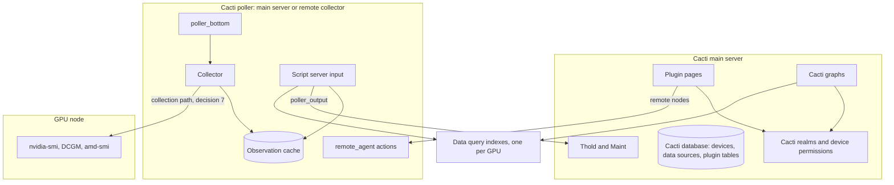

# Cacti 1.2 GPU Plugin Plan

Status: proposal, revision 2 (2026-11-15). Revision 2 folds in the milestone 1 documentation and source research in [`docs/research/`](research/); items that need hardware are marked *live* and listed in each research page's Live checks table. Nothing described here as a plugin capability exists yet. Statements about vendor tools, Cacti core, Thold, and net-snmp describe upstream behavior and cite the source that was checked, with the version or commit where one was available. Statements that could not be verified are listed as assumptions with the research issue that confirms them; they are not facts. Owner and estimates are not assigned; milestone 1 produces the estimates.

`plugin_gpu` brings per-GPU utilization, memory, temperature, power, ECC errors, XID errors, and clock throttling reasons from NVIDIA and AMD tools into Cacti 1.2. Each GPU becomes an index of a data query on its node's Cacti device, so operators see GPU graphs next to the node's other graphs, under Cacti's own permissions, and alert on them with Thold and Maint.

## Why this plugin

GPU nodes are usually already Cacti devices. Their SNMP data answers questions about CPU, memory, disks, and interfaces. It does not say whether a GPU is throttling, is accumulating ECC errors, or has reported an XID fault. Vendor tools report those, but their output sits outside Cacti:

1. **No graphs next to the node.** GPU data lives in a different tool from the node's other graphs, so a slowdown is investigated in two places.
2. **No Cacti permissions.** A separate viewer knows nothing about Cacti users, groups, or device permissions.
3. **No path into Cacti alerting.** Thold evaluates Cacti data sources and Maint suppresses Cacti devices. GPU alerts configured elsewhere are routed and suppressed separately.

The Cacti GitHub organization has no repository matching "gpu" or "nvidia" (searched 2026-11-14). That search does not cover templates or scripts shared outside the organization.

The plugin closes the gaps by turning vendor tool output into Cacti data sources keyed by GPU identity, and by exposing them through Cacti's data query mechanism. It reuses Cacti's graphing, permissions, remote data collectors, Thold, and Maint. It does not replace vendor tools, manage GPUs, or schedule work.

## Goals and non-goals

**Goals**

- Per-GPU graphs for utilization, memory, temperature, power, clocks, throttling reasons, ECC errors, and XID errors, from `nvidia-smi` first, then DCGM and `amd-smi`.
- GPU identity that survives reboots and index reordering, and never attaches one GPU's history to another.
- Alerting and maintenance through Thold and Maint, so one notification path covers SNMP and GPU data.
- Read-only operation. The plugin never changes a GPU, a node, or a vendor service.
- Distributed collection through Cacti's remote data collectors, not a new network service.
- No required Cacti core patches.

**Non-goals**

- A plugin-owned incident, escalation, or notification engine.
- Any command that changes state: clocks, power limits, persistence mode, MIG layout, GPU reset, node drain, or page retirement.
- A custom network protocol, daemon, or credential store.
- Job accounting, scheduler integration, or per-process usage (research).
- Replacing `nvidia-smi`, DCGM, or `amd-smi`.

## Release phases

Each phase ships to users. Later phases are re-estimated after the phase before them.

| Phase | Label | Scope | Depends on |
|---|---|---|---|
| 0 | Research | Vendor tool output, DCGM fields, XID and throttle signals, identity, privileges, collection path decision (milestone 1) | Nothing |
| 1 | Planned | `nvidia-smi` collection, inventory by UUID, data query and templates, graphs, throttle, ECC and XID signals, Thold and Maint, health page (milestones 2 to 4) | Phase 0 |
| 2 | Planned | DCGM backend, `amd-smi` backend, mapping onto the common metric model (milestone 5) | Phase 1, security review |
| 3 | Planned | MIG instances, Cacti remote data collectors (milestone 6) | Phase 2, security review |
| - | Research | NVLink and NVSwitch fabric health, per-process usage, scheduler job attribution, vGPU, other vendors | Demand after phase 1 |

## Compatibility

**Cacti.** Minimum Cacti release is 1.2.31, with no core patches. The plugin uses only APIs present in that release, each to be reconfirmed by #24:

- Plugin lifecycle and hooks: `api_plugin_register_hook()`, `api_plugin_register_realm()`, tracked plugin tables ([lib/plugins.php](https://github.com/Cacti/cacti/blob/release/1.2.31/lib/plugins.php)).
- Devices and data queries: `api_device_save()` and `api_device_dq_add()` ([lib/api_device.php](https://github.com/Cacti/cacti/blob/release/1.2.31/lib/api_device.php)), `run_data_query()` ([lib/data_query.php](https://github.com/Cacti/cacti/blob/release/1.2.31/lib/data_query.php)).
- Templates: `import_xml_data()` (`lib/import.php`).
- Background work: `exec_background()` and `register_process_start()` (`lib/poller.php`).
- Remote collectors: `call_remote_data_collector()` (`lib/functions.php`) and the `remote_agent` hook (`remote_agent.php`).

**PHP.** The plugin requires PHP 8.2 or later. The `1.2.x` branch declares `"php": ">=8.2"` and pins Composer resolution to `platform.php: 8.2.0` ([branch composer.json](https://github.com/Cacti/cacti/blob/1.2.x/composer.json), read 2026-11-14). The `release/1.2.31` tag still declares `">=8.0"` ([release composer.json](https://github.com/Cacti/cacti/blob/release/1.2.31/composer.json)). Because Cacti includes plugin files on every request, a parse error in a plugin breaks the whole Cacti UI, so:

- `setup.php`, `INFO`, and every file Cacti includes before the version check use only PHP 8.0 syntax.
- `plugin_gpu_check_config()` and `plugin_gpu_install()` refuse to proceed when `version_compare(PHP_VERSION, '8.2.0', '<')`, with a message naming the required version.
- Hook shims return early under the same condition, before the autoloader is registered, so no class file is parsed on an unsupported runtime.
- CI lints `setup.php` and the shim files under PHP 8.0.

Code loaded after the check may use PHP features through 8.2 where they make the code clearer, including `readonly` classes, enums, and DNF types. Features from PHP 8.3 and later are not used. Properties are always declared, because PHP 8.2 deprecates dynamic properties. PHPStan runs at `phpVersion` 8.2. See ADR 0006.

**Vendor tools.** The supported driver, DCGM, and ROCm lines are not chosen yet. [research/compatibility-matrix.md](research/compatibility-matrix.md) lists the vendor-supported lines (NVIDIA R580, R595, R620; ROCm 10.1.0 as the current release) and proposes a support set for the owner to confirm; fixture and pilot hardware are *live*. The DCGM field IDs the plan uses were compared at two tags: `v3.3.9` and `v4.7.0`.

**Plugin metadata.** `INFO` will declare `compat = 1.2.31`. The capability set is set in M2 and M6. For phase 3 it includes `remote_collect:1` (for `poller_output` and the script server input) and `remote_poller:1`, because `poller_bottom`, where the collector runs, is gated by `remote_poller` on a remote collector. The author, copyright holder, and contact in `INFO` and file headers are Thomas Vincent, and the homepage is this repository.

## Upstream behavior the design depends on

Facts are listed with the source and the version or commit checked, and the date a non-versioned page was read. A fact that is not here is an assumption.

### Verified

**NVIDIA tools**

| Fact | Consequence | Source |
|---|---|---|
| `nvidia-smi --query-gpu` takes a comma-separated list of properties; `--format=csv` is mandatory with it; `noheader` and `nounits` are optional; `-l` and `-lms` repeat the query at an interval. | One query per collection can return a CSV row per GPU with explicit fields. | [nvidia-smi documentation](https://docs.nvidia.com/deploy/nvidia-smi/index.html), read 2026-11-14 |
| The documented field help text includes `uuid` ("globally unique immutable alphanumeric identifier of the GPU"), `pci.bus_id` (`domain:bus:device.function`, hex), `index` ("Zero based index of the GPU. Can change at each boot."), and `serial` (printed on the board). | UUID is the identity key; index and bus ID are attributes. | [`help_query_gpu.txt` in pynvml at 20e79a8](https://github.com/gpuopenanalytics/pynvml/blob/20e79a8b585a85ed9dda4c362c8b5c010b1a295f/help_query_gpu.txt), last changed 2021-05-10, so field names and wording on current drivers are not confirmed (#14, #19) |
| The same snapshot lists `utilization.gpu`, `utilization.memory`, `memory.total`, `memory.used`, `memory.free`, `temperature.gpu`, `power.draw`, `power.limit`, `clocks.sm`, `clocks.mem`, `retired_pages.pending`, `ecc.errors.{corrected,uncorrected}.{volatile,aggregate}.total`, `mig.mode.current`. Volatile ECC counts are "since the last driver load"; aggregate counts "persist indefinitely". | Volatile ECC totals reset at driver load and must not be presented as lifetime totals. | Same file |
| The nvidia-smi documentation records that "Clock Throttle Reasons" were renamed "Clock Event Reasons", and that `clock_throttle_reasons` was added back to `--query-gpu` "to not break backwards compatibility". It marks the Idle and Application Clocks Setting reasons deprecated. | Both names may exist on one driver; the collector must handle either. Idle is not a fault. | nvidia-smi documentation, changelog and Clock Event Reasons sections, read 2026-11-14. The exact driver release and new field names are not confirmed (#17) |
| Xid messages are logged to the kernel log buffer and recorded by the distribution's logging, in the form `NVRM: Xid (0000:03:00): 14, Channel 00000001`, preceded by a line mapping the PCI address to the GPU UUID. The guide does not describe NVML or DCGM reporting of Xids. | Kernel log lines are a complete source and carry the UUID, but reading them needs log access. | [Working with Xid Errors](https://docs.nvidia.com/deploy/xid-errors/working-with-xid-errors.html), read 2026-11-14 |
| `nvidia-smi mig` is the privileged command that manages MIG; `mig -lgi` lists GPU instances. | The plugin must never call `mig` management subcommands. | nvidia-smi documentation, read 2026-11-14 |

**DCGM and dcgm-exporter**

| Fact | Consequence | Source |
|---|---|---|
| Field IDs are the same at `v3.3.9` and `v4.7.0`: GPU UUID 54, PCI bus ID 57, MIG mode 67, clock throttle or event reasons 112, GPU temperature 150, power usage 155, GPU utilization 203, XID 230, framebuffer total, free, used 250, 251, 252, volatile ECC SBE and DBE totals 310 and 311, pending page retirement 392, row remap failure 395. | Numeric IDs are a more stable contract than macro names. | `dcgmlib/dcgm_fields.h` at [v3.3.9](https://github.com/NVIDIA/DCGM/blob/v3.3.9/dcgmlib/dcgm_fields.h) and [v4.7.0](https://github.com/NVIDIA/DCGM/blob/v4.7.0/dcgmlib/dcgm_fields.h) |
| `v4.7.0` renames fields and keeps the old names as aliases: `DCGM_FI_DEV_XID_ERRORS` is now `DCGM_FI_DEV_XID_ERROR` (230), `DCGM_FI_DEV_CLOCK_THROTTLE_REASONS` aliases `DCGM_FI_DEV_CLOCKS_EVENT_REASONS` (112), `DCGM_FI_DEV_GPU_TEMP` is `DCGM_FI_DEV_GPU_TEMP_CELSIUS`. It deprecates `DCGM_FI_DEV_GPU_UTIL` (203) for `DCGM_FI_DEV_GPU_UTIL_RATIO` (1613, "GPU Utilization (0.0-1.0)") and `DCGM_FI_DEV_FB_USED` (252, MiB) for `DCGM_FI_DEV_FB_USED_BYTES` (1627). | The backend must request IDs, convert scale (ratio to percent), and know which line it is talking to. | Same file at `v4.7.0` |
| `DCGM_FI_DEV_XID_ERROR` is documented as "XID errors. The value is the specific XID error", and `dcgm-exporter` describes its metric as "Value of the last XID error encountered", a gauge. | The field is one value per GPU, not a count of events. Whether it can miss repeats or clear is unknown (#16). | `dcgm_fields.h` at `v4.7.0`; [`etc/default-counters.csv` at 4.9.0](https://github.com/NVIDIA/dcgm-exporter/blob/4.9.0/etc/default-counters.csv) |
| The clock events bitmask maps 1:1 to NVML reasons: `0x1` idle, `0x2` clocks setting, `0x4` SW power cap, `0x8` HW slowdown, `0x10` sync boost, `0x20` SW thermal, `0x40` HW thermal, `0x80` HW power brake, `0x100` display clocks. | The plugin can decode the bitmask into per-reason indicators. | `dcgm_fields.h` at `v4.7.0` (`DCGM_CLOCKS_EVENT_REASON_*`) and `v3.3.9` (`DCGM_CLOCKS_THROTTLE_REASON_*`) |
| `dcgm-exporter` 4.9.0 lists XID, throttle, and ECC counters as commented-out optional entries, and enables temperature, power, utilization ratio, framebuffer, and XID by default. Its documented defaults are listener `:9400`, collection interval 30000 ms, embedded host engine unless `-r` is set. | Freshness through `dcgm-exporter` is bounded by its collection interval. | `default-counters.csv` at 4.9.0; [dcgm-exporter command reference](https://docs.nvidia.com/datacenter/dcgm/latest/reference/command-line-reference/dcgm-exporter.html), read 2026-11-14 |
| `dcgmi dmon -e` takes field IDs and queries at a 1000 ms delay by default (minimum 1 ms; the 100 ms minimum belongs to DCGM profiling metrics); `dcgmi discovery -l` lists GPU ID, name, PCI bus ID, and UUID; `dcgmi discovery -c` shows GPU instances and compute instances. DCGM treats XIDs as a built-in policy condition and `dcgmi health` reports `DCGM_FR_XID_ERROR`. | A DCGM backend can enumerate GPUs and MIG instances; the DCGM guide does not document a CSV output. | [DCGM feature overview](https://docs.nvidia.com/datacenter/dcgm/latest/user-guide/feature-overview.html), read 2026-11-14 |
| DCGM's source is Apache 2.0. | The plugin may reference its field IDs and documentation without a license conflict; it does not link to DCGM. | [LICENSE at v4.7.0](https://github.com/NVIDIA/DCGM/blob/v4.7.0/LICENSE) |

**AMD tools**

| Fact | Consequence | Source |
|---|---|---|
| "Starting with ROCm 7.0, only critical bug fixes will be applied to ROCm-SMI", and users are directed to AMD-SMI. No removal version is stated. | `amd-smi` is the supported AMD backend; `rocm-smi` is not a target unless #18 shows a supported release requires it. | [rocm_smi_lib README at rocm-7.2.4](https://github.com/ROCm/rocm_smi_lib/blob/rocm-7.2.4/README.md) |
| `amd-smi` commands accept `--json` or `--csv`. `amd-smi list` shows BDF, UUID, KFD_ID, NODE_ID, and Partition ID per GPU. `amd-smi metric` has `--usage`, `--temperature`, `--power`, `--ecc`, `--ecc-blocks`, and `--violation` (throttle accumulators, MI300 or newer only). `amd-smi partition` shows compute and memory partitions. | Machine-readable output exists; throttle data is generation-limited. | [AMD SMI CLI documentation](https://rocm.docs.amd.com/projects/amdsmi/en/latest/how-to/amdsmi-cli-tool.html), read 2026-11-14 (the `latest` page is not version-pinned; #18 pins versions) |

**net-snmp**

| Fact | Consequence | Source |
|---|---|---|
| `extend [MIBOID] NAME PROG ARGS` runs a program and exposes it through MIB tables indexed by NAME. `nsExtendOutput1Table` holds exit status, first line, and full output as one string; `nsExtendOutput2Table` holds the output as separate lines. Results are cached per entry. The page does not say which user the program runs as. | SNMP `extend` is a viable transport for option B, but the run-as user, cache time, and index stability need evidence (#22). | [snmpd.conf manual](https://www.net-snmp.org/docs/man/snmpd.conf.html), read 2026-11-14 |

**Cacti core 1.2.31** (tag `release/1.2.31`)

| Fact | Consequence | Source |
|---|---|---|
| A data query's `xml_path` is resolved and rejected unless it is within `<base_path>/resource` (`cacti_path_is_within()`); a rejected path logs a SECURITY message and returns an empty array. | The data query XML must be copied under `resource/` at install. It is the plugin's only write outside its own directory. | `lib/data_query.php` around lines 605 to 620; `lib/functions.php:8058` |
| When an index leaves a reindex, its data source is marked `orphan = 1`. Removal happens only when the query XML sets `index_orphan_removal` to `true`. | Absent GPUs must stay in the index listing to keep their history attached, and the XML must not set `index_orphan_removal`. | `lib/data_query.php` lines 294 to 321 and 407 to 459 |
| `DATA_QUERY_AUTOINDEX_NONE` is 0. | Reindexing can be driven by the plugin instead of Cacti's schedule. | `include/global_constants.php:75` |
| Script server refuses functions whose source file is outside `base_path`, and refuses PHP internals; a failure prints `U`. | The script server function is defined in a plugin file. | `script_server.php` lines 318 to 330 |
| `call_remote_data_collector()` is defined at `lib/functions.php:6380`, and `remote_agent.php` dispatches unknown actions through `api_plugin_hook_function('remote_agent', ...)` and authorizes callers by address. | Phase 3 can use Cacti's own mechanism. Authorization is address-based, not cryptographic. | `lib/functions.php`; `remote_agent.php:107` and nearby |
| The connection mode is set to `recovery` while `poller_output_boost` still holds rows to replay, and to `offline` when the main database is unreachable. | Remote CLI jobs must work in both modes. | `include/global.php` lines 320 to 355 |

**Thold**

| Fact | Consequence | Source |
|---|---|---|
| Thold registers the `poller_output` hook (`thold_poller_output`). | Only polled data sources reach Thold. | [plugin_thold `setup.php` on `develop`, commit dc76952](https://github.com/Cacti/plugin_thold/blob/dc76952ee52e8b4877b2d5b830caab1f7c43dde9/setup.php) |

### Assumptions to confirm

These are used by the design, were not verified, and are not stated as fact anywhere else in this repository.

| Assumption | Where the design uses it | Research |
|---|---|---|
| Exact `--query-gpu` names for event reasons (`clocks_event_reasons.*`) and their availability per driver line. | Throttle indicators | #17 |
| `nvidia-smi` prints a documented placeholder for unavailable values, and `nounits` drops every unit; the memory unit. | Unknown handling | #14 |
| `nvidia-smi` and `dcgmi` run as an unprivileged user for every field the plugin uses. | Security, collection path | #21 |
| What `DCGM_FI_DEV_XID_ERROR` reports after repeated or different XIDs, and whether it clears. | XID signal | #16, #8 |
| Labels `dcgm-exporter` attaches to its metrics, including UUID and MIG labels. | dcgm-exporter transport | #15, #23 |
| UUID, serial, and bus ID behavior across reboot, driver upgrade, card swap, passthrough, and RMA, for NVIDIA and for AMD. | Identity | #19 |
| MIG instance identifiers across reboot and reconfiguration. | MIG | #20 |
| The user `snmpd` runs `extend` commands as, and index stability of the extend tables. | Collection path B | #22 |
| Cost of a collection per tool and GPU count. | Interval, performance | #25 |
| `amd-smi` field names, units, UUID stability, and whether supported ROCm releases need `rocm-smi`. | AMD backend | #18 |
| The Cacti core rows above hold on current `1.2.x`. | Everything | Confirmed by source at `1.2.x` e2d5c25 and `release/1.2.31` 1e8eaca ([research/cacti-core.md](research/cacti-core.md)); behavior not run |

### Research status (revision 2)

Each assumption above was researched from documentation and source on 2026-11-15. Nothing was run on hardware; *live* means the answer needs a GPU node, an account, or a running service.

| Assumption | Outcome | Page |
|---|---|---|
| Event reason query names | Old names confirmed in a 2021 snapshot; new `clocks_event_reasons.*` names and per-driver availability *live*; bit table settled | [clock-event-reasons](research/clock-event-reasons.md) |
| Placeholder and units | Manual says `N/A`; snapshot shows `[Not Supported]`; units *live* | [nvidia-smi-fields](research/nvidia-smi-fields.md) |
| Unprivileged tools | Documentation shows device files default to mode 0666 and no root requirement for the plan's queries; actual runs *live* | [privileges](research/privileges.md) |
| `DCGM_FI_DEV_XID_ERROR` behavior | DCGM appends one sample per event; a latest-value read cannot count; clearing *live* | [xid](research/xid.md) |
| Exporter labels | Label set read from source; rendered output *live* | [dcgm](research/dcgm.md), [dcgm-exporter](research/dcgm-exporter.md) |
| Identity across changes | NVML documents UUID as immutable and index as unstable; passthrough, RMA, and AMD *live* | [identity](research/identity.md) |
| MIG identifiers | UUID is immutable per instance lifetime; reuse rule *live* | [mig](research/mig.md) |
| `extend` run-as and index stability | Run-as is `snmpd`'s user (source); slow-command effect *live*; UUID cannot be the SNMP index | [snmp-extend](research/snmp-extend.md) |
| Collection cost | Cost structure and invocation arithmetic only; all timings *live* | [tool-cost](research/tool-cost.md) |
| AMD fields and `rocm-smi` | Keys read from CLI source at ROCm 7.2.4; no `rocm-smi` target; real output *live* | [amd-smi](research/amd-smi.md) |
| Cacti core rows | Confirmed by source, with corrections applied in this revision | [cacti-core](research/cacti-core.md) |

Evidence for decision #7 is collected in [research/collection-path.md](research/collection-path.md); it records no outcome. Estimates are in [research/estimates.md](research/estimates.md).

## Collection paths

Vendor tools run on the GPU node. The Cacti poller that reads the data is a process on the main server or on a remote collector. The decision about how the data gets from one to the other is open (#7) because each path moves the trust boundary:

| Path | How it works | Strengths | Costs |
|---|---|---|---|
| A. Cacti poller on the node | The plugin runs the vendor tool on a host that is a Cacti main server or remote data collector. | No network credential; no new protocol. | Every GPU node needs a full Cacti collector. |
| B. SNMP `extend` | `snmpd` on the node runs a fixed command; Cacti reads the output tables. | Nothing to install beyond `snmpd` configuration; Cacti already polls SNMP. | Output tables are indexed by line, so the UUID must be in the output; run-as user and timing unverified (#22). `snmpd` becomes a command runner. |
| C. Scrape `dcgm-exporter` | Plugin makes an HTTP request to an operator-configured URL. | Reuses an NVIDIA-supported exporter. | NVIDIA only; needs DCGM; outbound request boundary; freshness bounded by the exporter's interval. |
| D. SSH from the poller | The poller logs in and runs the tool. | Works anywhere SSH works. | A credential store and a remote command path. Not proposed. |

Whatever the decision, the same rules apply: no operator input reaches a command line, the plugin never uses elevated privilege, and the script server input reads only the plugin's cache (ADR 0007). The collector sits behind an interface so the nvidia-smi, DCGM, and amd-smi backends and the transports are independent choices. The architecture below draws the interface and not a chosen path.

## Architecture

| Component | Responsibility | Interfaces | Failure behavior |
|---|---|---|---|
| Plugin pages | Node mapping, GPU inventory, health | Cacti page framework, csrf-magic, realms | Show cached data with its age; never contact a node |
| Collector | Run a backend per node, normalize rows, update cache and health | `poller_bottom`, `exec_background()`, `register_process_start()`, filtered by `poller_id` | One instance per poller; time budget; skip and count a node it cannot finish |
| Backend (nvidia-smi, DCGM, amd-smi) | Build the fixed command, parse output by field position | Collector interface | Error state with unknown values; never zeros |
| Script server input | Return index listing and per-GPU values from the cache | Cacti script server | `U` when stale, absent, or failed; `age` always numeric |
| `remote_agent` actions (phase 3) | Inventory and health from a remote collector | `remote_agent` hook, `call_remote_data_collector()` | Collector unreachable shows as stale, never healthy |

## GPU identity

Cacti keeps history by data query index. An index that changes meaning attaches one GPU's history to another. The plan therefore never uses position as identity (ADR 0003).

| Identifier | Property | Use |
|---|---|---|
| UUID | Documented as globally unique and immutable (NVIDIA). AMD UUID stability is unconfirmed (#19). | Identity key and data query index |
| Index | "Can change at each boot" (NVIDIA help text snapshot) | Attribute, shown in titles |
| PCI bus ID | Identifies a slot; a replacement card in the slot shares it | Attribute, used to flag possible replacements |
| Serial | Printed on the board; not available on every product | Not stored in phase 1 |

Rules, tested by fixtures (REQ-ID-001 to 006):

- A new UUID at a known node, index, and bus ID creates a new GPU record flagged as a possible replacement. It never inherits history.
- A UUID seen at a different node is recorded as moved only when an operator confirms.
- A GPU missing from collection is marked absent after N consecutive successful collections, never deleted automatically, and keeps its index, data sources, and RRD files.
- A failed collection, a tool error, or an empty result never marks GPUs absent.

## Cacti objects

| Object | Created from | Notes |
|---|---|---|
| Device | The node's existing Cacti device, mapped by an operator | Decision #10; a device is created only on request |
| Data query | "GPU" script server data query, one index per GPU, keyed by identity key | The XML lives under `<path_cacti>/resource` |
| Data source and graphs | Graph templates per GPU | Created by Cacti's data query path from the templates |
| Data source for staleness | A field of the same data query (`age`) | Always numeric |

Templates ship as Cacti template XML and are imported with `import_xml_data()`, matched by hash so re-imports update rather than duplicate, under a lock so two upgrades cannot import together. The data query uses reindex method None; the plugin runs a forced reindex after each inventory change so titles refresh. `api_device_update_host_template()` (called from `api_device_save()` when a template is applied) runs `REPLACE INTO host_snmp_query` with the global default reindex method for data queries that have no cache rows yet, so the plugin sets None again afterward; `api_device_save()` itself only forces method 0 for devices with SNMP version 0. Confirmed by source at `release/1.2.31` and `1.2.x`; running it is *live* ([research/cacti-core.md](research/cacti-core.md)). A data query XML may instead set `index_transient`, which stops removed indexes being marked orphan; M3 chooses between that and keeping absent GPUs in the listing.

When the device is Down or disabled, `run_data_query()` returns `true` without reindexing, even for a forced reindex, and method None schedules no later one. The plugin records each skipped reindex and runs it again once the device is Up and enabled, then checks that the expected indexes are present.

Poller items are one per data query field per GPU. At 8,000 GPUs and 12 fields that is 96,000 poller items per collection cycle, which is why the script server input only reads a cache (#25, #49).

**One data source per GPU.** All graphs for a GPU map to the same data source, so each GPU has one RRD file and a metric appears in whichever graph is useful without being polled twice.

## Metric model

One set of fields describes every GPU, so a single set of templates and Thold templates covers both vendors (decision #9). The fields below are proposed and #14, #15, and #18 confirm each source.

| Field | Unit | NVIDIA source | DCGM source | AMD source |
|---|---|---|---|---|
| `util_gpu` | percent | `utilization.gpu` | field 1613 (ratio, multiplied by 100; first in DCGM v4.6.0) or 203 (percent; deprecated at v4.7.0) | `amd-smi metric --usage` (#18) |
| `util_mem` | percent | `utilization.memory` | #15 | #18 |
| `mem_used`, `mem_total` | one unit, chosen in #14 | `memory.used`, `memory.total` | 252 and 250 (MiB, deprecated) or 1627 and 1625 (used and capacity in bytes; 1627 first in DCGM v4.7.0) | #18 |
| `temp_gpu` | degrees C | `temperature.gpu` | 150 | `--temperature` |
| `power`, `power_limit` | watts | `power.draw`, `power.limit` | 155 and 160 | `--power` |
| `clock_sm`, `clock_mem` | MHz | `clocks.sm`, `clocks.mem` | #15 | #18 |
| `throttle_*` | 0 or 1 per reason | decoded from the event reasons bitmask | decoded from field 112 | accumulators, MI300 or newer (#18) |
| `ecc_corr`, `ecc_uncorr` | count since driver load | `ecc.errors.*.volatile.total` | 310 and 311 | `--ecc` |
| `retired_pending` | 0 or 1 | `retired_pages.pending` | 392 | #18 |
| `xid_last` | XID number | per #8 | field 230 | not applicable |
| `age` | seconds | computed | computed | computed |

Rules:

- A missing, unsupported, or stale value is `U`, never 0.
- Utilization is percent 0 to 100 whatever the source scale. DCGM declares its ratio field as 0.0 to 1.0.
- ECC and retired-page values are gauges of the reported total. Volatile totals reset at driver load, and the documentation says so.
- A backend does not estimate a field it cannot supply.

### Throttle reasons

The active reasons are a bitmask. The plugin decodes it into one indicator per reason, so Thold can alert on the reasons that indicate a fault. Software power cap, software thermal, hardware thermal, and hardware power brake each get an indicator. Hardware slowdown (0x8) keeps an indicator for now: the manual says it is active when either hardware thermal or hardware power brake is active, but the NVML header also lists Fast Trigger power protection and PState or clock changes as causes, and says the behavior may be removed. Whether 0x8 occurs without 0x40 or 0x80 is *live*. NVML 13.4.92 defines eleven bits (0x1 to 0x400), including Board Limit (0x200) and Reliability (0x400), which DCGM `v4.7.0` does not name, so the raw mask must keep bits the decoder does not know. Indicator names must fit Cacti's 19-character data source item limit ([research/clock-event-reasons.md](research/clock-event-reasons.md)). Idle is normal behavior and the nvidia-smi documentation marks Idle and Application Clocks Setting deprecated, so no default threshold uses them. The raw mask is stored so unrecognized bits are not lost. Which reasons are actionable is refined by #17.

### XID and ECC signals

ECC and retired-page values are numbers the GPU reports. XID is different: the kernel log carries each event, and DCGM carries one number per GPU described as the last XID. The plugin therefore does not present the XID field as an error count. DCGM source shows each XID event is appended as a sample, so only a reader that asks for samples since a cursor can count repeats; a latest-value read cannot ([research/xid.md](research/xid.md)). Decision #8 picks the source; clearing behavior and kernel log access are *live*. If a kernel log reader is chosen, it is read-only, limited to lines matching the XID pattern, and bounded in size and age. No error value triggers a reset, drain, or retirement action.

## Measurement state

| Dimension | States | Evidence |
|---|---|---|
| Freshness | Current, delayed, stale, never observed | Observation time against the expected interval |
| Execution | Completed, tool error, permission denied, timed out, unknown | Exit status, timeout, and output validation |
| GPU presence | Present, absent, possible replacement | Inventory records |
| Maintenance | In maintenance, not in maintenance | Maint's `plugin_maint_check_cacti_host()` for the node's device (guarded call; the `is_device_in_maintenance` hook has no caller in core) |

Each cached observation carries observation time, ingestion time, expected interval, backend, and tool version. A recent page refresh never counts as a recent measurement.

## Alerting and maintenance

Thold thresholds work on fields of the data query: temperature, power against limit, throttle indicators, ECC, retired pending, last XID, and `age`. Maint suppression applies to the node's device. Neither plugin changes (ADR 0002).

Stated limits:

- **Sampling.** A fault shorter than the collection interval is not seen. The supported minimum interval comes from #25.
- **Alignment.** Cacti's poll interval and the collection interval are independent, so a value can be reported twice or skipped. Thold durations should be at least one collection interval.
- **Unknown values.** `U` never breaches a threshold; `age` is how a stopped collector alerts.
- **Counters.** Volatile ECC totals reset at driver load, so a threshold on the total can clear after a reboot without the cause being resolved.

Alternatives considered:

| Option | Why not chosen |
|---|---|
| Plugin-owned alert engine | Duplicates Thold and Maint and adds a third notification path |
| Forwarding vendor alerts | No common vendor alert interface, and Maint is bypassed |

## MIG instances

A MIG-enabled GPU exposes GPU instances and compute instances that can be created and destroyed at runtime. DCGM names them as entity groups (GPU instance and compute instance), and `dcgmi discovery -c` shows the hierarchy. The identifiers, their reuse after reconfiguration, and the metrics available per instance are not verified (#20). Decision #13 chooses between instances as indexes alongside their GPU, a separate data query, or parent-only monitoring. Whatever it chooses, a destroyed instance keeps its history, and a new instance does not inherit it.

## Remote collectors

When GPU nodes are in other sites, a Cacti remote data collector near them runs the collector and script server input, following the pattern other collector-aware plugins use.

- Plugin configuration tables replicate to remote collectors through the `replicate_out` hook.
- The collector on each poller handles only nodes whose `poller_id` matches.
- The collector writes the observation cache to the collector's local database, where the script server input reads it. Values reach the main server through the normal poller output path, which handles offline and recovery modes.
- The main server fetches inventory and health on demand through `remote_agent` actions that take no command, path, or URL.

`remote_agent` authorizes callers by address, not cryptographically. The documentation requires https between pollers and a restricted network. A GPU node is not itself a Cacti collector; the UI keeps the terms separate. See ADR 0005.

## Code structure

Plugin code is object-oriented wherever Cacti's plugin contract allows it. Cacti calls plugins by function name, so these entry points stay procedural, each a thin shim, parseable on PHP 8.0, that checks the PHP version, validates input, and hands off to a class:

- `setup.php` lifecycle functions: `plugin_gpu_install()`, `plugin_gpu_uninstall()`, `plugin_gpu_version()`, `plugin_gpu_check_config()`, `plugin_gpu_upgrade()`.
- Hook callbacks such as `config_arrays`, `config_settings`, `draw_navigation_text`, `poller_bottom`, `api_device_save`, `device_remove`, and later `replicate_out` and `remote_agent`.
- Page scripts, which include Cacti's authentication, read request variables with Cacti's validating accessors, and call a page class.
- The script server input function and the collector CLI entry point.

**Layout.**

- Classes live in `lib/*.php` under the `Cacti\Gpu` namespace, one class per file, loaded by a small `spl_autoload_register()` loader registered only after the PHP version check. No Composer runtime dependency. Files stay at depth 2 or less because the gettext build and the POT check scan with `find . -maxdepth 2`.
- Settings use the `config_settings` hook. Logging uses `cacti_log()` with a `GPU` tag. Forms rely on csrf-magic.
- Strings use the `gpu` text domain with a `locales/` directory and a POT file.
- Realms: "GPU View" and "GPU Admin", each a list of page files.

**Planned classes.** Names are illustrative; milestone 2 settles the set.

| Kind | Examples | Notes |
|---|---|---|
| Value objects | `Node`, `Gpu`, `GpuIdentity`, `Observation` | `readonly` classes built by named constructors |
| Enums | `Freshness`, `ExecutionState`, `Presence`, `Vendor` | String-backed; stored as `varchar` |
| Repositories | `NodeRepository`, `GpuRepository`, `ObservationRepository` | Only classes that issue SQL, always prepared, with an explicit connection |
| Backends | `NvidiaSmiBackend`, `DcgmBackend`, `AmdSmiBackend` | Behind one interface; tested against captured output fixtures |
| Process | `CommandRunner` | Fixed argument vectors, timeout, output cap, no shell |
| Services | `InventoryService`, `FreshnessEvaluator`, `ThrottleDecoder` | Return decisions as objects; a runner applies side effects |
| Infrastructure | `Clock` with system and fixed implementations | Injected wherever time matters |

## Storage, jobs, upgrades, and recovery

Plugin tables hold node mappings, GPU records, the observation cache, and health. They are created and upgraded with Cacti's tracked plugin table API, and the stored plugin version changes only after a migration succeeds. The collector runs from `poller_bottom` through `exec_background()` as one `register_process_start()` process per poller, with a time budget. Runs are idempotent.

Disabling the plugin stops jobs and leaves devices, graphs, and RRD files untouched. Uninstalling offers an export, then asks separately whether to drop plugin tables and whether to remove plugin-created Cacti objects. The plugin never changes anything on a GPU node. Backup documentation covers the Cacti database and the RRD directory. A restore must not attach an RRD file to a different UUID, which is a release test.

## Performance

Capacity is stated in GPUs. Fixtures cover 100, 1,000, and 8,000 GPUs on documented hardware.

Arithmetic for 1,000 nodes of 8 GPUs with 12 data query fields:

- 8,000 data query indexes and 8,000 RRD files.
- 96,000 poller items per cycle, because each field of each GPU is one poller item (a sibling plugin's smoke test checks 18 poller items for 3 indexes of 6 fields; #24 confirms the rule at 1.2.31).
- 1,000 vendor tool invocations per collection interval if each node is collected once, whatever the polling cost.

Engineering targets, to be measured, not yet demonstrated:

- The script server input completes in under 50 ms per call against a 10,000-row cache.
- No page request runs a tool or contacts a node.
- A collector round for the nodes of one poller fits its time budget; nodes it cannot finish are skipped and counted.
- Cacti's device, data source, and graph pages stay within normal response time at the documented object count.

The supported minimum interval is not stated until #25 measures tool cost.

## Security

| Boundary | Control |
|---|---|
| Browser to Cacti | Cacti session, csrf-magic, plugin realms, device and graph permissions, prepared queries, contextual escaping |
| Cacti to GPU node | Fixed argument vectors with no shell; administrator-set tool allowlist; no operator, node, or GPU value in an argument; no `sudo`, setuid helper, or root; timeout, output cap, and minimal environment; read-only subcommands only (ADR 0007) |
| GPU node to Cacti | Tool output is untrusted data: parsed by field position, validated, and rejected on a short row, extra field, or nonzero exit status. GPU names and driver strings are escaped on output |
| Kernel log (if #8 selects it) | Read-only, limited to XID-pattern lines, bounded in size and age; the access it needs is the least privilege found by #21 |
| SNMP `extend` (if #7 selects it) | The command is fixed by the node's administrator; the plugin sends no input; run-as user from #22 |
| `dcgm-exporter` scrape (if #7 selects it) | Allowed host list, no redirects, size and time limits, https where the operator enables it, no credentials in logs |
| Main server to remote collector (phase 3) | Cacti's `remote_agent` authorization and the configured https scheme; actions are read-only and take no command, path, or URL |
| Fixtures and logs | No real hostnames, serial numbers, or UUIDs in fixtures, logs at default level, or error messages shown to unauthorized users |

No credential is stored by the proposed paths. If a chosen path later needs one (an SNMP community or an exporter token), it follows Cacti's credential handling and never appears in logs, fixtures, or documentation examples.

Phase 2 needs a security review of the DCGM and amd-smi invocation paths and any outbound request. Phase 3 needs a review of the `remote_agent` actions. If the kernel log reader is built, it needs its own review.

## Testing

- **Fixtures.** Captured output from real tools, recording tool, version, driver, GPU model, and date, for normal operation, unavailable fields, a GPU without ECC, a lost GPU, truncated and empty output, a nonzero exit status, and a reboot that reorders indexes. Fixtures contain no real hostnames, serials, or UUIDs. CI needs no GPU.
- **Hostile input.** GPU, node, and driver strings containing shell metacharacters, commas, and control characters reach no command line and are escaped on output.
- **Identity.** Reboot reorder, card swap, slot move, driver change, and restore from a database older than the RRD directory never attach history to another UUID.
- **Lifecycle.** A removed GPU keeps its index, graphs, and RRD file and prints `U`; re-adding it continues the same history.
- **Matrix.** Cacti 1.2.31 and current `1.2.x` on every PHP minor in the CI matrix; entry points are also linted under PHP 8.0.
- **Permissions.** Every page, graph, and data source as an administrator, a scoped user, a user whose access was just revoked, and a user without access.
- **Alerting.** Thold fires and recovers on fixture throttle, ECC, and staleness; Maint suppresses it.
- **Remote.** Collector offline, recovery mode, replication after reconnect.
- **Failure scenarios before each phase release:** tool missing, timeout, permission denied, driver unloaded, GPU lost mid-collection, node unreachable, clock skew, full disk, interrupted collector, duplicate collector start, interrupted upgrade.
- **Harness.** Use the harness maintained Cacti plugins use, and confirm with maintainers before adding test or CI infrastructure (#12).

## Milestones

| Milestone | Phase | Deliverables | Exit evidence |
|---|---|---|---|
| 1. Research and collection path | 0 | Tool output tables, DCGM field table, XID and throttle findings, identity and MIG findings, privilege table, transport measurements, driver matrix, estimates | Every assumption confirmed or corrected; #7 decided |
| 2. Foundation | 1 | PHP guard, lifecycle, realms, class layout, node and GPU identity records, test harness, upstream proposal | Fresh install and upgrade at 1.2.31; refusal on PHP 8.1; unauthorized access rejected |
| 3. NVIDIA collection and Cacti objects | 1 | Command runner, nvidia-smi backend, inventory, metric model, templates, indexes, script server input, graphs | Fixture GPUs appear as indexes; removed GPUs keep history |
| 4. Alerting, health, and phase 1 release | 1 | Throttle, ECC and XID signals, Thold and Maint tests, health page, permission suite, performance, docs, failure qualification, pilots | Thold fires and recovers on fixtures; pilot on real hardware |
| 5. DCGM and AMD backends | 2 | DCGM backend, amd-smi backend, AMD identity and mapping, security review | Same fixture suite passes on each backend; review complete |
| 6. MIG and remote collectors | 3 | MIG, remote collectors, offline and recovery, `remote_agent` actions, security review | MIG and remote scenarios correct; review complete |

Milestone size estimates (ranges from measured reference plugins, no durations) are in [research/estimates.md](research/estimates.md).

## Open decisions

| Decision | Options | Needed before | Decided by |
|---|---|---|---|
| Collection path (#7) | Poller on node, SNMP extend, dcgm-exporter scrape | Milestone 2 | M1 measurements |
| XID source (#8) | DCGM field, kernel log, none in phase 1 | Milestone 3 | #16 |
| Common metric model (#9) | Common core plus vendor extensions (proposed); vendor-specific templates | Milestone 3 | Cacti maintainers |
| Attach to existing devices (#10) | Existing device (proposed); plugin-owned devices | Milestone 3 | Cacti maintainers |
| Repository home and name (#11) | `Cacti/plugin_gpu` (proposed); community plugin | Before code is published | Cacti maintainers |
| Test harness (#12) | Whatever maintained plugins use | Milestone 2 | Cacti maintainers |
| MIG representation (#13) | Indexes, separate data query, parent only | Milestone 6 | #20 |

## Risks

| Risk | Effect | Mitigation |
|---|---|---|
| A field needs root to read | Unprivileged collection is incomplete | Report the field as unknown; document the limit; never add sudo |
| Vendor output format or field names change | Parser breaks or misreads | Explicit field lists, fixture per driver line, field-count validation |
| XID signal is one value per GPU | Repeats and clears are invisible | #16 measures it; #8 may choose the kernel log or defer XID |
| A card swap in the same slot | History attaches to the wrong GPU | Identity by UUID; replacement flagged, never inherited |
| Object counts slow Cacti at 8,000 GPUs | Poor experience for all users | Measure at M4; document a supported GPU count |
| Collection path needs privilege or a command runner on the node | New attack surface | Decision #7 weighs it; fixed commands and review |
| Address-based `remote_agent` authorization | A host sharing a poller's address can call actions; at `release/1.2.31` the address comes from `get_client_addr()`, which reads proxy headers only when the site sets `proxy_headers` in its configuration (then any host that can reach the endpoint can supply a header), and at `1.2.x` the check uses `REMOTE_ADDR` | https, restricted network, read-only actions; leave `proxy_headers` unset for collector endpoints, or have the trusted proxy strip and replace those headers |
| Hardware access for tests | Fixtures may not reflect all GPUs | Capture from real hardware, pilot before release |
| Volunteer capacity | Later phases stall | Each phase ships on its own |

## Research

Not scheduled; revisited after phase 1:

- NVLink and NVSwitch fabric health (#64).
- Per-process GPU usage and its privacy implications (#65).
- Job attribution from a scheduler (#66).
- vGPU and virtualized GPUs (#67).
- Other GPU vendors (#68).

## Upstream process

This repository holds the proposal and tracks its requirements as GitHub issues and milestones. Before code is proposed for the Cacti organization, open an issue there describing the problem, the phase plan, and the open decisions, and ask maintainers about the repository, name, attaching to existing devices, and the test harness (#28). No Thold or Maint change is needed.
