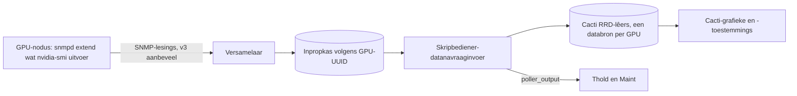

<!-- Source: README.md; SHA256: 97ba37df4a883426d3984ed7d14547ad7367e973411a8abd930409ce259f545b -->

<!-- translations:start -->
[English](../../../README.md) | [简体中文](../zh-CN/README.md) | [हिन्दी](../hi-IN/README.md) | [Español (España)](../es-ES/README.md) | [Español (Latinoamérica)](../es-419/README.md) | [العربية (السعودية)](../ar-SA/README.md) | [Afrikaans](README.md) | [አማርኛ](../am-ET/README.md) | [العربية (مصر)](../ar-EG/README.md) | [العربية (المغرب)](../ar-MA/README.md) | [বাংলা](../bn-BD/README.md) | [Bosanski](../bs-BA/README.md) | [Deutsch](../de-DE/README.md) | [فارسی](../fa-IR/README.md) | [Filipino](../fil-PH/README.md) | [Français](../fr-FR/README.md) | [Français (Maroc)](../fr-MA/README.md) | [Français (Sénégal)](../fr-SN/README.md) | [Hausa](../ha-NG/README.md) | [עברית](../he-IL/README.md) | [Hrvatski](../hr-HR/README.md) | [Bahasa Indonesia](../id-ID/README.md) | [Igbo](../ig-NG/README.md) | [Italiano](../it-IT/README.md) | [日本語](../ja-JP/README.md) | [한국어](../ko-KR/README.md) | [Malagasy](../mg-MG/README.md) | [मराठी](../mr-IN/README.md) | [Bahasa Melayu](../ms-MY/README.md) | [Nederlands](../nl-NL/README.md) | [Polski](../pl-PL/README.md) | [Português (Brasil)](../pt-BR/README.md) | [Русский](../ru-RU/README.md) | [Kinyarwanda](../rw-RW/README.md) | [Soomaali](../so-SO/README.md) | [Српски](../sr-RS/README.md) | [Svenska](../sv-SE/README.md) | [Kiswahili](../sw-KE/README.md) | [தமிழ்](../ta-IN/README.md) | [తెలుగు](../te-IN/README.md) | [ไทย](../th-TH/README.md) | [Türkçe](../tr-TR/README.md) | [Українська](../uk-UA/README.md) | [اردو](../ur-PK/README.md) | [Tiếng Việt](../vi-VN/README.md) | [isiXhosa](../xh-ZA/README.md) | [Yorùbá](../yo-NG/README.md) | [繁體中文](../zh-TW/README.md) | [isiZulu](../zu-ZA/README.md)
<!-- translations:end -->

# plugin_gpu

'n Cacti 1.2-inprop wat per-GPU-benutting, geheue, temperatuur, krag, ECC-foute en smoorredes vanaf NVIDIA-nutsgoed na Cacti bring. AMD-ondersteuning en die insameling van XID-foute word beplan, maar is nog nie geïmplementeer nie. Elke GPU word 'n indeks van 'n datanavraag op sy nodus se toestel, sodat GPU-grafieke langs die nodus se ander grafieke onder Cacti se toestemmings sit, en Thold en Maint daarop kan waarsku en dit kan onderdruk.

> **Status: in ontwikkeling, nog nie vrygestel nie.** Mylpaal 4 maak fase 1 (NVIDIA via SNMP extend) kode-voltooid: insameling, identiteit, grafieke, smoor- en ECC-seine, Thold- en Maint-waarskuwings, die gesondheidsbladsy en die operateurdokumentasie. Dit is slegs teen 'n regte `snmpd` met 'n nagemaakte `nvidia-smi` wat sintetiese uitvoer druk uitgevoer, nooit op GPU-hardeware nie. Nog oop voor 'n vrystelling: loodsprojekte op regte hardeware ([docs/pilot-plan.md](../../pilot-plan.md), #54), 'n eksterne sekuriteitsoorsig ([docs/security-review.md](../../security-review.md)), toetsdata vanaf regte nutsgoed (#14), en skaal gemeet op produksiegrootte-hardeware ([docs/performance.md](../../performance.md)). XID-foute wag op besluit #8. Moet dit nie in produksie gebruik nie.

## Toegangsrolle

| Domein | Toegang |
| --- | --- |
| GPU View | Bestaande moniteringsbladsye. |
| GPU Operator | Monitering plus die Bedrywighede-bladsy en persoonlike siftingsbevestigings. |
| GPU Admin | Operateurtoegang plus die bestaande konfigurasie- en administratiewe aksies. |

Nadat opgraderingslêers gekopieer is, maak die Plugins-bladsy as 'n administrateur oop om die nuwe domein te registreer. Ken die Operator-domein uitdruklik onder **Configuration > Users** of gebruikersgroepe toe. Opgraderings behou die bestaande View- en Admin-domein-ID's en -toekennings. Admin-toegang erf Operateurtoegang, en Operateurtoegang erf View-toegang met elke versoek; dit voeg nie gestoorde toekennings by gebruikers of groepe nie. Inpropinstellings vereis ook GPU Admin-toegang benewens Cacti se Settings-toestemming.

Cacti-toesteltoestemmings beperk steeds die rye en aksies wat vir elke gebruiker beskikbaar is; ongekarteerde objekte vereis 'n administrateur. Geloofsbriewe, konfigurasie, kartering, skrapping en ander administratiewe veranderinge bly in die administratiewe bladsye. Bevestigings duur slegs in die huidige gebruiker se sessie, vir hoogstens een uur en slegs solank dieselfde waarneming vars bly. Nuwe of veranderde waarnemings maak dit ongeldig. Dit merk nooit 'n mislukte meting as gesond nie en onderdruk nooit waarskuwings nie.

## Waarom

GPU-nodusse is gewoonlik reeds in Cacti vir SVE, geheue en koppelvlakke. GPU-gesondheid is 'n aparte vraag wat die nodus se SNMP-data nie beantwoord nie: 'n kaart kan termies gesmoor wees, ECC-foute opgaar, of 'n XID-fout rapporteer terwyl die nodus self gesond lyk. Vervaardigernutsgoed rapporteer dit (`nvidia-smi`, DCGM, `amd-smi`), maar hul uitvoer leef buite Cacti se grafieke, toestemmings en waarskuwings.

Die inprop oorbrug daardie gaping deur vervaardigernutsmiddel-uitvoer in Cacti-databronne om te skakel, gekoppel aan elke GPU se identiteit eerder as sy posisie, sodat 'n herlaai wat GPU's herrangskik nie een kaart se geskiedenis aan 'n ander heg nie. Dit hergebruik Cacti se grafieke, toestemmings, afgeleë dataversamelaars, Thold en Maint eerder as om parallelle weergawes daarvan te bou.

## Beplande omvang

| Fase | Omvang | Mylpale |
|---|---|---|
| 0, navorsing | Vervaardigernutsmiddel-uitvoer, XID- en smoorseine, GPU-identiteit, voorregte, insamelingspadbesluit | [M1](https://github.com/somethingwithproof/plugin_gpu/milestone/1) |
| 1, nvidia | `nvidia-smi`-insameling, inventaris volgens UUID, grafieke, smoor-, ECC- en XID-seine, Thold en Maint, gesondheidsbladsy | [M2](https://github.com/somethingwithproof/plugin_gpu/milestone/2), [M3](https://github.com/somethingwithproof/plugin_gpu/milestone/3), [M4](https://github.com/somethingwithproof/plugin_gpu/milestone/4) |
| 2, agterkante | DCGM-agterkant, `amd-smi`-agterkant | [M5](https://github.com/somethingwithproof/plugin_gpu/milestone/5) |
| 3, mig en afgeleë | MIG-instansies, Cacti se afgeleë dataversamelaars | [M6](https://github.com/somethingwithproof/plugin_gpu/milestone/6) |

Buite omvang: enige opdrag wat 'n GPU of nodus verander (klokspoed, kraglimiete, herstellings, MIG-uitleg), 'n inprop-beheerde waarskuwingsenjin, 'n pasgemaakte bedienerproses of netwerkprotokol, en skeduleerder- of taakboekhouding. Sien die plan vir die navorsingsagterstand.

## Wat mylpaal 4 byvoeg

- **Smoorredes as waarskuwingswaardes.** Die klokgebeurtenismasker word gedekodeer in een 0- of 1-aanwyser per rede; 'n onbekende masker gee onbekende aanwysers, nooit nulle nie, en bisse sonder 'n aanwyser bly in die rou masker, wat GPU Health wys.
- **ECC as waarskuwingswaardes** ([docs/metrics.md](../../metrics.md)). Nuwe gekorrigeerde en ongekorrigeerde foute sedert die vorige monster word deur die inprop uit twee opeenvolgende totale bereken en as meters gestoor: onbekend vir 'n eerste monster, 'n gemiste lesing of 'n drywerherlaai, sodat 'n herstel nooit as nul of as 'n negatiewe telling lees nie. Afgetrede enkelbis- en dubbelbisbladsytellings en die ECC-modus word ook gelees. Twee addisionele ECC-grafieke per GPU laat Cacti dit stoor; saam met Kragpersentasie is daar elf grafieke in totaal. XID word nie ingesamel nie: geen bron pas by die vaste `nvidia-smi`-opdragte nie (#8).
- **Thold en Maint** ([docs/alerting.md](../../alerting.md)). Meegeleverde Thold-sjablone vir temperatuur, krag teenoor sy limiet, die smooraanwysers, nuwe ongekorrigeerde ECC-foute, hangende bladsy-aftrede en monsterouderdom. Elke waarde is 'n meter, omdat Thold 1.8.2 op 'n onbekende teller misluk. 'n End-tot-end-toets met onveranderde Thold 1.8.2 en Maint 1.3 wys hoe elke drempelwaarde afgaan en herstel, oor 'n ECC-herstel heen, en hoe Maint dit onderdruk.
- **GPU Health** (GPU View). Per nodus: varsheid, hoe die laaste insameling geëindig het, Maint-toestand, agterkant, nutsmiddel- en drywerweergawes, en GPU-tellings; per GPU: teenwoordigheid, monsterouderdom, ECC-toestand en die rou masker. Dit lees slegs gestoorde rekords.
- **Toestemmings.** Die toestemmingstoetsstel dek elke bladsylêer en aksie, herroeping met die volgende versoek, en weierings wat niks openbaar nie.
- **Mislukkings- en herstelkwalifikasie.** Geskripeerde end-tot-end-lopies breek die agent, die geloofsbriewe, die nutsmiddel, sy uitvoer, die databasisverbinding en RRD-skrywings, en herstel die databasis vanaf 'n rugsteunlêer, insluitend een ouer as die RRD-lêers; 'n nuwe GPU erf nooit 'n ander een se RRD-lêer nie ([docs/backup.md](../../backup.md)).
- **Skaal** ([docs/performance.md](../../performance.md)). 'n Skaaltoets neem die tyd van insameling, die skripbedienerinvoer, Cacti-objekskepping, 'n peilersiklus en die gesondheidsbladsy teen 'n gegewe GPU-telling; CI voer dit by 100 GPU's uit. Die 1 000- en 8 000-GPU-metings is nog nie aangeteken nie, dus word geen ondersteunde GPU-telling vermeld nie.
- **Operateurdokumentasie** ([docs/operations.md](../../operations.md)): installasie, opgradering, deïnstallasie, minste voorregte, onbeskikbare waardes en foutsporing. Veranderinge word in [CHANGELOG.md](../../../CHANGELOG.md) gelys.

## Wat mylpaal 3 byvoeg

- **Insameling deur SNMP extend** ([ADR 0008](../../decisions/0008-collect-through-snmp-extend.md)). Die nodus se administrateur voeg twee vaste `extend`-lyne by `snmpd.conf` ([docs/node-setup.md](../../node-setup.md)); die inprop lees NET-SNMP-EXTEND-MIB deur Cacti se SNMP-funksies met die toestel se eie geloofsbriewe, met SNMPv3 aanbeveel. Dit voer niks op die Cacti-bediener of die nodus uit nie.
- **Streng ontleding.** Velde word volgens posisie gelees, elke lyn benoem sy GPU volgens UUID, en 'n nie-nul uitgangstatus, 'n tydverstreking, afgeknotte uitvoer, 'n lyn met die verkeerde veldtelling of saamgevoegde foutteks laat die hele insameling misluk: waardes word `U`, geen GPU word as afwesig gemerk nie, en GPU Nodes wys waarom.
- **'n Versamelaar ná elke peilersiklus.** Dit lees elke geaktiveerde nodus se agent, werk die identiteitsrekords by en kas die nuutste monster. Die skripbedienerinvoer lees slegs daardie kas, sodat 'n Cacti-peiling nooit op 'n GPU-nodus wag nie.
- **Cacti-objekte** ([ADR 0010](../../decisions/0010-attach-to-existing-node-devices.md)). Die sjablone en die *GPU - Devices*-datanavraag word as XML saamgestel en tydens installasie en opgradering ingevoer. Om 'n nodus te stoor, heg die datanavraag aan sy bestaande toestel met herindekseringsmetode None; GPU Nodes kan slegs 'n toestel skep wanneer die nodus geen een het nie. Elke GPU is 'n indeks wat deur vervaardiger en UUID geïdentifiseer word, met een databron wat gedeel word deur sy grafieke vir Benutting, Geheue, Temperatuur, Krag, Kragpersentasie, Klokspoed, Smoor, ECC-foute, Nuwe ECC-foute, Afgetrede Bladsye en Monsterouderdom. Elke modelveld word deur een of ander grafiek geteken, want Cacti stoor slegs die velde wat 'n grafiek gebruik. Die inprop herindekseer ná elke GPU-verandering, hou 'n herindeksering wat Cacti oorgeslaan het terwyl die toestel Af of gedeaktiveer was en voer dit uit sodra die toestel Op is, en skep grafieke vir nuwe GPU's.
- **Geskiedenis bly by die kaart.** 'n Afwesige GPU bly 'n indeks, sodat sy grafieke 'n gaping wys en in dieselfde RRD-lêer hervat wanneer dit terugkeer. 'n Vervangingskaart in dieselfde gleuf kry sy eie databron. **Remove from Data Query** op die nodus se bladsy verwyder 'n afwesige GPU uit die lys; sy RRD-lêers en grafieke word behou totdat jy dit skrap.
- **Toesteltoestemmings op GPU Nodes.** 'n GPU Admin sien, verander, voer uit en skuif slegs nodusse en GPU's op toestelle wat hulle in Cacti mag sien; 'n GPU-skuif vereis albei nodusse. 'n Nodus waarvan die toestel geskrap is, kan gedeaktiveer of geskrap word.
- **Die algemene metriekmodel** ([ADR 0009](../../decisions/0009-common-metric-core-with-vendor-extensions.md), [docs/metrics.md](../../metrics.md)). Geheue is in grepe, die klokgebeurtenismasker word in `thr_*`-aanwysers gedekodeer, en `age` is die ouderdom van die GPU se eie monstertyd, of `U` wanneer onbekend.

Die installerende (webbediener-) gebruiker moet na `<cacti>/resource/script_server/` kan skryf, waar die inprop sy datanavraag-XML plaas; installasie en opgradering stop andersins met 'n boodskap en probeer weer met die volgende poging. Deïnstallasie verwyder die sjablone en die XML slegs wanneer *Remove the plugin's Cacti objects on uninstall* gemerk is, en skrap nooit RRD-lêers, toestelle, grafieke of databronne nie ([docs/operations.md](../../operations.md#uninstall)). Nodusse op afgeleë dataversamelaars word nie voor fase 3 ingesamel nie.

## Wat mylpaal 2 vrystel

- **'n Beskermde installasie.** Op PHP laer as 8.2 word installasie en aktivering geweier met 'n boodskap wat die vereiste weergawe noem, en die res van Cacti bly werk. `setup.php` en die bladsyskripte ontleed op PHP 8.0.
- **Lewensiklus.** Installeer, gradeer op, deaktiveer en deïnstalleer deur Cacti se Plugins-bladsy. Opgraderings is georden, voltooi ná 'n onderbreking en verander die aangetekende weergawe slegs nadat dit geslaag het. Deïnstallasie behou die inprop se tabelle tensy jy *Keep Plugin Tables on Uninstall* afmerk; dit raak nooit aan 'n Cacti-toestel, databron, grafiek of RRD-lêer nie.
- **Afsonderlike domeine.** *GPU Admin* maak **GPU Nodes** oop, waar jy Cacti-toestelle as GPU-nodusse registreer, GPU-verskuiwings tussen nodusse bevestig of verwerp, en elke rekord as JSON uitvoer. *GPU View* maak **GPU Inventory** oop, wat GPU's slegs op toestelle lys wat die kyker mag sien. Albei bladsye is onder Management, en elke verandering is 'n POST wat deur csrf-magic nagegaan word.
- **GPU-identiteitsrekords.** Elke GPU word deur vervaardiger en UUID geïdentifiseer. Indeks, PCI-bus-ID, naam, drywer en die rapporterende nutsmiddel is eienskappe wat in plek verander. 'n Nuwe UUID in 'n bekende gleuf word as 'n moontlike vervanging gemerk en begin sy eie geskiedenis; 'n GPU wat by 'n ander nodus gesien word, skuif slegs wanneer 'n operateur bevestig; 'n GPU wat uit suksesvolle insamelings ontbreek, word ná 'n konfigureerbare telling as afwesig gemerk en nooit geskrap nie. Slegs heel-GPU-UUID's van NVIDIA word voorlopig aanvaar; MIG-instansies wag op besluit #13, en AMD op navorsing #19. Die reëls word deur toetsdata-reekse uitgeoefen, aangesien geen versamelaar dit nog voer nie.
- **Toetse en CI.** Eenheids- en bronreël-toetsstelle sonder GPU of databasis, lewensiklus- en bladsytoestemmingstoetse teen Cacti 1.2.31 en huidige 1.2.x op PHP 8.2 tot 8.5, 'n PHP 8.1-weieringstaak, 'n PHP 8.0-sintaksiskontrole van die toegangspunte, PHPStan op vlak 9 en REUSE. Die toetsraamwerk is voorlopig totdat #12 besluit is.

### Installeer vir evaluering

Hierdie stappe installeer die huidige kode om dit uit te toets; [docs/operations.md](../../operations.md) bevat die volledige operateurgids. Dit vereis Cacti 1.2.31 of nuwer op PHP 8.2 of nuwer.

1. Kopieer die bewaarplek na `plugins/gpu` onder jou Cacti-gids. Die gids moet `gpu` genoem word.
2. In Cacti, maak **Configuration > Plugins** oop, en installeer en aktiveer dan **GPU**.
3. Gee gebruikers die *GPU View*-, *GPU Operator*- of *GPU Admin*-domein onder **Configuration > Users**, volgens hul rol. Die installerende gebruiker ontvang View en Admin; Admin sluit Operateurtoegang in.
4. Stel elke GPU-nodus se SNMP-agent op soos beskryf in [docs/node-setup.md](../../node-setup.md), en voeg dan die nodus onder **Management > GPU Nodes** by.
5. Vir waarskuwings, voer die meegeleverde Thold-sjablone in soos [docs/alerting.md](../../alerting.md) beskryf.
6. Pas opsioneel **Configuration > Settings > GPU** aan: *Mark Absent After* (verstek 3 suksesvolle insamelings, van 1 tot 100), *Stale After* (hoe oud 'n monster mag wees voordat sy waardes `U` druk), en *Keep Plugin Tables on Uninstall* (verstek aan).

## Hoe metrieke Cacti bereik

Besluit [#7](https://github.com/somethingwithproof/plugin_gpu/issues/7) het SNMP `extend` gekies ([ADR 0008](../../decisions/0008-collect-through-snmp-extend.md)): die nodus se eie agent voer 'n vaste `nvidia-smi`-opdrag uit en die inprop lees slegs die resultaat. Die plan vergelyk die opsies onder [Insamelingspaaie](../../PLAN.md#collection-paths).

## Versoenbaarheidsdoelwitte

| Komponent | Doelwit |
|---|---|
| Cacti | 1.2.31 of nuwer, geen kernregstellings nie |
| PHP | 8.2 of nuwer; `setup.php` bly ontleedbaar op 8.0 sodat 'n onondersteunde looptyd 'n weiering kry in plaas van 'n gebreekte Cacti-koppelvlak |
| NVIDIA | Drywer- en nutsmiddellyne wat deur navorsing [#26](https://github.com/somethingwithproof/plugin_gpu/issues/26) bepaal sal word; DCGM-veld-ID's nagegaan by v3.3.9 en v4.7.0 |
| AMD | `amd-smi` op ROCm-vrystellings wat deur navorsing [#26](https://github.com/somethingwithproof/plugin_gpu/issues/26) bepaal sal word |
| Thold, Maint | Thold 1.8.2 en Maint 1.3, onveranderd, end-tot-end getoets ([docs/alerting.md](../../alerting.md)) |

## Ontwerp

- [docs/PLAN.md](../../PLAN.md) is die volledige plan: argitektuur, stroomop-feite waarop dit steun (met bronne), identiteitsmodel, sekuriteitsgrense, werkverrigtingsrekenkunde, toetsing en risiko's.
- [docs/decisions/](../../decisions) bevat argitektuurbesluitrekords vir keuses wat reeds gemaak is.
- [docs/REQUIREMENTS.md](../../REQUIREMENTS.md) karteer elke vereiste-ID na sy kwessie.

## Hoe werk nagespoor word

- **Mylpale** volg die plan se mylpale. Elkeen het 'n epiese kwessie wat sy subkwessies en uitgangsbewyse lys.
- **Kwessies** word volgens etiket getipeer: `type: requirement`, `type: research`, `type: decision`, `type: epic`. Vereistekwessies stel genommerde, toetsbare vereistes (`REQ-AREA-NNN`) en aanvaardingskriteria.
- **Etikette** dra ook `area:`, `phase:`, `priority:` en `status:`. Sien [CONTRIBUTING.md](../../../CONTRIBUTING.md#labels).
- Die [projekbord](https://github.com/users/somethingwithproof/projects/9) wys alle kwessies oor mylpale heen.

## Bydraes

Lees [CONTRIBUTING.md](../../../CONTRIBUTING.md). Toewydings (commits) benodig 'n DCO-aftekening. Ontwerpbespreking vind plaas op kwessies; oop besluite dra die `type: decision`-etiket. Vasgevangde uitvoer vanaf regte GPU-nutsgoed is die nuttigste bydrae tot mylpaal 1; verwyder eers gasheername, reeksnommers en UUID's.

## Sekuriteit

Rapporteer kwesbaarhede privaat; sien [SECURITY.md](../../../SECURITY.md).

## Lisensie

GNU General Public License v2.0, dieselfde lisensie as Cacti en sy inproppe. Sien [LICENSE](../../../LICENSE).
