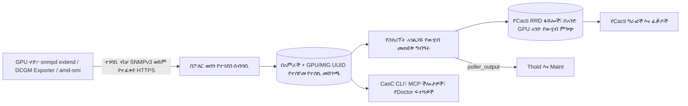

<!-- Source: README.md; SHA256: 97ba37df4a883426d3984ed7d14547ad7367e973411a8abd930409ce259f545b -->

<!-- translations:start -->
[English](../../../README.md) | [简体中文](../zh-CN/README.md) | [हिन्दी](../hi-IN/README.md) | [Español (España)](../es-ES/README.md) | [Español (Latinoamérica)](../es-419/README.md) | [العربية (السعودية)](../ar-SA/README.md) | [Afrikaans](../af-ZA/README.md) | [አማርኛ](README.md) | [العربية (مصر)](../ar-EG/README.md) | [العربية (المغرب)](../ar-MA/README.md) | [বাংলা](../bn-BD/README.md) | [Bosanski](../bs-BA/README.md) | [Deutsch](../de-DE/README.md) | [فارسی](../fa-IR/README.md) | [Filipino](../fil-PH/README.md) | [Français](../fr-FR/README.md) | [Français (Maroc)](../fr-MA/README.md) | [Français (Sénégal)](../fr-SN/README.md) | [Hausa](../ha-NG/README.md) | [עברית](../he-IL/README.md) | [Hrvatski](../hr-HR/README.md) | [Bahasa Indonesia](../id-ID/README.md) | [Igbo](../ig-NG/README.md) | [Italiano](../it-IT/README.md) | [日本語](../ja-JP/README.md) | [한국어](../ko-KR/README.md) | [Malagasy](../mg-MG/README.md) | [मराठी](../mr-IN/README.md) | [Bahasa Melayu](../ms-MY/README.md) | [Nederlands](../nl-NL/README.md) | [Polski](../pl-PL/README.md) | [Português (Brasil)](../pt-BR/README.md) | [Русский](../ru-RU/README.md) | [Kinyarwanda](../rw-RW/README.md) | [Soomaali](../so-SO/README.md) | [Српски](../sr-RS/README.md) | [Svenska](../sv-SE/README.md) | [Kiswahili](../sw-KE/README.md) | [தமிழ்](../ta-IN/README.md) | [తెలుగు](../te-IN/README.md) | [ไทย](../th-TH/README.md) | [Türkçe](../tr-TR/README.md) | [Українська](../uk-UA/README.md) | [اردو](../ur-PK/README.md) | [Tiếng Việt](../vi-VN/README.md) | [isiXhosa](../xh-ZA/README.md) | [Yorùbá](../yo-NG/README.md) | [繁體中文](../zh-TW/README.md) | [isiZulu](../zu-ZA/README.md)
<!-- translations:end -->

# plugin_gpu

ከNVIDIA እና AMD መሣሪያዎች የሚገኙ የእያንዳንዱን GPU አጠቃቀም፣ ማህደረ ትውስታ፣ ሙቀት፣ ኃይል፣ የECC ስህተቶች እና የፍጥነት መገደብ (throttling) ምክንያቶችን ወደ Cacti የሚያመጣ የCacti 1.2 ተሰኪ (plugin)። እያንዳንዱ GPU (ወይም MIG ክፍል) በኖዱ መሣሪያ ላይ የውሂብ መጠይቅ (data query) ማውጫ (index) ይሆናል፤ ስለዚህ የGPU ግራፎች በCacti ፈቃዶች ስር ከኖዱ ሌሎች ግራፎች ጎን ይቀመጣሉ፣ እንዲሁም Thold እና Maint ማንቂያዎችን መላክ እና ማፈን ይችላሉ።

> **ሁኔታ፦ ከደረጃ 1 እስከ 3 በኮድ ተተግብረዋል፣ ገና አልተለቀቁም።** ደረጃ 1 (NVIDIA `nvidia-smi` በSNMP extend በኩል፣ የማንነት ክትትል፣ ግራፎች፣ የፍጥነት መገደብ እና የECC ምልክቶች፣ የThold እና Maint ማንቂያ፣ የጤና ገጽ)፣ ደረጃ 2 (ተነባቢ ብቻ የሆነ የNVIDIA DCGM Exporter HTTP(S) ተንታኝ/ደንበኛ እና የAMD `amd-smi` ተንታኝ)፣ ደረጃ 3 (የMIG ክፍል ማንነት ክትትል፣ የSchema v4 አምዶች፣ በፖለር ወሰን የተገደበ የርቀት ሰብሳቢ አፈጻጸም፣ የ`replicate_out` እና `remote_agent` መንጠቆዎች)፣ የCasC ኦፕሬተር CLI (`cli/gpu.php`) እና የስነ-ምህዳር መንጠቆዎች (`abilities_register`፣ `doctor_register_checks`፣ `casc_register_providers`) ተተግብረው በክፍል (unit)፣ በደህንነት እና በተጣይ Cacti (disposable-Cacti) የውህደት ሙከራዎች ተሸፍነዋል። እስካሁን የተደረጉ የቀጥታ ሙከራዎች ከአካላዊ የGPU ሃርድዌር ይልቅ ሰው ሰራሽ `snmpd` እና የሙከራ ውሂብ (fixture payloads) ይጠቀማሉ። ልቀት ከመሰየሙ በፊት ገና ያልተጠናቀቁ ጉዳዮች፦ በእውነተኛ ሃርድዌር ላይ የሚደረጉ የሙከራ ስራዎች ([docs/pilot-plan.md](../../pilot-plan.md)፣ #54)፣ ውጫዊ የደህንነት ግምገማ ([docs/security-review.md](../../security-review.md))፣ ከእውነተኛ መሣሪያዎች የተወሰዱ የሙከራ ውሂቦች (#14)፣ እና በምርት-መጠን ሃርድዌር ላይ የተለካ የመጠን አቅም ([docs/performance.md](../../performance.md))። የXID ስህተት መሰብሰብ በውሳኔ #8 ስር ክፍት ሆኖ ይቆያል።

## የመዳረሻ ሚናዎች

| ዘርፍ | መዳረሻ |
| --- | --- |
| GPU View | ነባር የክትትል ገጾች። |
| GPU Operator | ክትትል፣ በተጨማሪም የክወና (Operations) ገጽ እና የግል የማጣሪያ ማረጋገጫዎች። |
| GPU Admin | የOperator መዳረሻ፣ በተጨማሪም ነባር የውቅር እና የአስተዳደር እርምጃዎች። |

የማሻሻያ (upgrade) ፋይሎችን ከገለበጡ በኋላ አዲሱን ዘርፍ (realm) ለመመዝገብ እንደ አስተዳዳሪ ሆነው የPlugins ገጹን ይክፈቱ። የOperator ዘርፍን በ **Configuration > Users** ወይም በተጠቃሚ ቡድኖች ስር በግልጽ ይመድቡ።
ማሻሻያዎች ነባሮቹን የView እና የAdmin ዘርፍ መለያዎች (IDs) እና ፈቃዶች ጠብቀው ያቆያሉ። የAdmin መዳረሻ የOperator መዳረሻን ይወርሳል፣ የOperator መዳረሻም በእያንዳንዱ ጥያቄ ላይ የView መዳረሻን ይወርሳል፤ ይህ በተጠቃሚዎች ወይም በቡድኖች ላይ የተከማቹ ፈቃዶችን አይጨምርም። የተሰኪ ቅንብሮች ከCacti የSettings ፈቃድ በተጨማሪ የGPU Admin መዳረሻን ይጠይቃሉ።

የCacti የመሣሪያ ፈቃዶች አሁንም ለእያንዳንዱ ተጠቃሚ የሚታዩትን ረድፎች እና እርምጃዎች ይገድባሉ፤ ያልተዛመዱ (unmapped) ነገሮች አስተዳዳሪን ይፈልጋሉ።
የማረጋገጫ ሰነዶች (credentials)፣ ውቅር፣ ማዛመድ፣ መሰረዝ እና ሌሎች የአስተዳደር ለውጦች በአስተዳደር ገጾች ውስጥ ይቆያሉ። ማረጋገጫዎች (acknowledgments) የሚቆዩት በአሁኑ የተጠቃሚ ክፍለ ጊዜ (session) ውስጥ ብቻ ሲሆን፣ ቢበዛ ለአንድ ሰዓት እና ያው ምልከታ ትኩስ ሆኖ እስከቀጠለ ድረስ ብቻ ነው። አዳዲስ ወይም የተለወጡ ምልከታዎች ውድቅ ያደርጓቸዋል። የከሸፈ መለኪያን ጤናማ አድርገው በፍጹም አይቆጥሩም ወይም ማንቂያዎችን አያፍኑም።

## ለምን አስፈለገ

የGPU ኖዶች አብዛኛውን ጊዜ ለCPU፣ ለማህደረ ትውስታ እና ለበይነገጾች (interfaces) ቀድሞውኑ በCacti ውስጥ አሉ። የGPU ጤና ግን የኖዱ SNMP ውሂብ የማይመልሰው የተለየ ጉዳይ ነው፦ ኖዱ ራሱ ጤናማ በሚመስልበት ጊዜ አንድ ካርድ በሙቀት ምክንያት ፍጥነቱ ሊገደብ፣ የECC ስህተቶችን ሊያከማች ወይም የXID ብልሽት ሪፖርት ሊያደርግ ይችላል። የአምራች መሣሪያዎች (`nvidia-smi`፣ DCGM፣ `amd-smi`) ይህንን ሪፖርት ያደርጋሉ፣ ነገር ግን ውጤታቸው ከCacti ግራፎች፣ ፈቃዶች እና ማንቂያዎች ውጭ ይኖራል።

ተሰኪው የአምራች መሣሪያ ውጤትን በእያንዳንዱ GPU አቀማመጥ ሳይሆን በማንነቱ (identity) ወደተሰየሙ የCacti ውሂብ ምንጮች በመቀየር ያንን ክፍተት ይሞላል፤ ስለዚህ GPUዎችን በቅደም ተከተል የሚቀይር ዳግም ማስጀመር (reboot) የአንዱን ካርድ ታሪክ ከሌላው ጋር አያያይዝም። ትይዩ የሆኑ የራሱን ስሪቶች ከመገንባት ይልቅ የCactiን ግራፍ አሰራር፣ ፈቃዶች፣ የርቀት ውሂብ ሰብሳቢዎች፣ Thold እና Maintን መልሶ ይጠቀማል።

## የታቀደው ወሰን

| ደረጃ | ወሰን | ሁኔታ | ምዕራፎች |
|---|---|---|---|
| 0፣ ምርምር | የአምራች መሣሪያ ውጤት፣ የXID እና የፍጥነት መገደብ ምልክቶች፣ የGPU ማንነት፣ መብቶች፣ የመሰብሰቢያ መንገድ ውሳኔ | ተጠናቋል | [M1](https://github.com/somethingwithproof/plugin_gpu/milestone/1) |
| 1፣ nvidia | የ`nvidia-smi` መሰብሰብ፣ በUUID ላይ የተመሰረተ ቆጠራ፣ ግራፎች፣ የፍጥነት መገደብ እና የECC ምልክቶች፣ Thold እና Maint፣ የጤና ገጽ | ተተግብሯል (በሙከራ ውሂብ ተፈትኗል) | [M2](https://github.com/somethingwithproof/plugin_gpu/milestone/2), [M3](https://github.com/somethingwithproof/plugin_gpu/milestone/3), [M4](https://github.com/somethingwithproof/plugin_gpu/milestone/4) |
| 2፣ backends | ተነባቢ ብቻ DCGM Exporter HTTP(S) ተንታኝ/ደንበኛ (`lib/DcgmExporterParser.php`፣ `lib/DcgmExporterClient.php`)፣ የAMD `amd-smi` ተንታኝ (`lib/AmdSmiParser.php`) | ተተግብሯል (በክፍል ሙከራ ተፈትኗል) | [M5](https://github.com/somethingwithproof/plugin_gpu/milestone/5) |
| 3፣ mig፣ remote እና ስነ-ምህዳር | የMIG ክፍል ማንነት ክትትል፣ የርቀት ውሂብ ሰብሳቢዎች (`INFO`፣ `poller_gpu.php --poller=N`፣ `replicate_out`፣ `remote_agent`)፣ CasC CLI (`cli/gpu.php`)፣ MCP/Doctor/CasC መንጠቆዎች | ተተግብሯል (በክፍል እና CI ውህደት ተፈትኗል) | [M6](https://github.com/somethingwithproof/plugin_gpu/milestone/6) |

ከወሰን ውጭ የሆኑ፦ GPUን ወይም ኖድን የሚቀይር ማንኛውም ትዕዛዝ (ሰዓቶች፣ የኃይል ገደቦች፣ ዳግም ማስጀመሮች፣ የMIG አቀማመጥ)፣ በተሰኪው ባለቤትነት የሚተዳደር የማንቂያ ሞተር፣ ብጁ ዴሞን (daemon) ወይም የአውታረ መረብ ፕሮቶኮል፣ እና የመርሐግብር (scheduler) ወይም የስራ ሂሳብ አያያዝ። ለምርምር ክምችት (backlog) ዕቅዱን ይመልከቱ።

## ምዕራፍ 4 የሚጨምራቸው ነገሮች

- **የNVIDIA DCGM Exporter ተነባቢ ብቻ ሰብሳቢ** (`lib/DcgmExporterParser.php`፣ `lib/DcgmExporterClient.php`)። የPrometheus የጽሁፍ መግለጫ መለኪያዎችን (`DCGM_FI_DEV_GPU_UTIL`፣ `DCGM_FI_DEV_FB_USED`፣ `DCGM_FI_DEV_FB_FREE`፣ `DCGM_FI_DEV_POWER_USAGE`፣ `DCGM_FI_DEV_GPU_TEMP`፣ `DCGM_FI_DEV_ECC_DBE_VOL_TOTAL`፣ `DCGM_FI_DEV_CLOCK_THROTTLE_REASONS`፣ እና የMIG መለያዎችን `GPU_I_ID` እና `GPU_I_PROFILE`) ይተነትናል። የHTTP(S) ደንበኛው ግልጽ የሆነ የመድረሻ አስተናጋጅ/CIDR የፍቃድ ዝርዝርን ያስፈጽማል፣ በነባሪነት የTLS የአቻ የምስክር ወረቀቶችን ያረጋግጣል፣ የጊዜ ማብቂያዎችን እና የምላሽ መጠንን ይገድባል፣ አቅጣጫ ማዞሮችን (redirects) ያቦዝናል፣ እና HTTP(S) ያልሆኑ መርሐ-ግብሮችን ውድቅ ያደርጋል።
- **የAMD `amd-smi` ተነባቢ ብቻ ተንታኝ** (`lib/AmdSmiParser.php`)። የ`amd-smi` JSON/SNMP-extend ውጤትን (አጠቃቀም፣ VRAM፣ ኃይል፣ የመገናኛ/ጠርዝ ሙቀት፣ ECC፣ የክፍልፋይ (partition) ሜታዳታ፣ እና በ`Reading::$vendorExtensions` በኩል የተለዩ የፍጥነት መገደብ አጠራቃሚዎችን) በ`Vendor::Amd` ስር ወደሚገኘው የጋራ መለኪያ ሞዴል ያስተካክላል።
- **የMIG ክፍል ክትትል እና Schema v4** (`lib/GpuReport.php`፣ `lib/GpuSnapshot.php`፣ `lib/GpuRecord.php`፣ `lib/Schema.php`፣ `lib/ScriptServer.php`)። የማይለወጡ የማንነት ቁልፎችን (`vendor`፣ `uuid`፣ `parent_uuid`) በዝመናዎች ላይ እየጠበቀ እና ከውሂብ ጎታ መጠይቆች በፊት እያረጋገጠ፣ የMIG ክፍል UUIDዎችን (`MIG-<uuid>` እና `MIG-GPU-<parent>/<gi>/<ci>`)፣ `mig_mode`፣ `mig_instance_id`፣ `mig_profile`፣ `parent_uuid` እና `partition_info`ን ከወላጅ GPUዎች ጋር ይከታተላል።
- **የርቀት ውሂብ ሰብሳቢዎች** (`INFO`፣ `poller_gpu.php`፣ `lib/Poller.php`፣ `lib/ReplicationRepository.php`፣ `setup.php`)። በ`INFO` ውስጥ `remote_collect:1, remote_poller:1`ን ያውጃል፣ በ`php plugins/gpu/poller_gpu.php --poller=N` አማካኝነት በፖለር ወሰን የተገደበ አፈጻጸምን ይደግፋል፣ ዋና ባልሆኑ ፖለሮች ላይ የCacti ነገር ማዘጋጀትን ይዘላል፣ በፖለር ወሰን የተገደቡ ሰንጠረዦችን በ`replicate_out` በኩል ያባዛል፣ እና በ`remote_agent` በኩል ተነባቢ ብቻ ለሆኑ የ`gpu_health` እና `gpu_inventory` እርምጃዎች ምላሽ ይሰጣል።
- **የኦፕሬተር እና CasC CLI** (`cli/gpu.php`፣ `lib/CascProvider.php`)። ምንም ውጫዊ የComposer ጥገኝነት ሳይኖረው በPHP 8.2+ ላይ ይሰራል (በPHP 8.0 ላይ ይተነተናል)፦ `php plugins/gpu/cli/gpu.php export [--format=yaml|xml]`፣ `validate <file> [--format=yaml|xml]`፣ `plan <file> [--format=yaml|xml] [--output=text|json]`፣ `apply <file> --confirm=<PLAN_HASH> [--format=yaml|xml]` እና `health [--format=text|json]`። ዕቅዶች ቆራጥ (deterministic) የSHA-256 ማረጋገጫ ሃሽ ያሰላሉ፣ `apply` ሃሽ ካልተዛመደ በጥብቅ ይከሽፋል፣ እና የXML ትንተና የ`DOCTYPE` እና `ENTITY` መግለጫዎችን ውድቅ ያደርጋል።
- **የስነ-ምህዳር ውህደት መንጠቆዎች** (`lib/EcosystemIntegration.php`፣ `setup.php`)። `abilities_register`ን (`gpu-list-nodes`፣ `gpu-list-devices`፣ `gpu-get-health`፤ ተነባቢ ብቻ፣ በ`GPU View` ዘርፍ እና በCacti መሣሪያ ፈቃዶች የተገደበ)፣ `doctor_register_checks`ን (`gpu_schema`፣ `gpu_poller_freshness`፣ `gpu_node_health`) እና `casc_register_providers`ን ይመዘግባል።
- **የፍጥነት መገደብ (throttle) ምክንያቶች እና ECC እንደ ማንቂያ እሴቶች** ([docs/metrics.md](../../metrics.md))። Thold 1.8.2 እና Maint 1.3 አሉታዊ ቆጣሪዎች ወይም የዳግም ማስጀመር ዝላይዎች (reset spikes) ሳይኖሩ ማንቂያ እንዲሰጡ እና እንዲያፍኑ ([docs/alerting.md](../../alerting.md)) የሰዓት ክስተት ጭንብሎችን ወደ 0/1 አመልካቾች ይፈታል እና በየክፍለ-ጊዜው የተከሰቱ አዳዲስ የተስተካከሉ/ያልተስተካከሉ የECC ስህተቶችን እንደ ጌጅ (gauge) ያሰላል።
- **GPU Health፣ ፈቃዶች፣ ብልሽት/መመለስ እና መጠን (Scale)።** GPU Health (GPU View) ኖዶችን ሳያገኝ የተከማቸ ትኩስነትን፣ የመጨረሻውን ስብስብ ውጤት፣ የMaint ሁኔታን፣ backendን፣ ስሪቶችን እና ጥሬ የፍጥነት መገደብ ጭንብሎችን ያሳያል። በስክሪፕት የተጻፉ ከጫፍ እስከ ጫፍ ሙከራዎች ፈቃዶችን፣ የወኪል/DB/RRD ብልሽት መመለስን ([docs/backup.md](../../backup.md)) እና በCI ውስጥ የ100 GPU መጠን ሩጫን ([docs/performance.md](../../performance.md)፣ [docs/operations.md](../../operations.md)፣ [CHANGELOG.md](../../../CHANGELOG.md)) ያረጋግጣሉ።

## ምዕራፍ 3 የሚጨምራቸው ነገሮች

- **በSNMP extend በኩል መሰብሰብ** ([ADR 0008](../../decisions/0008-collect-through-snmp-extend.md))። የኖዱ አስተዳዳሪ ሁለት ቋሚ `extend` መስመሮችን ወደ `snmpd.conf` ያክላል ([docs/node-setup.md](../../node-setup.md))፤ ተሰኪው NET-SNMP-EXTEND-MIBን በCacti የSNMP ተግባራት አማካኝነት በመሣሪያው የራሱ ማረጋገጫዎች ያነባል፣ SNMPv3 ይመከራል። በCacti አገልጋይም ሆነ በኖዱ ላይ ምንም ነገር አያስኪድም።
- **ጥብቅ ትንተና (Strict parsing)።** መስኮች በአቀማመጣቸው ይነበባሉ፣ እያንዳንዱ መስመር GPUውን በUUID ይሰይማል፣ እና ከዜሮ ውጭ የሆነ የመውጫ ሁኔታ፣ የጊዜ ማለፍ (timeout)፣ የተቆረጠ ውጤት፣ የተሳሳተ የመስክ ብዛት ያለው መስመር ወይም የተቀላቀለ የስህተት ጽሑፍ ሙሉውን ስብስብ ያከሽፋል፦ እሴቶች `U` ይሆናሉ፣ የትኛውም GPU እንደሌለ አይመዘገብም፣ እና GPU Nodes ምክንያቱን ያሳያል።
- **ከእያንዳንዱ የፖለር ዑደት በኋላ የሚሰራ ሰብሳቢ።** የእያንዳንዱን የነቃ ኖድ ወኪል ያነባል፣ የማንነት መዝገቦችን ያዘምናል፣ እና የቅርብ ጊዜውን ናሙና በመሸጎጫ (cache) ያስቀምጣል። የስክሪፕት አገልጋይ ግብዓቱ ያንን መሸጎጫ ብቻ ስለሚያነብ የCacti መጠይቅ (poll) በGPU ኖድ ላይ ፈጽሞ አይጠብቅም።
- **የCacti ነገሮች** ([ADR 0010](../../decisions/0010-attach-to-existing-node-devices.md))። አብነቶቹ እና የ*GPU - Devices* የውሂብ መጠይቅ እንደ XML ሆነው ይላካሉ እንዲሁም በመጫን እና በማሻሻል ጊዜ ወደ ውስጥ ይገባሉ (import)። አንድን ኖድ ማስቀመጥ የውሂብ መጠይቁን በነባሩ መሣሪያ ላይ በNone ዳግም-ማውጫ (reindex) ዘዴ ያያይዛል፤ GPU Nodes መሣሪያ መፍጠር የሚችለው ኖዱ ምንም ከሌለው ብቻ ነው። እያንዳንዱ GPU በአምራች እና በUUID የተሰየመ ማውጫ (index) ሲሆን፣ በUtilization፣ Memory፣ Temperature፣ Power፣ Power Percent፣ Clocks፣ Throttle፣ ECC Errors፣ New ECC Errors፣ Retired Pages እና Sample Age ግራፎቹ የሚጋሩት አንድ የውሂብ ምንጭ አለው። Cacti የሚያከማቸው ግራፍ የሚጠቀምባቸውን መስኮች ብቻ ስለሆነ እያንዳንዱ የሞዴል መስክ በአንድ ግራፍ ይሳላል። ተሰኪው ከእያንዳንዱ የGPU ለውጥ በኋላ ዳግም ማውጫ ያደርጋል፣ መሣሪያው Down ወይም የቦዘነ በነበረበት ጊዜ Cacti የዘለለውን ዳግም ማውጫ ይይዝና መሣሪያው Up እንደሆነ ያስኪደዋል፣ እንዲሁም ለአዳዲስ GPUዎች ግራፎችን ይፈጥራል።
- **ታሪክ ከካርዱ ጋር ይቆያል።** የጠፋ GPU እንደ ማውጫ ሆኖ ይቆያል፣ ስለዚህ ግራፎቹ ክፍተት ያሳያሉ እና ሲመለስ በተመሳሳይ RRD ፋይል ውስጥ ይቀጥላሉ። በተመሳሳይ ቦታ ላይ የሚገባ ምትክ ካርድ የራሱን የውሂብ ምንጭ ያገኛል። በኖዱ ገጽ ላይ ያለው **Remove from Data Query** የጠፋ GPUን ከዝርዝሩ ያወጣዋል፤ እርስዎ እስኪሰርዟቸው ድረስ የRRD ፋይሎቹ እና ግራፎቹ ይቀመጣሉ።
- **በGPU Nodes ላይ የመሣሪያ ፈቃዶች።** አንድ GPU Admin የሚያየው፣ የሚቀይረው፣ ወደ ውጭ የሚልከው (export) እና የሚያንቀሳቅሰው በCacti ውስጥ ማየት በሚችላቸው መሣሪያዎች ላይ ያሉትን ኖዶች እና GPUዎች ብቻ ነው፤ GPUን ማንቀሳቀስ ሁለቱንም ኖዶች ይፈልጋል። መሣሪያው የተሰረዘበት ኖድ ሊቦዝን ወይም ሊሰረዝ ይችላል።
- **የጋራ መለኪያ ሞዴል** ([ADR 0009](../../decisions/0009-common-metric-core-with-vendor-extensions.md)፣ [docs/metrics.md](../../metrics.md))። ማህደረ ትውስታ በባይት (bytes) ነው፣ የሰዓት ክስተት ጭንብል ወደ `thr_*` አመልካቾች ይፈታል፣ እና `age` የGPUው የራሱ ናሙና ጊዜ ዕድሜ ወይም ካልታወቀ `U` ነው።

ጫኚው (የድር አገልጋይ) ተጠቃሚ ተሰኪው የውሂብ መጠይቅ XMLውን ወደሚያስቀምጥበት `<cacti>/resource/script_server/` መጻፍ መቻል አለበት፤ ካልሆነ መጫን እና ማሻሻል በመልእክት ይቆማሉ እና በሚቀጥለው ሙከራ ላይ እንደገና ይሞክራሉ። ማራገፍ አብነቶቹን እና XMLውን የሚያስወግደው *Remove the plugin's Cacti objects on uninstall* ምልክት ከተደረገበት ብቻ ሲሆን RRD ፋይሎችን፣ መሣሪያዎችን፣ ግራፎችን ወይም የውሂብ ምንጮችን በፍጹም አይሰርዝም ([docs/operations.md](../../operations.md#uninstall))። በርቀት ውሂብ ሰብሳቢዎች ላይ ያሉ ኖዶች በተመደበላቸው `poller_id` ወሰን ውስጥ ይሰራሉ።

## ምዕራፍ 2 የሚልካቸው ነገሮች

- **ጥበቃ ያለው መጫን።** ከPHP 8.2 በታች መጫን እና ማንቃት የሚፈለገውን ስሪት በሚጠቅስ መልእክት ውድቅ ይደረጋሉ፣ እና የተቀረው Cacti መስራቱን ይቀጥላል። `setup.php` እና የገጽ ስክሪፕቶቹ በPHP 8.0 ላይ ይተነተናሉ (parse)።
- **የህይወት ዑደት (Lifecycle)።** በCacti የPlugins ገጽ በኩል መጫን፣ ማሻሻል፣ ማቦዘን እና ማራገፍ። ማሻሻያዎች ቅደም ተከተል አላቸው፣ ከመቋረጥ በኋላ ይጠናቀቃሉ፣ እና የተመዘገበውን ስሪት የሚቀይሩት ከተሳኩ በኋላ ብቻ ነው። ማራገፍ *Keep Plugin Tables on Uninstall*ን ካላጠፉ በስተቀር የተሰኪውን ሰንጠረዦች ያቆያል፤ የCacti መሣሪያን፣ የውሂብ ምንጭን፣ ግራፍን ወይም RRD ፋይልን በፍጹም አይነካም።
- **የተለያዩ ዘርፎች (realms)።** *GPU Admin* **GPU Nodes**ን ይከፍታል፣ እዚያም የCacti መሣሪያዎችን እንደ GPU ኖዶች ይመዘግባሉ፣ በኖዶች መካከል የGPU ዝውውሮችን ያረጋግጣሉ ወይም ውድቅ ያደርጋሉ፣ እና እያንዳንዱን መዝገብ እንደ JSON ወደ ውጭ ይልካሉ። *GPU View* **GPU Inventory**ን ይከፍታል፣ እሱም ተመልካቹ ማየት በሚችላቸው መሣሪያዎች ላይ ያሉ GPUዎችን ብቻ ይዘረዝራል። ሁለቱም ገጾች በManagement ስር ናቸው፣ እና እያንዳንዱ ለውጥ በcsrf-magic የሚረጋገጥ POST ነው።
- **የGPU ማንነት መዝገቦች።** እያንዳንዱ GPU በአምራች እና በUUID ይሰየማል። ማውጫ፣ የPCI አውቶቡስ መለያ፣ ስም፣ ድራይቨር እና ሪፖርት አድራጊው መሣሪያ በቦታው ላይ የሚቀየሩ ባህሪያት ናቸው። በታወቀ ቦታ ላይ ያለ አዲስ UUID እንደ ምትክ ሊሆን እንደሚችል ምልክት ይደረግበትና የራሱን ታሪክ ይጀምራል፤ በሌላ ኖድ ላይ የታየ GPU የሚዘዋወረው ኦፕሬተር ሲያረጋግጥ ብቻ ነው፤ ከተሳኩ ስብስቦች የጠፋ GPU ሊዋቀር ከሚችል ቆጠራ በኋላ እንደሌለ ይመዘገባል እና በፍጹም አይሰረዝም። ለአሁኑ ተቀባይነት ያላቸው የNVIDIA ሙሉ-GPU UUIDዎች ብቻ ናቸው፤ የMIG ክፍሎች ውሳኔ #13ን፣ AMD ደግሞ ምርምር #19ን ይጠብቃሉ። ገና የሚመግባቸው ሰብሳቢ ስለሌለ ህጎቹ የሚፈተሹት በሙከራ ውሂብ ቅደም ተከተሎች (fixture sequences) ነው።
- **ሙከራዎች እና CI።** ያለ GPU ወይም ውሂብ ጎታ የሚሰሩ የክፍል (unit) እና የምንጭ-ህግ (source-rule) ሙከራዎች፣ በPHP 8.2 እስከ 8.5 ላይ ከCacti 1.2.31 እና ከአሁኑ 1.2.x ጋር የህይወት ዑደት እና የገጽ-ፈቃድ ፍተሻዎች፣ የPHP 8.1 እምቢታ ስራ፣ የመግቢያ ነጥቦቹ የPHP 8.0 ሊንት (lint)፣ በደረጃ 9 ላይ PHPStan፣ እና REUSE። #12 እስኪወሰን ድረስ የሙከራ አደረጃጀቱ (harness) ጊዜያዊ ነው።

### ለግምገማ መጫን

እነዚህ እርምጃዎች ለመሞከር የአሁኑን ኮድ ይጭናሉ፤ [docs/operations.md](../../operations.md) ሙሉውን የኦፕሬተር መመሪያ ይዟል። በPHP 8.2 ወይም ከዚያ በላይ ላይ Cacti 1.2.31 ወይም ከዚያ በላይ ያስፈልጋቸዋል።

1. ማከማቻውን (repository) በCacti ማውጫዎ ስር ወደ `plugins/gpu` ይቅዱት። ማውጫው `gpu` መባል አለበት።
2. በCacti ውስጥ **Configuration > Plugins**ን ይክፈቱ፣ ከዚያ **GPU**ን ይጫኑ እና ያንቁ።
3. ለተጠቃሚዎች እንደየሚናቸው በ**Configuration > Users** ስር *GPU View*፣ *GPU Operator* ወይም *GPU Admin* ዘርፍን ይስጧቸው። ጫኚው ተጠቃሚ View እና Adminን ያገኛል፤ Admin የOperator መዳረሻን ያካትታል።
4. በ[docs/node-setup.md](../../node-setup.md) ላይ እንደተገለጸው የእያንዳንዱን የGPU ኖድ SNMP ወኪል ያዋቅሩ፣ ከዚያ ኖዱን በ**Management > GPU Nodes** ስር ያክሉ።
5. ለማንቂያዎች [docs/alerting.md](../../alerting.md) እንደሚገልጸው የተላኩትን የThold አብነቶች ወደ ውስጥ ያስገቡ (import)።
6. እንደ አማራጭ **Configuration > Settings > GPU**ን ያስተካክሉ፦ *Mark Absent After* (ነባሪው 3 የተሳኩ ስብስቦች፣ ከ1 እስከ 100)፣ *Stale After* (እሴቶቹ `U` ከማተማቸው በፊት አንድ ናሙና ምን ያህል ሊቆይ እንደሚችል) እና *Keep Plugin Tables on Uninstall* (በነባሪ የበራ)።

## መለኪያዎች እንዴት ወደ Cacti ይደርሳሉ

ውሳኔ [#7](https://github.com/somethingwithproof/plugin_gpu/issues/7) SNMP `extend`ን መርጧል ([ADR 0008](../../decisions/0008-collect-through-snmp-extend.md))፦ የኖዱ የራሱ ወኪል ቋሚ የ`nvidia-smi` ትዕዛዝ ያስኪዳል፣ ተሰኪውም ውጤቱን ብቻ ያነባል። ዕቅዱ አማራጮቹን በ[የመሰብሰቢያ መንገዶች](../../PLAN.md#collection-paths) ስር ያወዳድራል።

## የተኳኋኝነት ዒላማዎች

| አካል | ዒላማ |
|---|---|
| Cacti | 1.2.31 ወይም ከዚያ በላይ፣ ምንም የዋና ኮድ ማሻሻያ (core patches) የለም |
| PHP | 8.2 ወይም ከዚያ በላይ፤ የማይደገፍ አካባቢ ከተሰበረ የCacti በይነገጽ ይልቅ እምቢታ እንዲያገኝ `setup.php` በ8.0 ላይ መተንተን የሚችል ሆኖ ይቆያል |
| NVIDIA | የድራይቨር እና የመሣሪያ መስመሮች በምርምር [#26](https://github.com/somethingwithproof/plugin_gpu/issues/26) ይወሰናሉ፤ የDCGM መስክ መለያዎች በv3.3.9 እና በv4.7.0 ላይ ተረጋግጠዋል |
| AMD | በROCm ልቀቶች ላይ `amd-smi` በምርምር [#26](https://github.com/somethingwithproof/plugin_gpu/issues/26) ይወሰናል |
| Thold, Maint | Thold 1.8.2 እና Maint 1.3፣ ያልተለወጡ፣ ከጫፍ እስከ ጫፍ የተሞከሩ ([docs/alerting.md](../../alerting.md)) |

## ንድፍ

- [docs/PLAN.md](../../PLAN.md) ሙሉው ዕቅድ ነው፦ አርክቴክቸር፣ የሚደገፍባቸው የላይኛው ክፍል እውነታዎች (ከምንጮች ጋር)፣ የማንነት ሞዴል፣ የደህንነት ወሰኖች፣ የአፈጻጸም ስሌት፣ ሙከራ እና ስጋቶች።
- [docs/decisions/](../../decisions) ቀድሞውኑ ለተወሰዱ ምርጫዎች የአርክቴክቸር ውሳኔ መዝገቦችን ይዟል።
- [docs/REQUIREMENTS.md](../../REQUIREMENTS.md) እያንዳንዱን የመስፈርት መለያ ከጉዳዩ (issue) ጋር ያዛምዳል።

## ስራ እንዴት ይከታተላል

- **ምዕራፎች (Milestones)** የዕቅዱን ምዕራፎች ይከተላሉ። እያንዳንዳቸው ንዑስ-ጉዳዮቹን እና የመውጫ ማስረጃዎችን የሚዘረዝር የepic ጉዳይ አላቸው።
- **ጉዳዮች (Issues)** በመለያ (label) ተከፋፍለዋል፦ `type: requirement`፣ `type: research`፣ `type: decision`፣ `type: epic`። የመስፈርት ጉዳዮች ቁጥር የተሰጣቸውን፣ ሊፈተሹ የሚችሉ መስፈርቶችን (`REQ-AREA-NNN`) እና የመቀበያ መስፈርቶችን ይገልጻሉ።
- **መለያዎች** `area:`፣ `phase:`፣ `priority:` እና `status:`ንም ይይዛሉ። [CONTRIBUTING.md](../../../CONTRIBUTING.md#labels)ን ይመልከቱ።
- [የፕሮጀክት ሰሌዳው](https://github.com/users/somethingwithproof/projects/9) በሁሉም ምዕራፎች ውስጥ ያሉትን ሁሉንም ጉዳዮች ያሳያል።

## አስተዋጽኦ ማድረግ

[CONTRIBUTING.md](../../../CONTRIBUTING.md)ን ያንብቡ። ኮሚቶች (commits) የDCO ፊርማ (sign-off) ያስፈልጋቸዋል። የንድፍ ውይይት የሚካሄደው በጉዳዮች (issues) ላይ ነው፤ ክፍት ውሳኔዎች የ`type: decision` መለያን ይይዛሉ። ከእውነተኛ የGPU መሣሪያዎች የተቀዳ ውጤት ለምዕራፍ 1 በጣም ጠቃሚው አስተዋጽኦ ነው፤ በመጀመሪያ የአስተናጋጅ ስሞችን (hostnames)፣ መለያ ቁጥሮችን እና UUIDዎችን ያጥፉ።

## ደህንነት

ተጋላጭነቶችን በግል ሪፖርት ያድርጉ፤ [SECURITY.md](../../../SECURITY.md)ን ይመልከቱ።

## ፈቃድ

GNU General Public License v2.0፣ ከCacti እና ከተሰኪዎቹ ጋር ተመሳሳይ ፈቃድ። [LICENSE](../../../LICENSE)ን ይመልከቱ።
