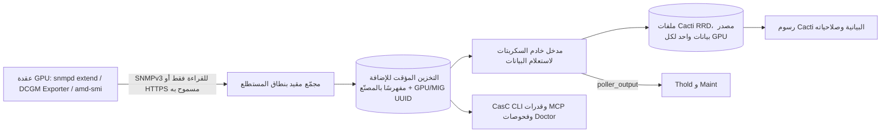

<!-- Source: README.md; SHA256: 97ba37df4a883426d3984ed7d14547ad7367e973411a8abd930409ce259f545b -->

<!-- translations:start -->
[English](../../../README.md) | [简体中文](../zh-CN/README.md) | [हिन्दी](../hi-IN/README.md) | [Español (España)](../es-ES/README.md) | [Español (Latinoamérica)](../es-419/README.md) | [العربية (السعودية)](../ar-SA/README.md) | [Afrikaans](../af-ZA/README.md) | [አማርኛ](../am-ET/README.md) | [العربية (مصر)](README.md) | [العربية (المغرب)](../ar-MA/README.md) | [বাংলা](../bn-BD/README.md) | [Bosanski](../bs-BA/README.md) | [Deutsch](../de-DE/README.md) | [فارسی](../fa-IR/README.md) | [Filipino](../fil-PH/README.md) | [Français](../fr-FR/README.md) | [Français (Maroc)](../fr-MA/README.md) | [Français (Sénégal)](../fr-SN/README.md) | [Hausa](../ha-NG/README.md) | [עברית](../he-IL/README.md) | [Hrvatski](../hr-HR/README.md) | [Bahasa Indonesia](../id-ID/README.md) | [Igbo](../ig-NG/README.md) | [Italiano](../it-IT/README.md) | [日本語](../ja-JP/README.md) | [한국어](../ko-KR/README.md) | [Malagasy](../mg-MG/README.md) | [मराठी](../mr-IN/README.md) | [Bahasa Melayu](../ms-MY/README.md) | [Nederlands](../nl-NL/README.md) | [Polski](../pl-PL/README.md) | [Português (Brasil)](../pt-BR/README.md) | [Русский](../ru-RU/README.md) | [Kinyarwanda](../rw-RW/README.md) | [Soomaali](../so-SO/README.md) | [Српски](../sr-RS/README.md) | [Svenska](../sv-SE/README.md) | [Kiswahili](../sw-KE/README.md) | [தமிழ்](../ta-IN/README.md) | [తెలుగు](../te-IN/README.md) | [ไทย](../th-TH/README.md) | [Türkçe](../tr-TR/README.md) | [Українська](../uk-UA/README.md) | [اردو](../ur-PK/README.md) | [Tiếng Việt](../vi-VN/README.md) | [isiXhosa](../xh-ZA/README.md) | [Yorùbá](../yo-NG/README.md) | [繁體中文](../zh-TW/README.md) | [isiZulu](../zu-ZA/README.md)
<!-- translations:end -->

# plugin_gpu

إضافة لنظام Cacti 1.2 تجلب بيانات الاستخدام والذاكرة ودرجة الحرارة والطاقة وأخطاء ECC وأسباب الاختناق (throttling) لكل بطاقة معالجة رسومية (GPU) من أدوات NVIDIA و AMD إلى Cacti. تصبح كل بطاقة GPU (أو مثيل MIG) فهرسًا لاستعلام بيانات (data query) على جهاز العقدة الخاص بها، بحيث تظهر رسوم GPU البيانية بجانب الرسوم الأخرى للعقدة تحت صلاحيات Cacti، ويمكن لـ Thold و Maint إصدار التنبيهات وكتمها.

> **الحالة: المراحل من 1 إلى 3 منفذة في الكود، ولم تُصدر بعد.** المرحلة 1 (جمع NVIDIA `nvidia-smi` عبر SNMP extend، وتتبع الهوية، والرسوم البيانية، وإشارات الاختناق و ECC، وتنبيهات Thold و Maint، وصفحة الحالة الصحية)، والمرحلة 2 (محلل/عميل HTTP(S) للقراءة فقط لـ NVIDIA DCGM Exporter ومحلل AMD `amd-smi`)، والمرحلة 3 (تتبع هوية مثيلات MIG، وأعمدة Schema v4، وتنفيذ المجمّع البعيد في نطاق المستطلع، وخطافات `replicate_out` و `remote_agent`)، وأداة سطر أوامر المشغّل و CasC (`cli/gpu.php`)، وخطافات التكامل البيئي (`abilities_register`، `doctor_register_checks`، `casc_register_providers`) منفذة ومغطاة باختبارات الوحدة والأمان والتكامل على Cacti مؤقت. تعتمد التشغيلات الحية حتى الآن على `snmpd` اصطناعي وحمولات اختبارية بدلًا من عتاد GPU فعلي. لا يزال مفتوحًا قبل وسْم الإصدار: اختبارات تجريبية على عتاد حقيقي ([docs/pilot-plan.md](../../pilot-plan.md)، #54)، ومراجعة أمنية خارجية ([docs/security-review.md](../../security-review.md))، وبيانات اختبارية مأخوذة من أدوات حقيقية (#14)، وقياسات التوسع على عتاد بحجم بيئة الإنتاج ([docs/performance.md](../../performance.md)). يظل جمع أخطاء XID مفتوحًا بموجب القرار #8.

## أدوار الوصول

| النطاق (Realm) | صلاحية الوصول |
| --- | --- |
| GPU View | صفحات المراقبة الحالية. |
| GPU Operator | المراقبة بالإضافة إلى صفحة العمليات وإقرارات الفرز الشخصية. |
| GPU Admin | صلاحيات المشغّل بالإضافة إلى الإعدادات والإجراءات الإدارية الحالية. |

بعد نسخ ملفات الترقية، افتح صفحة الإضافات (Plugins) بصلاحية مسؤول لتسجيل النطاق (realm) الجديد. عيّن نطاق Operator بشكل صريح من خلال **Configuration > Users** أو مجموعات المستخدمين. تحتفظ الترقيات بمعرفات وأذونات نطاقي View و Admin الحالية. يرث وصول Admin صلاحيات Operator، ويرث وصول Operator صلاحيات View عند كل طلب؛ ولا يضيف ذلك أذونات مخزنة للمستخدمين أو المجموعات. تتطلب إعدادات الإضافة أيضًا صلاحية GPU Admin بالإضافة إلى إذن Settings الخاص بـ Cacti.

تظل صلاحيات الأجهزة في Cacti تحدد الصفوف والإجراءات المتاحة لكل مستخدم؛ وتتطلب الكائنات غير المربوطة تدخل المسؤول. تبقى بيانات الاعتماد، والإعدادات، والربط، والحذف، والتغييرات الإدارية الأخرى في الصفحات الإدارية. تدوم الإقرارات في جلسة المستخدم الحالية فقط، لمدة ساعة واحدة بحد أقصى وطالما ظلت الملاحظة نفسها حديثة. أي ملاحظة جديدة أو متغيرة تبطلها، ولا تجعل أبدًا القياس الفاشل يبدو سليمًا أو تكتم التنبيهات.

## لماذا

عادةً ما تكون عقد GPU مضافة بالفعل في Cacti لمراقبة المعالج والذاكرة وواجهات الشبكة. لكن صحة بطاقة GPU مسألة منفصلة لا تجيب عنها بيانات SNMP الخاصة بالعقدة: فقد تتعرض البطاقة للاختناق الحراري، أو تراكم أخطاء ECC، أو تبلّغ عن عطل XID بينما تبدو العقدة نفسها سليمة. ترصد أدوات الشركات المصنعة ذلك (`nvidia-smi`، و DCGM، و `amd-smi`)، لكن مخرجاتها تظل خارج نطاق رسوم Cacti وصلاحياته وتنبيهاته.

تسد الإضافة هذه الفجوة بتحويل مخرجات أدوات الشركات المصنعة إلى مصادر بيانات (data sources) في Cacti، مفهرسة بهوية كل بطاقة GPU بدلًا من موضعها، بحيث لا يؤدي إعادة التشغيل التي تغير ترتيب البطاقات إلى ربط سجل بطاقة ببطاقة أخرى. كما تعيد استخدام نظام الرسوم البيانية في Cacti، وصلاحياته، ومجمّعات البيانات البعيدة (remote data collectors)، و Thold، و Maint بدلًا من بناء نسخ موازية لها.

## النطاق المخطط له

| المرحلة | النطاق | الحالة | المعالم الرئيسية |
|---|---|---|---|
| 0، البحث | مخرجات أدوات الشركات المصنعة، إشارات XID والاختناق، هوية GPU، الصلاحيات، قرار مسار الجمع | مكتمل | [M1](https://github.com/somethingwithproof/plugin_gpu/milestone/1) |
| 1، nvidia | الجمع عبر `nvidia-smi`، الجرد حسب UUID، الرسوم البيانية، إشارات الاختناق و ECC، و Thold و Maint، وصفحة الحالة الصحية | منفذ (مختبر بالعينات) | [M2](https://github.com/somethingwithproof/plugin_gpu/milestone/2)، [M3](https://github.com/somethingwithproof/plugin_gpu/milestone/3)، [M4](https://github.com/somethingwithproof/plugin_gpu/milestone/4) |
| 2، الواجهات الخلفية | محلل/عميل HTTP(S) للقراءة فقط لـ DCGM Exporter (`lib/DcgmExporterParser.php`، `lib/DcgmExporterClient.php`)، محلل AMD `amd-smi` (`lib/AmdSmiParser.php`) | منفذ (مختبر بالوحدة) | [M5](https://github.com/somethingwithproof/plugin_gpu/milestone/5) |
| 3، mig والجمع البعيد والنظام البيئي | تتبع هوية مثيلات MIG، مجمّعات البيانات البعيدة (`INFO`، `poller_gpu.php --poller=N`، `replicate_out`، `remote_agent`)، أداة CasC CLI (`cli/gpu.php`)، خطافات MCP/Doctor/CasC | منفذ (مختبر بالوحدة وتكامل CI) | [M6](https://github.com/somethingwithproof/plugin_gpu/milestone/6) |

خارج النطاق: أي أمر يغيّر حالة GPU أو العقدة (ترددات الساعة، حدود الطاقة، إعادة الضبط، تخطيط MIG)، أو محرك تنبيهات مملوك للإضافة، أو خدمة خفية (daemon) أو بروتوكول شبكة مخصص، أو حسابات المجدول والمهام (job accounting). راجع الخطة للاطلاع على قائمة مهام البحث المتبقية.

## ما يضيفه المعلم الرئيسي 4 (Milestone 4)

- **مجمّع القراءة فقط لـ NVIDIA DCGM Exporter** (`lib/DcgmExporterParser.php`، `lib/DcgmExporterClient.php`). يحلل مقاييس العرض النصي لـ Prometheus (`DCGM_FI_DEV_GPU_UTIL`، `DCGM_FI_DEV_FB_USED`، `DCGM_FI_DEV_FB_FREE`، `DCGM_FI_DEV_POWER_USAGE`، `DCGM_FI_DEV_GPU_TEMP`، `DCGM_FI_DEV_ECC_DBE_VOL_TOTAL`، `DCGM_FI_DEV_CLOCK_THROTTLE_REASONS`، ووسمي MIG `GPU_I_ID` و `GPU_I_PROFILE`). يفرض عميل HTTP(S) قائمة سماح صريحة للمضيف أو نطاق CIDR لنقطة النهاية، ويتحقق من شهادات TLS للنظير افتراضيًا، ويقيد المهلات وحجم الاستجابة، ويعطل إعادة التوجيه، ويرفض المخططات غير HTTP(S).
- **محلل القراءة فقط لـ AMD `amd-smi`** (`lib/AmdSmiParser.php`). يوحّد مخرجات `amd-smi` بصيغة JSON أو SNMP-extend (الاستخدام، و VRAM، والطاقة، ودرجة حرارة الوصلة والحافة، و ECC، وبيانات التقسيم الوصفية، ومراكمات الاختناق المنفصلة عبر `Reading::$vendorExtensions`) إلى نموذج المقاييس المشترك تحت `Vendor::Amd`.
- **تتبع مثيلات MIG و Schema v4** (`lib/GpuReport.php`، `lib/GpuSnapshot.php`، `lib/GpuRecord.php`، `lib/Schema.php`، `lib/ScriptServer.php`). يتتبع معرفات UUID لمثيلات MIG (`MIG-<uuid>` و `MIG-GPU-<parent>/<gi>/<ci>`)، و `mig_mode`، و `mig_instance_id`، و `mig_profile`، و `parent_uuid`، و `partition_info` جنبًا إلى جنب مع بطاقات GPU الأصلية، مع إبقاء مفاتيح الهوية الثابتة (`vendor`، `uuid`، `parent_uuid`) محمية عند التحديثات ومتحققًا منها قبل استعلامات قاعدة البيانات.
- **مجمّعات البيانات البعيدة** (`INFO`، `poller_gpu.php`، `lib/Poller.php`، `lib/ReplicationRepository.php`، `setup.php`). يعلن `remote_collect:1, remote_poller:1` في `INFO`، ويدعم التنفيذ المقيد بالمستطلع عبر `php plugins/gpu/poller_gpu.php --poller=N`، ويتخطى توفير كائنات Cacti على المستطلعات غير الرئيسية، وينسخ الجداول المقيدة بالمستطلع عبر `replicate_out`، ويجيب عن إجراءات القراءة فقط `gpu_health` و `gpu_inventory` عبر `remote_agent`.
- **أداة سطر الأوامر للمشغّل و CasC** (`cli/gpu.php`، `lib/CascProvider.php`). تعمل على PHP 8.2+ (وتُحلل نحويًا على PHP 8.0) دون أي اعتماديات Composer خارجية: `php plugins/gpu/cli/gpu.php export [--format=yaml|xml]`، و `validate <file> [--format=yaml|xml]`، و `plan <file> [--format=yaml|xml] [--output=text|json]`، و `apply <file> --confirm=<PLAN_HASH> [--format=yaml|xml]`، و `health [--format=text|json]`. تحسب الخطط تجزئة تأكيد SHA-256 حتمية، ويفشل `apply` بأمان عند عدم تطابق التجزئة، ويرفض تحليل XML تصريحات `DOCTYPE` و `ENTITY`.
- **خطافات التكامل البيئي** (`lib/EcosystemIntegration.php`، `setup.php`). يسجّل `abilities_register` (`gpu-list-nodes`، `gpu-list-devices`، `gpu-get-health`؛ للقراءة فقط ومقيدة بنطاق `GPU View` وصلاحيات أجهزة Cacti)، و `doctor_register_checks` (`gpu_schema`، `gpu_poller_freshness`، `gpu_node_health`)، و `casc_register_providers`.
- **أسباب الاختناق و ECC كقيم تنبيه** ([docs/metrics.md](../../metrics.md)). يفك تشفير أقنعة أحداث الساعة إلى مؤشرات 0/1 ويحسب أخطاء ECC المصححة وغير المصححة الجديدة لكل فترة كمقاييس (gauges) بحيث ينبه Thold 1.8.2 و Maint 1.3 ويكتمان التنبيهات دون عدادات سالبة أو قفزات إعادة الضبط ([docs/alerting.md](../../alerting.md)).
- **صحة GPU والصلاحيات والفشل/الاستعادة وقابلية التوسع.** تعرض صفحة GPU Health (نطاق GPU View) حداثة البيانات المخزنة، ونتيجة آخر عملية جمع، وحالة Maint، والواجهة الخلفية، والإصدارات، والأقنعة الخام للاختناق دون الاتصال بالعقد. وتتحقق الاختبارات الشاملة المؤتمتة من الصلاحيات، واستعادة أعطال الوكيل وقاعدة البيانات و RRD ([docs/backup.md](../../backup.md))، وتشغيل اختبار توسع لـ 100 بطاقة GPU في بيئة CI ([docs/performance.md](../../performance.md)، [docs/operations.md](../../operations.md)، [CHANGELOG.md](../../../CHANGELOG.md)).

## ما يضيفه المعلم الرئيسي 3 (Milestone 3)

- **الجمع عبر SNMP extend** ([سجل القرار 0008](../../decisions/0008-collect-through-snmp-extend.md)). يضيف مسؤول العقدة سطرَي `extend` ثابتين إلى `snmpd.conf` ([docs/node-setup.md](../../node-setup.md))؛ وتقرأ الإضافة NET-SNMP-EXTEND-MIB عبر دوال SNMP في Cacti باستخدام بيانات اعتماد الجهاز نفسه، ويُوصى بـ SNMPv3. ولا تشغّل الإضافة أي شيء على خادم Cacti أو العقدة.
- **التحليل الصارم.** تُقرأ الحقول حسب الموضع، ويحدد كل سطر بطاقة GPU الخاصة به بواسطة UUID، وأي حالة خروج غير صفرية، أو انتهاء مهلة، أو مخرجات مبتورة، أو سطر بعدد حقول خاطئ، أو نص خطأ مدمج يُفشل عملية الجمع بأكملها: تصبح القيم `U`، ولا يتم وسم أي GPU كغائب، وتعرض صفحة GPU Nodes السبب.
- **مجمّع بعد كل دورة مستطلع (poller).** يقرأ وكيل كل عقدة مفعّلة، ويحدّث سجلات الهوية، ويخزّن أحدث عينة مؤقتًا. يقرأ مدخل خادم السكربتات من هذا التخزين المؤقت فقط، لذا لا ينتظر استطلاع Cacti أبدًا استجابة عقدة GPU.
- **كائنات Cacti** ([سجل القرار 0010](../../decisions/0010-attach-to-existing-node-devices.md)). تأتي القوالب واستعلام البيانات *GPU - Devices* كملفات XML ويتم استيرادها عند التثبيت والترقية. حفظ العقدة يربط استعلام البيانات بجهازها الحالي بطريقة إعادة فهرسة None؛ ويمكن لـ GPU Nodes إنشاء جهاز فقط عندما لا تملك العقدة جهازًا. كل بطاقة GPU هي فهرس مفهرس بالمصنّع و UUID، مع مصدر بيانات واحد تتشاركه رسوم Utilization، و Memory، و Temperature، و Power، و Power Percent، و Clocks، و Throttle، و ECC Errors، و New ECC Errors، و Retired Pages، و Sample Age. كل حقل في النموذج يُرسم بواسطة رسم بياني ما، لأن Cacti يخزّن فقط الحقول التي يستخدمها رسم بياني. تعيد الإضافة الفهرسة بعد كل تغيير في GPU، وتحتفظ بإعادة الفهرسة التي تخطاها Cacti أثناء تعطل الجهاز أو كونه Down وتشغّلها بمجرد أن يصبح الجهاز Up، وتنشئ رسومًا بيانية لبطاقات GPU الجديدة.
- **السجل يبقى مع البطاقة.** تبقى بطاقة GPU الغائبة كفهرس، لذا تُظهر رسومها البيانية فجوة وتستأنف التسجيل في نفس ملف RRD عند عودتها. أما البطاقة البديلة في نفس الفتحة فتحصل على مصدر بيانات خاص بها. خيار **Remove from Data Query** في صفحة العقدة يزيل بطاقة GPU الغائبة من القائمة؛ بينما تبقى ملفات RRD ورسومها البيانية حتى تقوم بحذفها.
- **صلاحيات الأجهزة في GPU Nodes.** يرى مسؤول GPU Admin، ويعدّل، ويصدّر، وينقل فقط العقد وبطاقات GPU الموجودة على الأجهزة المسموح له برؤيتها في Cacti؛ ويتطلب نقل GPU صلاحية على كلتا العقدتين. ويمكن تعطيل أو حذف العقدة التي حُذف جهازها.
- **نموذج المقاييس المشترك** ([سجل القرار 0009](../../decisions/0009-common-metric-core-with-vendor-extensions.md)، [docs/metrics.md](../../metrics.md)). الذاكرة بالبايت، ويُفك تشفير قناع أحداث الساعة إلى مؤشرات `thr_*`، و `age` هو عمر وقت عينة GPU نفسها، أو `U` عندما يكون غير معروف.

يجب أن يمتلك المستخدم المثبِّت (مستخدم خادم الويب) صلاحية الكتابة في `<cacti>/resource/script_server/`، حيث تضع الإضافة ملف XML الخاص باستعلام البيانات؛ وإلا يتوقف التثبيت والترقية مع رسالة خطأ وتُعاد المحاولة في المرة التالية. يزيل إلغاء التثبيت القوالب وملف XML فقط عند تحديد *Remove the plugin's Cacti objects on uninstall*، ولا يحذف أبدًا ملفات RRD أو الأجهزة أو الرسوم البيانية أو مصادر البيانات ([docs/operations.md](../../operations.md#uninstall)). تعمل العقد الموجودة على مجمّعات البيانات البعيدة ضمن نطاق معرف المستطلع `poller_id` المعيّن لها.

## ما يقدمه المعلم الرئيسي 2 (Milestone 2)

- **تثبيت محمي.** في إصدارات PHP الأقل من 8.2، يُرفض التثبيت والتفعيل مع رسالة تذكر الإصدار المطلوب، ويستمر باقي Cacti في العمل. تبقى ملفات `setup.php` وسكربتات الصفحات قابلة للتحليل النحوي على PHP 8.0.
- **دورة الحياة.** التثبيت والترقية والتعطيل وإلغاء التثبيت عبر صفحة Plugins في Cacti. الترقيات مرتبة، وتستكمل بعد أي انقطاع، ولا تغيّر الإصدار المسجّل إلا بعد نجاحها. يحتفظ إلغاء التثبيت بجداول الإضافة ما لم تقم بإلغاء تحديد *Keep Plugin Tables on Uninstall*؛ ولا يمس أبدًا أي جهاز أو مصدر بيانات أو رسم بياني أو ملف RRD في Cacti.
- **نطاقات منفصلة.** يفتح *GPU Admin* صفحة **GPU Nodes**، حيث تسجّل أجهزة Cacti كعقد GPU، وتؤكد أو ترفض نقل بطاقات GPU بين العقد، وتصدّر كل السجلات بصيغة JSON. ويفتح *GPU View* صفحة **GPU Inventory**، التي تعرض بطاقات GPU فقط على الأجهزة التي يحق للمشاهد رؤيتها. كلتا الصفحتين تحت قائمة Management، وكل تغيير يتم عبر طلب POST يتحقق منه csrf-magic.
- **سجلات هوية GPU.** كل بطاقة GPU مفهرسة بالمصنّع و UUID. أما الفهرس، ومعرف ناقل PCI، والاسم، والتعريف، والأداة المبلّغة فهي سمات تتغير في مكانها. يُشار إلى أي UUID جديد في فتحة معروفة كاستبدال محتمل ويبدأ سجله الخاص؛ ولا تُنقل بطاقة GPU شوهدت في عقدة أخرى إلا عندما يؤكد المشغّل ذلك؛ وتُوسم بطاقة GPU المفقودة من عمليات الجمع الناجحة كغائبة بعد عدد قابل للضبط ولا تُحذف أبدًا. تُقبل فقط معرفات UUID الكاملة لبطاقات NVIDIA في الوقت الحالي؛ بينما تنتظر وحدات MIG القرار #13، و AMD البحث #19. يتم اختبار هذه القواعد بتسلسلات بيانات تجريبية (fixtures)، نظرًا لعدم وجود مجمّع يغذيها بعد.
- **الاختبارات و CI.** مجموعات اختبارات وحدات وقواعد الكود المصدري بدون GPU أو قاعدة بيانات، وفحوصات دورة الحياة وصلاحيات الصفحات ضد Cacti 1.2.31 ونسخة 1.2.x الحالية على PHP 8.2 إلى 8.5، ومهمة رفض PHP 8.1، وفحص نحوي على PHP 8.0 لنقاط الدخول، و PHPStan على المستوى 9، و REUSE. بيئة الاختبار مؤقتة لحين حسم القرار #12.

### التثبيت للتجربة والتقييم

تثبّت هذه الخطوات الكود الحالي لتجربته؛ ويحتوي [docs/operations.md](../../operations.md) على دليل المشغّل الكامل. تتطلب هذه الخطوات Cacti 1.2.31 أو أحدث على PHP 8.2 أو أحدث.

1. انسخ المستودع إلى `plugins/gpu` داخل مجلد Cacti الخاص بك. يجب أن يكون اسم المجلد `gpu`.
2. في Cacti، افتح **Configuration > Plugins**، ثم ثبّت وفعّل **GPU**.
3. امنح المستخدمين نطاق *GPU View* أو *GPU Operator* أو *GPU Admin* من خلال **Configuration > Users**، حسب دور كل منهم. يحصل المستخدم المثبِّت على View و Admin؛ ويشمل Admin صلاحية الوصول الخاصة بـ Operator.
4. أعدّ وكيل SNMP الخاص بكل عقدة GPU كما هو موضح في [docs/node-setup.md](../../node-setup.md)، ثم أضف العقدة من خلال **Management > GPU Nodes**.
5. للحصول على التنبيهات، استورد قوالب Thold المدمجة كما يصف [docs/alerting.md](../../alerting.md).
6. اضبط اختياريًا **Configuration > Settings > GPU**: *Mark Absent After* (الافتراضي 3 عمليات جمع ناجحة، من 1 إلى 100)، و *Stale After* (المدة التي يمكن أن تصل إليها العينة قبل أن تطبع قيمها `U`)، و *Keep Plugin Tables on Uninstall* (مفعّل افتراضيًا).

## كيف تصل المقاييس إلى Cacti

اختار القرار [#7](https://github.com/somethingwithproof/plugin_gpu/issues/7) استخدام SNMP `extend` ([سجل القرار 0008](../../decisions/0008-collect-through-snmp-extend.md)): يشغّل وكيل العقدة نفسه أمر `nvidia-smi` ثابتًا، وتقرأ الإضافة النتيجة فقط. وتقارن الخطة بين الخيارات المتاحة تحت قسم [مسارات الجمع](../../PLAN.md#collection-paths).

## أهداف التوافق

| المكوّن | الهدف |
|---|---|
| Cacti | 1.2.31 أو أحدث، بدون تعديلات على النواة |
| PHP | 8.2 أو أحدث؛ يبقى `setup.php` قابلًا للتحليل النحوي على 8.0 حتى تحصل بيئة التشغيل غير المدعومة على رسالة رفض بدلًا من تعطل واجهة Cacti |
| NVIDIA | إصدارات التعريف والأداة ستُحدد عبر البحث [#26](https://github.com/somethingwithproof/plugin_gpu/issues/26)؛ تم التحقق من معرفات حقول DCGM عند v3.3.9 و v4.7.0 |
| AMD | `amd-smi` على إصدارات ROCm ستُحدد عبر البحث [#26](https://github.com/somethingwithproof/plugin_gpu/issues/26) |
| Thold, Maint | Thold 1.8.2 و Maint 1.3، بدون تعديل، تم اختبارهما بشكل شامل ([docs/alerting.md](../../alerting.md)) |

## التصميم

- [docs/PLAN.md](../../PLAN.md) هو الخطة الكاملة: البنية المعمارية، وحقائق الأنظمة الأساسية التي تعتمد عليها (مع المصادر)، ونموذج الهوية، والحدود الأمنية، وحسابات الأداء، والاختبارات، والمخاطر.
- [docs/decisions/](../../decisions) يحتوي على سجلات القرارات المعمارية للخيارات التي تم حسمها بالفعل.
- [docs/REQUIREMENTS.md](../../REQUIREMENTS.md) يربط كل معرف متطلب بالـ issue الخاص به.

## كيف تتم متابعة العمل

- **المعالم الرئيسية (Milestones)** تتبع المعالم الموجودة في الخطة. لكل معلم epic issue يدرج القضايا الفرعية وأدلة الإنجاز.
- **القضايا (Issues)** مصنّفة بالتسميات: `type: requirement`، و `type: research`، و `type: decision`، و `type: epic`. تنص قضايا المتطلبات على متطلبات مرقمة وقابلة للاختبار (`REQ-AREA-NNN`) ومعايير القبول.
- **التسميات (Labels)** تحمل أيضًا `area:`، و `phase:`، و `priority:`، و `status:`. راجع [CONTRIBUTING.md](../../../CONTRIBUTING.md#labels).
- تعرض [لوحة المشروع](https://github.com/users/somethingwithproof/projects/9) جميع القضايا عبر المعالم الرئيسية.

## المساهمة

اقرأ [CONTRIBUTING.md](../../../CONTRIBUTING.md). تتطلب الـ commits توقيع DCO (sign-off). تتم مناقشة التصميم في القضايا (issues)؛ وتحمل القرارات المفتوحة تسمية `type: decision`. المخرجات الملتقطة من أدوات GPU الحقيقية هي أكثر مساهمة مفيدة للمعلم الرئيسي 1؛ احرص على إزالة أسماء المضيفين والأرقام التسلسلية ومعرفات UUID أولًا.

## الأمان

أبلغ عن الثغرات الأمنية بشكل خاص؛ راجع [SECURITY.md](../../../SECURITY.md).

## الترخيص

رخصة GNU General Public License v2.0، وهي نفس رخصة Cacti وإضافاته. راجع [LICENSE](../../../LICENSE).
