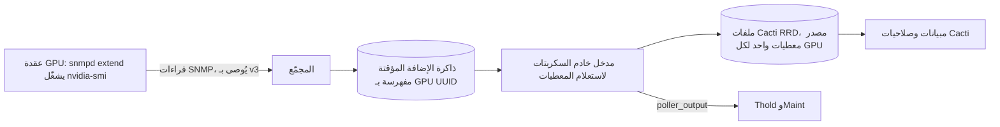

<!-- Source: README.md; SHA256: 126deef1783d64f878bf565f1433c10f31aef828eb9bc313aeff2b0335e54c7c -->

<!-- translations:start -->
[English](../../../README.md) | [简体中文](../zh-CN/README.md) | [हिन्दी](../hi-IN/README.md) | [Español (España)](../es-ES/README.md) | [Español (Latinoamérica)](../es-419/README.md) | [العربية (السعودية)](../ar-SA/README.md) | [Afrikaans](../af-ZA/README.md) | [አማርኛ](../am-ET/README.md) | [العربية (مصر)](../ar-EG/README.md) | [العربية (المغرب)](README.md) | [বাংলা](../bn-BD/README.md) | [Bosanski](../bs-BA/README.md) | [Deutsch](../de-DE/README.md) | [فارسی](../fa-IR/README.md) | [Filipino](../fil-PH/README.md) | [Français](../fr-FR/README.md) | [Français (Maroc)](../fr-MA/README.md) | [Français (Sénégal)](../fr-SN/README.md) | [Hausa](../ha-NG/README.md) | [עברית](../he-IL/README.md) | [Hrvatski](../hr-HR/README.md) | [Bahasa Indonesia](../id-ID/README.md) | [Igbo](../ig-NG/README.md) | [Italiano](../it-IT/README.md) | [日本語](../ja-JP/README.md) | [한국어](../ko-KR/README.md) | [Malagasy](../mg-MG/README.md) | [मराठी](../mr-IN/README.md) | [Bahasa Melayu](../ms-MY/README.md) | [Nederlands](../nl-NL/README.md) | [Polski](../pl-PL/README.md) | [Português (Brasil)](../pt-BR/README.md) | [Русский](../ru-RU/README.md) | [Kinyarwanda](../rw-RW/README.md) | [Soomaali](../so-SO/README.md) | [Српски](../sr-RS/README.md) | [Svenska](../sv-SE/README.md) | [Kiswahili](../sw-KE/README.md) | [தமிழ்](../ta-IN/README.md) | [తెలుగు](../te-IN/README.md) | [ไทย](../th-TH/README.md) | [Türkçe](../tr-TR/README.md) | [Українська](../uk-UA/README.md) | [اردو](../ur-PK/README.md) | [Tiếng Việt](../vi-VN/README.md) | [isiXhosa](../xh-ZA/README.md) | [Yorùbá](../yo-NG/README.md) | [繁體中文](../zh-TW/README.md) | [isiZulu](../zu-ZA/README.md)
<!-- translations:end -->

# plugin_gpu

إضافة (plugin) لـ Cacti 1.2 تجلب استغلالية كل وحدة معالجة رسوميات (GPU)، والذاكرة، ودرجة الحرارة، والطاقة، وأخطاء ECC، وأسباب الخنق (throttling) من أدوات NVIDIA إلى Cacti. دعم AMD وتجميع أخطاء XID مخطط لهما، وليسا منفذين بعد. تصبح كل وحدة GPU فهرساً لاستعلام معطيات على جهاز عقدتها، بحيث تجلس مبيانات GPU بجانب مبيانات العقدة الأخرى تحت صلاحيات Cacti، ويمكن لـ Thold وMaint التنبيه بشأنها وكتمها.

> **الحالة: قيد التطوير، غير مُصدرة.** يجعل المعلم 4 المرحلة 1 (NVIDIA عبر SNMP extend) مكتملة برمجياً: التجميع، الهوية، المبيانات، إشارات الخنق وECC، التنبيهات عبر Thold وMaint، صفحة الحالة الصحية، وتوثيق المشغّل. تم تشغيلها فقط مقابل `snmpd` حقيقي مع `nvidia-smi` وهمي يطبع مخرجات اصطناعية، ولم تُختبر أبداً على عتاد GPU حقيقي. لا يزال مفتوحاً قبل الإصدار: اختبارات تجريبية على عتاد حقيقي ([docs/pilot-plan.md](../../pilot-plan.md)، #54)، ومراجعة أمنية خارجية ([docs/security-review.md](../../security-review.md))، ونماذج مخرجات ملتقطة من أدوات حقيقية (#14)، وقياس قابلية التوسع على عتاد بحجم الإنتاج ([docs/performance.md](../../performance.md)). أخطاء XID تنتظر القرار #8. لا تشغّلها في بيئة الإنتاج.

## أدوار الولوج

| المجال | الولوج |
| --- | --- |
| عرض GPU | صفحات المراقبة الحالية. |
| مشغّل GPU | المراقبة بالإضافة إلى صفحة العمليات وإقرارات الفرز الشخصية. |
| مدير GPU | ولوج المشغّل بالإضافة إلى التهيئة الحالية والإجراءات الإدارية. |

بعد نسخ ملفات الترقية، افتح صفحة الإضافات بصفتك مديراً لتسجيل المجال الجديد. عيّن مجال المشغّل صراحةً تحت **التهيئة > المستخدمون** أو مجموعات المستخدمين. تحتفظ الترقيات بمعرّفات وتخويلات مجالي العرض والمدير الحالية. يرث ولوج المدير ولوج المشغّل، ويرث ولوج المشغّل ولوج العرض عند كل طلب؛ ولا يضيف هذا منحاً مخزنة للمستخدمين أو المجموعات. تتطلب إعدادات الإضافة أيضاً ولوج مدير GPU بالإضافة إلى صلاحية الإعدادات في Cacti.

لا تزال صلاحيات الأجهزة في Cacti تحد من الصفوف والإجراءات المتاحة لكل مستخدم؛ وتتطلب الكائنات غير المربوطة مديراً. تبقى بيانات الاعتماد، والتهيئة، والربط، والحذف، والتغييرات الإدارية الأخرى في الصفحات الإدارية. تدوم الإقرارات فقط خلال جلسة المستخدم الحالية، لمدة ساعة واحدة على الأكثر وفقط ما دامت الملاحظة نفسها حديثة. تبطلها الملاحظات الجديدة أو المتغيرة. وهي لا تجعل أبداً قياساً فاشلاً يبدو سليماً ولا تكتم التنبيهات.

## لماذا

عادةً ما تكون عقد GPU موجودة مسبقاً في Cacti من أجل المعالج (CPU)، والذاكرة، والواجهات. غير أن الحالة الصحية لوحدة GPU مسألة منفصلة لا تجيب عنها معطيات SNMP الخاصة بالعقدة: فقد تتعرض بطاقة للخنق الحراري، أو تراكم أخطاء ECC، أو تبلّغ عن عطل XID بينما تبدو العقدة نفسها سليمة. وتبلّغ أدوات المصنّعين عن ذلك (`nvidia-smi`، DCGM، `amd-smi`)، لكن مخرجاتها تظل خارج مبيانات وصلاحيات وتنبيهات Cacti.

تسد الإضافة هذه الفجوة بتحويل مخرجات أدوات المصنّعين إلى مصادر معطيات في Cacti، مفهرسة بهوية كل وحدة GPU بدلاً من موضعها، بحيث لا تؤدي إعادة التشغيل التي تعيد ترتيب وحدات GPU إلى إرفاق سجل بطاقة ببطاقة أخرى. كما تعيد استخدام المبيانات، والصلاحيات، ومجمّعات المعطيات البعيدة، وThold، وMaint في Cacti بدلاً من بناء نسخ موازية لها.

## النطاق المخطط له

| المرحلة | النطاق | المعالم |
|---|---|---|
| 0، البحث | مخرجات أدوات المصنّعين، إشارات XID والخنق، هوية GPU، الامتيازات، قرار مسار التجميع | [M1](https://github.com/somethingwithproof/plugin_gpu/milestone/1) |
| 1، nvidia | التجميع عبر `nvidia-smi`، الجرد حسب UUID، المبيانات، إشارات الخنق وECC وXID، Thold وMaint، صفحة الحالة الصحية | [M2](https://github.com/somethingwithproof/plugin_gpu/milestone/2)، [M3](https://github.com/somethingwithproof/plugin_gpu/milestone/3)، [M4](https://github.com/somethingwithproof/plugin_gpu/milestone/4) |
| 2، الواجهات الخلفية | الواجهة الخلفية DCGM، الواجهة الخلفية `amd-smi` | [M5](https://github.com/somethingwithproof/plugin_gpu/milestone/5) |
| 3، mig والبعد | مثيلات MIG، مجمّعات المعطيات البعيدة في Cacti | [M6](https://github.com/somethingwithproof/plugin_gpu/milestone/6) |

خارج النطاق: أي أمر يغيّر وحدة GPU أو عقدة (الترددات، حدود الطاقة، إعادة الضبط، تخطيط MIG)، أو محرك تنبيهات مملوك للإضافة، أو خدمة خفية (daemon) أو بروتوكول شبكة مخصص، أو محاسبة المجدول أو المهام. راجع الخطة للاطلاع على قائمة مهام البحث المتراكمة.

## ما يضيفه المعلم 4

- **أسباب الخنق كقيم تنبيه.** يُفك تشفير قناع أحداث الساعة إلى مؤشر 0 أو 1 لكل سبب؛ ويعطي القناع غير المعروف مؤشرات غير معروفة، ولا يعطي أصفاراً أبداً، وتبقى البتات التي بدون مؤشر في القناع الخام، الذي تعرضه صفحة الحالة الصحية لـ GPU.
- **أخطاء ECC كقيم تنبيه** ([docs/metrics.md](../../metrics.md)). تحسب الإضافة الأخطاء المصححة وغير المصححة الجديدة منذ العينة السابقة انطلاقاً من مجموعين متتاليين وتخزنها كمقاييس (gauges): غير معروفة لأول عينة، أو قراءة فائتة، أو إعادة تحميل برنامج التشغيل، بحيث لا تُقرأ إعادة الضبط أبداً كصفر أو كعدد سالب. كما تُقرأ أعداد الصفحات المتقاعدة أحادية البت وثنائية البت ووضع ECC. ويتيح مبيانان إضافيان لـ ECC لكل وحدة GPU لـ Cacti تخزينها؛ ومع نسبة الطاقة، يصبح المجموع أحد عشر مبياناً. لا يتم تجميع XID: لا يوجد مصدر يلائم أوامر `nvidia-smi` الثابتة (#8).
- **Thold وMaint** ([docs/alerting.md](../../alerting.md)). قوالب Thold مدمجة لدرجة الحرارة، والطاقة مقارنةً بحدها، ومؤشرات الخنق، وأخطاء ECC غير المصححة الجديدة، وتقاعد الصفحات المعلق، وعمر العينة. كل قيمة هي مقياس (gauge)، لأن Thold 1.8.2 يفشل عند عداد غير معروف. ويُظهر اختبار شامل (end-to-end) مع Thold 1.8.2 وMaint 1.3 غير المعدّلين انطلاق كل عتبة واستعادتها، عبر إعادة ضبط ECC، وكتم Maint لها.
- **الحالة الصحية لـ GPU** (عرض GPU). لكل عقدة: حداثة المعطيات، وكيفية انتهاء آخر تجميع، وحالة Maint، والواجهة الخلفية، وإصدارات الأداة وبرنامج التشغيل، وعدد وحدات GPU؛ ولكل وحدة GPU: التواجد، وعمر العينة، وحالة ECC، والقناع الخام. وهي تقرأ السجلات المخزنة فقط.
- **الصلاحيات.** تغطي حزمة اختبارات الصلاحيات كل ملف صفحة وكل إجراء، وإلغاء الصلاحية في الطلب الموالي، وحالات الرفض التي لا تكشف عن أي شيء.
- **تأهيل الأعطال والاستعادة.** تعطل الاختبارات البرمجية الشاملة الوكيل، وبيانات الاعتماد، والأداة، ومخرجاتها، والاتصال بقاعدة المعطيات، وكتابات RRD، وتستعيد قاعدة المعطيات من نسخة احتياطية (dump)، بما في ذلك نسخة أقدم من ملفات RRD؛ ولا ترث وحدة GPU جديدة أبداً ملف RRD الخاص ببطاقة أخرى ([docs/backup.md](../../backup.md)).
- **قابلية التوسع** ([docs/performance.md](../../performance.md)). يقيس اختبار التوسع مدة التجميع، ومدخل خادم السكربتات، وإنشاء كائنات Cacti، ودورة المجمّع (poller)، وصفحة الحالة الصحية عند عدد معين من وحدات GPU؛ ويشغّله CI عند 100 وحدة GPU. لم تُسجّل بعد قياسات 1,000 و8,000 وحدة GPU، لذا لم يُحدَّد أي عدد مدعوم من وحدات GPU.
- **توثيق المشغّل** ([docs/operations.md](../../operations.md)): التثبيت، الترقية، الإزالة، مبدأ أقل امتياز، القيم غير المتاحة، واستكشاف الأخطاء وإصلاحها. التغييرات مدرجة في [CHANGELOG.md](../../../CHANGELOG.md).

## ما يضيفه المعلم 3

- **التجميع عبر SNMP extend** ([ADR 0008](../../decisions/0008-collect-through-snmp-extend.md)). يضيف مدير العقدة سطرَي `extend` ثابتين إلى `snmpd.conf` ([docs/node-setup.md](../../node-setup.md))؛ وتقرأ الإضافة NET-SNMP-EXTEND-MIB عبر دوال SNMP الخاصة بـ Cacti باستخدام بيانات اعتماد الجهاز نفسه، مع التوصية بـ SNMPv3. ولا تشغّل أي شيء على خادم Cacti أو على العقدة.
- **تحليل صارم.** تُقرأ الحقول حسب الموضع، ويسمّي كل سطر وحدة GPU الخاصة به عبر UUID، وأي حالة خروج غير صفرية، أو انتهاء مهلة، أو مخرجات مبتورة، أو سطر بعدد حقول خاطئ، أو نص خطأ مدمج يُفشل التجميع بأكمله: تصبح القيم `U`، ولا تُوسم أي وحدة GPU كغائبة، وتوضح صفحة عقد GPU السبب.
- **مجمّع بعد كل دورة poller.** يقرأ وكيل كل عقدة مفعّلة، ويحدّث سجلات الهوية، ويخزّن آخر عينة مؤقتاً. يقرأ مدخل خادم السكربتات من هذه الذاكرة المؤقتة فقط، بحيث لا ينتظر استطلاع Cacti أبداً عقدة GPU.
- **كائنات Cacti** ([ADR 0010](../../decisions/0010-attach-to-existing-node-devices.md)). تُشحن القوالب واستعلام المعطيات *GPU - Devices* كملفات XML وتُستورد عند التثبيت والترقية. يربط حفظ العقدة استعلام المعطيات بجهازها الحالي بطريقة إعادة فهرسة None؛ ويمكن لعقد GPU إنشاء جهاز فقط عندما لا تملك العقدة جهازاً. كل وحدة GPU هي فهرس مفهرس بالمصنّع وUUID، مع مصدر معطيات واحد تتقاسمه مبيانات: الاستغلالية، الذاكرة، درجة الحرارة، الطاقة، نسبة الطاقة، الترددات، الخنق، أخطاء ECC، أخطاء ECC الجديدة، الصفحات المتقاعدة، وعمر العينة. كل حقل في النموذج مرسوم في مبيان ما، لأن Cacti لا يخزن سوى الحقول التي يستخدمها مبيان. تعيد الإضافة الفهرسة بعد كل تغيير في GPU، وتحتفظ بإعادة الفهرسة التي تخطاها Cacti بينما كان الجهاز متوقفاً أو معطلاً وتنفذها بمجرد تشغيل الجهاز، وتنشئ مبيانات لوحدات GPU الجديدة.
- **السجل يبقى مع البطاقة.** تبقى وحدة GPU الغائبة فهرساً، فتظهر مبياناتها فجوة وتستأنف في ملف RRD نفسه عند عودتها. وتحصل بطاقة بديلة في المنفذ نفسه على مصدر معطيات خاص بها. يزيل خيار **إزالة من استعلام المعطيات** في صفحة العقدة وحدة GPU الغائبة من القائمة؛ وتُحفظ ملفات RRD ومبياناتها إلى أن تحذفها.
- **صلاحيات الأجهزة في عقد GPU.** يرى مدير GPU ويغيّر ويصدّر وينقل فقط العقد ووحدات GPU على الأجهزة التي يحق له رؤيتها في Cacti؛ ويتطلب نقل وحدة GPU كلتا العقدتين. ويمكن تعطيل أو حذف العقدة التي حُذف جهازها.
- **نموذج القياسات المشترك** ([ADR 0009](../../decisions/0009-common-metric-core-with-vendor-extensions.md)، [docs/metrics.md](../../metrics.md)). الذاكرة بالبايت، ويُفك تشفير قناع أحداث الساعة إلى مؤشرات `thr_*`، و`age` هو عمر وقت عينة GPU نفسها، أو `U` عندما يكون غير معروف.

يجب أن يكون مستخدم التثبيت (خادم الويب) قادراً على الكتابة في `<cacti>/resource/script_server/`، حيث تضع الإضافة ملف XML الخاص باستعلام المعطيات؛ وإلا يتوقف التثبيت والترقية مع رسالة خطأ وتتم إعادة المحاولة في المحاولة التالية. تزيل عملية الإزالة القوالب وملف XML فقط عند تحديد خيار *إزالة كائنات Cacti الخاصة بالإضافة عند الإزالة*، ولا تحذف أبداً ملفات RRD أو الأجهزة أو المبيانات أو مصادر المعطيات ([docs/operations.md](../../operations.md#uninstall)). لا تُجمّع العقد الموجودة على مجمّعات المعطيات البعيدة حتى المرحلة 3.

## ما يقدمه المعلم 2

- **تثبيت محمي.** في إصدارات PHP الأقل من 8.2، يُرفض التثبيت والتفعيل برسالة تذكر الإصدار المطلوب، ويواصل باقي Cacti العمل. يظل `setup.php` وسكربتات الصفحات قابلة للتحليل النحوي على PHP 8.0.
- **دورة الحياة.** التثبيت، الترقية، التعطيل، والإزالة عبر صفحة الإضافات في Cacti. الترقيات مرتبة، وتكتمل بعد أي انقطاع، ولا تغيّر الإصدار المسجّل إلا بعد نجاحها. تحتفظ الإزالة بجداول الإضافة ما لم تقم بإلغاء تحديد *الاحتفاظ بجداول الإضافة عند الإزالة*؛ ولا تمس أبداً أي جهاز أو مصدر معطيات أو مبيان أو ملف RRD في Cacti.
- **مجالات منفصلة.** يفتح *مدير GPU* صفحة **عقد GPU**، حيث تسجل أجهزة Cacti كعقد GPU، وتؤكد أو ترفض تنقلات GPU بين العقد، وتصدّر كل سجل بصيغة JSON. ويفتح *عرض GPU* صفحة **جرد GPU**، التي تسرد وحدات GPU فقط على الأجهزة التي يحق للمشاهد رؤيتها. كلتا الصفحتين تحت التدبير، وكل تغيير هو طلب POST يتحقق منه csrf-magic.
- **سجلات هوية GPU.** تُفهرس كل وحدة GPU بالمصنّع وUUID. الفهرس، ومعرف ناقل PCI، والاسم، وبرنامج التشغيل، وأداة التبليغ هي سمات تتغير في موضعها. يُعلّم UUID جديد في منفذ معروف كاستبدال محتمل ويبدأ سجله الخاص؛ وتنتقل وحدة GPU المرئية في عقدة أخرى فقط عند تأكيد المشغّل؛ وتُوسم وحدة GPU المفقودة من التجميعات الناجحة كغائبة بعد عدد قابل للتهيئة ولا تُحذف أبداً. تُقبل حالياً فقط معرّفات UUID لوحدة GPU كاملة من NVIDIA؛ وتنتظر مثيلات MIG القرار #13، وAMD البحث #19. تُختبر القواعد عبر تسلسلات نماذج اختبار، إذ لا يغذيها أي مجمّع بعد.
- **الاختبارات وCI.** حزم اختبارات الوحدات وقواعد الشيفرة دون الحاجة إلى GPU أو قاعدة معطيات، وفحوصات دورة الحياة وصلاحيات الصفحات مقابل Cacti 1.2.31 والإصدار الحالي 1.2.x على PHP 8.2 إلى 8.5، ومهمة رفض لـ PHP 8.1، وفحص صياغة PHP 8.0 لنقاط الدخول، وPHPStan على المستوى 9، وREUSE. تظل بيئة الاختبار مؤقتة إلى أن يُبت في #12.

### التثبيت قصد التقييم

تثبّت هذه الخطوات الشيفرة الحالية لتجربتها؛ ويتضمن [docs/operations.md](../../operations.md) دليل المشغّل الكامل. وهي تتطلب Cacti 1.2.31 أو أحدث على PHP 8.2 أو أحدث.

1. انسخ المستودع إلى `plugins/gpu` تحت مجلد Cacti الخاص بك. يجب أن يحمل المجلد الاسم `gpu`.
2. في Cacti، افتح **التهيئة > الإضافات**، ثم ثبّت وفعّل **GPU**.
3. امنح المستخدمين مجال *عرض GPU*، أو *مشغّل GPU*، أو *مدير GPU* تحت **التهيئة > المستخدمون**، حسب دورهم. يتلقى المستخدم المثبّت مجالي العرض والمدير؛ ويشمل المدير ولوج المشغّل.
4. أعدّ وكيل SNMP لكل عقدة GPU كما هو موضح في [docs/node-setup.md](../../node-setup.md)، ثم أضف العقدة تحت **التدبير > عقد GPU**.
5. للتنبيهات، استورد قوالب Thold المدمجة كما يصف [docs/alerting.md](../../alerting.md).
6. اختيارياً، اضبط **التهيئة > الإعدادات > GPU**: *الوسم كغائب بعد* (الافتراضي 3 تجميعات ناجحة، من 1 إلى 100)، *التقادم بعد* (عمر العينة المسموح به قبل أن تطبع قيمها `U`)، و*الاحتفاظ بجداول الإضافة عند الإزالة* (مفعّل افتراضياً).

## كيف تصل القياسات إلى Cacti

اختار القرار [#7](https://github.com/somethingwithproof/plugin_gpu/issues/7) تقنية SNMP `extend` ([ADR 0008](../../decisions/0008-collect-through-snmp-extend.md)): يشغّل وكيل العقدة نفسه أمر `nvidia-smi` ثابتاً وتقرأ الإضافة النتيجة فقط. وتقارن الخطة الخيارات تحت [مسارات التجميع](../../PLAN.md#collection-paths).

## أهداف التوافق

| المكون | الهدف |
|---|---|
| Cacti | 1.2.31 أو أحدث، دون ترقيعات للنواة |
| PHP | 8.2 أو أحدث؛ يبقى `setup.php` قابلاً للتحليل النحوي على 8.0 بحيث تتلقى بيئة التشغيل غير المدعومة رفضاً بدلاً من واجهة Cacti معطلة |
| NVIDIA | إصدارات برنامج التشغيل والأداة ستُحدّد عبر البحث [#26](https://github.com/somethingwithproof/plugin_gpu/issues/26)؛ تم التحقق من معرّفات حقول DCGM عند v3.3.9 وv4.7.0 |
| AMD | `amd-smi` على إصدارات ROCm ستُحدّد عبر البحث [#26](https://github.com/somethingwithproof/plugin_gpu/issues/26) |
| Thold، Maint | Thold 1.8.2 وMaint 1.3، دون تعديل، مُختبران بشكل شامل ([docs/alerting.md](../../alerting.md)) |

## التصميم

- [docs/PLAN.md](../../PLAN.md) هي الخطة الكاملة: البنية المعمارية، والحقائق المصدرية التي تعتمد عليها (مع المصادر)، ونموذج الهوية، والحدود الأمنية، وحسابات الأداء، والاختبار، والمخاطر.
- [docs/decisions/](../../decisions) يحتوي على سجلات القرارات المعمارية للخيارات المتخذة بالفعل.
- [docs/REQUIREMENTS.md](../../REQUIREMENTS.md) يربط كل معرّف متطلب بقضيته.

## كيف يتم تتبع العمل

- **المعالم** تتبع معالم الخطة. ولكل معلم قضية ملحقة (epic) تسرد قضاياه الفرعية وأدلة الإنجاز.
- **القضايا** مصنّفة بالوسوم: `type: requirement`، `type: research`، `type: decision`، `type: epic`. وتنص قضايا المتطلبات على متطلبات مرقمة وقابلة للاختبار (`REQ-AREA-NNN`) ومعايير القبول.
- تحمل **الوسوم** أيضاً `area:`، و`phase:`، و`priority:`، و`status:`. راجع [CONTRIBUTING.md](../../../CONTRIBUTING.md#labels).
- تعرض [لوحة المشروع](https://github.com/users/somethingwithproof/projects/9) جميع القضايا عبر المعالم.

## المساهمة

اقرأ [CONTRIBUTING.md](../../../CONTRIBUTING.md). تتطلب الإيداعات توقيع DCO. وتجري مناقشة التصميم في القضايا؛ وتحمل القرارات المفتوحة الوسم `type: decision`. المخرجات الملتقطة من أدوات GPU حقيقية هي أفيد مساهمة للمعلم 1؛ أزل أسماء المضيفين، والأرقام التسلسلية، ومعرّفات UUID أولاً.

## الأمن

بلّغ عن الثغرات الأمنية بشكل خاص؛ راجع [SECURITY.md](../../../SECURITY.md).

## الترخيص

رخصة GNU العمومية الإصدار 2.0، وهي الرخصة نفسها التي يعتمدها Cacti وإضافاته. راجع [LICENSE](../../../LICENSE).
