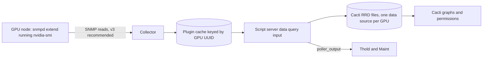

<!-- Source: README.md; SHA256: cb3865a085270dfe8ee8d421f0e19cbf9abcdcfc9c91544f1aa566ab29198618 -->

<!-- translations:start -->
[English](../../../README.md) | [简体中文](../zh-CN/README.md) | [हिन्दी](../hi-IN/README.md) | [Español (España)](../es-ES/README.md) | [Español (Latinoamérica)](../es-419/README.md) | [العربية](README.md)
<!-- translations:end -->

# plugin_gpu

ملحق لـ Cacti 1.2 يجلب استخدام كل GPU وذاكرته وحرارته وقدرته وأخطاء ECC وأسباب خفض الأداء من أدوات NVIDIA إلى Cacti. دعم AMD وجمع أخطاء XID مخططان، ولم يُنفذا بعد. يصبح كل GPU فهرسًا لاستعلام بيانات على جهاز عقدته، فتظهر رسومه بجوار رسوم العقدة الأخرى ضمن صلاحيات Cacti، ويمكن لـ Thold وMaint إطلاق التنبيهات وكتمها.

> **الحالة: قيد التطوير، لم يصدر بعد.** يكمل المعلم 4 شيفرة المرحلة 1 (NVIDIA عبر SNMP extend): الجمع والهوية والرسوم وإشارات خفض التردد وECC وتنبيه Thold وMaint وصفحة الصحة ووثائق المشغّل. لم يُشغّل إلا مع `snmpd` حقيقي و`nvidia-smi` محاكى يطبع خرجًا اصطناعيًا، ولم يُشغّل قط على عتاد GPU. ما يزال مطلوبًا قبل الإصدار: تجارب على عتاد حقيقي ([docs/pilot-plan.md](../../pilot-plan.md)، #54)، ومراجعة أمنية خارجية ([docs/security-review.md](../../security-review.md))، وعينات ملتقطة من أدوات حقيقية (#14)، وقياس الحجم على عتاد بحجم الإنتاج ([docs/performance.md](docs/performance.md)). تنتظر أخطاء XID القرار #8. لا تستخدمه في الإنتاج.

## أدوار الوصول

| المجال | الوصول |
| --- | --- |
| GPU View | صفحات المراقبة الحالية. |
| GPU Operator | المراقبة إضافةً إلى صفحة العمليات وإقرارات الفرز الشخصية. |
| GPU Admin | وصول Operator إضافةً إلى الإعداد والإجراءات الإدارية الحالية. |

بعد نسخ ملفات الترقية، افتح صفحة الملحقات كمسؤول لتسجيل المجال الجديد. عيّن مجال Operator صراحةً ضمن **الإعداد > المستخدمون** أو مجموعات المستخدمين. تحتفظ الترقيات بمعرّفات مجالي View وAdmin ومنحهما الحاليين. يرث Admin وصول Operator، ويرث Operator وصول View في كل طلب؛ ولا يضيف ذلك منحًا مخزنة للمستخدمين أو المجموعات. تتطلب إعدادات الملحق وصول GPU Admin إضافةً إلى صلاحية Settings في Cacti.

تظل صلاحيات أجهزة Cacti تحدّ الصفوف والإجراءات المتاحة لكل مستخدم؛ وتتطلب الكائنات غير المربوطة مسؤولًا. تبقى بيانات الاعتماد والإعداد والربط والحذف والتغييرات الإدارية الأخرى في الصفحات الإدارية. تستمر الإقرارات في جلسة المستخدم الحالي فقط، لمدة ساعة كحد أقصى وطالما بقيت الملاحظة نفسها حديثة. تبطلها الملاحظات الجديدة أو المتغيرة. لا تجعل القياس الفاشل سليمًا ولا تكبت التنبيهات مطلقًا.

## الدافع

تكون عقد GPU عادةً موجودة بالفعل في Cacti لمراقبة CPU والذاكرة والواجهات. صحة GPU مسألة أخرى لا تجيب عنها بيانات SNMP للعقدة: قد تُخفض سرعة بطاقة بسبب الحرارة أو تتراكم أخطاء ECC أو يُبلّغ عطل XID بينما تبدو العقدة نفسها سليمة. تبلّغ أدوات الشركات ذلك (`nvidia-smi` وDCGM و`amd-smi`)، لكن خرجها خارج رسوم Cacti وصلاحياته وتنبيهاته.

يسد الملحق هذه الفجوة بتحويل خرج أدوات الشركات إلى مصادر بيانات Cacti، بمفاتيح تعتمد هوية كل GPU لا موضعها، كي لا تربط إعادة تشغيل تغيّر ترتيب GPU تاريخ بطاقة بأخرى. يعيد استخدام رسوم Cacti وصلاحياته ومجمّعاته البعيدة وThold وMaint بدل بناء نسخ موازية منها.

## النطاق المخطط

| المرحلة | النطاق | المعالم |
|---|---|---|
| 0، البحث | خرج أدوات الشركات وإشارات XID وخفض التردد وهوية GPU والامتيازات وقرار مسار الجمع | [M1](https://github.com/somethingwithproof/plugin_gpu/milestone/1) |
| 1، nvidia | جمع `nvidia-smi`، وجرد حسب UUID، ورسوم، وإشارات خفض التردد وECC وXID، وThold وMaint، وصفحة الصحة | [M2](https://github.com/somethingwithproof/plugin_gpu/milestone/2)، [M3](https://github.com/somethingwithproof/plugin_gpu/milestone/3)، [M4](https://github.com/somethingwithproof/plugin_gpu/milestone/4) |
| 2، الواجهات الخلفية | واجهة DCGM وواجهة `amd-smi` | [M5](https://github.com/somethingwithproof/plugin_gpu/milestone/5) |
| 3، MIG والبعيد | مثيلات MIG ومجمّعات بيانات Cacti البعيدة | [M6](https://github.com/somethingwithproof/plugin_gpu/milestone/6) |

خارج النطاق: أي أمر يغيّر GPU أو العقدة (الساعات وحدود الطاقة وإعادة الضبط وتخطيط MIG)، ومحرك تنبيه خاص بالملحق، وخدمة خلفية أو بروتوكول شبكي مخصص، ومحاسبة المجدول أو المهام. راجع الخطة لقائمة البحث المتبقية.

## ما يضيفه المعلم 4

- **أسباب خفض التردد كقيم تنبيه.** يُفك قناع أحداث الساعة إلى مؤشر 0 أو 1 لكل سبب؛ يعطي القناع المجهول مؤشرات مجهولة لا أصفارًا، وتبقى البتات بلا مؤشر في القناع الخام الذي تعرضه صحة GPU.
- **ECC كقيم تنبيه** ([docs/metrics.md](docs/metrics.md)). يحسب الملحق الأخطاء المصحّحة وغير المصحّحة الجديدة منذ العينة السابقة من مجموعين متتاليين، ويخزنها كقيم gauge: مجهولة لأول عينة أو قراءة مفقودة أو إعادة تحميل برنامج التشغيل، فلا تظهر إعادة الضبط كصفر أو عدد سالب. تُقرأ أيضًا أعداد الصفحات المحالة إلى التقاعد بعد أخطاء أحادية وثنائية البت ووضع ECC. يتيح رسمان إضافيان لأخطاء ECC لكل GPU تخزينها في Cacti؛ ومع رسم نسبة الطاقة يصبح الإجمالي أحد عشر رسمًا. لا يُجمع XID: لا مصدر يناسب أوامر `nvidia-smi` الثابتة (#8).
- **Thold وMaint** ([docs/alerting.md](docs/alerting.md)). قوالب Thold مرفقة للحرارة والطاقة نسبةً إلى حدها ومؤشرات خفض التردد وأخطاء ECC غير المصحّحة الجديدة وانتظار تقاعد الصفحات وعمر العينة. كل قيمة gauge لأن Thold 1.8.2 يفشل مع عداد مجهول. يبيّن اختبار شامل مع Thold 1.8.2 وMaint 1.3 دون تعديل تشغيل كل عتبة واستعادتها عبر إعادة ضبط ECC وكبتها بواسطة Maint.
- **صحة GPU** (GPU View). لكل عقدة: الحداثة ونتيجة آخر جمع وحالة Maint وإصدارات الواجهة الخلفية والأداة وبرنامج التشغيل وأعداد GPU؛ ولكل GPU: الوجود وعمر العينة وحالة ECC والقناع الخام. تقرأ السجلات المخزنة فقط.
- **الصلاحيات.** تغطي مجموعة اختبارات الصلاحيات كل ملف صفحة وإجراء، وسحب الصلاحية في الطلب التالي، ورفضًا لا يكشف أي معلومات.
- **تأهيل الفشل والاستعادة.** تُعطّل تشغيلات شاملة مبرمجة الوكيل وبيانات الاعتماد والأداة وخرجها واتصال قاعدة البيانات وكتابة RRD، وتستعيد قاعدة البيانات من تفريغ، بما فيه تفريغ أقدم من ملفات RRD؛ ولا ترث GPU جديدة ملف RRD لأخرى مطلقًا ([docs/backup.md](docs/backup.md)).
- **الحجم** ([docs/performance.md](docs/performance.md)). يقيس اختبار الحجم أزمنة الجمع وإدخال خادم السكربت وإنشاء كائنات Cacti ودورة المستطلع وصفحة الصحة لعدد GPU محدد؛ يشغله CI عند 100 GPU. لم تُسجل قياسات 1,000 و8,000 GPU بعد، لذا لا يُعلن عدد GPU مدعوم.
- **وثائق المشغّل** ([docs/operations.md](docs/operations.md)): التثبيت والترقية والإزالة وأقل الامتيازات والقيم غير المتاحة واستكشاف الأخطاء. التغييرات في [CHANGELOG.md](../../../CHANGELOG.md).

## ما يضيفه المعلم 3

- **الجمع عبر SNMP extend** ([ADR 0008](../../decisions/0008-collect-through-snmp-extend.md)). يضيف مسؤول العقدة سطري `extend` ثابتين إلى `snmpd.conf` ([docs/node-setup.md](docs/node-setup.md))؛ ويقرأ الملحق NET-SNMP-EXTEND-MIB عبر دوال SNMP في Cacti ببيانات اعتماد الجهاز نفسه؛ ويوصى بـSNMPv3. لا يشغّل شيئًا على خادم Cacti أو العقدة.
- **تحليل صارم.** تُقرأ الحقول حسب الموضع وتسمّي كل سطر GPU بواسطة UUID؛ وتفشل عملية الجمع كاملةً عند حالة خروج غير صفرية أو انتهاء مهلة أو خرج مبتور أو عدد حقول خاطئ أو نص خطأ مدمج: تصبح القيم `U`، ولا تُعلّم GPU غائبة، وتعرض عقد GPU السبب.
- **مجمّع بعد كل دورة مستطلع.** يقرأ وكيل كل عقدة مفعّلة ويحدّث سجلات الهوية ويخزّن آخر عينة مؤقتًا. يقرأ إدخال خادم السكربت هذه الذاكرة فقط، فلا ينتظر استطلاع Cacti عقدة GPU مطلقًا.
- **كائنات Cacti** ([ADR 0010](../../decisions/0010-attach-to-existing-node-devices.md)). تُرفق القوالب واستعلام *GPU - Devices* كـXML وتُستورد عند التثبيت والترقية. يربط حفظ العقدة الاستعلام بجهازها الحالي بطريقة إعادة فهرسة None؛ ولا تستطيع عقد GPU إنشاء جهاز إلا إذا لم تملك العقدة جهازًا. كل GPU فهرس بمفتاح الشركة وUUID، مع مصدر بيانات واحد تشترك فيه رسوم الاستخدام والذاكرة والحرارة والطاقة ونسبة الطاقة والساعات وخفض التردد وأخطاء ECC وأخطاء ECC الجديدة والصفحات المتقاعدة وعمر العينة. يُرسم كل حقل نموذج في رسم ما، لأن Cacti لا يخزّن إلا حقولًا تستخدمها الرسوم. يعيد الملحق الفهرسة بعد كل تغيير GPU، ويحتفظ بإعادة فهرسة تخطاها Cacti حين كان الجهاز متوقفًا أو معطّلًا وينفذها عندما ينشط، وينشئ رسوم GPU الجديدة.
- **يبقى التاريخ مع البطاقة.** تظل GPU الغائبة فهرسًا، فتظهر فجوة في رسومها وتستأنف في ملف RRD نفسه عند عودتها. تحصل البطاقة البديلة في الفتحة نفسها على مصدرها الخاص. يزيل **إزالة من استعلام البيانات** على صفحة العقدة GPU الغائبة من القائمة؛ تبقى ملفات RRD ورسومها حتى تحذفها.
- **صلاحيات الأجهزة في عقد GPU.** لا يرى GPU Admin ولا يغيّر ولا يصدّر ولا ينقل إلا عقد وGPU أجهزة يجوز له رؤيتها في Cacti؛ ويتطلب نقل GPU كلا العقدتين. العقدة التي حُذف جهازها لا يمكن إلا تعطيلها.
- **نموذج المقاييس المشترك** ([ADR 0009](../../decisions/0009-common-metric-core-with-vendor-extensions.md)، [docs/metrics.md](docs/metrics.md)). الذاكرة بالبايت، ويُفك قناع أحداث الساعة إلى مؤشرات `thr_*`، و`age` عمر وقت العينة الخاصة بـGPU، أو `U` عند الجهل به.

يجب أن يستطيع مستخدم التثبيت (خادم الويب) الكتابة إلى `<cacti>/resource/script_server/` حيث يضع الملحق XML استعلام البيانات؛ وإلا يتوقف التثبيت والترقية برسالة ويعيدان المحاولة لاحقًا. لا تزيل الإزالة القوالب وXML إلا عند تحديد *إزالة كائنات Cacti الخاصة بالملحق عند الإزالة*، ولا تحذف ملفات RRD أو الأجهزة أو الرسوم أو مصادر البيانات مطلقًا ([docs/operations.md](docs/operations.md#uninstall)). لا تُجمع عقد المجمّعات البعيدة حتى المرحلة 3.

## ما يقدمه المعلم 2

- **تثبيت محمي.** على PHP أقل من 8.2 يُرفض التثبيت والتفعيل برسالة تحدد الإصدار المطلوب ويستمر باقي Cacti بالعمل. يمكن تحليل `setup.php` وسكربتات الصفحات على PHP 8.0.
- **دورة الحياة.** التثبيت والترقية والتعطيل والإزالة عبر صفحة ملحقات Cacti. الترقيات مرتبة وتكتمل بعد الانقطاع ولا تغيّر الإصدار المسجل إلا عند نجاحها. تحتفظ الإزالة بجداول الملحق ما لم تُلغِ *الاحتفاظ بجداول الملحق عند الإزالة*؛ ولا تمس جهاز Cacti أو مصدر بيانات أو رسمًا أو ملف RRD مطلقًا.
- **مجالات منفصلة.** يفتح *GPU Admin* صفحة **عقد GPU** لتسجيل أجهزة Cacti كعقد GPU وتأكيد نقل GPU بين العقد أو رفضه وتصدير كل سجل كـJSON. يفتح *GPU View* **جرد GPU** الذي يسرد GPU على أجهزة يمكن للمشاهد رؤيتها فقط. الصفحتان تحت الإدارة، وكل تغيير طلب POST يفحصه csrf-magic.
- **سجلات هوية GPU.** مفتاح كل GPU هو الشركة وUUID. الفهرس ومعرّف ناقل PCI والاسم وبرنامج التشغيل وأداة الإبلاغ سمات تتغير في موضعها. يُعلّم UUID جديد في فتحة معروفة كبديل محتمل ويبدأ تاريخه الخاص؛ ولا تُنقل GPU مرصودة على عقدة أخرى إلا بتأكيد المشغّل؛ وتُعلّم GPU المفقودة من جمع ناجح غائبة بعد عدد قابل للضبط ولا تُحذف مطلقًا. لا تُقبل حاليًا إلا UUID لوحدات NVIDIA الكاملة؛ تنتظر مثيلات MIG القرار #13، وAMD البحث #19. تُختبر القواعد بتسلسلات عينات، إذ لا يوجد مجمّع يغذيها بعد.
- **الاختبارات وCI.** مجموعات وحدة وقواعد مصدر دون GPU أو قاعدة بيانات، وفحوص دورة الحياة وصلاحيات الصفحات على Cacti 1.2.31 و1.2.x الحالي مع PHP 8.2 إلى 8.5، ومهمة رفض PHP 8.1، وفحص صياغة نقاط الدخول على PHP 8.0، وPHPStan بالمستوى 9 وREUSE. بيئة الاختبار مؤقتة حتى يُحسم #12.

### التثبيت للتقييم

تثبّت الخطوات التالية الشيفرة الحالية لتجربتها؛ الدليل الكامل في [docs/operations.md](docs/operations.md). تتطلب Cacti 1.2.31 أو أحدث على PHP 8.2 أو أحدث.

1. انسخ المستودع إلى `plugins/gpu` تحت دليل Cacti. يجب أن يُسمّى الدليل `gpu`.
2. في Cacti، افتح **الإعداد > الملحقات** ثم ثبّت **GPU** وفعّله.
3. امنح المستخدمين نطاق *GPU View* أو *GPU Operator* أو *GPU Admin* ضمن **الإعدادات > المستخدمون** بحسب دورهم. يحصل مستخدم التثبيت على View وAdmin؛ ويشمل Admin وصول Operator.
4. اضبط وكيل SNMP لكل عقدة كما في [docs/node-setup.md](docs/node-setup.md)، ثم أضفها ضمن **الإدارة > عقد GPU**.
5. للتنبيهات، استورد قوالب Thold المرفقة كما في [docs/alerting.md](docs/alerting.md).
6. اختياريًا اضبط **الإعداد > الإعدادات > GPU**: *تعليم الغياب بعد* (افتراضيًا 3 عمليات جمع ناجحة، من 1 إلى 100)، و*التقادم بعد* (عمر العينة قبل عرض القيم `U`)، و*الاحتفاظ بجداول الملحق عند الإزالة* (مفعّل افتراضيًا).

## كيف تصل المقاييس إلى Cacti

اختار القرار [#7](https://github.com/somethingwithproof/plugin_gpu/issues/7) SNMP `extend` ([ADR 0008](../../decisions/0008-collect-through-snmp-extend.md)): يشغّل وكيل العقدة أمر `nvidia-smi` ثابتًا ويقرأ الملحق النتيجة فقط. تقارن الخطة الخيارات تحت [مسارات الجمع](../../PLAN.md#collection-paths).

## أهداف التوافق

| المكوّن | الهدف |
|---|---|
| Cacti | 1.2.31 أو أحدث، دون ترقيعات للنواة |
| PHP | 8.2 أو أحدث؛ يبقى `setup.php` قابلًا للتحليل على 8.0 كي يُرفض وقت التشغيل غير المدعوم بدل تعطيل واجهة Cacti |
| NVIDIA | خطوط برامج التشغيل والأدوات يحددها البحث [#26](https://github.com/somethingwithproof/plugin_gpu/issues/26)؛ فُحصت معرّفات حقول DCGM عند v3.3.9 وv4.7.0 |
| AMD | `amd-smi` على إصدارات ROCm يحددها البحث [#26](https://github.com/somethingwithproof/plugin_gpu/issues/26) |
| Thold وMaint | Thold 1.8.2 وMaint 1.3 دون تعديل، باختبار شامل ([docs/alerting.md](docs/alerting.md)) |

## التصميم

- [docs/PLAN.md](../../PLAN.md) الخطة الكاملة: المعمارية والحقائق المعتمدة من المشاريع الأصلية (بمصادرها) ونموذج الهوية وحدود الأمان وحسابات الأداء والاختبار والمخاطر.
- يحوي [docs/decisions/](../../decisions) سجلات القرارات المعمارية المتخذة.
- يربط [docs/REQUIREMENTS.md](../../REQUIREMENTS.md) كل معرّف متطلب بقضيته.

## كيفية تتبع العمل

- تتبع **المعالم** معالم الخطة. لكل منها قضية ملحمية تسرد قضاياها الفرعية وأدلة الإكمال.
- تُصنّف **القضايا** بالوسوم: `type: requirement` و`type: research` و`type: decision` و`type: epic`. تذكر قضايا المتطلبات متطلبات مرقمة قابلة للاختبار (`REQ-AREA-NNN`) ومعايير قبول.
- تحمل **الوسوم** أيضًا `area:` و`phase:` و`priority:` و`status:`. راجع [CONTRIBUTING.md](../../../CONTRIBUTING.md#labels).
- تعرض [لوحة المشروع](https://github.com/users/somethingwithproof/projects/9) جميع القضايا عبر المعالم.

## المساهمة

اقرأ [CONTRIBUTING.md](../../../CONTRIBUTING.md). تتطلب الالتزامات توقيع DCO. نقاش التصميم في القضايا؛ تحمل القرارات المفتوحة الوسم `type: decision`. الخرج الملتقط من أدوات GPU حقيقية أكثر مساهمة فائدة للمعلم 1؛ أزل أسماء المضيفين والأرقام التسلسلية وUUID أولًا.

## الأمان

أبلغ عن الثغرات بصورة خاصة؛ راجع [SECURITY.md](../../../SECURITY.md).

## الترخيص

رخصة GNU العمومية العامة v2.0، وهي رخصة Cacti وملحقاته نفسها. راجع [LICENSE](../../../LICENSE).
