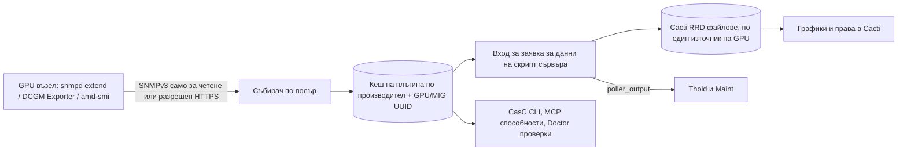

<!-- Source: README.md; SHA256: 97ba37df4a883426d3984ed7d14547ad7367e973411a8abd930409ce259f545b -->

<!-- translations:start -->
[English](../../../README.md) | [简体中文](../zh-CN/README.md) | [हिन्दी](../hi-IN/README.md) | [Español (España)](../es-ES/README.md) | [Español (Latinoamérica)](../es-419/README.md) | [العربية (السعودية)](../ar-SA/README.md) | [Afrikaans](../af-ZA/README.md) | [አማርኛ](../am-ET/README.md) | [العربية (مصر)](../ar-EG/README.md) | [العربية (المغرب)](../ar-MA/README.md) | [Български](README.md) | [বাংলা](../bn-BD/README.md) | [Bosanski](../bs-BA/README.md) | [Deutsch](../de-DE/README.md) | [Ελληνικά](../el-GR/README.md) | [فارسی](../fa-IR/README.md) | [Filipino](../fil-PH/README.md) | [Français](../fr-FR/README.md) | [Français (Maroc)](../fr-MA/README.md) | [Français (Sénégal)](../fr-SN/README.md) | [Hausa](../ha-NG/README.md) | [עברית](../he-IL/README.md) | [Hrvatski](../hr-HR/README.md) | [Bahasa Indonesia](../id-ID/README.md) | [Igbo](../ig-NG/README.md) | [Italiano](../it-IT/README.md) | [日本語](../ja-JP/README.md) | [ქართული](../ka-GE/README.md) | [한국어](../ko-KR/README.md) | [Latviešu](../lv-LV/README.md) | [Malagasy](../mg-MG/README.md) | [मराठी](../mr-IN/README.md) | [Bahasa Melayu](../ms-MY/README.md) | [Nederlands](../nl-NL/README.md) | [Polski](../pl-PL/README.md) | [Português (Brasil)](../pt-BR/README.md) | [Português (Portugal)](../pt-PT/README.md) | [Русский](../ru-RU/README.md) | [Kinyarwanda](../rw-RW/README.md) | [Soomaali](../so-SO/README.md) | [Српски](../sr-RS/README.md) | [Svenska](../sv-SE/README.md) | [Kiswahili](../sw-KE/README.md) | [தமிழ்](../ta-IN/README.md) | [తెలుగు](../te-IN/README.md) | [ไทย](../th-TH/README.md) | [Türkçe](../tr-TR/README.md) | [Українська](../uk-UA/README.md) | [اردو](../ur-PK/README.md) | [Tiếng Việt](../vi-VN/README.md) | [isiXhosa](../xh-ZA/README.md) | [Yorùbá](../yo-NG/README.md) | [繁體中文](../zh-TW/README.md) | [isiZulu](../zu-ZA/README.md)
<!-- translations:end -->

# plugin_gpu

Плъгин за Cacti 1.2, който внася натоварването на отделните GPU, паметта, температурата, консумираната мощност, ECC грешките и причините за ограничаване на честотата (throttling) от инструментите на NVIDIA и AMD в Cacti. Всеки GPU (или MIG инстанция) става индекс в заявка за данни на устройството на своя възел, така че графиките за GPU стоят до останалите графики на възела под правата на Cacti, а Thold и Maint могат да известяват и потискат известия за тях.

> **Състояние: фази от 1 до 3 са реализирани в кода, но все още няма издадена версия.** Фаза 1 (NVIDIA `nvidia-smi` чрез SNMP extend, проследяване на идентичността, графики, сигнали за ограничаване и ECC, известяване чрез Thold и Maint, страница за състоянието), Фаза 2 (анализатор/клиент само за четене за NVIDIA DCGM Exporter по HTTP(S) и анализатор за AMD `amd-smi`), Фаза 3 (проследяване на идентичността на MIG инстанции, колони от Схема v4, изпълнение на отдалечен събирач по полър, куки `replicate_out` и `remote_agent`), операторският CasC CLI (`cli/gpu.php`) и куките за екосистемата (`abilities_register`, `doctor_register_checks`, `casc_register_providers`) са реализирани и покрити с модулни тестове, тестове за сигурност и интеграционни тестове с временна инстанция на Cacti. Изпълненията на живо до момента използват синтетичен `snmpd` и фикстурни данни вместо физически GPU хардуер. Преди маркиране на издание остават отворени: пилотни внедрявания на реален хардуер ([docs/pilot-plan.md](../../pilot-plan.md), #54), външен одит на сигурността ([docs/security-review.md](../../security-review.md)), фикстури, заснети от реални инструменти (#14), и измервания на мащабируемостта върху хардуер с производствен размер ([docs/performance.md](../../performance.md)). Събирането на XID грешки остава отворено по решение #8.

## Роли за достъп

| Област на достъп | Достъп |
| --- | --- |
| Преглед на GPU (GPU View) | Съществуващите страници за наблюдение. |
| Оператор на GPU (GPU Operator) | Наблюдение плюс страницата „Операции“ и лични потвърждения за преглед при триаж. |
| Администриране на GPU (GPU Admin) | Операторски достъп плюс съществуващите конфигурационни и административни действия. |

След копиране на файловете за надграждане отворете страницата „Плъгини“ като администратор, за да регистрирате новата област на достъп. Назначете областта „Оператор“ изрично в **Конфигурация > Потребители** или в потребителски групи. Надгражданията запазват съществуващите идентификатори и права на областите View и Admin. Администраторският достъп наследява операторския, а операторският наследява достъпа за преглед при всяка заявка; това не добавя записани права към потребители или групи. Настройките на плъгина изискват също достъп GPU Admin в допълнение към правото за „Настройки“ в Cacti.

Правата за устройства в Cacti продължават да ограничават редовете и действията, достъпни за всеки потребител; несвързаните обекти изискват администратор. Идентификационните данни, конфигурацията, свързването, изтриването и другите административни промени остават в административните страници. Потвържденията са валидни само в текущата сесия на потребителя, най-много за един час и само докато същото наблюдение остава актуално. Нови или променени наблюдения ги обезсилват. Те никога не отбелязват неуспешно измерване като изправно и не потискат известия.

## Защо

GPU възлите обикновено вече присъстват в Cacti за наблюдение на CPU, памет и мрежови интерфейси. Състоянието на GPU е отделен въпрос, на който стандартните SNMP данни на възела не отговарят: дадена карта може да е термично ограничена, да натрупва ECC грешки или да докладва XID повреда, докато самият възел изглежда изправен. Инструментите на производителите отчитат това (`nvidia-smi`, DCGM, `amd-smi`), но техният изход остава извън графиките, правата и известяването на Cacti.

Плъгинът запълва тази празнина, като превръща изхода на инструментите на производителите в източници на данни в Cacti, индексирани по идентичността на всеки GPU вместо по позицията му, така че рестартиране, което пренарежда GPU устройствата, не прикачва историята на една карта към друга. Той използва повторно графиките, правата, отдалечените събирачи на данни, Thold и Maint на Cacti, вместо да изгражда паралелни техни версии.

## Планиран обхват

| Фаза | Обхват | Състояние | Етапи |
|---|---|---|---|
| 0, проучване | Изход на инструментите на производителите, XID и сигнали за ограничаване, идентичност на GPU, привилегии, решение за пътя за събиране | Завършена | [M1](https://github.com/somethingwithproof/plugin_gpu/milestone/1) |
| 1, nvidia | Събиране чрез `nvidia-smi`, инвентар по UUID, графики, сигнали за ограничаване и ECC, Thold и Maint, страница за състоянието | Реализирана (тествана с фикстури) | [M2](https://github.com/somethingwithproof/plugin_gpu/milestone/2), [M3](https://github.com/somethingwithproof/plugin_gpu/milestone/3), [M4](https://github.com/somethingwithproof/plugin_gpu/milestone/4) |
| 2, бекенди | Анализатор/клиент само за четене за DCGM Exporter по HTTP(S) (`lib/DcgmExporterParser.php`, `lib/DcgmExporterClient.php`), анализатор за AMD `amd-smi` (`lib/AmdSmiParser.php`) | Реализирана (модулно тествана) | [M5](https://github.com/somethingwithproof/plugin_gpu/milestone/5) |
| 3, mig, отдалечено събиране и екосистема | Проследяване на идентичността на MIG инстанции, отдалечени събирачи на данни (`INFO`, `poller_gpu.php --poller=N`, `replicate_out`, `remote_agent`), CasC CLI (`cli/gpu.php`), куки за MCP/Doctor/CasC | Реализирана (тествана с модулни и CI интеграционни тестове) | [M6](https://github.com/somethingwithproof/plugin_gpu/milestone/6) |

Извън обхвата: всякакви команди, които променят GPU или възел (честоти, ограничения на мощността, нулирания, MIG конфигурация), собствен механизъм за известяване в плъгина, собствен демон или мрежов протокол, както и отчитане на планировчик или задачи. Вижте плана за изследователския списък със задачи.

## Какво добавя етап 4

- **Събирач само за четене за NVIDIA DCGM Exporter** (`lib/DcgmExporterParser.php`, `lib/DcgmExporterClient.php`). Анализира текстовия формат за експозиция на Prometheus (`DCGM_FI_DEV_GPU_UTIL`, `DCGM_FI_DEV_FB_USED`, `DCGM_FI_DEV_FB_FREE`, `DCGM_FI_DEV_POWER_USAGE`, `DCGM_FI_DEV_GPU_TEMP`, `DCGM_FI_DEV_ECC_DBE_VOL_TOTAL`, `DCGM_FI_DEV_CLOCK_THROTTLE_REASONS`, както и MIG етикетите `GPU_I_ID` и `GPU_I_PROFILE`). HTTP(S) клиентът налага изричен списък с разрешени хостове/CIDR адреси за крайни точки, проверява TLS сертификатите по подразбиране, ограничава времето за изчакване и размера на отговора, забранява пренасочванията и отхвърля схеми, различни от HTTP(S).
- **Анализатор само за четене за AMD `amd-smi`** (`lib/AmdSmiParser.php`). Нормализира изхода на `amd-smi` в JSON/SNMP-extend формат (натоварване, VRAM, мощност, температура на прехода/ръба, ECC, метаданни за дялове и отделни акумулатори за ограничаване чрез `Reading::$vendorExtensions`) в общия метричен модел под `Vendor::Amd`.
- **Проследяване на MIG инстанции и Схема v4** (`lib/GpuReport.php`, `lib/GpuSnapshot.php`, `lib/GpuRecord.php`, `lib/Schema.php`, `lib/ScriptServer.php`). Проследява UUID на MIG инстанции (`MIG-<uuid>` и `MIG-GPU-<parent>/<gi>/<ci>`), `mig_mode`, `mig_instance_id`, `mig_profile`, `parent_uuid` и `partition_info` редом с родителските GPU, като запазва неизменяемите ключове за идентичност (`vendor`, `uuid`, `parent_uuid`) защитени при актуализации и валидирани преди заявки към базата данни.
- **Отдалечени събирачи на данни** (`INFO`, `poller_gpu.php`, `lib/Poller.php`, `lib/ReplicationRepository.php`, `setup.php`). Декларира `remote_collect:1, remote_poller:1` в `INFO`, поддържа изпълнение с обхват по полър чрез `php plugins/gpu/poller_gpu.php --poller=N`, пропуска създаването на Cacti обекти на полъри, различни от главния, репликира таблиците с обхват по полър чрез `replicate_out` и отговаря на действия само за четене `gpu_health` и `gpu_inventory` чрез `remote_agent`.
- **Операторски и CasC CLI** (`cli/gpu.php`, `lib/CascProvider.php`). Работи на PHP 8.2+ (синтактично валиден на PHP 8.0) без външни зависимости от Composer: `php plugins/gpu/cli/gpu.php export [--format=yaml|xml]`, `validate <file> [--format=yaml|xml]`, `plan <file> [--format=yaml|xml] [--output=text|json]`, `apply <file> --confirm=<PLAN_HASH> [--format=yaml|xml]` и `health [--format=text|json]`. Плановете изчисляват детерминиран SHA-256 хеш за потвърждение, `apply` отказва безопасно при несъответствие на хеша, а XML анализът отхвърля декларации `DOCTYPE` и `ENTITY`.
- **Куки за интеграция с екосистемата** (`lib/EcosystemIntegration.php`, `setup.php`). Регистрира `abilities_register` (`gpu-list-nodes`, `gpu-list-devices`, `gpu-get-health`; само за четене, ограничени от областта `GPU View` и правата за устройства в Cacti), `doctor_register_checks` (`gpu_schema`, `gpu_poller_freshness`, `gpu_node_health`) и `casc_register_providers`.
- **Причини за ограничаване и ECC като стойности за известяване** ([docs/metrics.md](../../metrics.md)). Декодира битовите маски на събитията за тактовата честота в индикатори 0/1 и изчислява новите коригирани/некоригирани ECC грешки за интервал като показатели (gauges), така че Thold 1.8.2 и Maint 1.3 известяват и потискат без отрицателни броячи или пикове при нулиране ([docs/alerting.md](../../alerting.md)).
- **Състояние на GPU, права, възстановяване при отказ и мащаб.** „Състояние на GPU“ (GPU View) показва записаната актуалност, последния резултат от събирането, състоянието в Maint, бекенда, версиите и суровите маски за ограничаване, без да се свързва с възлите. Скриптирани тестове от край до край проверяват правата, възстановяването при отказ на агент/БД/RRD ([docs/backup.md](../../backup.md)) и изпълнение със 100 GPU в CI ([docs/performance.md](../../performance.md), [docs/operations.md](../../operations.md), [CHANGELOG.md](../../../CHANGELOG.md)).

## Какво добавя етап 3

- **Събиране чрез SNMP extend** ([ADR 0008](../../decisions/0008-collect-through-snmp-extend.md)). Администраторът на възела добавя два фиксирани реда `extend` в `snmpd.conf` ([docs/node-setup.md](../../node-setup.md)); плъгинът чете NET-SNMP-EXTEND-MIB чрез SNMP функциите на Cacti със собствените идентификационни данни на устройството, като се препоръчва SNMPv3. Той не стартира нищо на сървъра Cacti или на възела.
- **Стриктен анализ.** Полетата се четат по позиция, всеки ред именува своя GPU чрез UUID, а ненулев код за изход, изтекло време, отрязан изход, ред с грешен брой полета или смесен текст на грешка провалят цялото събиране: стойностите стават `U`, нито един GPU не се отбелязва като отсъстващ, а „GPU възли“ показва причината.
- **Събирач след всеки цикъл на полъра.** Той чете агента на всеки активиран възел, обновява записите за идентичност и кешира последната извадка. Входът на скрипт сървъра чете само този кеш, така че анкетирането на Cacti никога не чака GPU възел.
- **Обекти в Cacti** ([ADR 0010](../../decisions/0010-attach-to-existing-node-devices.md)). Шаблоните и заявката за данни *GPU - Devices* се доставят като XML и се импортират при инсталиране и надграждане. Запазването на възел прикачва заявката за данни към съществуващото му устройство с метод на преиндексиране „Няма“; „GPU възли“ може да създаде устройство само когато възелът няма такова. Всеки GPU е индекс по производител и UUID, с един източник на данни, споделен от графиките му за натоварване, памет, температура, мощност, процент мощност, честоти, ограничаване, ECC грешки, нови ECC грешки, изведени страници и възраст на извадката. Всяко поле от модела се изчертава в някоя графика, тъй като Cacti съхранява само полетата, използвани от графика. Плъгинът преиндексира след всяка промяна на GPU, запазва пропуснато преиндексиране, докато устройството е било неактивно или деактивирано, и го изпълнява след възстановяването му, като създава графики за новите GPU.
- **Историята остава с картата.** Отсъстващият GPU остава индекс, така че графиките му показват прекъсване и продължават в същия RRD файл при завръщането му. Заместваща карта в същия слот получава собствен източник на данни. **Премахни от заявката за данни** на страницата на възела изважда отсъстващ GPU от списъка; RRD файловете и графиките му се запазват, докато не ги изтриете.
- **Права за устройства в „GPU възли“.** Потребител с GPU Admin вижда, променя, експортира и мести само възли и GPU на устройства, които има право да вижда в Cacti; преместването на GPU изисква права и за двата възела. Възел, чието устройство е изтрито, може да бъде деактивиран или изтрит.
- **Общият метричен модел** ([ADR 0009](../../decisions/0009-common-metric-core-with-vendor-extensions.md), [docs/metrics.md](../../metrics.md)). Паметта е в байтове, маската на събитията за тактовата честота се декодира в индикатори `thr_*`, а `age` е възрастта на собственото време на извадката на GPU, или `U`, когато е неизвестна.

Инсталиращият потребител (на уеб сървъра) трябва да може да записва в `<cacti>/resource/script_server/`, където плъгинът поставя XML файла на заявката за данни; в противен случай инсталирането и надграждането спират със съобщение и опитват отново при следващия опит. Деинсталирането премахва шаблоните и XML файла само когато е отметнато *Премахни обектите на плъгина в Cacti при деинсталиране*, и никога не изтрива RRD файлове, устройства, графики или източници на данни ([docs/operations.md](../../operations.md#uninstall)). Възлите на отдалечени събирачи на данни работят в обхвата на назначения им `poller_id`.

## Какво доставя етап 2

- **Защитено инсталиране.** При PHP под 8.2 инсталирането и активирането се отказват със съобщение, посочващо изискваната версия, а останалата част от Cacti продължава да работи. `setup.php` и скриптовете на страниците са синтактично валидни на PHP 8.0.
- **Жизнен цикъл.** Инсталиране, надграждане, деактивиране и деинсталиране през страницата „Плъгини“ на Cacti. Надгражданията са подредени, довършват се след прекъсване и променят записаната версия едва след успех. Деинсталирането запазва таблиците на плъгина, освен ако не премахнете отметката от *Запази таблиците на плъгина при деинсталиране*; то никога не докосва устройство, източник на данни, графика или RRD файл в Cacti.
- **Разделени области на достъп.** *GPU Admin* отваря **GPU възли**, където регистрирате устройства в Cacti като GPU възли, потвърждавате или отхвърляте премествания на GPU между възли и експортирате всички записи като JSON. *GPU View* отваря **Инвентар на GPU**, който изброява GPU само за устройствата, видими за потребителя. И двете страници са под „Управление“, а всяка промяна е POST заявка, проверена от csrf-magic.
- **Записи за идентичност на GPU.** Всеки GPU е индексиран по производител и UUID. Индексът, идентификаторът на PCI шината, името, драйверът и докладващият инструмент са атрибути, които се обновяват на място. Нов UUID в известен слот се маркира като възможна подмяна и започва собствена история; GPU, забелязан на друг възел, се премества само след потвърждение от оператор; GPU, липсващ при успешни събирания, се отбелязва като отсъстващ след конфигурируем брой опити и никога не се изтрива. Засега се приемат само NVIDIA UUID за цял GPU; MIG инстанциите чакат решение #13, а AMD — проучване #19. Правилата се проверяват чрез поредици от фикстури, тъй като все още няма събирач, който да ги захранва.
- **Тестове и CI.** Модулни тестове и проверки на правилата на кода без GPU или база данни, проверки на жизнения цикъл и правата на страниците спрямо Cacti 1.2.31 и текущия 1.2.x на PHP 8.2 до 8.5, задача за отказ на PHP 8.1, синтактична проверка на входните точки на PHP 8.0, PHPStan на ниво 9 и REUSE. Тестовата среда е временна до вземането на решение #12.

### Инсталиране за оценка

Тези стъпки инсталират текущия код за изпробване; [docs/operations.md](../../operations.md) съдържа пълното ръководство за оператори. Изискват Cacti 1.2.31 или по-нова версия на PHP 8.2 или по-нова.

1. Копирайте хранилището в `plugins/gpu` под директорията на Cacti. Директорията трябва да се казва `gpu`.
2. В Cacti отворете **Конфигурация > Плъгини**, след това инсталирайте и активирайте **GPU**.
3. Предоставете на потребителите областта *GPU View*, *GPU Operator* или *GPU Admin* в **Конфигурация > Потребители** според ролята им. Инсталиращият потребител получава View и Admin; Admin включва операторски достъп.
4. Настройте SNMP агента на всеки GPU възел, както е описано в [docs/node-setup.md](../../node-setup.md), след което добавете възела в **Управление > GPU възли**.
5. За известия импортирайте предоставените Thold шаблони, както описва [docs/alerting.md](../../alerting.md).
6. По желание коригирайте **Конфигурация > Настройки > GPU**: *Отбележи като отсъстващ след* (по подразбиране 3 успешни събирания, от 1 до 100), *Остарява след* (колко стара може да е извадка, преди стойностите ѝ да се отчитат като `U`) и *Запази таблиците на плъгина при деинсталиране* (включено по подразбиране).

## Как метриките достигат до Cacti

Решение [#7](https://github.com/somethingwithproof/plugin_gpu/issues/7) избра SNMP `extend` ([ADR 0008](../../decisions/0008-collect-through-snmp-extend.md)): собственият агент на възела изпълнява фиксирана команда `nvidia-smi`, а плъгинът само чете резултата. Планът сравнява вариантите в [Пътища за събиране на данни](../../PLAN.md#collection-paths).

## Цели за съвместимост

| Компонент | Цел |
|---|---|
| Cacti | 1.2.31 или по-нова, без кръпки в ядрото |
| PHP | 8.2 или по-нова; `setup.php` остава синтактично валиден на 8.0, така че неподдържана среда получава отказ вместо счупен интерфейс на Cacti |
| NVIDIA | Линиите на драйверите и инструментите ще бъдат определени от проучване [#26](https://github.com/somethingwithproof/plugin_gpu/issues/26); идентификаторите на полетата на DCGM са проверени при v3.3.9 и v4.7.0 |
| AMD | `amd-smi` за издания на ROCm, които ще бъдат определени от проучване [#26](https://github.com/somethingwithproof/plugin_gpu/issues/26) |
| Thold, Maint | Thold 1.8.2 и Maint 1.3, без промени, тествани от край до край ([docs/alerting.md](../../alerting.md)) |

## Дизайн

- [docs/PLAN.md](../../PLAN.md) е пълният план: архитектура, upstream факти, от които зависи (с източници), модел на идентичността, граници на сигурност, изчисления за производителност, тестване и рискове.
- [docs/decisions/](../../decisions/) съдържа записи на архитектурни решения за вече направените избори.
- [docs/REQUIREMENTS.md](../../REQUIREMENTS.md) свързва всеки идентификатор на изискване с неговата задача (issue).

## Как се проследява работата

- **Етапите (Milestones)** следват етапите от плана. Всеки има епична задача (epic issue), изброяваща подзадачите и доказателствата за завършване.
- **Задачите (Issues)** се класифицират чрез етикети: `type: requirement`, `type: research`, `type: decision`, `type: epic`. Задачите за изисквания формулират номерирани, проверими изисквания (`REQ-AREA-NNN`) и критерии за приемане.
- **Етикетите** съдържат също `area:`, `phase:`, `priority:` и `status:`. Вижте [CONTRIBUTING.md](../../../CONTRIBUTING.md#labels).
- [Таблото на проекта](https://github.com/users/somethingwithproof/projects/9) показва всички задачи по етапи.

## Принос

Прочетете [CONTRIBUTING.md](../../../CONTRIBUTING.md). Комитите изискват DCO подпис (`git commit -s`). Дискусиите по дизайна се водят в задачите; отворените решения носят етикета `type: decision`. Заснетият изход от реални GPU инструменти е най-полезният принос за етап 1; предварително премахнете имената на хостовете, серийните номера и UUID стойностите.

## Сигурност

Докладвайте уязвимости поверително; вижте [SECURITY.md](../../../SECURITY.md).

## Лиценз

GNU General Public License v2.0 — същият лиценз като Cacti и неговите плъгини. Вижте [LICENSE](../../../LICENSE).
