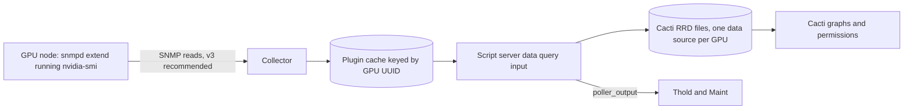

<!-- Source: README.md; SHA256: 126deef1783d64f878bf565f1433c10f31aef828eb9bc313aeff2b0335e54c7c -->

<!-- translations:start -->
[English](../../../README.md) | [简体中文](../zh-CN/README.md) | [हिन्दी](../hi-IN/README.md) | [Español (España)](../es-ES/README.md) | [Español (Latinoamérica)](../es-419/README.md) | [العربية (السعودية)](../ar-SA/README.md) | [Afrikaans](../af-ZA/README.md) | [አማርኛ](../am-ET/README.md) | [العربية (مصر)](../ar-EG/README.md) | [العربية (المغرب)](../ar-MA/README.md) | [বাংলা](README.md) | [Bosanski](../bs-BA/README.md) | [Deutsch](../de-DE/README.md) | [فارسی](../fa-IR/README.md) | [Filipino](../fil-PH/README.md) | [Français](../fr-FR/README.md) | [Français (Maroc)](../fr-MA/README.md) | [Français (Sénégal)](../fr-SN/README.md) | [Hausa](../ha-NG/README.md) | [עברית](../he-IL/README.md) | [Hrvatski](../hr-HR/README.md) | [Bahasa Indonesia](../id-ID/README.md) | [Igbo](../ig-NG/README.md) | [Italiano](../it-IT/README.md) | [日本語](../ja-JP/README.md) | [한국어](../ko-KR/README.md) | [Malagasy](../mg-MG/README.md) | [मराठी](../mr-IN/README.md) | [Bahasa Melayu](../ms-MY/README.md) | [Nederlands](../nl-NL/README.md) | [Polski](../pl-PL/README.md) | [Português (Brasil)](../pt-BR/README.md) | [Русский](../ru-RU/README.md) | [Kinyarwanda](../rw-RW/README.md) | [Soomaali](../so-SO/README.md) | [Српски](../sr-RS/README.md) | [Svenska](../sv-SE/README.md) | [Kiswahili](../sw-KE/README.md) | [தமிழ்](../ta-IN/README.md) | [తెలుగు](../te-IN/README.md) | [ไทย](../th-TH/README.md) | [Türkçe](../tr-TR/README.md) | [Українська](../uk-UA/README.md) | [اردو](../ur-PK/README.md) | [Tiếng Việt](../vi-VN/README.md) | [isiXhosa](../xh-ZA/README.md) | [Yorùbá](../yo-NG/README.md) | [繁體中文](../zh-TW/README.md) | [isiZulu](../zu-ZA/README.md)
<!-- translations:end -->

# plugin_gpu

একটি Cacti 1.2 প্লাগইন যা NVIDIA টুল থেকে প্রতি-জিপিইউ (per-GPU) ব্যবহার, মেমোরি, তাপমাত্রা, বিদ্যুৎ খরচ (power), ECC ত্রুটি এবং থ্রটলিংয়ের কারণসমূহ Cacti-তে নিয়ে আসে। AMD সমর্থন এবং XID ত্রুটি সংগ্রহের কাজ পরিকল্পিত রয়েছে, এখনো বাস্তবায়ন করা হয়নি। প্রতিটি জিপিইউ তার নোডের ডিভাইসে একটি ডেটা কোয়েরির সূচক (index) হিসেবে যুক্ত হয়, ফলে জিপিইউ গ্রাফগুলো Cacti-র অনুমতির আওতায় নোডের অন্যান্য গ্রাফের পাশেই অবস্থান করে এবং Thold ও Maint সেগুলোর ওপর সতর্কতা জারি ও দমন করতে পারে।

> **অবস্থা: উন্নয়নশীল পর্যায়ে রয়েছে, এখনো প্রকাশিত হয়নি।** মাইলস্টোন ৪-এর মাধ্যমে প্রথম ধাপ (SNMP extend-এর মাধ্যমে NVIDIA) কোডের দিক থেকে সম্পূর্ণ হয়েছে: সংগ্রহ, পরিচিতি, গ্রাফ, থ্রটল ও ECC সংকেত, Thold ও Maint সতর্কতা, হেলথ পেজ এবং অপারেটর ডকুমেন্টেশন। এটি কেবল কৃত্রিম আউটপুট প্রিন্ট করা একটি নকল `nvidia-smi` এবং একটি বাস্তব `snmpd`-এর বিপরীতে চালানো হয়েছে, প্রকৃত জিপিইউ হার্ডওয়্যারে কখনো চালানো হয়নি। প্রকাশের আগে এখনো যা বাকি রয়েছে: বাস্তব হার্ডওয়্যারে পাইলট পরীক্ষা ([docs/pilot-plan.md](../../pilot-plan.md), #54), একটি বাহ্যিক নিরাপত্তা পর্যালোচনা ([docs/security-review.md](../../security-review.md)), বাস্তব টুল থেকে সংগৃহীত ফিক্সচার (#14), এবং প্রোডাকশন-আকারের হার্ডওয়্যারে পরিমাপকৃত স্কেল ([docs/performance.md](../../performance.md))। XID ত্রুটিগুলো সিদ্ধান্ত #8-এর অপেক্ষায় রয়েছে। এটি প্রোডাকশনে চালাবেন না।

## প্রবেশাধিকারের ভূমিকা

| রিয়েলম (Realm) | প্রবেশাধিকার |
| --- | --- |
| GPU View | বিদ্যমান পর্যবেক্ষণ (monitoring) পেজসমূহ। |
| GPU Operator | পর্যবেক্ষণ পেজের পাশাপাশি অপারেশনস (Operations) পেজ এবং ব্যক্তিগত ট্রায়াজ স্বীকৃতি (triage acknowledgments)। |
| GPU Admin | অপারেটর প্রবেশাধিকারের পাশাপাশি বিদ্যমান কনফিগারেশন এবং প্রশাসনিক কার্যাবলি। |

আপগ্রেড ফাইলগুলো কপি করার পর, নতুন রিয়েলম নিবন্ধন করতে প্রশাসক হিসেবে Plugins পেজটি খুলুন। **Configuration > Users** অথবা ইউজার গ্রুপের অধীনে Operator রিয়েলমটি সুস্পষ্টভাবে নির্ধারণ করে দিন। আপগ্রেডের সময় বিদ্যমান View এবং Admin রিয়েলম আইডি ও অনুমোদনসমূহ (grants) অপরিবর্তিত থাকে। প্রতিটি অনুরোধে Admin প্রবেশাধিকার স্বয়ংক্রিয়ভাবে Operator প্রবেশাধিকার পায় এবং Operator প্রবেশাধিকার পায় View প্রবেশাধিকার; এটি ব্যবহারকারী বা গ্রুপে কোনো সংরক্ষিত অনুমোদন যোগ করে না। প্লাগইন সেটিংসের জন্য Cacti-র Settings অনুমতির পাশাপাশি GPU Admin প্রবেশাধিকারও প্রয়োজন হয়।

Cacti ডিভাইসের অনুমতিগুলো এখনো প্রতিটি ব্যবহারকারীর জন্য প্রদর্শিত সারি ও কার্যাবলি সীমাবদ্ধ রাখে; আনম্যাপড (unmapped) অবজেক্টগুলোর জন্য একজন প্রশাসকের প্রয়োজন হয়। ক্রেডেনশিয়াল, কনফিগারেশন, ম্যাপিং, মুছে ফেলা এবং অন্যান্য প্রশাসনিক পরিবর্তন প্রশাসনিক পেজগুলোতে থাকে। স্বীকৃতিগুলো (acknowledgments) কেবল ব্যবহারকারীর বর্তমান সেশনে সর্বোচ্চ এক ঘণ্টার জন্য এবং কেবল একই পর্যবেক্ষণ সতেজ (fresh) থাকা পর্যন্ত কার্যকর থাকে। নতুন বা পরিবর্তিত পর্যবেক্ষণ সেগুলোকে বাতিল করে দেয়। এগুলো কখনোই কোনো ব্যর্থ পরিমাপকে সুস্থ হিসেবে চিহ্নিত করে না বা সতর্কতা দমন করে না।

## কেন এই প্লাগইন

CPU, মেমোরি এবং ইন্টারফেস পর্যবেক্ষণের জন্য জিপিইউ নোডগুলো সাধারণত আগে থেকেই Cacti-তে যুক্ত থাকে। জিপিইউ-র স্বাস্থ্য একটি আলাদা বিষয়, যার উত্তর নোডের SNMP ডেটা দেয় না: নোড নিজে সুস্থ দেখালেও একটি কার্ড তাপমাত্রাজনিত কারণে থ্রটলড (thermally throttled) হতে পারে, ECC ত্রুটি জমা করতে পারে অথবা XID ত্রুটি জানাতে পারে। ভেন্ডর টুলগুলো (`nvidia-smi`, DCGM, `amd-smi`) এগুলো রিপোর্ট করে, কিন্তু সেগুলোর আউটপুট Cacti-র গ্রাফ, অনুমতি এবং সতর্কতা ব্যবস্থার বাইরে থেকে যায়।

এই প্লাগইনটি ভেন্ডর টুলের আউটপুটকে প্রতিটি জিপিইউ-র অবস্থানের পরিবর্তে তার নিজস্ব পরিচিতির (identity) ওপর ভিত্তি করে Cacti ডেটা সোর্সে রূপান্তর করে সেই শূন্যস্থান পূরণ করে; ফলে রিবুটের কারণে জিপিইউ-র ক্রম বদলে গেলেও এক কার্ডের ইতিহাস অন্য কার্ডে যুক্ত হয় না। এটি সমান্তরাল কোনো ব্যবস্থা তৈরি না করে Cacti-র নিজস্ব গ্রাফিং, অনুমতি, রিমোট ডেটা কালেক্টর, Thold এবং Maint পুনর্ব্যবহার করে।

## পরিকল্পিত পরিধি

| ধাপ | পরিধি | মাইলস্টোন |
|---|---|---|
| ০, গবেষণা | ভেন্ডর টুল আউটপুট, XID ও থ্রটল সংকেত, জিপিইউ পরিচিতি, অধিকার (privileges), সংগ্রহের পথ সংক্রান্ত সিদ্ধান্ত | [M1](https://github.com/somethingwithproof/plugin_gpu/milestone/1) |
| ১, এনভিডিয়া (nvidia) | `nvidia-smi` সংগ্রহ, UUID অনুযায়ী ইনভেন্টরি, গ্রাফ, থ্রটল, ECC ও XID সংকেত, Thold ও Maint, হেলথ পেজ | [M2](https://github.com/somethingwithproof/plugin_gpu/milestone/2), [M3](https://github.com/somethingwithproof/plugin_gpu/milestone/3), [M4](https://github.com/somethingwithproof/plugin_gpu/milestone/4) |
| ২, ব্যাকএন্ড | DCGM ব্যাকএন্ড, `amd-smi` ব্যাকএন্ড | [M5](https://github.com/somethingwithproof/plugin_gpu/milestone/5) |
| ৩, মিগ ও রিমোট | MIG ইনস্ট্যান্স, Cacti রিমোট ডেটা কালেক্টর | [M6](https://github.com/somethingwithproof/plugin_gpu/milestone/6) |

পরিকল্পনার বাইরে থাকা বিষয়সমূহ: জিপিইউ বা নোডে পরিবর্তন আনে এমন কোনো কমান্ড (ক্লক, পাওয়ার লিমিট, রিসেট, MIG লেআউট), প্লাগইনের নিজস্ব সতর্কতা ইঞ্জিন, কাস্টম ডেমন বা নেটওয়ার্ক প্রোটোকল, এবং শিডিউলার বা জব অ্যাকাউন্টিং। গবেষণার ব্যাকলগের জন্য পরিকল্পনাটি দেখুন।

## মাইলস্টোন ৪-এ যা যুক্ত হয়েছে

- **সতর্কতা মান হিসেবে থ্রটল কারণসমূহ।** ক্লক ইভেন্ট মাস্ককে প্রতিটি কারণের জন্য ০ অথবা ১ নির্দেশকে ডিকোড করা হয়; অজানা মাস্ক কখনো শূন্য দেয় না বরং অজানা নির্দেশক দেয়, এবং নির্দেশকবিহীন বিটগুলো মূল (raw) মাস্কে থেকে যায়, যা GPU Health প্রদর্শন করে।
- **সতর্কতা মান হিসেবে ECC** ([docs/metrics.md](../../metrics.md))। পূর্ববর্তী নমুনার পর থেকে নতুন সংশোধিত (corrected) এবং অসংশোধিত (uncorrected) ত্রুটিগুলো প্লাগইন পরপর দুটি মোট সংখ্যা থেকে হিসাব করে এবং গেজ (gauge) হিসেবে সংরক্ষণ করে: প্রথম নমুনা, মিস হওয়া পাঠ বা ড্রাইভার রিলোডের ক্ষেত্রে মান অজানা থাকে, যাতে রিসেট কখনো শূন্য বা ঋণাত্মক সংখ্যা হিসেবে পঠিত না হয়। অবসরপ্রাপ্ত (retired) সিঙ্গেল-বিট ও ডাবল-বিট পেজের সংখ্যা এবং ECC মোডও পঠিত হয়। প্রতি জিপিইউ-র জন্য দুটি অতিরিক্ত ECC গ্রাফ Cacti-তে এগুলো সংরক্ষণের সুযোগ দেয়; Power Percent-সহ মোট এগারোটি গ্রাফ রয়েছে। XID সংগ্রহ করা হয় না: নির্ধারিত `nvidia-smi` কমান্ডগুলোর সাথে কোনো উৎস মানানসই নয় (#8)।
- **Thold এবং Maint** ([docs/alerting.md](../../alerting.md))। তাপমাত্রা, সীমার বিপরীতে পাওয়ার, থ্রটল নির্দেশক, নতুন অসংশোধিত ECC ত্রুটি, অপেক্ষমাণ পেজ রিটায়ারমেন্ট এবং নমুনার বয়সের (sample age) জন্য প্রস্তুতকৃত Thold টেমপ্লেট। প্রতিটি মান একটি গেজ, কারণ Thold 1.8.2 অজানা কাউন্টারে ব্যর্থ হয়। অপরিবর্তিত Thold 1.8.2 এবং Maint 1.3-এর সাথে একটি এন্ড-টু-এন্ড পরীক্ষায় দেখা গেছে যে একটি ECC রিসেটের পরেও প্রতিটি থ্রেশহোল্ড সক্রিয় হয় ও পুনরুদ্ধার হয় এবং Maint তা দমন করে।
- **GPU Health** (GPU View)। প্রতি নোডের জন্য: সতেজতা, সর্বশেষ সংগ্রহ কীভাবে শেষ হয়েছে, Maint-এর অবস্থা, ব্যাকএন্ড, টুল ও ড্রাইভার সংস্করণ এবং জিপিইউ সংখ্যা; প্রতি জিপিইউ-র জন্য: উপস্থিতি, নমুনার বয়স, ECC অবস্থা এবং মূল মাস্ক। এটি কেবল সংরক্ষিত রেকর্ডগুলো পড়ে।
- **অনুমতিসমূহ।** পারমিশন স্যুট প্রতিটি পেজ ফাইল ও অ্যাকশন, পরবর্তী অনুরোধে অধিকার বাতিল হওয়া এবং কোনো তথ্য প্রকাশ না করেই প্রত্যাখ্যান করার বিষয়টি যাচাই করে।
- **ব্যর্থতা এবং পুনরুদ্ধার যোগ্যতা যাচাই।** স্ক্রিপ্টেড এন্ড-টু-এন্ড রান এজেন্ট, ক্রেডেনশিয়াল, টুল, এর আউটপুট, ডেটাবেস সংযোগ এবং RRD রাইট ভেঙে দিয়ে পরীক্ষা করে এবং RRD ফাইলের চেয়ে পুরোনো ডাম্পসহ একটি ডাম্প থেকে ডেটাবেস পুনরুদ্ধার করে; একটি নতুন জিপিইউ কখনোই অন্যটির RRD ফাইল উত্তরাধিকারসূত্রে পায় না ([docs/backup.md](../../backup.md))।
- **স্কেল** ([docs/performance.md](../../performance.md))। একটি স্কেল পরীক্ষা নির্দিষ্ট জিপিইউ সংখ্যায় সংগ্রহ, স্ক্রিপ্ট সার্ভার ইনপুট, Cacti অবজেক্ট তৈরি, একটি পোলার চক্র এবং হেলথ পেজের সময় পরিমাপ করে; CI এটি ১০০টি জিপিইউ-তে চালায়। ১,০০০ এবং ৮,০০০ জিপিইউ-র পরিমাপ এখনো নথিভুক্ত করা হয়নি, তাই সমর্থিত জিপিইউ সংখ্যা উল্লেখ করা হয়নি।
- **অপারেটর ডকুমেন্টেশন** ([docs/operations.md](../../operations.md)): ইনস্টল, আপগ্রেড, আনইনস্টল, ন্যূনতম অধিকার (least privilege), অনুপলব্ধ মান এবং সমস্যা সমাধান। পরিবর্তনগুলো [CHANGELOG.md](../../../CHANGELOG.md)-এ তালিকাভুক্ত রয়েছে।

## মাইলস্টোন ৩-এ যা যুক্ত হয়েছে

- **SNMP extend-এর মাধ্যমে সংগ্রহ** ([ADR 0008](../../decisions/0008-collect-through-snmp-extend.md))। নোডের প্রশাসক `snmpd.conf`-এ দুটি নির্দিষ্ট `extend` লাইন যোগ করেন ([docs/node-setup.md](../../node-setup.md)); প্লাগইনটি ডিভাইসের নিজস্ব ক্রেডেনশিয়ালসহ Cacti-র SNMP ফাংশনের মাধ্যমে NET-SNMP-EXTEND-MIB পড়ে, যেখানে SNMPv3 ব্যবহারের পরামর্শ দেওয়া হয়। এটি Cacti সার্ভার বা নোডে কোনো কিছু চালায় না।
- **কঠোর পার্সিং।** অবস্থান অনুযায়ী ফিল্ডগুলো পড়া হয়, প্রতিটি লাইন UUID দ্বারা তার জিপিইউ-কে চিহ্নিত করে, এবং অ-শূন্য এক্সিট স্ট্যাটাস, টাইমআউট, খণ্ডিত আউটপুট, ভুল ফিল্ড সংখ্যাসহ লাইন অথবা মিশ্রিত ত্রুটি বার্তা পুরো সংগ্রহকে ব্যর্থ করে দেয়: মানগুলো `U` হয়ে যায়, কোনো জিপিইউ-কে অনুপস্থিত হিসেবে চিহ্নিত করা হয় না, এবং GPU Nodes এর কারণ প্রদর্শন করে।
- **প্রতিটি পোলার চক্রের পর একটি কালেক্টর।** এটি প্রতিটি সক্রিয় নোডের এজেন্ট পড়ে, পরিচিতির রেকর্ডগুলো হালনাগাদ করে এবং সর্বশেষ নমুনা ক্যাশে সংরক্ষণ করে। স্ক্রিপ্ট সার্ভার ইনপুট কেবল ওই ক্যাশ পড়ে, ফলে Cacti পোল কখনোই কোনো জিপিইউ নোডের জন্য অপেক্ষা করে না।
- **Cacti অবজেক্ট** ([ADR 0010](../../decisions/0010-attach-to-existing-node-devices.md))। টেমপ্লেটসমূহ এবং *GPU - Devices* ডেটা কোয়েরি XML হিসেবে সরবরাহ করা হয় এবং ইনস্টল ও আপগ্রেডের সময় ইমপোর্ট করা হয়। একটি নোড সংরক্ষণ করলে তার বিদ্যমান ডিভাইসের সাথে রিন্ডেক্স (reindex) পদ্ধতি None দিয়ে ডেটা কোয়েরি যুক্ত হয়; কেবল নোডের কোনো ডিভাইস না থাকলেই GPU Nodes একটি ডিভাইস তৈরি করতে পারে। প্রতিটি জিপিইউ ভেন্ডর এবং UUID দ্বারা নির্ধারিত একটি সূচক, যার একটি একক ডেটা সোর্স এর Utilization, Memory, Temperature, Power, Power Percent, Clocks, Throttle, ECC Errors, New ECC Errors, Retired Pages এবং Sample Age গ্রাফগুলোর মধ্যে শেয়ার করা হয়। মডেলের প্রতিটি ফিল্ড কোনো না কোনো গ্রাফের মাধ্যমে অঙ্কিত হয়, কারণ Cacti কেবল গ্রাফে ব্যবহৃত ফিল্ডগুলোই সংরক্ষণ করে। প্রতিটি জিপিইউ পরিবর্তনের পর প্লাগইনটি রিন্ডেক্স করে, ডিভাইস Down বা নিষ্ক্রিয় থাকাকালীন Cacti কোনো রিন্ডেক্স বাদ দিলে তা সংরক্ষণ করে ও ডিভাইস Up হলে একবার তা চালায় এবং নতুন জিপিইউ-র জন্য গ্রাফ তৈরি করে।
- **ইতিহাস কার্ডের সাথেই থাকে।** অনুপস্থিত জিপিইউ সূচক হিসেবে থেকে যায়, ফলে এর গ্রাফগুলো একটি ফাঁকা জায়গা দেখায় এবং কার্ডটি ফিরে এলে একই RRD ফাইলে পুনরায় শুরু হয়। একই স্লটে প্রতিস্থাপিত কার্ড নিজস্ব ডেটা সোর্স পায়। নোডের পেজে **Remove from Data Query** ব্যবহার করলে অনুপস্থিত জিপিইউ তালিকা থেকে সরে যায়; আপনি মুছে না ফেলা পর্যন্ত এর RRD ফাইল এবং গ্রাফগুলো সংরক্ষিত থাকে।
- **GPU Nodes-এ ডিভাইস অনুমতি।** একজন GPU Admin কেবল Cacti-তে দেখার অনুমতিপ্রাপ্ত ডিভাইসগুলোর নোড এবং জিপিইউ দেখতে, পরিবর্তন করতে, এক্সপোর্ট করতে এবং স্থানান্তর করতে পারেন; জিপিইউ স্থানান্তরের জন্য দুটি নোডেরই অনুমতি প্রয়োজন। যে নোডের ডিভাইস মুছে ফেলা হয়েছে সেটি নিষ্ক্রিয় বা মুছে ফেলা যায়।
- **সাধারণ মেট্রিক মডেল** ([ADR 0009](../../decisions/0009-common-metric-core-with-vendor-extensions.md), [docs/metrics.md](../../metrics.md))। মেমোরি বাইটে হিসাব করা হয়, ক্লক ইভেন্ট মাস্ককে `thr_*` নির্দেশকে ডিকোড করা হয় এবং `age` হলো জিপিইউ-র নিজস্ব নমুনার সময়ের বয়স, অথবা অজানা হলে `U`।

ইনস্টলকারী (ওয়েব সার্ভার) ব্যবহারকারীর অবশ্যই `<cacti>/resource/script_server/`-এ লেখার অনুমতি থাকতে হবে, যেখানে প্লাগইনটি তার ডেটা কোয়েরি XML রাখে; অন্যথায় একটি বার্তা দিয়ে ইনস্টল ও আপগ্রেড থেমে যায় এবং পরবর্তী প্রচেষ্টায় পুনরায় চেষ্টা করে। কেবল *Remove the plugin's Cacti objects on uninstall* টিক দেওয়া থাকলেই আনইনস্টল টেমপ্লেট ও XML মুছে ফেলে, এবং এটি কখনোই RRD ফাইল, ডিভাইস, গ্রাফ বা ডেটা সোর্স মুছে ফেলে না ([docs/operations.md](../../operations.md#uninstall))। রিমোট ডেটা কালেক্টরে থাকা নোডগুলো তৃতীয় ধাপের আগ পর্যন্ত সংগ্রহ করা হয় না।

## মাইলস্টোন ২-এ যা রয়েছে

- **সুরক্ষিত ইনস্টল।** PHP 8.2-এর নিচে হলে, প্রয়োজনীয় সংস্করণ উল্লেখ করে একটি বার্তাসহ ইনস্টল এবং সক্রিয়করণ প্রত্যাখ্যান করা হয়, এবং Cacti-র বাকি অংশ কাজ চালিয়ে যায়। `setup.php` এবং পেজ স্ক্রিপ্টগুলো PHP 8.0-তে পার্স হয়।
- **জীবনচক্র।** Cacti-র Plugins পেজের মাধ্যমে ইনস্টল, আপগ্রেড, নিষ্ক্রিয় এবং আনইনস্টল করা যায়। আপগ্রেডগুলো ক্রমানুসারে চলে, বিঘ্ন ঘটার পরও শেষ হয় এবং কেবল সফল হলেই নথিভুক্ত সংস্করণ পরিবর্তন করে। *Keep Plugin Tables on Uninstall* বন্ধ না করা পর্যন্ত আনইনস্টল প্লাগইনের টেবিলগুলো রেখে দেয়; এটি কখনো কোনো Cacti ডিভাইস, ডেটা সোর্স, গ্রাফ বা RRD ফাইল স্পর্শ করে না।
- **পৃথক রিয়েলম।** *GPU Admin* **GPU Nodes** খোলে, যেখানে আপনি Cacti ডিভাইসগুলোকে জিপিইউ নোড হিসেবে নিবন্ধন করেন, নোডগুলোর মধ্যে জিপিইউ স্থানান্তর নিশ্চিত বা প্রত্যাখ্যান করেন এবং প্রতিটি রেকর্ড JSON হিসেবে এক্সপোর্ট করেন। *GPU View* **GPU Inventory** খোলে, যা কেবল দর্শকের দেখার অনুমতিপ্রাপ্ত ডিভাইসগুলোর জিপিইউ তালিকাভুক্ত করে। উভয় পেজই Management-এর অধীনে থাকে, এবং প্রতিটি পরিবর্তন csrf-magic দ্বারা পরীক্ষিত একটি POST অনুরোধ।
- **জিপিইউ পরিচিতি রেকর্ড।** প্রতিটি জিপিইউ ভেন্ডর এবং UUID দ্বারা চিহ্নিত। ইনডেক্স, PCI বাস আইডি, নাম, ড্রাইভার এবং রিপোর্টিং টুল হলো অ্যাট্রিবিউট যা স্বস্থানে পরিবর্তিত হয়। পরিচিত কোনো স্লটে নতুন UUID দেখা গেলে তা সম্ভাব্য প্রতিস্থাপন হিসেবে চিহ্নিত হয় এবং নিজস্ব ইতিহাস শুরু করে; অন্য নোডে দেখা যাওয়া জিপিইউ কেবল অপারেটর নিশ্চিত করলেই স্থানান্তরিত হয়; সফল সংগ্রহ থেকে অনুপস্থিত থাকা জিপিইউ একটি কনফিগারযোগ্য সংখ্যার পর অনুপস্থিত হিসেবে চিহ্নিত হয় এবং কখনো মুছে ফেলা হয় না। আপাতত কেবল NVIDIA পূর্ণ-জিপিইউ UUID গৃহীত হয়; MIG ইনস্ট্যান্সগুলো সিদ্ধান্ত #13-এর এবং AMD গবেষণা #19-এর অপেক্ষায় রয়েছে। যেহেতু কোনো কালেক্টর এখনো এগুলোতে ডেটা পাঠায় না, তাই ফিক্সচার অনুক্রমের মাধ্যমে নিয়মগুলো পরীক্ষা করা হয়েছে।
- **পরীক্ষা এবং CI।** কোনো জিপিইউ বা ডেটাবেস ছাড়াই ইউনিট এবং সোর্স-রুল স্যুট, PHP 8.2 থেকে 8.5-এ Cacti 1.2.31 এবং বর্তমান 1.2.x-এর বিপরীতে জীবনচক্র ও পেজ-অনুমতি পরীক্ষা, PHP 8.1 প্রত্যাখ্যান পরীক্ষা, এন্ট্রি পয়েন্টগুলোর PHP 8.0 লিন্ট, লেভেল ৯-এ PHPStan এবং REUSE। #12 নির্ধারিত না হওয়া পর্যন্ত হারনেসটি অস্থায়ী।

### মূল্যায়নের জন্য ইনস্টলেশন

এই ধাপগুলো পরীক্ষা করে দেখার জন্য বর্তমান কোড ইনস্টল করে; সম্পূর্ণ অপারেটর নির্দেশিকা [docs/operations.md](../../operations.md)-এ রয়েছে। এর জন্য PHP 8.2 বা তার পরবর্তী সংস্করণে Cacti 1.2.31 বা তার পরবর্তী সংস্করণ প্রয়োজন।

1. আপনার Cacti ডিরেক্টরির অধীনে `plugins/gpu`-তে রিপোজিটরিটি কপি করুন। ডিরেক্টরির নাম অবশ্যই `gpu` হতে হবে।
2. Cacti-তে **Configuration > Plugins** খুলুন, তারপর **GPU** ইনস্টল ও সক্রিয় করুন।
3. ব্যবহারকারীদের ভূমিকা অনুযায়ী **Configuration > Users**-এর অধীনে *GPU View*, *GPU Operator* অথবা *GPU Admin* রিয়েলম দিন। ইনস্টলকারী ব্যবহারকারী View এবং Admin পান; Admin-এর মধ্যে Operator প্রবেশাধিকার অন্তর্ভুক্ত থাকে।
4. [docs/node-setup.md](../../node-setup.md)-এ বর্ণিত নির্দেশনা অনুযায়ী প্রতিটি জিপিইউ নোডের SNMP এজেন্ট সেট আপ করুন, তারপর **Management > GPU Nodes**-এর অধীনে নোডটি যুক্ত করুন।
5. সতর্কতার জন্য [docs/alerting.md](../../alerting.md)-এ বর্ণিত নিয়ম অনুযায়ী প্রদত্ত Thold টেমপ্লেটগুলো ইমপোর্ট করুন।
6. ঐচ্ছিকভাবে **Configuration > Settings > GPU** সমন্বয় করুন: *Mark Absent After* (ডিফল্ট ৩টি সফল সংগ্রহ, ১ থেকে ১০০ পর্যন্ত), *Stale After* (কত পুরোনো হলে একটি নমুনার মান `U` প্রিন্ট করবে) এবং *Keep Plugin Tables on Uninstall* (ডিফল্ট চালু)।

## মেট্রিক্স কীভাবে Cacti-তে পৌঁছায়

সিদ্ধান্ত [#7](https://github.com/somethingwithproof/plugin_gpu/issues/7)-এ SNMP `extend` ([ADR 0008](../../decisions/0008-collect-through-snmp-extend.md)) বেছে নেওয়া হয়েছে: নোডের নিজস্ব এজেন্ট একটি নির্দিষ্ট `nvidia-smi` কমান্ড চালায় এবং প্লাগইন কেবল ফলাফলটি পড়ে। পরিকল্পনাটি [সংগ্রহের পথসমূহ](../../PLAN.md#collection-paths)-এর অধীনে বিকল্পগুলোর তুলনা করে।

## সামঞ্জস্যের লক্ষ্যমাত্রা

| উপাদান | লক্ষ্যমাত্রা |
|---|---|
| Cacti | 1.2.31 বা পরবর্তী, কোনো কোর প্যাচ ছাড়া |
| PHP | 8.2 বা পরবর্তী; `setup.php` 8.0-তেও পার্সযোগ্য থাকে যাতে অসমর্থিত রানটাইম ভাঙা Cacti UI-এর পরিবর্তে একটি প্রত্যাখ্যান বার্তা পায় |
| NVIDIA | ড্রাইভার এবং টুল লাইন গবেষণা [#26](https://github.com/somethingwithproof/plugin_gpu/issues/26) দ্বারা নির্ধারিত হবে; DCGM ফিল্ড আইডি v3.3.9 এবং v4.7.0-এ পরীক্ষিত |
| AMD | ROCm রিলিজে `amd-smi`, গবেষণা [#26](https://github.com/somethingwithproof/plugin_gpu/issues/26) দ্বারা নির্ধারিত হবে |
| Thold, Maint | Thold 1.8.2 এবং Maint 1.3, অপরিবর্তিত, এন্ড-টু-এন্ড পরীক্ষিত ([docs/alerting.md](../../alerting.md)) |

## নকশা

- [docs/PLAN.md](../../PLAN.md) হলো সম্পূর্ণ পরিকল্পনা: স্থাপত্য, এর ওপর নির্ভরশীল আপস্ট্রিম তথ্যসমূহ (উৎসসহ), পরিচিতি মডেল, নিরাপত্তা সীমানা, পারফরম্যান্স গণিত, পরীক্ষা এবং ঝুঁকি।
- [docs/decisions/](../../decisions) ইতোমধ্যে গৃহীত সিদ্ধান্তগুলোর আর্কিটেকচার ডিসিশন রেকর্ড (ADR) ধারণ করে।
- [docs/REQUIREMENTS.md](../../REQUIREMENTS.md) প্রতিটি রিকোয়ারমেন্ট আইডিকে তার ইস্যুর সাথে ম্যাপ করে।

## কাজের অগ্রগতি কীভাবে অনুসরণ করা হয়

- **মাইলস্টোনসমূহ** পরিকল্পনার মাইলস্টোনগুলো অনুসরণ করে। প্রতিটির একটি এপিক ইস্যু রয়েছে যেখানে এর সাব-ইস্যু এবং সমাপ্তির প্রমাণ তালিকাভুক্ত থাকে।
- **ইস্যুগুলো** লেবেল দ্বারা শ্রেণীবদ্ধ: `type: requirement`, `type: research`, `type: decision`, `type: epic`। রিকোয়ারমেন্ট ইস্যুগুলোতে সংখ্যাযুক্ত, পরীক্ষাযোগ্য রিকোয়ারমেন্ট (`REQ-AREA-NNN`) এবং গ্রহণযোগ্যতার মানদণ্ড উল্লেখ থাকে।
- **লেবেলগুলোতে** `area:`, `phase:`, `priority:` এবং `status:`-ও থাকে। দেখুন [CONTRIBUTING.md](../../../CONTRIBUTING.md#labels)।
- [প্রজেক্ট বোর্ড](https://github.com/users/somethingwithproof/projects/9) মাইলস্টোন জুড়ে সকল ইস্যু প্রদর্শন করে।

## অবদান রাখা

[CONTRIBUTING.md](../../../CONTRIBUTING.md) পড়ুন। কমিটগুলোতে DCO সাইন-অফ প্রয়োজন। নকশা সংক্রান্ত আলোচনা ইস্যুগুলোতে হয়; উন্মুক্ত সিদ্ধান্তগুলোতে `type: decision` লেবেল থাকে। মাইলস্টোন ১-এর জন্য বাস্তব জিপিইউ টুল থেকে সংগৃহীত আউটপুট সবচেয়ে কার্যকর অবদান; আগে হোস্টনেম, সিরিয়াল নম্বর এবং UUID-গুলো সরিয়ে নিন।

## নিরাপত্তা

দুর্বলতাগুলো ব্যক্তিগতভাবে রিপোর্ট করুন; দেখুন [SECURITY.md](../../../SECURITY.md)।

## লাইসেন্স

GNU General Public License v2.0, Cacti এবং এর প্লাগইনগুলোর মতোই একই লাইসেন্স। দেখুন [LICENSE](../../../LICENSE)।
