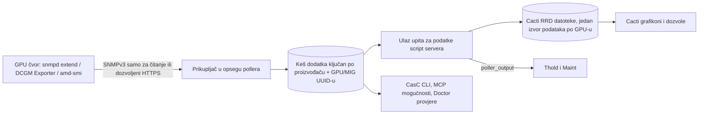

<!-- Source: README.md; SHA256: 97ba37df4a883426d3984ed7d14547ad7367e973411a8abd930409ce259f545b -->

<!-- translations:start -->
[English](../../../README.md) | [简体中文](../zh-CN/README.md) | [हिन्दी](../hi-IN/README.md) | [Español (España)](../es-ES/README.md) | [Español (Latinoamérica)](../es-419/README.md) | [العربية (السعودية)](../ar-SA/README.md) | [Afrikaans](../af-ZA/README.md) | [አማርኛ](../am-ET/README.md) | [العربية (مصر)](../ar-EG/README.md) | [العربية (المغرب)](../ar-MA/README.md) | [বাংলা](../bn-BD/README.md) | [Bosanski](README.md) | [Deutsch](../de-DE/README.md) | [فارسی](../fa-IR/README.md) | [Filipino](../fil-PH/README.md) | [Français](../fr-FR/README.md) | [Français (Maroc)](../fr-MA/README.md) | [Français (Sénégal)](../fr-SN/README.md) | [Hausa](../ha-NG/README.md) | [עברית](../he-IL/README.md) | [Hrvatski](../hr-HR/README.md) | [Bahasa Indonesia](../id-ID/README.md) | [Igbo](../ig-NG/README.md) | [Italiano](../it-IT/README.md) | [日本語](../ja-JP/README.md) | [한국어](../ko-KR/README.md) | [Malagasy](../mg-MG/README.md) | [मराठी](../mr-IN/README.md) | [Bahasa Melayu](../ms-MY/README.md) | [Nederlands](../nl-NL/README.md) | [Polski](../pl-PL/README.md) | [Português (Brasil)](../pt-BR/README.md) | [Русский](../ru-RU/README.md) | [Kinyarwanda](../rw-RW/README.md) | [Soomaali](../so-SO/README.md) | [Српски](../sr-RS/README.md) | [Svenska](../sv-SE/README.md) | [Kiswahili](../sw-KE/README.md) | [தமிழ்](../ta-IN/README.md) | [తెలుగు](../te-IN/README.md) | [ไทย](../th-TH/README.md) | [Türkçe](../tr-TR/README.md) | [Українська](../uk-UA/README.md) | [اردو](../ur-PK/README.md) | [Tiếng Việt](../vi-VN/README.md) | [isiXhosa](../xh-ZA/README.md) | [Yorùbá](../yo-NG/README.md) | [繁體中文](../zh-TW/README.md) | [isiZulu](../zu-ZA/README.md)
<!-- translations:end -->

# plugin_gpu

Dodatak za Cacti 1.2 koji u Cacti donosi iskorištenost, memoriju, temperaturu, potrošnju energije, ECC greške i razloge prigušivanja po GPU-u iz NVIDIA i AMD alata. Svaki GPU (ili MIG instanca) postaje indeks upita za podatke na uređaju svog čvora, tako da se grafikoni GPU-a nalaze uz ostale grafikone čvora pod Cacti dozvolama, a Thold i Maint mogu pokretati upozorenja i potiskivati ih.

> **Status: faze od 1 do 3 implementirane u kodu, još nisu objavljene.** Faza 1 (NVIDIA `nvidia-smi` putem SNMP extend, praćenje identiteta, grafikoni, signali prigušivanja i ECC-a, upozoravanje putem Thold i Maint dodataka, stranica ispravnosti), faza 2 (parser/klijent samo za čitanje za NVIDIA DCGM Exporter HTTP(S) i parser za AMD `amd-smi`), faza 3 (praćenje identiteta MIG instanci, kolone Schema v4, izvršavanje udaljenog prikupljača u opsegu pollera, hookovi `replicate_out` i `remote_agent`), CasC operaterski CLI (`cli/gpu.php`) i hookovi ekosistema (`abilities_register`, `doctor_register_checks`, `casc_register_providers`) implementirani su i pokriveni jediničnim, sigurnosnim i integracijskim testovima u privremenom Cactiju. Dosadašnja pokretanja uživo koriste sintetički `snmpd` i testne uzorke umjesto fizičkog GPU hardvera. Prije označavanja izdanja još su otvoreni: pilot-testiranja na stvarnom hardveru ([docs/pilot-plan.md](../../pilot-plan.md), #54), vanjski sigurnosni pregled ([docs/security-review.md](../../security-review.md)), testni uzorci snimljeni iz stvarnih alata (#14) i mjerenja skaliranja na hardveru produkcijske veličine ([docs/performance.md](../../performance.md)). Prikupljanje XID grešaka ostaje otvoreno pod odlukom #8.

## Uloge pristupa

| Područje ovlasti | Pristup |
| --- | --- |
| GPU View | Postojeće stranice za nadzor. |
| GPU Operator | Nadzor plus stranica GPU operacije i lične potvrde trijaže. |
| GPU Admin | Pristup operatera plus postojeće radnje konfiguracije i administracije. |

Nakon kopiranja datoteka za nadogradnju, otvorite stranicu Plugins kao administrator da registrujete novo područje ovlasti. Izričito dodijelite područje Operator pod **Configuration > Users** ili korisničkim grupama. Nadogradnje zadržavaju postojeće ID-ove i dodjele za područja View i Admin. Admin pristup nasljeđuje Operator pristup, a Operator pristup nasljeđuje View pristup pri svakom zahtjevu; time se ne dodaju trajne dodjele korisnicima ili grupama. Postavke dodatka također zahtijevaju GPU Admin pristup pored Cacti dozvole za Settings.

Cacti dozvole na nivou uređaja i dalje ograničavaju redove i radnje dostupne svakom korisniku; nemapirani objekti zahtijevaju administratora. Pristupni podaci, konfiguracija, mapiranje, brisanje i druge administrativne izmjene ostaju na administrativnim stranicama. Potvrde traju samo u trenutnoj korisničkoj sesiji, najviše jedan sat i samo dok isto zapažanje ostaje svježe. Nova ili izmijenjena zapažanja ih poništavaju. One nikada ne označavaju neuspješno mjerenje ispravnim niti potiskuju upozorenja.

## Zašto

GPU čvorovi su obično već u Cactiju radi praćenja CPU-a, memorije i mrežnih interfejsa. Ispravnost GPU-a je zasebno pitanje na koje SNMP podaci čvora ne odgovaraju: kartica može biti termički prigušena, akumulirati ECC greške ili prijaviti XID kvar dok sam čvor izgleda ispravno. Alati proizvođača to prijavljuju (`nvidia-smi`, DCGM, `amd-smi`), ali njihov izlaz ostaje izvan Cacti grafikona, dozvola i upozoravanja.

Dodatak zatvara tu prazninu pretvarajući izlaz alata proizvođača u Cacti izvore podataka, indeksirane po identitetu svakog GPU-a umjesto po njegovoj poziciji, tako da ponovno pokretanje koje promijeni redoslijed GPU-ova ne pripaja historiju jedne kartice drugoj. Ponovo koristi Cacti grafikone, dozvole, udaljene prikupljače podataka, Thold i Maint umjesto da gradi njihove paralelne verzije.

## Planirani obim

| Faza | Obim | Status | Prekretnice |
|---|---|---|---|
| 0, istraživanje | Izlaz alata proizvođača, XID i signali prigušivanja, identitet GPU-a, privilegije, odluka o putanji prikupljanja | Završeno | [M1](https://github.com/somethingwithproof/plugin_gpu/milestone/1) |
| 1, nvidia | Prikupljanje putem `nvidia-smi`, inventar po UUID-u, grafikoni, signali prigušivanja i ECC-a, Thold i Maint, stranica ispravnosti | Implementirano (testirano uzorcima) | [M2](https://github.com/somethingwithproof/plugin_gpu/milestone/2), [M3](https://github.com/somethingwithproof/plugin_gpu/milestone/3), [M4](https://github.com/somethingwithproof/plugin_gpu/milestone/4) |
| 2, pozadinski sistemi | Parser/klijent samo za čitanje za DCGM Exporter HTTP(S) (`lib/DcgmExporterParser.php`, `lib/DcgmExporterClient.php`), parser za AMD `amd-smi` (`lib/AmdSmiParser.php`) | Implementirano (jedinično testirano) | [M5](https://github.com/somethingwithproof/plugin_gpu/milestone/5) |
| 3, mig, udaljeno i ekosistem | Praćenje identiteta MIG instanci, udaljeni prikupljači podataka (`INFO`, `poller_gpu.php --poller=N`, `replicate_out`, `remote_agent`), CasC CLI (`cli/gpu.php`), MCP/Doctor/CasC hookovi | Implementirano (jedinično i CI integracijski testirano) | [M6](https://github.com/somethingwithproof/plugin_gpu/milestone/6) |

Izvan obima: svaka komanda koja mijenja GPU ili čvor (taktovi, ograničenja snage, resetovanja, MIG raspored), vlastiti sistem upozoravanja u dodatku, prilagođeni daemon ili mrežni protokol te planer poslova ili obračun zadataka. Za istraživački spisak zadataka pogledajte plan.

## Šta donosi prekretnica 4

- **Prikupljač samo za čitanje za NVIDIA DCGM Exporter** (`lib/DcgmExporterParser.php`, `lib/DcgmExporterClient.php`). Parsira Prometheus tekstualne metrike (`DCGM_FI_DEV_GPU_UTIL`, `DCGM_FI_DEV_FB_USED`, `DCGM_FI_DEV_FB_FREE`, `DCGM_FI_DEV_POWER_USAGE`, `DCGM_FI_DEV_GPU_TEMP`, `DCGM_FI_DEV_ECC_DBE_VOL_TOTAL`, `DCGM_FI_DEV_CLOCK_THROTTLE_REASONS`, te MIG oznake `GPU_I_ID` i `GPU_I_PROFILE`). HTTP(S) klijent primjenjuje eksplicitnu listu dozvoljenih hostova ili CIDR blokova za krajnje tačke, podrazumijevano provjerava TLS certifikate druge strane, ograničava trajanje zahtjeva i veličinu odgovora, onemogućava preusmjeravanja i odbija šeme koje nisu HTTP(S).
- **Parser samo za čitanje za AMD `amd-smi`** (`lib/AmdSmiParser.php`). Normalizuje `amd-smi` JSON/SNMP-extend izlaz (iskorištenost, VRAM, potrošnja energije, temperatura spoja i ivice, ECC, metapodaci particija i zasebni akumulatori prigušivanja putem `Reading::$vendorExtensions`) u zajednički model metrika pod `Vendor::Amd`.
- **Praćenje MIG instanci i Schema v4** (`lib/GpuReport.php`, `lib/GpuSnapshot.php`, `lib/GpuRecord.php`, `lib/Schema.php`, `lib/ScriptServer.php`). Prati UUID-ove MIG instanci (`MIG-<uuid>` i `MIG-GPU-<parent>/<gi>/<ci>`), `mig_mode`, `mig_instance_id`, `mig_profile`, `parent_uuid` i `partition_info` uz matične GPU-ove, dok nepromjenjive ključeve identiteta (`vendor`, `uuid`, `parent_uuid`) štiti prilikom ažuriranja i provjerava prije upita prema bazi podataka.
- **Udaljeni prikupljači podataka** (`INFO`, `poller_gpu.php`, `lib/Poller.php`, `lib/ReplicationRepository.php`, `setup.php`). Deklariše `remote_collect:1, remote_poller:1` u `INFO`, podržava izvršavanje u opsegu pollera putem `php plugins/gpu/poller_gpu.php --poller=N`, preskače pripremu Cacti objekata na pollerima koji nisu glavni, replicira tabele po polleru putem `replicate_out` i odgovara na akcije samo za čitanje `gpu_health` i `gpu_inventory` putem `remote_agent`.
- **Operaterski i CasC CLI** (`cli/gpu.php`, `lib/CascProvider.php`). Radi na PHP 8.2+ (parsira se na PHP 8.0) bez vanjskih Composer zavisnosti: `php plugins/gpu/cli/gpu.php export [--format=yaml|xml]`, `validate <file> [--format=yaml|xml]`, `plan <file> [--format=yaml|xml] [--output=text|json]`, `apply <file> --confirm=<PLAN_HASH> [--format=yaml|xml]` i `health [--format=text|json]`. Planovi izračunavaju deterministički SHA-256 hash za potvrdu, `apply` bezbjedno pada pri nepodudaranju hasha, a XML parsiranje odbija deklaracije `DOCTYPE` i `ENTITY`.
- **Hookovi integracije ekosistema** (`lib/EcosystemIntegration.php`, `setup.php`). Registruje `abilities_register` (`gpu-list-nodes`, `gpu-list-devices`, `gpu-get-health`; samo za čitanje, ograničeno na područje ovlasti `GPU View` i Cacti dozvole uređaja), `doctor_register_checks` (`gpu_schema`, `gpu_poller_freshness`, `gpu_node_health`) i `casc_register_providers`.
- **Razlozi prigušivanja i ECC kao vrijednosti za upozorenja** ([docs/metrics.md](../../metrics.md)). Dekodira maske događaja takta u indikatore 0/1 i računa nove ispravljene/neispravljene ECC greške po intervalu kao mjerne vrijednosti (gauge) tako da Thold 1.8.2 i Maint 1.3 upozoravaju i potiskuju upozorenja bez negativnih brojača ili skokova pri resetovanju ([docs/alerting.md](../../alerting.md)).
- **Ispravnost GPU-a, dozvole, kvar/oporavak i skaliranje.** Ispravnost GPU-a (GPU View) prikazuje pohranjenu svježinu, rezultat posljednjeg prikupljanja, stanje Maint-a, pozadinski sistem, verzije i sirove maske prigušivanja bez kontaktiranja čvorova. Skriptovani testovi od kraja do kraja potvrđuju dozvole, oporavak od kvarova agenta/baze/RRD-a ([docs/backup.md](../../backup.md)) i izvršavanje na skali od 100 GPU-ova u CI okruženju ([docs/performance.md](../../performance.md), [docs/operations.md](../../operations.md), [CHANGELOG.md](../../../CHANGELOG.md)).

## Šta donosi prekretnica 3

- **Prikupljanje putem SNMP extend** ([ADR 0008](../../decisions/0008-collect-through-snmp-extend.md)). Administrator čvora dodaje dvije fiksne `extend` linije u `snmpd.conf` ([docs/node-setup.md](../../node-setup.md)); dodatak čita NET-SNMP-EXTEND-MIB putem Cacti SNMP funkcija koristeći vlastite pristupne podatke uređaja, pri čemu se preporučuje SNMPv3. Ne pokreće ništa na Cacti serveru ni na čvoru.
- **Strogo parsiranje.** Polja se čitaju po poziciji, svaka linija imenuje svoj GPU putem UUID-a, a izlazni status različit od nule, istek vremena, skraćen izlaz, linija sa pogrešnim brojem polja ili pomiješani tekst greške obaraju cijelo prikupljanje: vrijednosti postaju `U`, nijedan GPU se ne označava kao odsutan, a GPU čvorovi prikazuju razlog.
- **Prikupljač nakon svakog ciklusa pollera.** Čita agent svakog omogućenog čvora, ažurira zapise identiteta i kešira najnoviji uzorak. Ulaz script servera čita samo taj keš, tako da Cacti poll nikada ne čeka na GPU čvor.
- **Cacti objekti** ([ADR 0010](../../decisions/0010-attach-to-existing-node-devices.md)). Šabloni i upit za podatke *GPU - Devices* isporučuju se kao XML i uvoze pri instalaciji i nadogradnji. Čuvanje čvora dodaje upit za podatke na postojeći uređaj sa metodom ponovnog indeksiranja None; GPU čvorovi mogu kreirati uređaj samo kada čvor još nema nijedan. Svaki GPU je indeks ključan po proizvođaču i UUID-u, sa jednim izvorom podataka koji dijele grafikoni Utilization, Memory, Temperature, Power, Power Percent, Clocks, Throttle, ECC Errors, New ECC Errors, Retired Pages i Sample Age. Svako polje modela iscrtava neki grafikon, jer Cacti pohranjuje samo polja koja neki grafikon koristi. Dodatak ponovo indeksira nakon svake promjene GPU-a, pamti ponovno indeksiranje koje je Cacti preskočio dok je uređaj bio Down ili onemogućen i pokreće ga čim uređaj bude Up, te kreira grafikone za nove GPU-ove.
- **Historija ostaje uz karticu.** Odsutan GPU ostaje indeks, pa njegovi grafikoni prikazuju prekid i nastavljaju u istoj RRD datoteci kada se kartica vrati. Zamjenska kartica u istom slotu dobija vlastiti izvor podataka. **Remove from Data Query** na stranici čvora uklanja odsutan GPU sa spiska; njegove RRD datoteke i grafikoni ostaju sačuvani dok ih ne izbrišete.
- **Dozvole uređaja na stranici GPU čvorovi.** GPU administrator vidi, mijenja, izvozi i premješta samo čvorove i GPU-ove na uređajima koje smije vidjeti u Cactiju; premještanje GPU-a zahtijeva dozvolu za oba čvora. Čvor čiji je uređaj izbrisan može se onemogućiti ili izbrisati.
- **Zajednički model metrika** ([ADR 0009](../../decisions/0009-common-metric-core-with-vendor-extensions.md), [docs/metrics.md](../../metrics.md)). Memorija je u bajtovima, maska događaja takta dekodira se u `thr_*` indikatore, a `age` je starost vremena uzorka samog GPU-a ili `U` kada je nepoznata.

Korisnik koji vrši instalaciju (web server) mora imati pravo pisanja u `<cacti>/resource/script_server/`, gdje dodatak smješta svoju XML datoteku upita za podatke; u suprotnom se instalacija i nadogradnja zaustavljaju sa porukom i pokušavaju ponovo pri sljedećem pokretanju. Deinstalacija uklanja šablone i XML datoteku samo kada je označena opcija *Remove the plugin's Cacti objects on uninstall* i nikada ne briše RRD datoteke, uređaje, grafikone ni izvore podataka ([docs/operations.md](../../operations.md#uninstall)). Čvorovi na udaljenim prikupljačima podataka izvršavaju se u opsegu svog dodijeljenog `poller_id`.

## Šta isporučuje prekretnica 2

- **Zaštićena instalacija.** Na verzijama PHP-a starijim od 8.2 instalacija i omogućavanje se odbijaju uz poruku koja navodi potrebnu verziju, dok ostatak Cactija nastavlja raditi. `setup.php` i skripte stranica prolaze sintaksnu provjeru na PHP 8.0.
- **Životni ciklus.** Instalacija, nadogradnja, onemogućavanje i deinstalacija kroz Cacti stranicu Plugins. Nadogradnje su redoslijedne, dovršavaju se nakon prekida i mijenjaju zabilježenu verziju tek nakon što uspiju. Deinstalacija zadržava tabele dodatka osim ako ne poništite opciju *Keep Plugin Tables on Uninstall*; nikada ne dira Cacti uređaj, izvor podataka, grafikon ili RRD datoteku.
- **Odvojena područja ovlasti.** *GPU Admin* otvara **GPU Nodes**, gdje registrujete Cacti uređaje kao GPU čvorove, potvrđujete ili odbijate premještanja GPU-ova između čvorova i izvozite svaki zapis kao JSON. *GPU View* otvara **GPU Inventory**, koji navodi GPU-ove samo na uređajima koje gledalac smije vidjeti. Obje stranice nalaze se pod Management, a svaka promjena je POST zahtjev provjeren putem csrf-magic.
- **Zapisi identiteta GPU-a.** Svaki GPU je ključan po proizvođaču i UUID-u. Indeks, ID PCI sabirnice, naziv, drajver i alat koji šalje izvještaj su atributi koji se mijenjaju na mjestu. Novi UUID u poznatom slotu označava se kao moguća zamjena i započinje vlastitu historiju; GPU viđen na drugom čvoru premješta se tek kada operater to potvrdi; GPU koji nedostaje u uspješnim prikupljanjima označava se kao odsutan nakon broja definisanog u postavkama i nikada se ne briše. Za sada se prihvataju samo NVIDIA UUID-ovi cijelih GPU-ova; MIG instance čekaju odluku #13, a AMD istraživanje #19. Pravila se provjeravaju sekvencama testnih uzoraka jer ih još ne hrani nijedan prikupljač.
- **Testovi i CI.** Paketi jediničnih i izvornih testova bez GPU-a ili baze podataka, provjere životnog ciklusa i dozvola stranica protiv Cacti 1.2.31 i aktuelnog 1.2.x na PHP-u od 8.2 do 8.5, zadatak za odbijanje na PHP 8.1, PHP 8.0 lint ulaznih tačaka, PHPStan na nivou 9 i REUSE. Testno okruženje je privremeno dok se ne odluči o #12.

### Instalacija za evaluaciju

Ovi koraci instaliraju trenutni kod radi isprobavanja; potpuni vodič za operatere nalazi se u [docs/operations.md](../../operations.md). Potrebni su Cacti 1.2.31 ili noviji na PHP-u 8.2 ili novijem.

1. Kopirajte repozitorij u `plugins/gpu` unutar vašeg Cacti direktorija. Direktorij se mora zvati `gpu`.
2. U Cactiju otvorite **Configuration > Plugins**, zatim instalirajte i omogućite **GPU**.
3. Dodijelite korisnicima područje *GPU View*, *GPU Operator* ili *GPU Admin* pod **Configuration > Users**, u skladu s njihovom ulogom. Korisnik koji vrši instalaciju dobija View i Admin; Admin uključuje pristup Operator.
4. Konfigurišite SNMP agent svakog GPU čvora kako je opisano u [docs/node-setup.md](../../node-setup.md), zatim dodajte čvor pod **Management > GPU Nodes**.
5. Za upozorenja uvezite isporučene Thold šablone kako je opisano u [docs/alerting.md](../../alerting.md).
6. Po želji prilagodite **Configuration > Settings > GPU**: *Mark Absent After* (podrazumijevano 3 uspješna prikupljanja, od 1 do 100), *Stale After* (koliko star uzorak smije biti prije nego što njegove vrijednosti ispišu `U`) i *Keep Plugin Tables on Uninstall* (podrazumijevano uključeno).

## Kako metrike dolaze u Cacti

Odluka [#7](https://github.com/somethingwithproof/plugin_gpu/issues/7) odabrala je SNMP `extend` ([ADR 0008](../../decisions/0008-collect-through-snmp-extend.md)): vlastiti agent čvora pokreće fiksnu `nvidia-smi` komandu, a dodatak samo čita rezultat. Plan upoređuje opcije u odjeljku [Putanje prikupljanja](../../PLAN.md#collection-paths).

## Ciljevi kompatibilnosti

| Komponenta | Cilj |
|---|---|
| Cacti | 1.2.31 ili noviji, bez zakrpa za jezgru |
| PHP | 8.2 ili noviji; `setup.php` ostaje parsibilan na 8.0 kako bi nepodržano izvršno okruženje dobilo odbijanje umjesto pokvarenog Cacti interfejsa |
| NVIDIA | Linije drajvera i alata koje će odrediti istraživanje [#26](https://github.com/somethingwithproof/plugin_gpu/issues/26); DCGM ID-ovi polja provjereni na v3.3.9 i v4.7.0 |
| AMD | `amd-smi` na ROCm izdanjima koje će odrediti istraživanje [#26](https://github.com/somethingwithproof/plugin_gpu/issues/26) |
| Thold, Maint | Thold 1.8.2 i Maint 1.3, neizmijenjeni, testirani od kraja do kraja ([docs/alerting.md](../../alerting.md)) |

## Dizajn

- [docs/PLAN.md](../../PLAN.md) je potpuni plan: arhitektura, činjenice iz uzvodnih projekata od kojih zavisi (sa izvorima), model identiteta, sigurnosne granice, računica performansi, testiranje i rizici.
- [docs/decisions/](../../decisions/) sadrži zapise arhitektonskih odluka za već donesene izbore.
- [docs/REQUIREMENTS.md](../../REQUIREMENTS.md) povezuje svaki ID zahtjeva sa njegovim zadatkom.

## Kako se prati rad

- **Prekretnice** prate prekretnice iz plana. Svaka ima epik zadatak koji navodi njene podzadatke i dokaze o završetku.
- **Zadaci** su označeni po tipu oznakama: `type: requirement`, `type: research`, `type: decision`, `type: epic`. Zadaci zahtjeva navode numerisane, provjerljive zahtjeve (`REQ-AREA-NNN`) i kriterije prihvatanja.
- **Oznake** također nose prefikse `area:`, `phase:`, `priority:` i `status:`. Pogledajte [CONTRIBUTING.md](../../../CONTRIBUTING.md#labels).
- [Tabla projekta](https://github.com/users/somethingwithproof/projects/9) prikazuje sve zadatke kroz prekretnice.

## Doprinošenje

Pročitajte [CONTRIBUTING.md](../../../CONTRIBUTING.md). Komiti zahtijevaju DCO potpis (sign-off). Diskusije o dizajnu vode se u zadacima; otvorene odluke nose oznaku `type: decision`. Snimljeni izlaz stvarnih GPU alata najkorisniji je doprinos za prekretnicu 1; prethodno uklonite nazive hostova, serijske brojeve i UUID-ove.

## Sigurnost

Ranjivosti prijavljujte privatno; pogledajte [SECURITY.md](../../../SECURITY.md).

## Licenca

GNU General Public License v2.0, ista licenca kao Cacti i njegovi dodaci. Pogledajte [LICENSE](../../../LICENSE).
