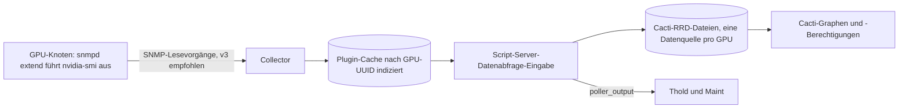

<!-- Source: README.md; SHA256: 126deef1783d64f878bf565f1433c10f31aef828eb9bc313aeff2b0335e54c7c -->

<!-- translations:start -->
[English](../../../README.md) | [简体中文](../zh-CN/README.md) | [हिन्दी](../hi-IN/README.md) | [Español (España)](../es-ES/README.md) | [Español (Latinoamérica)](../es-419/README.md) | [العربية (السعودية)](../ar-SA/README.md) | [Afrikaans](../af-ZA/README.md) | [አማርኛ](../am-ET/README.md) | [العربية (مصر)](../ar-EG/README.md) | [العربية (المغرب)](../ar-MA/README.md) | [বাংলা](../bn-BD/README.md) | [Bosanski](../bs-BA/README.md) | [Deutsch](README.md) | [فارسی](../fa-IR/README.md) | [Filipino](../fil-PH/README.md) | [Français](../fr-FR/README.md) | [Français (Maroc)](../fr-MA/README.md) | [Français (Sénégal)](../fr-SN/README.md) | [Hausa](../ha-NG/README.md) | [עברית](../he-IL/README.md) | [Hrvatski](../hr-HR/README.md) | [Bahasa Indonesia](../id-ID/README.md) | [Igbo](../ig-NG/README.md) | [Italiano](../it-IT/README.md) | [日本語](../ja-JP/README.md) | [한국어](../ko-KR/README.md) | [Malagasy](../mg-MG/README.md) | [मराठी](../mr-IN/README.md) | [Bahasa Melayu](../ms-MY/README.md) | [Nederlands](../nl-NL/README.md) | [Polski](../pl-PL/README.md) | [Português (Brasil)](../pt-BR/README.md) | [Русский](../ru-RU/README.md) | [Kinyarwanda](../rw-RW/README.md) | [Soomaali](../so-SO/README.md) | [Српски](../sr-RS/README.md) | [Svenska](../sv-SE/README.md) | [Kiswahili](../sw-KE/README.md) | [தமிழ்](../ta-IN/README.md) | [తెలుగు](../te-IN/README.md) | [ไทย](../th-TH/README.md) | [Türkçe](../tr-TR/README.md) | [Українська](../uk-UA/README.md) | [اردو](../ur-PK/README.md) | [Tiếng Việt](../vi-VN/README.md) | [isiXhosa](../xh-ZA/README.md) | [Yorùbá](../yo-NG/README.md) | [繁體中文](../zh-TW/README.md) | [isiZulu](../zu-ZA/README.md)
<!-- translations:end -->

# plugin_gpu

Ein Cacti-1.2-Plugin, das Auslastung, Speicher, Temperatur, Leistungsaufnahme, ECC-Fehler und Drosselungsgründe pro GPU aus NVIDIA-Tools in Cacti einbindet. AMD-Unterstützung und die Erfassung von XID-Fehlern sind geplant, aber noch nicht implementiert. Jede GPU wird zu einem Index einer Datenabfrage auf dem Gerät ihres Knotens, sodass GPU-Graphen neben den anderen Graphen des Knotens unter den Berechtigungen von Cacti liegen und Thold sowie Maint darauf aufbauend alarmieren und Warnungen unterdrücken können.

> **Status: in Entwicklung, nicht veröffentlicht.** Meilenstein 4 schließt Phase 1 (NVIDIA über SNMP-Extend) code-seitig ab: Erfassung, Identität, Graphen, Drosselungs- und ECC-Signale, Alarmierung über Thold und Maint, die Statusseite sowie die Betreiberdokumentation. Das Plugin wurde bislang nur gegen einen echten `snmpd` mit einem simulierten `nvidia-smi` getestet, der synthetische Ausgaben erzeugt – niemals auf echter GPU-Hardware. Vor einer Veröffentlichung stehen noch aus: Pilottests auf echter Hardware ([docs/pilot-plan.md](../../pilot-plan.md), #54), ein externes Sicherheitsaudit ([docs/security-review.md](../../security-review.md)), auf realen Tools aufgezeichnete Testdaten (#14) sowie Skalierungsmessungen auf produktionsnaher Hardware ([docs/performance.md](../../performance.md)). XID-Fehler warten auf Entscheidung #8. Setzen Sie das Plugin nicht produktiv ein.

## Zugriffsrollen

| Berechtigungsbereich | Zugriff |
| --- | --- |
| GPU View | Bestehende Überwachungsseiten. |
| GPU Operator | Überwachungsseiten sowie die Operations-Seite und persönliche Triage-Bestätigungen. |
| GPU Admin | Operator-Zugriff sowie die bestehenden Konfigurations- und Verwaltungsaktionen. |

Öffnen Sie nach dem Kopieren der Upgrade-Dateien als Administrator die Plugins-Seite, um den neuen Berechtigungsbereich zu registrieren. Weisen Sie den Operator-Bereich explizit unter **Configuration > Users** oder über Benutzergruppen zu. Upgrades behalten die bestehenden Realm-IDs und -Berechtigungen für View und Admin bei. Der Admin-Zugriff erbt bei jeder Anfrage den Operator-Zugriff, und der Operator-Zugriff erbt den View-Zugriff; dadurch werden keine dauerhaften Berechtigungen für Benutzer oder Gruppen hinzugefügt. Plugin-Einstellungen erfordern neben der Cacti-Berechtigung für Einstellungen zusätzlich GPU-Admin-Zugriff.

Cacti-Geräteberechtigungen schränken weiterhin die Zeilen und Aktionen ein, die jedem Benutzer zur Verfügung stehen; nicht zugeordnete Objekte erfordern einen Administrator. Zugangsdaten, Konfiguration, Zuordnung, Löschung und andere administrative Änderungen verbleiben auf den Verwaltungsseiten. Bestätigungen gelten nur in der aktuellen Benutzersitzung, für höchstens eine Stunde und nur solange derselbe Messwert aktuell bleibt. Neue oder geänderte Beobachtungen machen sie ungültig. Sie markieren eine fehlgeschlagene Messung niemals als fehlerfrei und unterdrücken keine Alarme.

## Warum

GPU-Knoten sind in der Regel bereits für CPU, Arbeitsspeicher und Netzwerkschnittstellen in Cacti erfasst. Der Zustand der GPUs ist eine separate Fragestellung, die die SNMP-Daten des Knotens nicht beantworten: Eine Karte kann thermisch gedrosselt sein, ECC-Fehler ansammeln oder einen XID-Fehler melden, während der Knoten selbst unauffällig erscheint. Hersteller-Tools melden dies (`nvidia-smi`, DCGM, `amd-smi`), ihre Ausgaben liegen jedoch außerhalb der Graphen, Berechtigungen und Alarmierung von Cacti.

Das Plugin schließt diese Lücke, indem es die Ausgaben der Hersteller-Tools in Cacti-Datenquellen umwandelt, die über die Identität jeder GPU statt über ihre Position indiziert sind, sodass ein Neustart mit geänderter GPU-Reihenfolge nicht die Historie einer Karte an eine andere anhängt. Es nutzt die Graphen, Berechtigungen, Remote Data Collectors, Thold und Maint von Cacti weiter, statt parallele Eigenentwicklungen aufzubauen.

## Geplanter Funktionsumfang

| Phase | Umfang | Meilensteine |
|---|---|---|
| 0, Forschung | Ausgaben der Hersteller-Tools, XID- und Drosselungssignale, GPU-Identität, Berechtigungen, Entscheidung über den Erfassungspfad | [M1](https://github.com/somethingwithproof/plugin_gpu/milestone/1) |
| 1, nvidia | Erfassung über `nvidia-smi`, Inventar nach UUID, Graphen, Drosselungs-, ECC- und XID-Signale, Thold und Maint, Statusseite | [M2](https://github.com/somethingwithproof/plugin_gpu/milestone/2), [M3](https://github.com/somethingwithproof/plugin_gpu/milestone/3), [M4](https://github.com/somethingwithproof/plugin_gpu/milestone/4) |
| 2, Backends | DCGM-Backend, `amd-smi`-Backend | [M5](https://github.com/somethingwithproof/plugin_gpu/milestone/5) |
| 3, MIG und Remote | MIG-Instanzen, Cacti Remote Data Collectors | [M6](https://github.com/somethingwithproof/plugin_gpu/milestone/6) |

Nicht im Umfang enthalten sind: Befehle, die eine GPU oder einen Knoten verändern (Taktraten, Leistungslimits, Resets, MIG-Layout), eine plugin-eigene Alarmierungs-Engine, ein eigener Daemon oder ein eigenes Netzwerkprotokoll sowie Scheduler- oder Job-Abrechnung. Den Forschungs-Backlog finden Sie im Projektplan.

## Neuerungen in Meilenstein 4

- **Drosselungsgründe als Alarmwerte.** Die Takt-Ereignismaske wird pro Grund in einen Indikator mit dem Wert 0 oder 1 dekodiert; eine unbekannte Maske ergibt unbekannte Indikatoren, niemals Nullen, und Bits ohne eigenen Indikator verbleiben in der Rohmaske, die unter GPU Health angezeigt wird.
- **ECC als Alarmwerte** ([docs/metrics.md](../../metrics.md)). Neue korrigierbare und nicht korrigierbare Fehler seit dem vorherigen Messwert werden vom Plugin aus zwei aufeinanderfolgenden Gesamtwerten berechnet und als Gauges gespeichert: unbekannt beim ersten Messwert, bei einem verpassten Lesevorgang oder nach einem Treiber-Neuladen, sodass ein Reset niemals als Null oder als negativer Zählwert interpretiert wird. Ausgemusterte Einzelbit- und Doppelbit-Speicherseiten sowie der ECC-Modus werden ebenfalls ausgelesen. Zwei zusätzliche ECC-Graphen pro GPU ermöglichen deren Speicherung in Cacti; zusammen mit Power Percent ergeben sich insgesamt elf Graphen. XID wird nicht erfasst: Keine Quelle passt zu den fest vorgegebenen `nvidia-smi`-Befehlen (#8).
- **Thold und Maint** ([docs/alerting.md](../../alerting.md)). Mitgelieferte Thold-Vorlagen für Temperatur, Leistungsaufnahme im Verhältnis zum Limit, die Drosselungsindikatoren, neue nicht korrigierbare ECC-Fehler, ausstehende Seitenausmusterungen und Messwertalter. Jeder Wert ist ein Gauge, da Thold 1.8.2 bei einem unbekannten Counter fehlschlägt. Ein End-to-End-Test mit unverändertem Thold 1.8.2 und Maint 1.3 zeigt das Auslösen und Zurücksetzen jedes Schwellenwerts – auch über einen ECC-Reset hinweg – sowie die Unterdrückung durch Maint.
- **GPU Health** (GPU View). Pro Knoten: Aktualität, Abschlussstatus der letzten Erfassung, Maint-Status, Backend, Tool- und Treiberversionen sowie GPU-Anzahl; pro GPU: Präsenz, Messwertalter, ECC-Status und Rohmaske. Es werden ausschließlich gespeicherte Datensätze gelesen.
- **Berechtigungen.** Die Berechtigungs-Testsuite deckt jede Seitendatei und Aktion, den Entzug bei der nächsten Anfrage sowie Ablehnungen ohne Informationspreisgabe ab.
- **Fehler- und Wiederherstellungsqualifizierung.** Skriptgestützte End-to-End-Läufe unterbrechen den Agenten, die Zugangsdaten, das Tool, dessen Ausgabe, die Datenbankverbindung und RRD-Schreibvorgänge und stellen die Datenbank aus einem Dump wieder her – einschließlich eines Dumps, der älter als die RRD-Dateien ist; eine neue GPU übernimmt niemals die RRD-Datei einer anderen ([docs/backup.md](../../backup.md)).
- **Skalierung** ([docs/performance.md](../../performance.md)). Ein Skalierungstest misst die Laufzeit von Erfassung, Script-Server-Eingabe, Erstellung der Cacti-Objekte, einem Poller-Zyklus und der Health-Seite bei einer bestimmten GPU-Anzahl; die CI führt ihn mit 100 GPUs aus. Messungen für 1.000 und 8.000 GPUs liegen noch nicht vor, daher wird keine unterstützte GPU-Anzahl angegeben.
- **Betreiberdokumentation** ([docs/operations.md](../../operations.md)): Installation, Upgrade, Deinstallation, Prinzip der minimalen Rechte, nicht verfügbare Werte und Fehlerbehebung. Änderungen sind in [CHANGELOG.md](../../../CHANGELOG.md) aufgeführt.

## Neuerungen in Meilenstein 3

- **Erfassung über SNMP extend** ([ADR 0008](../../decisions/0008-collect-through-snmp-extend.md)). Der Administrator des Knotens fügt zwei feste `extend`-Zeilen zu `snmpd.conf` hinzu ([docs/node-setup.md](../../node-setup.md)); das Plugin liest die NET-SNMP-EXTEND-MIB über die SNMP-Funktionen von Cacti mit den eigenen Zugangsdaten des Geräts aus, wobei SNMPv3 empfohlen wird. Auf dem Cacti-Server oder dem Knoten wird nichts aktiv ausgeführt.
- **Strikte Auswertung.** Felder werden nach Position gelesen, jede Zeile benennt ihre GPU per UUID, und ein Exit-Status ungleich null, eine Zeitüberschreitung, abgeschnittene Ausgaben, eine Zeile mit falscher Feldanzahl oder zusammengeführte Fehlertexte lassen die gesamte Erfassung fehlschlagen: Werte werden zu `U`, keine GPU wird als abwesend markiert, und GPU Nodes zeigt die Ursache an.
- **Ein Collector nach jedem Poller-Zyklus.** Er liest den Agenten jedes aktivierten Knotens aus, aktualisiert die Identitätsdatensätze und legt den neuesten Messwert im Cache ab. Die Script-Server-Eingabe liest nur diesen Cache, sodass ein Cacti-Poll niemals auf einen GPU-Knoten wartet.
- **Cacti-Objekte** ([ADR 0010](../../decisions/0010-attach-to-existing-node-devices.md)). Die Vorlagen und die Datenabfrage *GPU - Devices* werden als XML mitgeliefert und bei Installation und Upgrade importiert. Beim Speichern eines Knotens wird die Datenabfrage mit der Reindex-Methode *None* an das bestehende Gerät angehängt; GPU Nodes kann nur dann ein Gerät anlegen, wenn der Knoten noch keines hat. Jede GPU ist ein über Hersteller und UUID indizierter Eintrag mit einer einzigen Datenquelle, die von den Graphen Utilization, Memory, Temperature, Power, Power Percent, Clocks, Throttle, ECC Errors, New ECC Errors, Retired Pages und Sample Age gemeinsam genutzt wird. Jedes Modellfeld wird von einem Graphen gezeichnet, da Cacti nur Felder speichert, die ein Graph verwendet. Das Plugin führt nach jeder GPU-Änderung ein Reindexing durch, merkt sich ein von Cacti übersprungenes Reindexing, solange das Gerät *Down* oder deaktiviert war, und führt es aus, sobald das Gerät wieder *Up* ist, und legt Graphen für neue GPUs an.
- **Die Historie bleibt bei der Karte.** Eine abwesende GPU bleibt als Index erhalten, sodass ihre Graphen eine Lücke zeigen und in derselben RRD-Datei fortgesetzt werden, sobald sie wieder verfügbar ist. Eine Ersatzkarte im selben Steckplatz erhält eine eigene Datenquelle. **Remove from Data Query** auf der Seite des Knotens entfernt eine abwesende GPU aus der Auflistung; ihre RRD-Dateien und Graphen bleiben erhalten, bis Sie sie löschen.
- **Geräteberechtigungen unter GPU Nodes.** Ein GPU Admin sieht, ändert, exportiert und verschiebt nur Knoten und GPUs auf Geräten, die er in Cacti sehen darf; das Verschieben einer GPU erfordert Berechtigungen für beide Knoten. Ein Knoten, dessen Gerät gelöscht wurde, kann deaktiviert oder gelöscht werden.
- **Das gemeinsame Metrikmodell** ([ADR 0009](../../decisions/0009-common-metric-core-with-vendor-extensions.md), [docs/metrics.md](../../metrics.md)). Der Speicher wird in Bytes angegeben, die Takt-Ereignismaske wird in `thr_*`-Indikatoren dekodiert, und `age` ist das Alter des eigenen Zeitstempels der GPU oder `U`, falls unbekannt.

Der installierende (Webserver-)Benutzer muss in `<cacti>/resource/script_server/` schreiben dürfen, wo das Plugin seine Data-Query-XML ablegt; Installation und Upgrade brechen andernfalls mit einer Meldung ab und versuchen es beim nächsten Aufruf erneut. Bei der Deinstallation werden die Vorlagen und die XML-Datei nur entfernt, wenn *Remove the plugin's Cacti objects on uninstall* aktiviert ist; RRD-Dateien, Geräte, Graphen oder Datenquellen werden niemals gelöscht ([docs/operations.md](../../operations.md#uninstall)). Knoten auf Remote Data Collectors werden erst ab Phase 3 erfasst.

## Lieferumfang in Meilenstein 2

- **Abgesicherte Installation.** Bei PHP unter 8.2 werden Installation und Aktivierung mit einer Meldung verweigert, die die erforderliche Version nennt, während der Rest von Cacti weiterläuft. `setup.php` und die Seitenskripte sind unter PHP 8.0 syntaktisch gültig.
- **Lebenszyklus.** Installation, Upgrade, Deaktivierung und Deinstallation über die Plugins-Seite von Cacti. Upgrades erfolgen geordnet, werden nach einer Unterbrechung fortgesetzt und aktualisieren die gespeicherte Version erst nach erfolgreichem Abschluss. Bei der Deinstallation bleiben die Tabellen des Plugins erhalten, sofern Sie nicht *Keep Plugin Tables on Uninstall* abwählen; ein Cacti-Gerät, eine Datenquelle, ein Graph oder eine RRD-Datei wird niemals angetastet.
- **Getrennte Berechtigungsbereiche.** *GPU Admin* öffnet **GPU Nodes**, wo Sie Cacti-Geräte als GPU-Knoten registrieren, GPU-Verschiebungen zwischen Knoten bestätigen oder ablehnen und jeden Datensatz als JSON exportieren können. *GPU View* öffnet **GPU Inventory**, das GPUs nur auf Geräten auflistet, die der Betrachter sehen darf. Beide Seiten befinden unter Management, und jede Änderung ist eine durch csrf-magic geprüfte POST-Anfrage.
- **GPU-Identitätsdatensätze.** Jede GPU wird über Hersteller und UUID identifiziert. Index, PCI-Bus-ID, Name, Treiber und das meldende Tool sind Attribute, die direkt am Datensatz aktualisiert werden. Eine neue UUID in einem bekannten Steckplatz wird als möglicher Austausch markiert und beginnt eine eigene Historie; eine an einem anderen Knoten erkannte GPU wird erst verschoben, wenn ein Operator dies bestätigt; eine GPU, die in erfolgreichen Erfassungen fehlt, wird nach einer konfigurierbaren Anzahl als abwesend markiert und niemals gelöscht. Vorerst werden nur NVIDIA-UUIDs ganzer GPUs akzeptiert; MIG-Instanzen warten auf Entscheidung #13 und AMD auf Recherche #19. Die Regeln werden durch Fixture-Sequenzen getestet, da sie noch von keinem Collector gespeist werden.
- **Tests und CI.** Unit- und Quellregel-Suites ohne GPU oder Datenbank, Lebenszyklus- und Seitenberechtigungsprüfungen gegen Cacti 1.2.31 sowie aktuelle 1.2.x-Versionen unter PHP 8.2 bis 8.5, ein Ablehnungstest unter PHP 8.1, ein PHP-8.0-Lint der Einstiegspunkte, PHPStan auf Level 9 sowie REUSE. Die Testumgebung ist vorläufig, bis #12 entschieden ist.

### Installation für Testzwecke

Diese Schritte installieren den aktuellen Code zum Ausprobieren; die vollständige Betreiberanleitung finden Sie in [docs/operations.md](../../operations.md). Erforderlich sind Cacti 1.2.31 oder neuer unter PHP 8.2 oder neuer.

1. Kopieren Sie das Repository nach `plugins/gpu` unterhalb Ihres Cacti-Verzeichnisses. Das Verzeichnis muss `gpu` heißen.
2. Öffnen Sie in Cacti **Configuration > Plugins** und installieren sowie aktivieren Sie anschließend **GPU**.
3. Weisen Sie Benutzern unter **Configuration > Users** entsprechend ihrer Rolle den Berechtigungsbereich *GPU View*, *GPU Operator* oder *GPU Admin* zu. Der installierende Benutzer erhält View und Admin; Admin schließt den Operator-Zugriff ein.
4. Richten Sie den SNMP-Agenten jedes GPU-Knotens wie in [docs/node-setup.md](../../node-setup.md) beschrieben ein und fügen Sie den Knoten anschließend unter **Management > GPU Nodes** hinzu.
5. Für Alarme importieren Sie die mitgelieferten Thold-Vorlagen wie in [docs/alerting.md](../../alerting.md) beschrieben.
6. Passen Sie optional **Configuration > Settings > GPU** an: *Mark Absent After* (Standard: 3 erfolgreiche Erfassungen, von 1 bis 100), *Stale After* (wie alt ein Messwert sein darf, bevor seine Werte `U` ausgeben) und *Keep Plugin Tables on Uninstall* (standardmäßig aktiviert).

## Wie Metriken in Cacti gelangen

Entscheidung [#7](https://github.com/somethingwithproof/plugin_gpu/issues/7) fiel zugunsten von SNMP `extend` ([ADR 0008](../../decisions/0008-collect-through-snmp-extend.md)): Der eigene Agent des Knotens führt einen festen `nvidia-smi`-Befehl aus, und das Plugin liest lediglich das Ergebnis aus. Der Projektplan vergleicht die Optionen unter [Erfassungspfade](../../PLAN.md#collection-paths).

## Kompatibilitätsziele

| Komponente | Ziel |
|---|---|
| Cacti | 1.2.31 oder neuer, ohne Core-Patches |
| PHP | 8.2 oder neuer; `setup.php` bleibt unter 8.0 parsebar, sodass eine nicht unterstützte Laufzeitumgebung eine Ablehnung statt einer defekten Cacti-Oberfläche erhält |
| NVIDIA | Treiber- und Tool-Linien werden durch Recherche [#26](https://github.com/somethingwithproof/plugin_gpu/issues/26) festgelegt; DCGM-Feld-IDs geprüft mit v3.3.9 und v4.7.0 |
| AMD | `amd-smi` auf ROCm-Releases, festzulegen durch Recherche [#26](https://github.com/somethingwithproof/plugin_gpu/issues/26) |
| Thold, Maint | Thold 1.8.2 und Maint 1.3, unverändert, End-to-End getestet ([docs/alerting.md](../../alerting.md)) |

## Design

- [docs/PLAN.md](../../PLAN.md) ist der vollständige Plan: Architektur, zugrunde liegende Upstream-Fakten (mit Quellen), Identitätsmodell, Sicherheitsgrenzen, Leistungsberechnungen, Tests und Risiken.
- [docs/decisions/](../../decisions) enthält Architecture Decision Records für bereits getroffene Entscheidungen.
- [docs/REQUIREMENTS.md](../../REQUIREMENTS.md) ordnet jede Anforderungs-ID ihrem Issue zu.

## Nachverfolgung der Arbeit

- **Meilensteine** folgen den Meilensteinen des Plans. Jeder hat ein Epic-Issue, das seine Unter-Issues und Abschlussnachweise auflistet.
- **Issues** sind über Labels typisiert: `type: requirement`, `type: research`, `type: decision`, `type: epic`. Anforderungs-Issues definieren nummerierte, testbare Anforderungen (`REQ-AREA-NNN`) und Akzeptanzkriterien.
- **Labels** tragen außerdem `area:`, `phase:`, `priority:` und `status:`. Siehe [CONTRIBUTING.md](../../../CONTRIBUTING.md#labels).
- Das [Projektboard](https://github.com/users/somethingwithproof/projects/9) zeigt alle Issues über alle Meilensteine hinweg.

## Mitwirken

Lesen Sie [CONTRIBUTING.md](../../../CONTRIBUTING.md). Commits benötigen ein DCO-Sign-off. Design-Diskussionen finden in Issues statt; offene Entscheidungen tragen das Label `type: decision`. Aufgezeichnete Ausgaben echter GPU-Tools sind der nützlichste Beitrag zu Meilenstein 1; entfernen Sie vorher Hostnamen, Seriennummern und UUIDs.

## Sicherheit

Melden Sie Sicherheitslücken vertraulich; siehe [SECURITY.md](../../../SECURITY.md).

## Lizenz

GNU General Public License v2.0, dieselbe Lizenz wie Cacti und seine Plugins. Siehe [LICENSE](../../../LICENSE).
