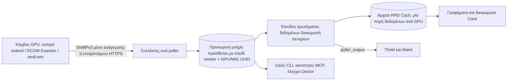

<!-- Source: README.md; SHA256: 97ba37df4a883426d3984ed7d14547ad7367e973411a8abd930409ce259f545b -->

<!-- translations:start -->
[English](../../../README.md) | [简体中文](../zh-CN/README.md) | [हिन्दी](../hi-IN/README.md) | [Español (España)](../es-ES/README.md) | [Español (Latinoamérica)](../es-419/README.md) | [العربية (السعودية)](../ar-SA/README.md) | [Afrikaans](../af-ZA/README.md) | [አማርኛ](../am-ET/README.md) | [العربية (مصر)](../ar-EG/README.md) | [العربية (المغرب)](../ar-MA/README.md) | [Български](../bg-BG/README.md) | [বাংলা](../bn-BD/README.md) | [Bosanski](../bs-BA/README.md) | [Deutsch](../de-DE/README.md) | [Ελληνικά](README.md) | [فارسی](../fa-IR/README.md) | [Filipino](../fil-PH/README.md) | [Français](../fr-FR/README.md) | [Français (Maroc)](../fr-MA/README.md) | [Français (Sénégal)](../fr-SN/README.md) | [Hausa](../ha-NG/README.md) | [עברית](../he-IL/README.md) | [Hrvatski](../hr-HR/README.md) | [Bahasa Indonesia](../id-ID/README.md) | [Igbo](../ig-NG/README.md) | [Italiano](../it-IT/README.md) | [日本語](../ja-JP/README.md) | [ქართული](../ka-GE/README.md) | [한국어](../ko-KR/README.md) | [Latviešu](../lv-LV/README.md) | [Malagasy](../mg-MG/README.md) | [मराठी](../mr-IN/README.md) | [Bahasa Melayu](../ms-MY/README.md) | [Nederlands](../nl-NL/README.md) | [Polski](../pl-PL/README.md) | [Português (Brasil)](../pt-BR/README.md) | [Português (Portugal)](../pt-PT/README.md) | [Русский](../ru-RU/README.md) | [Kinyarwanda](../rw-RW/README.md) | [Soomaali](../so-SO/README.md) | [Српски](../sr-RS/README.md) | [Svenska](../sv-SE/README.md) | [Kiswahili](../sw-KE/README.md) | [தமிழ்](../ta-IN/README.md) | [తెలుగు](../te-IN/README.md) | [ไทย](../th-TH/README.md) | [Türkçe](../tr-TR/README.md) | [Українська](../uk-UA/README.md) | [اردو](../ur-PK/README.md) | [Tiếng Việt](../vi-VN/README.md) | [isiXhosa](../xh-ZA/README.md) | [Yorùbá](../yo-NG/README.md) | [繁體中文](../zh-TW/README.md) | [isiZulu](../zu-ZA/README.md)
<!-- translations:end -->

# plugin_gpu

Ένα πρόσθετο για το Cacti 1.2 που φέρνει στο Cacti τη χρήση ανά GPU, τη μνήμη, τη θερμοκρασία, την ισχύ, τα σφάλματα ECC και τις αιτίες περιορισμού συχνότητας (throttling) από εργαλεία NVIDIA και AMD. Κάθε GPU (ή παρουσία MIG) γίνεται ευρετήριο ενός ερωτήματος δεδομένων στη συσκευή του κόμβου της, ώστε τα γραφήματα GPU να βρίσκονται δίπλα στα υπόλοιπα γραφήματα του κόμβου υπό τα δικαιώματα του Cacti, και τα Thold και Maint να μπορούν να ειδοποιούν και να τα καταστέλλουν.

> **Κατάσταση: οι φάσεις 1 έως 3 έχουν υλοποιηθεί στον κώδικα, αλλά δεν έχουν ακόμη κυκλοφορήσει.** Η Φάση 1 (NVIDIA `nvidia-smi` μέσω SNMP extend, παρακολούθηση ταυτότητας, γραφήματα, σήματα throttling και ECC, ειδοποιήσεις Thold και Maint, σελίδα υγείας), η Φάση 2 (αναλυτής/πελάτης HTTP(S) μόνο ανάγνωσης για NVIDIA DCGM Exporter και αναλυτής AMD `amd-smi`), η Φάση 3 (παρακολούθηση ταυτότητας παρουσιών MIG, στήλες Schema v4, εκτέλεση απομακρυσμένων συλλεκτών ανά poller, σημεία επέκτασης `replicate_out` και `remote_agent`), το CLI χειριστή CasC (`cli/gpu.php`) και τα σημεία επέκτασης οικοσυστήματος (`abilities_register`, `doctor_register_checks`, `casc_register_providers`) έχουν υλοποιηθεί και καλύπτονται από δοκιμές μονάδας, ασφάλειας και ενσωμάτωσης σε προσωρινό Cacti. Οι ζωντανές εκτελέσεις μέχρι στιγμής χρησιμοποιούν συνθετικό `snmpd` και προσχεδιασμένα φορτία δεδομένων αντί για φυσικό υλικό GPU. Παραμένουν ανοιχτά πριν από την ετικετοποίηση κυκλοφορίας: πιλοτικές δοκιμές σε πραγματικό υλικό ([docs/pilot-plan.md](../../pilot-plan.md), #54), εξωτερικός έλεγχος ασφάλειας ([docs/security-review.md](../../security-review.md)), fixtures που έχουν συλλεχθεί από πραγματικά εργαλεία (#14) και μετρήσεις κλίμακας σε υλικό παραγωγικού μεγέθους ([docs/performance.md](../../performance.md)). Η συλλογή σφαλμάτων XID παραμένει ανοιχτή υπό την απόφαση #8.

## Ρόλοι πρόσβασης

| Πεδίο δικαιωμάτων | Πρόσβαση |
| --- | --- |
| Προβολή GPU (GPU View) | Υπάρχουσες σελίδες παρακολούθησης. |
| Χειριστής GPU (GPU Operator) | Παρακολούθηση συν τη σελίδα Λειτουργιών και προσωπικές επιβεβαιώσεις διαλογής. |
| Διαχειριστής GPU (GPU Admin) | Πρόσβαση χειριστή συν τις υπάρχουσες ενέργειες διαμόρφωσης και διαχείρισης. |

Αφού αντιγράψετε τα αρχεία αναβάθμισης, ανοίξτε τη σελίδα «Πρόσθετα» (Plugins) ως διαχειριστής για να καταχωρηθεί
το νέο πεδίο δικαιωμάτων. Εκχωρήστε ρητά το πεδίο Operator από **Configuration > Users** ή από ομάδες χρηστών.
Οι αναβαθμίσεις διατηρούν τα υπάρχοντα αναγνωριστικά και τις παραχωρήσεις των πεδίων View και Admin. Η πρόσβαση Admin
κληρονομεί την πρόσβαση Operator και η πρόσβαση Operator κληρονομεί την πρόσβαση View σε κάθε αίτημα·
αυτό δεν προσθέτει αποθηκευμένες παραχωρήσεις σε χρήστες ή ομάδες. Οι ρυθμίσεις του πρόσθετου απαιτούν επίσης
πρόσβαση GPU Admin επιπλέον του δικαιώματος Settings του Cacti.

Τα δικαιώματα συσκευών του Cacti εξακολουθούν να περιορίζουν τις γραμμές και τις ενέργειες που είναι διαθέσιμες σε κάθε χρήστη· τα μη αντιστοιχισμένα αντικείμενα απαιτούν διαχειριστή.
Τα διαπιστευτήρια, η διαμόρφωση, η αντιστοίχιση, η διαγραφή και άλλες διαχειριστικές αλλαγές
παραμένουν στις σελίδες διαχείρισης. Οι επιβεβαιώσεις διαρκούν μόνο στην τρέχουσα
συνεδρία του χρήστη, για το πολύ μία ώρα και μόνο όσο η ίδια παρατήρηση παραμένει
επίκαιρη. Νέες ή τροποποιημένες παρατηρήσεις τις ακυρώνουν. Δεν χαρακτηρίζουν ποτέ μια αποτυχημένη
μέτρηση ως υγιή ούτε καταστέλλουν ειδοποιήσεις.

## Γιατί

Οι κόμβοι GPU συνήθως βρίσκονται ήδη στο Cacti για CPU, μνήμη και διεπαφές δικτύου. Η υγεία των GPU είναι ένα ξεχωριστό ερώτημα στο οποίο τα δεδομένα SNMP του κόμβου δεν απαντούν: μια κάρτα μπορεί να υφίσταται θερμικό περιορισμό συχνότητας (throttling), να συσσωρεύει σφάλματα ECC ή να αναφέρει σφάλμα XID ενώ ο ίδιος ο κόμβος φαίνεται υγιής. Τα εργαλεία των κατασκευαστών τα αναφέρουν (`nvidia-smi`, DCGM, `amd-smi`), αλλά η έξοδός τους βρίσκεται εκτός των γραφημάτων, των δικαιωμάτων και των ειδοποιήσεων του Cacti.

Το πρόσθετο καλύπτει αυτό το κενό μετατρέποντας την έξοδο των εργαλείων κατασκευαστή σε πηγές δεδομένων Cacti, με κλειδί την ταυτότητα κάθε GPU αντί για τη θέση της, ώστε μια επανεκκίνηση που αλλάζει τη σειρά των GPU να μην προσκολλά το ιστορικό μιας κάρτας σε άλλη. Επαναχρησιμοποιεί τα γραφήματα, τα δικαιώματα, τους απομακρυσμένους συλλέκτες δεδομένων, το Thold και το Maint του Cacti αντί να δημιουργεί παράλληλες εκδόσεις τους.

## Προγραμματισμένο εύρος

| Φάση | Εύρος | Κατάσταση | Ορόσημα |
|---|---|---|---|
| 0, έρευνα | Έξοδος εργαλείων κατασκευαστή, σήματα XID και throttling, ταυτότητα GPU, δικαιώματα, απόφαση διαδρομής συλλογής | Ολοκληρώθηκε | [M1](https://github.com/somethingwithproof/plugin_gpu/milestone/1) |
| 1, nvidia | Συλλογή `nvidia-smi`, απογραφή βάσει UUID, γραφήματα, σήματα throttling και ECC, Thold και Maint, σελίδα υγείας | Υλοποιήθηκε (δοκιμασμένο με fixtures) | [M2](https://github.com/somethingwithproof/plugin_gpu/milestone/2), [M3](https://github.com/somethingwithproof/plugin_gpu/milestone/3), [M4](https://github.com/somethingwithproof/plugin_gpu/milestone/4) |
| 2, συστήματα υποστήριξης | Αναλυτής/πελάτης HTTP(S) μόνο ανάγνωσης DCGM Exporter (`lib/DcgmExporterParser.php`, `lib/DcgmExporterClient.php`), αναλυτής AMD `amd-smi` (`lib/AmdSmiParser.php`) | Υλοποιήθηκε (δοκιμές μονάδας) | [M5](https://github.com/somethingwithproof/plugin_gpu/milestone/5) |
| 3, mig, απομακρυσμένη συλλογή και οικοσύστημα | Παρακολούθηση ταυτότητας παρουσιών MIG, απομακρυσμένοι συλλέκτες δεδομένων (`INFO`, `poller_gpu.php --poller=N`, `replicate_out`, `remote_agent`), CasC CLI (`cli/gpu.php`), σημεία επέκτασης MCP/Doctor/CasC | Υλοποιήθηκε (δοκιμές μονάδας και ενσωμάτωσης CI) | [M6](https://github.com/somethingwithproof/plugin_gpu/milestone/6) |

Εκτός εύρους: οποιαδήποτε εντολή που τροποποιεί μια GPU ή έναν κόμβο (χρονισμοί, όρια ισχύος, επαναφορές, διάταξη MIG), ιδιόκτητη μηχανή ειδοποιήσεων του πρόσθετου, προσαρμοσμένος δαίμονας ή πρωτόκολλο δικτύου και χρονοπρογραμματισμός ή λογιστική εργασιών. Δείτε το σχέδιο για το εκκρεμές ερευνητικό έργο.

## Τι προσθέτει το ορόσημο 4

- **Συλλέκτης μόνο ανάγνωσης NVIDIA DCGM Exporter** (`lib/DcgmExporterParser.php`, `lib/DcgmExporterClient.php`). Αναλύει μετρικές κειμένου Prometheus (`DCGM_FI_DEV_GPU_UTIL`, `DCGM_FI_DEV_FB_USED`, `DCGM_FI_DEV_FB_FREE`, `DCGM_FI_DEV_POWER_USAGE`, `DCGM_FI_DEV_GPU_TEMP`, `DCGM_FI_DEV_ECC_DBE_VOL_TOTAL`, `DCGM_FI_DEV_CLOCK_THROTTLE_REASONS` και ετικέτες MIG `GPU_I_ID` και `GPU_I_PROFILE`). Ο πελάτης HTTP(S) επιβάλλει ρητή λίστα επιτρεπόμενων κεντρικών υπολογιστών/CIDR τελικού σημείου, επαληθεύει τα πιστοποιητικά ομότιμου TLS από προεπιλογή, περιορίζει χρονικά όρια και μέγεθος απάντησης, απενεργοποιεί ανακατευθύνσεις και απορρίπτει σχήματα εκτός HTTP(S).
- **Αναλυτής μόνο ανάγνωσης AMD `amd-smi`** (`lib/AmdSmiParser.php`). Κανονικοποιεί την έξοδο JSON/SNMP-extend του `amd-smi` (χρήση, VRAM, ισχύς, θερμοκρασία junction/edge, ECC, μεταδεδομένα διαμερισμάτων και ξεχωριστούς συσσωρευτές throttling μέσω `Reading::$vendorExtensions`) στο κοινό μοντέλο μετρικών υπό το `Vendor::Amd`.
- **Παρακολούθηση παρουσιών MIG και Schema v4** (`lib/GpuReport.php`, `lib/GpuSnapshot.php`, `lib/GpuRecord.php`, `lib/Schema.php`, `lib/ScriptServer.php`). Παρακολουθεί UUID παρουσιών MIG (`MIG-<uuid>` και `MIG-GPU-<parent>/<gi>/<ci>`), `mig_mode`, `mig_instance_id`, `mig_profile`, `parent_uuid` και `partition_info` παράλληλα με τις γονικές GPU, διατηρώντας τα αμετάβλητα κλειδιά ταυτότητας (`vendor`, `uuid`, `parent_uuid`) προστατευμένα στις ενημερώσεις και επικυρωμένα πριν από τα ερωτήματα βάσης δεδομένων.
- **Απομακρυσμένοι συλλέκτες δεδομένων** (`INFO`, `poller_gpu.php`, `lib/Poller.php`, `lib/ReplicationRepository.php`, `setup.php`). Δηλώνει `remote_collect:1, remote_poller:1` στο `INFO`, υποστηρίζει εκτέλεση ανά poller μέσω `php plugins/gpu/poller_gpu.php --poller=N`, παραλείπει την παροχή αντικειμένων Cacti σε μη κύριους pollers, αναπαράγει πίνακες ανά poller μέσω `replicate_out` και απαντά σε ενέργειες μόνο ανάγνωσης `gpu_health` και `gpu_inventory` μέσω `remote_agent`.
- **CLI χειριστή και CasC** (`cli/gpu.php`, `lib/CascProvider.php`). Εκτελείται σε PHP 8.2+ (αναλύεται συντακτικά σε PHP 8.0) με μηδενικές εξωτερικές εξαρτήσεις Composer: `php plugins/gpu/cli/gpu.php export [--format=yaml|xml]`, `validate <file> [--format=yaml|xml]`, `plan <file> [--format=yaml|xml] [--output=text|json]`, `apply <file> --confirm=<PLAN_HASH> [--format=yaml|xml]` και `health [--format=text|json]`. Τα σχέδια υπολογίζουν ντετερμινιστικό κατακερματισμό επιβεβαίωσης SHA-256, το `apply` αποτυγχάνει με ασφάλεια σε ασυμφωνία κατακερματισμού και η ανάλυση XML απορρίπτει δηλώσεις `DOCTYPE` και `ENTITY`.
- **Σημεία επέκτασης ενσωμάτωσης οικοσυστήματος** (`lib/EcosystemIntegration.php`, `setup.php`). Καταχωρεί `abilities_register` (`gpu-list-nodes`, `gpu-list-devices`, `gpu-get-health`· μόνο ανάγνωσης, προστατευμένα από το πεδίο `GPU View` και τα δικαιώματα συσκευών Cacti), `doctor_register_checks` (`gpu_schema`, `gpu_poller_freshness`, `gpu_node_health`) και `casc_register_providers`.
- **Αιτίες throttling και ECC ως τιμές ειδοποίησης** ([docs/metrics.md](../../metrics.md)). Αποκωδικοποιεί μάσκες συμβάντων χρονισμού σε δείκτες 0/1 και υπολογίζει νέα διορθωμένα/μη διορθωμένα σφάλματα ECC ανά διάστημα ως gauges, ώστε τα Thold 1.8.2 και Maint 1.3 να ειδοποιούν και να καταστέλλουν χωρίς αρνητικούς μετρητές ή αιχμές επαναφοράς ([docs/alerting.md](../../alerting.md)).
- **Υγεία GPU, δικαιώματα, αποτυχία/επαναφορά και κλίμακα.** Η Υγεία GPU (GPU View) εμφανίζει αποθηκευμένη επικαιρότητα, αποτέλεσμα τελευταίας συλλογής, κατάσταση Maint, σύστημα υποστήριξης, εκδόσεις και ακατέργαστες μάσκες throttling χωρίς επικοινωνία με κόμβους. Αυτοματοποιημένες δοκιμές από άκρο σε άκρο επαληθεύουν δικαιώματα, ανάκαμψη από αποτυχίες agent/DB/RRD ([docs/backup.md](../../backup.md)) και εκτέλεση κλίμακας 100 GPU στο CI ([docs/performance.md](../../performance.md), [docs/operations.md](../../operations.md), [CHANGELOG.md](../../../CHANGELOG.md)).

## Τι προσθέτει το ορόσημο 3

- **Συλλογή μέσω SNMP extend** ([ADR 0008](../../decisions/0008-collect-through-snmp-extend.md)). Ο διαχειριστής του κόμβου προσθέτει δύο σταθερές γραμμές `extend` στο `snmpd.conf` ([docs/node-setup.md](../../node-setup.md))· το πρόσθετο διαβάζει το NET-SNMP-EXTEND-MIB μέσω των συναρτήσεων SNMP του Cacti με τα διαπιστευτήρια της ίδιας της συσκευής, με σύσταση για SNMPv3. Δεν εκτελεί τίποτα στον διακομιστή Cacti ή στον κόμβο.
- **Αυστηρή ανάλυση.** Τα πεδία διαβάζονται ανά θέση, κάθε γραμμή προσδιορίζει τη GPU της με UUID, και ένας μη μηδενικός κωδικός εξόδου, ένα χρονικό όριο, περικομμένη έξοδος, μια γραμμή με λάθος αριθμό πεδίων ή αναμεμειγμένο κείμενο σφάλματος απορρίπτει ολόκληρη τη συλλογή: οι τιμές γίνονται `U`, καμία GPU δεν σημαίνεται ως απούσα και η σελίδα Κόμβοι GPU δείχνει τον λόγο.
- **Συλλέκτης μετά από κάθε κύκλο poller.** Διαβάζει τον παράγοντα κάθε ενεργοποιημένου κόμβου, ενημερώνει τις εγγραφές ταυτότητας και αποθηκεύει προσωρινά το τελευταίο δείγμα. Η είσοδος του διακομιστή σεναρίων διαβάζει μόνο αυτή την προσωρινή μνήμη, ώστε μια συλλογή Cacti να μην περιμένει ποτέ έναν κόμβο GPU.
- **Αντικείμενα Cacti** ([ADR 0010](../../decisions/0010-attach-to-existing-node-devices.md)). Τα πρότυπα και το ερώτημα δεδομένων *GPU - Devices* παρέχονται ως XML και εισάγονται κατά την εγκατάσταση και την αναβάθμιση. Η αποθήκευση ενός κόμβου προσαρτά το ερώτημα δεδομένων στην υπάρχουσα συσκευή του με μέθοδο επαναδημιουργίας ευρετηρίου None· η σελίδα Κόμβοι GPU μπορεί να δημιουργήσει συσκευή μόνο όταν ο κόμβος δεν διαθέτει καμία. Κάθε GPU είναι ένα ευρετήριο με κλειδί κατασκευαστή και UUID, με μία πηγή δεδομένων που μοιράζονται τα γραφήματα Utilization, Memory, Temperature, Power, Power Percent, Clocks, Throttle, ECC Errors, New ECC Errors, Retired Pages και Sample Age. Κάθε πεδίο του μοντέλου σχεδιάζεται από κάποιο γράφημα, επειδή το Cacti αποθηκεύει μόνο τα πεδία που χρησιμοποιεί κάποιο γράφημα. Το πρόσθετο επαναδημιουργεί το ευρετήριο μετά από κάθε αλλαγή GPU, διατηρεί μια επαναδημιουργία που παρέλειψε το Cacti ενώ η συσκευή ήταν εκτός λειτουργίας ή απενεργοποιημένη και την εκτελεί μόλις η συσκευή επανέλθει, και δημιουργεί γραφήματα για νέες GPU.
- **Το ιστορικό παραμένει με την κάρτα.** Μια απούσα GPU παραμένει ευρετήριο, ώστε τα γραφήματά της να εμφανίζουν κενό και να συνεχίζουν στο ίδιο αρχείο RRD όταν επιστρέψει. Μια κάρτα αντικατάστασης στην ίδια υποδοχή λαμβάνει τη δική της πηγή δεδομένων. Η επιλογή **Αφαίρεση από το ερώτημα δεδομένων** στη σελίδα του κόμβου αφαιρεί μια απούσα GPU από τη λίστα· τα αρχεία RRD και τα γραφήματά της διατηρούνται έως ότου τα διαγράψετε.
- **Δικαιώματα συσκευών στους Κόμβους GPU.** Ένας Διαχειριστής GPU βλέπει, τροποποιεί, εξάγει και μετακινεί μόνο κόμβους και GPU σε συσκευές στις οποίες έχει πρόσβαση στο Cacti· μια μετακίνηση GPU απαιτεί πρόσβαση και στους δύο κόμβους. Ένας κόμβος του οποίου η συσκευή διαγράφηκε μπορεί να απενεργοποιηθεί ή να διαγραφεί.
- **Το κοινό μοντέλο μετρικών** ([ADR 0009](../../decisions/0009-common-metric-core-with-vendor-extensions.md), [docs/metrics.md](../../metrics.md)). Η μνήμη είναι σε byte, η μάσκα συμβάντων χρονισμού αποκωδικοποιείται σε δείκτες `thr_*` και το `age` είναι η ηλικία του χρόνου δείγματος της ίδιας της GPU, ή `U` όταν είναι άγνωστη.

Ο χρήστης εγκατάστασης (διακομιστής ιστού) πρέπει να μπορεί να γράφει στον κατάλογο `<cacti>/resource/script_server/`, όπου το πρόσθετο τοποθετεί το αρχείο XML ερωτήματος δεδομένων· διαφορετικά η εγκατάσταση και η αναβάθμιση σταματούν με μήνυμα και ξαναπροσπαθούν στην επόμενη απόπειρα. Η απεγκατάσταση αφαιρεί τα πρότυπα και το XML μόνο όταν είναι επιλεγμένο το *Αφαίρεση των αντικειμένων Cacti του πρόσθετου κατά την απεγκατάσταση* και δεν διαγράφει ποτέ αρχεία RRD, συσκευές, γραφήματα ή πηγές δεδομένων ([docs/operations.md](../../operations.md#uninstall)). Οι κόμβοι σε απομακρυσμένους συλλέκτες δεδομένων εκτελούνται περιορισμένοι στο ανατεθειμένο `poller_id` τους.

## Τι παρέχει το ορόσημο 2

- **Προστατευμένη εγκατάσταση.** Σε PHP κάτω από 8.2, η εγκατάσταση και η ενεργοποίηση απορρίπτονται με μήνυμα που αναφέρει την απαιτούμενη έκδοση, ενώ το υπόλοιπο Cacti συνεχίζει να λειτουργεί. Το `setup.php` και τα σενάρια σελίδων αναλύονται συντακτικά σε PHP 8.0.
- **Κύκλος ζωής.** Εγκατάσταση, αναβάθμιση, απενεργοποίηση και απεγκατάσταση μέσω της σελίδας «Πρόσθετα» (Plugins) του Cacti. Οι αναβαθμίσεις είναι διατεταγμένες, ολοκληρώνονται μετά από διακοπή και αλλάζουν την καταγεγραμμένη έκδοση μόνο αφού επιτύχουν. Η απεγκατάσταση διατηρεί τους πίνακες του πρόσθετου εκτός αν αποεπιλέξετε το *Διατήρηση πινάκων του πρόσθετου κατά την απεγκατάσταση*· δεν αγγίζει ποτέ συσκευή Cacti, πηγή δεδομένων, γράφημα ή αρχείο RRD.
- **Ξεχωριστά πεδία δικαιωμάτων.** Το *GPU Admin* ανοίγει τους **Κόμβους GPU**, όπου καταχωρείτε συσκευές Cacti ως κόμβους GPU, επιβεβαιώνετε ή απορρίπτετε μετακινήσεις GPU μεταξύ κόμβων και εξάγετε κάθε εγγραφή ως JSON. Το *GPU View* ανοίγει την **Απογραφή GPU**, η οποία παραθέτει GPU μόνο σε συσκευές που μπορεί να δει ο θεατής. Και οι δύο σελίδες βρίσκονται υπό τη Διαχείριση (Management) και κάθε αλλαγή είναι αίτημα POST ελεγμένο από csrf-magic.
- **Εγγραφές ταυτότητας GPU.** Κάθε GPU έχει κλειδί κατασκευαστή και UUID. Το ευρετήριο, το αναγνωριστικό διαύλου PCI, το όνομα, ο οδηγός και το εργαλείο αναφοράς είναι ιδιότητες που αλλάζουν επιτόπου. Ένα νέο UUID σε γνωστή υποδοχή σημαίνεται ως πιθανή αντικατάσταση και ξεκινά το δικό του ιστορικό· μια GPU που εντοπίζεται σε άλλον κόμβο μετακινείται μόνο όταν το επιβεβαιώσει χειριστής· μια GPU που λείπει από επιτυχημένες συλλογές σημαίνεται ως απούσα μετά από διαμορφώσιμο πλήθος και δεν διαγράφεται ποτέ. Προς το παρόν γίνονται δεκτά μόνο UUID ολόκληρων GPU της NVIDIA· οι παρουσίες MIG αναμένουν την απόφαση #13 και η AMD την έρευνα #19. Οι κανόνες ελέγχονται με ακολουθίες fixtures, καθώς δεν τους τροφοδοτεί ακόμη συλλέκτης.
- **Δοκιμές και CI.** Σουίτες δοκιμών μονάδας και κανόνων πηγαίου κώδικα χωρίς GPU ή βάση δεδομένων, έλεγχοι κύκλου ζωής και δικαιωμάτων σελίδας έναντι Cacti 1.2.31 και τρέχουσας 1.2.x σε PHP 8.2 έως 8.5, εργασία απόρριψης PHP 8.1, συντακτικός έλεγχος PHP 8.0 των σημείων εισόδου, PHPStan σε επίπεδο 9 και REUSE. Το πλαίσιο δοκιμών είναι προσωρινό έως ότου ληφθεί απόφαση για το #12.

### Εγκατάσταση για αξιολόγηση

Αυτά τα βήματα εγκαθιστούν τον τρέχοντα κώδικα για δοκιμή· το [docs/operations.md](../../operations.md) περιέχει τον πλήρη οδηγό χειριστή. Απαιτούν Cacti 1.2.31 ή νεότερη σε PHP 8.2 ή νεότερη.

1. Αντιγράψτε το αποθετήριο στον κατάλογο `plugins/gpu` κάτω από τον κατάλογο του Cacti. Ο κατάλογος πρέπει να ονομάζεται `gpu`.
2. Στο Cacti, ανοίξτε **Configuration > Plugins** και στη συνέχεια εγκαταστήστε και ενεργοποιήστε το **GPU**.
3. Δώστε στους χρήστες το πεδίο *GPU View*, *GPU Operator* ή *GPU Admin* από **Configuration > Users**, ανάλογα με τον ρόλο τους. Ο χρήστης εγκατάστασης λαμβάνει View και Admin· το Admin περιλαμβάνει πρόσβαση Operator.
4. Ρυθμίστε τον παράγοντα SNMP κάθε κόμβου GPU όπως περιγράφεται στο [docs/node-setup.md](../../node-setup.md) και στη συνέχεια προσθέστε τον κόμβο από **Management > GPU Nodes**.
5. Για ειδοποιήσεις, εισαγάγετε τα παρεχόμενα πρότυπα Thold όπως περιγράφει το [docs/alerting.md](../../alerting.md).
6. Προαιρετικά προσαρμόστε τις ρυθμίσεις σε **Configuration > Settings > GPU**: *Σήμανση ως απούσας μετά από* (προεπιλογή 3 επιτυχημένες συλλογές, από 1 έως 100), *Παρωχημένα μετά από* (πόσο παλιό μπορεί να είναι ένα δείγμα πριν οι τιμές του εκτυπώσουν `U`) και *Διατήρηση πινάκων του πρόσθετου κατά την απεγκατάσταση* (προεπιλογή ενεργό).

## Πώς φτάνουν οι μετρικές στο Cacti

Η απόφαση [#7](https://github.com/somethingwithproof/plugin_gpu/issues/7) επέλεξε το SNMP `extend` ([ADR 0008](../../decisions/0008-collect-through-snmp-extend.md)): ο παράγοντας του ίδιου του κόμβου εκτελεί μια σταθερή εντολή `nvidia-smi` και το πρόσθετο απλώς διαβάζει το αποτέλεσμα. Το σχέδιο συγκρίνει τις επιλογές στην ενότητα [Διαδρομές συλλογής](../../PLAN.md#collection-paths).

## Στόχοι συμβατότητας

| Στοιχείο | Στόχος |
|---|---|
| Cacti | 1.2.31 ή νεότερη, χωρίς τροποποιήσεις στον πυρήνα |
| PHP | 8.2 ή νεότερη· το `setup.php` παραμένει συντακτικά αναλύσιμο στην 8.0 ώστε ένα μη υποστηριζόμενο περιβάλλον εκτέλεσης να λαμβάνει απόρριψη αντί για κατεστραμμένη διεπαφή Cacti |
| NVIDIA | Εκδόσεις οδηγών και εργαλείων που θα καθοριστούν από την έρευνα [#26](https://github.com/somethingwithproof/plugin_gpu/issues/26)· αναγνωριστικά πεδίων DCGM ελεγμένα στις εκδόσεις v3.3.9 και v4.7.0 |
| AMD | `amd-smi` σε εκδόσεις ROCm που θα καθοριστούν από την έρευνα [#26](https://github.com/somethingwithproof/plugin_gpu/issues/26) |
| Thold, Maint | Thold 1.8.2 και Maint 1.3, αμετάβλητα, δοκιμασμένα από άκρο σε άκρο ([docs/alerting.md](../../alerting.md)) |

## Σχεδιασμός

- Το [docs/PLAN.md](../../PLAN.md) είναι το πλήρες σχέδιο: αρχιτεκτονική, δεδομένα upstream στα οποία βασίζεται (με πηγές), μοντέλο ταυτότητας, όρια ασφάλειας, αριθμητική απόδοσης, δοκιμές και κίνδυνοι.
- Ο κατάλογος [docs/decisions/](../../decisions/) περιέχει αρχεία αρχιτεκτονικών αποφάσεων για επιλογές που έχουν ήδη γίνει.
- Το [docs/REQUIREMENTS.md](../../REQUIREMENTS.md) αντιστοιχίζει κάθε αναγνωριστικό απαίτησης στο αντίστοιχο ζήτημα.

## Πώς παρακολουθείται η εργασία

- Τα **Ορόσημα (Milestones)** ακολουθούν τα ορόσημα του σχεδίου. Καθένα έχει ένα επικό ζήτημα (epic issue) που παραθέτει τα επιμέρους ζητήματα και τα αποδεικτικά στοιχεία ολοκλήρωσης.
- Τα **Ζητήματα (Issues)** κατηγοριοποιούνται με ετικέτες: `type: requirement`, `type: research`, `type: decision`, `type: epic`. Τα ζητήματα απαιτήσεων δηλώνουν αριθμημένες, ελέγξιμες απαιτήσεις (`REQ-AREA-NNN`) και κριτήρια αποδοχής.
- Οι **Ετικέτες (Labels)** φέρουν επίσης προθέματα `area:`, `phase:`, `priority:` και `status:`. Δείτε το [CONTRIBUTING.md](../../../CONTRIBUTING.md#labels).
- Ο [πίνακας έργου](https://github.com/users/somethingwithproof/projects/9) εμφανίζει όλα τα ζητήματα σε όλα τα ορόσημα.

## Συνεισφορά

Διαβάστε το [CONTRIBUTING.md](../../../CONTRIBUTING.md). Οι καταχωρήσεις (commits) απαιτούν υπογραφή DCO (DCO sign-off). Η συζήτηση σχεδιασμού γίνεται στα ζητήματα· οι ανοιχτές αποφάσεις φέρουν την ετικέτα `type: decision`. Η καταγεγραμμένη έξοδος από πραγματικά εργαλεία GPU είναι η πιο χρήσιμη συνεισφορά για το ορόσημο 1· αφαιρέστε πρώτα ονόματα κεντρικών υπολογιστών, σειριακούς αριθμούς και UUID.

## Ασφάλεια

Αναφέρετε ευπάθειες ιδιωτικά· δείτε το [SECURITY.md](../../../SECURITY.md).

## Άδεια χρήσης

GNU General Public License v2.0, η ίδια άδεια με το Cacti και τα πρόσθετά του. Δείτε το [LICENSE](../../../LICENSE).
