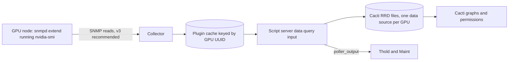

<!-- Source: README.md; SHA256: 126deef1783d64f878bf565f1433c10f31aef828eb9bc313aeff2b0335e54c7c -->

<!-- translations:start -->
[English](../../../README.md) | [简体中文](../zh-CN/README.md) | [हिन्दी](../hi-IN/README.md) | [Español (España)](../es-ES/README.md) | [Español (Latinoamérica)](README.md) | [العربية (السعودية)](../ar-SA/README.md) | [Afrikaans](../af-ZA/README.md) | [አማርኛ](../am-ET/README.md) | [العربية (مصر)](../ar-EG/README.md) | [العربية (المغرب)](../ar-MA/README.md) | [বাংলা](../bn-BD/README.md) | [Bosanski](../bs-BA/README.md) | [Deutsch](../de-DE/README.md) | [فارسی](../fa-IR/README.md) | [Filipino](../fil-PH/README.md) | [Français](../fr-FR/README.md) | [Français (Maroc)](../fr-MA/README.md) | [Français (Sénégal)](../fr-SN/README.md) | [Hausa](../ha-NG/README.md) | [עברית](../he-IL/README.md) | [Hrvatski](../hr-HR/README.md) | [Bahasa Indonesia](../id-ID/README.md) | [Igbo](../ig-NG/README.md) | [Italiano](../it-IT/README.md) | [日本語](../ja-JP/README.md) | [한국어](../ko-KR/README.md) | [Malagasy](../mg-MG/README.md) | [मराठी](../mr-IN/README.md) | [Bahasa Melayu](../ms-MY/README.md) | [Nederlands](../nl-NL/README.md) | [Polski](../pl-PL/README.md) | [Português (Brasil)](../pt-BR/README.md) | [Русский](../ru-RU/README.md) | [Kinyarwanda](../rw-RW/README.md) | [Soomaali](../so-SO/README.md) | [Српски](../sr-RS/README.md) | [Svenska](../sv-SE/README.md) | [Kiswahili](../sw-KE/README.md) | [தமிழ்](../ta-IN/README.md) | [తెలుగు](../te-IN/README.md) | [ไทย](../th-TH/README.md) | [Türkçe](../tr-TR/README.md) | [Українська](../uk-UA/README.md) | [اردو](../ur-PK/README.md) | [Tiếng Việt](../vi-VN/README.md) | [isiXhosa](../xh-ZA/README.md) | [Yorùbá](../yo-NG/README.md) | [繁體中文](../zh-TW/README.md) | [isiZulu](../zu-ZA/README.md)
<!-- translations:end -->

# plugin_gpu

Un plugin para Cacti 1.2 que incorpora utilización, memoria, temperatura, potencia, errores ECC y motivos de limitación por GPU desde las herramientas NVIDIA. La compatibilidad con AMD y la recolección de errores XID están previstas, pero no implementadas. Cada GPU se convierte en un índice de una consulta de datos del dispositivo de su nodo, de modo que sus gráficos aparecen junto a los demás del nodo bajo los permisos de Cacti, y Thold y Maint pueden alertar sobre ellos y suprimir las alertas.

> **Estado: en desarrollo, sin publicar.** El hito 4 completa el código de la fase 1 (NVIDIA mediante SNMP extend): recolección, identidad, gráficos, señales de limitación y ECC, alertas con Thold y Maint, página de estado y documentación del operador. Solo se ha ejecutado con un `snmpd` real y un `nvidia-smi` simulado que imprime salida sintética, nunca en hardware GPU. Antes de publicar siguen pendientes: pilotos en hardware real ([docs/pilot-plan.md](../../pilot-plan.md), #54), revisión externa de seguridad ([docs/security-review.md](../../security-review.md)), muestras capturadas de herramientas reales (#14) y mediciones a escala en hardware de tamaño productivo ([docs/performance.md](docs/performance.md)). Los errores XID esperan la decisión #8. No lo ejecute en producción.

## Roles de acceso

| Ámbito | Acceso |
| --- | --- |
| GPU View | Páginas de monitorización existentes. |
| GPU Operator | Monitorización, página Operaciones y confirmaciones personales de clasificación. |
| GPU Admin | Acceso Operator más configuración y acciones administrativas existentes. |

Tras copiar los archivos de actualización, abra Plugins como administrador para registrar el nuevo ámbito. Asigne expresamente Operator en **Configuración > Usuarios** o en grupos de usuarios. Las actualizaciones conservan los identificadores y concesiones existentes de View y Admin. En cada solicitud, Admin hereda Operator y Operator hereda View; esto no agrega concesiones persistentes a usuarios ni grupos. Los ajustes del plugin requieren GPU Admin además del permiso Settings de Cacti.

Los permisos de dispositivo de Cacti siguen limitando las filas y acciones de cada usuario; los objetos sin asignar requieren un administrador. Credenciales, configuración, asignación, borrado y otros cambios administrativos permanecen en las páginas administrativas. Las confirmaciones duran solo en la sesión del usuario actual, como máximo una hora y mientras siga vigente la misma observación. Las observaciones nuevas o modificadas las invalidan. Nunca marcan una medición fallida como correcta ni suprimen alertas.

## Motivo

Los nodos GPU suelen estar ya en Cacti para CPU, memoria e interfaces. La salud de GPU es otra cuestión que sus datos SNMP no resuelven: una tarjeta puede sufrir limitación térmica, acumular errores ECC o comunicar un fallo XID mientras el nodo parece sano. Las herramientas del fabricante lo comunican (`nvidia-smi`, DCGM, `amd-smi`), pero su salida queda fuera de los gráficos, permisos y alertas de Cacti.

El plugin cubre esa carencia convirtiendo la salida en fuentes de datos Cacti identificadas por la identidad de cada GPU, no por su posición, para que un reinicio que reordene las GPU no asigne el historial de una tarjeta a otra. Reutiliza gráficos, permisos, recolectores remotos, Thold y Maint de Cacti en lugar de crear versiones paralelas.

## Alcance previsto

| Fase | Alcance | Hitos |
|---|---|---|
| 0, investigación | Salida de herramientas, señales XID y de limitación, identidad GPU, privilegios y decisión de ruta de recolección | [M1](https://github.com/somethingwithproof/plugin_gpu/milestone/1) |
| 1, nvidia | Recogida `nvidia-smi`, inventario por UUID, gráficos, señales de limitación, ECC y XID, Thold y Maint, página de estado | [M2](https://github.com/somethingwithproof/plugin_gpu/milestone/2), [M3](https://github.com/somethingwithproof/plugin_gpu/milestone/3), [M4](https://github.com/somethingwithproof/plugin_gpu/milestone/4) |
| 2, backends | Backend DCGM y backend `amd-smi` | [M5](https://github.com/somethingwithproof/plugin_gpu/milestone/5) |
| 3, MIG y remoto | Instancias MIG y recolectores de datos remotos de Cacti | [M6](https://github.com/somethingwithproof/plugin_gpu/milestone/6) |

Fuera de alcance: comandos que cambien una GPU o nodo (relojes, límites de potencia, reinicios, disposición MIG), motor de alertas propio, demonio o protocolo de red personalizado y contabilidad del planificador o de trabajos. Consulte el plan para las investigaciones pendientes.

## Qué agrega el hito 4

- **Motivos de limitación como valores de alerta.** La máscara de eventos de reloj se decodifica en un indicador 0 o 1 por motivo; una máscara desconocida da indicadores desconocidos, nunca ceros, y los bits sin indicador permanecen en la máscara bruta que muestra Estado de GPU.
- **ECC como valores de alerta** ([docs/metrics.md](docs/metrics.md)). El plugin calcula errores nuevos corregidos y no corregidos desde la muestra anterior a partir de dos totales consecutivos y los guarda como gauges: desconocidos en la primera muestra, tras una lectura perdida o una recarga del controlador, para que un reinicio del contador nunca aparezca como cero ni como cantidad negativa. También lee los recuentos de páginas retiradas por errores de uno y dos bits y el modo ECC. Dos gráficos ECC adicionales por GPU permiten que Cacti los guarde; con el porcentaje de potencia hay once gráficos en total. XID no se recoge: ninguna fuente encaja en los comandos fijos de `nvidia-smi` (#8).
- **Thold y Maint** ([docs/alerting.md](docs/alerting.md)). Plantillas Thold incluidas para temperatura, potencia respecto al límite, indicadores de limitación, errores ECC nuevos no corregidos, retirada de páginas pendiente y antigüedad de muestra. Cada valor es gauge porque Thold 1.8.2 falla con un contador desconocido. Una prueba de extremo a extremo con Thold 1.8.2 y Maint 1.3 sin cambios demuestra la activación y restablecimiento de cada umbral, también tras reiniciar ECC, y su supresión por Maint.
- **Estado de GPU** (GPU View). Por nodo: actualidad, resultado de la última recolección, estado Maint, versiones del backend, herramienta y controlador y cantidades de GPU; por GPU: presencia, antigüedad de muestra, estado ECC y máscara bruta. Solo lee registros guardados.
- **Permisos.** La suite de permisos cubre todos los archivos de página y acciones, revocación en la siguiente solicitud y rechazos sin revelar información.
- **Verificación de fallos y restauración.** Ejecuciones de extremo a extremo programadas provocan fallos del agente, credenciales, herramienta, salida, conexión de base de datos y escritura RRD, y restauran la base de datos desde un volcado, incluso uno anterior a los RRD; una GPU nueva nunca hereda el RRD de otra ([docs/backup.md](docs/backup.md)).
- **Escala** ([docs/performance.md](docs/performance.md)). Una prueba mide recolección, entrada del servidor de scripts, creación de objetos Cacti, ciclo del sondeador y página de estado para una cantidad dada de GPU; CI la ejecuta con 100. Todavía no se registraron las mediciones de 1,000 y 8,000 GPU, por lo que no se declara una cantidad admitida.
- **Documentación del operador** ([docs/operations.md](docs/operations.md)): instalación, actualización, desinstalación, mínimos privilegios, valores no disponibles y resolución de problemas. Los cambios están en [CHANGELOG.md](../../../CHANGELOG.md).

## Qué agrega el hito 3

- **Recolección mediante SNMP extend** ([ADR 0008](../../decisions/0008-collect-through-snmp-extend.md)). El administrador del nodo agrega dos líneas `extend` fijas a `snmpd.conf` ([docs/node-setup.md](docs/node-setup.md)); el plugin lee NET-SNMP-EXTEND-MIB mediante las funciones SNMP de Cacti y las credenciales del dispositivo; se recomienda SNMPv3. No ejecuta nada en el servidor Cacti ni en el nodo.
- **Análisis estricto.** Los campos se leen por posición, cada línea identifica su GPU por UUID y cualquier estado de salida no cero, tiempo agotado, salida truncada, cantidad de campos incorrecta o texto de error mezclado hace fallar toda la recolección: los valores pasan a `U`, ninguna GPU se marca ausente y Nodos GPU muestra el motivo.
- **Un recolector tras cada ciclo del sondeador.** Lee el agente de cada nodo habilitado, actualiza los registros de identidad y guarda la última muestra en caché. La entrada del servidor de scripts solo lee esa caché, por lo que un sondeo de Cacti nunca espera a un nodo GPU.
- **Objetos Cacti** ([ADR 0010](../../decisions/0010-attach-to-existing-node-devices.md)). Las plantillas y la consulta *GPU - Devices* se distribuyen como XML y se importan al instalar y actualizar. Guardar un nodo vincula la consulta a su dispositivo existente con método de reindexación None; Nodos GPU solo puede crear un dispositivo si el nodo no tiene ninguno. Cada GPU es un índice por fabricante y UUID, con una fuente compartida por sus gráficos de Utilización, Memoria, Temperatura, Potencia, Porcentaje de potencia, Relojes, Limitación, Errores ECC, Errores ECC nuevos, Páginas retiradas y Antigüedad de muestra. Cada campo del modelo aparece en algún gráfico, porque Cacti solo guarda campos utilizados por gráficos. El plugin reindexa tras cada cambio de GPU, conserva una reindexación omitida por Cacti mientras el dispositivo estaba caído o desactivado y la ejecuta cuando vuelve a estar activo, y crea gráficos para GPU nuevas.
- **El historial permanece con la tarjeta.** Una GPU ausente sigue siendo un índice, de modo que sus gráficos muestran un hueco y continúan en el mismo RRD cuando vuelve. Una tarjeta de sustitución en la misma ranura recibe su propia fuente. **Eliminar de la consulta de datos**, en la página del nodo, retira una GPU ausente de la lista; sus RRD y gráficos se conservan hasta que los borre.
- **Permisos de dispositivo en Nodos GPU.** GPU Admin solo ve, cambia, exporta y mueve nodos y GPU de dispositivos que puede ver en Cacti; un traslado de GPU requiere ambos nodos. Un nodo cuyo dispositivo se borró puede desactivarse o eliminarse.
- **Modelo común de métricas** ([ADR 0009](../../decisions/0009-common-metric-core-with-vendor-extensions.md), [docs/metrics.md](docs/metrics.md)). La memoria está en bytes, la máscara de eventos de reloj se decodifica en indicadores `thr_*` y `age` es la antigüedad de la hora de muestra propia de la GPU, o `U` si se desconoce.

El usuario que instala (servidor web) debe poder escribir en `<cacti>/resource/script_server/`, donde el plugin coloca el XML de consulta; en caso contrario, instalación y actualización se detienen con un mensaje y reintentan la próxima vez. La desinstalación elimina plantillas y XML solo si se marca *Eliminar los objetos Cacti del plugin al desinstalar*, y nunca elimina RRD, dispositivos, gráficos ni fuentes de datos ([docs/operations.md](docs/operations.md#uninstall)). Los nodos de recolectores remotos no se recolectan hasta la fase 3.

## Qué incluye el hito 2

- **Instalación protegida.** Con PHP anterior a 8.2 se rechazan instalación y activación con un mensaje que indica la versión requerida; el resto de Cacti sigue funcionando. `setup.php` y los scripts de página se analizan en PHP 8.0.
- **Ciclo de vida.** Instalación, actualización, desactivación y desinstalación desde Plugins de Cacti. Las actualizaciones siguen un orden, terminan tras una interrupción y cambian la versión registrada solo si tienen éxito. La desinstalación conserva las tablas salvo que desmarque *Conservar tablas del plugin al desinstalar*; nunca toca dispositivos, fuentes, gráficos ni RRD de Cacti.
- **Ámbitos separados.** *GPU Admin* abre **Nodos GPU**, donde registra dispositivos Cacti como nodos GPU, confirma o rechaza traslados entre nodos y exporta todos los registros a JSON. *GPU View* abre **Inventario GPU**, que solo enumera GPU de dispositivos visibles para el usuario. Ambas páginas están en Administración y todo cambio es un POST comprobado por csrf-magic.
- **Registros de identidad GPU.** Cada GPU se identifica por fabricante y UUID. Índice, ID de bus PCI, nombre, controlador y herramienta que informa son atributos actualizados en el mismo registro. Un UUID nuevo en una ranura conocida se marca como posible sustitución y comienza su propio historial; una GPU vista en otro nodo solo se mueve tras confirmación de un operador; una GPU ausente en recoleccións correctas se marca ausente tras un número configurable y nunca se elimina. Por ahora solo se aceptan UUID NVIDIA de GPU completas; MIG espera la decisión #13 y AMD la investigación #19. Las reglas se ejercitan con secuencias de muestras porque todavía ningún recolector las alimenta.
- **Pruebas y CI.** Suites unitarias y de reglas de código sin GPU ni base de datos; comprobaciones de ciclo de vida y permisos contra Cacti 1.2.31 y 1.2.x actual con PHP 8.2 a 8.5; tarea de rechazo PHP 8.1; análisis sintáctico de entradas con PHP 8.0; PHPStan nivel 9 y REUSE. El entorno de pruebas es provisional hasta resolver #12.

### Instalar para evaluar

Estos pasos instalan el código actual para probarlo; [docs/operations.md](docs/operations.md) contiene la guía completa. Requieren Cacti 1.2.31 o posterior con PHP 8.2 o posterior.

1. Copie el repositorio a `plugins/gpu` bajo el directorio de Cacti. Debe llamarse `gpu`.
2. En Cacti, abra **Configuración > Plugins**, instale y active **GPU**.
3. Asigne *GPU View*, *GPU Operator* o *GPU Admin* en **Configuración > Usuarios**, según la función del usuario. El usuario que instala recibe View y Admin; Admin incluye el acceso Operator.
4. Configure el agente SNMP de cada nodo según [docs/node-setup.md](docs/node-setup.md) y agregue el nodo en **Administración > Nodos GPU**.
5. Para alertas, importe las plantillas Thold incluidas como indica [docs/alerting.md](docs/alerting.md).
6. Opcionalmente ajuste **Configuración > Ajustes > GPU**: *Marcar ausente tras* (3 recoleccións correctas por defecto, de 1 a 100), *Obsoleto tras* (antigüedad antes de mostrar valores `U`) y *Conservar tablas del plugin al desinstalar* (activado por defecto).

## Cómo llegan las métricas a Cacti

La decisión [#7](https://github.com/somethingwithproof/plugin_gpu/issues/7) eligió SNMP `extend` ([ADR 0008](../../decisions/0008-collect-through-snmp-extend.md)): el agente del nodo ejecuta un comando `nvidia-smi` fijo y el plugin solo lee el resultado. El plan compara opciones en [Rutas de recolección](../../PLAN.md#collection-paths).

## Objetivos de compatibilidad

| Componente | Objetivo |
|---|---|
| Cacti | 1.2.31 o posterior, sin parches del núcleo |
| PHP | 8.2 o posterior; `setup.php` sigue siendo analizable en 8.0 para que un entorno no compatible reciba un rechazo en lugar de romper la interfaz de Cacti |
| NVIDIA | Líneas de controlador y herramienta pendientes de investigación [#26](https://github.com/somethingwithproof/plugin_gpu/issues/26); identificadores DCGM comprobados en v3.3.9 y v4.7.0 |
| AMD | `amd-smi` en versiones ROCm pendientes de investigación [#26](https://github.com/somethingwithproof/plugin_gpu/issues/26) |
| Thold, Maint | Thold 1.8.2 y Maint 1.3 sin cambios, probados de extremo a extremo ([docs/alerting.md](docs/alerting.md)) |

## Diseño

- [docs/PLAN.md](../../PLAN.md) contiene el plan completo: arquitectura, hechos de proyectos originales de los que depende (con fuentes), modelo de identidad, límites de seguridad, cálculos de rendimiento, pruebas y riesgos.
- [docs/decisions/](../../decisions) contiene los registros de decisiones arquitectónicas ya tomadas.
- [docs/REQUIREMENTS.md](../../REQUIREMENTS.md) relaciona cada identificador de requisito con su incidencia.

## Cómo se sigue el trabajo

- Los **hitos** siguen los del plan. Cada uno tiene una incidencia épica con sus subincidencias y las evidencias de finalización.
- Las **incidencias** se clasifican por etiqueta: `type: requirement`, `type: research`, `type: decision`, `type: epic`. Las de requisito contienen requisitos numerados y verificables (`REQ-AREA-NNN`) y criterios de aceptación.
- Las **etiquetas** también incluyen `area:`, `phase:`, `priority:` y `status:`. Consulte [CONTRIBUTING.md](../../../CONTRIBUTING.md#labels).
- El [tablero del proyecto](https://github.com/users/somethingwithproof/projects/9) muestra todas las incidencias de los hitos.

## Contribuir

Lea [CONTRIBUTING.md](../../../CONTRIBUTING.md). Los commits requieren firma DCO. El diseño se debate en incidencias; las decisiones abiertas llevan `type: decision`. La salida capturada de herramientas GPU reales es la aportación más útil al hito 1; elimine antes nombres de host, números de serie y UUID.

## Seguridad

Comunique las vulnerabilidades de forma privada; consulte [SECURITY.md](../../../SECURITY.md).

## Licencia

Licencia Pública General GNU v2.0, la misma que Cacti y sus plugins. Consulte [LICENSE](../../../LICENSE).
