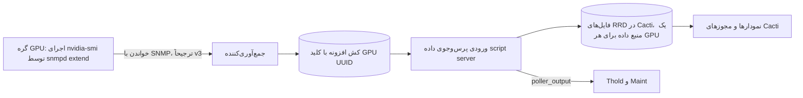

<!-- Source: README.md; SHA256: 126deef1783d64f878bf565f1433c10f31aef828eb9bc313aeff2b0335e54c7c -->

<!-- translations:start -->
[English](../../../README.md) | [简体中文](../zh-CN/README.md) | [हिन्दी](../hi-IN/README.md) | [Español (España)](../es-ES/README.md) | [Español (Latinoamérica)](../es-419/README.md) | [العربية (السعودية)](../ar-SA/README.md) | [Afrikaans](../af-ZA/README.md) | [አማርኛ](../am-ET/README.md) | [العربية (مصر)](../ar-EG/README.md) | [العربية (المغرب)](../ar-MA/README.md) | [বাংলা](../bn-BD/README.md) | [Deutsch](../de-DE/README.md) | [فارسی](README.md) | [Filipino](../fil-PH/README.md) | [Français](../fr-FR/README.md) | [Français (Maroc)](../fr-MA/README.md) | [Français (Sénégal)](../fr-SN/README.md) | [Hausa](../ha-NG/README.md) | [עברית](../he-IL/README.md) | [Bahasa Indonesia](../id-ID/README.md) | [Igbo](../ig-NG/README.md) | [Italiano](../it-IT/README.md) | [日本語](../ja-JP/README.md) | [한국어](../ko-KR/README.md) | [Malagasy](../mg-MG/README.md) | [मराठी](../mr-IN/README.md) | [Bahasa Melayu](../ms-MY/README.md) | [Nederlands](../nl-NL/README.md) | [Polski](../pl-PL/README.md) | [Português (Brasil)](../pt-BR/README.md) | [Русский](../ru-RU/README.md) | [Kinyarwanda](../rw-RW/README.md) | [Soomaali](../so-SO/README.md) | [Svenska](../sv-SE/README.md) | [Kiswahili](../sw-KE/README.md) | [தமிழ்](../ta-IN/README.md) | [తెలుగు](../te-IN/README.md) | [ไทย](../th-TH/README.md) | [Türkçe](../tr-TR/README.md) | [Українська](../uk-UA/README.md) | [اردو](../ur-PK/README.md) | [Tiếng Việt](../vi-VN/README.md) | [isiXhosa](../xh-ZA/README.md) | [Yorùbá](../yo-NG/README.md) | [繁體中文](../zh-TW/README.md) | [isiZulu](../zu-ZA/README.md)
<!-- translations:end -->

# plugin_gpu

افزونه‌ای برای Cacti 1.2 که میزان بهره‌برداری، حافظه، دما، توان مصرفی، خطاهای ECC و دلایل کاهش فرکانس (throttling) هر GPU را از ابزارهای NVIDIA به Cacti می‌آورد. پشتیبانی از AMD و جمع‌آوری خطاهای XID در برنامه قرار دارند و هنوز پیاده‌سازی نشده‌اند. هر GPU به یک شاخص (index) از یک پرس‌وجوی داده (data query) روی دستگاه گره خود تبدیل می‌شود؛ بنابراین نمودارهای GPU در کنار سایر نمودارهای گره و تحت مجوزهای Cacti قرار می‌گیرند و Thold و Maint می‌توانند بر اساس آن‌ها هشدار صادر کنند یا هشدارها را متوقف (suppress) سازند.

> **وضعیت: در حال توسعه، منتشر نشده.** مایلستون ۴ فاز ۱ (NVIDIA از طریق SNMP extend) را از نظر کد تکمیل می‌کند: جمع‌آوری، هویت، نمودارها، سیگنال‌های throttling و ECC، هشداردهی Thold و Maint، صفحه سلامت و مستندات اپراتور. این افزونه تاکنون تنها روی یک `snmpd` واقعی با یک `nvidia-smi` شبیه‌سازی‌شده که خروجی مصنوعی چاپ می‌کند اجرا شده و هرگز روی سخت‌افزار واقعی GPU آزمایش نشده است. موارد زیر پیش از انتشار همچنان باز هستند: اجرای آزمایشی روی سخت‌افزار واقعی ([docs/pilot-plan.md](../../pilot-plan.md)، شماره #54)، بررسی امنیتی خارجی ([docs/security-review.md](../../security-review.md))، داده‌های نمونه گردآوری‌شده از ابزارهای واقعی (#14) و اندازه‌گیری مقیاس‌پذیری روی سخت‌افزاری با ابعاد محیط عملیاتی ([docs/performance.md](../../performance.md)). خطاهای XID در انتظار تصمیم #8 هستند. از این افزونه در محیط عملیاتی (production) استفاده نکنید.

## نقش‌های دسترسی

| قلمرو (Realm) | دسترسی |
| --- | --- |
| GPU View | صفحات پایش موجود. |
| GPU Operator | پایش به همراه صفحه Operations و تاییدیه‌های شخصی تریاژ (triage acknowledgments). |
| GPU Admin | دسترسی Operator به همراه پیکربندی و اقدامات مدیریتی موجود. |

پس از کپی کردن فایل‌های ارتقا، به‌عنوان مدیر وارد صفحه Plugins شوید تا قلمرو جدید ثبت شود. قلمرو Operator را به‌صورت صریح در بخش **Configuration > Users** یا گروه‌های کاربری اختصاص دهید. ارتقاها شناسه‌ها و مجوزهای موجود قلمروهای View و Admin را حفظ می‌کنند. دسترسی Admin دسترسی Operator را و دسترسی Operator دسترسی View را در هر درخواست به ارث می‌برد؛ این کار مجوز ذخیره‌شده‌ای به کاربران یا گروه‌ها اضافه نمی‌کند. تنظیمات افزونه نیز علاوه بر مجوز Settings در Cacti، نیازمند دسترسی GPU Admin است.

مجوزهای دستگاه در Cacti همچنان ردیف‌ها و اقدامات قابل دسترس برای هر کاربر را محدود می‌کنند؛ اشیای نگاشت‌نشده (unmapped) نیازمند مدیر هستند. اعتبارنامه‌ها، پیکربندی، نگاشت، حذف و سایر تغییرات مدیریتی در صفحات مدیریتی باقی می‌مانند. تاییدیه‌ها (acknowledgments) تنها در نشست فعلی کاربر، حداکثر برای یک ساعت و فقط تا زمانی که همان مشاهده تازه (fresh) باقی بماند معتبر هستند. مشاهدات جدید یا تغییریافته آن‌ها را باطل می‌کنند. این تاییدیه‌ها هرگز یک اندازه‌گیری ناموفق را سالم نشان نمی‌دهند و هشدارها را متوقف نمی‌کنند.

## چرا

گره‌های GPU معمولاً از پیش برای پایش CPU، حافظه و رابط‌های شبکه در Cacti ثبت شده‌اند. سلامت GPU موضوعی جداگانه است که داده‌های SNMP گره به آن پاسخ نمی‌دهند: یک کارت می‌تواند دچار کاهش فرکانس حرارتی شود، خطاهای ECC انباشته کند یا خطای XID گزارش دهد، در حالی که خود گره سالم به نظر می‌رسد. ابزارهای سازنده (`nvidia-smi`، DCGM، `amd-smi`) این وضعیت را گزارش می‌دهند، اما خروجی آن‌ها خارج از نمودارها، مجوزها و سیستم هشداردهی Cacti قرار دارد.

این افزونه با تبدیل خروجی ابزارهای سازنده به منابع داده (data sources) در Cacti این شکاف را پر می‌کند؛ این منابع داده به جای موقعیت فیزیکی، با هویت هر GPU کلیدگذاری می‌شوند تا راه‌اندازی مجددی که ترتیب GPUها را تغییر می‌دهد، تاریخچه یک کارت را به کارت دیگر متصل نکند. افزونه به جای ساخت نسخه‌های موازی، از نمودارسازی، مجوزها، جمع‌آوری‌کننده‌های داده راه دور (remote data collectors)، Thold و Maint خود Cacti استفاده مجدد می‌کند.

## محدوده برنامه‌ریزی‌شده

| فاز | محدوده | مایلستون‌ها |
|---|---|---|
| ۰، پژوهش | خروجی ابزار سازنده، سیگنال‌های XID و throttling، هویت GPU، سطح دسترسی‌ها، تصمیم‌گیری درباره مسیر جمع‌آوری | [M1](https://github.com/somethingwithproof/plugin_gpu/milestone/1) |
| ۱، nvidia | جمع‌آوری با `nvidia-smi`، فهرست موجودی بر اساس UUID، نمودارها، سیگنال‌های throttling، ECC و XID، Thold و Maint، صفحه سلامت | [M2](https://github.com/somethingwithproof/plugin_gpu/milestone/2), [M3](https://github.com/somethingwithproof/plugin_gpu/milestone/3), [M4](https://github.com/somethingwithproof/plugin_gpu/milestone/4) |
| ۲، بک‌اندها | بک‌اند DCGM، بک‌اند `amd-smi` | [M5](https://github.com/somethingwithproof/plugin_gpu/milestone/5) |
| ۳، mig و راه دور | نمونه‌های MIG، جمع‌آوری‌کننده‌های داده راه دور در Cacti | [M6](https://github.com/somethingwithproof/plugin_gpu/milestone/6) |

خارج از محدوده: هر دستوری که وضعیت GPU یا گره را تغییر دهد (فرکانس‌ها، محدودیت توان، بازنشانی‌ها، چیدمان MIG)، موتور هشداردهی اختصاصی افزونه، دیمن یا پروتکل شبکه سفارشی، و حسابداری زمان‌بند یا کارها (scheduler/job accounting). برای فهرست کارهای پژوهشی باقیمانده، برنامه پروژه را ببینید.

## موارد اضافه‌شده در مایلستون ۴

- **دلایل throttling به‌عنوان مقادیر هشدار.** ماسک رویداد کلاک به ازای هر دلیل به یک شاخص ۰ یا ۱ رمزگشایی می‌شود؛ ماسک ناشناخته شاخص‌های ناشناخته تولید می‌کند و هرگز صفر نمی‌دهد، و بیت‌هایی که شاخصی ندارند در ماسک خام باقی می‌مانند که صفحه GPU Health آن را نمایش می‌دهد.
- **ECC به‌عنوان مقادیر هشدار** ([docs/metrics.md](../../metrics.md)). خطاهای اصلاح‌شده و اصلاح‌نشده جدید از نمونه قبلی توسط افزونه از روی دو مجموع متوالی محاسبه و به‌صورت gauge ذخیره می‌شوند: برای نخستین نمونه، خواندن ازدست‌رفته یا بارگذاری مجدد درایور مقدار ناشناخته ثبت می‌شود تا بازنشانی هرگز به‌صورت صفر یا عدد منفی خوانده نشود. تعداد صفحات بازنشسته‌شده (retired) تک‌بیتی و دوبیتی و وضعیت ECC نیز خوانده می‌شوند. دو نمودار ECC اضافه به ازای هر GPU به Cacti امکان ذخیره آن‌ها را می‌دهد؛ همراه با نمودار Power Percent، در مجموع یازده نمودار وجود دارد. XID جمع‌آوری نمی‌شود: هیچ منبعی با دستورات ثابت `nvidia-smi` سازگار نیست (#8).
- **Thold و Maint** ([docs/alerting.md](../../alerting.md)). قالب‌های آماده Thold برای دما، توان نسبت به سقف مجاز آن، شاخص‌های throttling، خطاهای ECC اصلاح‌نشده جدید، بازنشستگی صفحات در انتظار و سن نمونه. هر مقدار از نوع gauge است، زیرا Thold 1.8.2 روی شمارنده ناشناخته با خطا مواجه می‌شود. یک آزمون سرتاسری با نسخه‌های تغییرنیافته Thold 1.8.2 و Maint 1.3 فعال شدن و بازیابی هر آستانه را در طول یک بازنشانی ECC و متوقف شدن آن توسط Maint نشان می‌دهد.
- **صفحه GPU Health** (دسترسی GPU View). به ازای هر گره: تازگی داده، نحوه پایان آخرین جمع‌آوری، وضعیت Maint، بک‌اند، نسخه‌های ابزار و درایور، و تعداد GPUها؛ به ازای هر GPU: حضور، سن نمونه، وضعیت ECC و ماسک خام. این صفحه فقط رکوردهای ذخیره‌شده را می‌خواند.
- **مجوزها.** مجموعه آزمون مجوزها تمام فایل‌های صفحه و اقدامات، لغو دسترسی در درخواست بعدی و پیام‌های رد دسترسی که هیچ اطلاعاتی افشا نمی‌کنند را پوشش می‌دهد.
- **ارزیابی خرابی و بازیابی.** اجراهای سرتاسری اسکریپت‌شده، عامل (agent)، اعتبارنامه‌ها، ابزار، خروجی آن، اتصال پایگاه داده و نوشتن‌های RRD را مختل می‌کنند و پایگاه داده را از روی نسخه پشتیبان (dump)، از جمله نسخه‌ای قدیمی‌تر از فایل‌های RRD، بازیابی می‌کنند؛ یک GPU جدید هرگز فایل RRD کارت دیگری را به ارث نمی‌برد ([docs/backup.md](../../backup.md)).
- **مقیاس‌پذیری** ([docs/performance.md](../../performance.md)). یک آزمون مقیاس‌پذیری زمان جمع‌آوری، ورودی script server، ایجاد اشیای Cacti، یک چرخه poller و صفحه سلامت را در تعداد مشخصی از GPUها اندازه می‌گیرد؛ CI آن را در ۱۰۰ GPU اجرا می‌کند. اندازه‌گیری‌های ۱,۰۰۰ و ۸,۰۰۰ GPU هنوز ثبت نشده‌اند، بنابراین تعداد GPU پشتیبانی‌شده اعلام نشده است.
- **مستندات اپراتور** ([docs/operations.md](../../operations.md)): نصب، ارتقا، حذف نصب، اصل حداقل دسترسی، مقادیر ناموجود و عیب‌یابی. تغییرات در [CHANGELOG.md](../../../CHANGELOG.md) فهرست شده‌اند.

## موارد اضافه‌شده در مایلستون ۳

- **جمع‌آوری از طریق SNMP extend** ([ADR 0008](../../decisions/0008-collect-through-snmp-extend.md)). مدیر گره دو خط ثابت `extend` را به `snmpd.conf` اضافه می‌کند ([docs/node-setup.md](../../node-setup.md))؛ افزونه NET-SNMP-EXTEND-MIB را از طریق توابع SNMP خود Cacti و با اعتبارنامه‌های دستگاه می‌خواند که SNMPv3 توصیه می‌شود. افزونه هیچ برنامه‌ای را روی سرور Cacti یا گره اجرا نمی‌کند.
- **تجزیه سخت‌گیرانه (Strict parsing).** فیلدها بر اساس موقعیت خوانده می‌شوند، هر خط GPU خود را با UUID نام‌گذاری می‌کند و کد خروج غیرصفر، اتمام مهلت زمانی (timeout)، خروجی بریده‌شده، خطی با تعداد فیلد نادرست یا متن خطای ادغام‌شده کل جمع‌آوری را با شکست مواجه می‌کند: مقادیر به `U` تبدیل می‌شوند، هیچ GPU غایب علامت‌گذاری نمی‌شود و صفحه GPU Nodes دلیل آن را نمایش می‌دهد.
- **یک جمع‌آوری‌کننده پس از هر چرخه poller.** این بخش عامل هر گره فعال را می‌خواند، رکوردهای هویت را به‌روزرسانی می‌کند و آخرین نمونه را در کش نگه می‌دارد. ورودی script server فقط همان کش را می‌خواند، بنابراین نظرسنجی (poll) در Cacti هرگز منتظر یک گره GPU نمی‌ماند.
- **اشیای Cacti** ([ADR 0010](../../decisions/0010-attach-to-existing-node-devices.md)). قالب‌ها و پرس‌وجوی داده *GPU - Devices* به‌صورت XML ارائه شده و هنگام نصب و ارتقا وارد می‌شوند. ذخیره یک گره، پرس‌وجوی داده را با روش نمایه‌سازی مجدد None به دستگاه موجود آن متصل می‌کند؛ GPU Nodes تنها زمانی می‌تواند دستگاهی ایجاد کند که گره دستگاهی نداشته باشد. هر GPU یک شاخص با کلید سازنده و UUID است و یک منبع داده دارد که بین نمودارهای Utilization، Memory، Temperature، Power، Power Percent، Clocks، Throttle، ECC Errors، New ECC Errors، Retired Pages و Sample Age مشترک است. هر فیلد مدل توسط یک نمودار رسم می‌شود، زیرا Cacti فقط فیلدهایی را ذخیره می‌کند که در نموداری استفاده شوند. افزونه پس از هر تغییر GPU نمایه‌سازی مجدد را انجام می‌دهد، نمایه‌سازی مجددی را که Cacti در زمان Down یا غیرفعال بودن دستگاه رد کرده نگه می‌دارد و پس از Up شدن دستگاه اجرا می‌کند، و برای GPUهای جدید نمودار می‌سازد.
- **تاریخچه همراه کارت باقی می‌ماند.** یک GPU غایب به‌عنوان شاخص باقی می‌ماند، بنابراین نمودارهای آن یک شکاف نشان می‌دهند و هنگام بازگشت کارت، در همان فایل RRD ادامه می‌یابند. کارت جایگزین در همان اسلات، منبع داده مخصوص به خود را دریافت می‌کند. گزینه **Remove from Data Query** در صفحه گره، GPU غایب را از فهرست حذف می‌کند؛ فایل‌های RRD و نمودارهای آن تا زمانی که آن‌ها را حذف نکنید حفظ می‌شوند.
- **مجوزهای دستگاه در GPU Nodes.** یک GPU Admin تنها گره‌ها و GPUهایی را روی دستگاه‌هایی می‌بیند، تغییر می‌دهد، خروجی می‌گیرد و جابه‌جا می‌کند که در Cacti اجازه مشاهده آن‌ها را داشته باشد؛ جابه‌جایی GPU نیازمند دسترسی به هر دو گره است. گره‌ای که دستگاه آن حذف شده را می‌توان غیرفعال یا حذف کرد.
- **مدل معیار مشترک** ([ADR 0009](../../decisions/0009-common-metric-core-with-vendor-extensions.md), [docs/metrics.md](../../metrics.md)). حافظه بر حسب بایت است، ماسک رویداد کلاک به شاخص‌های `thr_*` رمزگشایی می‌شود و `age` سن زمان نمونه خود GPU یا در صورت ناشناخته بودن `U` است.

کاربر نصب‌کننده (وب‌سرور) باید بتواند در `<cacti>/resource/script_server/` بنویسد که افزونه فایل XML پرس‌وجوی داده خود را در آن قرار می‌دهد؛ در غیر این صورت نصب و ارتقا با پیامی متوقف شده و در تلاش بعدی دوباره امتحان می‌کنند. حذف نصب، قالب‌ها و فایل XML را تنها زمانی پاک می‌کند که گزینه *Remove the plugin's Cacti objects on uninstall* تیک خورده باشد، و هرگز فایل‌های RRD، دستگاه‌ها، نمودارها یا منابع داده را حذف نمی‌کند ([docs/operations.md](../../operations.md#uninstall)). گره‌های متصل به جمع‌آوری‌کننده‌های داده راه دور تا فاز ۳ جمع‌آوری نمی‌شوند.

## موارد ارائه‌شده در مایلستون ۲

- **نصب محافظت‌شده.** در PHP پایین‌تر از 8.2، نصب و فعال‌سازی با پیامی که نسخه مورد نیاز را ذکر می‌کند رد می‌شوند و بقیه بخش‌های Cacti به کار خود ادامه می‌دهند. `setup.php` و اسکریپت‌های صفحات در PHP 8.0 قابل تجزیه (parse) هستند.
- **چرخه عمر.** نصب، ارتقا، غیرفعال‌سازی و حذف نصب از طریق صفحه Plugins در Cacti. ارتقاها ترتیب‌بندی‌شده هستند، پس از وقفه تکمیل می‌شوند و نسخه ثبت‌شده را تنها پس از موفقیت تغییر می‌دهند. حذف نصب جداول افزونه را نگه می‌دارد مگر اینکه تیک *Keep Plugin Tables on Uninstall* را بردارید؛ و هرگز به دستگاه، منبع داده، نمودار یا فایل RRD در Cacti دست نمی‌زند.
- **قلمروهای مجزا.** *GPU Admin* صفحه **GPU Nodes** را باز می‌کند که در آن دستگاه‌های Cacti را به‌عنوان گره‌های GPU ثبت می‌کنید، جابه‌جایی GPUها بین گره‌ها را تایید یا رد می‌کنید و از تمام رکوردها خروجی JSON می‌گیرید. *GPU View* صفحه **GPU Inventory** را باز می‌کند که فقط GPUهای روی دستگاه‌هایی را نمایش می‌دهد که بیننده اجازه مشاهده آن‌ها را دارد. هر دو صفحه در بخش Management قرار دارند و هر تغییر به‌صورت یک درخواست POST است که توسط csrf-magic بررسی می‌شود.
- **رکوردهای هویت GPU.** هر GPU با سازنده و UUID کلیدگذاری می‌شود. شاخص، شناسه گذرگاه PCI، نام، درایور و ابزار گزارش‌دهنده ویژگی‌هایی هستند که درجا تغییر می‌کنند. یک UUID جدید در یک اسلات شناخته‌شده به‌عنوان جایگزینی احتمالی علامت‌گذاری شده و تاریخچه خودش را آغاز می‌کند؛ GPU مشاهده‌شده در گره دیگر تنها با تایید اپراتور منتقل می‌شود؛ GPUای که در جمع‌آوری‌های موفق غایب باشد پس از تعداد قابل تنظیمی غایب علامت‌گذاری شده و هرگز حذف نمی‌شود. فعلاً فقط UUIDهای کامل GPU از نوع NVIDIA پذیرفته می‌شوند؛ نمونه‌های MIG در انتظار تصمیم #13 و AMD در انتظار پژوهش #19 هستند. قوانین با توالی‌های آزمایشی (fixture) بررسی می‌شوند، زیرا هنوز جمع‌آوری‌کننده‌ای آن‌ها را تغذیه نمی‌کند.
- **آزمون‌ها و CI.** مجموعه‌آزمون‌های واحد و قوانین کد منبع بدون نیاز به GPU یا پایگاه داده، بررسی‌های چرخه عمر و مجوز صفحات در برابر Cacti 1.2.31 و نسخه جاری 1.2.x روی PHP 8.2 تا 8.5، یک کار رد شدن در PHP 8.1، بررسی نحوی (lint) نقاط ورود با PHP 8.0، PHPStan در سطح ۹ و REUSE. زیرساخت آزمون تا زمان تصمیم‌گیری درباره #12 موقتی است.

### نصب برای ارزیابی

این مراحل کد فعلی را برای آزمایش نصب می‌کنند؛ [docs/operations.md](../../operations.md) راهنمای کامل اپراتور را دارد. این مراحل نیازمند Cacti 1.2.31 یا بالاتر روی PHP 8.2 یا بالاتر هستند.

1. مخزن را در مسیر `plugins/gpu` زیر شاخه Cacti خود کپی کنید. نام شاخه باید `gpu` باشد.
2. در Cacti، بخش **Configuration > Plugins** را باز کرده، سپس **GPU** را نصب و فعال کنید.
3. بر اساس نقش کاربران، قلمروهای *GPU View*، *GPU Operator* یا *GPU Admin* را در بخش **Configuration > Users** به آن‌ها بدهید. کاربر نصب‌کننده دسترسی View و Admin را دریافت می‌کند؛ Admin شامل دسترسی Operator نیز هست.
4. عامل SNMP هر گره GPU را طبق توضیح [docs/node-setup.md](../../node-setup.md) تنظیم کنید، سپس گره را در بخش **Management > GPU Nodes** اضافه نمایید.
5. برای هشدارها، قالب‌های آماده Thold را مطابق توضیح [docs/alerting.md](../../alerting.md) وارد کنید.
6. در صورت تمایل **Configuration > Settings > GPU** را تنظیم کنید: *Mark Absent After* (پیش‌فرض ۳ جمع‌آوری موفق، از ۱ تا ۱۰۰)، *Stale After* (حداکثر سن یک نمونه پیش از اینکه مقادیرش `U` چاپ شوند) و *Keep Plugin Tables on Uninstall* (پیش‌فرض فعال).

## نحوه رسیدن معیارها به Cacti

تصمیم [#7](https://github.com/somethingwithproof/plugin_gpu/issues/7) روش SNMP `extend` را انتخاب کرد ([ADR 0008](../../decisions/0008-collect-through-snmp-extend.md)): عامل خود گره یک دستور ثابت `nvidia-smi` را اجرا می‌کند و افزونه فقط نتیجه را می‌خواند. برنامه پروژه گزینه‌ها را در بخش [مسیرهای جمع‌آوری](../../PLAN.md#collection-paths) مقایسه می‌کند.

## اهداف سازگاری

| جزء | هدف |
|---|---|
| Cacti | 1.2.31 یا بالاتر، بدون وصله روی هسته |
| PHP | 8.2 یا بالاتر؛ `setup.php` در نسخه 8.0 قابل تجزیه می‌ماند تا محیط اجرایی پشتیبانی‌نشده به جای رابط کاربری خراب Cacti، پیام رد شدن دریافت کند |
| NVIDIA | نسخه‌های درایور و ابزار که با پژوهش [#26](https://github.com/somethingwithproof/plugin_gpu/issues/26) تعیین می‌شوند؛ شناسه‌های فیلد DCGM در نسخه‌های v3.3.9 و v4.7.0 بررسی شده‌اند |
| AMD | `amd-smi` در نسخه‌های ROCm که با پژوهش [#26](https://github.com/somethingwithproof/plugin_gpu/issues/26) تعیین می‌شوند |
| Thold, Maint | Thold 1.8.2 و Maint 1.3، بدون تغییر، آزمایش‌شده به‌صورت سرتاسری ([docs/alerting.md](../../alerting.md)) |

## طراحی

- [docs/PLAN.md](../../PLAN.md) برنامه کامل است: معماری، حقایق بالادستی که به آن‌ها وابسته است (همراه با منابع)، مدل هویت، مرزهای امنیتی، محاسبات کارایی، آزمون و ریسک‌ها.
- [docs/decisions/](../../decisions) سوابق تصمیمات معماری (ADR) را برای انتخاب‌های انجام‌شده نگهداری می‌کند.
- [docs/REQUIREMENTS.md](../../REQUIREMENTS.md) هر شناسه نیازمندی را به issue مربوط به آن نگاشت می‌کند.

## نحوه پیگیری کارها

- **مایلستون‌ها** از مایلستون‌های برنامه پیروی می‌کنند. هر یک دارای یک epic issue است که زیرمسائل و شواهد خروج آن را فهرست می‌کند.
- **مسائل (Issues)** بر اساس برچسب نوع‌بندی می‌شوند: `type: requirement`، `type: research`، `type: decision`، `type: epic`. مسائل نیازمندی، نیازمندی‌های شماره‌گذاری‌شده و قابل آزمون (`REQ-AREA-NNN`) و معیارهای پذیرش را بیان می‌کنند.
- **برچسب‌ها** همچنین شامل `area:`، `phase:`، `priority:` و `status:` هستند. [CONTRIBUTING.md](../../../CONTRIBUTING.md#labels) را ببینید.
- [تابلوی پروژه](https://github.com/users/somethingwithproof/projects/9) تمام مسائل را در سراسر مایلستون‌ها نمایش می‌دهد.

## مشارکت

[CONTRIBUTING.md](../../../CONTRIBUTING.md) را مطالعه کنید. کامیت‌ها نیازمند امضای DCO هستند. بحث‌های طراحی در مسائل انجام می‌شوند؛ تصمیمات باز دارای برچسب `type: decision` هستند. خروجی‌های ضبط‌شده از ابزارهای واقعی GPU مفیدترین مشارکت برای مایلستون ۱ هستند؛ پیش از ارسال، نام میزبان، شماره سریال و UUIDها را پاک کنید.

## امنیت

آسیب‌پذیری‌ها را به‌صورت خصوصی گزارش دهید؛ [SECURITY.md](../../../SECURITY.md) را ببینید.

## مجوز

مجوز عمومی همگانی گنو نسخه ۲.۰ (GNU General Public License v2.0)، همان مجوز Cacti و افزونه‌های آن. [LICENSE](../../../LICENSE) را ببینید.
