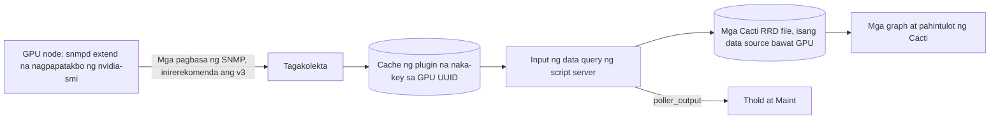

<!-- Source: README.md; SHA256: 97ba37df4a883426d3984ed7d14547ad7367e973411a8abd930409ce259f545b -->

<!-- translations:start -->
[English](../../../README.md) | [简体中文](../zh-CN/README.md) | [हिन्दी](../hi-IN/README.md) | [Español (España)](../es-ES/README.md) | [Español (Latinoamérica)](../es-419/README.md) | [العربية (السعودية)](../ar-SA/README.md) | [Afrikaans](../af-ZA/README.md) | [አማርኛ](../am-ET/README.md) | [العربية (مصر)](../ar-EG/README.md) | [العربية (المغرب)](../ar-MA/README.md) | [বাংলা](../bn-BD/README.md) | [Bosanski](../bs-BA/README.md) | [Deutsch](../de-DE/README.md) | [فارسی](../fa-IR/README.md) | [Filipino](README.md) | [Français](../fr-FR/README.md) | [Français (Maroc)](../fr-MA/README.md) | [Français (Sénégal)](../fr-SN/README.md) | [Hausa](../ha-NG/README.md) | [עברית](../he-IL/README.md) | [Hrvatski](../hr-HR/README.md) | [Bahasa Indonesia](../id-ID/README.md) | [Igbo](../ig-NG/README.md) | [Italiano](../it-IT/README.md) | [日本語](../ja-JP/README.md) | [한국어](../ko-KR/README.md) | [Malagasy](../mg-MG/README.md) | [मराठी](../mr-IN/README.md) | [Bahasa Melayu](../ms-MY/README.md) | [Nederlands](../nl-NL/README.md) | [Polski](../pl-PL/README.md) | [Português (Brasil)](../pt-BR/README.md) | [Русский](../ru-RU/README.md) | [Kinyarwanda](../rw-RW/README.md) | [Soomaali](../so-SO/README.md) | [Српски](../sr-RS/README.md) | [Svenska](../sv-SE/README.md) | [Kiswahili](../sw-KE/README.md) | [தமிழ்](../ta-IN/README.md) | [తెలుగు](../te-IN/README.md) | [ไทย](../th-TH/README.md) | [Türkçe](../tr-TR/README.md) | [Українська](../uk-UA/README.md) | [اردو](../ur-PK/README.md) | [Tiếng Việt](../vi-VN/README.md) | [isiXhosa](../xh-ZA/README.md) | [Yorùbá](../yo-NG/README.md) | [繁體中文](../zh-TW/README.md) | [isiZulu](../zu-ZA/README.md)
<!-- translations:end -->

# plugin_gpu

Isang plugin ng Cacti 1.2 na nagdadala ng bawat-GPU na paggamit (utilization), memorya, temperatura, kuryente, mga ECC error, at mga dahilan ng throttling mula sa mga tool ng NVIDIA patungo sa Cacti. Nakaplano pa lamang ang suporta sa AMD at pagkolekta ng mga XID error, hindi pa naipapatupad. Ang bawat GPU ay nagiging isang index ng isang data query sa device ng node nito, kaya nakapuwesto ang mga GPU graph katabi ng iba pang mga graph ng node sa ilalim ng mga pahintulot ng Cacti, at maaaring mag-alerto at mag-suppress ang Thold at Maint sa mga ito.

> **Katayuan: nasa pagbuo pa, hindi pa inilabas.** Ginagawang kumpleto sa code ng Milestone 4 ang yugto 1 (NVIDIA sa pamamagitan ng SNMP extend): pagkolekta, pagkakakilanlan, mga graph, mga signal ng throttle at ECC, pag-alerto ng Thold at Maint, ang pahina ng kalusugan, at ang dokumentasyon para sa operator. Pinatakbo lamang ito laban sa isang totoong `snmpd` na may pekeng `nvidia-smi` na nagpi-print ng sintetikong output, hindi pa sa totoong hardware ng GPU. Bukas pa bago ang paglabas: mga pilot sa totoong hardware ([docs/pilot-plan.md](../../pilot-plan.md), #54), isang panlabas na pagsusuri sa seguridad ([docs/security-review.md](../../security-review.md)), mga fixture na nakuha mula sa mga totoong tool (#14), at sukat na nasusukat sa hardware na kasinglaki ng produksyon ([docs/performance.md](../../performance.md)). Naghihintay sa desisyon #8 ang mga XID error. Huwag itong patakbuhin sa produksyon.

## Mga tungkulin sa pag-access

| Realm | Pag-access |
| --- | --- |
| GPU View | Mga kasalukuyang pahina ng pagsubaybay. |
| GPU Operator | Pagsubaybay kasama ang pahina ng Operations at mga personal na pagkilala sa triage. |
| GPU Admin | Access ng Operator kasama ang mga kasalukuyang aksyon sa configuration at pangangasiwa. |

Pagkatapos kopyahin ang mga upgrade file, buksan ang pahina ng Plugins bilang isang administrator upang irehistro
ang bagong realm. Italaga nang hayagan ang realm ng Operator sa ilalim ng **Configuration > Users** o mga pangkat ng user.
Pinapanatili ng mga upgrade ang mga kasalukuyang View at Admin realm ID at mga grant. Ang access ng Admin ay
nagmamana ng access ng Operator, at ang access ng Operator ay nagmamana ng access ng View sa bawat kahilingan;
hindi ito nagdaragdag ng mga nakaimbak na grant sa mga user o pangkat. Nangangailangan din ang mga setting ng plugin ng
access na GPU Admin bilang karagdagan sa pahintulot na Settings ng Cacti.

Nililimitahan pa rin ng mga pahintulot ng device sa Cacti ang mga row at aksyong magagamit ng bawat user; ang mga hindi naka-map na bagay ay nangangailangan ng isang administrator.
Ang mga kredensyal, configuration, pagmamapa, pagtanggal at iba pang mga pagbabagong pampangasiwaan ay
nananatili sa mga pahinang pampangasiwaan. Ang mga pagkilala ay tumatagal lamang sa kasalukuyang
session ng user, nang hindi hihigit sa isang oras at hangga't nananatiling sariwa ang parehong obserbasyon.
Pinapawalang-bisa ang mga ito ng mga bago o nabagong obserbasyon. Hindi nila kailanman minamarkahan ang isang nabigong
pagsukat bilang malusog o pinipigilan ang mga alerto.

## Bakit

Karaniwang nasa Cacti na ang mga GPU node para sa CPU, memorya, at mga interface. Ang kalusugan ng GPU ay isang hiwalay na usapin na hindi sinasagot ng data ng SNMP ng node: maaaring naka-thermally throttled ang isang card, makaipon ng mga ECC error, o mag-ulat ng XID fault habang mukhang malusog ang mismong node. Iniuulat ito ng mga tool ng vendor (`nvidia-smi`, DCGM, `amd-smi`), ngunit ang kanilang output ay nasa labas ng mga graph, pahintulot, at pag-alerto ng Cacti.

Isinasara ng plugin ang agwat na iyon sa pamamagitan ng paggawa sa output ng tool ng vendor bilang mga data source ng Cacti, na naka-key sa pagkakakilanlan ng bawat GPU sa halip na sa posisyon nito, kaya hindi ikinakabit ng isang reboot na muling nag-aayos ng mga GPU ang kasaysayan ng isang card sa isa pa. Muli nitong ginagamit ang graphing, mga pahintulot, mga remote data collector, Thold, at Maint ng Cacti sa halip na bumuo ng mga katulad na bersyon ng mga ito.

## Nakaplanong saklaw

| Yugto | Saklaw | Mga Milestone |
|---|---|---|
| 0, pananaliksik | Output ng tool ng vendor, mga signal ng XID at throttle, pagkakakilanlan ng GPU, mga pribilehiyo, desisyon sa landas ng pagkolekta | [M1](https://github.com/somethingwithproof/plugin_gpu/milestone/1) |
| 1, nvidia | Pagkolekta gamit ang `nvidia-smi`, imbentaryo ayon sa UUID, mga graph, mga signal ng throttle, ECC at XID, Thold at Maint, pahina ng kalusugan | [M2](https://github.com/somethingwithproof/plugin_gpu/milestone/2), [M3](https://github.com/somethingwithproof/plugin_gpu/milestone/3), [M4](https://github.com/somethingwithproof/plugin_gpu/milestone/4) |
| 2, mga backend | Backend ng DCGM, backend ng `amd-smi` | [M5](https://github.com/somethingwithproof/plugin_gpu/milestone/5) |
| 3, mig at remote | Mga instance ng MIG, mga remote data collector ng Cacti | [M6](https://github.com/somethingwithproof/plugin_gpu/milestone/6) |

Wala sa saklaw: anumang command na nagbabago sa isang GPU o node (mga clock, mga limitasyon sa kuryente, mga reset, layout ng MIG), isang engine ng pag-alerto na pagmamay-ari ng plugin, isang custom na daemon o protocol ng network, at accounting ng scheduler o job. Tingnan ang plano para sa backlog ng pananaliksik.

## Mga idinadagdag ng milestone 4

- **Mga dahilan ng throttle bilang mga halaga ng alerto.** Ang clock event mask ay dine-decode sa isang 0 o 1 indicator bawat dahilan; ang hindi kilalang mask ay nagbibigay ng mga hindi kilalang indicator, hindi kailanman mga zero, at ang mga bit na walang indicator ay nananatili sa raw mask, na ipinapakita ng GPU Health.
- **ECC bilang mga halaga ng alerto** ([docs/metrics.md](../../metrics.md)). Ang mga bagong corrected at uncorrected error mula noong nakaraang sample ay kinukuwenta ng plugin mula sa dalawang magkasunod na kabuuan at iniimbak bilang mga gauge: hindi kilala para sa isang unang sample, isang nakaligtaang pagbasa, o isang pag-reload ng driver, kaya hindi kailanman binabasa ang isang reset bilang zero o bilang negatibong bilang. Binabasa rin ang mga bilang ng retired single-bit at double-bit page at ang mode ng ECC. Dalawang karagdagang ECC graph bawat GPU ang nagpapahintulot sa Cacti na iimbak ang mga ito; kasama ang Power Percent, mayroong labing-isang graph sa kabuuan. Hindi kinokolekta ang XID: walang source na akma sa mga nakapirming command ng `nvidia-smi` (#8).
- **Thold at Maint** ([docs/alerting.md](../../alerting.md)). Mga ipinapadalang template ng Thold para sa temperatura, kuryente laban sa limitasyon nito, mga throttle indicator, mga bagong uncorrected ECC error, nakabinbing pagreretiro ng page, at edad ng sample. Ang bawat halaga ay isang gauge, dahil nabibigo ang Thold 1.8.2 sa isang hindi kilalang counter. Ipinapakita ng isang end-to-end na pagsubok na may hindi binagong Thold 1.8.2 at Maint 1.3 ang pag-fire at pag-restore ng bawat threshold, sa kabila ng pag-reset ng ECC, at ang pag-suppress ng Maint dito.
- **GPU Health** (GPU View). Bawat node: pagiging sariwa, kung paano natapos ang huling pagkolekta, estado ng Maint, backend, mga bersyon ng tool at driver, at mga bilang ng GPU; bawat GPU: presensya, edad ng sample, estado ng ECC, at ang raw mask. Binabasa lamang nito ang mga nakaimbak na tala.
- **Mga pahintulot.** Sinasaklaw ng permission suite ang bawat file ng pahina at aksyon, pagbawi sa susunod na kahilingan, at mga pagtangging walang ibinubunyag.
- **Kwalipikasyon sa pagkabigo at pag-restore.** Sinisira ng mga naka-script na end-to-end run ang agent, ang mga kredensyal, ang tool, ang output nito, ang koneksyon sa database, at mga pagsusulat ng RRD, at nire-restore ang database mula sa isang dump, kabilang ang isang mas luma kaysa sa mga RRD file; hindi kailanman nagmamana ang isang bagong GPU ng RRD file ng iba ([docs/backup.md](../../backup.md)).
- **Sukat** ([docs/performance.md](../../performance.md)). Sinusukat ng isang scale test ang oras ng pagkolekta, ang input ng script server, paggawa ng bagay sa Cacti, isang cycle ng poller, at ang pahina ng kalusugan sa isang partikular na bilang ng GPU; pinapatakbo ito ng CI sa 100 GPU. Hindi pa naitatala ang mga sukat sa 1,000 at 8,000 GPU, kaya walang nakasaad na sinusuportahang bilang ng GPU.
- **Dokumentasyon para sa operator** ([docs/operations.md](../../operations.md)): pag-install, pag-upgrade, pag-uninstall, least privilege, mga hindi magagamit na halaga, at pag-troubleshoot. Nakalista ang mga pagbabago sa [CHANGELOG.md](../../../CHANGELOG.md).

## Mga idinadagdag ng milestone 3

- **Pagkolekta sa pamamagitan ng SNMP extend** ([ADR 0008](../../decisions/0008-collect-through-snmp-extend.md)). Nagdaragdag ang administrator ng node ng dalawang nakapirming linya ng `extend` sa `snmpd.conf` ([docs/node-setup.md](../../node-setup.md)); binabasa ng plugin ang NET-SNMP-EXTEND-MIB sa pamamagitan ng mga function ng SNMP ng Cacti gamit ang sariling mga kredensyal ng device, inirerekomenda ang SNMPv3. Wala itong pinapatakbo sa server ng Cacti o sa node.
- **Mahigpit na pag-parse.** Binabasa ang mga field ayon sa posisyon, pinapangalanan ng bawat linya ang GPU nito sa pamamagitan ng UUID, at ang isang nonzero na exit status, timeout, putol na output, linyang may maling bilang ng field, o pinagsamang text ng error ay nagpapabigo sa buong pagkolekta: nagiging `U` ang mga halaga, walang GPU na minamarkahang wala, at ipinapakita ng GPU Nodes kung bakit.
- **Isang collector pagkatapos ng bawat cycle ng poller.** Binabasa nito ang agent ng bawat naka-enable na node, ina-update ang mga tala ng pagkakakilanlan, at kina-cache ang pinakabagong sample. Binabasa lamang ng input ng script server ang cache na iyon, kaya hindi kailanman naghihintay ang isang poll ng Cacti sa isang GPU node.
- **Mga bagay sa Cacti** ([ADR 0010](../../decisions/0010-attach-to-existing-node-devices.md)). Ang mga template at ang data query na *GPU - Devices* ay ipinapadala bilang XML at ini-import sa pag-install at pag-upgrade. Ikinakabit ng pag-save ng isang node ang data query sa kasalukuyan nitong device na may paraan ng reindex na None; makakagawa lamang ang GPU Nodes ng isang device kapag wala nito ang node. Ang bawat GPU ay isang index na naka-key sa vendor at UUID, na may isang data source na pinaghahatian ng mga graph nitong Utilization, Memory, Temperature, Power, Power Percent, Clocks, Throttle, ECC Errors, New ECC Errors, Retired Pages, at Sample Age. Iginuguhit ng ilang graph ang bawat field ng modelo, dahil iniimbak lamang ng Cacti ang mga field na ginagamit ng isang graph. Nagre-reindex ang plugin pagkatapos ng bawat pagbabago ng GPU, pinapanatili ang isang reindex na nilaktawan ng Cacti habang Down o naka-disable ang device at pinapatakbo ito kapag Up na ang device, at gumagawa ng mga graph para sa mga bagong GPU.
- **Nananatili ang kasaysayan sa card.** Ang isang nawawalang GPU ay nananatiling isang index, kaya nagpapakita ang mga graph nito ng puwang at nagpapatuloy sa parehong RRD file kapag bumalik ito. Ang isang pamalit na card sa parehong slot ay nakakakuha ng sarili nitong data source. Tinatanggal ng **Remove from Data Query** sa pahina ng node ang isang nawawalang GPU mula sa listahan; pinapanatili ang mga RRD file at graph nito hanggang sa tanggalin mo ang mga ito.
- **Mga pahintulot ng device sa GPU Nodes.** Nakikita, binabago, ine-export, at inililipat lamang ng isang GPU Admin ang mga node at GPU sa mga device na maaari nilang makita sa Cacti; nangangailangan ng parehong node ang paglipat ng GPU. Maaaring i-disable o tanggalin ang isang node na natanggal ang device.
- **Ang karaniwang modelo ng sukatan** ([ADR 0009](../../decisions/0009-common-metric-core-with-vendor-extensions.md), [docs/metrics.md](../../metrics.md)). Nasa bytes ang memorya, dine-decode ang clock event mask sa mga indicator na `thr_*`, at ang `age` ay ang edad ng sariling oras ng sample ng GPU, o `U` kapag hindi kilala.

Dapat makapagsulat ang nag-i-install na user (web server) sa `<cacti>/resource/script_server/`, kung saan inilalagay ng plugin ang XML ng data query nito; humihinto ang pag-install at pag-upgrade na may mensahe kung hindi, at sumusubok muli sa susunod na pagkakataon. Tinatanggal ng pag-uninstall ang mga template at ang XML kapag nakatsek lamang ang *Remove the plugin's Cacti objects on uninstall*, at hindi kailanman tinatanggal ang mga RRD file, device, graph, o data source ([docs/operations.md](../../operations.md#uninstall)). Hindi kinokolekta ang mga node sa mga remote data collector hanggang sa yugto 3.

## Mga ipinapadala ng milestone 2

- **Isang binabantayang pag-install.** Sa PHP na mas mababa sa 8.2, tinatanggihan ang pag-install at pag-enable na may mensaheng nagsasaad ng kinakailangang bersyon, at patuloy na gumagana ang natitirang bahagi ng Cacti. Nagpa-parse ang `setup.php` at ang mga script ng pahina sa PHP 8.0.
- **Siklo ng buhay.** Pag-install, pag-upgrade, pag-disable, at pag-uninstall sa pamamagitan ng pahina ng Plugins ng Cacti. Nakahanay sa pagkakasunod-sunod ang mga pag-upgrade, natatapos pagkatapos ng pagkaantala, at binabago lamang ang nakatalang bersyon pagkatapos nilang magtagumpay. Pinapanatili ng pag-uninstall ang mga table ng plugin maliban kung alisin mo ang tsek sa *Keep Plugin Tables on Uninstall*; hindi nito kailanman ginagalaw ang isang device, data source, graph, o RRD file ng Cacti.
- **Magkahiwalay na mga realm.** Binubuksan ng *GPU Admin* ang **GPU Nodes**, kung saan inirerehistro mo ang mga device ng Cacti bilang mga GPU node, kinukumpirma o tinatanggihan ang mga paglipat ng GPU sa pagitan ng mga node, at ine-export ang bawat tala bilang JSON. Binubuksan ng *GPU View* ang **GPU Inventory**, na naglilista lamang ng mga GPU sa mga device na maaaring makita ng tumitingin. Nasa ilalim ng Management ang parehong pahina, at ang bawat pagbabago ay isang POST na sinusuri ng csrf-magic.
- **Mga tala ng pagkakakilanlan ng GPU.** Naka-key ang bawat GPU sa vendor at UUID. Ang index, PCI bus ID, pangalan, driver, at ang tool sa pag-uulat ay mga katangiang nagbabago sa lugar. Ang isang bagong UUID sa isang kilalang slot ay minamarkahan bilang isang posibleng kapalit at nagsisimula ng sarili nitong kasaysayan; ang isang GPU na nakita sa isa pang node ay lilipat lamang kapag kinumpirma ng isang operator; ang isang GPU na nawawala mula sa mga matagumpay na pagkolekta ay minamarkahang wala pagkatapos ng isang nako-configure na bilang at hindi kailanman tinatanggal. Mga NVIDIA whole-GPU UUID lamang ang tinatanggap sa ngayon; naghihintay sa desisyon #13 ang mga instance ng MIG, at sa pananaliksik #19 ang AMD. Isinasagawa ang mga panuntunan sa pamamagitan ng mga pagkakasunod-sunod ng fixture, dahil wala pang collector na nagpapasok sa mga ito.
- **Mga pagsubok at CI.** Mga unit at source-rule suite na walang GPU o database, mga pagsusuri sa siklo ng buhay at pahintulot ng pahina laban sa Cacti 1.2.31 at kasalukuyang 1.2.x sa PHP 8.2 hanggang 8.5, isang PHP 8.1 refusal job, isang PHP 8.0 lint ng mga entry point, PHPStan sa antas 9, at REUSE. Pansamantala ang harness hanggang sa mapagpasyahan ang #12.

### Mag-install para sa pagsusuri

Ini-install ng mga hakbang na ito ang kasalukuyang code upang masubukan ito; nasa [docs/operations.md](../../operations.md) ang buong gabay para sa operator. Nangangailangan ang mga ito ng Cacti 1.2.31 o mas bago sa PHP 8.2 o mas bago.

1. Kopyahin ang repository sa `plugins/gpu` sa ilalim ng iyong direktoryo ng Cacti. Dapat na `gpu` ang pangalan ng direktoryo.
2. Sa Cacti, buksan ang **Configuration > Plugins**, pagkatapos ay i-install at i-enable ang **GPU**.
3. Bigyan ang mga user ng realm na *GPU View*, *GPU Operator*, o *GPU Admin* sa ilalim ng **Configuration > Users**, ayon sa kanilang tungkulin. Tumatanggap ng View at Admin ang nag-i-install na user; kasama sa Admin ang access ng Operator.
4. I-set up ang SNMP agent ng bawat GPU node gaya ng inilalarawan sa [docs/node-setup.md](../../node-setup.md), pagkatapos ay idagdag ang node sa ilalim ng **Management > GPU Nodes**.
5. Para sa mga alerto, i-import ang mga ipinapadalang template ng Thold gaya ng inilalarawan sa [docs/alerting.md](../../alerting.md).
6. Opsyonal na isaayos ang **Configuration > Settings > GPU**: *Mark Absent After* (default na 3 matagumpay na pagkolekta, mula 1 hanggang 100), *Stale After* (kung gaano katagal bago mag-print ng `U` ang mga halaga ng isang sample), at *Keep Plugin Tables on Uninstall* (naka-on bilang default).

## Paano nakakarating ang mga sukatan sa Cacti

Pinili ng desisyon [#7](https://github.com/somethingwithproof/plugin_gpu/issues/7) ang SNMP `extend` ([ADR 0008](../../decisions/0008-collect-through-snmp-extend.md)): pinapatakbo ng sariling agent ng node ang isang nakapirming command ng `nvidia-smi` at binabasa lamang ng plugin ang resulta. Inihahambing ng plano ang mga opsyon sa ilalim ng [Mga landas ng pagkolekta](../../PLAN.md#collection-paths).

## Mga target na pagkatugma

| Bahagi | Target |
|---|---|
| Cacti | 1.2.31 o mas bago, walang mga core patch |
| PHP | 8.2 o mas bago; nananatiling na-parse ang `setup.php` sa 8.0 upang makatanggap ng pagtanggi ang isang hindi sinusuportahang runtime sa halip na isang sirang UI ng Cacti |
| NVIDIA | Mga linya ng driver at tool na itatakda ng pananaliksik [#26](https://github.com/somethingwithproof/plugin_gpu/issues/26); nasuri ang mga field ID ng DCGM sa v3.3.9 at v4.7.0 |
| AMD | `amd-smi` sa mga paglabas ng ROCm na itatakda ng pananaliksik [#26](https://github.com/somethingwithproof/plugin_gpu/issues/26) |
| Thold, Maint | Thold 1.8.2 at Maint 1.3, hindi binago, nasubok nang end to end ([docs/alerting.md](../../alerting.md)) |

## Disenyo

- Ang [docs/PLAN.md](../../PLAN.md) ay ang buong plano: arkitektura, mga upstream na katotohanang pinagbabatayan nito (may mga pinagmulan), modelo ng pagkakakilanlan, mga hangganan ng seguridad, pagkalkula ng pagganap, pagsubok, at mga panganib.
- Naglalaman ang [docs/decisions/](../../decisions) ng mga tala ng desisyon sa arkitektura para sa mga pagpiling nagawa na.
- Iminamapa ng [docs/REQUIREMENTS.md](../../REQUIREMENTS.md) ang bawat ID ng kinakailangan sa issue nito.

## Paano sinusubaybayan ang trabaho

- **Mga Milestone** ay sumusunod sa mga milestone ng plano. Ang bawat isa ay may epic issue na naglilista ng mga sub-issue nito at ebidensya ng paglabas.
- **Mga Issue** ay may uri ayon sa label: `type: requirement`, `type: research`, `type: decision`, `type: epic`. Nagsasaad ang mga requirement issue ng mga may bilang at nasusubok na kinakailangan (`REQ-AREA-NNN`) at pamantayan sa pagtanggap.
- **Mga Label** ay nagdadala rin ng `area:`, `phase:`, `priority:`, at `status:`. Tingnan ang [CONTRIBUTING.md](../../../CONTRIBUTING.md#labels).
- Ipinapakita ng [board ng proyekto](https://github.com/users/somethingwithproof/projects/9) ang lahat ng mga issue sa lahat ng mga milestone.

## Pag-aambag

Basahin ang [CONTRIBUTING.md](../../../CONTRIBUTING.md). Nangangailangan ang mga commit ng isang DCO sign-off. Nagaganap sa mga issue ang talakayan sa disenyo; may label na `type: decision` ang mga bukas na desisyon. Ang nakuhang output mula sa mga totoong GPU tool ang pinakakapaki-pakinabang na ambag sa milestone 1; alisin muna ang mga hostname, serial number, at UUID.

## Seguridad

Iulat ang mga kahinaan nang pribado; tingnan ang [SECURITY.md](../../../SECURITY.md).

## Lisensya

GNU General Public License v2.0, ang parehong lisensya gaya ng Cacti at mga plugin nito. Tingnan ang [LICENSE](../../../LICENSE).
