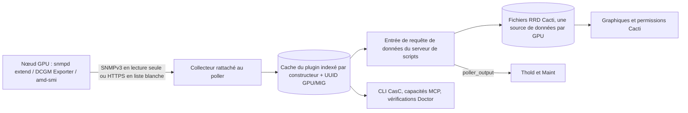

<!-- Source: README.md; SHA256: 97ba37df4a883426d3984ed7d14547ad7367e973411a8abd930409ce259f545b -->

<!-- translations:start -->
[English](../../../README.md) | [简体中文](../zh-CN/README.md) | [हिन्दी](../hi-IN/README.md) | [Español (España)](../es-ES/README.md) | [Español (Latinoamérica)](../es-419/README.md) | [العربية (السعودية)](../ar-SA/README.md) | [Afrikaans](../af-ZA/README.md) | [አማርኛ](../am-ET/README.md) | [العربية (مصر)](../ar-EG/README.md) | [العربية (المغرب)](../ar-MA/README.md) | [বাংলা](../bn-BD/README.md) | [Bosanski](../bs-BA/README.md) | [Deutsch](../de-DE/README.md) | [فارسی](../fa-IR/README.md) | [Filipino](../fil-PH/README.md) | [Français](README.md) | [Français (Maroc)](../fr-MA/README.md) | [Français (Sénégal)](../fr-SN/README.md) | [Hausa](../ha-NG/README.md) | [עברית](../he-IL/README.md) | [Hrvatski](../hr-HR/README.md) | [Bahasa Indonesia](../id-ID/README.md) | [Igbo](../ig-NG/README.md) | [Italiano](../it-IT/README.md) | [日本語](../ja-JP/README.md) | [한국어](../ko-KR/README.md) | [Malagasy](../mg-MG/README.md) | [मराठी](../mr-IN/README.md) | [Bahasa Melayu](../ms-MY/README.md) | [Nederlands](../nl-NL/README.md) | [Polski](../pl-PL/README.md) | [Português (Brasil)](../pt-BR/README.md) | [Русский](../ru-RU/README.md) | [Kinyarwanda](../rw-RW/README.md) | [Soomaali](../so-SO/README.md) | [Српски](../sr-RS/README.md) | [Svenska](../sv-SE/README.md) | [Kiswahili](../sw-KE/README.md) | [தமிழ்](../ta-IN/README.md) | [తెలుగు](../te-IN/README.md) | [ไทย](../th-TH/README.md) | [Türkçe](../tr-TR/README.md) | [Українська](../uk-UA/README.md) | [اردو](../ur-PK/README.md) | [Tiếng Việt](../vi-VN/README.md) | [isiXhosa](../xh-ZA/README.md) | [Yorùbá](../yo-NG/README.md) | [繁體中文](../zh-TW/README.md) | [isiZulu](../zu-ZA/README.md)
<!-- translations:end -->

# plugin_gpu

Un plugin Cacti 1.2 qui intègre dans Cacti l'utilisation, la mémoire, la température, la puissance, les erreurs ECC et les raisons de limitation (*throttling*) par GPU à partir des outils NVIDIA et AMD. Chaque GPU (ou instance MIG) devient un index d'une requête de données sur l'équipement de son nœud ; ainsi, les graphiques GPU apparaissent aux côtés des autres graphiques du nœud selon les permissions de Cacti, et Thold et Maint peuvent déclencher des alertes et les suspendre.

> **Statut : phases 1 à 3 implémentées dans le code, non encore publiées.** La phase 1 (NVIDIA `nvidia-smi` via SNMP extend, suivi d'identité, graphiques, signaux de limitation et d'ECC, alertes Thold et Maint, page d'état de santé), la phase 2 (analyseur/client HTTP(S) en lecture seule pour NVIDIA DCGM Exporter et analyseur AMD `amd-smi`), la phase 3 (suivi d'identité des instances MIG, colonnes Schema v4, exécution des collecteurs distants rattachés au poller, hooks `replicate_out` et `remote_agent`), la CLI opérateur CasC (`cli/gpu.php`) et les hooks d'écosystème (`abilities_register`, `doctor_register_checks`, `casc_register_providers`) sont implémentés et couverts par des tests unitaires, de sécurité et d'intégration sur une instance Cacti jetable. Les exécutions en conditions réelles reposent jusqu'ici sur un `snmpd` synthétique et des jeux de données de test plutôt que sur du matériel GPU physique. Points encore ouverts avant de publier une version : pilotes sur matériel réel ([docs/pilot-plan.md](../../pilot-plan.md), #54), audit de sécurité externe ([docs/security-review.md](../../security-review.md)), jeux de données capturés depuis de vrais outils (#14) et mesures de montée en charge sur du matériel de taille production ([docs/performance.md](../../performance.md)). La collecte des erreurs XID reste ouverte sous la décision #8.

## Rôles d'accès

| Domaine | Accès |
| --- | --- |
| GPU View | Pages de supervision existantes. |
| GPU Operator | Supervision, plus la page Opérations et les acquittements de triage personnels. |
| GPU Admin | Accès Opérateur, plus la configuration existante et les actions d'administration. |

Après avoir copié les fichiers de mise à niveau, ouvrez la page Plugins en tant qu'administrateur pour enregistrer le nouveau domaine. Attribuez explicitement le domaine Operator sous **Configuration > Utilisateurs** ou dans les groupes d'utilisateurs. Les mises à niveau conservent les identifiants et les autorisations des domaines View et Admin existants. L'accès Admin hérite de l'accès Operator, et l'accès Operator hérite de l'accès View à chaque requête ; cela n'ajoute pas d'autorisations stockées aux utilisateurs ni aux groupes. Les paramètres du plugin nécessitent également l'accès GPU Admin en plus de la permission Settings de Cacti.

Les permissions d'équipement de Cacti continuent de limiter les lignes et les actions disponibles pour chaque utilisateur ; les objets non mappés nécessitent un administrateur. Les identifiants, la configuration, le mappage, la suppression et les autres modifications d'administration restent dans les pages d'administration. Les acquittements ne durent que pendant la session en cours de l'utilisateur, pour une heure au maximum et uniquement tant que la même observation reste fraîche. Toute observation nouvelle ou modifiée les invalide. Ils ne marquent jamais une mesure en échec comme saine et ne suppriment jamais les alertes.

## Pourquoi

Les nœuds GPU sont généralement déjà présents dans Cacti pour le CPU, la mémoire et les interfaces. L'état de santé des GPU est une question distincte à laquelle les données SNMP du nœud ne répondent pas : une carte peut subir une limitation thermique, accumuler des erreurs ECC ou signaler une erreur XID alors que le nœud lui-même semble sain. Les outils des constructeurs le signalent (`nvidia-smi`, DCGM, `amd-smi`), mais leurs sorties restent en dehors des graphiques, des permissions et des alertes de Cacti.

Le plugin comble cette lacune en transformant la sortie des outils constructeurs en sources de données Cacti, indexées selon l'identité de chaque GPU plutôt que sa position, de sorte qu'un redémarrage réordonnant les GPU ne rattache pas l'historique d'une carte à une autre. Il réutilise la génération de graphiques, les permissions, les collecteurs de données distants, Thold et Maint de Cacti plutôt que d'en reconstruire des versions parallèles.

## Périmètre prévu

| Phase | Périmètre | Statut | Jalons |
|---|---|---|---|
| 0, recherche | Sortie des outils constructeurs, signaux XID et de limitation, identité des GPU, privilèges, décision sur la méthode de collecte | Terminé | [M1](https://github.com/somethingwithproof/plugin_gpu/milestone/1) |
| 1, nvidia | Collecte `nvidia-smi`, inventaire par UUID, graphiques, signaux de limitation et d'ECC, Thold et Maint, page d'état de santé | Implémenté (testé sur jeux de données) | [M2](https://github.com/somethingwithproof/plugin_gpu/milestone/2), [M3](https://github.com/somethingwithproof/plugin_gpu/milestone/3), [M4](https://github.com/somethingwithproof/plugin_gpu/milestone/4) |
| 2, backends | Analyseur/client HTTP(S) DCGM Exporter en lecture seule (`lib/DcgmExporterParser.php`, `lib/DcgmExporterClient.php`), analyseur AMD `amd-smi` (`lib/AmdSmiParser.php`) | Implémenté (testé unitairement) | [M5](https://github.com/somethingwithproof/plugin_gpu/milestone/5) |
| 3, mig, distant et écosystème | Suivi d'identité des instances MIG, collecteurs de données distants (`INFO`, `poller_gpu.php --poller=N`, `replicate_out`, `remote_agent`), CLI CasC (`cli/gpu.php`), hooks MCP/Doctor/CasC | Implémenté (testé unitairement et en intégration CI) | [M6](https://github.com/somethingwithproof/plugin_gpu/milestone/6) |

Hors périmètre : toute commande modifiant un GPU ou un nœud (fréquences, limites de puissance, réinitialisations, configuration MIG), un moteur d'alerte propre au plugin, un démon ou protocole réseau personnalisé, ainsi que la comptabilisation de l'ordonnanceur ou des tâches. Consultez le plan pour la liste des travaux de recherche en attente.

## Apports du jalon 4

- **Collecteur en lecture seule NVIDIA DCGM Exporter** (`lib/DcgmExporterParser.php`, `lib/DcgmExporterClient.php`). Analyse les métriques d'exposition texte Prometheus (`DCGM_FI_DEV_GPU_UTIL`, `DCGM_FI_DEV_FB_USED`, `DCGM_FI_DEV_FB_FREE`, `DCGM_FI_DEV_POWER_USAGE`, `DCGM_FI_DEV_GPU_TEMP`, `DCGM_FI_DEV_ECC_DBE_VOL_TOTAL`, `DCGM_FI_DEV_CLOCK_THROTTLE_REASONS`, ainsi que les étiquettes MIG `GPU_I_ID` et `GPU_I_PROFILE`). Le client HTTP(S) applique une liste blanche explicite d'hôtes/CIDR pour les points de terminaison, vérifie par défaut les certificats TLS des pairs, borne les délais d'attente et la taille des réponses, désactive les redirections et rejette les schémas autres qu'HTTP(S).
- **Analyseur en lecture seule AMD `amd-smi`** (`lib/AmdSmiParser.php`). Normalise les sorties JSON/SNMP-extend d'`amd-smi` (utilisation, VRAM, puissance, température jonction/bord, ECC, métadonnées de partition et accumulateurs de limitation distincts via `Reading::$vendorExtensions`) dans le modèle de métriques commun sous `Vendor::Amd`.
- **Suivi des instances MIG et Schema v4** (`lib/GpuReport.php`, `lib/GpuSnapshot.php`, `lib/GpuRecord.php`, `lib/Schema.php`, `lib/ScriptServer.php`). Suit les UUID d'instances MIG (`MIG-<uuid>` et `MIG-GPU-<parent>/<gi>/<ci>`), `mig_mode`, `mig_instance_id`, `mig_profile`, `parent_uuid` et `partition_info` aux côtés des GPU parents tout en protégeant les clés d'identité immuables (`vendor`, `uuid`, `parent_uuid`) lors des mises à jour et en les validant avant les requêtes en base de données.
- **Collecteurs de données distants** (`INFO`, `poller_gpu.php`, `lib/Poller.php`, `lib/ReplicationRepository.php`, `setup.php`). Déclare `remote_collect:1, remote_poller:1` dans `INFO`, prend en charge l'exécution ciblée par poller via `php plugins/gpu/poller_gpu.php --poller=N`, ignore le provisionnement des objets Cacti sur les pollers non principaux, réplique les tables rattachées au poller via `replicate_out` et répond aux actions en lecture seule `gpu_health` et `gpu_inventory` via `remote_agent`.
- **CLI opérateur et CasC** (`cli/gpu.php`, `lib/CascProvider.php`). Fonctionne sous PHP 8.2+ (analysable sous PHP 8.0) sans aucune dépendance Composer externe : `php plugins/gpu/cli/gpu.php export [--format=yaml|xml]`, `validate <file> [--format=yaml|xml]`, `plan <file> [--format=yaml|xml] [--output=text|json]`, `apply <file> --confirm=<PLAN_HASH> [--format=yaml|xml]` et `health [--format=text|json]`. La commande `plan` calcule une empreinte de confirmation SHA-256 déterministe, `apply` échoue de manière sûre en cas de divergence d'empreinte et l'analyse XML rejette les déclarations `DOCTYPE` et `ENTITY`.
- **Hooks d'intégration à l'écosystème** (`lib/EcosystemIntegration.php`, `setup.php`). Enregistre `abilities_register` (`gpu-list-nodes`, `gpu-list-devices`, `gpu-get-health` ; en lecture seule, conditionné au domaine `GPU View` et aux permissions d'équipement Cacti), `doctor_register_checks` (`gpu_schema`, `gpu_poller_freshness`, `gpu_node_health`) et `casc_register_providers`.
- **Raisons de limitation et ECC comme valeurs d'alerte** ([docs/metrics.md](../../metrics.md)). Décode les masques d'événements d'horloge en indicateurs 0/1 et calcule les nouvelles erreurs ECC corrigées et non corrigées par intervalle sous forme de jauges afin que Thold 1.8.2 et Maint 1.3 déclenchent et suspendent les alertes sans compteurs négatifs ni pics de réinitialisation ([docs/alerting.md](../../alerting.md)).
- **GPU Health, permissions, panne/restauration et montée en charge.** GPU Health (GPU View) affiche la fraîcheur stockée, le résultat de la dernière collecte, l'état Maint, le backend, les versions et les masques de limitation bruts sans contacter les nœuds. Des tests de bout en bout scriptés vérifient les permissions, la reprise après panne agent/BDD/RRD ([docs/backup.md](../../backup.md)) et une exécution à l'échelle de 100 GPU en CI ([docs/performance.md](../../performance.md), [docs/operations.md](../../operations.md), [CHANGELOG.md](../../../CHANGELOG.md)).

## Apports du jalon 3

- **Collecte via SNMP extend** ([ADR 0008](../../decisions/0008-collect-through-snmp-extend.md)). L'administrateur du nœud ajoute deux lignes `extend` fixes dans `snmpd.conf` ([docs/node-setup.md](../../node-setup.md)) ; le plugin lit NET-SNMP-EXTEND-MIB via les fonctions SNMP de Cacti avec les identifiants propres à l'équipement, SNMPv3 étant recommandé. Il n'exécute rien sur le serveur Cacti ni sur le nœud.
- **Analyse stricte.** Les champs sont lus par position, chaque ligne identifie son GPU par UUID, et un code de sortie non nul, un délai dépassé, une sortie tronquée, une ligne avec un mauvais nombre de champs ou un message d'erreur fusionné fait échouer toute la collecte : les valeurs deviennent `U`, aucun GPU n'est marqué absent et GPU Nodes en indique la raison.
- **Un collecteur après chaque cycle du poller.** Il interroge l'agent de chaque nœud activé, met à jour les enregistrements d'identité et met en cache le dernier échantillon. L'entrée du serveur de scripts lit uniquement ce cache, de sorte qu'un sondage Cacti n'attend jamais un nœud GPU.
- **Objets Cacti** ([ADR 0010](../../decisions/0010-attach-to-existing-node-devices.md)). Les modèles et la requête de données *GPU - Devices* sont fournis au format XML et importés lors de l'installation et de la mise à niveau. L'enregistrement d'un nœud attache la requête de données à son équipement existant avec la méthode de réindexation None ; GPU Nodes ne peut créer un équipement que lorsque le nœud n'en possède aucun. Chaque GPU est un index identifié par son constructeur et son UUID, avec une source de données partagée par ses graphiques Utilization, Memory, Temperature, Power, Power Percent, Clocks, Throttle, ECC Errors, New ECC Errors, Retired Pages et Sample Age. Chaque champ du modèle est tracé par au moins un graphique, car Cacti ne stocke que les champs utilisés par un graphique. Le plugin réindexe après chaque changement de GPU, conserve une réindexation ignorée par Cacti lorsque l'équipement était Down ou désactivé pour l'exécuter une fois l'équipement revenu à l'état Up, et crée les graphiques pour les nouveaux GPU.
- **L'historique reste attaché à la carte.** Un GPU absent reste un index : ses graphiques affichent une interruption et reprennent dans le même fichier RRD lorsqu'il revient. Une carte de remplacement dans le même emplacement obtient sa propre source de données. L'action **Remove from Data Query** sur la page du nœud retire un GPU absent de la liste ; ses fichiers RRD et ses graphiques sont conservés jusqu'à ce que vous les supprimiez.
- **Permissions d'équipement sur GPU Nodes.** Un administrateur GPU Admin ne voit, ne modifie, n'exporte et ne déplace que les nœuds et GPU des équipements qu'il est autorisé à voir dans Cacti ; le déplacement d'un GPU nécessite l'accès aux deux nœuds. Un nœud dont l'équipement a été supprimé peut être désactivé ou supprimé.
- **Le modèle de métriques commun** ([ADR 0009](../../decisions/0009-common-metric-core-with-vendor-extensions.md), [docs/metrics.md](../../metrics.md)). La mémoire est en octets, le masque d'événements d'horloge est décodé en indicateurs `thr_*`, et `age` correspond à l'âge de l'horodatage propre au GPU, ou `U` lorsqu'il est inconnu.

L'utilisateur effectuant l'installation (celui du serveur web) doit pouvoir écrire dans `<cacti>/resource/script_server/`, où le plugin place le fichier XML de sa requête de données ; dans le cas contraire, l'installation et la mise à niveau s'arrêtent avec un message et réessaient lors de la tentative suivante. La désinstallation ne supprime les modèles et le fichier XML que si *Remove the plugin's Cacti objects on uninstall* est coché, et ne supprime jamais les fichiers RRD, les équipements, les graphiques ni les sources de données ([docs/operations.md](../../operations.md#uninstall)). Les nœuds rattachés à des collecteurs de données distants s'exécutent dans le périmètre de leur `poller_id` assigné.

## Contenu livré par le jalon 2

- **Une installation protégée.** Sous PHP inférieur à 8.2, l'installation et l'activation sont refusées avec un message indiquant la version requise, et le reste de Cacti continue de fonctionner. `setup.php` et les scripts des pages restent syntaxiquement valides sous PHP 8.0.
- **Cycle de vie.** Installation, mise à niveau, désactivation et désinstallation depuis la page Plugins de Cacti. Les mises à niveau sont ordonnées, reprennent après une interruption et ne mettent à jour la version enregistrée qu'une fois réussies. La désinstallation conserve les tables du plugin, sauf si vous décochez *Keep Plugin Tables on Uninstall* ; elle ne modifie jamais un équipement, une source de données, un graphique ou un fichier RRD de Cacti.
- **Domaines distincts.** *GPU Admin* ouvre **GPU Nodes**, où vous enregistrez des équipements Cacti comme nœuds GPU, confirmez ou rejetez les déplacements de GPU entre nœuds et exportez tous les enregistrements en JSON. *GPU View* ouvre **GPU Inventory**, qui liste uniquement les GPU des équipements que l'utilisateur est autorisé à consulter. Les deux pages se trouvent sous Gestion, et chaque modification passe par une requête POST vérifiée par csrf-magic.
- **Enregistrements d'identité des GPU.** Chaque GPU est indexé par constructeur et UUID. L'index, l'identifiant de bus PCI, le nom, le pilote et l'outil de remontée sont des attributs mis à jour sur place. Un nouvel UUID dans un emplacement connu est signalé comme un remplacement possible et démarre son propre historique ; un GPU vu sur un autre nœud n'est déplacé que lorsqu'un opérateur le confirme ; un GPU absent des collectes réussies est marqué comme absent après un seuil configurable et n'est jamais supprimé. Seuls les UUID de GPU complets NVIDIA sont acceptés pour l'instant ; les instances MIG attendent la décision #13, et AMD la recherche #19. Les règles sont validées par des séquences de jeux de données, puisqu'aucun collecteur ne les alimente encore.
- **Tests et intégration continue.** Suites de tests unitaires et de règles de code source sans GPU ni base de données, vérifications du cycle de vie et des permissions de pages sur Cacti 1.2.31 et la branche 1.2.x actuelle sous PHP 8.2 à 8.5, tâche de refus sous PHP 8.1, vérification syntaxique PHP 8.0 des points d'entrée, PHPStan au niveau 9 et conformité REUSE. Le harnais de test reste provisoire tant que la décision #12 n'est pas arrêtée.

### Installation pour évaluation

Ces étapes installent le code actuel pour l'essayer ; [docs/operations.md](../../operations.md) contient le guide opérateur complet. Elles nécessitent Cacti 1.2.31 ou ultérieur sur PHP 8.2 ou ultérieur.

1. Copiez le dépôt dans `plugins/gpu` sous votre répertoire Cacti. Le répertoire doit se nommer `gpu`.
2. Dans Cacti, ouvrez **Configuration > Plugins**, puis installez et activez **GPU**.
3. Attribuez aux utilisateurs le domaine *GPU View*, *GPU Operator* ou *GPU Admin* sous **Configuration > Utilisateurs**, selon leur rôle. L'utilisateur effectuant l'installation reçoit View et Admin ; Admin inclut l'accès Operator.
4. Configurez l'agent SNMP de chaque nœud GPU comme décrit dans [docs/node-setup.md](../../node-setup.md), puis ajoutez le nœud sous **Gestion > GPU Nodes**.
5. Pour les alertes, importez les modèles Thold fournis comme indiqué dans [docs/alerting.md](../../alerting.md).
6. Ajustez éventuellement **Configuration > Paramètres > GPU** : *Mark Absent After* (3 collectes réussies par défaut, de 1 à 100), *Stale After* (âge maximal d'un échantillon avant que ses valeurs n'affichent `U`) et *Keep Plugin Tables on Uninstall* (activé par défaut).

## Cheminement des métriques vers Cacti

La décision [#7](https://github.com/somethingwithproof/plugin_gpu/issues/7) a retenu SNMP `extend` ([ADR 0008](../../decisions/0008-collect-through-snmp-extend.md)) : l'agent propre du nœud exécute une commande `nvidia-smi` fixe et le plugin se contente d'en lire le résultat. Le plan compare les options à la section [Méthodes de collecte](../../PLAN.md#collection-paths).

## Cibles de compatibilité

| Composant | Cible |
|---|---|
| Cacti | 1.2.31 ou ultérieur, sans correctifs du cœur |
| PHP | 8.2 ou ultérieur ; `setup.php` reste analysable sous PHP 8.0 afin qu'un environnement d'exécution non pris en charge reçoive un refus plutôt qu'une interface Cacti cassée |
| NVIDIA | Versions de pilotes et d'outils à définir par la recherche [#26](https://github.com/somethingwithproof/plugin_gpu/issues/26) ; identifiants de champs DCGM vérifiés aux versions v3.3.9 et v4.7.0 |
| AMD | `amd-smi` sur les versions ROCm à définir par la recherche [#26](https://github.com/somethingwithproof/plugin_gpu/issues/26) |
| Thold, Maint | Thold 1.8.2 et Maint 1.3, non modifiés, testés de bout en bout ([docs/alerting.md](../../alerting.md)) |

## Conception

- [docs/PLAN.md](../../PLAN.md) est le plan complet : architecture, faits amont sur lesquels il s'appuie (avec sources), modèle d'identité, frontières de sécurité, calculs de performance, tests et risques.
- [docs/decisions/](../../decisions) contient les dossiers de décision d'architecture (ADR) pour les choix déjà effectués.
- [docs/REQUIREMENTS.md](../../REQUIREMENTS.md) associe chaque identifiant d'exigence à son ticket.

## Suivi des travaux

- **Les jalons** suivent ceux du plan. Chacun dispose d'un ticket épique listant ses sous-tickets et ses preuves de clôture.
- **Les tickets** sont typés par étiquette : `type: requirement`, `type: research`, `type: decision`, `type: epic`. Les tickets d'exigence énoncent des exigences numérotées et testables (`REQ-AREA-NNN`) ainsi que des critères d'acceptation.
- **Les étiquettes** portent également `area:`, `phase:`, `priority:` et `status:`. Consultez [CONTRIBUTING.md](../../../CONTRIBUTING.md#labels).
- Le [tableau de projet](https://github.com/users/somethingwithproof/projects/9) présente l'ensemble des tickets à travers les jalons.

## Contribution

Lisez [CONTRIBUTING.md](../../../CONTRIBUTING.md). Les commits nécessitent une signature DCO (*sign-off*). Les discussions de conception ont lieu dans les tickets ; les décisions ouvertes portent l'étiquette `type: decision`. Les captures de sorties provenant de véritables outils GPU constituent la contribution la plus utile au jalon 1 ; supprimez d'abord les noms d'hôtes, numéros de série et UUID.

## Sécurité

Signalez les vulnérabilités en privé ; consultez [SECURITY.md](../../../SECURITY.md).

## Licence

GNU General Public License v2.0, la même licence que Cacti et ses plugins. Consultez [LICENSE](../../../LICENSE).
