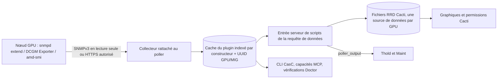

<!-- Source: README.md; SHA256: 97ba37df4a883426d3984ed7d14547ad7367e973411a8abd930409ce259f545b -->

<!-- translations:start -->
[English](../../../README.md) | [简体中文](../zh-CN/README.md) | [हिन्दी](../hi-IN/README.md) | [Español (España)](../es-ES/README.md) | [Español (Latinoamérica)](../es-419/README.md) | [العربية (السعودية)](../ar-SA/README.md) | [Afrikaans](../af-ZA/README.md) | [አማርኛ](../am-ET/README.md) | [العربية (مصر)](../ar-EG/README.md) | [العربية (المغرب)](../ar-MA/README.md) | [Български](../bg-BG/README.md) | [বাংলা](../bn-BD/README.md) | [Bosanski](../bs-BA/README.md) | [Deutsch](../de-DE/README.md) | [Ελληνικά](../el-GR/README.md) | [فارسی](../fa-IR/README.md) | [Filipino](../fil-PH/README.md) | [Français](../fr-FR/README.md) | [Français (Maroc)](README.md) | [Français (Sénégal)](../fr-SN/README.md) | [Hausa](../ha-NG/README.md) | [עברית](../he-IL/README.md) | [Hrvatski](../hr-HR/README.md) | [Bahasa Indonesia](../id-ID/README.md) | [Igbo](../ig-NG/README.md) | [Italiano](../it-IT/README.md) | [日本語](../ja-JP/README.md) | [ქართული](../ka-GE/README.md) | [한국어](../ko-KR/README.md) | [Latviešu](../lv-LV/README.md) | [Malagasy](../mg-MG/README.md) | [मराठी](../mr-IN/README.md) | [Bahasa Melayu](../ms-MY/README.md) | [Nederlands](../nl-NL/README.md) | [Polski](../pl-PL/README.md) | [Português (Brasil)](../pt-BR/README.md) | [Português (Portugal)](../pt-PT/README.md) | [Русский](../ru-RU/README.md) | [Kinyarwanda](../rw-RW/README.md) | [Soomaali](../so-SO/README.md) | [Српски](../sr-RS/README.md) | [Svenska](../sv-SE/README.md) | [Kiswahili](../sw-KE/README.md) | [தமிழ்](../ta-IN/README.md) | [తెలుగు](../te-IN/README.md) | [ไทย](../th-TH/README.md) | [Türkçe](../tr-TR/README.md) | [Українська](../uk-UA/README.md) | [اردو](../ur-PK/README.md) | [Tiếng Việt](../vi-VN/README.md) | [isiXhosa](../xh-ZA/README.md) | [Yorùbá](../yo-NG/README.md) | [繁體中文](../zh-TW/README.md) | [isiZulu](../zu-ZA/README.md)
<!-- translations:end -->

# plugin_gpu

Un plugin Cacti 1.2 qui intègre dans Cacti l'utilisation, la mémoire, la température, la consommation électrique, les erreurs ECC et les causes de limitation de fréquence (*throttling*) par GPU à partir des outils NVIDIA et AMD. Chaque GPU (ou instance MIG) devient un index d'une requête de données sur l'équipement de son nœud, de sorte que les graphiques GPU figurent à côté des autres graphiques du nœud selon les permissions de Cacti, et que Thold et Maint peuvent déclencher des alertes et les supprimer temporairement.

> **Statut : phases 1 à 3 implémentées dans le code, non encore publiées.** La phase 1 (NVIDIA `nvidia-smi` via SNMP extend, suivi d'identité, graphiques, signaux de limitation et d'ECC, alertes Thold et Maint, page d'état de santé), la phase 2 (analyseur/client HTTP(S) en lecture seule pour NVIDIA DCGM Exporter et analyseur AMD `amd-smi`), la phase 3 (suivi d'identité des instances MIG, colonnes Schema v4, exécution des collecteurs distants rattachés au poller, hooks `replicate_out` et `remote_agent`), l'interface CLI opérateur CasC (`cli/gpu.php`) et les hooks d'écosystème (`abilities_register`, `doctor_register_checks`, `casc_register_providers`) sont implémentés et couverts par des tests unitaires, de sécurité et d'intégration sur une instance Cacti jetable. Les exécutions en conditions réelles reposent jusqu'ici sur un `snmpd` synthétique et des jeux de données de test plutôt que sur du matériel GPU physique. Points encore ouverts avant de marquer une version : des pilotes sur matériel réel ([docs/pilot-plan.md](../../pilot-plan.md), #54), un audit de sécurité externe ([docs/security-review.md](../../security-review.md)), des jeux de données capturés à partir d'outils réels (#14) et la mesure de la montée en charge sur du matériel de taille production ([docs/performance.md](../../performance.md)). La collecte des erreurs XID reste ouverte sous la décision #8.

## Rôles d'accès

| Domaine d'accès | Accès |
| --- | --- |
| GPU View | Pages de supervision existantes. |
| GPU Operator | Supervision, plus la page Opérations et les acquittements personnels de triage. |
| GPU Admin | Accès Operator, plus la configuration existante et les actions d'administration. |

Après avoir copié les fichiers de mise à niveau, ouvrez la page Plugins en tant qu'administrateur pour enregistrer le nouveau domaine d'accès. Attribuez explicitement le domaine Operator sous **Configuration > Users** ou via les groupes d'utilisateurs.
Les mises à niveau conservent les identifiants et les autorisations existants des domaines View et Admin. L'accès Admin hérite de l'accès Operator, et l'accès Operator hérite de l'accès View à chaque requête ; cela n'ajoute pas d'autorisations enregistrées aux utilisateurs ni aux groupes. Les paramètres du plugin exigent également l'accès GPU Admin en plus de la permission Settings de Cacti.

Les permissions d'équipement de Cacti continuent de limiter les lignes et les actions disponibles pour chaque utilisateur ; les objets non mappés nécessitent un administrateur.
Les identifiants, la configuration, le mappage, la suppression et les autres modifications d'administration restent dans les pages d'administration. Les acquittements ne durent que pendant la session en cours de l'utilisateur, pendant au plus une heure et uniquement tant que la même observation reste fraîche. Toute observation nouvelle ou modifiée les invalide. Ils ne marquent jamais une mesure en échec comme saine et ne suppriment pas les alertes.

## Pourquoi

Les nœuds GPU sont généralement déjà présents dans Cacti pour le CPU, la mémoire et les interfaces. L'état de santé des GPU constitue une question distincte à laquelle les données SNMP du nœud ne répondent pas : une carte peut subir une limitation thermique, accumuler des erreurs ECC ou signaler une défaillance XID alors que le nœud lui-même semble sain. Les outils des constructeurs le signalent (`nvidia-smi`, DCGM, `amd-smi`), mais leurs sorties restent en dehors des graphiques, des permissions et du système d'alertes de Cacti.

Le plugin comble cette lacune en transformant la sortie des outils constructeurs en sources de données Cacti, indexées selon l'identité de chaque GPU plutôt que sa position, afin qu'un redémarrage qui réordonne les GPU n'attache pas l'historique d'une carte à une autre. Il réutilise la génération de graphiques, les permissions, les collecteurs de données distants, Thold et Maint de Cacti plutôt que d'en développer des versions parallèles.

## Périmètre planifié

| Phase | Périmètre | Statut | Jalons |
|---|---|---|---|
| 0, recherche | Sortie des outils constructeurs, signaux XID et de limitation, identité GPU, privilèges, choix du chemin de collecte | Terminé | [M1](https://github.com/somethingwithproof/plugin_gpu/milestone/1) |
| 1, nvidia | Collecte `nvidia-smi`, inventaire par UUID, graphiques, signaux de limitation et d'ECC, Thold et Maint, page d'état de santé | Implémenté (testé sur jeux de données) | [M2](https://github.com/somethingwithproof/plugin_gpu/milestone/2), [M3](https://github.com/somethingwithproof/plugin_gpu/milestone/3), [M4](https://github.com/somethingwithproof/plugin_gpu/milestone/4) |
| 2, backends | Analyseur/client HTTP(S) DCGM Exporter en lecture seule (`lib/DcgmExporterParser.php`, `lib/DcgmExporterClient.php`), analyseur AMD `amd-smi` (`lib/AmdSmiParser.php`) | Implémenté (testé unitairement) | [M5](https://github.com/somethingwithproof/plugin_gpu/milestone/5) |
| 3, mig, distant et écosystème | Suivi d'identité des instances MIG, collecteurs de données distants (`INFO`, `poller_gpu.php --poller=N`, `replicate_out`, `remote_agent`), CLI CasC (`cli/gpu.php`), hooks MCP/Doctor/CasC | Implémenté (testé unitairement et en intégration CI) | [M6](https://github.com/somethingwithproof/plugin_gpu/milestone/6) |

Hors périmètre : toute commande qui modifie un GPU ou un nœud (fréquences d'horloge, limites de puissance, réinitialisations, configuration MIG), un moteur d'alertes propre au plugin, un démon ou un protocole réseau personnalisé, ainsi que la comptabilisation de l'ordonnanceur ou des tâches. Consultez le plan pour la liste des travaux de recherche en attente.

## Ce qu'apporte le jalon 4

- **Collecteur en lecture seule NVIDIA DCGM Exporter** (`lib/DcgmExporterParser.php`, `lib/DcgmExporterClient.php`). Analyse les métriques au format texte Prometheus (`DCGM_FI_DEV_GPU_UTIL`, `DCGM_FI_DEV_FB_USED`, `DCGM_FI_DEV_FB_FREE`, `DCGM_FI_DEV_POWER_USAGE`, `DCGM_FI_DEV_GPU_TEMP`, `DCGM_FI_DEV_ECC_DBE_VOL_TOTAL`, `DCGM_FI_DEV_CLOCK_THROTTLE_REASONS`, ainsi que les étiquettes MIG `GPU_I_ID` et `GPU_I_PROFILE`). Le client HTTP(S) impose une liste autorisée explicite d'hôtes/CIDR pour les points de terminaison, vérifie par défaut les certificats TLS des pairs, plafonne les délais d'attente et la taille des réponses, désactive les redirections et rejette les schémas non HTTP(S).
- **Analyseur en lecture seule AMD `amd-smi`** (`lib/AmdSmiParser.php`). Normalise les sorties JSON/SNMP-extend d'`amd-smi` (utilisation, VRAM, puissance, température jonction/bord, ECC, métadonnées de partition et accumulateurs de limitation distincts via `Reading::$vendorExtensions`) dans le modèle de métriques commun sous `Vendor::Amd`.
- **Suivi des instances MIG et Schema v4** (`lib/GpuReport.php`, `lib/GpuSnapshot.php`, `lib/GpuRecord.php`, `lib/Schema.php`, `lib/ScriptServer.php`). Suit les UUID d'instances MIG (`MIG-<uuid>` et `MIG-GPU-<parent>/<gi>/<ci>`), `mig_mode`, `mig_instance_id`, `mig_profile`, `parent_uuid` et `partition_info` aux côtés des GPU parents tout en protégeant les clés d'identité immuables (`vendor`, `uuid`, `parent_uuid`) lors des mises à jour et en les validant avant les requêtes en base de données.
- **Collecteurs de données distants** (`INFO`, `poller_gpu.php`, `lib/Poller.php`, `lib/ReplicationRepository.php`, `setup.php`). Déclare `remote_collect:1, remote_poller:1` dans `INFO`, prend en charge l'exécution ciblée par poller via `php plugins/gpu/poller_gpu.php --poller=N`, ignore le provisionnement des objets Cacti sur les pollers non principaux, réplique les tables rattachées au poller via `replicate_out` et répond aux actions en lecture seule `gpu_health` et `gpu_inventory` via `remote_agent`.
- **CLI opérateur et CasC** (`cli/gpu.php`, `lib/CascProvider.php`). Fonctionne sous PHP 8.2+ (analysable sous PHP 8.0) sans aucune dépendance Composer externe : `php plugins/gpu/cli/gpu.php export [--format=yaml|xml]`, `validate <file> [--format=yaml|xml]`, `plan <file> [--format=yaml|xml] [--output=text|json]`, `apply <file> --confirm=<PLAN_HASH> [--format=yaml|xml]` et `health [--format=text|json]`. Les plans calculent un hachage de confirmation SHA-256 déterministe, `apply` échoue de façon sûre en cas de non-correspondance du hachage et l'analyse XML rejette les déclarations `DOCTYPE` et `ENTITY`.
- **Hooks d'intégration à l'écosystème** (`lib/EcosystemIntegration.php`, `setup.php`). Enregistre `abilities_register` (`gpu-list-nodes`, `gpu-list-devices`, `gpu-get-health` ; en lecture seule, restreint au domaine d'accès `GPU View` et aux permissions d'équipement Cacti), `doctor_register_checks` (`gpu_schema`, `gpu_poller_freshness`, `gpu_node_health`) et `casc_register_providers`.
- **Causes de limitation et ECC comme valeurs d'alerte** ([docs/metrics.md](../../metrics.md)). Décode les masques d'événements d'horloge en indicateurs 0/1 et calcule les nouvelles erreurs ECC corrigées et non corrigées par intervalle sous forme de jauges afin que Thold 1.8.2 et Maint 1.3 déclenchent et suppriment les alertes sans compteurs négatifs ni pics liés aux réinitialisations ([docs/alerting.md](../../alerting.md)).
- **GPU Health, permissions, panne/restauration et montée en charge.** GPU Health (GPU View) affiche la fraîcheur stockée, le résultat de la dernière collecte, l'état Maint, le backend, les versions et les masques bruts de limitation sans contacter les nœuds. Des tests automatisés de bout en bout vérifient les permissions, la reprise après panne agent/BDD/RRD ([docs/backup.md](../../backup.md)) et une exécution à l'échelle de 100 GPU en CI ([docs/performance.md](../../performance.md), [docs/operations.md](../../operations.md), [CHANGELOG.md](../../../CHANGELOG.md)).

## Ce qu'apporte le jalon 3

- **Collecte via SNMP extend** ([ADR 0008](../../decisions/0008-collect-through-snmp-extend.md)). L'administrateur du nœud ajoute deux lignes `extend` fixes dans `snmpd.conf` ([docs/node-setup.md](../../node-setup.md)) ; le plugin lit la MIB NET-SNMP-EXTEND-MIB via les fonctions SNMP de Cacti avec les propres identifiants de l'équipement, SNMPv3 étant recommandé. Il n'exécute rien sur le serveur Cacti ni sur le nœud.
- **Analyse stricte.** Les champs sont lus par position, chaque ligne identifie son GPU par UUID, et un code de sortie non nul, un dépassement de délai, une sortie tronquée, une ligne comportant un nombre de champs erroné ou un texte d'erreur fusionné fait échouer toute la collecte : les valeurs deviennent `U`, aucun GPU n'est marqué absent et GPU Nodes en indique la raison.
- **Un collecteur après chaque cycle du poller.** Il interroge l'agent de chaque nœud activé, met à jour les enregistrements d'identité et met en cache le dernier échantillon. L'entrée du serveur de scripts lit uniquement ce cache, de sorte qu'un cycle de collecte Cacti n'attend jamais un nœud GPU.
- **Objets Cacti** ([ADR 0010](../../decisions/0010-attach-to-existing-node-devices.md)). Les modèles et la requête de données *GPU - Devices* sont fournis au format XML et importés lors de l'installation et de la mise à niveau. L'enregistrement d'un nœud attache la requête de données à son équipement existant avec la méthode de réindexation None ; GPU Nodes ne peut créer un équipement que lorsque le nœud n'en possède aucun. Chaque GPU est un index identifié par le constructeur et l'UUID, avec une source de données partagée par ses graphiques Utilization, Memory, Temperature, Power, Power Percent, Clocks, Throttle, ECC Errors, New ECC Errors, Retired Pages et Sample Age. Chaque champ du modèle est tracé par au moins un graphique, car Cacti ne stocke que les champs utilisés par un graphique. Le plugin réindexe après chaque changement de GPU, conserve une réindexation ignorée par Cacti lorsque l'équipement était Down ou désactivé et l'exécute dès que l'équipement repasse Up, et crée les graphiques pour les nouveaux GPU.
- **L'historique reste attaché à la carte.** Un GPU absent reste un index, de sorte que ses graphiques affichent une interruption et reprennent dans le même fichier RRD lorsqu'il revient. Une carte de remplacement dans le même emplacement obtient sa propre source de données. L'action **Remove from Data Query** sur la page du nœud retire un GPU absent de la liste ; ses fichiers RRD et graphiques sont conservés jusqu'à ce que vous les supprimiez.
- **Permissions d'équipement sur GPU Nodes.** Un utilisateur GPU Admin ne voit, ne modifie, n'exporte et ne déplace que les nœuds et GPU associés aux équipements qu'il est autorisé à voir dans Cacti ; le déplacement d'un GPU nécessite l'accès aux deux nœuds. Un nœud dont l'équipement a été supprimé peut être désactivé ou supprimé.
- **Le modèle de métriques commun** ([ADR 0009](../../decisions/0009-common-metric-core-with-vendor-extensions.md), [docs/metrics.md](../../metrics.md)). La mémoire est exprimée en octets, le masque d'événements d'horloge est décodé en indicateurs `thr_*` et `age` correspond à l'âge de l'horodatage d'échantillonnage propre au GPU, ou `U` lorsqu'il est inconnu.

L'utilisateur procédant à l'installation (serveur web) doit disposer des droits d'écriture dans `<cacti>/resource/script_server/`, où le plugin place le XML de sa requête de données ; dans le cas contraire, l'installation et la mise à niveau s'arrêtent avec un message et réessaient lors de la tentative suivante. La désinstallation supprime les modèles et le XML uniquement lorsque l'option *Remove the plugin's Cacti objects on uninstall* est cochée, et ne supprime jamais les fichiers RRD, les équipements, les graphiques ni les sources de données ([docs/operations.md](../../operations.md#uninstall)). Les nœuds rattachés à des collecteurs de données distants s'exécutent dans le périmètre de leur `poller_id` attribué.

## Ce que livre le jalon 2

- **Une installation protégée.** Sous PHP inférieur à 8.2, l'installation et l'activation sont refusées avec un message indiquant la version requise, et le reste de Cacti continue de fonctionner. `setup.php` et les scripts de pages restent syntaxiquement valides sous PHP 8.0.
- **Cycle de vie.** Installation, mise à niveau, désactivation et désinstallation via la page Plugins de Cacti. Les mises à niveau sont ordonnées, reprennent après une interruption et ne modifient la version enregistrée qu'après réussite. La désinstallation conserve les tables du plugin sauf si vous décochez *Keep Plugin Tables on Uninstall* ; elle ne touche jamais à un équipement, une source de données, un graphique ou un fichier RRD de Cacti.
- **Domaines d'accès distincts.** *GPU Admin* ouvre **GPU Nodes**, où vous enregistrez des équipements Cacti comme nœuds GPU, confirmez ou rejetez les déplacements de GPU entre nœuds et exportez chaque enregistrement au format JSON. *GPU View* ouvre **GPU Inventory**, qui liste uniquement les GPU des équipements que l'utilisateur est autorisé à voir. Les deux pages se trouvent sous Management et chaque modification s'effectue via une requête POST vérifiée par csrf-magic.
- **Enregistrements d'identité GPU.** Chaque GPU est identifié par son constructeur et son UUID. L'index, l'identifiant de bus PCI, le nom, le pilote et l'outil de rapport sont des attributs qui changent sur place. Un nouvel UUID dans un emplacement connu est signalé comme un remplacement potentiel et démarre son propre historique ; un GPU détecté sur un autre nœud n'est déplacé que lorsqu'un opérateur le confirme ; un GPU absent des collectes réussies est marqué absent après un nombre configurable de cycles et n'est jamais supprimé. Seuls les UUID de GPU entiers NVIDIA sont acceptés pour l'instant ; les instances MIG attendent la décision #13, et AMD la recherche #19. Les règles sont vérifiées par des séquences de jeux de données de test, aucun collecteur ne les alimentant encore.
- **Tests et CI.** Suites de tests unitaires et de règles sur les sources sans GPU ni base de données, vérifications du cycle de vie et des permissions de pages par rapport à Cacti 1.2.31 et à la branche 1.2.x actuelle sous PHP 8.2 à 8.5, tâche de refus sous PHP 8.1, vérification syntaxique (*lint*) PHP 8.0 des points d'entrée, PHPStan au niveau 9 et REUSE. L'environnement de test reste provisoire jusqu'à ce que la question #12 soit tranchée.

### Installation pour évaluation

Ces étapes installent le code actuel afin de l'essayer ; [docs/operations.md](../../operations.md) contient le guide complet pour l'opérateur. Elles nécessitent Cacti 1.2.31 ou ultérieur sous PHP 8.2 ou ultérieur.

1. Copiez le dépôt dans `plugins/gpu` sous votre répertoire Cacti. Le répertoire doit impérativement se nommer `gpu`.
2. Dans Cacti, ouvrez **Configuration > Plugins**, puis installez et activez **GPU**.
3. Attribuez aux utilisateurs le domaine *GPU View*, *GPU Operator* ou *GPU Admin* sous **Configuration > Users**, selon leur rôle. L'utilisateur effectuant l'installation reçoit View et Admin ; Admin inclut l'accès Operator.
4. Configurez l'agent SNMP de chaque nœud GPU comme décrit dans [docs/node-setup.md](../../node-setup.md), puis ajoutez le nœud sous **Management > GPU Nodes**.
5. Pour les alertes, importez les modèles Thold fournis comme indiqué dans [docs/alerting.md](../../alerting.md).
6. Vous pouvez éventuellement ajuster **Configuration > Settings > GPU** : *Mark Absent After* (3 collectes réussies par défaut, de 1 à 100), *Stale After* (ancienneté maximale d'un échantillon avant que ses valeurs n'affichent `U`) et *Keep Plugin Tables on Uninstall* (activé par défaut).

## Comment les métriques parviennent à Cacti

La décision [#7](https://github.com/somethingwithproof/plugin_gpu/issues/7) a retenu SNMP `extend` ([ADR 0008](../../decisions/0008-collect-through-snmp-extend.md)) : l'agent propre du nœud exécute une commande `nvidia-smi` fixe et le plugin se contente d'en lire le résultat. Le plan compare les différentes options sous [Chemins de collecte](../../PLAN.md#collection-paths).

## Cibles de compatibilité

| Composant | Cible |
|---|---|
| Cacti | 1.2.31 ou ultérieur, sans modification du cœur |
| PHP | 8.2 ou ultérieur ; `setup.php` reste analysable sous PHP 8.0 afin qu'un environnement d'exécution non pris en charge reçoive un refus plutôt qu'une interface Cacti cassée |
| NVIDIA | Versions de pilotes et d'outils à définir par la recherche [#26](https://github.com/somethingwithproof/plugin_gpu/issues/26) ; identifiants de champs DCGM vérifiés aux versions v3.3.9 et v4.7.0 |
| AMD | `amd-smi` sur les versions ROCm à définir par la recherche [#26](https://github.com/somethingwithproof/plugin_gpu/issues/26) |
| Thold, Maint | Thold 1.8.2 et Maint 1.3, non modifiés, testés de bout en bout ([docs/alerting.md](../../alerting.md)) |

## Conception

- [docs/PLAN.md](../../PLAN.md) constitue le plan complet : architecture, faits amont dont il dépend (avec sources), modèle d'identité, frontières de sécurité, calculs de performance, tests et risques.
- [docs/decisions/](../../decisions) regroupe les dossiers de décision d'architecture (*ADR*) pour les choix déjà arrêtés.
- [docs/REQUIREMENTS.md](../../REQUIREMENTS.md) associe chaque identifiant d'exigence à son ticket.

## Suivi des travaux

- **Jalons** : ils suivent les jalons du plan. Chacun dispose d'un ticket épique listant ses sous-tickets et ses preuves de sortie.
- **Tickets** : ils sont typés par étiquette : `type: requirement`, `type: research`, `type: decision`, `type: epic`. Les tickets d'exigences énoncent des exigences numérotées et testables (`REQ-AREA-NNN`) ainsi que des critères d'acceptation.
- **Étiquettes** : elles portent également les préfixes `area:`, `phase:`, `priority:` et `status:`. Voir [CONTRIBUTING.md](../../../CONTRIBUTING.md#labels).
- Le [tableau de projet](https://github.com/users/somethingwithproof/projects/9) présente tous les tickets à travers les jalons.

## Contribution

Lisez [CONTRIBUTING.md](../../../CONTRIBUTING.md). Les commits nécessitent une signature DCO (*sign-off*). Les discussions de conception ont lieu sur les tickets ; les décisions ouvertes portent l'étiquette `type: decision`. Les sorties capturées à partir de véritables outils GPU constituent la contribution la plus utile pour le jalon 1 ; retirez au préalable les noms d'hôte, numéros de série et UUID.

## Sécurité

Signalez les vulnérabilités de manière privée ; consultez [SECURITY.md](../../../SECURITY.md).

## Licence

Licence publique générale GNU v2.0 (GNU General Public License v2.0), la même licence que Cacti et ses plugins. Voir [LICENSE](../../../LICENSE).
