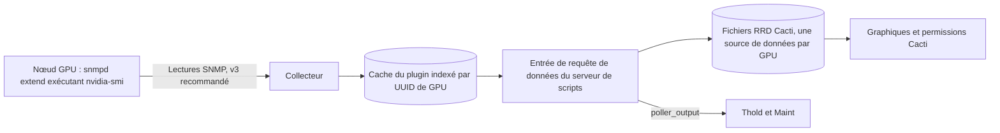

<!-- Source: README.md; SHA256: 126deef1783d64f878bf565f1433c10f31aef828eb9bc313aeff2b0335e54c7c -->

<!-- translations:start -->
[English](../../../README.md) | [简体中文](../zh-CN/README.md) | [हिन्दी](../hi-IN/README.md) | [Español (España)](../es-ES/README.md) | [Español (Latinoamérica)](../es-419/README.md) | [العربية (السعودية)](../ar-SA/README.md) | [Afrikaans](../af-ZA/README.md) | [አማርኛ](../am-ET/README.md) | [العربية (مصر)](../ar-EG/README.md) | [العربية (المغرب)](../ar-MA/README.md) | [বাংলা](../bn-BD/README.md) | [Bosanski](../bs-BA/README.md) | [Deutsch](../de-DE/README.md) | [فارسی](../fa-IR/README.md) | [Filipino](../fil-PH/README.md) | [Français](../fr-FR/README.md) | [Français (Maroc)](../fr-MA/README.md) | [Français (Sénégal)](README.md) | [Hausa](../ha-NG/README.md) | [עברית](../he-IL/README.md) | [Hrvatski](../hr-HR/README.md) | [Bahasa Indonesia](../id-ID/README.md) | [Igbo](../ig-NG/README.md) | [Italiano](../it-IT/README.md) | [日本語](../ja-JP/README.md) | [한국어](../ko-KR/README.md) | [Malagasy](../mg-MG/README.md) | [मराठी](../mr-IN/README.md) | [Bahasa Melayu](../ms-MY/README.md) | [Nederlands](../nl-NL/README.md) | [Polski](../pl-PL/README.md) | [Português (Brasil)](../pt-BR/README.md) | [Русский](../ru-RU/README.md) | [Kinyarwanda](../rw-RW/README.md) | [Soomaali](../so-SO/README.md) | [Српски](../sr-RS/README.md) | [Svenska](../sv-SE/README.md) | [Kiswahili](../sw-KE/README.md) | [தமிழ்](../ta-IN/README.md) | [తెలుగు](../te-IN/README.md) | [ไทย](../th-TH/README.md) | [Türkçe](../tr-TR/README.md) | [Українська](../uk-UA/README.md) | [اردو](../ur-PK/README.md) | [Tiếng Việt](../vi-VN/README.md) | [isiXhosa](../xh-ZA/README.md) | [Yorùbá](../yo-NG/README.md) | [繁體中文](../zh-TW/README.md) | [isiZulu](../zu-ZA/README.md)
<!-- translations:end -->

# plugin_gpu

Un plugin Cacti 1.2 qui intègre dans Cacti l'utilisation, la mémoire, la température, la consommation électrique, les erreurs ECC et les motifs de bridage (*throttling*) par GPU à partir des outils NVIDIA. La prise en charge d'AMD et la collecte des erreurs XID sont prévues, mais ne sont pas encore implémentées. Chaque GPU devient un index d'une requête de données sur l'équipement de son nœud, afin que les graphiques GPU apparaissent aux côtés des autres graphiques du nœud selon les permissions de Cacti, et que Thold et Maint puissent générer des alertes et les suspendre.

> **Statut : en développement, non publié.** Le jalon 4 achève le code de la phase 1 (NVIDIA via SNMP extend) : collecte, identité, graphiques, signaux de bridage et d'ECC, alertes Thold et Maint, page d'état de santé et documentation opérateur. Il n'a été exécuté qu'avec un véritable `snmpd` associé à un faux `nvidia-smi` produisant une sortie synthétique, jamais sur du matériel GPU réel. Restent à accomplir avant une publication : des pilotes sur du matériel réel ([docs/pilot-plan.md](../../pilot-plan.md), #54), un audit de sécurité externe ([docs/security-review.md](../../security-review.md)), des jeux de données de test (*fixtures*) capturés à partir d'outils réels (#14) et des mesures de passage à l'échelle sur une infrastructure de taille production ([docs/performance.md](../../performance.md)). Les erreurs XID attendent la décision #8. Ne l'exécutez pas en production.

## Rôles d'accès

| Domaine | Accès |
| --- | --- |
| GPU View | Pages de supervision existantes. |
| GPU Operator | Supervision ainsi que la page Opérations et les acquittements personnels de triage. |
| GPU Admin | Accès Opérateur ainsi que les actions existantes de configuration et d'administration. |

Après avoir copié les fichiers de mise à niveau, ouvrez la page Plugins en tant qu'administrateur pour enregistrer le nouveau domaine. Attribuez explicitement le domaine Operator sous **Configuration > Users** ou dans les groupes d'utilisateurs. Les mises à niveau conservent les identifiants et les droits existants des domaines View et Admin. L'accès Admin hérite de l'accès Operator, et l'accès Operator hérite de l'accès View à chaque requête ; cela n'ajoute pas d'autorisations enregistrées aux utilisateurs ni aux groupes. Les paramètres du plugin exigent également l'accès GPU Admin en plus de la permission Settings de Cacti.

Les permissions d'équipement de Cacti continuent de limiter les lignes et les actions accessibles à chaque utilisateur ; les objets non mappés nécessitent un administrateur. Les identifiants, la configuration, le mappage, la suppression et les autres modifications administratives restent dans les pages d'administration. Les acquittements ne sont valables que pendant la session en cours de l'utilisateur, pour une durée maximale d'une heure et uniquement tant que la même observation reste fraîche. Toute observation nouvelle ou modifiée les invalide. Ils ne marquent jamais une mesure en échec comme saine et ne suspendent pas les alertes.

## Pourquoi

Les nœuds GPU sont généralement déjà présents dans Cacti pour le processeur, la mémoire et les interfaces. L'état de santé des GPU est une question distincte à laquelle les données SNMP du nœud ne répondent pas : une carte peut subir un bridage thermique, accumuler des erreurs ECC ou signaler une défaillance XID alors que le nœud lui-même semble sain. Les outils des constructeurs le signalent (`nvidia-smi`, DCGM, `amd-smi`), mais leur sortie reste en dehors des graphiques, des permissions et des alertes de Cacti.

Le plugin comble cette lacune en transformant la sortie des outils constructeur en sources de données Cacti, indexées par l'identité de chaque GPU plutôt que par sa position, de sorte qu'un redémarrage réordonnant les GPU n'attache pas l'historique d'une carte à une autre. Il réutilise la gestion des graphiques, les permissions, les collecteurs de données distants, Thold et Maint de Cacti plutôt que d'en construire des équivalents parallèles.

## Périmètre prévu

| Phase | Périmètre | Jalons |
|---|---|---|
| 0, recherche | Sorties des outils constructeur, signaux XID et de bridage, identité des GPU, privilèges, choix du chemin de collecte | [M1](https://github.com/somethingwithproof/plugin_gpu/milestone/1) |
| 1, nvidia | Collecte `nvidia-smi`, inventaire par UUID, graphiques, signaux de bridage, ECC et XID, Thold et Maint, page d'état de santé | [M2](https://github.com/somethingwithproof/plugin_gpu/milestone/2), [M3](https://github.com/somethingwithproof/plugin_gpu/milestone/3), [M4](https://github.com/somethingwithproof/plugin_gpu/milestone/4) |
| 2, backends | Backend DCGM, backend `amd-smi` | [M5](https://github.com/somethingwithproof/plugin_gpu/milestone/5) |
| 3, mig et distant | Instances MIG, collecteurs de données distants Cacti | [M6](https://github.com/somethingwithproof/plugin_gpu/milestone/6) |

Hors périmètre : toute commande modifiant un GPU ou un nœud (fréquences d'horloge, limites de puissance, réinitialisations, configuration MIG), un moteur d'alertes propre au plugin, un démon ou protocole réseau personnalisé, ainsi que l'ordonnancement ou la comptabilisation des tâches. Consultez le plan pour la liste des travaux de recherche en attente.

## Ce qu'apporte le jalon 4

- **Motifs de bridage comme valeurs d'alerte.** Le masque d'événements d'horloge est décodé en un indicateur à 0 ou 1 par motif ; un masque inconnu donne des indicateurs inconnus, jamais des zéros, et les bits sans indicateur restent dans le masque brut, affiché dans GPU Health.
- **ECC comme valeurs d'alerte** ([docs/metrics.md](../../metrics.md)). Les nouvelles erreurs corrigées et non corrigées depuis l'échantillon précédent sont calculées par le plugin à partir de deux totaux consécutifs et enregistrées comme jauges : inconnues lors d'un premier échantillon, d'une lecture manquée ou d'un rechargement de pilote, afin qu'une réinitialisation ne soit jamais interprétée comme un zéro ni comme un compteur négatif. Les nombres de pages retirées (simple bit et double bit) ainsi que le mode ECC sont également lus. Deux graphiques ECC supplémentaires par GPU permettent à Cacti de les enregistrer ; avec Power Percent, cela fait onze graphiques au total. Les erreurs XID ne sont pas collectées : aucune source ne correspond aux commandes `nvidia-smi` fixes (#8).
- **Thold et Maint** ([docs/alerting.md](../../alerting.md)). Modèles Thold fournis pour la température, la consommation par rapport à sa limite, les indicateurs de bridage, les nouvelles erreurs ECC non corrigées, le retrait de pages en attente et l'âge de l'échantillon. Chaque valeur est une jauge, car Thold 1.8.2 échoue sur un compteur inconnu. Un test de bout en bout avec Thold 1.8.2 et Maint 1.3 non modifiés montre chaque seuil se déclencher puis se rétablir, y compris lors d'une réinitialisation ECC, et Maint les suspendre.
- **GPU Health** (GPU View). Par nœud : fraîcheur, statut de fin de la dernière collecte, état Maint, backend, versions de l'outil et du pilote, et nombre de GPU ; par GPU : présence, âge de l'échantillon, état ECC et masque brut. Cette page lit uniquement les enregistrements stockés.
- **Permissions.** La suite de tests de permissions couvre chaque fichier de page et chaque action, la révocation dès la requête suivante et les refus qui ne divulguent aucune information.
- **Qualification en cas de panne et de restauration.** Des exécutions scriptées de bout en bout mettent en défaut l'agent, les identifiants, l'outil, sa sortie, la connexion à la base de données et les écritures RRD, et restaurent la base de données depuis une sauvegarde, y compris une sauvegarde plus ancienne que les fichiers RRD ; un nouveau GPU n'hérite jamais du fichier RRD d'un autre ([docs/backup.md](../../backup.md)).
- **Montée en charge** ([docs/performance.md](../../performance.md)). Un test de montée en charge mesure la durée de la collecte, de l'entrée du serveur de scripts, de la création d'objets Cacti, d'un cycle du poller et de la page d'état de santé pour un nombre donné de GPU ; l'intégration continue l'exécute à 100 GPU. Les mesures à 1 000 et 8 000 GPU n'étant pas encore enregistrées, aucun nombre maximal de GPU pris en charge n'est annoncé.
- **Documentation opérateur** ([docs/operations.md](../../operations.md)) : installation, mise à niveau, désinstallation, moindre privilège, valeurs indisponibles et dépannage. Les modifications sont répertoriées dans [CHANGELOG.md](../../../CHANGELOG.md).

## Ce qu'apporte le jalon 3

- **Collecte via SNMP extend** ([ADR 0008](../../decisions/0008-collect-through-snmp-extend.md)). L'administrateur du nœud ajoute deux lignes `extend` fixes à `snmpd.conf` ([docs/node-setup.md](../../node-setup.md)) ; le plugin lit NET-SNMP-EXTEND-MIB via les fonctions SNMP de Cacti avec les propres identifiants de l'équipement, SNMPv3 étant recommandé. Il n'exécute rien sur le serveur Cacti ni sur le nœud.
- **Analyse stricte.** Les champs sont lus par position, chaque ligne nomme son GPU par UUID, et un code de sortie non nul, un délai d'attente dépassé, une sortie tronquée, une ligne comportant un nombre incorrect de champs ou du texte d'erreur fusionné fait échouer toute la collecte : les valeurs deviennent `U`, aucun GPU n'est marqué absent et GPU Nodes en indique la raison.
- **Un collecteur après chaque cycle du poller.** Il interroge l'agent de chaque nœud activé, met à jour les enregistrements d'identité et met en cache le dernier échantillon. L'entrée du serveur de scripts lit uniquement ce cache, de sorte qu'une interrogation Cacti n'attend jamais un nœud GPU.
- **Objets Cacti** ([ADR 0010](../../decisions/0010-attach-to-existing-node-devices.md)). Les modèles et la requête de données *GPU - Devices* sont fournis au format XML et importés lors de l'installation et de la mise à niveau. L'enregistrement d'un nœud associe la requête de données à son équipement existant avec la méthode de réindexation None ; GPU Nodes ne peut créer un équipement que lorsque le nœud n'en possède aucun. Chaque GPU est un index identifié par son constructeur et son UUID, avec une source de données unique partagée par ses graphiques Utilization, Memory, Temperature, Power, Power Percent, Clocks, Throttle, ECC Errors, New ECC Errors, Retired Pages et Sample Age. Chaque champ du modèle est tracé par un graphique, car Cacti ne stocke que les champs utilisés par un graphique. Le plugin réindexe après chaque changement de GPU, conserve une réindexation ignorée par Cacti lorsque l'équipement était Down ou désactivé pour l'exécuter dès que l'équipement redevient Up, et crée les graphiques des nouveaux GPU.
- **L'historique reste attaché à la carte.** Un GPU absent conserve son index, de sorte que ses graphiques affichent un vide et reprennent dans le même fichier RRD lorsqu'il revient. Une carte de remplacement dans le même emplacement reçoit sa propre source de données. **Remove from Data Query** sur la page du nœud retire un GPU absent de la liste ; ses fichiers RRD et ses graphiques sont conservés jusqu'à ce que vous les supprimiez.
- **Permissions d'équipement sur GPU Nodes.** Un administrateur GPU (GPU Admin) ne voit, ne modifie, n'exporte et ne déplace que les nœuds et les GPU situés sur des équipements qu'il est autorisé à voir dans Cacti ; le déplacement d'un GPU requiert l'accès aux deux nœuds. Un nœud dont l'équipement a été supprimé peut être désactivé ou supprimé.
- **Le modèle de métriques commun** ([ADR 0009](../../decisions/0009-common-metric-core-with-vendor-extensions.md), [docs/metrics.md](../../metrics.md)). La mémoire est exprimée en octets, le masque d'événements d'horloge est décodé en indicateurs `thr_*` et `age` correspond à l'âge de l'horodatage propre à l'échantillon du GPU, ou `U` s'il est inconnu.

L'utilisateur qui effectue l'installation (utilisateur du serveur web) doit pouvoir écrire dans `<cacti>/resource/script_server/`, où le plugin dépose le fichier XML de sa requête de données ; dans le cas contraire, l'installation et la mise à niveau s'interrompent avec un message et réessaient lors de la tentative suivante. La désinstallation ne supprime les modèles et le XML que si l'option *Remove the plugin's Cacti objects on uninstall* est cochée, et ne supprime jamais les fichiers RRD, les équipements, les graphiques ni les sources de données ([docs/operations.md](../../operations.md#uninstall)). Les nœuds rattachés à des collecteurs de données distants ne sont collectés qu'à partir de la phase 3.

## Ce que livre le jalon 2

- **Une installation protégée.** Sous PHP inférieur à 8.2, l'installation et l'activation sont refusées avec un message précisant la version requise, et le reste de Cacti continue de fonctionner. `setup.php` et les scripts de page restent analysables sous PHP 8.0.
- **Cycle de vie.** Installation, mise à niveau, désactivation et désinstallation depuis la page Plugins de Cacti. Les mises à niveau sont ordonnées, s'achèvent après une interruption et ne modifient la version enregistrée qu'après réussite. La désinstallation conserve les tables du plugin sauf si vous décochez *Keep Plugin Tables on Uninstall* ; elle ne touche jamais à un équipement, une source de données, un graphique ou un fichier RRD de Cacti.
- **Domaines séparés.** *GPU Admin* ouvre **GPU Nodes**, où vous enregistrez les équipements Cacti comme nœuds GPU, confirmez ou rejetez les déplacements de GPU entre nœuds et exportez tous les enregistrements en JSON. *GPU View* ouvre **GPU Inventory**, qui liste uniquement les GPU présents sur les équipements que l'utilisateur est autorisé à consulter. Les deux pages se trouvent sous Management, et chaque modification passe par une requête POST vérifiée par csrf-magic.
- **Enregistrements d'identité des GPU.** Chaque GPU est identifié par son constructeur et son UUID. L'index, l'identifiant de bus PCI, le nom, le pilote et l'outil de rapport sont des attributs qui changent sur place. Un nouvel UUID dans un emplacement connu est signalé comme un remplacement potentiel et démarre son propre historique ; un GPU détecté sur un autre nœud n'est déplacé que lorsqu'un opérateur le confirme ; un GPU manquant lors de collectes réussies est marqué absent après un nombre configurable de cycles et n'est jamais supprimé. Seuls les UUID de GPU complets NVIDIA sont acceptés pour l'instant ; les instances MIG attendent la décision #13 et AMD attend la recherche #19. Les règles sont vérifiées par des séquences de jeux de test (*fixtures*), aucun collecteur ne les alimentant encore à ce stade.
- **Tests et intégration continue.** Suites de tests unitaires et de règles sur les sources sans GPU ni base de données, vérifications du cycle de vie et des permissions de page sur Cacti 1.2.31 et la branche 1.2.x actuelle de PHP 8.2 à 8.5, une tâche de refus sous PHP 8.1, une vérification syntaxique PHP 8.0 des points d'entrée, PHPStan au niveau 9 et REUSE. Le banc de test reste provisoire tant que la décision #12 n'est pas arrêtée.

### Installation pour évaluation

Ces étapes installent le code actuel afin de l'essayer ; [docs/operations.md](../../operations.md) contient le guide complet pour l'opérateur. Elles requièrent Cacti 1.2.31 ou ultérieur sous PHP 8.2 ou ultérieur.

1. Copiez le dépôt dans `plugins/gpu` sous votre répertoire Cacti. Le répertoire doit impérativement s'appeler `gpu`.
2. Dans Cacti, ouvrez **Configuration > Plugins**, puis installez et activez **GPU**.
3. Attribuez aux utilisateurs le domaine *GPU View*, *GPU Operator* ou *GPU Admin* sous **Configuration > Users**, selon leur rôle. L'utilisateur effectuant l'installation reçoit View et Admin ; Admin inclut l'accès Operator.
4. Configurez l'agent SNMP de chaque nœud GPU comme décrit dans [docs/node-setup.md](../../node-setup.md), puis ajoutez le nœud sous **Management > GPU Nodes**.
5. Pour les alertes, importez les modèles Thold fournis comme indiqué dans [docs/alerting.md](../../alerting.md).
6. Ajustez éventuellement **Configuration > Settings > GPU** : *Mark Absent After* (3 collectes réussies par défaut, de 1 à 100), *Stale After* (ancienneté maximale d'un échantillon avant que ses valeurs n'affichent `U`) et *Keep Plugin Tables on Uninstall* (activé par défaut).

## Comment les métriques parviennent à Cacti

La décision [#7](https://github.com/somethingwithproof/plugin_gpu/issues/7) a retenu SNMP `extend` ([ADR 0008](../../decisions/0008-collect-through-snmp-extend.md)) : l'agent propre au nœud exécute une commande `nvidia-smi` fixe et le plugin se contente d'en lire le résultat. Le plan compare les différentes options dans [Collection paths](../../PLAN.md#collection-paths).

## Cibles de compatibilité

| Composant | Cible |
|---|---|
| Cacti | 1.2.31 ou ultérieur, sans correctif du cœur |
| PHP | 8.2 ou ultérieur ; `setup.php` reste analysable sous 8.0 afin qu'un environnement non pris en charge reçoive un refus plutôt que de casser l'interface Cacti |
| NVIDIA | Versions de pilotes et d'outils à définir par la recherche [#26](https://github.com/somethingwithproof/plugin_gpu/issues/26) ; identifiants de champs DCGM vérifiés aux versions v3.3.9 et v4.7.0 |
| AMD | `amd-smi` sur les versions ROCm à définir par la recherche [#26](https://github.com/somethingwithproof/plugin_gpu/issues/26) |
| Thold, Maint | Thold 1.8.2 et Maint 1.3, non modifiés, testés de bout en bout ([docs/alerting.md](../../alerting.md)) |

## Conception

- [docs/PLAN.md](../../PLAN.md) est le plan complet : architecture, faits en amont dont il dépend (avec sources), modèle d'identité, frontières de sécurité, calculs de performance, tests et risques.
- [docs/decisions/](../../decisions) rassemble les dossiers de décision d'architecture (*ADR*) pour les choix déjà arrêtés.
- [docs/REQUIREMENTS.md](../../REQUIREMENTS.md) associe chaque identifiant d'exigence à son ticket.

## Suivi des travaux

- **Les jalons** suivent les jalons du plan. Chacun dispose d'un ticket épique (*epic*) répertoriant ses sous-tickets et ses preuves de sortie.
- **Les tickets** sont typés par étiquette : `type: requirement`, `type: research`, `type: decision`, `type: epic`. Les tickets d'exigence énoncent des exigences numérotées et testables (`REQ-AREA-NNN`) ainsi que leurs critères d'acceptation.
- **Les étiquettes** indiquent également `area:`, `phase:`, `priority:` et `status:`. Consultez [CONTRIBUTING.md](../../../CONTRIBUTING.md#labels).
- Le [tableau de projet](https://github.com/users/somethingwithproof/projects/9) présente l'ensemble des tickets à travers les jalons.

## Contribution

Consultez [CONTRIBUTING.md](../../../CONTRIBUTING.md). Les commits doivent comporter une signature DCO (*DCO sign-off*). Les discussions de conception se déroulent dans les tickets ; les décisions ouvertes portent l'étiquette `type: decision`. Les sorties capturées à partir de véritables outils GPU constituent la contribution la plus utile au jalon 1 ; supprimez au préalable les noms d'hôtes, les numéros de série et les UUID.

## Sécurité

Signalez les vulnérabilités en privé ; consultez [SECURITY.md](../../../SECURITY.md).

## Licence

Licence publique générale GNU v2.0 (GNU General Public License v2.0), la même licence que Cacti et ses plugins. Consultez [LICENSE](../../../LICENSE).
