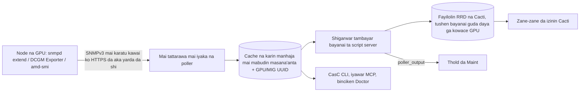

<!-- Source: README.md; SHA256: 97ba37df4a883426d3984ed7d14547ad7367e973411a8abd930409ce259f545b -->

<!-- translations:start -->
[English](../../../README.md) | [简体中文](../zh-CN/README.md) | [हिन्दी](../hi-IN/README.md) | [Español (España)](../es-ES/README.md) | [Español (Latinoamérica)](../es-419/README.md) | [العربية (السعودية)](../ar-SA/README.md) | [Afrikaans](../af-ZA/README.md) | [አማርኛ](../am-ET/README.md) | [العربية (مصر)](../ar-EG/README.md) | [العربية (المغرب)](../ar-MA/README.md) | [Български](../bg-BG/README.md) | [বাংলা](../bn-BD/README.md) | [Bosanski](../bs-BA/README.md) | [Deutsch](../de-DE/README.md) | [Ελληνικά](../el-GR/README.md) | [فارسی](../fa-IR/README.md) | [Filipino](../fil-PH/README.md) | [Français](../fr-FR/README.md) | [Français (Maroc)](../fr-MA/README.md) | [Français (Sénégal)](../fr-SN/README.md) | [Hausa](README.md) | [עברית](../he-IL/README.md) | [Hrvatski](../hr-HR/README.md) | [Bahasa Indonesia](../id-ID/README.md) | [Igbo](../ig-NG/README.md) | [Italiano](../it-IT/README.md) | [日本語](../ja-JP/README.md) | [ქართული](../ka-GE/README.md) | [한국어](../ko-KR/README.md) | [Latviešu](../lv-LV/README.md) | [Malagasy](../mg-MG/README.md) | [मराठी](../mr-IN/README.md) | [Bahasa Melayu](../ms-MY/README.md) | [Nederlands](../nl-NL/README.md) | [Polski](../pl-PL/README.md) | [Português (Brasil)](../pt-BR/README.md) | [Português (Portugal)](../pt-PT/README.md) | [Русский](../ru-RU/README.md) | [Kinyarwanda](../rw-RW/README.md) | [Soomaali](../so-SO/README.md) | [Српски](../sr-RS/README.md) | [Svenska](../sv-SE/README.md) | [Kiswahili](../sw-KE/README.md) | [தமிழ்](../ta-IN/README.md) | [తెలుగు](../te-IN/README.md) | [ไทย](../th-TH/README.md) | [Türkçe](../tr-TR/README.md) | [Українська](../uk-UA/README.md) | [اردو](../ur-PK/README.md) | [Tiếng Việt](../vi-VN/README.md) | [isiXhosa](../xh-ZA/README.md) | [Yorùbá](../yo-NG/README.md) | [繁體中文](../zh-TW/README.md) | [isiZulu](../zu-ZA/README.md)
<!-- translations:end -->

# plugin_gpu

Karin manhajar Cacti 1.2 ce da ke kawo bayanan amfanin kowace GPU, ƙwaƙwalwa, zafi, wuta, kurakuran ECC, da dalilan rage gudu daga kayan aikin NVIDIA da AMD zuwa cikin Cacti. Kowace GPU (ko ɓangaren MIG) tana zama fihirisa ta tambayar bayanai (data query) a kan na'urar node ɗinta, don haka zane-zanen GPU suna zama kusa da sauran zane-zanen node ɗin ƙarƙashin izinin Cacti, kuma Thold da Maint za su iya aika gargaɗi da dakatar da su.

> **Matsayi: an aiwatar da matakai na 1 zuwa 3 a cikin lamba, ba a sake shi ba tukuna.** Kashi na 1 (NVIDIA `nvidia-smi` ta hanyar SNMP extend, bin diddigin asali, zane-zane, alamun rage gudu da ECC, gargaɗin Thold da Maint, shafin lafiya), Kashi na 2 (mai fassara da abokin ciniki na HTTP(S) mai karatu kawai don NVIDIA DCGM Exporter da mai fassarar `amd-smi` don AMD), Kashi na 3 (bin diddigin asalin ɓangaren MIG, ginshiƙan Schema v4, gudanar da mai tattarawa na nesa a ƙarƙashin poller, hooks na `replicate_out` da `remote_agent`), CasC operator CLI (`cli/gpu.php`), da hooks na haɗin gwiwar tsarin (`abilities_register`, `doctor_register_checks`, `casc_register_providers`) an aiwatar da su kuma gwaje-gwajen naúrar, tsaro, da haɗin kai a kan Cacti na wucin gadi sun rufe su. Gwaje-gwajen kai tsaye zuwa yanzu suna amfani da `snmpd` na kwaikwayo da bayanan gwaji (fixtures) maimakon na'urar GPU ta zahiri. Abubuwan da suka rage kafin a sa alamar fitarwa: gwajin farko a kan kayan aiki na gaske ([docs/pilot-plan.md](../../pilot-plan.md), #54), bitar tsaro ta waje ([docs/security-review.md](../../security-review.md)), bayanan gwaji da aka ɗauko daga kayan aiki na gaske (#14), da auna ƙarfin aiki a kan kayan aiki masu girman aikin yau da kullum ([docs/performance.md](../../performance.md)). Tattara kurakuran XID yana nan a buɗe ƙarƙashin shawara #8.

## Matsayin shiga

| Fanni (Realm) | Dama (Access) |
| --- | --- |
| GPU View | Shafukan sa ido da ke akwai. |
| GPU Operator | Sa ido tare da shafin Operations da amincewar tantancewa ta mutum ɗaya. |
| GPU Admin | Damar Operator tare da zaɓuɓɓukan saiti da ayyukan gudanarwa da ke akwai. |

Bayan kwafin fayilolin haɓakawa (upgrade), buɗe shafin Plugins a matsayin mai gudanarwa (administrator) don yin rijistar sabon fannin (realm). Ba da fannin Operator kai tsaye ƙarƙashin **Configuration > Users** ko rukunin masu amfani.
Haɓakawa yana riƙe lambobin ID da izinin fannonin View da Admin da ke akwai. Damar Admin
tana gadar damar Operator, kuma damar Operator tana gadar damar View a kan kowace buƙata;
wannan ba ya ƙara izinin da aka adana ga masu amfani ko rukuni. Saitunan karin manhaja kuma suna buƙatar
damar GPU Admin baya ga izinin Settings na Cacti.

Izinin na'urori na Cacti har yanzu suna iyakance layuka da ayyukan da ke samuwa ga kowane mai amfani; abubuwan da ba a haɗa su ba suna buƙatar mai gudanarwa.
Bayanan sirri (credentials), saiti, haɗawa (mapping), gogewa da sauran sauye-sauyen gudanarwa
suna ci gaba da kasancewa a shafukan gudanarwa. Amincewa (acknowledgments) tana aiki ne kawai a zaman
mai amfani na yanzu, na tsawon awa ɗaya a mafi yawa kuma kawai yayin da wannan lura ta ci gaba
da kasancewa sabuwa. Sabbin bayanai ko waɗanda suka sauya suna soke su. Ba su taɓa nuna ma'aunin
da ya gaza a matsayin lafiyayye ko hana gargaɗi ba.

## Dalili

Nodes na GPU yawanci suna cikin Cacti tuni don CPU, ƙwaƙwalwa, da hanyoyin sadarwa (interfaces). Lafiyar GPU wani batu ne daban wanda bayanan SNMP na node ba sa bayar da amsarsa: kati na iya samun rage gudu saboda zafi, tara kurakuran ECC, ko ba da rahoton matsalar XID yayin da node ɗin da kansa yake kama da lafiyayye. Kayan aikin masana'antun suna ba da rahoton hakan (`nvidia-smi`, DCGM, `amd-smi`), amma sakamakonsu yana wajen zane-zane, izini, da gargaɗin Cacti.

Karin manhajar yana cike wannan giɓi ta hanyar mayar da sakamakon kayan aikin masana'anta zuwa tushen bayanan Cacti (data sources), wanda aka yi masa mabuɗi ta hanyar asalin kowace GPU maimakon matsayinta, ta yadda sake kunna na'ura (reboot) da ke sauya jerin GPUs ba zai haɗa tarihin wani kati zuwa wani ba. Yana sake amfani da zane-zane, izini, masu tattara bayanai na nesa (remote data collectors), Thold, da Maint na Cacti maimakon gina wasu nau'ikan su daban.

## Iyakar shirin

| Kashi | Iyaka | Matsayi | Matakai (Milestones) |
|---|---|---|---|
| 0, bincike | Sakamakon kayan aikin masana'anta, alamun XID da rage gudu, asalin GPU, izini, shawarar hanyar tattarawa | An kammala | [M1](https://github.com/somethingwithproof/plugin_gpu/milestone/1) |
| 1, nvidia | Tattarawar `nvidia-smi`, lissafin kayayyaki ta UUID, zane-zane, alamun rage gudu da ECC, Thold da Maint, shafin lafiya | An aiwatar (an gwada da fixture) | [M2](https://github.com/somethingwithproof/plugin_gpu/milestone/2), [M3](https://github.com/somethingwithproof/plugin_gpu/milestone/3), [M4](https://github.com/somethingwithproof/plugin_gpu/milestone/4) |
| 2, backends | Mai fassara/abokin ciniki na HTTP(S) mai karatu kawai don DCGM Exporter (`lib/DcgmExporterParser.php`, `lib/DcgmExporterClient.php`), mai fassarar AMD `amd-smi` (`lib/AmdSmiParser.php`) | An aiwatar (an gwada a naúrar) | [M5](https://github.com/somethingwithproof/plugin_gpu/milestone/5) |
| 3, mig, na nesa, da tsari | Bin diddigin asalin ɓangaren MIG, masu tattara bayanai na nesa (`INFO`, `poller_gpu.php --poller=N`, `replicate_out`, `remote_agent`), CasC CLI (`cli/gpu.php`), hooks na MCP/Doctor/CasC | An aiwatar (an gwada a naúrar da haɗin CI) | [M6](https://github.com/somethingwithproof/plugin_gpu/milestone/6) |

Abubuwan da ba sa cikin iyaka: kowace umarni da ke sauya GPU ko node (agogo, iyakokin wuta, sake saitawa, tsarin MIG), injin gargaɗi mallakar karin manhaja, daemon ko ka'idar sadarwa ta musamman, da lissafin mai tsara ayyuka (scheduler) ko ayyuka. Duba tsarin don ganin jerin ayyukan bincike.

## Abin da mataki na 4 (milestone 4) ya ƙara

- **Mai tattarawa mai karatu kawai don NVIDIA DCGM Exporter** (`lib/DcgmExporterParser.php`, `lib/DcgmExporterClient.php`). Yana fassara ma'aunin rubutu na Prometheus (`DCGM_FI_DEV_GPU_UTIL`, `DCGM_FI_DEV_FB_USED`, `DCGM_FI_DEV_FB_FREE`, `DCGM_FI_DEV_POWER_USAGE`, `DCGM_FI_DEV_GPU_TEMP`, `DCGM_FI_DEV_ECC_DBE_VOL_TOTAL`, `DCGM_FI_DEV_CLOCK_THROTTLE_REASONS`, da alamomin MIG `GPU_I_ID` da `GPU_I_PROFILE`). Abokin ciniki na HTTP(S) yana aiwatar da jerin sunayen host/CIDR da aka yarda da su a sarari, yana tabbatar da takaddun shaida na TLS ta tsoho, yana iyakance lokacin jira da girman amsa, yana kashe sake turawa (redirects), kuma yana ƙin tsarin da ba HTTP(S) ba.
- **Mai fassara mai karatu kawai don AMD `amd-smi`** (`lib/AmdSmiParser.php`). Yana daidaita sakamakon `amd-smi` JSON/SNMP-extend (amfani, VRAM, wuta, zafin junction/edge, ECC, bayanan ɓangarewa, da ma'ajin rage gudu daban-daban ta hanyar `Reading::$vendorExtensions`) zuwa tsarin ma'auni na gama-gari ƙarƙashin `Vendor::Amd`.
- **Bin diddigin ɓangaren MIG da Schema v4** (`lib/GpuReport.php`, `lib/GpuSnapshot.php`, `lib/GpuRecord.php`, `lib/Schema.php`, `lib/ScriptServer.php`). Yana bin diddigin UUID na ɓangaren MIG (`MIG-<uuid>` da `MIG-GPU-<parent>/<gi>/<ci>`), `mig_mode`, `mig_instance_id`, `mig_profile`, `parent_uuid`, da `partition_info` tare da GPUs na asali yayin da yake kare maɓallan asali marasa sauyawa (`vendor`, `uuid`, `parent_uuid`) a yayin sabuntawa da tantance su kafin tambayoyin rumbun bayanai.
- **Masu tattara bayanai na nesa** (`INFO`, `poller_gpu.php`, `lib/Poller.php`, `lib/ReplicationRepository.php`, `setup.php`). Yana bayyana `remote_collect:1, remote_poller:1` a cikin `INFO`, yana goyan bayan gudanarwa mai iyaka ga poller ta hanyar `php plugins/gpu/poller_gpu.php --poller=N`, yana tsallake samar da abubuwan Cacti a kan pollers da ba na asali ba, yana kwafa teburin da ke ƙarƙashin poller ta hanyar `replicate_out`, kuma yana amsa ayyukan karatu kawai na `gpu_health` da `gpu_inventory` ta hanyar `remote_agent`.
- **CasC CLI da na mai gudanarwa** (`cli/gpu.php`, `lib/CascProvider.php`). Yana aiki a kan PHP 8.2+ (yana fassaruwa a kan PHP 8.0) ba tare da wani dogaro na waje na Composer ba: `php plugins/gpu/cli/gpu.php export [--format=yaml|xml]`, `validate <file> [--format=yaml|xml]`, `plan <file> [--format=yaml|xml] [--output=text|json]`, `apply <file> --confirm=<PLAN_HASH> [--format=yaml|xml]`, da `health [--format=text|json]`. Tsare-tsaren suna ƙididdige tabbacin hash na SHA-256 mai daidaito, `apply` yana tsayawa cikin tsaro idan hash bai dace ba, kuma fassarar XML tana ƙin bayanan `DOCTYPE` da `ENTITY`.
- **Hooks na haɗin gwiwar tsari** (`lib/EcosystemIntegration.php`, `setup.php`). Yana yin rijistar `abilities_register` (`gpu-list-nodes`, `gpu-list-devices`, `gpu-get-health`; karatu kawai, an iyakance ga fannin `GPU View` da izinin na'urorin Cacti), `doctor_register_checks` (`gpu_schema`, `gpu_poller_freshness`, `gpu_node_health`), da `casc_register_providers`.
- **Dalilan rage gudu da ECC a matsayin ƙimar gargaɗi** ([docs/metrics.md](../../metrics.md)). Yana fassara abin rufe fuska na taron agogo zuwa alamun 0/1 kuma yana ƙididdige sabbin kurakuran ECC da aka gyara da waɗanda ba a gyara ba a kowane tazara a matsayin gauges ta yadda Thold 1.8.2 da Maint 1.3 za su aika gargaɗi da dakatar da shi ba tare da ma'auni mara kyau ko tsalle-tsallen sake saitawa ba ([docs/alerting.md](../../alerting.md)).
- **GPU Health, izini, gazawa/maidowa, da girman aiki.** GPU Health (GPU View) yana nuna sabunta da aka adana, sakamakon tattarawar ƙarshe, yanayin Maint, backend, nau'ikan kayan aiki, da ɗanyen abin rufe fuska na rage gudu ba tare da tuntuɓar nodes ba. Gwaje-gwajen da aka rubuta daga farko zuwa ƙarshe suna tabbatar da izini, farfaɗowa daga gazawar agent/DB/RRD ([docs/backup.md](../../backup.md)), da gwajin GPUs 100 a cikin CI ([docs/performance.md](../../performance.md), [docs/operations.md](../../operations.md), [CHANGELOG.md](../../../CHANGELOG.md)).

## Abin da mataki na 3 (milestone 3) ya ƙara

- **Tattarawa ta hanyar SNMP extend** ([ADR 0008](../../decisions/0008-collect-through-snmp-extend.md)). Mai gudanarwar node yana ƙara ƙayyadaddun layukan `extend` guda biyu zuwa `snmpd.conf` ([docs/node-setup.md](../../node-setup.md)); karin manhajar yana karanta NET-SNMP-EXTEND-MIB ta hanyar ayyukan SNMP na Cacti tare da bayanan sirri na na'urar kanta, an fi ba da shawarar SNMPv3. Ba ya gudanar da komai a kan uwar garken Cacti ko node ɗin.
- **Tsauraran fassara.** Ana karanta filaye ta matsayi, kowane layi yana sanya sunan GPU ɗinsa ta UUID, kuma matsayin fita da ba sifili ba, ƙarewar lokaci, yanke sakamako, layin da ke da kuskuren adadin filaye, ko haɗaɗɗen rubutun kuskure yana sa duka tattarawar ta gaza: ƙimomi suna zama `U`, ba a nuna wata GPU a matsayin ba ta nan, kuma GPU Nodes yana nuna dalili.
- **Mai tattarawa bayan kowane zagayen poller.** Yana karanta agent na kowane node da aka kunna, yana sabunta bayanan tantancewa, kuma yana adana sabon samfurin na ɗan lokaci (cache). Shigarwar script server tana karanta wannan cache ɗin ne kawai, ta yadda binciken Cacti ba zai taɓa jiran node na GPU ba.
- **Abubuwan Cacti** ([ADR 0010](../../decisions/0010-attach-to-existing-node-devices.md)). Samfura da tambayar bayanai ta *GPU - Devices* suna zuwa a matsayin XML kuma ana shigo da su yayin shigarwa da haɓakawa. Adana node yana haɗa tambayar bayanai zuwa na'urar da ke akwai tare da hanyar sake fihirisa ta None; GPU Nodes zai iya ƙirƙirar na'ura ne kawai idan node ɗin ba ya da ita. Kowace GPU fihirisa ce da aka yi wa mabuɗi ta masana'anta da UUID, tare da tushen bayanai guda ɗaya da zane-zanenta na Utilization, Memory, Temperature, Power, Power Percent, Clocks, Throttle, ECC Errors, New ECC Errors, Retired Pages, da Sample Age ke rabawa. Wani zane yana zana kowane fili na samfurin, saboda Cacti yana adana filayen da zane ke amfani da su ne kawai. Karin manhajar yana sake fihirisa bayan kowane sauyin GPU, yana adana sake fihirisar da Cacti ya tsallake yayin da na'urar take Down ko a kashe kuma yana gudanar da ita da zarar na'urar ta tashi Up, kuma yana ƙirƙirar zane-zane ga sabbin GPUs.
- **Tarihi yana zama tare da katin.** GPU da ba ta nan tana zama fihirisa, don haka zane-zanenta suna nuna giɓi kuma suna ci gaba a cikin wannan fayil ɗin RRD idan ta dawo. Katin maye gurbi a wannan ramin yana samun nasa tushen bayanai. **Remove from Data Query** a shafin node ɗin yana cire GPU da ba ta nan daga jerin; ana adana fayilolin RRD da zane-zanenta har sai kun goge su.
- **Izinin na'ura a kan GPU Nodes.** GPU Admin yana gani, sauyawa, fitarwa, da matsar da nodes da GPUs ne kawai a kan na'urorin da aka ba su izinin gani a Cacti; matsar da GPU yana buƙatar duka nodes biyun. Za a iya kashe ko goge node ɗin da aka goge na'urarsa.
- **Tsarin ma'auni na gama-gari** ([ADR 0009](../../decisions/0009-common-metric-core-with-vendor-extensions.md), [docs/metrics.md](../../metrics.md)). Ana auna ƙwaƙwalwa a cikin bytes, ana fassara clock event mask zuwa alamun `thr_*`, kuma `age` shi ne tsufan lokacin samfurin GPU da kansa, ko `U` idan ba a sani ba.

Mai amfani mai shigarwa (uwar garken yanar gizo) dole ne ya sami damar rubutu a `<cacti>/resource/script_server/`, inda karin manhajar ke ajiye XML na tambayar bayanai; shigarwa da haɓakawa suna tsayawa tare da saƙo idan ba haka ba kuma suna sake gwadawa a yunƙuri na gaba. Cirewa (uninstall) yana cire samfura da XML kawai idan an duba *Remove the plugin's Cacti objects on uninstall*, kuma ba ya taɓa goge fayilolin RRD, na'urori, zane-zane, ko tushen bayanai ([docs/operations.md](../../operations.md#uninstall)). Nodes da ke kan masu tattara bayanai na nesa suna aiki a ƙarƙashin `poller_id` ɗin da aka ba su.

## Abin da mataki na 2 (milestone 2) ya ƙunsa

- **Shigarwa mai kariya.** A kan PHP ƙasa da 8.2, ana ƙin shigarwa da kunnawa tare da saƙon da ke ambaton nau'in da ake buƙata, kuma sauran Cacti yana ci gaba da aiki. `setup.php` da rubutun shafi suna fassara a kan PHP 8.0.
- **Tsarin rayuwa (Lifecycle).** Shigarwa, haɓakawa, kashewa, da cirewa ta hanyar shafin Plugins na Cacti. Haɓakawa suna da tsari, suna ƙarewa bayan katsewa, kuma suna sauya nau'in da aka rubuta bayan sun yi nasara ne kawai. Cirewa yana riƙe teburin karin manhajar sai dai idan kun cire alamar *Keep Plugin Tables on Uninstall*; ba ya taɓa taɓa na'urar Cacti, tushen bayanai, zane, ko fayil ɗin RRD.
- **Fannoni daban-daban.** *GPU Admin* yana buɗe **GPU Nodes**, inda kuke yin rijistar na'urorin Cacti a matsayin nodes na GPU, tabbatarwa ko ƙin matsar da GPU tsakanin nodes, da fitar da kowane rikodi a matsayin JSON. *GPU View* yana buɗe **GPU Inventory**, wanda ke jera GPUs ne kawai a kan na'urorin da mai kallo zai iya gani. Duka shafukan suna ƙarƙashin Management, kuma kowane sauyi POST ne da csrf-magic ke bincikawa.
- **Bayanan asalin GPU.** Ana yi wa kowace GPU mabuɗi ta masana'anta da UUID. Index, PCI bus ID, suna, direba, da kayan aikin bayar da rahoto siffofi ne da ke sauyawa a wurin. Sabon UUID a cikin rami da aka sani ana yi masa alama a matsayin yiwuwar maye gurbi kuma yana fara nasa tarihi; GPU da aka gani a wani node tana motsawa kawai idan mai gudanarwa ya tabbatar; GPU da ba a gani ba a cikin tattarawa masu nasara ana yi mata alama a matsayin ba ta nan bayan adadin da za a iya saitawa kuma ba a taɓa goge ta. Ana karɓar NVIDIA whole-GPU UUIDs ne kawai a yanzu; sassan MIG suna jiran shawara #13, kuma AMD a kan bincike #19. Ana gwada ƙa'idodin ta jerin bayanan gwaji, tunda babu mai tattarawa da ke ba su bayanai tukuna.
- **Gwaje-gwaje da CI.** Rukunin gwaje-gwajen naúrar da ƙa'idodin tushe ba tare da GPU ko rumbun bayanai ba, binciken tsarin rayuwa da izinin shafi a kan Cacti 1.2.31 da 1.2.x na yanzu a kan PHP 8.2 zuwa 8.5, aikin ƙin yarda da PHP 8.1, binciken lint na PHP 8.0 na wuraren shiga, PHPStan a mataki na 9, da REUSE. Kayan aikin gwajin na wucin gadi ne har sai an yanke shawara kan #12.

### Shigarwa don gwaji

Waɗannan matakan suna shigar da lambar yanzu don gwada ta; [docs/operations.md](../../operations.md) yana da cikakken jagorar mai gudanarwa. Suna buƙatar Cacti 1.2.31 ko sabo a kan PHP 8.2 ko sabo.

1. Kwafi ma'ajiyar (repository) zuwa `plugins/gpu` ƙarƙashin kundin adireshin Cacti ɗinku. Dole ne a sanya wa kundin adireshin suna `gpu`.
2. A cikin Cacti, buɗe **Configuration > Plugins**, sannan ku shigar ku kunna **GPU**.
3. Ba wa masu amfani fannin *GPU View*, *GPU Operator*, ko *GPU Admin* ƙarƙashin **Configuration > Users**, gwargwadon matsayinsu. Mai amfani da ya shigar yana karɓar View da Admin; Admin yana ƙunshe da damar Operator.
4. Saita wakilin SNMP na kowane node na GPU kamar yadda aka bayyana a [docs/node-setup.md](../../node-setup.md), sannan ƙara node ɗin ƙarƙashin **Management > GPU Nodes**.
5. Don gargaɗi, shigo da samfuran Thold da aka haɗa kamar yadda [docs/alerting.md](../../alerting.md) ya bayyana.
6. Idan ana so, daidaita **Configuration > Settings > GPU**: *Mark Absent After* (tsoho tattarawa 3 masu nasara, daga 1 zuwa 100), *Stale After* (yawan tsufan da samfuri zai yi kafin ƙimominsa su buga `U`), da *Keep Plugin Tables on Uninstall* (a kunne ta tsoho).

## Yadda ma'auni ke isa Cacti

Shawara [#7](https://github.com/somethingwithproof/plugin_gpu/issues/7) ta zaɓi SNMP `extend` ([ADR 0008](../../decisions/0008-collect-through-snmp-extend.md)): wakilin node ɗin da kansa yana gudanar da ƙayyadadden umarnin `nvidia-smi` kuma karin manhajar yana karanta sakamakon ne kawai. Tsarin yana kwatanta zaɓuɓɓukan ƙarƙashin [Hanyoyin tattarawa](../../PLAN.md#collection-paths).

## Manufofin dacewa

| Bangare | Manufa |
|---|---|
| Cacti | 1.2.31 ko sabo, babu gyare-gyaren tushe |
| PHP | 8.2 ko sabo; `setup.php` yana ci gaba da zama mai fassaruwa a kan 8.0 don tsarin da ba a tallafawa ya sami ƙin amincewa maimakon lalacewar Cacti UI |
| NVIDIA | Layukan direba da kayan aiki da bincike [#26](https://github.com/somethingwithproof/plugin_gpu/issues/26) zai saita; an duba lambobin filayen DCGM a v3.3.9 da v4.7.0 |
| AMD | `amd-smi` a kan fitowar ROCm da bincike [#26](https://github.com/somethingwithproof/plugin_gpu/issues/26) zai saita |
| Thold, Maint | Thold 1.8.2 da Maint 1.3, ba a sauya su ba, an gwada su daga farko zuwa ƙarshe ([docs/alerting.md](../../alerting.md)) |

## Tsari

- [docs/PLAN.md](../../PLAN.md) shi ne cikakken tsari: gine-gine, bayanan gaskiya na sama da ya dogara da su (tare da tushe), tsarin asali, iyakokin tsaro, lissafin ƙarfin aiki, gwaji, da haɗari.
- [docs/decisions/](../../decisions) yana riƙe da bayanan shawarwarin gine-gine don zaɓuɓɓukan da aka riga aka yanke.
- [docs/REQUIREMENTS.md](../../REQUIREMENTS.md) yana haɗa kowace lambar buƙata (requirement ID) zuwa batunta.

## Yadda ake bin diddigin aiki

- **Matakai (Milestones)** suna bin matakan tsarin. Kowane yana da babban batu (epic issue) da ke jera ƙananan batutuwa da shaidar kammalawa.
- **Batutuwa (Issues)** ana rarraba su ta alama (label): `type: requirement`, `type: research`, `type: decision`, `type: epic`. Batutuwan buƙatu suna bayyana buƙatu masu lamba da za a iya gwadawa (`REQ-AREA-NNN`) da sharuɗɗan karɓa.
- **Alamomi (Labels)** kuma suna ɗauke da `area:`, `phase:`, `priority:`, da `status:`. Duba [CONTRIBUTING.md](../../../CONTRIBUTING.md#labels).
- [Allon ayyuka](https://github.com/users/somethingwithproof/projects/9) yana nuna duk batutuwa a cikin matakai.

## Bayar da gudummawa

Karanta [CONTRIBUTING.md](../../../CONTRIBUTING.md). Commits suna buƙatar sa hannun DCO (DCO sign-off). Tattaunawar tsari tana faruwa a kan batutuwa; buɗaɗɗun shawarwari suna ɗauke da alamar `type: decision`. Sakamakon da aka ɗauko daga kayan aikin GPU na gaske shi ne gudummawa mafi amfani ga mataki na 1; cire sunayen uwar garke (hostnames), lambobin serial, da UUIDs da farko.

## Tsaro

Ba da rahoton raunin tsaro a asirce; duba [SECURITY.md](../../../SECURITY.md).

## Lasisi

GNU General Public License v2.0, iri ɗaya da lasisin Cacti da karin manhajojinsa. Duba [LICENSE](../../../LICENSE).
