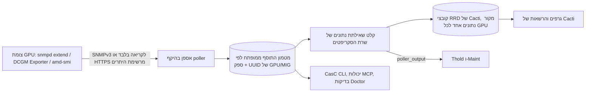

<!-- Source: README.md; SHA256: 97ba37df4a883426d3984ed7d14547ad7367e973411a8abd930409ce259f545b -->

<!-- translations:start -->
[English](../../../README.md) | [简体中文](../zh-CN/README.md) | [हिन्दी](../hi-IN/README.md) | [Español (España)](../es-ES/README.md) | [Español (Latinoamérica)](../es-419/README.md) | [العربية (السعودية)](../ar-SA/README.md) | [Afrikaans](../af-ZA/README.md) | [አማርኛ](../am-ET/README.md) | [العربية (مصر)](../ar-EG/README.md) | [العربية (المغرب)](../ar-MA/README.md) | [বাংলা](../bn-BD/README.md) | [Bosanski](../bs-BA/README.md) | [Deutsch](../de-DE/README.md) | [فارسی](../fa-IR/README.md) | [Filipino](../fil-PH/README.md) | [Français](../fr-FR/README.md) | [Français (Maroc)](../fr-MA/README.md) | [Français (Sénégal)](../fr-SN/README.md) | [Hausa](../ha-NG/README.md) | [עברית](README.md) | [Hrvatski](../hr-HR/README.md) | [Bahasa Indonesia](../id-ID/README.md) | [Igbo](../ig-NG/README.md) | [Italiano](../it-IT/README.md) | [日本語](../ja-JP/README.md) | [한국어](../ko-KR/README.md) | [Malagasy](../mg-MG/README.md) | [मराठी](../mr-IN/README.md) | [Bahasa Melayu](../ms-MY/README.md) | [Nederlands](../nl-NL/README.md) | [Polski](../pl-PL/README.md) | [Português (Brasil)](../pt-BR/README.md) | [Русский](../ru-RU/README.md) | [Kinyarwanda](../rw-RW/README.md) | [Soomaali](../so-SO/README.md) | [Српски](../sr-RS/README.md) | [Svenska](../sv-SE/README.md) | [Kiswahili](../sw-KE/README.md) | [தமிழ்](../ta-IN/README.md) | [తెలుగు](../te-IN/README.md) | [ไทย](../th-TH/README.md) | [Türkçe](../tr-TR/README.md) | [Українська](../uk-UA/README.md) | [اردو](../ur-PK/README.md) | [Tiếng Việt](../vi-VN/README.md) | [isiXhosa](../xh-ZA/README.md) | [Yorùbá](../yo-NG/README.md) | [繁體中文](../zh-TW/README.md) | [isiZulu](../zu-ZA/README.md)
<!-- translations:end -->

# plugin_gpu

תוסף עבור Cacti 1.2 המביא אל Cacti מדדי ניצולת, זיכרון, טמפרטורה, הספק, שגיאות ECC וסיבות האטה (throttling) לכל GPU מתוך כלי NVIDIA ו-AMD. כל GPU (או מופע MIG) הופך לאינדקס של שאילתת נתונים בהתקן של הצומת שלו, כך שגרפי ה-GPU מוצבים לצד שאר הגרפים של הצומת תחת ההרשאות של Cacti, ו-Thold ו-Maint יכולים להתריע עליהם ולהשתיק אותם.

> **סטטוס: שלבים 1 עד 3 מומשו בקוד, טרם שוחרר.** שלב 1 (`nvidia-smi` של NVIDIA דרך הרחבת SNMP, מעקב זהות, גרפים, אותות האטה ו-ECC, התרעות Thold ו-Maint, דף התקינות), שלב 2 (מנתח ולקוח HTTP(S) לקריאה בלבד עבור NVIDIA DCGM Exporter ומנתח `amd-smi` עבור AMD), שלב 3 (מעקב זהות למופעי MIG, עמודות Schema v4, הרצת אספן מרוחק בהיקף poller, וויי `replicate_out` ו-`remote_agent`), כלי ה-CLI של מפעיל CasC (`cli/gpu.php`) ווויי האינטגרציה עם המערכת (`abilities_register`, `doctor_register_checks`, `casc_register_providers`) מומשו ומכוסים על ידי בדיקות יחידה, אבטחה ואינטגרציה על גבי התקנת Cacti זמנית. הרצות חיות עד כה משתמשות ב-`snmpd` סינתטי ובדגימות קלט (fixtures) במקום בחומרת GPU פיזית. פריטים שעדיין פתוחים לפני תיוג שחרור: פיילוטים על חומרה אמיתית ([docs/pilot-plan.md](../../pilot-plan.md), #54), סקירת אבטחה חיצונית ([docs/security-review.md](../../security-review.md)), דגימות פלט שנלכדו מכלים אמיתיים (#14), ומדידות מדרגיות על חומרה בגודל סביבת ייצור ([docs/performance.md](../../performance.md)). איסוף שגיאות XID נותר פתוח תחת החלטה #8.

## תפקידי גישה

| תחום (Realm) | גישה |
| --- | --- |
| GPU View | דפי הניטור הקיימים. |
| GPU Operator | ניטור בתוספת דף הפעולות (Operations) ואישורי תיוג אישיים. |
| GPU Admin | גישת מפעיל בתוספת דפי ההגדרות ופעולות הניהול הקיימות. |

לאחר העתקת קובצי השדרוג, פתחו את דף התוספים כמנהלי מערכת כדי לרשום
את התחום החדש. הקצו את תחום המפעיל במפורש תחת **Configuration > Users** או קבוצות משתמשים.
שדרוגים שומרים על מזהי תחומי ה-View וה-Admin הקיימים ועל ההרשאות שניתנו להם. גישת Admin
יורשת גישת Operator, וגישת Operator יורשת גישת View בכל בקשה;
פעולה זו אינה מוסיפה הרשאות שמורות למשתמשים או לקבוצות. הגדרות התוסף דורשות גם
גישת GPU Admin בנוסף להרשאת Settings של Cacti.

הרשאות ההתקנים של Cacti עדיין מגבילות את השורות והפעולות הזמינות לכל משתמש; אובייקטים לא ממופים דורשים מנהל מערכת.
פרטי הזדהות, תצורה, מיפוי, מחיקה ושינויים מנהלתיים אחרים
נשארים בדפי הניהול. אישורים (Acknowledgments) נשמרים רק בהפעלה
הנוכחית של המשתמש, למשך שעה אחת לכל היותר וכל עוד אותה תצפית נשארת
עדכנית. תצפיות חדשות או שהשתנו מבטלות אותם. הם לעולם אינם מסמנים מדידה
שנכשלה כתקינה ואינם משתיקים התרעות.

## מדוע

צומתי GPU לרוב כבר מוגדרים ב-Cacti עבור מעבד, זיכרון וממשקים. תקינות ה-GPU היא שאלה נפרדת שנתוני ה-SNMP של הצומת אינם עונים עליה: כרטיס יכול להיות מואט תרמית, לצבור שגיאות ECC או לדווח על תקלת XID בעוד שהצומת עצמו נראה תקין. כלי הספקים מדווחים על כך (`nvidia-smi`, DCGM, `amd-smi`), אך הפלט שלהם נמצא מחוץ לגרפים, ההרשאות וההתרעות של Cacti.

התוסף סוגר פער זה על ידי הפיכת הפלט של כלי הספק למקורות נתונים של Cacti, הממופתחים לפי הזהות של כל GPU ולא לפי מיקומו, כך שאתחול המשנה את סדר ה-GPU אינו מצמיד היסטוריה של כרטיס אחד לאחר. הוא עושה שימוש חוזר במנגנוני הגרפים, ההרשאות, אספני הנתונים המרוחקים, Thold ו-Maint של Cacti במקום לבנות גרסאות מקבילות שלהם.

## היקף מתוכנן

| שלב | היקף | סטטוס | אבני דרך |
|---|---|---|---|
| 0, מחקר | פלט כלי הספקים, אותות XID והאטה, זיהוי GPU, הרשאות, החלטה על נתיב האיסוף | הושלם | [M1](https://github.com/somethingwithproof/plugin_gpu/milestone/1) |
| 1, nvidia | איסוף באמצעות `nvidia-smi`, מלאי לפי UUID, גרפים, אותות האטה ו-ECC, Thold ו-Maint, דף תקינות | מומש (נבדק מול דגימות) | [M2](https://github.com/somethingwithproof/plugin_gpu/milestone/2), [M3](https://github.com/somethingwithproof/plugin_gpu/milestone/3), [M4](https://github.com/somethingwithproof/plugin_gpu/milestone/4) |
| 2, מנועי איסוף | מנתח/לקוח HTTP(S) לקריאה בלבד עבור DCGM Exporter (`lib/DcgmExporterParser.php`, `lib/DcgmExporterClient.php`), מנתח `amd-smi` עבור AMD (`lib/AmdSmiParser.php`) | מומש (בדיקות יחידה) | [M5](https://github.com/somethingwithproof/plugin_gpu/milestone/5) |
| 3, MIG, מרוחק ומערכת | מעקב זהות למופעי MIG, אספני נתונים מרוחקים (`INFO`, `poller_gpu.php --poller=N`, `replicate_out`, `remote_agent`), ממשק CLI של CasC (`cli/gpu.php`), וויי MCP/Doctor/CasC | מומש (בדיקות יחידה ואינטגרציה ב-CI) | [M6](https://github.com/somethingwithproof/plugin_gpu/milestone/6) |

מחוץ להיקף: כל פקודה המשנה GPU או צומת (תדרי שעון, מגבלות הספק, איפוסים, פריסת MIG), מנוע התרעות בבעלות התוסף, שירות רקע או פרוטוקול רשת מותאמים אישית, וחשבונאות מתזמן או עבודות. ראו את התוכנית עבור צבר משימות המחקר.

## מה אבן דרך 4 מוסיפה

- **אספן לקריאה בלבד עבור NVIDIA DCGM Exporter** (`lib/DcgmExporterParser.php`, `lib/DcgmExporterClient.php`). מנתח מדדי חשיפה טקסטואליים של Prometheus (`DCGM_FI_DEV_GPU_UTIL`, `DCGM_FI_DEV_FB_USED`, `DCGM_FI_DEV_FB_FREE`, `DCGM_FI_DEV_POWER_USAGE`, `DCGM_FI_DEV_GPU_TEMP`, `DCGM_FI_DEV_ECC_DBE_VOL_TOTAL`, `DCGM_FI_DEV_CLOCK_THROTTLE_REASONS`, ותוויות MIG `GPU_I_ID` ו-`GPU_I_PROFILE`). לקוח ה-HTTP(S) אוכף רשימת היתרים מפורשת של מארחים/CIDR לנקודות קצה, מאמת תעודות עמית TLS כברירת מחדל, מגביל זמני המתנה וגודל תגובה, משבית הפניות מחדש ודוחה סכמות שאינן HTTP(S).
- **מנתח לקריאה בלבד עבור `amd-smi` של AMD** (`lib/AmdSmiParser.php`). מנרמל פלט JSON/SNMP-extend של `amd-smi` (ניצולת, VRAM, הספק, טמפרטורת junction/edge, ECC, מטא-נתוני מחיצות וצוברי האטה נפרדים דרך `Reading::$vendorExtensions`) למודל המדדים המשותף תחת `Vendor::Amd`.
- **מעקב מופעי MIG ו-Schema v4** (`lib/GpuReport.php`, `lib/GpuSnapshot.php`, `lib/GpuRecord.php`, `lib/Schema.php`, `lib/ScriptServer.php`). עוקב אחר מזהי UUID של מופעי MIG (`MIG-<uuid>` ו-`MIG-GPU-<parent>/<gi>/<ci>`), `mig_mode`, `mig_instance_id`, `mig_profile`, `parent_uuid` ו-`partition_info` לצד מעבדי GPU הוריים, תוך הגנה על מפתחות זהות קבועים (`vendor`, `uuid`, `parent_uuid`) בעת עדכונים ואימותם לפני שאילתות מסד נתונים.
- **אספני נתונים מרוחקים** (`INFO`, `poller_gpu.php`, `lib/Poller.php`, `lib/ReplicationRepository.php`, `setup.php`). מצהיר על `remote_collect:1, remote_poller:1` בקובץ `INFO`, תומך בהרצה בהיקף poller באמצעות `php plugins/gpu/poller_gpu.php --poller=N`, מדלג על הקצאת אובייקטי Cacti באספנים שאינם ראשיים, משכפל טבלאות בהיקף poller דרך `replicate_out` ועונה לפעולות הקריאה בלבד `gpu_health` ו-`gpu_inventory` דרך `remote_agent`.
- **ממשק CLI למפעיל ול-CasC** (`cli/gpu.php`, `lib/CascProvider.php`). רץ על PHP 8.2+ (תקין תחבירית ב-PHP 8.0) ללא תלויות Composer חיצוניות: `php plugins/gpu/cli/gpu.php export [--format=yaml|xml]`, `validate <file> [--format=yaml|xml]`, `plan <file> [--format=yaml|xml] [--output=text|json]`, `apply <file> --confirm=<PLAN_HASH> [--format=yaml|xml]`, ו-`health [--format=text|json]`. פקודת התכנון מחשבת גיבוב אישור דטרמיניסטי מסוג SHA-256, פקודת היישום נכשלת בצורה בטוחה (fail closed) באי-התאמת גיבוב, וניתוח ה-XML דוחה הצהרות `DOCTYPE` ו-`ENTITY`.
- **וויי אינטגרציה עם המערכת** (`lib/EcosystemIntegration.php`, `setup.php`). רושם את `abilities_register` (`gpu-list-nodes`, `gpu-list-devices`, `gpu-get-health`; לקריאה בלבד, מוגבל לתחום `GPU View` ולהרשאות התקנים ב-Cacti), `doctor_register_checks` (`gpu_schema`, `gpu_poller_freshness`, `gpu_node_health`) ו-`casc_register_providers`.
- **סיבות האטה ו-ECC כערכי התרעה** ([docs/metrics.md](../../metrics.md)). מפענח מסיכות אירועי שעון למחווני 0/1 ומחשב שגיאות ECC מתוקנות ולא מתוקנות חדשות לכל מרווח כמדדי gauge, כך ש-Thold 1.8.2 ו-Maint 1.3 מתריעים ומשתיקים ללא מונים שליליים או קפיצות מאיפוס ([docs/alerting.md](../../alerting.md)).
- **GPU Health, הרשאות, כשל/שחזור ומדרגיות.** GPU Health (תחת GPU View) מציג עדכניות שמורה, תוצאת איסוף אחרונה, מצב Maint, מנוע איסוף, גרסאות ומסיכות האטה גולמיות מבלי לפנות לצמתים. בדיקות מתוסרטות מקצה לקצה מאמתות הרשאות, התאוששות מכשל בסוכן/מסד הנתונים/RRD ([docs/backup.md](../../backup.md)), והרצת מדרגיות של 100 יחידות GPU ב-CI ([docs/performance.md](../../performance.md), [docs/operations.md](../../operations.md), [CHANGELOG.md](../../../CHANGELOG.md)).

## מה אבן דרך 3 מוסיפה

- **איסוף דרך הרחבת SNMP** ([ADR 0008](../../decisions/0008-collect-through-snmp-extend.md)). מנהל הצומת מוסיף שתי שורות `extend` קבועות לקובץ `snmpd.conf` ([docs/node-setup.md](../../node-setup.md)); התוסף קורא את NET-SNMP-EXTEND-MIB דרך פונקציות ה-SNMP של Cacti עם פרטי ההזדהות של ההתקן עצמו, מומלץ SNMPv3. הוא אינו מריץ דבר על שרת ה-Cacti או על הצומת.
- **ניתוח קפדני.** השדות נקראים לפי מיקום, כל שורה מציינת את ה-GPU שלה לפי UUID, וקוד יציאה שונה מאפס, פקיעת זמן המתנה, פלט קטוע, שורה עם מספר שדות שגוי או טקסט שגיאה ממוזג מכשילים את האיסוף כולו: הערכים הופכים ל-`U`, אף GPU אינו מסומן כנעדר, והדף GPU Nodes מציג את הסיבה.
- **אספן לאחר כל מחזור poller.** הוא קורא מהסוכן של כל צומת מופעל, מעדכן את רשומות הזהות ושומר במטמון את הדגימה האחרונה. קלט שרת הסקריפטים קורא רק ממטמון זה, כך שדגימת Cacti לעולם אינה ממתינה לצומת GPU.
- **אובייקטי Cacti** ([ADR 0010](../../decisions/0010-attach-to-existing-node-devices.md)). התבניות ושאילתת הנתונים *GPU - Devices* מסופקות כקבצי XML ומיובאות בעת התקנה ושדרוג. שמירת צומת מצמידה את שאילתת הנתונים להתקן הקיים שלו בשיטת אינדוקס מחדש None; GPU Nodes יכול ליצור התקן רק כאשר לצומת אין התקן. כל GPU הוא אינדקס הממופתח לפי ספק ו-UUID, עם מקור נתונים אחד המשותף לגרפים Utilization, Memory, Temperature, Power, Power Percent, Clocks, Throttle, ECC Errors, New ECC Errors, Retired Pages ו-Sample Age. כל שדה במודל מצויר על ידי גרף כלשהו, משום ש-Cacti שומר רק את השדות שגרף משתמש בהם. התוסף מאנדקס מחדש לאחר כל שינוי ב-GPU, שומר אינדוקס מחדש ש-Cacti דילג עליו בזמן שההתקן היה במצב Down או מושבת ומריץ אותו ברגע שההתקן במצב Up, ויוצר גרפים עבור יחידות GPU חדשות.
- **ההיסטוריה נשארת עם הכרטיס.** GPU נעדר נשאר אינדקס, כך שהגרפים שלו מציגים פער וממשיכים באותו קובץ RRD כשהוא חוזר. כרטיס חלופי באותו חריץ מקבל מקור נתונים משלו. **Remove from Data Query** בדף הצומת מסיר GPU נעדר מהרשימה; קובצי ה-RRD והגרפים שלו נשמרים עד שתמחקו אותם.
- **הרשאות התקנים ב-GPU Nodes.** בעל הרשאת GPU Admin רואה, משנה, מייצא ומעביר רק צמתים ויחידות GPU על גבי התקנים שהוא רשאי לראות ב-Cacti; העברת GPU דורשת גישה לשני הצמתים. צומת שהתקנו נמחק ניתן להשבתה או למחיקה.
- **מודל המדדים המשותף** ([ADR 0009](../../decisions/0009-common-metric-core-with-vendor-extensions.md), [docs/metrics.md](../../metrics.md)). זיכרון נמדד בבתים, מסיכת אירועי השעון מפוענחת למחווני `thr_*`, ו-`age` הוא גיל זמן הדגימה של ה-GPU עצמו, או `U` כאשר אינו ידוע.

המשתמש המבצע את ההתקנה (שרת האינטרנט) חייב להיות מסוגל לכתוב לתיקייה `<cacti>/resource/script_server/`, שבה התוסף ממקם את קובץ ה-XML של שאילתת הנתונים; אחרת ההתקנה והשדרוג נעצרים עם הודעה ומנסים שוב בניסיון הבא. הסרת ההתקנה מסירה את התבניות ואת ה-XML רק כאשר האפשרות *Remove the plugin's Cacti objects on uninstall* מסומנת, ולעולם אינה מוחקת קובצי RRD, התקנים, גרפים או מקורות נתונים ([docs/operations.md](../../operations.md#uninstall)). צמתים על אספני נתונים מרוחקים רצים בהיקף של ה-`poller_id` שהוקצה להם.

## מה אבן דרך 2 מספקת

- **התקנה מוגנת.** בגרסת PHP מתחת ל-8.2, ההתקנה וההפעלה נדחות עם הודעה המציינת את הגרסה הנדרשת, ושאר Cacti ממשיך לפעול. `setup.php` וסקריפטי הדפים תקינים תחבירית ב-PHP 8.0.
- **מחזור חיים.** התקנה, שדרוג, השבתה והסרת התקנה דרך דף התוספים של Cacti. השדרוגים מסודרים לפי סדר, מושלמים לאחר הפרעה ומשנים את הגרסה המתועדת רק לאחר הצלחתם. הסרת ההתקנה שומרת את טבלאות התוסף אלא אם תבטלו את סימון *Keep Plugin Tables on Uninstall*; היא לעולם אינה נוגעת בהתקן Cacti, במקור נתונים, בגרף או בקובץ RRD.
- **תחומים נפרדים.** *GPU Admin* פותח את **GPU Nodes**, שבו אתם רושמים התקני Cacti כצומתי GPU, מאשרים או דוחים העברות GPU בין צמתים ומייצאים כל רשומה כ-JSON. *GPU View* פותח את **GPU Inventory**, המפרט יחידות GPU רק על גבי התקנים שהצופה רשאי לראות. שני הדפים נמצאים תחת Management, וכל שינוי הוא בקשת POST הנבדקת על ידי csrf-magic.
- **רשומות זהות GPU.** כל GPU ממופתח לפי ספק ו-UUID. אינדקס, מזהה אפיק PCI, שם, דרייבר והכלי המדווח הם תכונות המשתנות במקום. UUID חדש בחריץ מוכר מסומן כהחלפה אפשרית ומתחיל היסטוריה משלו; GPU שנצפה בצומת אחר עובר רק כאשר מפעיל מאשר; GPU שחסר מאיסופים מוצלחים מסומן כנעדר לאחר ספירה הניתנת להגדרה ולעולם אינו נמחק. רק מזהי UUID של GPU שלם של NVIDIA מתקבלים לעת עתה; מופעי MIG ממתינים להחלטה #13, ו-AMD למחקר #19. הכללים נבחנים על ידי רצפי דגימות בדיקה, מאחר שאין עדיין אספן המזין אותם.
- **בדיקות ו-CI.** חבילות בדיקות יחידה וכללי קוד מקור ללא GPU או מסד נתונים, בדיקות מחזור חיים והרשאות דפים מול Cacti 1.2.31 ו-1.2.x הנוכחי על PHP 8.2 עד 8.5, משימת סירוב ל-PHP 8.1, בדיקת lint ב-PHP 8.0 לנקודות הכניסה, PHPStan ברמה 9 ו-REUSE. תשתית הבדיקות היא זמנית עד שתתקבל החלטה #12.

### התקנה לצורך הערכה

שלבים אלה מתקינים את הקוד הנוכחי כדי לנסות אותו; בקובץ [docs/operations.md](../../operations.md) נמצא מדריך המפעיל המלא. הם דורשים Cacti 1.2.31 ומעלה על PHP 8.2 ומעלה.

1. העתיקו את המאגר אל `plugins/gpu` תחת תיקיית ה-Cacti שלכם. שם התיקייה חייב להיות `gpu`.
2. ב-Cacti, פתחו את **Configuration > Plugins**, ולאחר מכן התקינו והפעילו את **GPU**.
3. העניקו למשתמשים את התחום *GPU View*, *GPU Operator* או *GPU Admin* תחת **Configuration > Users**, בהתאם לתפקידם. המשתמש המבצע את ההתקנה מקבל View ו-Admin; תחום Admin כולל גישת Operator.
4. הגדירו את סוכן ה-SNMP של כל צומת GPU כמתואר ב-[docs/node-setup.md](../../node-setup.md), ולאחר מכן הוסיפו את הצומת תחת **Management > GPU Nodes**.
5. עבור התרעות, ייבאו את תבניות Thold המצורפות כפי שמתואר ב-[docs/alerting.md](../../alerting.md).
6. באופן אופציונלי, התאימו את **Configuration > Settings > GPU**: *Mark Absent After* (ברירת מחדל 3 איסופים מוצלחים, מ-1 עד 100), *Stale After* (כמה ישנה יכולה להיות דגימה לפני שערכיה מדפיסים `U`) ו-*Keep Plugin Tables on Uninstall* (מופעל כברירת מחדל).

## כיצד המדדים מגיעים ל-Cacti

החלטה [#7](https://github.com/somethingwithproof/plugin_gpu/issues/7) בחרה ב-SNMP `extend` ([ADR 0008](../../decisions/0008-collect-through-snmp-extend.md)): הסוכן של הצומת עצמו מריץ פקודת `nvidia-smi` קבועה והתוסף רק קורא את התוצאה. התוכנית משווה בין האפשרויות תחת [Collection paths](../../PLAN.md#collection-paths).

## יעדי תאימות

| רכיב | יעד |
|---|---|
| Cacti | 1.2.31 ומעלה, ללא טלאים לליבה |
| PHP | 8.2 ומעלה; `setup.php` נשאר תקין לניתוח תחבירי ב-8.0 כדי שסביבת ריצה לא נתמכת תקבל הודעת סירוב במקום ממשק Cacti שבור |
| NVIDIA | גרסאות דרייבר וכלים שייקבעו במחקר [#26](https://github.com/somethingwithproof/plugin_gpu/issues/26); מזהי שדות DCGM נבדקו ב-v3.3.9 וב-v4.7.0 |
| AMD | `amd-smi` במהדורות ROCm שייקבעו במחקר [#26](https://github.com/somethingwithproof/plugin_gpu/issues/26) |
| Thold, Maint | Thold 1.8.2 ו-Maint 1.3, ללא שינוי, נבדקו מקצה לקצה ([docs/alerting.md](../../alerting.md)) |

## תכנון

- [docs/PLAN.md](../../PLAN.md) היא התוכנית המלאה: ארכיטקטורה, עובדות מקדימות שהיא נשענת עליהן (עם מקורות), מודל זהות, גבולות אבטחה, חישובי ביצועים, בדיקות וסיכונים.
- [docs/decisions/](../../decisions) מכילה רשומות החלטות ארכיטקטוניות עבור בחירות שכבר התקבלו.
- [docs/REQUIREMENTS.md](../../REQUIREMENTS.md) ממפה כל מזהה דרישה ל-issue המתאים לו.

## כיצד העבודה מנוהלת

- **אבני דרך** עוקבות אחר אבני הדרך של התוכנית. לכל אחת יש epic issue המפרט את תתי-ה-issues ואת ראיות הסיום שלה.
- **Issues** מסווגים לפי תווית: `type: requirement`, `type: research`, `type: decision`, `type: epic`. דרישות מפרטות דרישות ממוספרות הניתנות לבדיקה (`REQ-AREA-NNN`) וקריטריוני קבלה.
- **תוויות** נושאות גם `area:`, `phase:`, `priority:` ו-`status:`. ראו [CONTRIBUTING.md](../../../CONTRIBUTING.md#labels).
- [לוח הפרויקט](https://github.com/users/somethingwithproof/projects/9) מציג את כל ה-issues על פני אבני הדרך.

## תרומה לפרויקט

קראו את [CONTRIBUTING.md](../../../CONTRIBUTING.md). קומיטים דורשים חתימת DCO. דיוני תכנון מתקיימים ב-issues; החלטות פתוחות נושאות את התווית `type: decision`. פלט שנלכד מכלי GPU אמיתיים הוא התרומה השימושית ביותר לאבן דרך 1; הסירו תחילה שמות מארחים, מספרים סידוריים ומזהי UUID.

## אבטחה

דווחו על פגיעויות באופן פרטי; ראו [SECURITY.md](../../../SECURITY.md).

## רישיון

GNU General Public License v2.0, אותו רישיון כמו של Cacti והתוספים שלה. ראו [LICENSE](../../../LICENSE).
