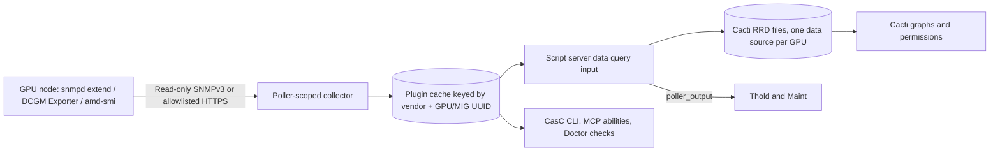

<!-- Source: README.md; SHA256: 97ba37df4a883426d3984ed7d14547ad7367e973411a8abd930409ce259f545b -->

<!-- translations:start -->
[English](../../../README.md) | [简体中文](../zh-CN/README.md) | [हिन्दी](README.md) | [Español (España)](../es-ES/README.md) | [Español (Latinoamérica)](../es-419/README.md) | [العربية (السعودية)](../ar-SA/README.md) | [Afrikaans](../af-ZA/README.md) | [አማርኛ](../am-ET/README.md) | [العربية (مصر)](../ar-EG/README.md) | [العربية (المغرب)](../ar-MA/README.md) | [Български](../bg-BG/README.md) | [বাংলা](../bn-BD/README.md) | [Bosanski](../bs-BA/README.md) | [Deutsch](../de-DE/README.md) | [Ελληνικά](../el-GR/README.md) | [فارسی](../fa-IR/README.md) | [Filipino](../fil-PH/README.md) | [Français](../fr-FR/README.md) | [Français (Maroc)](../fr-MA/README.md) | [Français (Sénégal)](../fr-SN/README.md) | [Hausa](../ha-NG/README.md) | [עברית](../he-IL/README.md) | [Hrvatski](../hr-HR/README.md) | [Bahasa Indonesia](../id-ID/README.md) | [Igbo](../ig-NG/README.md) | [Italiano](../it-IT/README.md) | [日本語](../ja-JP/README.md) | [ქართული](../ka-GE/README.md) | [한국어](../ko-KR/README.md) | [Latviešu](../lv-LV/README.md) | [Malagasy](../mg-MG/README.md) | [मराठी](../mr-IN/README.md) | [Bahasa Melayu](../ms-MY/README.md) | [Nederlands](../nl-NL/README.md) | [Polski](../pl-PL/README.md) | [Português (Brasil)](../pt-BR/README.md) | [Português (Portugal)](../pt-PT/README.md) | [Русский](../ru-RU/README.md) | [Kinyarwanda](../rw-RW/README.md) | [Soomaali](../so-SO/README.md) | [Српски](../sr-RS/README.md) | [Svenska](../sv-SE/README.md) | [Kiswahili](../sw-KE/README.md) | [தமிழ்](../ta-IN/README.md) | [తెలుగు](../te-IN/README.md) | [ไทย](../th-TH/README.md) | [Türkçe](../tr-TR/README.md) | [Українська](../uk-UA/README.md) | [اردو](../ur-PK/README.md) | [Tiếng Việt](../vi-VN/README.md) | [isiXhosa](../xh-ZA/README.md) | [Yorùbá](../yo-NG/README.md) | [繁體中文](../zh-TW/README.md) | [isiZulu](../zu-ZA/README.md)
<!-- translations:end -->

# plugin_gpu

Cacti 1.2 का प्लगइन जो NVIDIA और AMD टूल से प्रति-GPU उपयोग, मेमोरी, तापमान, पावर, ECC त्रुटियाँ और थ्रॉटलिंग के कारण Cacti में लाता है। हर GPU (या MIG इंस्टेंस) अपने नोड के डिवाइस की डेटा क्वेरी का इंडेक्स बनता है, इसलिए GPU ग्राफ़ नोड के अन्य ग्राफ़ के साथ Cacti अनुमतियों के अंतर्गत रहते हैं और Thold तथा Maint उन पर अलर्ट तथा उनका दमन कर सकते हैं।

> **स्थिति: चरण 1 से 3 कोड में लागू, अभी रिलीज़ नहीं हुआ।** चरण 1 (SNMP extend के ज़रिए NVIDIA `nvidia-smi`, पहचान ट्रैकिंग, ग्राफ़, थ्रॉटल और ECC संकेत, Thold तथा Maint अलर्ट, स्वास्थ्य पृष्ठ), चरण 2 (केवल-पठन NVIDIA DCGM Exporter HTTP(S) पार्सर/क्लाइंट और AMD `amd-smi` पार्सर), चरण 3 (MIG इंस्टेंस पहचान ट्रैकिंग, Schema v4 कॉलम, पोलर-स्कोप्ड दूरस्थ कलेक्टर निष्पादन, `replicate_out` और `remote_agent` हुक), CasC ऑपरेटर CLI (`cli/gpu.php`), तथा इकोसिस्टम हुक (`abilities_register`, `doctor_register_checks`, `casc_register_providers`) लागू किए जा चुके हैं और यूनिट, सुरक्षा तथा डिस्पोज़ेबल-Cacti एकीकरण परीक्षणों से आच्छादित हैं। अब तक के लाइव रन भौतिक GPU हार्डवेयर के बजाय कृत्रिम `snmpd` और फ़िक्स्चर पेलोड का उपयोग करते हैं। रिलीज़ टैग करने से पहले अभी बाकी हैं: असली हार्डवेयर पर पायलट ([docs/pilot-plan.md](../../pilot-plan.md), #54), बाहरी सुरक्षा समीक्षा ([docs/security-review.md](../../security-review.md)), असली टूल से लिए फ़िक्स्चर (#14), और उत्पादन आकार के हार्डवेयर पर पैमाने का मापन ([docs/performance.md](docs/performance.md))। XID त्रुटि संग्रह निर्णय #8 के अंतर्गत खुला है।

## पहुँच भूमिकाएँ

| Realm | पहुँच |
| --- | --- |
| GPU View | मौजूदा निगरानी पृष्ठ। |
| GPU Operator | निगरानी के साथ ऑपरेशन्स पृष्ठ और व्यक्तिगत ट्रायेज स्वीकृतियाँ। |
| GPU Admin | Operator पहुँच के साथ मौजूदा कॉन्फ़िगरेशन और प्रशासनिक कार्रवाइयाँ। |

अपग्रेड फ़ाइलें कॉपी करने के बाद प्रशासक के रूप में प्लगइन पृष्ठ खोलकर नया realm दर्ज करें। **कॉन्फ़िगरेशन > उपयोगकर्ता** या उपयोगकर्ता समूह में Operator realm स्पष्ट रूप से दें। अपग्रेड मौजूदा View और Admin realm ID तथा अनुमति बनाए रखते हैं। हर अनुरोध में Admin को Operator और Operator को View पहुँच विरासत में मिलती है; इससे उपयोगकर्ता या समूह में स्थायी अनुमति नहीं जुड़ती। प्लगइन सेटिंग के लिए Cacti Settings अनुमति के अतिरिक्त GPU Admin भी चाहिए।

Cacti डिवाइस अनुमतियाँ हर उपयोगकर्ता की पंक्तियाँ और कार्रवाइयाँ सीमित करती रहती हैं; बिना मैप किए ऑब्जेक्ट को प्रशासक चाहिए। क्रेडेंशियल, कॉन्फ़िगरेशन, मैपिंग, हटाना और अन्य प्रशासनिक बदलाव प्रशासनिक पृष्ठों पर रहते हैं। स्वीकृतियाँ केवल वर्तमान उपयोगकर्ता सत्र में, अधिकतम एक घंटे और उसी अवलोकन के ताज़ा रहने तक रहती हैं। नया या बदला अवलोकन उन्हें अमान्य करता है। वे विफल मापन को स्वस्थ नहीं बनातीं और अलर्ट नहीं दबातीं।

## कारण

GPU नोड सामान्यतः CPU, मेमोरी और इंटरफ़ेस के लिए पहले से Cacti में होते हैं। GPU स्वास्थ्य अलग प्रश्न है जिसका नोड SNMP डेटा उत्तर नहीं देता: नोड स्वस्थ दिखते हुए भी कार्ड गर्मी से थ्रॉटल हो सकता है, ECC त्रुटियाँ जमा कर सकता है या XID खराबी बता सकता है। विक्रेता टूल (`nvidia-smi`, DCGM, `amd-smi`) यह बताते हैं, लेकिन उनका आउटपुट Cacti के ग्राफ़, अनुमति और अलर्ट से बाहर रहता है।

प्लगइन टूल आउटपुट को Cacti डेटा स्रोतों में बदलकर यह कमी भरता है। कुंजी GPU की पहचान है, स्थान नहीं, इसलिए रीबूट में GPU क्रम बदलने पर एक कार्ड का इतिहास दूसरे से नहीं जुड़ता। यह Cacti ग्राफ़, अनुमति, दूरस्थ डेटा कलेक्टर, Thold और Maint का पुनः उपयोग करता है, उनके समानांतर संस्करण नहीं बनाता।

## नियोजित दायरा

| चरण | दायरा | स्थिति | माइलस्टोन |
|---|---|---|---|
| 0, शोध | विक्रेता टूल आउटपुट, XID और थ्रॉटल संकेत, GPU पहचान, विशेषाधिकार, संग्रह पथ निर्णय | पूर्ण | [M1](https://github.com/somethingwithproof/plugin_gpu/milestone/1) |
| 1, nvidia | `nvidia-smi` संग्रह, UUID से सूची, ग्राफ़, थ्रॉटल और ECC संकेत, Thold और Maint, स्वास्थ्य पृष्ठ | लागू (फ़िक्स्चर-परीक्षित) | [M2](https://github.com/somethingwithproof/plugin_gpu/milestone/2), [M3](https://github.com/somethingwithproof/plugin_gpu/milestone/3), [M4](https://github.com/somethingwithproof/plugin_gpu/milestone/4) |
| 2, बैकएंड | केवल-पठन DCGM Exporter HTTP(S) पार्सर/क्लाइंट (`lib/DcgmExporterParser.php`, `lib/DcgmExporterClient.php`), AMD `amd-smi` पार्सर (`lib/AmdSmiParser.php`) | लागू (यूनिट-परीक्षित) | [M5](https://github.com/somethingwithproof/plugin_gpu/milestone/5) |
| 3, mig, दूरस्थ और इकोसिस्टम | MIG इंस्टेंस पहचान ट्रैकिंग, दूरस्थ डेटा कलेक्टर (`INFO`, `poller_gpu.php --poller=N`, `replicate_out`, `remote_agent`), CasC CLI (`cli/gpu.php`), MCP/Doctor/CasC हुक | लागू (यूनिट और CI एकीकरण परीक्षित) | [M6](https://github.com/somethingwithproof/plugin_gpu/milestone/6) |

दायरे से बाहर: GPU या नोड बदलने वाले कमांड (क्लॉक, पावर सीमा, रीसेट, MIG लेआउट), प्लगइन का अपना अलर्ट इंजन, कस्टम डेमन या नेटवर्क प्रोटोकॉल और शेड्यूलर या जॉब लेखांकन। शोध बैकलॉग के लिए योजना देखें।

## माइलस्टोन 4 क्या जोड़ता है

- **NVIDIA DCGM Exporter केवल-पठन कलेक्टर** (`lib/DcgmExporterParser.php`, `lib/DcgmExporterClient.php`)। Prometheus टेक्स्ट एक्सपोज़िशन मेट्रिक्स (`DCGM_FI_DEV_GPU_UTIL`, `DCGM_FI_DEV_FB_USED`, `DCGM_FI_DEV_FB_FREE`, `DCGM_FI_DEV_POWER_USAGE`, `DCGM_FI_DEV_GPU_TEMP`, `DCGM_FI_DEV_ECC_DBE_VOL_TOTAL`, `DCGM_FI_DEV_CLOCK_THROTTLE_REASONS`, तथा MIG लेबल `GPU_I_ID` और `GPU_I_PROFILE`) पार्स करता है। HTTP(S) क्लाइंट स्पष्ट एंडपॉइंट होस्ट/CIDR अनुमति-सूची लागू करता है, डिफ़ॉल्ट रूप से TLS पीयर प्रमाणपत्र सत्यापित करता है, टाइमआउट और प्रतिक्रिया आकार सीमित करता है, रीडायरेक्ट अक्षम करता है, तथा गैर-HTTP(S) स्कीम अस्वीकार करता है।
- **AMD `amd-smi` केवल-पठन पार्सर** (`lib/AmdSmiParser.php`)। `amd-smi` JSON/SNMP-extend आउटपुट (उपयोग, VRAM, पावर, जंक्शन/एज तापमान, ECC, विभाजन मेटाडेटा, और `Reading::$vendorExtensions` के माध्यम से अलग थ्रॉटल संचायक) को `Vendor::Amd` के अंतर्गत सामान्य मेट्रिक मॉडल में सामान्यीकृत करता है।
- **MIG इंस्टेंस ट्रैकिंग और Schema v4** (`lib/GpuReport.php`, `lib/GpuSnapshot.php`, `lib/GpuRecord.php`, `lib/Schema.php`, `lib/ScriptServer.php`)। अपडेट पर अपरिवर्तनीय पहचान कुंजियों (`vendor`, `uuid`, `parent_uuid`) को सुरक्षित रखते हुए और डेटाबेस क्वेरी से पहले सत्यापित करते हुए, पैरेंट GPU के साथ MIG इंस्टेंस UUID (`MIG-<uuid>` और `MIG-GPU-<parent>/<gi>/<ci>`), `mig_mode`, `mig_instance_id`, `mig_profile`, `parent_uuid`, और `partition_info` को ट्रैक करता है।
- **दूरस्थ डेटा कलेक्टर** (`INFO`, `poller_gpu.php`, `lib/Poller.php`, `lib/ReplicationRepository.php`, `setup.php`)। `INFO` में `remote_collect:1, remote_poller:1` घोषित करता है, `php plugins/gpu/poller_gpu.php --poller=N` द्वारा पोलर-स्कोप्ड निष्पादन का समर्थन करता है, गैर-मुख्य पोलर पर Cacti ऑब्जेक्ट प्रावधान छोड़ता है, `replicate_out` के माध्यम से पोलर-स्कोप्ड तालिकाएँ प्रतिकृत करता है, तथा `remote_agent` के माध्यम से केवल-पठन `gpu_health` और `gpu_inventory` क्रियाओं का उत्तर देता है।
- **ऑपरेटर और CasC CLI** (`cli/gpu.php`, `lib/CascProvider.php`)। शून्य बाहरी Composer निर्भरताओं के साथ PHP 8.2+ पर चलता है (PHP 8.0 पर पार्स होता है): `php plugins/gpu/cli/gpu.php export [--format=yaml|xml]`, `validate <file> [--format=yaml|xml]`, `plan <file> [--format=yaml|xml] [--output=text|json]`, `apply <file> --confirm=<PLAN_HASH> [--format=yaml|xml]`, और `health [--format=text|json]`। योजनाएँ एक नियतात्मक SHA-256 पुष्टिकरण हैश की गणना करती हैं, हैश बेमेल होने पर `apply` सुरक्षित रूप से विफल होता है, और XML पार्सिंग `DOCTYPE` तथा `ENTITY` घोषणाओं को अस्वीकार करती है।
- **इकोसिस्टम एकीकरण हुक** (`lib/EcosystemIntegration.php`, `setup.php`)। `abilities_register` (`gpu-list-nodes`, `gpu-list-devices`, `gpu-get-health`; केवल-पठन, `GPU View` realm और Cacti डिवाइस अनुमतियों पर आधारित), `doctor_register_checks` (`gpu_schema`, `gpu_poller_freshness`, `gpu_node_health`), और `casc_register_providers` पंजीकृत करता है।
- **अलर्ट मानों के रूप में थ्रॉटल कारण और ECC** ([docs/metrics.md](docs/metrics.md))। क्लॉक इवेंट मास्क को 0/1 संकेतकों में डिकोड करता है और प्रति अंतराल नई सुधारी और असुधारित ECC त्रुटियों को gauge के रूप में गणना करता है ताकि Thold 1.8.2 और Maint 1.3 ऋणात्मक काउंटर या रीसेट स्पाइक के बिना अलर्ट कर सकें और उन्हें दबा सकें ([docs/alerting.md](docs/alerting.md))।
- **GPU स्वास्थ्य, अनुमतियाँ, विफलता/बहाली और पैमाना।** GPU स्वास्थ्य (GPU View) नोड से संपर्क किए बिना संग्रहीत ताज़गी, अंतिम संग्रह परिणाम, Maint स्थिति, बैकएंड, संस्करण और कच्चे थ्रॉटल मास्क दिखाता है। स्क्रिप्टेड संपूर्ण परीक्षण अनुमतियों, एजेंट/DB/RRD विफलता बहाली ([docs/backup.md](docs/backup.md)), और CI में 100-GPU स्केल रन ([docs/performance.md](docs/performance.md), [docs/operations.md](docs/operations.md), [CHANGELOG.md](../../../CHANGELOG.md)) की पुष्टि करते हैं।

## माइलस्टोन 3 क्या जोड़ता है

- **SNMP extend से संग्रह** ([ADR 0008](../../decisions/0008-collect-through-snmp-extend.md))। नोड प्रशासक `snmpd.conf` में दो निश्चित `extend` पंक्तियाँ जोड़ता है ([docs/node-setup.md](docs/node-setup.md)); प्लगइन डिवाइस के अपने क्रेडेंशियल से Cacti SNMP फ़ंक्शन द्वारा NET-SNMP-EXTEND-MIB पढ़ता है; SNMPv3 अनुशंसित है। यह Cacti सर्वर या नोड पर कुछ नहीं चलाता।
- **सख्त पार्सिंग।** फ़ील्ड स्थान से पढ़े जाते हैं, हर पंक्ति GPU को UUID से पहचानती है, और गैर-शून्य निकास, टाइमआउट, कटा आउटपुट, गलत फ़ील्ड संख्या या मिला त्रुटि पाठ पूरे संग्रह को विफल करता है: मान `U` होते हैं, कोई GPU अनुपस्थित चिह्नित नहीं होता और GPU नोड कारण दिखाता है।
- **हर पोलर चक्र के बाद कलेक्टर।** हर सक्षम नोड का एजेंट पढ़ता है, पहचान रिकॉर्ड अपडेट करता है और नवीनतम नमूना कैश करता है। स्क्रिप्ट सर्वर इनपुट केवल कैश पढ़ता है, इसलिए Cacti पोल GPU नोड की प्रतीक्षा नहीं करता।
- **Cacti ऑब्जेक्ट** ([ADR 0010](../../decisions/0010-attach-to-existing-node-devices.md))। टेम्पलेट और *GPU - Devices* डेटा क्वेरी XML रूप में शामिल हैं और इंस्टॉल तथा अपग्रेड पर आयात होते हैं। नोड सहेजने से डेटा क्वेरी मौजूदा डिवाइस पर रीइंडेक्स विधि None के साथ जुड़ती है; GPU नोड तभी डिवाइस बना सकता है जब नोड का कोई डिवाइस न हो। हर GPU विक्रेता और UUID की कुंजी वाला इंडेक्स है, जिसका एक डेटा स्रोत उपयोग, मेमोरी, तापमान, पावर, बिजली प्रतिशत, क्लॉक, थ्रॉटल, ECC त्रुटि, नई ECC त्रुटि, रिटायर पेज और नमूने की आयु ग्राफ़ साझा करते हैं। हर मॉडल फ़ील्ड किसी ग्राफ़ में है क्योंकि Cacti केवल ग्राफ़ द्वारा उपयोग फ़ील्ड रखता है। प्लगइन हर GPU बदलाव के बाद रीइंडेक्स करता है; डिवाइस Down या बंद होने से Cacti द्वारा छोड़ा रीइंडेक्स रखता और Up होने पर चलाता है; नए GPU के ग्राफ़ बनाता है।
- **इतिहास कार्ड के साथ रहता है।** अनुपस्थित GPU इंडेक्स बना रहता है, इसलिए ग्राफ़ में अंतराल होता है और लौटने पर उसी RRD में जारी रहता है। उसी स्लॉट के नए कार्ड को अपना डेटा स्रोत मिलता है। नोड पृष्ठ का **डेटा क्वेरी से हटाएँ** अनुपस्थित GPU को सूची से हटाता है; RRD और ग्राफ़ आपके हटाने तक रहते हैं।
- **GPU नोड पर डिवाइस अनुमति।** GPU Admin केवल Cacti में देख सकने वाले डिवाइस के नोड और GPU देखता, बदलता, निर्यात तथा स्थानांतरित करता है; GPU स्थानांतरण में दोनों नोड की अनुमति चाहिए। जिसका डिवाइस हट गया वह नोड बंद या हटाया जा सकता है।
- **सामान्य मेट्रिक मॉडल** ([ADR 0009](../../decisions/0009-common-metric-core-with-vendor-extensions.md), [docs/metrics.md](docs/metrics.md))। मेमोरी बाइट में है, क्लॉक इवेंट मास्क `thr_*` इंडिकेटर बनता है और `age` GPU के अपने नमूना समय की आयु है, अज्ञात हो तो `U`।

इंस्टॉल करने वाला वेब सर्वर उपयोगकर्ता `<cacti>/resource/script_server/` में लिख सके, जहाँ प्लगइन क्वेरी XML रखता है; नहीं तो इंस्टॉल और अपग्रेड संदेश देकर रुकते हैं और अगली कोशिश में फिर प्रयास करते हैं। अनइंस्टॉल टेम्पलेट और XML केवल *अनइंस्टॉल पर प्लगइन के Cacti ऑब्जेक्ट हटाएँ* चुने होने पर हटाता है, और RRD, डिवाइस, ग्राफ़ या डेटा स्रोत कभी नहीं हटाता ([docs/operations.md](docs/operations.md#uninstall))। दूरस्थ डेटा कलेक्टर पर नोड अपने निर्दिष्ट `poller_id` के दायरे में चलते हैं।

## माइलस्टोन 2 में क्या मिलता है

- **सुरक्षित इंस्टॉल जाँच।** PHP 8.2 से नीचे इंस्टॉल और सक्षम करना आवश्यक संस्करण वाले संदेश से अस्वीकार होता है और बाकी Cacti चलता है। `setup.php` और पृष्ठ स्क्रिप्ट PHP 8.0 पर पार्स होती हैं।
- **जीवनचक्र।** Cacti प्लगइन पृष्ठ से इंस्टॉल, अपग्रेड, बंद और अनइंस्टॉल। अपग्रेड क्रम से होते हैं, रुकावट के बाद पूरे होते हैं और सफल होने पर ही दर्ज संस्करण बदलते हैं। *अनइंस्टॉल पर प्लगइन तालिकाएँ रखें* हटाए बिना तालिकाएँ रहती हैं; Cacti डिवाइस, डेटा स्रोत, ग्राफ़ या RRD कभी नहीं छूता।
- **अलग realm।** *GPU Admin* से **GPU नोड** खुलता है, जहाँ Cacti डिवाइस को GPU नोड दर्ज करते, नोडों के बीच GPU स्थानांतरण स्वीकार या अस्वीकार करते और हर रिकॉर्ड JSON में निर्यात करते हैं। *GPU View* से **GPU सूची** खुलती है जो केवल दर्शक के अनुमत डिवाइस के GPU दिखाती है। दोनों प्रबंधन में हैं और हर बदलाव csrf-magic द्वारा जाँचा POST है।
- **GPU पहचान रिकॉर्ड।** हर GPU की कुंजी विक्रेता और UUID है। इंडेक्स, PCI बस ID, नाम, ड्राइवर और रिपोर्टिंग टूल उसी रिकॉर्ड में बदलने वाले गुण हैं। ज्ञात स्लॉट में नया UUID संभावित प्रतिस्थापन चिह्नित होकर अपना इतिहास शुरू करता है; दूसरे नोड पर दिखा GPU ऑपरेटर पुष्टि पर ही जाता है; सफल संग्रहों से गायब GPU तय गिनती बाद अनुपस्थित होता है, कभी हटता नहीं। फिलहाल केवल NVIDIA पूर्ण-GPU UUID स्वीकार हैं; MIG निर्णय #13 और AMD शोध #19 की प्रतीक्षा में हैं। नियम फ़िक्स्चर क्रमों से जाँचे जाते हैं क्योंकि अभी कलेक्टर उन्हें डेटा नहीं देता।
- **परीक्षण और CI।** GPU या डेटाबेस के बिना यूनिट तथा स्रोत-नियम परीक्षण; PHP 8.2 से 8.5 पर Cacti 1.2.31 और वर्तमान 1.2.x के जीवनचक्र तथा पृष्ठ-अनुमति जाँच; PHP 8.1 अस्वीकृति जॉब; प्रवेश बिंदुओं का PHP 8.0 लिंट; PHPStan स्तर 9 और REUSE। #12 तय होने तक परीक्षण ढाँचा अस्थायी है।

### मूल्यांकन के लिए इंस्टॉल

इन चरणों से वर्तमान कोड आज़माने के लिए इंस्टॉल होता है; पूरी मार्गदर्शिका [docs/operations.md](docs/operations.md) में है। Cacti 1.2.31 या नया और PHP 8.2 या नया चाहिए।

1. रिपॉज़िटरी Cacti डायरेक्टरी के `plugins/gpu` में कॉपी करें। नाम `gpu` होना चाहिए।
2. Cacti में **कॉन्फ़िगरेशन > प्लगइन** खोलकर **GPU** इंस्टॉल और सक्षम करें।
3. **कॉन्फ़िगरेशन > उपयोगकर्ता** में भूमिका के अनुसार *GPU View*, *GPU Operator* या *GPU Admin* realm दें। इंस्टॉल करने वाले उपयोगकर्ता को View और Admin मिलते हैं; Admin में Operator पहुँच शामिल है।
4. हर GPU नोड का SNMP एजेंट [docs/node-setup.md](docs/node-setup.md) के अनुसार सेट करें और **प्रबंधन > GPU नोड** में जोड़ें।
5. अलर्ट के लिए [docs/alerting.md](docs/alerting.md) के अनुसार शामिल Thold टेम्पलेट आयात करें।
6. वैकल्पिक रूप से **कॉन्फ़िगरेशन > सेटिंग > GPU** बदलें: *इतने बाद अनुपस्थित चिह्नित करें* (डिफ़ॉल्ट 3 सफल संग्रह, 1 से 100), *इतने बाद पुराना* (नमूने की आयु जिसके बाद `U` दिखे) और *अनइंस्टॉल पर प्लगइन तालिकाएँ रखें* (डिफ़ॉल्ट चालू)।

## मेट्रिक Cacti तक कैसे पहुँचते हैं

निर्णय [#7](https://github.com/somethingwithproof/plugin_gpu/issues/7) ने SNMP `extend` चुना ([ADR 0008](../../decisions/0008-collect-through-snmp-extend.md)): नोड का अपना एजेंट निश्चित `nvidia-smi` कमांड चलाता है और प्लगइन केवल परिणाम पढ़ता है। योजना [संग्रह पथ](../../PLAN.md#collection-paths) में विकल्पों की तुलना करती है।

## अनुकूलता लक्ष्य

| घटक | लक्ष्य |
|---|---|
| Cacti | 1.2.31 या नया, कोर पैच नहीं |
| PHP | 8.2 या नया; `setup.php` 8.0 पर पार्स होने योग्य रहता है ताकि असमर्थित रनटाइम Cacti UI तोड़ने के बजाय अस्वीकृति दे |
| NVIDIA | ड्राइवर और टूल श्रृंखला शोध [#26](https://github.com/somethingwithproof/plugin_gpu/issues/26) में तय होगी; DCGM फ़ील्ड ID v3.3.9 और v4.7.0 पर जाँचे गए |
| AMD | शोध [#26](https://github.com/somethingwithproof/plugin_gpu/issues/26) में तय ROCm रिलीज़ पर `amd-smi` |
| Thold, Maint | अपरिवर्तित Thold 1.8.2 और Maint 1.3, संपूर्ण परीक्षण हुआ ([docs/alerting.md](docs/alerting.md)) |

## डिज़ाइन

- [docs/PLAN.md](../../PLAN.md) पूरी योजना है: आर्किटेक्चर, निर्भर मूल परियोजनाओं के तथ्य और स्रोत, पहचान मॉडल, सुरक्षा सीमाएँ, प्रदर्शन गणना, परीक्षण और जोखिम।
- [docs/decisions/](../../decisions) में तय वास्तुकला निर्णय रिकॉर्ड हैं।
- [docs/REQUIREMENTS.md](../../REQUIREMENTS.md) हर आवश्यकता ID को उसके मुद्दे से जोड़ता है।

## काम का ट्रैक रखना

- **माइलस्टोन** योजना का पालन करते हैं। हर एक का एपिक मुद्दा उपमुद्दे और पूरा होने के प्रमाण बताता है।
- **मुद्दे** लेबल से वर्गीकृत हैं: `type: requirement`, `type: research`, `type: decision`, `type: epic`। आवश्यकता मुद्दे क्रमांकित, जाँचने योग्य आवश्यकताएँ (`REQ-AREA-NNN`) और स्वीकृति मानदंड बताते हैं।
- **लेबल** में `area:`, `phase:`, `priority:` और `status:` भी हैं। [CONTRIBUTING.md](../../../CONTRIBUTING.md#labels) देखें।
- [प्रोजेक्ट बोर्ड](https://github.com/users/somethingwithproof/projects/9) सभी माइलस्टोन के मुद्दे दिखाता है।

## योगदान

[CONTRIBUTING.md](../../../CONTRIBUTING.md) पढ़ें। कमिट को DCO साइन-ऑफ़ चाहिए। डिज़ाइन चर्चा मुद्दों में होती है; खुले निर्णयों पर `type: decision` लेबल है। असली GPU टूल से लिया आउटपुट माइलस्टोन 1 का सबसे उपयोगी योगदान है; पहले होस्ट नाम, सीरियल नंबर और UUID हटाएँ।

## सुरक्षा

कमज़ोरियाँ निजी रूप से रिपोर्ट करें; [SECURITY.md](../../../SECURITY.md) देखें।

## लाइसेंस

GNU General Public License v2.0, Cacti और उसके प्लगइन वाला ही लाइसेंस। [LICENSE](../../../LICENSE) देखें।
