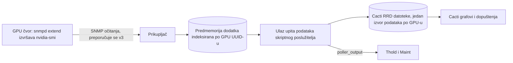

<!-- Source: README.md; SHA256: 97ba37df4a883426d3984ed7d14547ad7367e973411a8abd930409ce259f545b -->

<!-- translations:start -->
[English](../../../README.md) | [简体中文](../zh-CN/README.md) | [हिन्दी](../hi-IN/README.md) | [Español (España)](../es-ES/README.md) | [Español (Latinoamérica)](../es-419/README.md) | [العربية (السعودية)](../ar-SA/README.md) | [Afrikaans](../af-ZA/README.md) | [አማርኛ](../am-ET/README.md) | [العربية (مصر)](../ar-EG/README.md) | [العربية (المغرب)](../ar-MA/README.md) | [বাংলা](../bn-BD/README.md) | [Bosanski](../bs-BA/README.md) | [Deutsch](../de-DE/README.md) | [فارسی](../fa-IR/README.md) | [Filipino](../fil-PH/README.md) | [Français](../fr-FR/README.md) | [Français (Maroc)](../fr-MA/README.md) | [Français (Sénégal)](../fr-SN/README.md) | [Hausa](../ha-NG/README.md) | [עברית](../he-IL/README.md) | [Hrvatski](README.md) | [Bahasa Indonesia](../id-ID/README.md) | [Igbo](../ig-NG/README.md) | [Italiano](../it-IT/README.md) | [日本語](../ja-JP/README.md) | [한국어](../ko-KR/README.md) | [Malagasy](../mg-MG/README.md) | [मराठी](../mr-IN/README.md) | [Bahasa Melayu](../ms-MY/README.md) | [Nederlands](../nl-NL/README.md) | [Polski](../pl-PL/README.md) | [Português (Brasil)](../pt-BR/README.md) | [Русский](../ru-RU/README.md) | [Kinyarwanda](../rw-RW/README.md) | [Soomaali](../so-SO/README.md) | [Српски](../sr-RS/README.md) | [Svenska](../sv-SE/README.md) | [Kiswahili](../sw-KE/README.md) | [தமிழ்](../ta-IN/README.md) | [తెలుగు](../te-IN/README.md) | [ไทย](../th-TH/README.md) | [Türkçe](../tr-TR/README.md) | [Українська](../uk-UA/README.md) | [اردو](../ur-PK/README.md) | [Tiếng Việt](../vi-VN/README.md) | [isiXhosa](../xh-ZA/README.md) | [Yorùbá](../yo-NG/README.md) | [繁體中文](../zh-TW/README.md) | [isiZulu](../zu-ZA/README.md)
<!-- translations:end -->

# plugin_gpu

Dodatak za Cacti 1.2 koji u Cacti unosi podatke o iskorištenosti, memoriji, temperaturi, potrošnji snage, ECC pogreškama i razlozima prigušivanja za svaki GPU iz NVIDIA alata. Podrška za AMD i prikupljanje XID pogrešaka planirani su, ali još nisu provedeni. Svaki GPU postaje indeks upita podataka na uređaju svog čvora, čime se grafovi GPU-a smještaju uz ostale grafove čvora pod Cactijevim dopuštenjima, a dodaci Thold i Maint mogu na temelju njih pokretati i potiskivati upozorenja.

> **Status: u razvoju, neobjavljeno.** Prekretnica 4 programski dovršava fazu 1 (NVIDIA putem SNMP extend): prikupljanje, identitet, grafove, signale prigušivanja i ECC-a, upozoravanje putem Tholda i Mainta, stranicu stanja ispravnosti i dokumentaciju za operatere. Dodatak je dosad pokretan isključivo uz stvarni `snmpd` i simulirani `nvidia-smi` koji ispisuje sintetičke podatke, nikada na stvarnom GPU sklopovlju. Prije izdanja još su otvoreni: pilot-projekti na stvarnom sklopovlju ([docs/pilot-plan.md](../../pilot-plan.md), #54), vanjski sigurnosni pregled ([docs/security-review.md](../../security-review.md)), testni uzorci snimljeni iz stvarnih alata (#14) te mjerenja skaliranja na sustavima produkcijske veličine ([docs/performance.md](../../performance.md)). XID pogreške čekaju odluku #8. Ne upotrebljavajte dodatak u produkciji.

## Pristupne uloge

| Područje ovlasti | Pristup |
| --- | --- |
| GPU View | Postojeće nadzorne stranice. |
| GPU Operator | Nadzor te stranica Operacije GPU-a i osobne potvrde trijaže. |
| GPU Admin | Pristup operatera te postojeće konfiguracijske i administrativne radnje. |

Nakon kopiranja datoteka nadogradnje otvorite stranicu Plugins kao administrator kako biste registrirali novo područje ovlasti. Izričito dodijelite područje Operator u izborniku **Configuration > Users** ili korisničkim skupinama. Nadogradnje zadržavaju postojeće identifikatore i ovlasti za područja View i Admin. Admin pristup nasljeđuje Operator pristup, a Operator pristup nasljeđuje View pristup pri svakom zahtjevu; time se ne dodaju pohranjene ovlasti korisnicima ili skupinama. Postavke dodatka zahtijevaju i GPU Admin pristup uz Cactijevo dopuštenje Settings.

Cactijeva dopuštenja na razini uređaja i dalje ograničavaju retke i postupke dostupne pojedinom korisniku; nepovezani objekti zahtijevaju administratora. Vjerodajnice, konfiguracija, mapiranje, brisanje i ostale administrativne promjene ostaju na administrativnim stranicama. Potvrde vrijede samo u tekućoj korisničkoj sesiji, najdulje jedan sat i samo dok isto opažanje ostaje ažurno. Nova ili izmijenjena opažanja poništavaju ih. Potvrde nikada ne označavaju neuspjelo mjerenje ispravnim niti potiskuju upozorenja.

## Zašto

GPU čvorovi najčešće su već uključeni u Cacti radi nadzora procesora, memorije i mrežnih sučelja. Ispravnost GPU-a zasebno je pitanje na koje SNMP podaci čvora ne daju odgovor: kartica može biti toplinski prigušena, nakupljati ECC pogreške ili prijaviti XID kvar dok sam čvor djeluje ispravno. Alati proizvođača to dojavljuju (`nvidia-smi`, DCGM, `amd-smi`), ali njihov izlaz ostaje izvan Cactijevih grafova, dopuštenja i sustava upozoravanja.

Dodatak premošćuje taj jaz pretvarajući izlaz alata proizvođača u Cactijeve izvore podataka, indeksirane prema identitetu svakog GPU-a umjesto prema njegovu položaju, pa ponovno pokretanje koje promijeni redoslijed GPU-a ne povezuje povijest jedne kartice s drugom. Ponovno upotrebljava Cactijeve grafove, dopuštenja, udaljene prikupljače podataka, Thold i Maint umjesto izrade njihovih paralelnih inačica.

## Planirani opseg

| Faza | Opseg | Prekretnice |
|---|---|---|
| 0, istraživanje | Izlaz alata proizvođača, signali XID-a i prigušivanja, identitet GPU-a, ovlasti, odluka o putanji prikupljanja | [M1](https://github.com/somethingwithproof/plugin_gpu/milestone/1) |
| 1, nvidia | Prikupljanje putem `nvidia-smi`, popis po UUID-u, grafovi, signali prigušivanja, ECC-a i XID-a, Thold i Maint, stranica ispravnosti | [M2](https://github.com/somethingwithproof/plugin_gpu/milestone/2), [M3](https://github.com/somethingwithproof/plugin_gpu/milestone/3), [M4](https://github.com/somethingwithproof/plugin_gpu/milestone/4) |
| 2, pozadinski sustavi | DCGM pozadinski sustav, `amd-smi` pozadinski sustav | [M5](https://github.com/somethingwithproof/plugin_gpu/milestone/5) |
| 3, mig i udaljeno | MIG instance, Cactijevi udaljeni prikupljači podataka | [M6](https://github.com/somethingwithproof/plugin_gpu/milestone/6) |

Izvan opsega: svaka naredba koja mijenja GPU ili čvor (taktovi, ograničenja snage, ponovna pokretanja, MIG raspored), vlastiti sustav upozoravanja u sklopu dodatka, prilagođeni pozadinski proces ili mrežni protokol te raspoređivač ili obračun poslova. Istraživački popis zadataka potražite u planu.

## Što donosi prekretnica 4

- **Razlozi prigušivanja kao vrijednosti upozorenja.** Maska događaja takta dekodira se u po jedan pokazatelj vrijednosti 0 ili 1 za svaki razlog; nepoznata maska daje nepoznate pokazatelje, nikada nule, a bitovi bez pokazatelja ostaju u sirovoj maski koju prikazuje Stanje ispravnosti GPU-a.
- **ECC kao vrijednosti upozorenja** ([docs/metrics.md](../../metrics.md)). Nove ispravljene i neispravljene pogreške od prethodnog uzorka dodatak izračunava iz dvaju uzastopnih zbrojeva i sprema kao trenutne vrijednosti (gauge): nepoznato za prvi uzorak, propušteno očitanje ili ponovno učitavanje upravljačkog programa, pa resetiranje nikada ne daje nulu niti negativan broj. Očitavaju se i brojevi povučenih jednobitnih i dvobitnih memorijskih stranica te ECC način rada. Dva dodatna ECC grafa po GPU-u omogućuju Cactiju njihovu pohranu; uz Power Percent postoji ukupno jedanaest grafova. XID se ne prikuplja jer nijedan izvor ne odgovara fiksnim `nvidia-smi` naredbama (#8).
- **Thold i Maint** ([docs/alerting.md](../../alerting.md)). Isporučeni Thold predlošci za temperaturu, snagu u odnosu na ograničenje, pokazatelje prigušivanja, nove neispravljene ECC pogreške, stranice na čekanju za povlačenje i starost uzorka. Svaka vrijednost je gauge jer Thold 1.8.2 zataji na nepoznatom brojaču. Cjeloviti test s neizmijenjenim Tholdom 1.8.2 i Maintom 1.3 potvrđuje okidanje i oporavak svakog praga, uključujući i preko ECC resetiranja, te potiskivanje putem Mainta.
- **Stanje ispravnosti GPU-a** (GPU View). Po čvoru: ažurnost, ishod zadnjeg prikupljanja, status Mainta, pozadinski sustav, inačice alata i upravljačkog programa te broj GPU-a; po GPU-u: prisutnost, starost uzorka, ECC status i sirova maska. Stranica čita isključivo pohranjene zapise.
- **Dopuštenja.** Skup testova dopuštenja obuhvaća svaku datoteku stranice i postupak, ukidanje ovlasti na sljedećem zahtjevu te odbijanja koja ne otkrivaju podatke.
- **Provjera otpornosti na kvarove i oporavak.** Skriptirana cjelovita izvođenja prekidaju agent, vjerodajnice, alat, njegov izlaz, vezu s bazom podataka i zapise u RRD te vraćaju bazu podataka iz sigurnosne kopije, uključujući kopiju stariju od RRD datoteka; novi GPU nikada ne preuzima RRD datoteku drugoga GPU-a ([docs/backup.md](../../backup.md)).
- **Skaliranje** ([docs/performance.md](../../performance.md)). Test skaliranja mjeri trajanje prikupljanja, ulaza skriptnog poslužitelja, izrade Cacti objekata, jednog ciklusa pollera i stranice ispravnosti za zadani broj GPU-a; CI ga izvodi na 100 GPU-a. Mjerenja za 1.000 i 8.000 GPU-a još nisu evidentirana, pa se ne navodi podržani broj GPU-a.
- **Dokumentacija za operatere** ([docs/operations.md](../../operations.md)): instalacija, nadogradnja, deinstalacija, načelo najmanjih ovlasti, nedostupne vrijednosti i otklanjanje poteškoća. Promjene su navedene u datoteci [CHANGELOG.md](../../../CHANGELOG.md).

## Što donosi prekretnica 3

- **Prikupljanje putem SNMP extend** ([ADR 0008](../../decisions/0008-collect-through-snmp-extend.md)). Administrator čvora dodaje dva fiksna retka `extend` u `snmpd.conf` ([docs/node-setup.md](../../node-setup.md)); dodatak čita NET-SNMP-EXTEND-MIB putem Cactijevih SNMP funkcija s vjerodajnicama samog uređaja, uz preporuku za SNMPv3. Ništa se ne izvršava izravno na Cacti poslužitelju ni na čvoru.
- **Strogo raščlanjivanje.** Polja se čitaju po položaju, svaki redak imenuje svoj GPU putem UUID-a, a izlazni kôd različit od nule, istek vremena čekanja, skraćeni izlaz, redak s pogrešnim brojem polja ili umiješani tekst pogreške poništavaju cijelo prikupljanje: vrijednosti postaju `U`, nijedan GPU ne označava se odsutnim, a GPU čvorovi prikazuju uzrok.
- **Prikupljač nakon svakog ciklusa pollera.** Očitava agent svakog omogućenog čvora, ažurira zapise identiteta i sprema najnoviji uzorak u predmemoriju. Ulaz skriptnog poslužitelja čita isključivo tu predmemoriju pa Cactijev poll nikada ne čeka GPU čvor.
- **Cacti objekti** ([ADR 0010](../../decisions/0010-attach-to-existing-node-devices.md)). Predlošci i upit podataka *GPU - Devices* isporučuju se kao XML i uvoze pri instalaciji i nadogradnji. Spremanjem čvora upit podataka dodaje se postojećem uređaju s metodom ponovnog indeksiranja None; GPU čvorovi mogu izraditi uređaj samo kada ga čvor još nema. Svaki GPU predstavlja indeks određen proizvođačem i UUID-om, s jednim izvorom podataka koji dijele grafovi Utilization, Memory, Temperature, Power, Power Percent, Clocks, Throttle, ECC Errors, New ECC Errors, Retired Pages i Sample Age. Svako polje modela iscrtava barem jedan graf jer Cacti pohranjuje samo polja koja neki graf upotrebljava. Dodatak ponovno indeksira nakon svake promjene GPU-a, pamti ponovno indeksiranje koje je Cacti preskočio dok je uređaj bio Down ili onemogućen i pokreće ga čim uređaj ponovno bude Up te izrađuje grafove za nove GPU-e.
- **Povijest ostaje uz karticu.** Odsutan GPU ostaje indeks pa njegovi grafovi prikazuju prazninu i nastavljaju u istoj RRD datoteci nakon povratka. Zamjenska kartica u istom utoru dobiva vlastiti izvor podataka. **Remove from Data Query** na stranici čvora uklanja odsutan GPU s popisa; njegove RRD datoteke i grafovi ostaju pohranjeni dok ih sami ne obrišete.
- **Dopuštenja uređaja na stranici GPU čvorovi.** GPU administrator vidi, mijenja, izvozi i premješta samo čvorove i GPU-e na uređajima koje smije pregledavati u Cactiju; premještanje GPU-a zahtijeva ovlast za oba čvora. Čvor čiji je uređaj obrisan može se onemogućiti ili obrisati.
- **Zajednički model metrika** ([ADR 0009](../../decisions/0009-common-metric-core-with-vendor-extensions.md), [docs/metrics.md](../../metrics.md)). Memorija se izražava u bajtovima, maska događaja takta dekodira se u pokazatelje `thr_*`, a `age` označava starost uzorka samog GPU-a ili `U` kada je nepoznata.

Korisnik koji obavlja instalaciju (korisnik web poslužitelja) mora imati pravo pisanja u `<cacti>/resource/script_server/`, kamo dodatak sprema XML datoteku upita podataka; u protivnom se instalacija i nadogradnja zaustavljaju s porukom i ponavljaju pri sljedećem pokušaju. Deinstalacija uklanja predloške i XML datoteku samo kada je označena opcija *Remove the plugin's Cacti objects on uninstall* te nikada ne briše RRD datoteke, uređaje, grafove ili izvore podataka ([docs/operations.md](../../operations.md#uninstall)). Čvorovi na udaljenim prikupljačima podataka ne prikupljaju se prije faze 3.

## Što isporučuje prekretnica 2

- **Zaštićena instalacija.** Na inačicama PHP-a starijima od 8.2 instalacija i omogućavanje odbijaju se uz poruku s traženom inačicom, dok ostatak Cactija nastavlja raditi bez prekida. Datoteka `setup.php` i skripte stranica sintaksno su valjane na PHP-u 8.0.
- **Životni ciklus.** Instalacija, nadogradnja, onemogućavanje i deinstalacija putem Cactijeve stranice Plugins. Nadogradnje se izvode redom, dovršavaju se nakon prekida i ažuriraju zabilježenu inačicu tek nakon uspješnog završetka. Deinstalacija zadržava tablice dodatka osim ako poništite odabir *Keep Plugin Tables on Uninstall*; nikada ne dira Cacti uređaje, izvore podataka, grafove ni RRD datoteke.
- **Odvojena područja ovlasti.** *GPU Admin* otvara **GPU Nodes**, gdje registrirate Cacti uređaje kao GPU čvorove, potvrđujete ili odbacujete premještanja GPU-a između čvorova te izvozite svaki zapis u JSON obliku. *GPU View* otvara **GPU Inventory**, koji donosi popis GPU-a isključivo na uređajima kojima korisnik ima pravo pregleda. Obje se stranice nalaze pod Management, a svaka je promjena POST zahtjev provjeren alatom csrf-magic.
- **Zapisi identiteta GPU-a.** Svaki GPU određen je proizvođačem i UUID-om. Indeks, ID PCI sabirnice, ime, upravljački program i izvještajni alat atributi su koji se ažuriraju na mjestu. Novi UUID u poznatom utoru označava se kao moguća zamjena i započinje vlastitu povijest; GPU opažen na drugom čvoru premješta se tek nakon potvrde operatera; GPU koji izostane iz uspješnih prikupljanja označava se odsutnim nakon broja definiranog u postavkama i nikada se ne briše. Zasad se prihvaćaju samo NVIDIA UUID-ovi cijelih GPU-a; MIG instance čekaju odluku #13, a AMD istraživanje #19. Pravila se provjeravaju nizovima testnih uzoraka jer ih još ne puni nijedan prikupljač.
- **Testovi i CI.** Skupovi jediničnih testova i pravila izvornog koda bez GPU-a ili baze podataka, provjere životnog ciklusa i dopuštenja stranica uz Cacti 1.2.31 i aktualnu granu 1.2.x na PHP-u od 8.2 do 8.5, provjera odbijanja na PHP-u 8.1, PHP 8.0 lint ulaznih točaka, PHPStan na razini 9 te REUSE. Ispitno okruženje privremeno je do odluke #12.

### Instalacija za evaluaciju

Ovi koraci instaliraju trenutačni kôd radi isprobavanja; cjelovit vodič za operatere nalazi se u [docs/operations.md](../../operations.md). Potrebni su Cacti 1.2.31 ili noviji te PHP 8.2 ili noviji.

1. Kopirajte repozitorij u `plugins/gpu` unutar svojeg Cacti direktorija. Direktorij mora imati naziv `gpu`.
2. U Cactiju otvorite **Configuration > Plugins**, zatim instalirajte i omogućite **GPU**.
3. Dodijelite korisnicima područje *GPU View*, *GPU Operator* ili *GPU Admin* u izborniku **Configuration > Users**, sukladno njihovoj ulozi. Korisnik koji provodi instalaciju dobiva View i Admin; Admin obuhvaća i pristup Operator.
4. Konfigurirajte SNMP agent svakog GPU čvora prema uputama u [docs/node-setup.md](../../node-setup.md), zatim dodajte čvor u izborniku **Management > GPU Nodes**.
5. Za upozorenja uvezite isporučene Thold predloške prema uputama u [docs/alerting.md](../../alerting.md).
6. Po želji prilagodite **Configuration > Settings > GPU**: *Mark Absent After* (zadano 3 uspješna prikupljanja, od 1 do 100), *Stale After* (kolika starost uzorka smije biti prije nego što vrijednosti ispišu `U`) i *Keep Plugin Tables on Uninstall* (zadano uključeno).

## Kako metrike stižu u Cacti

Odluka [#7](https://github.com/somethingwithproof/plugin_gpu/issues/7) odabrala je SNMP `extend` ([ADR 0008](../../decisions/0008-collect-through-snmp-extend.md)): vlastiti agent čvora izvršava fiksnu `nvidia-smi` naredbu, a dodatak samo očitava rezultat. Plan uspoređuje dostupne opcije u odjeljku [Putanje prikupljanja](../../PLAN.md#collection-paths).

## Ciljevi kompatibilnosti

| Komponenta | Cilj |
|---|---|
| Cacti | 1.2.31 ili noviji, bez zakrpa jezgre |
| PHP | 8.2 ili noviji; `setup.php` ostaje raščlanjiv na 8.0 kako bi nepodržano okruženje dobilo odbijanje umjesto neispravnog Cacti sučelja |
| NVIDIA | Linije upravljačkih programa i alata koje će odrediti istraživanje [#26](https://github.com/somethingwithproof/plugin_gpu/issues/26); DCGM identifikatori polja provjereni u inačicama v3.3.9 i v4.7.0 |
| AMD | `amd-smi` u ROCm izdanjima koja će odrediti istraživanje [#26](https://github.com/somethingwithproof/plugin_gpu/issues/26) |
| Thold, Maint | Thold 1.8.2 i Maint 1.3, neizmijenjeni, ispitani u cijelosti ([docs/alerting.md](../../alerting.md)) |

## Dizajn

- [docs/PLAN.md](../../PLAN.md) donosi cjelovit plan: arhitekturu, uzvodne činjenice o kojima projekt ovisi (s izvorima), model identiteta, sigurnosne granice, izračune performansi, testiranje i rizike.
- [docs/decisions/](../../decisions/) sadrži zapise arhitektonskih odluka za već donesene odabire.
- [docs/REQUIREMENTS.md](../../REQUIREMENTS.md) povezuje svaki identifikator zahtjeva s pripadajućim predmetom.

## Praćenje rada

- **Prekretnice** slijede prekretnice iz plana. Svaka ima krovni predmet s popisom podzadataka i dokaza o završetku.
- **Predmeti** razvrstani su oznakama tipa: `type: requirement`, `type: research`, `type: decision`, `type: epic`. Predmeti zahtjeva definiraju numerirane, provjerljive zahtjeve (`REQ-AREA-NNN`) i kriterije prihvaćanja.
- **Oznake** dodatno nose prefikse `area:`, `phase:`, `priority:` i `status:`. Pogledajte [CONTRIBUTING.md](../../../CONTRIBUTING.md#labels).
- [Ploča projekta](https://github.com/users/somethingwithproof/projects/9) prikazuje sve predmete po prekretnicama.

## Doprinošenje

Pročitajte [CONTRIBUTING.md](../../../CONTRIBUTING.md). Commitovi zahtijevaju DCO potpis (sign-off). Rasprave o dizajnu vode se u predmetima; otvorene odluke nose oznaku `type: decision`. Snimljeni izlaz stvarnih GPU alata najkorisniji je doprinos za prekretnicu 1; prije slanja uklonite nazive poslužitelja, serijske brojeve i UUID-ove.

## Sigurnost

Ranjivosti prijavljujte privatno; pogledajte [SECURITY.md](../../../SECURITY.md).

## Licenca

GNU General Public License v2.0, ista licenca kao Cacti i njegovi dodaci. Pogledajte [LICENSE](../../../LICENSE).
