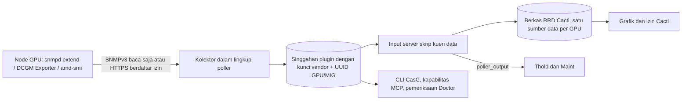

<!-- Source: README.md; SHA256: 97ba37df4a883426d3984ed7d14547ad7367e973411a8abd930409ce259f545b -->

<!-- translations:start -->
[English](../../../README.md) | [简体中文](../zh-CN/README.md) | [हिन्दी](../hi-IN/README.md) | [Español (España)](../es-ES/README.md) | [Español (Latinoamérica)](../es-419/README.md) | [العربية (السعودية)](../ar-SA/README.md) | [Afrikaans](../af-ZA/README.md) | [አማርኛ](../am-ET/README.md) | [العربية (مصر)](../ar-EG/README.md) | [العربية (المغرب)](../ar-MA/README.md) | [বাংলা](../bn-BD/README.md) | [Bosanski](../bs-BA/README.md) | [Deutsch](../de-DE/README.md) | [فارسی](../fa-IR/README.md) | [Filipino](../fil-PH/README.md) | [Français](../fr-FR/README.md) | [Français (Maroc)](../fr-MA/README.md) | [Français (Sénégal)](../fr-SN/README.md) | [Hausa](../ha-NG/README.md) | [עברית](../he-IL/README.md) | [Hrvatski](../hr-HR/README.md) | [Bahasa Indonesia](README.md) | [Igbo](../ig-NG/README.md) | [Italiano](../it-IT/README.md) | [日本語](../ja-JP/README.md) | [한국어](../ko-KR/README.md) | [Malagasy](../mg-MG/README.md) | [मराठी](../mr-IN/README.md) | [Bahasa Melayu](../ms-MY/README.md) | [Nederlands](../nl-NL/README.md) | [Polski](../pl-PL/README.md) | [Português (Brasil)](../pt-BR/README.md) | [Русский](../ru-RU/README.md) | [Kinyarwanda](../rw-RW/README.md) | [Soomaali](../so-SO/README.md) | [Српски](../sr-RS/README.md) | [Svenska](../sv-SE/README.md) | [Kiswahili](../sw-KE/README.md) | [தமிழ்](../ta-IN/README.md) | [తెలుగు](../te-IN/README.md) | [ไทย](../th-TH/README.md) | [Türkçe](../tr-TR/README.md) | [Українська](../uk-UA/README.md) | [اردو](../ur-PK/README.md) | [Tiếng Việt](../vi-VN/README.md) | [isiXhosa](../xh-ZA/README.md) | [Yorùbá](../yo-NG/README.md) | [繁體中文](../zh-TW/README.md) | [isiZulu](../zu-ZA/README.md)
<!-- translations:end -->

# plugin_gpu

Plugin Cacti 1.2 yang menghadirkan data utilisasi, memori, suhu, daya, galat ECC, dan alasan throttling per GPU dari perkakas NVIDIA dan AMD ke dalam Cacti. Setiap GPU (atau instans MIG) menjadi indeks dari suatu kueri data pada perangkat node-nya, sehingga grafik GPU ditempatkan berdampingan dengan grafik lain milik node tersebut di bawah sistem izin Cacti, serta Thold dan Maint dapat memberikan peringatan dan menekan (suppress) peringatan tersebut.

> **Status: fase 1 hingga 3 telah diimplementasikan dalam kode, belum dirilis.** Fase 1 (NVIDIA `nvidia-smi` melalui SNMP extend, pelacakan identitas, grafik, sinyal throttle dan ECC, peringatan Thold dan Maint, halaman kesehatan), Fase 2 (parser/klien HTTP(S) baca-saja untuk NVIDIA DCGM Exporter dan parser AMD `amd-smi`), Fase 3 (pelacakan identitas instans MIG, kolom Schema v4, eksekusi kolektor jarak jauh dalam lingkup poller, hook `replicate_out` dan `remote_agent`), CLI operator CasC (`cli/gpu.php`), serta hook ekosistem (`abilities_register`, `doctor_register_checks`, `casc_register_providers`) telah diimplementasikan dan dicakup oleh pengujian unit, keamanan, dan integrasi pada Cacti sementara. Eksekusi langsung sejauh ini menggunakan `snmpd` sintetis dan payload fixture, bukan perangkat keras GPU fisik. Hal yang masih terbuka sebelum menandai rilis: uji coba pada perangkat keras asli ([docs/pilot-plan.md](../../pilot-plan.md), #54), tinjauan keamanan eksternal ([docs/security-review.md](../../security-review.md)), fixture yang diambil dari perkakas asli (#14), serta pengukuran skala pada perangkat keras berukuran produksi ([docs/performance.md](../../performance.md)). Pengumpulan galat XID masih terbuka di bawah keputusan #8.

## Peran akses

| Realm | Akses |
| --- | --- |
| GPU View | Halaman pemantauan yang sudah ada. |
| GPU Operator | Pemantauan ditambah halaman Operations dan pengakuan (acknowledgment) triase pribadi. |
| GPU Admin | Akses Operator ditambah konfigurasi yang sudah ada dan tindakan administratif. |

Setelah menyalin berkas pemutakhiran, buka halaman Plugins sebagai administrator untuk mendaftarkan
realm baru. Tetapkan realm Operator secara eksplisit di bawah **Configuration > Users** atau grup pengguna.
Pemutakhiran mempertahankan ID dan hak akses (grant) realm View dan Admin yang sudah ada. Akses Admin
mewarisi akses Operator, dan akses Operator mewarisi akses View pada setiap permintaan;
hal ini tidak menambahkan grant tersimpan ke pengguna atau grup. Pengaturan plugin juga memerlukan
akses GPU Admin selain izin Settings milik Cacti.

Izin perangkat Cacti tetap membatasi baris dan tindakan yang tersedia bagi setiap pengguna; objek yang tidak terpetakan memerlukan seorang administrator.
Kredensial, konfigurasi, pemetaan, penghapusan, dan perubahan administratif lainnya
tetap berada di halaman administratif. Pengakuan (acknowledgment) hanya bertahan dalam sesi
pengguna saat ini, paling lama satu jam dan hanya selama pengamatan yang sama tetap
baru. Pengamatan yang baru atau berubah akan membatalkannya. Pengakuan tidak pernah menandai pengukuran
yang gagal sebagai sehat atau menekan (suppress) peringatan.

## Mengapa

Node GPU biasanya sudah ada di Cacti untuk pemantauan CPU, memori, dan antarmuka jaringan. Kesehatan GPU merupakan hal terpisah yang tidak dijawab oleh data SNMP node tersebut: sebuah kartu dapat mengalami pembatasan termal (thermal throttling), mengakumulasi galat ECC, atau melaporkan kegagalan XID sementara node itu sendiri tampak sehat. Perkakas vendor melaporkannya (`nvidia-smi`, DCGM, `amd-smi`), tetapi keluarannya berada di luar grafik, izin, dan sistem peringatan Cacti.

Plugin ini menutup celah tersebut dengan mengubah keluaran perkakas vendor menjadi sumber data Cacti, yang dikunci berdasarkan identitas masing-masing GPU alih-alih posisinya, sehingga boot ulang yang mengurutkan ulang GPU tidak menempelkan riwayat satu kartu ke kartu lainnya. Plugin ini menggunakan kembali sistem grafik, izin, kolektor data jarak jauh, Thold, dan Maint milik Cacti daripada membangun versi paralelnya.

## Ruang lingkup yang direncanakan

| Fase | Ruang lingkup | Status | Tonggak pencapaian |
|---|---|---|---|
| 0, riset | Keluaran perkakas vendor, sinyal XID dan throttle, identitas GPU, hak akses, keputusan jalur pengumpulan | Selesai | [M1](https://github.com/somethingwithproof/plugin_gpu/milestone/1) |
| 1, nvidia | Pengumpulan `nvidia-smi`, inventaris menurut UUID, grafik, sinyal throttle dan ECC, Thold dan Maint, halaman kesehatan | Diimplementasikan (diuji dengan fixture) | [M2](https://github.com/somethingwithproof/plugin_gpu/milestone/2), [M3](https://github.com/somethingwithproof/plugin_gpu/milestone/3), [M4](https://github.com/somethingwithproof/plugin_gpu/milestone/4) |
| 2, backend | Parser/klien HTTP(S) baca-saja DCGM Exporter (`lib/DcgmExporterParser.php`, `lib/DcgmExporterClient.php`), parser AMD `amd-smi` (`lib/AmdSmiParser.php`) | Diimplementasikan (diuji unit) | [M5](https://github.com/somethingwithproof/plugin_gpu/milestone/5) |
| 3, mig, jarak jauh, dan ekosistem | Pelacakan identitas instans MIG, kolektor data jarak jauh (`INFO`, `poller_gpu.php --poller=N`, `replicate_out`, `remote_agent`), CLI CasC (`cli/gpu.php`), hook MCP/Doctor/CasC | Diimplementasikan (diuji unit dan integrasi CI) | [M6](https://github.com/somethingwithproof/plugin_gpu/milestone/6) |

Di luar ruang lingkup: perintah apa pun yang mengubah GPU atau node (clock, batas daya, reset, tata letak MIG), mesin peringatan milik plugin sendiri, daemon atau protokol jaringan kustom, serta penjadwal atau akuntansi pekerjaan (job accounting). Lihat rencana untuk daftar pekerjaan riset yang tertunda (backlog).

## Hal yang ditambahkan pada tonggak pencapaian 4

- **Kolektor baca-saja NVIDIA DCGM Exporter** (`lib/DcgmExporterParser.php`, `lib/DcgmExporterClient.php`). Mengurai metrik eksposisi teks Prometheus (`DCGM_FI_DEV_GPU_UTIL`, `DCGM_FI_DEV_FB_USED`, `DCGM_FI_DEV_FB_FREE`, `DCGM_FI_DEV_POWER_USAGE`, `DCGM_FI_DEV_GPU_TEMP`, `DCGM_FI_DEV_ECC_DBE_VOL_TOTAL`, `DCGM_FI_DEV_CLOCK_THROTTLE_REASONS`, serta label MIG `GPU_I_ID` dan `GPU_I_PROFILE`). Klien HTTP(S) menerapkan daftar izin host/CIDR endpoint secara eksplisit, memverifikasi sertifikat peer TLS secara bawaan, membatasi batas waktu dan ukuran respons, menonaktifkan pengalihan (redirect), dan menolak skema non-HTTP(S).
- **Parser baca-saja AMD `amd-smi`** (`lib/AmdSmiParser.php`). Menormalisasi keluaran JSON/SNMP-extend `amd-smi` (utilisasi, VRAM, daya, suhu junction/edge, ECC, metadata partisi, dan akumulator throttle terpisah melalui `Reading::$vendorExtensions`) ke dalam model metrik umum di bawah `Vendor::Amd`.
- **Pelacakan instans MIG dan Schema v4** (`lib/GpuReport.php`, `lib/GpuSnapshot.php`, `lib/GpuRecord.php`, `lib/Schema.php`, `lib/ScriptServer.php`). Melacak UUID instans MIG (`MIG-<uuid>` dan `MIG-GPU-<parent>/<gi>/<ci>`), `mig_mode`, `mig_instance_id`, `mig_profile`, `parent_uuid`, dan `partition_info` bersama GPU induk sambil menjaga kunci identitas yang tidak dapat diubah (`vendor`, `uuid`, `parent_uuid`) tetap terlindungi saat pembaruan dan tervalidasi sebelum kueri basis data.
- **Kolektor data jarak jauh** (`INFO`, `poller_gpu.php`, `lib/Poller.php`, `lib/ReplicationRepository.php`, `setup.php`). Mendeklarasikan `remote_collect:1, remote_poller:1` dalam `INFO`, mendukung eksekusi dalam lingkup poller melalui `php plugins/gpu/poller_gpu.php --poller=N`, melewati penyediaan objek Cacti pada poller non-utama, mereplikasi tabel lingkup poller melalui `replicate_out`, dan menjawab aksi baca-saja `gpu_health` dan `gpu_inventory` melalui `remote_agent`.
- **CLI Operator dan CasC** (`cli/gpu.php`, `lib/CascProvider.php`). Berjalan di PHP 8.2+ (dapat diurai pada PHP 8.0) tanpa dependensi Composer eksternal: `php plugins/gpu/cli/gpu.php export [--format=yaml|xml]`, `validate <file> [--format=yaml|xml]`, `plan <file> [--format=yaml|xml] [--output=text|json]`, `apply <file> --confirm=<PLAN_HASH> [--format=yaml|xml]`, dan `health [--format=text|json]`. Perintah `plan` menghitung hash konfirmasi SHA-256 yang deterministik, `apply` gagal secara aman (fail closed) jika hash tidak cocok, dan penguraian XML menolak deklarasi `DOCTYPE` dan `ENTITY`.
- **Hook integrasi ekosistem** (`lib/EcosystemIntegration.php`, `setup.php`). Mendaftarkan `abilities_register` (`gpu-list-nodes`, `gpu-list-devices`, `gpu-get-health`; baca-saja, dibatasi oleh realm `GPU View` dan izin perangkat Cacti), `doctor_register_checks` (`gpu_schema`, `gpu_poller_freshness`, `gpu_node_health`), dan `casc_register_providers`.
- **Alasan throttle dan ECC sebagai nilai peringatan** ([docs/metrics.md](../../metrics.md)). Mendekode mask peristiwa clock menjadi indikator 0/1 dan menghitung galat ECC terkoreksi dan tidak terkoreksi yang baru per interval sebagai gauge sehingga Thold 1.8.2 dan Maint 1.3 memicu dan menekan peringatan tanpa counter negatif atau lonjakan akibat reset ([docs/alerting.md](../../alerting.md)).
- **GPU Health, izin, kegagalan/pemulihan, dan skala.** GPU Health (GPU View) menampilkan kesegaran data yang tersimpan, hasil pengumpulan terakhir, status Maint, backend, versi, dan mask throttle mentah tanpa menghubungi node. Pengujian ujung-ke-ujung berskrip memverifikasi izin, pemulihan kegagalan agen/basis data/RRD ([docs/backup.md](../../backup.md)), dan uji skala 100 GPU di CI ([docs/performance.md](../../performance.md), [docs/operations.md](../../operations.md), [CHANGELOG.md](../../../CHANGELOG.md)).

## Hal yang ditambahkan pada tonggak pencapaian 3

- **Pengumpulan melalui SNMP extend** ([ADR 0008](../../decisions/0008-collect-through-snmp-extend.md)). Administrator node menambahkan dua baris `extend` tetap ke `snmpd.conf` ([docs/node-setup.md](../../node-setup.md)); plugin membaca NET-SNMP-EXTEND-MIB melalui fungsi SNMP Cacti dengan kredensial milik perangkat itu sendiri, dengan SNMPv3 yang disarankan. Plugin ini tidak menjalankan apa pun di server Cacti maupun di node.
- **Penguraian ketat (strict parsing).** Bidang dibaca berdasarkan posisi, setiap baris menamai GPU-nya dengan UUID, dan status keluar bukan nol, batas waktu terlampaui (timeout), keluaran terpotong, baris dengan jumlah bidang yang salah, atau teks galat yang tercampur akan menggagalkan seluruh pengumpulan: nilai menjadi `U`, tidak ada GPU yang ditandai tidak hadir, dan GPU Nodes menunjukkan penyebabnya.
- **Kolektor setelah setiap siklus poller.** Kolektor membaca agen setiap node yang diaktifkan, memperbarui catatan identitas, dan menyinggahkannya (cache) sebagai sampel terbaru. Input server skrip hanya membaca singgahan tersebut, sehingga proses poll Cacti tidak pernah menunggu node GPU.
- **Objek Cacti** ([ADR 0010](../../decisions/0010-attach-to-existing-node-devices.md)). Templat dan kueri data *GPU - Devices* dikirimkan sebagai XML dan diimpor saat pemasangan dan pemutakhiran. Menyimpan sebuah node akan menempelkan kueri data ke perangkat yang sudah ada dengan metode pengindeksan ulang None; GPU Nodes dapat membuat perangkat hanya ketika node belum memilikinya. Setiap GPU adalah indeks yang dikunci oleh vendor dan UUID, dengan satu sumber data yang dibagi oleh grafik Utilization, Memory, Temperature, Power, Power Percent, Clocks, Throttle, ECC Errors, New ECC Errors, Retired Pages, dan Sample Age. Setiap bidang model digambarkan oleh suatu grafik, karena Cacti hanya menyimpan bidang yang digunakan oleh grafik. Plugin melakukan pengindeksan ulang setelah setiap perubahan GPU, menyimpan pengindeksan ulang yang dilewati Cacti saat perangkat dalam status Down atau dinonaktifkan dan menjalankannya begitu perangkat Up, serta membuat grafik untuk GPU baru.
- **Riwayat tetap melekat pada kartu.** GPU yang tidak hadir tetap menjadi indeks, sehingga grafiknya menunjukkan jeda dan berlanjut dalam berkas RRD yang sama saat GPU tersebut kembali. Kartu pengganti pada slot yang sama mendapatkan sumber datanya sendiri. **Remove from Data Query** pada halaman node menghapus GPU yang tidak hadir dari daftar; berkas RRD dan grafiknya tetap disimpan sampai Anda menghapusnya.
- **Izin perangkat pada GPU Nodes.** Seorang GPU Admin hanya melihat, mengubah, mengekspor, dan memindahkan node serta GPU pada perangkat yang boleh mereka lihat di Cacti; pemindahan GPU memerlukan kedua node. Node yang perangkatnya telah dihapus dapat dinonaktifkan atau dihapus.
- **Model metrik umum** ([ADR 0009](../../decisions/0009-common-metric-core-with-vendor-extensions.md), [docs/metrics.md](../../metrics.md)). Memori dalam satuan byte, mask peristiwa clock didekode menjadi indikator `thr_*`, dan `age` adalah usia waktu sampel milik GPU itu sendiri, atau `U` jika tidak diketahui.

Pengguna yang memasang (server web) harus dapat menulis ke `<cacti>/resource/script_server/`, tempat plugin meletakkan XML kueri datanya; jika tidak, pemasangan dan pemutakhiran akan berhenti dengan pesan kesalahan dan mencoba kembali pada upaya berikutnya. Pencopotan pemasangan menghapus templat dan XML hanya jika *Remove the plugin's Cacti objects on uninstall* dicentang, dan tidak pernah menghapus berkas RRD, perangkat, grafik, maupun sumber data ([docs/operations.md](../../operations.md#uninstall)). Node pada kolektor data jarak jauh berjalan dalam lingkup `poller_id` yang ditetapkan untuknya.

## Hal yang dikirimkan pada tonggak pencapaian 2

- **Pemasangan terproteksi.** Pada PHP di bawah 8.2, pemasangan dan pengaktifan ditolak dengan pesan yang menyebutkan versi yang diperlukan, sementara bagian Cacti lainnya tetap berjalan. `setup.php` dan skrip halaman tetap dapat diurai (parse) pada PHP 8.0.
- **Siklus hidup.** Pemasangan, pemutakhiran, penonaktifan, dan pencopotan pemasangan melalui halaman Plugins Cacti. Pemutakhiran dijalankan secara berurutan, diselesaikan setelah terjadi interupsi, dan mengubah versi tercatat hanya setelah berhasil. Pencopotan pemasangan mempertahankan tabel plugin kecuali Anda menghapus centang *Keep Plugin Tables on Uninstall*; tindakan ini tidak pernah menyentuh perangkat, sumber data, grafik, atau berkas RRD Cacti.
- **Realm terpisah.** *GPU Admin* membuka **GPU Nodes**, tempat Anda mendaftarkan perangkat Cacti sebagai node GPU, mengonfirmasi atau menolak pemindahan GPU antar-node, dan mengekspor setiap catatan sebagai JSON. *GPU View* membuka **GPU Inventory**, yang hanya mencantumkan GPU pada perangkat yang boleh dilihat oleh pemirsa. Kedua halaman berada di bawah Management, dan setiap perubahan berupa POST yang diperiksa oleh csrf-magic.
- **Catatan identitas GPU.** Setiap GPU dikunci oleh vendor dan UUID. Indeks, ID bus PCI, nama, driver, dan perkakas pelapor merupakan atribut yang berubah di tempat. UUID baru pada slot yang diketahui ditandai sebagai kemungkinan penggantian dan memulai riwayatnya sendiri; GPU yang terlihat di node lain berpindah hanya ketika operator mengonfirmasi; GPU yang hilang dari pengumpulan yang berhasil ditandai tidak hadir setelah jumlah yang dapat dikonfigurasi dan tidak pernah dihapus. Untuk saat ini hanya UUID GPU utuh NVIDIA yang diterima; instans MIG menunggu keputusan #13, dan AMD menunggu riset #19. Aturan-aturan ini diuji dengan rangkaian fixture, karena belum ada kolektor yang memasok datanya.
- **Pengujian dan CI.** Rangkaian pengujian unit dan aturan sumber tanpa GPU atau basis data, pemeriksaan siklus hidup dan izin halaman terhadap Cacti 1.2.31 serta 1.2.x terkini pada PHP 8.2 hingga 8.5, tugas penolakan PHP 8.1, lint PHP 8.0 untuk titik masuk, PHPStan pada level 9, dan REUSE. Rangkaian pengujian ini bersifat sementara hingga #12 diputuskan.

### Pemasangan untuk evaluasi

Langkah-langkah berikut memasang kode saat ini untuk dicoba; [docs/operations.md](../../operations.md) berisi panduan operator lengkap. Langkah ini memerlukan Cacti 1.2.31 atau yang lebih baru pada PHP 8.2 atau yang lebih baru.

1. Salin repositori ke `plugins/gpu` di bawah direktori Cacti Anda. Direktori harus bernama `gpu`.
2. Di Cacti, buka **Configuration > Plugins**, lalu pasang dan aktifkan **GPU**.
3. Berikan realm *GPU View*, *GPU Operator*, atau *GPU Admin* kepada pengguna di bawah **Configuration > Users**, sesuai dengan peran mereka. Pengguna yang memasang menerima View dan Admin; Admin mencakup akses Operator.
4. Siapkan agen SNMP setiap node GPU sebagaimana dijelaskan dalam [docs/node-setup.md](../../node-setup.md), lalu tambahkan node tersebut di bawah **Management > GPU Nodes**.
5. Untuk peringatan, impor templat Thold bawaan seperti yang dijelaskan oleh [docs/alerting.md](../../alerting.md).
6. Secara opsional sesuaikan **Configuration > Settings > GPU**: *Mark Absent After* (bawaan 3 pengumpulan berhasil, dari 1 hingga 100), *Stale After* (berapa lama usia sampel sebelum nilainya mencetak `U`), dan *Keep Plugin Tables on Uninstall* (bawaan aktif).

## Bagaimana metrik mencapai Cacti

Keputusan [#7](https://github.com/somethingwithproof/plugin_gpu/issues/7) memilih SNMP `extend` ([ADR 0008](../../decisions/0008-collect-through-snmp-extend.md)): agen milik node itu sendiri menjalankan perintah tetap `nvidia-smi` dan plugin hanya membaca hasilnya. Rencana membandingkan opsi-opsi tersebut di bawah [Jalur pengumpulan](../../PLAN.md#collection-paths).

## Target kompatibilitas

| Komponen | Target |
|---|---|
| Cacti | 1.2.31 atau yang lebih baru, tanpa patch inti |
| PHP | 8.2 atau yang lebih baru; `setup.php` tetap dapat diurai pada 8.0 agar runtime yang tidak didukung mendapatkan penolakan alih-alih UI Cacti yang rusak |
| NVIDIA | Lini driver dan perkakas akan ditetapkan oleh riset [#26](https://github.com/somethingwithproof/plugin_gpu/issues/26); ID bidang DCGM diperiksa pada v3.3.9 dan v4.7.0 |
| AMD | `amd-smi` pada rilis ROCm yang akan ditetapkan oleh riset [#26](https://github.com/somethingwithproof/plugin_gpu/issues/26) |
| Thold, Maint | Thold 1.8.2 dan Maint 1.3, tanpa modifikasi, diuji ujung-ke-ujung ([docs/alerting.md](../../alerting.md)) |

## Desain

- [docs/PLAN.md](../../PLAN.md) adalah rencana lengkapnya: arsitektur, fakta hulu (upstream) yang menjadi landasannya (beserta sumber), model identitas, batas keamanan, perhitungan performa, pengujian, dan risiko.
- [docs/decisions/](../../decisions) menyimpan catatan keputusan arsitektur untuk pilihan yang sudah dibuat.
- [docs/REQUIREMENTS.md](../../REQUIREMENTS.md) memetakan setiap ID persyaratan ke isu terkait.

## Bagaimana pekerjaan dilacak

- **Tonggak pencapaian** mengikuti tonggak pencapaian rencana. Masing-masing memiliki isu epik yang mencantumkan sub-isu dan bukti penyelesaiannya.
- **Isu** diberi tipe menurut label: `type: requirement`, `type: research`, `type: decision`, `type: epic`. Isu persyaratan menyatakan persyaratan bernomor yang dapat diuji (`REQ-AREA-NNN`) dan kriteria penerimaan.
- **Label** juga memuat `area:`, `phase:`, `priority:`, dan `status:`. Lihat [CONTRIBUTING.md](../../../CONTRIBUTING.md#labels).
- [Papan proyek](https://github.com/users/somethingwithproof/projects/9) menampilkan semua isu di seluruh tonggak pencapaian.

## Berkontribusi

Baca [CONTRIBUTING.md](../../../CONTRIBUTING.md). Komit memerlukan tanda tangan DCO (DCO sign-off). Diskusi desain berlangsung di isu; keputusan yang masih terbuka menggunakan label `type: decision`. Keluaran tangkapan dari perkakas GPU asli merupakan kontribusi paling bermanfaat untuk tonggak pencapaian 1; hapus nama host, nomor seri, dan UUID terlebih dahulu.

## Keamanan

Laporkan kerentanan secara privat; lihat [SECURITY.md](../../../SECURITY.md).

## Lisensi

GNU General Public License v2.0, lisensi yang sama dengan Cacti dan pluginnya. Lihat [LICENSE](../../../LICENSE).
