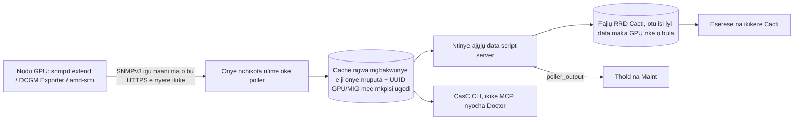

<!-- Source: README.md; SHA256: 97ba37df4a883426d3984ed7d14547ad7367e973411a8abd930409ce259f545b -->

<!-- translations:start -->
[English](../../../README.md) | [简体中文](../zh-CN/README.md) | [हिन्दी](../hi-IN/README.md) | [Español (España)](../es-ES/README.md) | [Español (Latinoamérica)](../es-419/README.md) | [العربية (السعودية)](../ar-SA/README.md) | [Afrikaans](../af-ZA/README.md) | [አማርኛ](../am-ET/README.md) | [العربية (مصر)](../ar-EG/README.md) | [العربية (المغرب)](../ar-MA/README.md) | [বাংলা](../bn-BD/README.md) | [Bosanski](../bs-BA/README.md) | [Deutsch](../de-DE/README.md) | [فارسی](../fa-IR/README.md) | [Filipino](../fil-PH/README.md) | [Français](../fr-FR/README.md) | [Français (Maroc)](../fr-MA/README.md) | [Français (Sénégal)](../fr-SN/README.md) | [Hausa](../ha-NG/README.md) | [עברית](../he-IL/README.md) | [Hrvatski](../hr-HR/README.md) | [Bahasa Indonesia](../id-ID/README.md) | [Igbo](README.md) | [Italiano](../it-IT/README.md) | [日本語](../ja-JP/README.md) | [한국어](../ko-KR/README.md) | [Malagasy](../mg-MG/README.md) | [मराठी](../mr-IN/README.md) | [Bahasa Melayu](../ms-MY/README.md) | [Nederlands](../nl-NL/README.md) | [Polski](../pl-PL/README.md) | [Português (Brasil)](../pt-BR/README.md) | [Русский](../ru-RU/README.md) | [Kinyarwanda](../rw-RW/README.md) | [Soomaali](../so-SO/README.md) | [Српски](../sr-RS/README.md) | [Svenska](../sv-SE/README.md) | [Kiswahili](../sw-KE/README.md) | [தமிழ்](../ta-IN/README.md) | [తెలుగు](../te-IN/README.md) | [ไทย](../th-TH/README.md) | [Türkçe](../tr-TR/README.md) | [Українська](../uk-UA/README.md) | [اردو](../ur-PK/README.md) | [Tiếng Việt](../vi-VN/README.md) | [isiXhosa](../xh-ZA/README.md) | [Yorùbá](../yo-NG/README.md) | [繁體中文](../zh-TW/README.md) | [isiZulu](../zu-ZA/README.md)
<!-- translations:end -->

# plugin_gpu

Ngwa mgbakwụnye Cacti 1.2 nke na-eweta ojiji GPU nke ọ bụla, ebe nchekwa, okpomọkụ, ike ọkụ, mmejọ ECC, na ihe kpatara mbelata ọsọ site na ngwaọrụ NVIDIA na AMD banye n'ime Cacti. GPU nke ọ bụla (ma ọ bụ ngalaba MIG) na-aghọ ndeksi nke ajụjụ data na ngwaọrụ nke nọdụ ya, ya mere eserese GPU na-anọ n'akụkụ eserese ndị ọzọ nke nọdụ ahụ n'okpuru ikikere Cacti, Thold na Maint nwekwara ike izipu ọkwa maka ha ma kwụsị ha nwa oge.

> **Ọnọdụ: e mejuputala ngalaba 1 ruo 3 na koodu, ewepụtabeghị ya.** Ngalaba 1 (NVIDIA `nvidia-smi` site na SNMP extend, nsochi njirimara, eserese, mgbaàmà mbelata ọsọ na ECC, izipu ọkwa Thold na Maint, ibe ahụike), Ngalaba 2 (onye ntụle/onye ahịa HTTP(S) na-agụ naanị maka NVIDIA DCGM Exporter na onye ntụle AMD `amd-smi`), Ngalaba 3 (nsochi njirimara ngalaba MIG, kọlụm Schema v4, mmebe onye nchịkọta dịpụrụ adịpụ n'ime oke poller, hook `replicate_out` na `remote_agent`), CasC operator CLI (`cli/gpu.php`), na hook njikọ usoro (`abilities_register`, `doctor_register_checks`, `casc_register_providers`) ka e mejuputara ma kpuchie site na nnwale otu, nchekwa, na njikọ na Cacti nwa oge. Mmegide dị ndụ ruo ugbu a na-eji `snmpd` e mepụtara na ihe atụ ule kama ngwaike GPU n'anụ ahụ. Ihe ka ghere oghe tupu ịkpọsa ntọhapụ: nnwale na ngwaike ezigbo ya ([docs/pilot-plan.md](../../pilot-plan.md), #54), nyocha nchekwa sitere n'èzí ([docs/security-review.md](../../security-review.md)), ihe atụ e nwetara site na ngwaọrụ ezigbo ya (#14), na oke arụmọrụ a tụrụ na ngwaike buru ibu dị ka nke mmepụta ([docs/performance.md](../../performance.md)). Nchịkọta mmejọ XID ka ghere oghe n'okpuru mkpebi #8.

## Oke ọrụ nnweta

| Mpaghara | Nnweta |
| --- | --- |
| GPU View | Ibe nlekọta ndị dị adị. |
| GPU Operator | Nlekọta gbakwụnyere ibe Operations na nkwenye nyocha nke onye nke aka ya. |
| GPU Admin | Nnweta Operator gbakwụnyere nhazi dị adị na omume nchịkwa. |

Mgbe i depụtachara faịlụ nkwalite, meghee ibe Plugins dị ka onye nchịkwa iji debanye aha
mpaghara ọhụrụ ahụ. Nye mpaghara Operator kpọmkwem n'okpuru **Configuration > Users** ma ọ bụ otu ndị ọrụ.
Nkwalite na-echekwa ID mpaghara View na Admin ndị dị adị na ikike e nyere. Nnweta Admin
na-eketa nnweta Operator, nnweta Operator na-eketekwa nnweta View na arịrịọ ọ bụla;
nke a anaghị agbakwụnye ikike echekwara nye ndị ọrụ ma ọ bụ otu. Ntọala ngwa mgbakwụnye chọkwara
nnweta GPU Admin na mgbakwụnye na ikikere Settings nke Cacti.

Ikikere ngwaọrụ Cacti ka na-egbochi ahịrị na omume dịịrị onye ọrụ nke ọ bụla; ihe ndị a na-ejikọtaghị na ngwaọrụ chọrọ onye nchịkwa.
Asambodo nzuzo, nhazi, njikọta, nhichapụ na mgbanwe nchịkwa ndị ọzọ
na-anọgide na ibe nchịkwa. Nkwenye na-adịru naanị n'ime oge ọrụ onye ọrụ dị ugbu a,
ọ gaghị akarị otu elekere ma naanị mgbe otu nchọpụta ahụ ka dị
ọhụrụ. Nchọpụta ọhụrụ ma ọ bụ nke gbanwere na-eme ka ha ghara ịdị irè. Ha anaghị eji akara egosi na nha dara ada
dị mma ma ọ bụ kwụsị ọkwa.

## Ihe kpatara ya

Nọdụ GPU na-abụkarị ndị dịbu na Cacti maka CPU, ebe nchekwa, na njikọ netwọkụ. Ahụike GPU bụ ajụjụ dị iche nke data SNMP nke nọdụ ahụ anaghị aza: kaadị nwere ike ịbelata ọsọ n'ihi oke okpomọkụ, kpokọta mmejọ ECC, ma ọ bụ kọọ mmejọ XID mgbe nọdụ ahụ n'onwe ya dị ka ọ dị mma. Ngwaọrụ ndị nrụpụta na-akọ ya (`nvidia-smi`, DCGM, `amd-smi`), mana nsonaazụ ha dị n'èzí eserese, ikikere, na izipu ọkwa nke Cacti.

Ngwa mgbakwụnye ahụ na-emechie oghere ahụ site n'ịtụgharị nsonaazụ ngwaọrụ ndị nrụpụta ka ọ bụrụ isi iyi data Cacti, nke e ji njirimara GPU nke ọ bụla mee mkpịsị ugodi kama ọnọdụ ya, ka nrụgharị nke na-agbanwe usoro GPU ghara ijikọ akụkọ ihe mere eme nke otu kaadị na nke ọzọ. Ọ na-eji usoro eserese, ikikere, ndị nchịkọta data dịpụrụ adịpụ, Thold, na Maint nke Cacti eme ihe ọzọ kama iwulite ụdị ha dị iche.

## Oke atụmatụ

| Ngalaba | Oke ọrụ | Ọnọdụ | Akara ihe mgbaru ọsọ |
|---|---|---|---|
| 0, nyocha | Nsonaazụ ngwaọrụ ndị nrụpụta, mgbaàmà XID na mbelata ọsọ, njirimara GPU, ikike pụrụ iche, mkpebi ụzọ nchịkọta | Zuru ezu | [M1](https://github.com/somethingwithproof/plugin_gpu/milestone/1) |
| 1, nvidia | Nchịkọta `nvidia-smi`, ndepụta site na UUID, eserese, mgbaàmà mbelata ọsọ na ECC, Thold na Maint, ibe ahụike | E mejuputara (nwalere na fixture) | [M2](https://github.com/somethingwithproof/plugin_gpu/milestone/2), [M3](https://github.com/somethingwithproof/plugin_gpu/milestone/3), [M4](https://github.com/somethingwithproof/plugin_gpu/milestone/4) |
| 2, backends | Onye ntụle/onye ahịa HTTP(S) na-agụ naanị maka DCGM Exporter (`lib/DcgmExporterParser.php`, `lib/DcgmExporterClient.php`), onye ntụle AMD `amd-smi` (`lib/AmdSmiParser.php`) | E mejuputara (nwalere otu) | [M5](https://github.com/somethingwithproof/plugin_gpu/milestone/5) |
| 3, mig, nke dịpụrụ adịpụ, na usoro | Nsochi njirimara ngalaba MIG, ndị nchịkọta data dịpụrụ adịpụ (`INFO`, `poller_gpu.php --poller=N`, `replicate_out`, `remote_agent`), CasC CLI (`cli/gpu.php`), hook MCP/Doctor/CasC | E mejuputara (nwalere otu na njikọ CI) | [M6](https://github.com/somethingwithproof/plugin_gpu/milestone/6) |

Nke na-esoghị n'oke ọrụ: iwu ọ bụla na-agbanwe GPU ma ọ bụ nọdụ (elekere, oke ike ọkụ, ntọgharị, nhazi MIG), injin izipu ọkwa nke ngwa mgbakwụnye nwe, daemon pụrụ iche ma ọ bụ ụkpụrụ netwọkụ, na nhazi oge ma ọ bụ nchịkọta ọrụ. Lee atụmatụ ahụ maka ndepụta ọrụ nyocha ka fọdụrụ.

## Ihe akara nke anọ (milestone 4) na-agbakwụnye

- **Onye nchịkọta na-agụ naanị maka NVIDIA DCGM Exporter** (`lib/DcgmExporterParser.php`, `lib/DcgmExporterClient.php`). Na-atụle metrik ngosi ederede Prometheus (`DCGM_FI_DEV_GPU_UTIL`, `DCGM_FI_DEV_FB_USED`, `DCGM_FI_DEV_FB_FREE`, `DCGM_FI_DEV_POWER_USAGE`, `DCGM_FI_DEV_GPU_TEMP`, `DCGM_FI_DEV_ECC_DBE_VOL_TOTAL`, `DCGM_FI_DEV_CLOCK_THROTTLE_REASONS`, na akara MIG `GPU_I_ID` na `GPU_I_PROFILE`). Onye ahịa HTTP(S) na-amanye ndepụta host/CIDR doro anya maka njedebe, na-enyocha asambodo TLS ndị ọgbọ na ndabere, na-egbochi oge ngafe na nha azịza, na-ewepụ ntugharị (redirects), ma na-ajụ atụmatụ na-abụghị HTTP(S).
- **Onye ntụle na-agụ naanị maka AMD `amd-smi`** (`lib/AmdSmiParser.php`). Na-ahazi nsonaazụ JSON/SNMP-extend nke `amd-smi` (ojiji, VRAM, ike ọkụ, okpomọkụ junction/edge, ECC, metadata nke nkewa, na ihe mkpokọta mbelata ọsọ dị iche iche site na `Reading::$vendorExtensions`) banye n'ụdị nha nkịtị n'okpuru `Vendor::Amd`.
- **Nsochi ngalaba MIG na Schema v4** (`lib/GpuReport.php`, `lib/GpuSnapshot.php`, `lib/GpuRecord.php`, `lib/Schema.php`, `lib/ScriptServer.php`). Na-eso UUID nke ngalaba MIG (`MIG-<uuid>` na `MIG-GPU-<parent>/<gi>/<ci>`), `mig_mode`, `mig_instance_id`, `mig_profile`, `parent_uuid`, na `partition_info` n'akụkụ GPU nne na nna ka ọ na-echebe mkpịsị ugodi njirimara na-adịghị agbanwe agbanwe (`vendor`, `uuid`, `parent_uuid`) na mmelite ma na-enyocha ha tupu ajụjụ nchekwa data.
- **Ndị nchịkọta data dịpụrụ adịpụ** (`INFO`, `poller_gpu.php`, `lib/Poller.php`, `lib/ReplicationRepository.php`, `setup.php`). Na-ekwupụta `remote_collect:1, remote_poller:1` na `INFO`, na-akwado mmebe n'ime oke poller site na `php plugins/gpu/poller_gpu.php --poller=N`, na-awụfe imepụta ihe Cacti na poller ndị na-abụghị isi, na-emegharị tebụl dị n'oke poller site na `replicate_out`, ma na-aza omume ịgụ naanị `gpu_health` na `gpu_inventory` site na `remote_agent`.
- **CLI nke onye ọrụ na CasC** (`cli/gpu.php`, `lib/CascProvider.php`). Na-agba na PHP 8.2+ (na-atụle na PHP 8.0) n'enweghị ndabere Composer dị n'èzí: `php plugins/gpu/cli/gpu.php export [--format=yaml|xml]`, `validate <file> [--format=yaml|xml]`, `plan <file> [--format=yaml|xml] [--output=text|json]`, `apply <file> --confirm=<PLAN_HASH> [--format=yaml|xml]`, na `health [--format=text|json]`. Atụmatụ na-agbakọ hash nkwenye SHA-256 doro anya, `apply` na-akwụsị n'enweghị nsogbu ma ọ bụrụ na hash adabaghị, na ntụle XML na-ajụ nkwupụta `DOCTYPE` na `ENTITY`.
- **Hook njikọ usoro** (`lib/EcosystemIntegration.php`, `setup.php`). Na-edebanye aha `abilities_register` (`gpu-list-nodes`, `gpu-list-devices`, `gpu-get-health`; ịgụ naanị, kpọchiri na mpaghara `GPU View` na ikikere ngwaọrụ Cacti), `doctor_register_checks` (`gpu_schema`, `gpu_poller_freshness`, `gpu_node_health`), na `casc_register_providers`.
- **Ihe kpatara mbelata ọsọ na ECC dị ka uru ọkwa** ([docs/metrics.md](../../metrics.md)). Na-akọwa ihe mkpuchi ihe omume elekere ka ọ bụrụ ihe ngosi 0/1 ma gbakọọ mmejọ ECC ọhụrụ e doziri na ndị a na-edozighị maka oge nke ọ bụla dị ka gauges ka Thold 1.8.2 na Maint 1.3 wee zipu ọkwa ma gbochie ya n'enweghị ngụkọta na-adịghị mma ma ọ bụ mwụpụ ntọgharị ([docs/alerting.md](../../alerting.md)).
- **GPU Health, ikikere, ọdịda/mweghachi, na oke arụmọrụ.** GPU Health (GPU View) na-egosi ịdị ọhụrụ e chekwara, nsonaazụ nchịkọta ikpeazụ, ọnọdụ Maint, backend, ụdị ngwaọrụ, na ihe mkpuchi mbụ nke mbelata ọsọ n'ejighị kpọtụrụ nọdụ. Nnwale edemede zuru oke na-akwado ikikere, mweghachi site na ọdịda agent/DB/RRD ([docs/backup.md](../../backup.md)), na nnwale GPU 100 na CI ([docs/performance.md](../../performance.md), [docs/operations.md](../../operations.md), [CHANGELOG.md](../../../CHANGELOG.md)).

## Ihe akara nke atọ (milestone 3) na-agbakwụnye

- **Nchịkọta site na SNMP extend** ([ADR 0008](../../decisions/0008-collect-through-snmp-extend.md)). Onye nchịkwa nọdụ na-agbakwụnye ahịrị `extend` abụọ e debere na `snmpd.conf` ([docs/node-setup.md](../../node-setup.md)); ngwa mgbakwụnye ahụ na-agụ NET-SNMP-EXTEND-MIB site na ọrụ SNMP nke Cacti jiri asambodo nzuzo nke ngwaọrụ ahụ n'onwe ya, a na-atụ aro SNMPv3. Ọ naghị agba ihe ọ bụla na sava Cacti ma ọ bụ nọdụ ahụ.
- **Ntụle siri ike.** A na-agụ mpaghara site n'ọnọdụ ha, ahịrị nke ọ bụla na-akpọ GPU ya site na UUID, ma ọnọdụ ọpụpụ na-abụghị efu, ngafe oge, nsonaazụ e bepụrụ ebepụ, ahịrị nwere ọnụọgụ mpaghara na-ezighị ezi, ma ọ bụ ederede mmejọ jikọtara ọnụ na-eme ka nchịkọta niile daa: uru na-aghọ `U`, ọ dịghị GPU a na-akpọ na ọ nọghị, na GPU Nodes na-egosi ihe kpatara ya.
- **Onye nchịkọta mgbe okirikiri poller ọ bụla gasịrị.** Ọ na-agụ onye nnọchiteanya nke nọdụ ọ bụla e mere ka ọ rụọ ọrụ, na-emelite ndekọ njirimara, ma chekwaa ihe atụ kacha ọhụrụ na cache. Ntinye script server na-agụ naanị cache ahụ, ya mere ntuli aka Cacti anaghị echere nọdụ GPU.
- **Ihe Cacti** ([ADR 0010](../../decisions/0010-attach-to-existing-node-devices.md)). Ndekọ ndabere na ajụjụ data *GPU - Devices* na-abịa dị ka XML ma a na-ebubata ha mgbe e tinyere ma ọ bụ kwalite ha. Ichekwa nọdụ na-ejikọta ajụjụ data ahụ na ngwaọrụ ya dị adị jiri usoro mweghachi ndeksi None; GPU Nodes nwere ike ịmepụta ngwaọrụ naanị mgbe nọdụ ahụ enweghị nke ọ bụla. GPU nke ọ bụla bụ ndeksi e ji onye nrụpụta na UUID mee mkpịsị ugodi, nwee otu isi iyi data nke eserese Utilization, Memory, Temperature, Power, Power Percent, Clocks, Throttle, ECC Errors, New ECC Errors, Retired Pages, na Sample Age ya na-ekerịta. Eserese ụfọdụ na-ese mpaghara ụdị ọ bụla, n'ihi na Cacti na-echekwa naanị mpaghara eserese na-eji. Ngwa mgbakwụnye ahụ na-emegharị ndeksi mgbe mgbanwe GPU ọ bụla gasịrị, na-edobe mmegharị ndeksi Cacti mafere mgbe ngwaọrụ ahụ dara (Down) ma ọ bụ kwụsịrị ma gbaa ya ozugbo ngwaọrụ ahụ biliri (Up), ma mepụta eserese maka GPU ọhụrụ.
- **Akụkọ ihe mere eme na-anọgide na kaadị ahụ.** GPU na-anọghị na-anọgide dị ka ndeksi, ya mere eserese ya na-egosi oghere ma maliteghachi n'otu faịlụ RRD ahụ mgbe ọ lọtara. Kaadị nnọchi n'otu oghere ahụ na-enweta isi iyi data nke ya. **Remove from Data Query** na ibe nọdụ ahụ na-ewepụ GPU na-anọghị na ndepụta ahụ; a na-echekwa faịlụ RRD ya na eserese ya ruo mgbe i hichapụrụ ha.
- **Ikikere ngwaọrụ na GPU Nodes.** GPU Admin na-ahụ, na-agbanwe, na-ebupụ, ma na-ebugharị naanị nọdụ na GPU dị na ngwaọrụ ha nwere ike ịhụ na Cacti; mbugharị GPU chọrọ nọdụ abụọ ahụ. Enwere ike gbanyụọ ma ọ bụ hichapụ nọdụ nke e hichapụrụ ngwaọrụ ya.
- **Ụdị nha nkịtị** ([ADR 0009](../../decisions/0009-common-metric-core-with-vendor-extensions.md), [docs/metrics.md](../../metrics.md)). Ebe nchekwa dị na byte, a na-akọwa ihe mkpuchi ihe omume elekere ka ọ bụrụ ihe ngosi `thr_*`, ma `age` bụ afọ nke oge ihe atụ GPU n'onwe ya, ma ọ bụ `U` mgbe a na-amaghị ya.

Onye ọrụ na-etinye ya (sava weebụ) ga-enwerịrị ike ide na `<cacti>/resource/script_server/`, ebe ngwa mgbakwụnye ahụ na-etinye XML ajụjụ data ya; ma ọ bụghị ya, ntinye na nkwalite ga-akwụsị na ozi ma nwaa ọzọ na mgbalị na-esote. Mwepụ na-ewepụ ndekọ ndabere na XML naanị mgbe a họpụtara *Remove the plugin's Cacti objects on uninstall*, ma ọ naghị ehichapụ faịlụ RRD, ngwaọrụ, eserese, ma ọ bụ isi iyi data ([docs/operations.md](../../operations.md#uninstall)). Nọdụ ndị dị na ndị nchịkọta data dịpụrụ adịpụ na-agba n'ime oke `poller_id` e kenyere ha.

## Ihe akara nke abụọ (milestone 2) na-eweta

- **Ntinye nwere nchedo.** Na PHP dị n'okpuru 8.2, a na-ajụ ntinye na mmegharị jiri ozi na-akpọ ụdị a chọrọ, akụkụ ndị ọzọ nke Cacti na-aga n'ihu na-arụ ọrụ. `setup.php` na edemede ibe na-agafe nyocha na PHP 8.0.
- **Okirikiri ndụ.** Ntinye, nkwalite, nkwụsị, na mwepụ site na ibe Plugins nke Cacti. Nkwalite dị n'usoro, na-agwụcha mgbe nkwụsịtụ gasịrị, ma na-agbanwe ụdị e dekọrọ naanị mgbe ha gara nke ọma. Mwepụ na-edobe tebụl nke ngwa mgbakwụnye ahụ belụsọ ma i kpochapụrụ *Keep Plugin Tables on Uninstall*; ọ naghị emetụ ngwaọrụ Cacti, isi iyi data, eserese, ma ọ bụ faịlụ RRD aka.
- **Mpaghara dị iche iche.** *GPU Admin* na-emepe **GPU Nodes**, ebe i na-edebanye ngwaọrụ Cacti dị ka nọdụ GPU, na-akwado ma ọ bụ na-ajụ mbugharị GPU n'etiti nọdụ, ma na-ebupụ ndekọ ọ bụla dị ka JSON. *GPU View* na-emepe **GPU Inventory**, nke na-edepụta GPU naanị na ngwaọrụ onye na-ekiri nwere ike ịhụ. Ibe abụọ ahụ dị n'okpuru Management, na mgbanwe ọ bụla bụ POST nke csrf-magic nyochara.
- **Ndekọ njirimara GPU.** E ji onye nrụpụta na UUID mee GPU nke ọ bụla mkpịsị ugodi. Ndeksi, ID bọs PCI, aha, draịva, na ngwaọrụ na-akọ akụkọ bụ àgwà ndị na-agbanwe n'ọnọdụ ha. A na-akpọ UUID ọhụrụ n'oghere a maara dị ka nnọchi nwere ike ịbụ ma malite akụkọ ihe mere eme nke ya; GPU a hụrụ na nọdụ ọzọ na-akwagharị naanị mgbe onye ọrụ kwadoro; a na-akpọ GPU na-efu na nchịkọta gara nke ọma dị ka onye na-anọghị mgbe ọnụọgụ a haziri ahazi gasịrị ma a naghị ehichapụ ya ma ọlị. Naanị UUID NVIDIA nke GPU zuru ezu ka a na-anabata ugbu a; ngalaba MIG na-echere mkpebi #13, na AMD na-echere nyocha #19. A na-anwale iwu ndị ahụ site na usoro ihe atụ, ebe ọ bụ na ọ dịghị onye nchịkọta na-enye ha data ugbu a.
- **Nnwale na CI.** Ngwugwu nnwale nke otu na iwu isi iyi na-enweghị GPU ma ọ bụ nchekwa data, nyocha okirikiri ndụ na ikikere ibe megide Cacti 1.2.31 na 1.2.x dị ugbu a na PHP 8.2 ruo 8.5, ọrụ njụ PHP 8.1, nyocha lint PHP 8.0 nke ebe ntinye, PHPStan na ọkwa 9, na REUSE. Ngwá nnwale ahụ bụ nwa oge ruo mgbe e kpebiri #12.

### Ntinye maka nnwale

Nzọụkwụ ndị a na-etinye koodu dị ugbu a iji nwalee ya; [docs/operations.md](../../operations.md) nwere ntụziaka zuru oke maka onye ọrụ. Ha chọrọ Cacti 1.2.31 ma ọ bụ nke ọhụrụ karịa na PHP 8.2 ma ọ bụ nke ọhụrụ karịa.

1. Depụtaghachi ebe nchekwa ahụ gaa na `plugins/gpu` n'okpuru ndekọ Cacti gị. A ga-akpọrịrị ndekọ ahụ `gpu`.
2. Na Cacti, meghee **Configuration > Plugins**, wee tinye ma gbanye **GPU**.
3. Nye ndị ọrụ mpaghara *GPU View*, *GPU Operator*, ma ọ bụ *GPU Admin* n'okpuru **Configuration > Users**, dị ka ọrụ ha si dị. Onye ọrụ na-etinye ya na-enweta View na Admin; Admin gụnyere nnweta Operator.
4. Hazie onye nnọchiteanya SNMP nke nọdụ GPU ọ bụla dị ka a kọwara na [docs/node-setup.md](../../node-setup.md), wee tinye nọdụ ahụ n'okpuru **Management > GPU Nodes**.
5. Maka ọkwa, bubata ndekọ ndabere Thold e zigara dị ka [docs/alerting.md](../../alerting.md) si kọwaa.
6. Ọ bụrụ na ị chọrọ, hazie **Configuration > Settings > GPU**: *Mark Absent After* (ndabere nchịkọta 3 gara nke ọma, site na 1 ruo 100), *Stale After* (afọ ihe atụ nwere ike ịdị tupu uru ya ebipụta `U`), na *Keep Plugin Tables on Uninstall* (ndabere gbanyere).

## Otu nha si erute Cacti

Mkpebi [#7](https://github.com/somethingwithproof/plugin_gpu/issues/7) họọrọ SNMP `extend` ([ADR 0008](../../decisions/0008-collect-through-snmp-extend.md)): onye nnọchiteanya nke nọdụ ahụ n'onwe ya na-agba iwu `nvidia-smi` e debere na ngwa mgbakwụnye ahụ na-agụ naanị nsonaazụ ya. Atụmatụ ahụ na-atụnyere nhọrọ ndị ahụ n'okpuru [Ụzọ nchịkọta](../../PLAN.md#collection-paths).

## Ebumnuche ndakọrịta

| Akụrụngwa | Ebumnuche |
|---|---|
| Cacti | 1.2.31 ma ọ bụ nke ọhụrụ karịa, enweghị mgbanwe koodu isi |
| PHP | 8.2 ma ọ bụ nke ọhụrụ karịa; `setup.php` na-anọgide na-agafe nyocha na 8.0 ka gburugburu a na-akwadoghị wee nweta njụ kama imebi UI Cacti |
| NVIDIA | Akara draịva na ngwaọrụ ga-abụ nke nyocha [#26](https://github.com/somethingwithproof/plugin_gpu/issues/26) ga-esetịpụ; a nyochara ID mpaghara DCGM na v3.3.9 na v4.7.0 |
| AMD | `amd-smi` na ntọhapụ ROCm ga-abụ nke nyocha [#26](https://github.com/somethingwithproof/plugin_gpu/issues/26) ga-esetịpụ |
| Thold, Maint | Thold 1.8.2 na Maint 1.3, a na-agbanweghị, nwalere site n'isi ruo n'ọgwụgwụ ([docs/alerting.md](../../alerting.md)) |

## Nhazi

- [docs/PLAN.md](../../PLAN.md) bụ atụmatụ zuru oke: nhazi usoro, eziokwu sitere n'isi iyi ọ dabere na ha (yana isi iyi ha), ụdị njirimara, oke nchekwa, mgbakọ arụmọrụ, nnwale, na ihe egwu.
- [docs/decisions/](../../decisions) nwere ndekọ mkpebi nhazi usoro maka nhọrọ e merelarị.
- [docs/REQUIREMENTS.md](../../REQUIREMENTS.md) na-ejikọta ID ihe achọrọ nke ọ bụla na okwu ya.

## Otu e si eso ọrụ

- **Akara ihe mgbaru ọsọ** na-agbaso akara ihe mgbaru ọsọ nke atụmatụ ahụ. Nke ọ bụla nwere okwu epic nke na-edepụta obere okwu ya na ihe àmà ọpụpụ.
- **Okwu (Issues)** nwere ụdị site na akara: `type: requirement`, `type: research`, `type: decision`, `type: epic`. Okwu ihe achọrọ na-ekwu ihe achọrọ e nyere nọmba nke a pụrụ ịnwale (`REQ-AREA-NNN`) na ụkpụrụ nnabata.
- **Akara** na-ebukwa `area:`, `phase:`, `priority:`, na `status:`. Lee [CONTRIBUTING.md](../../../CONTRIBUTING.md#labels).
- [Bọọdụ ọrụ ngo](https://github.com/users/somethingwithproof/projects/9) na-egosi okwu niile gafee akara ihe mgbaru ọsọ.

## Itinye aka

Gụọ [CONTRIBUTING.md](../../../CONTRIBUTING.md). Nkwenye koodu (commits) chọrọ mbinye aka DCO. Mkparịta ụka nhazi na-eme na okwu (issues); mkpebi ghere oghe na-ebu akara `type: decision`. Nsonaazụ e nwetara site na ngwaọrụ GPU ezigbo ya bụ onyinye kacha baa uru na akara nke mbụ; wepụ aha sava, nọmba usoro, na UUID mbụ.

## Nchekwa

Kọọ adịghị ike nchekwa na nzuzo; lee [SECURITY.md](../../../SECURITY.md).

## Ikikere

GNU General Public License v2.0, otu ikikere ahụ dị ka Cacti na ngwa mgbakwụnye ya. Lee [LICENSE](../../../LICENSE).
