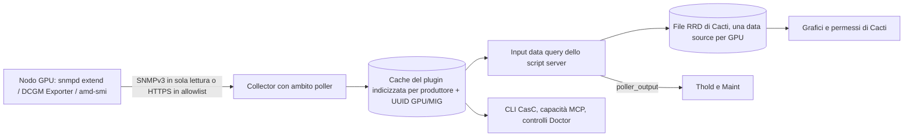

<!-- Source: README.md; SHA256: 97ba37df4a883426d3984ed7d14547ad7367e973411a8abd930409ce259f545b -->

<!-- translations:start -->
[English](../../../README.md) | [简体中文](../zh-CN/README.md) | [हिन्दी](../hi-IN/README.md) | [Español (España)](../es-ES/README.md) | [Español (Latinoamérica)](../es-419/README.md) | [العربية (السعودية)](../ar-SA/README.md) | [Afrikaans](../af-ZA/README.md) | [አማርኛ](../am-ET/README.md) | [العربية (مصر)](../ar-EG/README.md) | [العربية (المغرب)](../ar-MA/README.md) | [বাংলা](../bn-BD/README.md) | [Bosanski](../bs-BA/README.md) | [Deutsch](../de-DE/README.md) | [فارسی](../fa-IR/README.md) | [Filipino](../fil-PH/README.md) | [Français](../fr-FR/README.md) | [Français (Maroc)](../fr-MA/README.md) | [Français (Sénégal)](../fr-SN/README.md) | [Hausa](../ha-NG/README.md) | [עברית](../he-IL/README.md) | [Hrvatski](../hr-HR/README.md) | [Bahasa Indonesia](../id-ID/README.md) | [Igbo](../ig-NG/README.md) | [Italiano](README.md) | [日本語](../ja-JP/README.md) | [한국어](../ko-KR/README.md) | [Malagasy](../mg-MG/README.md) | [मराठी](../mr-IN/README.md) | [Bahasa Melayu](../ms-MY/README.md) | [Nederlands](../nl-NL/README.md) | [Polski](../pl-PL/README.md) | [Português (Brasil)](../pt-BR/README.md) | [Русский](../ru-RU/README.md) | [Kinyarwanda](../rw-RW/README.md) | [Soomaali](../so-SO/README.md) | [Српски](../sr-RS/README.md) | [Svenska](../sv-SE/README.md) | [Kiswahili](../sw-KE/README.md) | [தமிழ்](../ta-IN/README.md) | [తెలుగు](../te-IN/README.md) | [ไทย](../th-TH/README.md) | [Türkçe](../tr-TR/README.md) | [Українська](../uk-UA/README.md) | [اردو](../ur-PK/README.md) | [Tiếng Việt](../vi-VN/README.md) | [isiXhosa](../xh-ZA/README.md) | [Yorùbá](../yo-NG/README.md) | [繁體中文](../zh-TW/README.md) | [isiZulu](../zu-ZA/README.md)
<!-- translations:end -->

# plugin_gpu

Un plugin per Cacti 1.2 che porta in Cacti utilizzo, memoria, temperatura, potenza, errori ECC e motivi di throttling per singola GPU dagli strumenti NVIDIA e AMD. Ogni GPU (o istanza MIG) diventa un indice di una data query sul dispositivo del proprio nodo, in modo che i grafici GPU si trovino accanto agli altri grafici del nodo sotto i permessi di Cacti, e Thold e Maint possano generare avvisi e sopprimerli.

> **Stato: fasi dalla 1 alla 3 implementate nel codice, non ancora rilasciato.** La fase 1 (NVIDIA `nvidia-smi` tramite SNMP extend, tracciamento dell'identità, grafici, segnali di throttle ed ECC, avvisi Thold e Maint, pagina di stato di salute), la fase 2 (parser/client HTTP(S) in sola lettura per NVIDIA DCGM Exporter e parser AMD `amd-smi`), la fase 3 (tracciamento dell'identità delle istanze MIG, colonne Schema v4, esecuzione del collector remoto con ambito poller, hook `replicate_out` e `remote_agent`), la CLI operatore CasC (`cli/gpu.php`) e gli hook di ecosistema (`abilities_register`, `doctor_register_checks`, `casc_register_providers`) sono implementati e coperti da test unitari, di sicurezza e di integrazione su un'istanza Cacti temporanea. Le esecuzioni dal vivo finora utilizzano `snmpd` sintetico e payload di fixture anziché hardware GPU fisico. Rimangono aperti prima di etichettare un rilascio: test pilota su hardware reale ([docs/pilot-plan.md](../../pilot-plan.md), #54), una revisione di sicurezza esterna ([docs/security-review.md](../../security-review.md)), fixture acquisite da strumenti reali (#14) e la misurazione della scalabilità su hardware di dimensioni produttive ([docs/performance.md](../../performance.md)). La raccolta degli errori XID rimane aperta sotto la decisione #8.

## Ruoli di accesso

| Realm | Accesso |
| --- | --- |
| GPU View | Pagine di monitoraggio esistenti. |
| GPU Operator | Monitoraggio più la pagina Operations e le conferme personali di triage. |
| GPU Admin | Accesso Operator più la configurazione esistente e le azioni amministrative. |

Dopo aver copiato i file di aggiornamento, aprire la pagina Plugins come amministratore per registrare il nuovo realm. Assegnare esplicitamente il realm Operator in **Configuration > Users** o nei gruppi di utenti. Gli aggiornamenti mantengono gli ID e le concessioni esistenti dei realm View e Admin. L'accesso Admin eredita l'accesso Operator e l'accesso Operator eredita l'accesso View a ogni richiesta; ciò non aggiunge concessioni memorizzate a utenti o gruppi. Le impostazioni del plugin richiedono inoltre l'accesso GPU Admin in aggiunta al permesso Settings di Cacti.

I permessi sui dispositivi di Cacti continuano a limitare le righe e le azioni disponibili per ciascun utente; gli oggetti non mappati richiedono un amministratore. Credenziali, configurazione, mappatura, eliminazione e altre modifiche amministrative rimangono nelle pagine amministrative. Le conferme (acknowledgment) durano solo nella sessione corrente dell'utente, per al massimo un'ora e solo finché la stessa osservazione rimane aggiornata. Osservazioni nuove o modificate le invalidano. Non contrassegnano mai come sana una misurazione fallita né sopprimono gli avvisi.

## Motivazione

I nodi GPU sono solitamente già presenti in Cacti per CPU, memoria e interfacce. Lo stato di salute delle GPU è una questione separata a cui i dati SNMP del nodo non rispondono: una scheda può essere in throttling termico, accumulare errori ECC o segnalare un guasto XID mentre il nodo stesso appare sano. Gli strumenti dei produttori lo segnalano (`nvidia-smi`, DCGM, `amd-smi`), ma il loro output vive al di fuori dei grafici, dei permessi e del sistema di avvisi di Cacti.

Il plugin colma questa lacuna trasformando l'output degli strumenti dei produttori in data source di Cacti, indicizzate in base all'identità di ciascuna GPU anziché alla sua posizione, in modo che un riavvio che riordina le GPU non associ la cronologia di una scheda a un'altra. Riutilizza i grafici, i permessi, i remote data collector, Thold e Maint di Cacti invece di crearne versioni parallele.

## Ambito pianificato

| Fase | Ambito | Stato | Milestone |
|---|---|---|---|
| 0, ricerca | Output degli strumenti dei produttori, segnali XID e di throttle, identità GPU, privilegi, decisione sul percorso di raccolta | Completo | [M1](https://github.com/somethingwithproof/plugin_gpu/milestone/1) |
| 1, nvidia | Raccolta `nvidia-smi`, inventario per UUID, grafici, segnali di throttle ed ECC, Thold e Maint, pagina di stato | Implementato (testato con fixture) | [M2](https://github.com/somethingwithproof/plugin_gpu/milestone/2), [M3](https://github.com/somethingwithproof/plugin_gpu/milestone/3), [M4](https://github.com/somethingwithproof/plugin_gpu/milestone/4) |
| 2, backend | Parser/client HTTP(S) in sola lettura per DCGM Exporter (`lib/DcgmExporterParser.php`, `lib/DcgmExporterClient.php`), parser AMD `amd-smi` (`lib/AmdSmiParser.php`) | Implementato (testato a livello unitario) | [M5](https://github.com/somethingwithproof/plugin_gpu/milestone/5) |
| 3, mig, remoto ed ecosistema | Tracciamento identità istanze MIG, remote data collector (`INFO`, `poller_gpu.php --poller=N`, `replicate_out`, `remote_agent`), CLI CasC (`cli/gpu.php`), hook MCP/Doctor/CasC | Implementato (test unitari e di integrazione CI) | [M6](https://github.com/somethingwithproof/plugin_gpu/milestone/6) |

Fuori ambito: qualsiasi comando che modifichi una GPU o un nodo (clock, limiti di potenza, reset, layout MIG), un motore di avvisi proprietario del plugin, un demone o protocollo di rete personalizzato e la contabilizzazione di scheduler o job. Consultare il piano per il backlog di ricerca.

## Novità della milestone 4

- **Collector in sola lettura per NVIDIA DCGM Exporter** (`lib/DcgmExporterParser.php`, `lib/DcgmExporterClient.php`). Analizza le metriche di esposizione testuale Prometheus (`DCGM_FI_DEV_GPU_UTIL`, `DCGM_FI_DEV_FB_USED`, `DCGM_FI_DEV_FB_FREE`, `DCGM_FI_DEV_POWER_USAGE`, `DCGM_FI_DEV_GPU_TEMP`, `DCGM_FI_DEV_ECC_DBE_VOL_TOTAL`, `DCGM_FI_DEV_CLOCK_THROTTLE_REASONS`, ed etichette MIG `GPU_I_ID` e `GPU_I_PROFILE`). Il client HTTP(S) applica una allowlist esplicita di host/CIDR per gli endpoint, verifica i certificati peer TLS per impostazione predefinita, limita timeout e dimensione della risposta, disabilita i reindirizzamenti e rifiuta gli schemi non HTTP(S).
- **Parser in sola lettura per AMD `amd-smi`** (`lib/AmdSmiParser.php`). Normalizza l'output JSON/SNMP-extend di `amd-smi` (utilizzo, VRAM, potenza, temperatura junction/edge, ECC, metadati delle partizioni e accumulatori di throttle separati tramite `Reading::$vendorExtensions`) nel modello comune delle metriche sotto `Vendor::Amd`.
- **Tracciamento delle istanze MIG e Schema v4** (`lib/GpuReport.php`, `lib/GpuSnapshot.php`, `lib/GpuRecord.php`, `lib/Schema.php`, `lib/ScriptServer.php`). Traccia gli UUID delle istanze MIG (`MIG-<uuid>` e `MIG-GPU-<parent>/<gi>/<ci>`), `mig_mode`, `mig_instance_id`, `mig_profile`, `parent_uuid` e `partition_info` insieme alle GPU padre, proteggendo al contempo le chiavi di identità immutabili (`vendor`, `uuid`, `parent_uuid`) negli aggiornamenti e validandole prima delle query al database.
- **Remote data collector** (`INFO`, `poller_gpu.php`, `lib/Poller.php`, `lib/ReplicationRepository.php`, `setup.php`). Dichiara `remote_collect:1, remote_poller:1` in `INFO`, supporta l'esecuzione nell'ambito del poller tramite `php plugins/gpu/poller_gpu.php --poller=N`, salta il provisioning degli oggetti Cacti sui poller non principali, replica le tabelle con ambito poller tramite `replicate_out` e risponde alle azioni in sola lettura `gpu_health` e `gpu_inventory` tramite `remote_agent`.
- **CLI operatore e CasC** (`cli/gpu.php`, `lib/CascProvider.php`). Eseguibile su PHP 8.2+ (analizzabile su PHP 8.0) senza dipendenze Composer esterne: `php plugins/gpu/cli/gpu.php export [--format=yaml|xml]`, `validate <file> [--format=yaml|xml]`, `plan <file> [--format=yaml|xml] [--output=text|json]`, `apply <file> --confirm=<PLAN_HASH> [--format=yaml|xml]`, e `health [--format=text|json]`. I piani calcolano un hash di conferma SHA-256 deterministico, `apply` fallisce in modo sicuro (fail closed) in caso di mancata corrispondenza dell'hash e il parsing XML rifiuta le dichiarazioni `DOCTYPE` ed `ENTITY`.
- **Hook di integrazione con l'ecosistema** (`lib/EcosystemIntegration.php`, `setup.php`). Registra `abilities_register` (`gpu-list-nodes`, `gpu-list-devices`, `gpu-get-health`; in sola lettura, vincolato al realm `GPU View` e ai permessi sui dispositivi Cacti), `doctor_register_checks` (`gpu_schema`, `gpu_poller_freshness`, `gpu_node_health`) e `casc_register_providers`.
- **Motivi di throttling ed ECC come valori di avviso** ([docs/metrics.md](../../metrics.md)). Decodifica le maschere degli eventi di clock in indicatori 0/1 e calcola per ciascun intervallo i nuovi errori ECC corretti e non corretti come gauge, così che Thold 1.8.2 e Maint 1.3 inviino e sopprimano gli avvisi senza contatori negativi né picchi dovuti ai reset ([docs/alerting.md](../../alerting.md)).
- **GPU Health, permessi, guasti/ripristino e scalabilità.** GPU Health (GPU View) mostra la freschezza memorizzata, l'esito dell'ultima raccolta, lo stato di Maint, il backend, le versioni e le maschere di throttle grezze senza contattare i nodi. Test end-to-end automatizzati verificano i permessi, il ripristino da guasti di agente/DB/RRD ([docs/backup.md](../../backup.md)) e un test di scalabilità a 100 GPU in CI ([docs/performance.md](../../performance.md), [docs/operations.md](../../operations.md), [CHANGELOG.md](../../../CHANGELOG.md)).

## Novità della milestone 3

- **Raccolta tramite SNMP extend** ([ADR 0008](../../decisions/0008-collect-through-snmp-extend.md)). L'amministratore del nodo aggiunge due righe `extend` fisse a `snmpd.conf` ([docs/node-setup.md](../../node-setup.md)); il plugin legge NET-SNMP-EXTEND-MIB tramite le funzioni SNMP di Cacti con le credenziali del dispositivo stesso, preferibilmente SNMPv3. Non esegue nulla sul server Cacti né sul nodo.
- **Parsing rigoroso.** I campi sono letti per posizione, ogni riga identifica la propria GPU tramite UUID e uno stato di uscita diverso da zero, un timeout, un output troncato, una riga con un numero errato di campi o testo di errore mescolato fanno fallire l'intera raccolta: i valori diventano `U`, nessuna GPU viene contrassegnata come assente e GPU Nodes ne mostra il motivo.
- **Un collector dopo ogni ciclo del poller.** Legge l'agente di ciascun nodo abilitato, aggiorna i record di identità e mette in cache l'ultimo campione. L'input dello script server legge solo tale cache, così che un poll di Cacti non attenda mai un nodo GPU.
- **Oggetti Cacti** ([ADR 0010](../../decisions/0010-attach-to-existing-node-devices.md)). I template e la data query *GPU - Devices* sono distribuiti come XML e importati all'installazione e all'aggiornamento. Il salvataggio di un nodo associa la data query al dispositivo esistente con metodo di reindicizzazione None; GPU Nodes può creare un dispositivo solo quando il nodo non ne possiede alcuno. Ogni GPU è un indice identificato da produttore e UUID, con una data source condivisa dai relativi grafici Utilization, Memory, Temperature, Power, Power Percent, Clocks, Throttle, ECC Errors, New ECC Errors, Retired Pages e Sample Age. Ogni campo del modello è disegnato da almeno un grafico, poiché Cacti memorizza solo i campi usati da un grafico. Il plugin reindicizza dopo ogni modifica delle GPU, conserva una reindicizzazione saltata da Cacti mentre il dispositivo era Down o disabilitato e la esegue non appena il dispositivo torna Up, e crea i grafici per le nuove GPU.
- **La cronologia resta con la scheda.** Una GPU assente rimane un indice, quindi i suoi grafici mostrano un'interruzione e riprendono nello stesso file RRD al suo ritorno. Una scheda sostitutiva nello stesso slot ottiene la propria data source. **Remove from Data Query** nella pagina del nodo rimuove dall'elenco una GPU assente; i relativi file RRD e grafici vengono mantenuti finché non vengono eliminati manualmente.
- **Permessi sui dispositivi in GPU Nodes.** Un GPU Admin visualizza, modifica, esporta e sposta solo nodi e GPU su dispositivi che è autorizzato a vedere in Cacti; lo spostamento di una GPU richiede l'accesso a entrambi i nodi. Un nodo il cui dispositivo è stato eliminato può essere disabilitato o eliminato.
- **Il modello comune delle metriche** ([ADR 0009](../../decisions/0009-common-metric-core-with-vendor-extensions.md), [docs/metrics.md](../../metrics.md)). La memoria è espressa in byte, la maschera degli eventi di clock è decodificata in indicatori `thr_*` e `age` rappresenta l'età dell'istante di campionamento proprio della GPU, oppure `U` quando sconosciuta.

L'utente che esegue l'installazione (server web) deve poter scrivere in `<cacti>/resource/script_server/`, dove il plugin colloca l'XML della propria data query; in caso contrario l'installazione e l'aggiornamento si interrompono con un messaggio e riprovano al tentativo successivo. La disinstallazione rimuove i template e l'XML solo quando è selezionata l'opzione *Remove the plugin's Cacti objects on uninstall* e non elimina mai file RRD, dispositivi, grafici o data source ([docs/operations.md](../../operations.md#uninstall)). I nodi sui remote data collector vengono eseguiti nell'ambito del proprio `poller_id` assegnato.

## Funzionalità della milestone 2

- **Installazione protetta.** Su PHP inferiore alla 8.2, installazione e abilitazione vengono rifiutate con un messaggio che indica la versione richiesta e il resto di Cacti continua a funzionare. `setup.php` e gli script delle pagine sono analizzabili sintatticamente su PHP 8.0.
- **Ciclo di vita.** Installazione, aggiornamento, disabilitazione e disinstallazione tramite la pagina Plugins di Cacti. Gli aggiornamenti sono ordinati, vengono completati dopo un'interruzione e modificano la versione registrata solo dopo il completamento con successo. La disinstallazione mantiene le tabelle del plugin a meno che non si deselezioni *Keep Plugin Tables on Uninstall*; non tocca mai dispositivi, data source, grafici o file RRD di Cacti.
- **Realm separati.** *GPU Admin* apre **GPU Nodes**, dove si registrano i dispositivi Cacti come nodi GPU, si confermano o rifiutano gli spostamenti delle GPU tra nodi e si esporta ogni record in formato JSON. *GPU View* apre **GPU Inventory**, che elenca le GPU solo sui dispositivi che l'utente è autorizzato a vedere. Entrambe le pagine si trovano sotto Management e ogni modifica è una richiesta POST verificata tramite csrf-magic.
- **Record di identità delle GPU.** Ogni GPU è identificata da produttore e UUID. Indice, PCI bus ID, nome, driver e strumento di segnalazione sono attributi che variano sul posto. Un nuovo UUID in uno slot noto viene contrassegnato come possibile sostituzione e avvia una propria cronologia; una GPU rilevata su un altro nodo viene spostata solo previa conferma di un operatore; una GPU assente dalle raccolte riuscite viene contrassegnata come assente dopo un numero configurabile di cicli e non viene mai eliminata. Per ora sono accettati solo gli UUID NVIDIA relativi all'intera GPU; le istanze MIG attendono la decisione #13 e AMD la ricerca #19. Le regole sono verificate tramite sequenze di fixture, poiché nessun collector le alimenta ancora.
- **Test e CI.** Suite di unit test e di regole sui sorgenti senza GPU né database, verifiche del ciclo di vita e dei permessi di pagina rispetto a Cacti 1.2.31 e all'attuale 1.2.x su PHP da 8.2 a 8.5, un job di rifiuto su PHP 8.1, un controllo lint PHP 8.0 dei punti di ingresso, PHPStan al livello 9 e REUSE. L'infrastruttura di test è provvisoria fino alla decisione su #12.

### Installazione per valutazione

Questi passaggi installano il codice attuale per provarlo; [docs/operations.md](../../operations.md) contiene la guida completa per gli operatori. Richiedono Cacti 1.2.31 o successivo su PHP 8.2 o successivo.

1. Copiare il repository in `plugins/gpu` sotto la directory di Cacti. La directory deve chiamarsi `gpu`.
2. In Cacti, aprire **Configuration > Plugins**, quindi installare e abilitare **GPU**.
3. Assegnare agli utenti il realm *GPU View*, *GPU Operator* o *GPU Admin* in **Configuration > Users**, in base al rispettivo ruolo. L'utente che esegue l'installazione riceve View e Admin; Admin include l'accesso Operator.
4. Configurare l'agente SNMP di ciascun nodo GPU come descritto in [docs/node-setup.md](../../node-setup.md), quindi aggiungere il nodo in **Management > GPU Nodes**.
5. Per gli avvisi, importare i template Thold inclusi come descritto in [docs/alerting.md](../../alerting.md).
6. Facoltativamente, regolare **Configuration > Settings > GPU**: *Mark Absent After* (valore predefinito 3 raccolte riuscite, da 1 a 100), *Stale After* (quanto può essere vecchio un campione prima che i suoi valori stampino `U`) e *Keep Plugin Tables on Uninstall* (attivo per impostazione predefinita).

## Come le metriche raggiungono Cacti

La decisione [#7](https://github.com/somethingwithproof/plugin_gpu/issues/7) ha scelto SNMP `extend` ([ADR 0008](../../decisions/0008-collect-through-snmp-extend.md)): l'agente del nodo stesso esegue un comando `nvidia-smi` fisso e il plugin si limita a leggerne il risultato. Il piano confronta le opzioni in [Percorsi di raccolta](../../PLAN.md#collection-paths).

## Obiettivi di compatibilità

| Componente | Obiettivo |
|---|---|
| Cacti | 1.2.31 o successivo, nessuna patch al core |
| PHP | 8.2 o successivo; `setup.php` rimane analizzabile su 8.0 affinché un runtime non supportato riceva un rifiuto invece di compromettere l'interfaccia utente di Cacti |
| NVIDIA | Linee di driver e strumenti da definire tramite la ricerca [#26](https://github.com/somethingwithproof/plugin_gpu/issues/26); ID dei campi DCGM verificati alle versioni v3.3.9 e v4.7.0 |
| AMD | `amd-smi` sulle release ROCm da definire tramite la ricerca [#26](https://github.com/somethingwithproof/plugin_gpu/issues/26) |
| Thold, Maint | Thold 1.8.2 e Maint 1.3, non modificati, testati end-to-end ([docs/alerting.md](../../alerting.md)) |

## Progettazione

- [docs/PLAN.md](../../PLAN.md) è il piano completo: architettura, dati upstream da cui dipende (con fonti), modello di identità, confini di sicurezza, calcolo delle prestazioni, test e rischi.
- [docs/decisions/](../../decisions) raccoglie gli Architecture Decision Record per le scelte già effettuate.
- [docs/REQUIREMENTS.md](../../REQUIREMENTS.md) mappa ciascun ID di requisito alla relativa issue.

## Tracciamento del lavoro

- Le **Milestone** seguono le milestone del piano. Ciascuna ha una issue epic che elenca le relative sotto-issue e le evidenze di uscita.
- Le **Issue** sono classificate per etichetta: `type: requirement`, `type: research`, `type: decision`, `type: epic`. Le issue dei requisiti indicano requisiti numerati e verificabili (`REQ-AREA-NNN`) e criteri di accettazione.
- Le **Etichette** includono anche `area:`, `phase:`, `priority:` e `status:`. Vedere [CONTRIBUTING.md](../../../CONTRIBUTING.md#labels).
- La [bacheca del progetto](https://github.com/users/somethingwithproof/projects/9) mostra tutte le issue attraverso le milestone.

## Contributi

Leggere [CONTRIBUTING.md](../../../CONTRIBUTING.md). I commit richiedono un DCO sign-off. Le discussioni di progettazione avvengono nelle issue; le decisioni aperte riportano l'etichetta `type: decision`. L'output acquisito da strumenti GPU reali è il contributo più utile per la milestone 1; rimuovere prima hostname, numeri di serie e UUID.

## Sicurezza

Segnalare le vulnerabilità privatamente; vedere [SECURITY.md](../../../SECURITY.md).

## Licenza

GNU General Public License v2.0, la stessa licenza di Cacti e dei suoi plugin. Vedere [LICENSE](../../../LICENSE).
