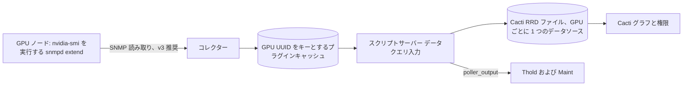

<!-- Source: README.md; SHA256: 126deef1783d64f878bf565f1433c10f31aef828eb9bc313aeff2b0335e54c7c -->

<!-- translations:start -->
[English](../../../README.md) | [简体中文](../zh-CN/README.md) | [हिन्दी](../hi-IN/README.md) | [Español (España)](../es-ES/README.md) | [Español (Latinoamérica)](../es-419/README.md) | [العربية (السعودية)](../ar-SA/README.md) | [Afrikaans](../af-ZA/README.md) | [አማርኛ](../am-ET/README.md) | [العربية (مصر)](../ar-EG/README.md) | [العربية (المغرب)](../ar-MA/README.md) | [বাংলা](../bn-BD/README.md) | [Bosanski](../bs-BA/README.md) | [Deutsch](../de-DE/README.md) | [فارسی](../fa-IR/README.md) | [Filipino](../fil-PH/README.md) | [Français](../fr-FR/README.md) | [Français (Maroc)](../fr-MA/README.md) | [Français (Sénégal)](../fr-SN/README.md) | [Hausa](../ha-NG/README.md) | [עברית](../he-IL/README.md) | [Hrvatski](../hr-HR/README.md) | [Bahasa Indonesia](../id-ID/README.md) | [Igbo](../ig-NG/README.md) | [Italiano](../it-IT/README.md) | [日本語](README.md) | [한국어](../ko-KR/README.md) | [Malagasy](../mg-MG/README.md) | [मराठी](../mr-IN/README.md) | [Bahasa Melayu](../ms-MY/README.md) | [Nederlands](../nl-NL/README.md) | [Polski](../pl-PL/README.md) | [Português (Brasil)](../pt-BR/README.md) | [Русский](../ru-RU/README.md) | [Kinyarwanda](../rw-RW/README.md) | [Soomaali](../so-SO/README.md) | [Српски](../sr-RS/README.md) | [Svenska](../sv-SE/README.md) | [Kiswahili](../sw-KE/README.md) | [தமிழ்](../ta-IN/README.md) | [తెలుగు](../te-IN/README.md) | [ไทย](../th-TH/README.md) | [Türkçe](../tr-TR/README.md) | [Українська](../uk-UA/README.md) | [اردو](../ur-PK/README.md) | [Tiếng Việt](../vi-VN/README.md) | [isiXhosa](../xh-ZA/README.md) | [Yorùbá](../yo-NG/README.md) | [繁體中文](../zh-TW/README.md) | [isiZulu](../zu-ZA/README.md)
<!-- translations:end -->

# plugin_gpu

NVIDIA ツールから取得した GPU ごとの使用率、メモリ、温度、消費電力、ECC エラー、およびスロットリング理由を Cacti に取り込む Cacti 1.2 プラグインです。AMD サポートおよび XID エラーの収集は計画中であり、まだ実装されていません。各 GPU はノードのデバイス上のデータクエリのインデックスとなるため、GPU グラフは Cacti の権限管理下でノードの他のグラフと並んで配置され、Thold や Maint によるアラート通知および抑制を利用できます。

> **ステータス: 開発中、未リリース。** マイルストーン 4 により、フェーズ 1（SNMP extend 経由の NVIDIA 対応）のコード実装が完了しました（収集、識別情報、グラフ、スロットルおよび ECC シグナル、Thold および Maint によるアラート、ヘルスページ、運用者向けドキュメント）。動作検証は、実際の `snmpd` に対して合成出力を行う擬似的な `nvidia-smi` を組み合わせて実行したのみで、実際の GPU ハードウェア上では一度も実行されていません。リリース前に残っている課題は、実機でのパイロットテスト（[docs/pilot-plan.md](../../pilot-plan.md)、#54）、外部セキュリティレビュー（[docs/security-review.md](../../security-review.md)）、実ツールから取得したフィクスチャ（#14）、および本番規模のハードウェアでのスケーラビリティ測定（[docs/performance.md](../../performance.md)）です。XID エラーは決定事項 #8 の結論待ちです。本番環境では実行しないでください。

## アクセスロール

| レルム | アクセス権限 |
| --- | --- |
| GPU View | 既存の監視ページ。 |
| GPU Operator | 監視ページに加え、Operations ページおよび個人用のトリアージ確認応答（acknowledgment）。 |
| GPU Admin | Operator の権限に加え、既存の設定変更および管理操作。 |

アップグレード用ファイルをコピーした後、管理者として Plugins ページを開き、新しいレルムを登録してください。Operator レルムは **Configuration > Users** またはユーザーグループで明示的に割り当ててください。
アップグレード後も既存の View および Admin レルム ID と付与済みの権限は保持されます。各リクエストにおいて、Admin 権限は Operator 権限を継承し、Operator 権限は View 権限を継承しますが、これによってユーザーやグループに保存された権限が追加されるわけではありません。また、プラグイン設定には Cacti の Settings 権限に加えて GPU Admin 権限が必要です。

各ユーザーに表示される行や利用可能な操作は引き続き Cacti のデバイス権限によって制限され、マッピングされていないオブジェクトの操作には管理者権限が必要です。
認証情報、設定、マッピング、削除、およびその他の管理上の変更は、引き続き管理ページで行います。確認応答（acknowledgment）は現在のユーザーセッション内でのみ有効であり、最大 1 時間、かつ同じ観測結果が最新（fresh）である間だけ維持されます。新しい観測結果や変更された観測結果が得られると無効になります。確認応答によって測定失敗が正常とみなされたり、アラートが抑制されたりすることはありません。

## なぜ必要か

GPU ノードは通常、CPU、メモリ、およびインターフェースの監視のためにすでに Cacti に登録されています。しかし GPU の健全性は別問題であり、ノードの SNMP データでは把握できません。ノード自体は正常に見えても、カードがサーマルスロットリングを起こしていたり、ECC エラーが蓄積していたり、XID 障害を報告していたりすることがあります。ベンダーツール（`nvidia-smi`、DCGM、`amd-smi`）はそのような状態を出力しますが、その出力は Cacti のグラフ、権限管理、およびアラート機能の枠外にあります。

このプラグインは、ベンダーツールの出力を Cacti のデータソースに変換することでそのギャップを埋めます。データは装着位置ではなく各 GPU の識別情報をキーとして管理されるため、再起動によって GPU の順序が入れ替わっても、あるカードの履歴が別のカードに紐付けられることはありません。また、同等の機能を独自に再実装するのではなく、Cacti のグラフ機能、権限管理、リモートデータコレクター、Thold、および Maint を再利用します。

## 計画されているスコープ

| フェーズ | スコープ | マイルストーン |
|---|---|---|
| 0, 調査 | ベンダーツール出力、XID およびスロットルシグナル、GPU 識別情報、権限、収集方式の決定 | [M1](https://github.com/somethingwithproof/plugin_gpu/milestone/1) |
| 1, nvidia | `nvidia-smi` による収集、UUID ベースのインベントリ、グラフ、スロットル・ECC・XID シグナル、Thold および Maint 連携、ヘルスページ | [M2](https://github.com/somethingwithproof/plugin_gpu/milestone/2), [M3](https://github.com/somethingwithproof/plugin_gpu/milestone/3), [M4](https://github.com/somethingwithproof/plugin_gpu/milestone/4) |
| 2, バックエンド | DCGM バックエンド、`amd-smi` バックエンド | [M5](https://github.com/somethingwithproof/plugin_gpu/milestone/5) |
| 3, MIG およびリモート | MIG インスタンス、Cacti リモートデータコレクター | [M6](https://github.com/somethingwithproof/plugin_gpu/milestone/6) |

スコープ外: GPU やノードの状態を変更するコマンド（クロック、電力制限、リセット、MIG レイアウトの変更）、プラグイン独自のアラートエンジン、カスタムデーモンや独自ネットワークプロトコル、およびスケジューラやジョブアカウンティング。調査バックログについては計画書を参照してください。

## マイルストーン 4 での追加機能

- **アラート値としてのスロットル理由。** クロックイベントマスクは理由ごとに 0 または 1 のインジケーターにデコードされます。未知のマスクの場合はゼロではなく不明値（unknown）となり、対応するインジケーターがないビットは生のマスク値に残され、GPU Health 画面に表示されます。
- **アラート値としての ECC**（[docs/metrics.md](../../metrics.md)）。前回サンプル以降に新規発生した訂正済みエラーおよび未訂正エラーは、連続する 2 つの累計値からプラグインによって計算され、ゲージ値として保存されます。初回サンプル、読み取り欠損、またはドライバーのリロード時は不明値となり、リセット時にもゼロや負の値として解釈されることはありません。リタイア済みのシングルビットおよびダブルビットページ数と ECC モードも読み取ります。GPU ごとに 2 つの追加 ECC グラフを用意することで Cacti に保存できるようになり、Power Percent を含めて合計 11 個のグラフが提供されます。XID は収集されません（固定の `nvidia-smi` コマンドに適合するデータソースがないため、#8）。
- **Thold および Maint**（[docs/alerting.md](../../alerting.md)）。温度、電力制限に対する消費電力、スロットルインジケーター、新規未訂正 ECC エラー、保留中のページリタイアメント、およびサンプル経過時間（sample age）用の Thold テンプレートが同梱されています。Thold 1.8.2 は未知のカウンター値で失敗するため、すべての値はゲージとして扱われます。無改変の Thold 1.8.2 および Maint 1.3 を用いたエンドツーエンドテストにより、ECC リセットを跨いだ場合も含めて各しきい値の発火と復旧、および Maint による抑制が確認されています。
- **GPU Health**（GPU View）。ノードごとには鮮度、前回の収集結果、Maint の状態、バックエンド、ツールおよびドライバーのバージョン、GPU 数を表示し、GPU ごとには存在状態、サンプル経過時間、ECC 状態、および生のマスク値を表示します。この画面は保存済みのレコードのみを参照します。
- **権限管理。** 権限テストスイートは、すべてのページファイルと操作、次のリクエストでの権限剥奪の反映、および情報を漏洩しない拒否応答を網羅しています。
- **障害およびリストア検証。** スクリプト化されたエンドツーエンドの実行により、エージェント、認証情報、ツール、その出力、データベース接続、および RRD 書き込みに障害を発生させ、さらに RRD ファイルより古いダンプを含むデータベースダンプからのリストアを検証しています。新しい GPU が別の GPU の RRD ファイルを引き継ぐことはありません（[docs/backup.md](../../backup.md)）。
- **スケーラビリティ**（[docs/performance.md](../../performance.md)）。スケーラビリティテストでは、指定した GPU 数において収集、スクリプトサーバー入力、Cacti オブジェクト作成、ポーラーサイクル、およびヘルスページの処理時間を計測します。CI では 100 GPU で実行されています。1,000 GPU および 8,000 GPU での計測結果はまだ記録されていないため、サポート対象の GPU 数は明記していません。
- **運用者向けドキュメント**（[docs/operations.md](../../operations.md)）: インストール、アップグレード、アンインストール、最小権限、取得不可値（unavailable values）、およびトラブルシューティングについて記載しています。変更履歴は [CHANGELOG.md](../../../CHANGELOG.md) に記載されています。

## マイルストーン 3 での追加機能

- **SNMP extend を介した収集**（[ADR 0008](../../decisions/0008-collect-through-snmp-extend.md)）。ノードの管理者が `snmpd.conf` に 2 つの固定 `extend` 行を追加すると（[docs/node-setup.md](../../node-setup.md)）、プラグインはデバイス自身の認証情報（SNMPv3 推奨）を用いて Cacti の SNMP 関数経由で NET-SNMP-EXTEND-MIB を読み取ります。Cacti サーバーやノード上で直接コマンドを実行することはありません。
- **厳格なパース処理。** フィールドは位置によって読み取られ、各行はその GPU を UUID で識別します。終了ステータスが 0 以外の場合、タイムアウト、出力の途中切れ、フィールド数が不正な行、またはエラーテキストの混入があった場合は収集全体が失敗扱いとなり、値は `U` になります。その際どの GPU も不在（absent）とはマークされず、GPU Nodes 画面に理由が表示されます。
- **各ポーラーサイクル後に動作するコレクター。** 有効化された各ノードのエージェントを読み取り、識別情報レコードを更新して最新のサンプルをキャッシュします。スクリプトサーバー入力はそのキャッシュのみを読み取るため、Cacti のポーリングが GPU ノードの応答待ちになることはありません。
- **Cacti オブジェクト**（[ADR 0010](../../decisions/0010-attach-to-existing-node-devices.md)）。テンプレートおよび *GPU - Devices* データクエリは XML として同梱され、インストール時およびアップグレード時にインポートされます。ノードを保存すると、既存のデバイスにデータクエリが再インデックス方法 None で関連付けられます。GPU Nodes 画面でデバイスを作成できるのは、ノードにデバイスがまだ存在しない場合のみです。各 GPU はベンダーと UUID をキーとするインデックスとなり、1 つのデータソースが Utilization、Memory、Temperature、Power、Power Percent、Clocks、Throttle、ECC Errors、New ECC Errors、Retired Pages、および Sample Age の各グラフで共有されます。Cacti はグラフで使用されるフィールドのみを保存するため、モデルのすべてのフィールドがいずれかのグラフに描画されます。プラグインは GPU の変更があるたびに再インデックスを実行し、デバイスが Down または無効化されている間に Cacti がスキップした再インデックスを保持してデバイスが Up になった時点で実行し、新しい GPU 用のグラフを作成します。
- **履歴はカードに紐付いて保持されます。** 不在となった GPU もインデックスとして残るため、グラフには欠損期間（ギャップ）が表示され、復帰時には同じ RRD ファイルへの記録が再開されます。同じスロットに交換された別のカードには、固有のデータソースが割り当てられます。ノードページ上の **Remove from Data Query** を実行すると不在の GPU を一覧から外すことができますが、RRD ファイルとグラフは手動で削除するまで保持されます。
- **GPU Nodes におけるデバイス権限。** GPU Admin は、Cacti 上で閲覧権限のあるデバイス上のノードおよび GPU のみを表示、変更、エクスポート、および移動できます（GPU の移動には移動元・移動先の両ノードへの権限が必要です）。デバイスが削除されたノードは、無効化または削除が可能です。
- **共通メトリックモデル**（[ADR 0009](../../decisions/0009-common-metric-core-with-vendor-extensions.md)、[docs/metrics.md](../../metrics.md)）。メモリ単位はバイトとし、クロックイベントマスクは `thr_*` インジケーターにデコードされ、`age` は GPU 自身のサンプル時刻からの経過時間（不明な場合は `U`）となります。

インストールを実行する（Web サーバーの）ユーザーは、プラグインがデータクエリ XML を配置する `<cacti>/resource/script_server/` への書き込み権限を持っている必要があります。権限がない場合、インストールとアップグレードはメッセージを表示して停止し、次回の試行時に再実行されます。アンインストール時には、*Remove the plugin's Cacti objects on uninstall* がチェックされている場合のみテンプレートと XML が削除され、RRD ファイル、デバイス、グラフ、またはデータソースが削除されることはありません（[docs/operations.md](../../operations.md#uninstall)）。リモートデータコレクター上のノードの収集は、フェーズ 3 まで対応していません。

## マイルストーン 2 の実装内容

- **ガード付きのインストール。** PHP 8.2 未満の環境では、必要なバージョンを明示したメッセージとともにインストールおよび有効化が拒否され、Cacti の他の機能は引き続き動作します。`setup.php` および各ページスクリプトは PHP 8.0 でも構文解析可能です。
- **ライフサイクル。** Cacti の Plugins ページからインストール、アップグレード、無効化、およびアンインストールを行えます。アップグレードは順序通りに実行され、中断後も途中から完了でき、成功後にのみ記録バージョンを更新します。アンインストール時は、*Keep Plugin Tables on Uninstall* のチェックを外さない限りプラグインのテーブルが保持され、Cacti のデバイス、データソース、グラフ、または RRD ファイルには一切手を加えません。
- **分離されたレルム。** *GPU Admin* では **GPU Nodes** ページを開くことができ、Cacti デバイスを GPU ノードとして登録したり、ノード間での GPU 移動を承認または却下したり、全レコードを JSON としてエクスポートしたりできます。*GPU View* では **GPU Inventory** ページを開くことができ、閲覧者が権限を持つデバイス上の GPU のみが一覧表示されます。どちらのページも Management メニュー配下にあり、すべての変更操作は csrf-magic で検証される POST リクエストとして実行されます。
- **GPU 識別レコード。** 各 GPU はベンダーと UUID をキーとして管理されます。インデックス、PCI バス ID、製品名、ドライバー、およびレポートツールは同一レコード上で更新される属性です。既知のスロットで新しい UUID が検出されると交換候補としてフラグが立てられ、独自の履歴を開始します。別のノードで検出された GPU は、運用者が承認した場合にのみ移動されます。正常な収集で連続して検出されない GPU は、設定可能な回数を超えると不在（absent）とマークされますが、削除されることはありません。現時点では NVIDIA の GPU 全体に対する UUID のみが受け入れられ、MIG インスタンスは決定事項 #13、AMD は調査 #19 の完了待ちです。現段階ではデータを供給するコレクターが未接続のため、これらのルールはフィクスチャシーケンスによって検証されています。
- **テストおよび CI。** GPU やデータベースを必要としない単体テストおよびソースルールテストスイート、PHP 8.2〜8.5 上の Cacti 1.2.31 および最新 1.2.x に対するライフサイクルおよびページ権限チェック、PHP 8.1 での拒否ジョブ、エントリーポイントに対する PHP 8.0 構文チェック（lint）、PHPStan レベル 9、および REUSE チェックを実行しています。テストハーネスは #12 の決定まで暫定的なものです。

### 評価用インストール手順

以下の手順では、試用目的で現在のコードをインストールします。運用者向けの完全なガイドは [docs/operations.md](../../operations.md) を参照してください。PHP 8.2 以降で動作する Cacti 1.2.31 以降が必要です。

1. リポジトリを Cacti ディレクトリ配下の `plugins/gpu` にコピーします。ディレクトリ名は必ず `gpu` にしてください。
2. Cacti で **Configuration > Plugins** を開き、**GPU** をインストールして有効化します。
3. **Configuration > Users** で、役割に応じてユーザーに *GPU View*、*GPU Operator*、または *GPU Admin* レルムを付与します。インストールを実行したユーザーには View と Admin が付与され、Admin には Operator 権限が含まれます。
4. [docs/node-setup.md](../../node-setup.md) の手順に従って各 GPU ノードの SNMP エージェントを設定し、**Management > GPU Nodes** からノードを追加します。
5. アラートを利用する場合は、[docs/alerting.md](../../alerting.md) の説明に従って同梱の Thold テンプレートをインポートします。
6. 必要に応じて **Configuration > Settings > GPU** で *Mark Absent After*（デフォルトは正常な収集 3 回、範囲は 1〜100）、*Stale After*（値が `U` を出力するまでのサンプル経過時間）、および *Keep Plugin Tables on Uninstall*（デフォルトはオン）を調整します。

## メトリクスが Cacti に届く仕組み

決定 [#7](https://github.com/somethingwithproof/plugin_gpu/issues/7) により SNMP `extend` が採用されました（[ADR 0008](../../decisions/0008-collect-through-snmp-extend.md)）。ノード側のエージェントが固定の `nvidia-smi` コマンドを実行し、プラグインはその結果を読み取るだけです。各方式の比較については、計画書の [Collection paths](../../PLAN.md#collection-paths) を参照してください。

## 互換性ターゲット

| コンポーネント | 対象バージョン・条件 |
|---|---|
| Cacti | 1.2.31 以降、コアパッチ不要 |
| PHP | 8.2 以降。非対応のランタイム環境で Cacti UI が破損する代わりに拒否メッセージを表示できるよう、`setup.php` は 8.0 でも構文解析可能に維持 |
| NVIDIA | ドライバーおよびツールの対象バージョンは調査 [#26](https://github.com/somethingwithproof/plugin_gpu/issues/26) にて確定予定。DCGM フィールド ID は v3.3.9 および v4.7.0 で確認済み |
| AMD | ROCm リリース上の `amd-smi`（調査 [#26](https://github.com/somethingwithproof/plugin_gpu/issues/26) にて確定予定） |
| Thold、Maint | Thold 1.8.2 および Maint 1.3（無改変でエンドツーエンドテスト済み、[docs/alerting.md](../../alerting.md)） |

## 設計

- [docs/PLAN.md](../../PLAN.md) は全体計画書であり、アーキテクチャ、依存するアップストリームの仕様（出典付き）、識別モデル、セキュリティ境界、パフォーマンス試算、テスト、およびリスクを記載しています。
- [docs/decisions/](../../decisions) には、決定済みの事項に関するアーキテクチャ決定記録（ADR）が格納されています。
- [docs/REQUIREMENTS.md](../../REQUIREMENTS.md) には、各要件 ID と対応する Issue の一覧が記載されています。

## 作業の追跡方法

- **マイルストーン**は計画書のマイルストーンに沿っています。各マイルストーンには、サブ Issue と完了条件の証跡を一覧化したエピック Issue があります。
- **Issue** は `type: requirement`、`type: research`、`type: decision`、`type: epic` のラベルで分類されています。要件 Issue には番号付きの検証可能な要件（`REQ-AREA-NNN`）と受け入れ基準が記載されています。
- **ラベル**には `area:`、`phase:`、`priority:`、および `status:` も付与されます。詳細は [CONTRIBUTING.md](../../../CONTRIBUTING.md#labels) を参照してください。
- [プロジェクトボード](https://github.com/users/somethingwithproof/projects/9)では、マイルストーンを横断したすべての Issue を確認できます。

## コントリビューション

[CONTRIBUTING.md](../../../CONTRIBUTING.md) をお読みください。コミットには DCO sign-off が必要です。設計に関する議論は Issue 上で行われており、未決の決定事項には `type: decision` ラベルが付与されています。マイルストーン 1 に対して最も役立つ貢献は、実際の GPU ツールから取得した出力の提供です。提供前にホスト名、シリアル番号、および UUID はあらかじめ削除してください。

## セキュリティ

脆弱性は非公開で報告してください。詳細は [SECURITY.md](../../../SECURITY.md) を参照してください。

## ライセンス

Cacti およびそのプラグインと同じ GNU General Public License v2.0 の下でライセンスされています。詳細は [LICENSE](../../../LICENSE) を参照してください。
