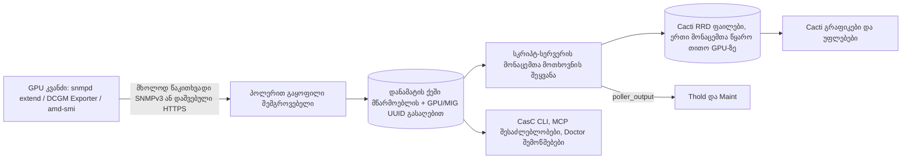

<!-- Source: README.md; SHA256: 97ba37df4a883426d3984ed7d14547ad7367e973411a8abd930409ce259f545b -->

<!-- translations:start -->
[English](../../../README.md) | [简体中文](../zh-CN/README.md) | [हिन्दी](../hi-IN/README.md) | [Español (España)](../es-ES/README.md) | [Español (Latinoamérica)](../es-419/README.md) | [العربية (السعودية)](../ar-SA/README.md) | [Afrikaans](../af-ZA/README.md) | [አማርኛ](../am-ET/README.md) | [العربية (مصر)](../ar-EG/README.md) | [العربية (المغرب)](../ar-MA/README.md) | [Български](../bg-BG/README.md) | [বাংলা](../bn-BD/README.md) | [Bosanski](../bs-BA/README.md) | [Deutsch](../de-DE/README.md) | [Ελληνικά](../el-GR/README.md) | [فارسی](../fa-IR/README.md) | [Filipino](../fil-PH/README.md) | [Français](../fr-FR/README.md) | [Français (Maroc)](../fr-MA/README.md) | [Français (Sénégal)](../fr-SN/README.md) | [Hausa](../ha-NG/README.md) | [עברית](../he-IL/README.md) | [Hrvatski](../hr-HR/README.md) | [Bahasa Indonesia](../id-ID/README.md) | [Igbo](../ig-NG/README.md) | [Italiano](../it-IT/README.md) | [日本語](../ja-JP/README.md) | [ქართული](README.md) | [한국어](../ko-KR/README.md) | [Latviešu](../lv-LV/README.md) | [Malagasy](../mg-MG/README.md) | [मराठी](../mr-IN/README.md) | [Bahasa Melayu](../ms-MY/README.md) | [Nederlands](../nl-NL/README.md) | [Polski](../pl-PL/README.md) | [Português (Brasil)](../pt-BR/README.md) | [Português (Portugal)](../pt-PT/README.md) | [Русский](../ru-RU/README.md) | [Kinyarwanda](../rw-RW/README.md) | [Soomaali](../so-SO/README.md) | [Српски](../sr-RS/README.md) | [Svenska](../sv-SE/README.md) | [Kiswahili](../sw-KE/README.md) | [தமிழ்](../ta-IN/README.md) | [తెలుగు](../te-IN/README.md) | [ไทย](../th-TH/README.md) | [Türkçe](../tr-TR/README.md) | [Українська](../uk-UA/README.md) | [اردو](../ur-PK/README.md) | [Tiếng Việt](../vi-VN/README.md) | [isiXhosa](../xh-ZA/README.md) | [Yorùbá](../yo-NG/README.md) | [繁體中文](../zh-TW/README.md) | [isiZulu](../zu-ZA/README.md)
<!-- translations:end -->

# plugin_gpu

Cacti 1.2-ის დანამატი, რომელიც NVIDIA-სა და AMD-ის ხელსაწყოებიდან Cacti-ში ასახავს თითოეული GPU-ს დატვირთვას, მეხსიერებას, ტემპერატურას, სიმძლავრეს, ECC შეცდომებსა და თროტლინგის მიზეზებს. თითოეული GPU (ან MIG ინსტანცია) ხდება თავისი კვანძის მოწყობილობის მონაცემთა მოთხოვნის ინდექსი, ამიტომ GPU გრაფიკები განთავსებულია კვანძის სხვა გრაფიკების გვერდით Cacti-ს უფლებების ქვეშ, ხოლო Thold-სა და Maint-ს შეუძლიათ მათზე გაფრთხილება და დათრგუნვა.

> **სტატუსი: 1-დან მე-3 ფაზამდე რეალიზებულია კოდში, მაგრამ ჯერ არ გამოქვეყნებულა.** 1-ლი ფაზა (NVIDIA `nvidia-smi` SNMP extend-ის მეშვეობით, იდენტობის თვალყურის დევნება, გრაფიკები, თროტლინგისა და ECC სიგნალები, Thold და Maint გაფრთხილებები, მდგომარეობის გვერდი), მე-2 ფაზა (მხოლოდ წაკითხვადი NVIDIA DCGM Exporter HTTP(S) პარსერი/კლიენტი და AMD `amd-smi` პარსერი), მე-3 ფაზა (MIG ინსტანციების იდენტობის თვალყურის დევნება, Schema v4 სვეტები, პოლერით გაყოფილი დაშორებული შემგროვებლის შესრულება, `replicate_out` და `remote_agent` ჰუკები), CasC ოპერატორის CLI (`cli/gpu.php`) და ეკოსისტემის ჰუკები (`abilities_register`, `doctor_register_checks`, `casc_register_providers`) რეალიზებულია და დაფარულია ერთეულოვანი, უსაფრთხოებისა და ერთჯერადი Cacti-ის ინტეგრაციული ტესტებით. აქამდე რეალური გაშვებები იყენებს სინთეტიკურ `snmpd`-ს და სატესტო მონაცემებს და არა ფიზიკურ GPU აპარატურას. გამოშვების ტეგირებამდე ღია რჩება: საპილოტე გაშვებები რეალურ აპარატურაზე ([docs/pilot-plan.md](../../pilot-plan.md), #54), გარე უსაფრთხოების მიმოხილვა ([docs/security-review.md](../../security-review.md)), რეალური ხელსაწყოებიდან აღებული ფიქსტურები (#14) და მასშტაბირების გაზომვები წარმოების ზომის აპარატურაზე ([docs/performance.md](../../performance.md)). XID შეცდომების შეგროვება ღია რჩება გადაწყვეტილება #8-ის ფარგლებში.

## წვდომის როლები

| უფლებების ზონა | წვდომა |
| --- | --- |
| GPU View | არსებული მონიტორინგის გვერდები. |
| GPU Operator | მონიტორინგი, ოპერაციების გვერდი და პერსონალური სორტირების დადასტურებები. |
| GPU Admin | ოპერატორის წვდომა, ასევე არსებული კონფიგურაცია და ადმინისტრაციული მოქმედებები. |

განახლების ფაილების კოპირების შემდეგ ადმინისტრატორის სტატუსით გახსენით დანამატების (Plugins) გვერდი ახალი უფლებების ზონის დასარეგისტრირებლად. Operator უფლებების ზონა მიანიჭეთ პირდაპირ განყოფილებაში **Configuration > Users** ან მომხმარებელთა ჯგუფებში. განახლებები ინარჩუნებს არსებულ View და Admin უფლებების ზონის ID-ებსა და მინიჭებებს. ყოველ მოთხოვნაზე Admin წვდომა მემკვიდრეობით იღებს Operator წვდომას, ხოლო Operator წვდომა — View წვდომას; ეს არ ამატებს შენახულ უფლებებს მომხმარებლებისთვის ან ჯგუფებისთვის. დანამატის პარამეტრები ასევე მოითხოვს GPU Admin წვდომას Cacti-ს პარამეტრების (Settings) უფლებასთან ერთად.

Cacti-ს მოწყობილობის უფლებები კვლავ ზღუდავს თითოეული მომხმარებლისთვის ხელმისაწვდომ სტრიქონებსა და მოქმედებებს; მიუბმელი ობიექტები საჭიროებს ადმინისტრატორს. ავტორიზაციის მონაცემები, კონფიგურაცია, მიბმა, წაშლა და სხვა ადმინისტრაციული ცვლილებები რჩება ადმინისტრაციულ გვერდებზე. დადასტურებები მოქმედებს მხოლოდ მიმდინარე მომხმარებლის სესიაში, არაუმეტეს ერთი საათის განმავლობაში და მხოლოდ მანამ, სანამ იგივე დაკვირვება აქტუალური რჩება. ახალი ან შეცვლილი დაკვირვებები აუქმებს მათ. ისინი არასდროს მონიშნავს ჩაშლილ გაზომვას გამართულად და არ თრგუნავს გაფრთხილებებს.

## რატომ

GPU კვანძები, როგორც წესი, უკვე დამატებულია Cacti-ში CPU-ს, მეხსიერებისა და ინტერფეისების მონიტორინგისთვის. GPU-ს მდგომარეობა ცალკე საკითხია, რომელსაც კვანძის SNMP მონაცემები არ პასუხობს: ბარათი შეიძლება თერმულად თროტლინგდებოდეს, აგროვებდეს ECC შეცდომებს ან აფიქსირებდეს XID ხარვეზს, მაშინ როცა თავად კვანძი გამართულად გამოიყურება. მწარმოებლის ხელსაწყოები ამას აჩვენებს (`nvidia-smi`, DCGM, `amd-smi`), მაგრამ მათი გამომავალი რჩება Cacti-ს გრაფიკების, უფლებებისა და გაფრთხილებების მიღმა.

დანამატი ავსებს ამ ხარვეზს მწარმოებლის ხელსაწყოების გამომავალის გარდაქმნით Cacti-ს მონაცემთა წყაროებად, რომელთა გასაღებიც თითოეული GPU-ს იდენტობაა და არა მისი პოზიცია, ამიტომ გადატვირთვა, რომელიც GPU-ების რიგს ცვლის, ერთი ბარათის ისტორიას მეორეს არ მიაბამს. იგი იყენებს Cacti-ს გრაფიკებს, უფლებებს, დაშორებულ მონაცემთა შემგროვებლებს, Thold-სა და Maint-ს, მათი პარალელური ვერსიების აგების ნაცვლად.

## დაგეგმილი ფარგლები

| ფაზა | ფარგლები | სტატუსი | ეტაპები |
|---|---|---|---|
| 0, კვლევა | მწარმოებლის ხელსაწყოების გამომავალი, XID და თროტლინგის სიგნალები, GPU იდენტობა, პრივილეგიები, შეგროვების გზის გადაწყვეტილება | დასრულებულია | [M1](https://github.com/somethingwithproof/plugin_gpu/milestone/1) |
| 1, nvidia | `nvidia-smi` შეგროვება, ინვენტარი UUID-ით, გრაფიკები, თროტლინგისა და ECC სიგნალები, Thold და Maint, მდგომარეობის გვერდი | რეალიზებულია (სატესტო ფიქსტურებით შემოწმებული) | [M2](https://github.com/somethingwithproof/plugin_gpu/milestone/2), [M3](https://github.com/somethingwithproof/plugin_gpu/milestone/3), [M4](https://github.com/somethingwithproof/plugin_gpu/milestone/4) |
| 2, ბექენდები | მხოლოდ წაკითხვადი DCGM Exporter HTTP(S) პარსერი/კლიენტი (`lib/DcgmExporterParser.php`, `lib/DcgmExporterClient.php`), AMD `amd-smi` პარსერი (`lib/AmdSmiParser.php`) | რეალიზებულია (ერთეულოვანი ტესტებით შემოწმებული) | [M5](https://github.com/somethingwithproof/plugin_gpu/milestone/5) |
| 3, mig, დაშორებული და ეკოსისტემა | MIG ინსტანციების იდენტობის თვალყურის დევნება, დაშორებული მონაცემთა შემგროვებლები (`INFO`, `poller_gpu.php --poller=N`, `replicate_out`, `remote_agent`), CasC CLI (`cli/gpu.php`), MCP/Doctor/CasC ჰუკები | რეალიზებულია (ერთეულოვანი და CI ინტეგრაციული ტესტებით შემოწმებული) | [M6](https://github.com/somethingwithproof/plugin_gpu/milestone/6) |

ფარგლებს გარეთაა: ნებისმიერი ბრძანება, რომელიც ცვლის GPU-ს ან კვანძს (ტაქტური სიხშირეები, სიმძლავრის ლიმიტები, გადატვირთვები, MIG განლაგება), დანამატის საკუთარი გაფრთხილების ძრავა, მორგებული დემონი ან ქსელური პროტოკოლი და დამგეგმავის ან ამოცანების აღრიცხვა. კვლევის სიისთვის იხილეთ გეგმა.

## რას ამატებს მე-4 ეტაპი

- **NVIDIA DCGM Exporter მხოლოდ წაკითხვადი შემგროვებელი** (`lib/DcgmExporterParser.php`, `lib/DcgmExporterClient.php`). აანალიზებს Prometheus-ის ტექსტურ მეტრიკებს (`DCGM_FI_DEV_GPU_UTIL`, `DCGM_FI_DEV_FB_USED`, `DCGM_FI_DEV_FB_FREE`, `DCGM_FI_DEV_POWER_USAGE`, `DCGM_FI_DEV_GPU_TEMP`, `DCGM_FI_DEV_ECC_DBE_VOL_TOTAL`, `DCGM_FI_DEV_CLOCK_THROTTLE_REASONS`, და MIG ჭდეებს `GPU_I_ID` და `GPU_I_PROFILE`). HTTP(S) კლიენტი იცავს საბოლოო წერტილების ჰოსტების/CIDR-ის მკაფიო დაშვებულთა სიას, ნაგულისხმევად ამოწმებს TLS სერტიფიკატებს, ზღუდავს ტაიმაუტებსა და პასუხის ზომას, თიშავს გადამისამართებებს და უარყოფს არა-HTTP(S) სქემებს.
- **AMD `amd-smi` მხოლოდ წაკითხვადი პარსერი** (`lib/AmdSmiParser.php`). ახდენს `amd-smi` JSON/SNMP-extend გამომავალის ნორმალიზაციას (დატვირთვა, VRAM, სიმძლავრე, შეერთების/კიდის ტემპერატურა, ECC, დანაყოფის მეტამონაცემები და ცალკე თროტლინგის აკუმულატორები `Reading::$vendorExtensions`-ის მეშვეობით) საერთო მეტრიკულ მოდელში `Vendor::Amd`-ის ქვეშ.
- **MIG ინსტანციების თვალყურის დევნება და Schema v4** (`lib/GpuReport.php`, `lib/GpuSnapshot.php`, `lib/GpuRecord.php`, `lib/Schema.php`, `lib/ScriptServer.php`). თვალყურს ადევნებს MIG ინსტანციების UUID-ებს (`MIG-<uuid>` და `MIG-GPU-<parent>/<gi>/<ci>`), `mig_mode`, `mig_instance_id`, `mig_profile`, `parent_uuid` და `partition_info` ველებს მშობელი GPU-ების გვერდით, ხოლო უცვლელ იდენტობის გასაღებებს (`vendor`, `uuid`, `parent_uuid`) იცავს განახლებებისას და ამოწმებს მონაცემთა ბაზის მოთხოვნებამდე.
- **დაშორებული მონაცემთა შემგროვებლები** (`INFO`, `poller_gpu.php`, `lib/Poller.php`, `lib/ReplicationRepository.php`, `setup.php`). აცხადებს `remote_collect:1, remote_poller:1` ფაილში `INFO`, მხარს უჭერს პოლერით გაყოფილ შესრულებას `php plugins/gpu/poller_gpu.php --poller=N`-ით, გამოტოვებს Cacti ობიექტების შექმნას არამთავარ პოლერებზე, არეპლიცირებს პოლერით გაყოფილ ცხრილებს `replicate_out`-ის მეშვეობით და პასუხობს მხოლოდ წაკითხვად `gpu_health` და `gpu_inventory` მოქმედებებს `remote_agent`-ის მეშვეობით.
- **ოპერატორისა და CasC CLI** (`cli/gpu.php`, `lib/CascProvider.php`). მუშაობს PHP 8.2+-ზე (წაკითხვადია PHP 8.0-ზე) გარე Composer დამოკიდებულებების გარეშე: `php plugins/gpu/cli/gpu.php export [--format=yaml|xml]`, `validate <file> [--format=yaml|xml]`, `plan <file> [--format=yaml|xml] [--output=text|json]`, `apply <file> --confirm=<PLAN_HASH> [--format=yaml|xml]` და `health [--format=text|json]`. გეგმები ითვლის დეტერმინისტულ SHA-256 დადასტურების ჰეშს, `apply` უსაფრთხოდ წყვეტს მუშაობას ჰეშის შეუსაბამობისას, ხოლო XML პარსინგი უარყოფს `DOCTYPE` და `ENTITY` დეკლარაციებს.
- **ეკოსისტემის ინტეგრაციის ჰუკები** (`lib/EcosystemIntegration.php`, `setup.php`). არეგისტრირებს `abilities_register` (`gpu-list-nodes`, `gpu-list-devices`, `gpu-get-health`; მხოლოდ წაკითხვადი, შეზღუდული `GPU View` უფლებების ზონითა და Cacti მოწყობილობის უფლებებით), `doctor_register_checks` (`gpu_schema`, `gpu_poller_freshness`, `gpu_node_health`) და `casc_register_providers`.
- **თროტლინგის მიზეზები და ECC როგორც გაფრთხილების მნიშვნელობები** ([docs/metrics.md](../../metrics.md)). შიფრავს ტაქტური სიხშირის მოვლენის ნიღბებს 0/1 ინდიკატორებად და ითვლის თითო ინტერვალში ახალ გამოსწორებულ/გამოუსწორებელ ECC შეცდომებს მაჩვენებლების სახით, რათა Thold 1.8.2-მა და Maint 1.3-მა შეატყობინონ და დათრგუნონ უარყოფითი მთვლელებისა და განულების პიკების გარეშე ([docs/alerting.md](../../alerting.md)).
- **GPU-ს მდგომარეობა, უფლებები, შეცდომა/აღდგენა და მასშტაბი.** GPU-ს მდგომარეობა (GPU View) კვანძებთან დაკავშირების გარეშე აჩვენებს შენახულ აქტუალობას, ბოლო შეგროვების შედეგს, Maint სტატუსს, ბექენდს, ვერსიებსა და თროტლინგის ნედლ ნიღბებს. სკრიპტირებული სრული ციკლის ტესტები ამოწმებს უფლებებს, აგენტის/DB/RRD შეცდომიდან აღდგენას ([docs/backup.md](../../backup.md)) და 100-GPU მასშტაბის გაშვებას CI-ში ([docs/performance.md](../../performance.md), [docs/operations.md](../../operations.md), [CHANGELOG.md](../../../CHANGELOG.md)).

## რას ამატებს მე-3 ეტაპი

- **შეგროვება SNMP extend-ის მეშვეობით** ([ADR 0008](../../decisions/0008-collect-through-snmp-extend.md)). კვანძის ადმინისტრატორი `snmpd.conf`-ში ამატებს ორ ფიქსირებულ `extend` სტრიქონს ([docs/node-setup.md](../../node-setup.md)); დანამატი კითხულობს NET-SNMP-EXTEND-MIB-ს Cacti-ს SNMP ფუნქციებით მოწყობილობის საკუთარი ავტორიზაციის მონაცემებით (რეკომენდებულია SNMPv3). იგი არაფერს უშვებს Cacti სერვერზე ან კვანძზე.
- **მკაცრი პარსინგი.** ველები იკითხება პოზიციით, თითოეული სტრიქონი ასახელებს თავის GPU-ს UUID-ით, ხოლო არანულოვანი გამოსვლის კოდი, ტაიმაუტი, მოკვეცილი გამომავალი, ველების არასწორი რაოდენობის მქონე სტრიქონი ან შერეული შეცდომის ტექსტი მთელ შეგროვებას ჩაშლილად აცხადებს: მნიშვნელობები ხდება `U`, არც ერთი GPU არ მოინიშნება არმყოფად და GPU კვანძების გვერდი აჩვენებს მიზეზს.
- **შემგროვებელი ყოველი პოლერის ციკლის შემდეგ.** იგი კითხულობს თითოეული ჩართული კვანძის აგენტს, აახლებს იდენტობის ჩანაწერებს და ინახავს ბოლო სინჯს ქეშში. სკრიპტ-სერვერის შეყვანა კითხულობს მხოლოდ ამ ქეშს, ამიტომ Cacti-ს გამოკითხვა არასდროს ელოდება GPU კვანძს.
- **Cacti ობიექტები** ([ADR 0010](../../decisions/0010-attach-to-existing-node-devices.md)). შაბლონები და *GPU - Devices* მონაცემთა მოთხოვნა მოწოდებულია XML ფორმატში და იმპორტირდება ინსტალაციისა და განახლებისას. კვანძის შენახვა აბამს მონაცემთა მოთხოვნას მის არსებულ მოწყობილობაზე ხელახალი ინდექსაციის მეთოდით None; GPU კვანძებს შეუძლია მოწყობილობის შექმნა მხოლოდ მაშინ, როცა კვანძს იგი არ აქვს. თითოეული GPU არის ინდექსი მწარმოებლისა და UUID-ის გასაღებით, ერთი მონაცემთა წყაროთი, რომელსაც იზიარებს მისი დატვირთვის, მეხსიერების, ტემპერატურის, სიმძლავრის, სიმძლავრის პროცენტის, ტაქტური სიხშირეების, თროტლინგის, ECC შეცდომების, ახალი ECC შეცდომების, ამოღებული გვერდებისა და სინჯის ასაკის გრაფიკები. მოდელის ყველა ველი აისახება რომელიმე გრაფიკზე, რადგან Cacti ინახავს მხოლოდ გრაფიკის მიერ გამოყენებულ ველებს. დანამატი აკეთებს ხელახალ ინდექსაციას GPU-ს ყოველი ცვლილების შემდეგ, ინახავს გამოტოვებულ ხელახალ ინდექსაციას, როცა მოწყობილობა გათიშული ან გამორთული იყო, უშვებს მას მოწყობილობის ჩართვისთანავე და ქმნის გრაფიკებს ახალი GPU-ებისთვის.
- **ისტორია რჩება ბარათთან.** არმყოფი GPU რჩება ინდექსად, ამიტომ მისი გრაფიკები აჩვენებს წყვეტას და დაბრუნებისას გრძელდება იმავე RRD ფაილში. იმავე სლოტში ჩასმული ჩამნაცვლებელი ბარათი იღებს საკუთარ მონაცემთა წყაროს. კვანძის გვერდზე **მონაცემთა მოთხოვნიდან ამოღება** იღებს არმყოფ GPU-ს სიიდან; მისი RRD ფაილები და გრაფიკები შენახულია თქვენ მიერ წაშლამდე.
- **მოწყობილობის უფლებები GPU კვანძებზე.** GPU Admin ხედავს, ცვლის, ექსპორტს უკეთებს და გადააქვს მხოლოდ იმ მოწყობილობებზე მყოფი კვანძები და GPU-ები, რომელთა ნახვის უფლებაც აქვს Cacti-ში; GPU-ს გადატანას სჭირდება ორივე კვანძი. კვანძის გამორთვა ან წაშლა, რომლის მოწყობილობაც წაშლილია, შესაძლებელია.
- **საერთო მეტრიკული მოდელი** ([ADR 0009](../../decisions/0009-common-metric-core-with-vendor-extensions.md), [docs/metrics.md](../../metrics.md)). მეხსიერება მოცემულია ბაიტებში, ტაქტური სიხშირის მოვლენის ნიღაბი გაშიფრულია `thr_*` ინდიკატორებად, ხოლო `age` არის თავად GPU-ს სინჯის დროის ასაკი, ან `U` როცა უცნობია.

დამყენებელ (ვებსერვერის) მომხმარებელს უნდა შეეძლოს ჩაწერა `<cacti>/resource/script_server/`-ში, სადაც დანამატი ათავსებს თავის მონაცემთა მოთხოვნის XML-ს; წინააღმდეგ შემთხვევაში ინსტალაცია და განახლება ჩერდება შეტყობინებით და მომდევნო მცდელობაზე ხელახლა ცდის. დეინსტალაცია შლის შაბლონებსა და XML-ს მხოლოდ მაშინ, თუ მონიშნულია *დანამატის Cacti ობიექტების წაშლა დეინსტალაციისას*, და არასდროს შლის RRD ფაილებს, მოწყობილობებს, გრაფიკებს ან მონაცემთა წყაროებს ([docs/operations.md](../../operations.md#uninstall)). დაშორებულ მონაცემთა შემგროვებლებზე მყოფი კვანძები მუშაობს მათზე მინიჭებული `poller_id`-ის ფარგლებში.

## რას მოიცავს მე-2 ეტაპი

- **დაცული ინსტალაცია.** PHP 8.2-ზე დაბალ ვერსიაზე ინსტალაცია და ჩართვა უარყოფილია შეტყობინებით, რომელიც ასახელებს საჭირო ვერსიას, ხოლო დანარჩენი Cacti ჩვეულებრივ მუშაობს. `setup.php` და გვერდის სკრიპტები წაკითხვადია PHP 8.0-ზე.
- **სასიცოცხლო ციკლი.** ინსტალაცია, განახლება, გამორთვა და დეინსტალაცია Cacti-ს დანამატების (Plugins) გვერდიდან. განახლებები თანმიმდევრულია, სრულდება შეწყვეტის შემდეგაც და ჩაწერილ ვერსიას ცვლის მხოლოდ წარმატების შემდეგ. დეინსტალაცია ინახავს დანამატის ცხრილებს, თუ არ მოხსნით მონიშვნას *დანამატის ცხრილების შენახვა დეინსტალაციისას*; იგი არასდროს ეხება Cacti მოწყობილობას, მონაცემთა წყაროს, გრაფიკს ან RRD ფაილს.
- **ცალკე უფლებების ზონები.** *GPU Admin* ხსნის **GPU კვანძებს**, სადაც არეგისტრირებთ Cacti მოწყობილობებს GPU კვანძებად, ადასტურებთ ან უარყოფთ GPU-ს გადატანებს კვანძებს შორის და აკეთებთ ყველა ჩანაწერის JSON ექსპორტს. *GPU View* ხსნის **GPU ინვენტარს**, რომელიც აჩვენებს GPU-ებს მხოლოდ მნახველისთვის ხელმისაწვდომ მოწყობილობებზე. ორივე გვერდი მდებარეობს მართვის (Management) განყოფილებაში და ყველა ცვლილება არის csrf-magic-ით შემოწმებული POST მოთხოვნა.
- **GPU იდენტობის ჩანაწერები.** თითოეული GPU იდენტიფიცირებულია მწარმოებლით და UUID-ით. ინდექსი, PCI სალტის ID, სახელი, დრაივერი და მომწოდებელი ხელსაწყო არის ატრიბუტები, რომლებიც ადგილზე იცვლება. ცნობილ სლოტში ახალი UUID მოინიშნება როგორც შესაძლო ჩანაცვლება და იწყებს საკუთარ ისტორიას; სხვა კვანძზე დაფიქსირებული GPU გადადის მხოლოდ ოპერატორის დადასტურების შემდეგ; წარმატებული შეგროვებებიდან გამქრალი GPU კონფიგურირებადი რაოდენობის შემდეგ მოინიშნება არმყოფად და არასდროს იშლება. ამ ეტაპზე მიიღება მხოლოდ NVIDIA-ს სრული GPU UUID-ები; MIG ინსტანციები ელოდება გადაწყვეტილება #13-ს, ხოლო AMD — კვლევა #19-ს. წესები შემოწმებულია ფიქსტურების თანმიმდევრობებით, რადგან ჯერ არც ერთი შემგროვებელი არ აწვდის მონაცემებს.
- **ტესტები და CI.** ერთეულოვანი და კოდის წესების ნაკრებები GPU-ს და მონაცემთა ბაზის გარეშე, სასიცოცხლო ციკლისა და გვერდის უფლებების შემოწმებები Cacti 1.2.31-სა და მიმდინარე 1.2.x-ზე PHP 8.2–8.5-ზე, PHP 8.1-ზე უარის თქმის ამოცანა, PHP 8.0 სინტაქსის შემოწმება შესასვლელ წერტილებზე, PHPStan მე-9 დონეზე და REUSE. სატესტო ჩარჩო დროებითია გადაწყვეტილება #12-ის მიღებამდე.

### შეფასებისთვის ინსტალაცია

ეს ნაბიჯები აყენებს მიმდინარე კოდს გამოსაცდელად; სრული ოპერატორის სახელმძღვანელო იხილეთ [docs/operations.md](../../operations.md)-ში. საჭიროა Cacti 1.2.31 ან უფრო ახალი PHP 8.2 ან უფრო ახალზე.

1. დააკოპირეთ რეპოზიტორი `plugins/gpu` საქაღალდეში თქვენი Cacti დირექტორიის ქვეშ. დირექტორიას აუცილებლად უნდა ერქვას `gpu`.
2. Cacti-ში გახსენით **Configuration > Plugins**, შემდეგ დააყენეთ და ჩართეთ **GPU**.
3. მიანიჭეთ მომხმარებლებს *GPU View*, *GPU Operator* ან *GPU Admin* უფლებების ზონა განყოფილებაში **Configuration > Users** მათი როლის მიხედვით. დამყენებელი მომხმარებელი იღებს View-ს და Admin-ს; Admin მოიცავს Operator წვდომას.
4. დააკონფიგურირეთ თითოეული GPU კვანძის SNMP აგენტი [docs/node-setup.md](../../node-setup.md)-ის მიხედვით, შემდეგ დაამატეთ კვანძი განყოფილებაში **Management > GPU Nodes**.
5. გაფრთხილებებისთვის დააიმპორტეთ მოწოდებული Thold შაბლონები [docs/alerting.md](../../alerting.md)-ის მიხედვით.
6. სურვილისამებრ მოარგეთ **Configuration > Settings > GPU**: *არმყოფად მონიშვნის ზღვარი* (ნაგულისხმევი 3 წარმატებული შეგროვება, 1-დან 100-მდე), *მოძველების ზღვარი* (რამდენი ხანი შეიძლება იყოს სინჯი ძველი, სანამ მისი მნიშვნელობები `U`-დ გამოისახება) და *დანამატის ცხრილების შენახვა დეინსტალაციისას* (ნაგულისხმევად ჩართულია).

## როგორ აღწევს მეტრიკები Cacti-მდე

გადაწყვეტილებამ [#7](https://github.com/somethingwithproof/plugin_gpu/issues/7) აირჩია SNMP `extend` ([ADR 0008](../../decisions/0008-collect-through-snmp-extend.md)): კვანძის საკუთარი აგენტი უშვებს ფიქსირებულ `nvidia-smi` ბრძანებას, ხოლო დანამატი მხოლოდ კითხულობს შედეგს. გეგმა ადარებს ვარიანტებს განყოფილებაში [შეგროვების გზები](../../PLAN.md#collection-paths).

## თავსებადობის მიზნები

| კომპონენტი | მიზანი |
|---|---|
| Cacti | 1.2.31 ან უფრო ახალი, ბირთვის პატჩების გარეშე |
| PHP | 8.2 ან უფრო ახალი; `setup.php` რჩება წაკითხვადი 8.0-ზე, რათა მხარდაუჭერელ გარემოში მიიღოთ უარი და არა დაზიანებული Cacti UI |
| NVIDIA | დრაივერისა და ხელსაწყოების ხაზები განისაზღვრება კვლევით [#26](https://github.com/somethingwithproof/plugin_gpu/issues/26); DCGM ველების ID-ები შემოწმებულია v3.3.9 და v4.7.0 ვერსიებზე |
| AMD | `amd-smi` ROCm გამოშვებებზე განისაზღვრება კვლევით [#26](https://github.com/somethingwithproof/plugin_gpu/issues/26) |
| Thold, Maint | Thold 1.8.2 და Maint 1.3, უცვლელად, შემოწმებული სრული ციკლით ([docs/alerting.md](../../alerting.md)) |

## დიზაინი

- [docs/PLAN.md](../../PLAN.md) არის სრული გეგმა: არქიტექტურა, ზემდგომი ფაქტები, რომლებზეც იგი ეყრდნობა (წყაროებით), იდენტობის მოდელი, უსაფრთხოების საზღვრები, წარმადობის არითმეტიკა, ტესტირება და რისკები.
- [docs/decisions/](../../decisions/) შეიცავს არქიტექტურული გადაწყვეტილებების ჩანაწერებს უკვე მიღებული არჩევანებისთვის.
- [docs/REQUIREMENTS.md](../../REQUIREMENTS.md) აკავშირებს თითოეულ მოთხოვნის ID-ს მის საკითხთან.

## როგორ მიმდინარეობს სამუშაოს აღრიცხვა

- **ეტაპები (Milestones)** მიჰყვება გეგმის ეტაპებს. თითოეულს აქვს ეპიკური საკითხი, სადაც ჩამოთვლილია ქვესაკითხები და დასრულების მტკიცებულებები.
- **საკითხები (Issues)** კლასიფიცირებულია ჭდეებით: `type: requirement`, `type: research`, `type: decision`, `type: epic`. მოთხოვნის საკითხები განსაზღვრავს დანომრილ, ტესტირებად მოთხოვნებს (`REQ-AREA-NNN`) და მიღების კრიტერიუმებს.
- **ჭდეები (Labels)** ასევე ატარებს `area:`, `phase:`, `priority:` და `status:` ნიშნულებს. იხილეთ [CONTRIBUTING.md](../../../CONTRIBUTING.md#labels).
- [პროექტის დაფა](https://github.com/users/somethingwithproof/projects/9) აჩვენებს ყველა საკითხს ყველა ეტაპზე.

## წვლილის შეტანა

წაიკითხეთ [CONTRIBUTING.md](../../../CONTRIBUTING.md). კომიტებს სჭირდება DCO ხელმოწერა. დიზაინის განხილვა მიმდინარეობს საკითხებში; ღია გადაწყვეტილებებს აქვს ჭდე `type: decision`. რეალური GPU ხელსაწყოებიდან აღებული გამომავალი ყველაზე სასარგებლო წვლილია 1-ლი ეტაპისთვის; წინასწარ წაშალეთ ჰოსტის სახელები, სერიული ნომრები და UUID-ები.

## უსაფრთხოება

მოწყვლადობების შესახებ შეგვატყობინეთ კონფიდენციალურად; იხილეთ [SECURITY.md](../../../SECURITY.md).

## ლიცენზია

GNU General Public License v2.0 — იგივე ლიცენზია, რაც Cacti-სა და მის დანამატებს აქვთ. იხილეთ [LICENSE](../../../LICENSE).
