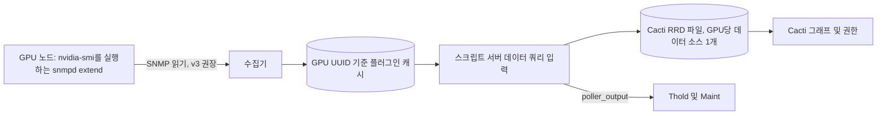

<!-- Source: README.md; SHA256: 126deef1783d64f878bf565f1433c10f31aef828eb9bc313aeff2b0335e54c7c -->

<!-- translations:start -->
[English](../../../README.md) | [简体中文](../zh-CN/README.md) | [हिन्दी](../hi-IN/README.md) | [Español (España)](../es-ES/README.md) | [Español (Latinoamérica)](../es-419/README.md) | [العربية (السعودية)](../ar-SA/README.md) | [Afrikaans](../af-ZA/README.md) | [አማርኛ](../am-ET/README.md) | [العربية (مصر)](../ar-EG/README.md) | [العربية (المغرب)](../ar-MA/README.md) | [বাংলা](../bn-BD/README.md) | [Bosanski](../bs-BA/README.md) | [Deutsch](../de-DE/README.md) | [فارسی](../fa-IR/README.md) | [Filipino](../fil-PH/README.md) | [Français](../fr-FR/README.md) | [Français (Maroc)](../fr-MA/README.md) | [Français (Sénégal)](../fr-SN/README.md) | [Hausa](../ha-NG/README.md) | [עברית](../he-IL/README.md) | [Hrvatski](../hr-HR/README.md) | [Bahasa Indonesia](../id-ID/README.md) | [Igbo](../ig-NG/README.md) | [Italiano](../it-IT/README.md) | [日本語](../ja-JP/README.md) | [한국어](README.md) | [Malagasy](../mg-MG/README.md) | [मराठी](../mr-IN/README.md) | [Bahasa Melayu](../ms-MY/README.md) | [Nederlands](../nl-NL/README.md) | [Polski](../pl-PL/README.md) | [Português (Brasil)](../pt-BR/README.md) | [Русский](../ru-RU/README.md) | [Kinyarwanda](../rw-RW/README.md) | [Soomaali](../so-SO/README.md) | [Српски](../sr-RS/README.md) | [Svenska](../sv-SE/README.md) | [Kiswahili](../sw-KE/README.md) | [தமிழ்](../ta-IN/README.md) | [తెలుగు](../te-IN/README.md) | [ไทย](../th-TH/README.md) | [Türkçe](../tr-TR/README.md) | [Українська](../uk-UA/README.md) | [اردو](../ur-PK/README.md) | [Tiếng Việt](../vi-VN/README.md) | [isiXhosa](../xh-ZA/README.md) | [Yorùbá](../yo-NG/README.md) | [繁體中文](../zh-TW/README.md) | [isiZulu](../zu-ZA/README.md)
<!-- translations:end -->

# plugin_gpu

NVIDIA 도구에서 가져온 GPU별 사용률, 메모리, 온도, 전력, ECC 오류 및 스로틀링 원인을 Cacti로 수집하는 Cacti 1.2 플러그인입니다. AMD 지원 및 XID 오류 수집은 계획되어 있으나 아직 구현되지 않았습니다. 각 GPU는 해당 노드 장치의 데이터 쿼리 인덱스가 되므로, GPU 그래프는 Cacti의 권한 체계 아래에서 노드의 다른 그래프와 함께 표시되며 Thold와 Maint에서 알림을 보내고 알림을 억제할 수 있습니다.

> **상태: 개발 중이며 정식 릴리스되지 않았습니다.** 마일스톤 4를 통해 1단계(SNMP extend를 통한 NVIDIA 수집)의 코드 구현이 완료되었습니다. 수집, 식별, 그래프, 스로틀 및 ECC 신호, Thold 및 Maint 알림, 상태 페이지, 운영자 문서가 포함됩니다. 실제 GPU 하드웨어에서는 한 번도 실행되지 않았으며, 가상 출력을 인쇄하는 가짜 `nvidia-smi`와 실제 `snmpd`를 연동해서만 실행해 보았습니다. 릴리스 전에 남은 과제는 실제 하드웨어 파일럿 테스트([docs/pilot-plan.md](../../pilot-plan.md), #54), 외부 보안 검토([docs/security-review.md](../../security-review.md)), 실제 도구에서 캡처한 픽스처(#14), 프로덕션 규모 하드웨어에서의 확장성 측정([docs/performance.md](../../performance.md))입니다. XID 오류는 결정 사항 #8을 기다리고 있습니다. 프로덕션 환경에서 실행하지 마세요.

## 액세스 역할

| 영역(Realm) | 액세스 권한 |
| --- | --- |
| GPU View | 기존 모니터링 페이지. |
| GPU Operator | 모니터링 페이지, Operations 페이지 및 개인 트리아지 확인(acknowledgment). |
| GPU Admin | Operator 권한과 기존 구성 및 관리 작업. |

업그레이드 파일을 복사한 후 관리자로 Plugins 페이지를 열어 새 영역(realm)을 등록하세요. **Configuration > Users** 또는 사용자 그룹에서 Operator 영역을 명시적으로 할당하세요.
업그레이드 시 기존 View 및 Admin 영역 ID와 부여된 권한은 유지됩니다. 요청이 발생할 때마다 Admin 권한은 Operator 권한을 상속하고, Operator 권한은 View 권한을 상속합니다. 이는 사용자나 그룹에 저장된 부여 권한을 추가로 생성하지 않습니다. 플러그인 설정을 변경하려면 Cacti의 Settings 권한 외에 GPU Admin 권한도 필요합니다.

각 사용자가 볼 수 있는 행과 수행할 수 있는 작업은 여전히 Cacti 장치 권한에 의해 제한되며, 매핑되지 않은 개체는 관리자가 처리해야 합니다.
자격 증명, 구성, 매핑, 삭제 및 기타 관리 변경 작업은 관리 페이지에 그대로 유지됩니다. 확인(acknowledgment)은 현재 사용자 세션에서만 유지되며, 최대 1시간 동안 그리고 동일한 관측 결과가 최신 상태일 때만 유효합니다. 관측 결과가 새로워지거나 변경되면 확인은 무효화됩니다. 확인 처리는 실패한 측정을 정상으로 표시하거나 알림을 억제하지 않습니다.

## 배경

GPU 노드는 일반적으로 CPU, 메모리, 인터페이스를 모니터링하기 위해 이미 Cacti에 등록되어 있습니다. GPU 상태는 노드의 SNMP 데이터만으로는 알 수 없는 별개의 문제입니다. 노드 자체는 정상으로 보이더라도 카드가 열 스로틀링 상태이거나, ECC 오류가 누적되거나, XID 결함을 보고할 수 있습니다. 벤더 도구(`nvidia-smi`, DCGM, `amd-smi`)가 이를 보고하지만, 그 출력은 Cacti의 그래프, 권한, 알림 체계 밖에 존재합니다.

이 플러그인은 벤더 도구의 출력을 위치가 아닌 각 GPU의 고유 식별자를 키로 삼는 Cacti 데이터 소스로 변환하여 이 격차를 해소합니다. 따라서 재부팅으로 GPU 순서가 바뀌더라도 한 카드의 기록이 다른 카드에 연결되지 않습니다. 또한 별도의 시스템을 구축하는 대신 Cacti의 그래프, 권한, 원격 데이터 수집기, Thold 및 Maint를 그대로 재사용합니다.

## 계획된 범위

| 단계 | 범위 | 마일스톤 |
|---|---|---|
| 0, 조사 | 벤더 도구 출력, XID 및 스로틀 신호, GPU 식별자, 권한, 수집 경로 결정 | [M1](https://github.com/somethingwithproof/plugin_gpu/milestone/1) |
| 1, nvidia | `nvidia-smi` 수집, UUID 기준 인벤토리, 그래프, 스로틀, ECC 및 XID 신호, Thold 및 Maint, 상태 페이지 | [M2](https://github.com/somethingwithproof/plugin_gpu/milestone/2), [M3](https://github.com/somethingwithproof/plugin_gpu/milestone/3), [M4](https://github.com/somethingwithproof/plugin_gpu/milestone/4) |
| 2, 백엔드 | DCGM 백엔드, `amd-smi` 백엔드 | [M5](https://github.com/somethingwithproof/plugin_gpu/milestone/5) |
| 3, mig 및 원격 | MIG 인스턴스, Cacti 원격 데이터 수집기 | [M6](https://github.com/somethingwithproof/plugin_gpu/milestone/6) |

범위 제외 항목: GPU나 노드의 상태를 변경하는 모든 명령(클럭, 전력 제한, 재설정, MIG 레이아웃), 플러그인 자체 알림 엔진, 사용자 지정 데몬 또는 네트워크 프로토콜, 스케줄러 또는 작업 회계(job accounting). 조사 백로그는 계획 문서를 참조하세요.

## 마일스톤 4에 추가된 내용

- **알림 값으로서의 스로틀 원인.** 클럭 이벤트 마스크를 원인별 0 또는 1 표시기로 디코딩합니다. 알 수 없는 마스크는 0이 아니라 알 수 없음 표시기로 처리되며, 표시기가 없는 비트는 원시 마스크에 남아 GPU Health에 표시됩니다.
- **알림 값으로서의 ECC** ([docs/metrics.md](../../metrics.md)). 이전 샘플 이후 새로 발생한 수정 가능(corrected) 오류와 수정 불가능(uncorrected) 오류를 플러그인이 연속된 두 총계에서 계산하여 게이지(gauge)로 저장합니다. 첫 번째 샘플, 누락된 읽기 또는 드라이버 재로드 시에는 알 수 없음으로 처리되므로, 재설정 시에도 값이 0이나 음수 카운트로 표시되지 않습니다. 회수 예정(retired) 단일 비트 및 이중 비트 페이지 수와 ECC 모드도 함께 읽습니다. GPU당 두 개의 추가 ECC 그래프를 통해 Cacti가 이를 저장하며, Power Percent를 포함해 총 11개의 그래프가 제공됩니다. XID는 수집되지 않습니다. 고정된 `nvidia-smi` 명령에 적합한 소스가 없습니다(#8).
- **Thold 및 Maint** ([docs/alerting.md](../../alerting.md)). 온도, 전력 제한 대비 전력, 스로틀 표시기, 새로운 수정 불가능 ECC 오류, 대기 중인 페이지 회수, 샘플 경과 시간에 대한 기본 Thold 템플릿을 제공합니다. Thold 1.8.2는 알 수 없는 카운터 값에서 실패하므로 모든 값은 게이지입니다. 수정하지 않은 Thold 1.8.2 및 Maint 1.3을 사용한 엔드투엔드 테스트에서 ECC 재설정을 포함해 각 임계값이 알림을 발생시키고 복구하며 Maint가 이를 억제함을 확인했습니다.
- **GPU Health** (GPU View). 노드별 항목: 최신성, 마지막 수집 종료 상태, Maint 상태, 백엔드, 도구 및 드라이버 버전, GPU 수. GPU별 항목: 존재 여부, 샘플 경과 시간, ECC 상태, 원시 마스크. 저장된 레코드만 읽습니다.
- **권한.** 권한 테스트 스위트는 모든 페이지 파일과 작업, 다음 요청에서의 권한 회수, 아무 정보도 노출하지 않는 거부 응답을 다룹니다.
- **장애 및 복원 검증.** 스크립트 기반 엔드투엔드 실행을 통해 에이전트, 자격 증명, 도구, 출력, 데이터베이스 연결, RRD 쓰기를 의도적으로 중단시키고, RRD 파일보다 오래된 덤프를 포함하여 데이터베이스를 덤프에서 복원하는 테스트를 수행합니다. 새 GPU는 다른 GPU의 RRD 파일을 절대 이어받지 않습니다([docs/backup.md](../../backup.md)).
- **확장성** ([docs/performance.md](../../performance.md)). 확장성 테스트는 지정된 GPU 수에서 수집, 스크립트 서버 입력, Cacti 개체 생성, 폴러 주기, 상태 페이지의 소요 시간을 측정하며, CI에서는 100개 GPU 기준으로 실행됩니다. 1,000개 및 8,000개 GPU 측정값은 아직 기록되지 않았으므로 지원되는 GPU 수는 명시하지 않았습니다.
- **운영자 문서** ([docs/operations.md](../../operations.md)): 설치, 업그레이드, 제거, 최소 권한, 사용할 수 없는 값, 문제 해결을 다룹니다. 변경 사항은 [CHANGELOG.md](../../../CHANGELOG.md)에 나열되어 있습니다.

## 마일스톤 3에 추가된 내용

- **SNMP extend를 통한 수집** ([ADR 0008](../../decisions/0008-collect-through-snmp-extend.md)). 노드 관리자가 `snmpd.conf`에 두 개의 고정 `extend` 줄을 추가하면([docs/node-setup.md](../../node-setup.md)), 플러그인은 장치 자체의 자격 증명을 사용해 Cacti의 SNMP 함수를 통해 NET-SNMP-EXTEND-MIB를 읽습니다(SNMPv3 권장). Cacti 서버나 노드에서 별도의 명령을 직접 실행하지 않습니다.
- **엄격한 파싱.** 필드는 위치 기준으로 읽으며 각 줄은 UUID로 GPU를 식별합니다. 0이 아닌 종료 상태, 시간 초과, 잘린 출력, 필드 수가 잘못된 줄 또는 오류 텍스트가 섞인 경우 전체 수집이 실패합니다. 값은 `U`가 되고 어떤 GPU도 부재로 표시되지 않으며 GPU Nodes에 원인이 표시됩니다.
- **각 폴러 주기 이후 실행되는 수집기.** 활성화된 각 노드의 에이전트를 읽고 식별자 레코드를 업데이트하며 최신 샘플을 캐시합니다. 스크립트 서버 입력은 이 캐시만 읽으므로 Cacti 폴링이 GPU 노드를 기다리지 않습니다.
- **Cacti 개체** ([ADR 0010](../../decisions/0010-attach-to-existing-node-devices.md)). 템플릿과 *GPU - Devices* 데이터 쿼리는 XML로 제공되며 설치 및 업그레이드 시 가져옵니다. 노드를 저장하면 재인덱싱 메서드가 None인 상태로 기존 장치에 데이터 쿼리가 연결됩니다. GPU Nodes는 노드에 장치가 없을 때만 장치를 생성할 수 있습니다. 각 GPU는 벤더와 UUID를 키로 하는 인덱스이며, Utilization, Memory, Temperature, Power, Power Percent, Clocks, Throttle, ECC Errors, New ECC Errors, Retired Pages, Sample Age 그래프가 하나의 데이터 소스를 공유합니다. Cacti는 그래프가 사용하는 필드만 저장하므로 모델의 모든 필드가 특정 그래프에 의해 그려집니다. 플러그인은 모든 GPU 변경 후 재인덱싱을 수행하고, 장치가 Down이거나 비활성화된 동안 Cacti가 건너뛴 재인덱싱을 보관했다가 장치가 Up이 되면 실행하며, 새 GPU용 그래프를 생성합니다.
- **기록은 카드와 함께 유지됩니다.** 부재 중인 GPU도 인덱스로 유지되므로 그래프에는 공백이 표시되고 카드가 돌아오면 동일한 RRD 파일에서 기록이 재개됩니다. 동일한 슬롯의 교체 카드는 자체 데이터 소스를 받습니다. 노드 페이지의 **Remove from Data Query**를 사용하면 부재 중인 GPU를 목록에서 제거할 수 있으며, RRD 파일과 그래프는 직접 삭제하기 전까지 유지됩니다.
- **GPU Nodes의 장치 권한.** GPU Admin은 Cacti에서 자신이 볼 수 있는 장치의 노드와 GPU만 조회, 변경, 내보내기 및 이동할 수 있으며, GPU 이동에는 양쪽 노드 모두에 대한 권한이 필요합니다. 장치가 삭제된 노드는 비활성화하거나 삭제할 수 있습니다.
- **공통 메트릭 모델** ([ADR 0009](../../decisions/0009-common-metric-core-with-vendor-extensions.md), [docs/metrics.md](../../metrics.md)). 메모리는 바이트 단위이고, 클럭 이벤트 마스크는 `thr_*` 표시기로 디코딩되며, `age`는 GPU 자체 샘플 시간의 경과 시간(알 수 없는 경우 `U`)입니다.

설치하는(웹 서버) 사용자는 플러그인이 데이터 쿼리 XML을 배치하는 `<cacti>/resource/script_server/` 경로에 쓰기 권한이 있어야 합니다. 그렇지 않으면 설치 및 업그레이드가 메시지와 함께 중지되고 다음 시도 시 다시 시도합니다. 제거 시에는 *Remove the plugin's Cacti objects on uninstall*이 선택된 경우에만 템플릿과 XML을 삭제하며, RRD 파일, 장치, 그래프 또는 데이터 소스는 절대 삭제하지 않습니다([docs/operations.md](../../operations.md#uninstall)). 원격 데이터 수집기의 노드는 3단계 전까지 수집되지 않습니다.

## 마일스톤 2에서 제공하는 기능

- **보호된 설치.** PHP 8.2 미만에서는 필요한 버전을 명시한 메시지와 함께 설치 및 활성화가 거부되며, 나머지 Cacti 기능은 정상 작동합니다. `setup.php`와 페이지 스크립트는 PHP 8.0에서도 구문 분석이 가능합니다.
- **수명 주기.** Cacti의 Plugins 페이지를 통해 설치, 업그레이드, 비활성화 및 제거할 수 있습니다. 업그레이드는 순차적으로 진행되며 중단 후에도 이어서 완료되고, 성공한 후에만 기록된 버전을 변경합니다. 제거 시 *Keep Plugin Tables on Uninstall* 옵션을 해제하지 않는 한 플러그인 테이블을 유지하며, Cacti 장치, 데이터 소스, 그래프 또는 RRD 파일은 절대 건드리지 않습니다.
- **분리된 영역(Realm).** *GPU Admin*은 Cacti 장치를 GPU 노드로 등록하고, 노드 간 GPU 이동을 확인 또는 거부하며, 모든 레코드를 JSON으로 내보낼 수 있는 **GPU Nodes**를 엽니다. *GPU View*는 조회자가 볼 수 있는 장치의 GPU만 나열하는 **GPU Inventory**를 엽니다. 두 페이지 모두 Management 아래에 있으며, 모든 변경 요청은 csrf-magic으로 검증되는 POST 요청입니다.
- **GPU 식별자 레코드.** 각 GPU는 벤더와 UUID를 키로 식별됩니다. 인덱스, PCI 버스 ID, 이름, 드라이버 및 보고 도구는 제자리에서 변경되는 속성입니다. 알려진 슬롯에 새 UUID가 나타나면 교체 가능성으로 플래그가 지정되고 자체 기록을 시작합니다. 다른 노드에서 관측된 GPU는 운영자가 확인한 경우에만 이동됩니다. 성공적인 수집에서 누락된 GPU는 구성 가능한 횟수 이후 부재로 표시되며 절대 삭제되지 않습니다. 현재는 NVIDIA 전체 GPU UUID만 허용되며, MIG 인스턴스는 결정 사항 #13을, AMD는 조사 #19를 기다리고 있습니다. 아직 이를 공급하는 수집기가 없으므로 이 규칙들은 픽스처 시퀀스로 테스트됩니다.
- **테스트 및 CI.** GPU나 데이터베이스 없이 실행되는 단위 테스트 및 소스 규칙 스위트, PHP 8.2~8.5 환경의 Cacti 1.2.31 및 최신 1.2.x 대상 수명 주기 및 페이지 권한 검사, PHP 8.1 거부 작업, 진입점에 대한 PHP 8.0 린트, 레벨 9 PHPStan 및 REUSE 검사를 포함합니다. 테스트 하네스는 #12가 결정될 때까지 임시로 유지됩니다.

### 평가용 설치

다음 단계는 현재 코드를 시험해 보기 위한 설치 방법이며, 전체 운영자 가이드는 [docs/operations.md](../../operations.md)를 참조하세요. PHP 8.2 이상에서 실행되는 Cacti 1.2.31 이상이 필요합니다.

1. 저장소를 Cacti 디렉터리 아래의 `plugins/gpu`로 복사합니다. 디렉터리 이름은 반드시 `gpu`여야 합니다.
2. Cacti에서 **Configuration > Plugins**를 연 다음 **GPU**를 설치하고 활성화합니다.
3. 역할에 따라 **Configuration > Users**에서 사용자에게 *GPU View*, *GPU Operator* 또는 *GPU Admin* 영역을 부여합니다. 설치를 수행한 사용자는 View 및 Admin 권한을 받으며, Admin에는 Operator 권한이 포함됩니다.
4. [docs/node-setup.md](../../node-setup.md)의 설명대로 각 GPU 노드의 SNMP 에이전트를 설정한 다음, **Management > GPU Nodes**에서 노드를 추가합니다.
5. 알림을 사용하려면 [docs/alerting.md](../../alerting.md)의 설명에 따라 제공된 Thold 템플릿을 가져옵니다.
6. 선택적으로 **Configuration > Settings > GPU**에서 *Mark Absent After*(기본값은 성공적인 수집 3회, 범위 1~100), *Stale After*(값이 `U`로 출력되기 전까지 샘플이 유지되는 경과 시간), *Keep Plugin Tables on Uninstall*(기본값 켜짐)을 조정합니다.

## 메트릭이 Cacti에 전달되는 방식

결정 [#7](https://github.com/somethingwithproof/plugin_gpu/issues/7)에서 SNMP `extend`가 선택되었습니다([ADR 0008](../../decisions/0008-collect-through-snmp-extend.md)). 노드 자체의 에이전트가 고정된 `nvidia-smi` 명령을 실행하고 플러그인은 결과만 읽습니다. 계획 문서의 [수집 경로](../../PLAN.md#collection-paths)에서 여러 옵션을 비교하고 있습니다.

## 호환성 대상

| 구성 요소 | 대상 |
|---|---|
| Cacti | 1.2.31 이상, 코어 패치 불필요 |
| PHP | 8.2 이상; 지원되지 않는 런타임에서 Cacti UI가 손상되는 대신 거부 메시지를 표시하도록 `setup.php`는 8.0에서도 구문 분석 가능하게 유지 |
| NVIDIA | 드라이버 및 도구 버전 라인은 조사 [#26](https://github.com/somethingwithproof/plugin_gpu/issues/26)에서 결정 예정; DCGM 필드 ID는 v3.3.9 및 v4.7.0에서 확인됨 |
| AMD | ROCm 릴리스의 `amd-smi` 지원 범위는 조사 [#26](https://github.com/somethingwithproof/plugin_gpu/issues/26)에서 결정 예정 |
| Thold, Maint | 수정 없는 Thold 1.8.2 및 Maint 1.3, 엔드투엔드 테스트 완료([docs/alerting.md](../../alerting.md)) |

## 설계

- [docs/PLAN.md](../../PLAN.md)는 아키텍처, 의존하는 업스트림 사실(출처 포함), 식별자 모델, 보안 경계, 성능 산술, 테스트 및 위험 요소를 담은 전체 계획서입니다.
- [docs/decisions/](../../decisions)에는 이미 내려진 선택에 대한 아키텍처 결정 기록이 보관되어 있습니다.
- [docs/REQUIREMENTS.md](../../REQUIREMENTS.md)는 모든 요구 사항 ID를 해당 이슈에 매핑합니다.

## 작업 추적 방식

- **마일스톤**은 계획의 마일스톤을 따릅니다. 각 마일스톤에는 하위 이슈와 종료 근거를 나열한 에픽 이슈가 있습니다.
- **이슈**는 `type: requirement`, `type: research`, `type: decision`, `type: epic` 레이블로 구분됩니다. 요구 사항 이슈에는 번호가 매겨지고 테스트 가능한 요구 사항(`REQ-AREA-NNN`)과 수락 기준이 명시되어 있습니다.
- **레이블**에는 `area:`, `phase:`, `priority:`, `status:`도 포함됩니다. [CONTRIBUTING.md](../../../CONTRIBUTING.md#labels)를 참조하세요.
- [프로젝트 보드](https://github.com/users/somethingwithproof/projects/9)에서 모든 마일스톤의 이슈를 확인할 수 있습니다.

## 기여하기

[CONTRIBUTING.md](../../../CONTRIBUTING.md)를 읽어 주세요. 커밋에는 DCO sign-off가 필요합니다. 설계 논의는 이슈에서 진행되며, 미결정 사항에는 `type: decision` 레이블이 붙습니다. 실제 GPU 도구에서 캡처한 출력은 마일스톤 1에 가장 유용한 기여입니다. 먼저 호스트 이름, 일련 번호 및 UUID를 제거해 주세요.

## 보안

취약점은 비공개로 보고해 주세요. [SECURITY.md](../../../SECURITY.md)를 참조하세요.

## 라이선스

Cacti 및 그 플러그인과 동일한 GNU General Public License v2.0입니다. [LICENSE](../../../LICENSE)를 참조하세요.
