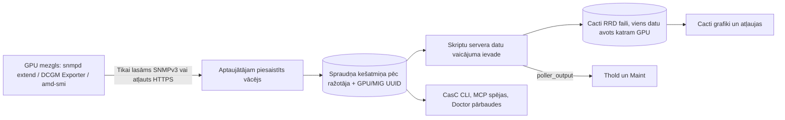

<!-- Source: README.md; SHA256: 97ba37df4a883426d3984ed7d14547ad7367e973411a8abd930409ce259f545b -->

<!-- translations:start -->
[English](../../../README.md) | [简体中文](../zh-CN/README.md) | [हिन्दी](../hi-IN/README.md) | [Español (España)](../es-ES/README.md) | [Español (Latinoamérica)](../es-419/README.md) | [العربية (السعودية)](../ar-SA/README.md) | [Afrikaans](../af-ZA/README.md) | [አማርኛ](../am-ET/README.md) | [العربية (مصر)](../ar-EG/README.md) | [العربية (المغرب)](../ar-MA/README.md) | [Български](../bg-BG/README.md) | [বাংলা](../bn-BD/README.md) | [Bosanski](../bs-BA/README.md) | [Deutsch](../de-DE/README.md) | [Ελληνικά](../el-GR/README.md) | [فارسی](../fa-IR/README.md) | [Filipino](../fil-PH/README.md) | [Français](../fr-FR/README.md) | [Français (Maroc)](../fr-MA/README.md) | [Français (Sénégal)](../fr-SN/README.md) | [Hausa](../ha-NG/README.md) | [עברית](../he-IL/README.md) | [Hrvatski](../hr-HR/README.md) | [Bahasa Indonesia](../id-ID/README.md) | [Igbo](../ig-NG/README.md) | [Italiano](../it-IT/README.md) | [日本語](../ja-JP/README.md) | [ქართული](../ka-GE/README.md) | [한국어](../ko-KR/README.md) | [Latviešu](README.md) | [Malagasy](../mg-MG/README.md) | [मराठी](../mr-IN/README.md) | [Bahasa Melayu](../ms-MY/README.md) | [Nederlands](../nl-NL/README.md) | [Polski](../pl-PL/README.md) | [Português (Brasil)](../pt-BR/README.md) | [Português (Portugal)](../pt-PT/README.md) | [Русский](../ru-RU/README.md) | [Kinyarwanda](../rw-RW/README.md) | [Soomaali](../so-SO/README.md) | [Српски](../sr-RS/README.md) | [Svenska](../sv-SE/README.md) | [Kiswahili](../sw-KE/README.md) | [தமிழ்](../ta-IN/README.md) | [తెలుగు](../te-IN/README.md) | [ไทย](../th-TH/README.md) | [Türkçe](../tr-TR/README.md) | [Українська](../uk-UA/README.md) | [اردو](../ur-PK/README.md) | [Tiếng Việt](../vi-VN/README.md) | [isiXhosa](../xh-ZA/README.md) | [Yorùbá](../yo-NG/README.md) | [繁體中文](../zh-TW/README.md) | [isiZulu](../zu-ZA/README.md)
<!-- translations:end -->

# plugin_gpu

Cacti 1.2 spraudnis, kas ienes katra GPU noslodzi, atmiņu, temperatūru, jaudu, ECC kļūdas un veiktspējas ierobežošanas iemeslus no NVIDIA un AMD rīkiem Cacti vidē. Katrs GPU (vai MIG instance) kļūst par datu vaicājuma indeksu sava mezgla ierīcē, tāpēc GPU grafiki atrodas blakus pārējiem mezgla grafikiem saskaņā ar Cacti atļaujām, un Thold un Maint var par tiem brīdināt un tos apslāpēt.

> **Statuss: 1. līdz 3. posms ir ieviesti kodā, bet vēl nav izlaisti.** 1. posms (NVIDIA `nvidia-smi` caur SNMP extend, identitātes izsekošana, grafiki, ierobežošanas un ECC signāli, Thold un Maint brīdinājumi, veselības lapa), 2. posms (tikai lasāms NVIDIA DCGM Exporter HTTP(S) parsētājs/klients un AMD `amd-smi` parsētājs), 3. posms (MIG instanču identitātes izsekošana, 4. shēmas versijas kolonnas, aptaujātājam piesaistīta attālā vācēja izpilde, `replicate_out` un `remote_agent` āķi), CasC operatora CLI (`cli/gpu.php`) un ekosistēmas āķi (`abilities_register`, `doctor_register_checks`, `casc_register_providers`) ir ieviesti un aptverti ar vienībtestiem, drošības testiem un vienreizējās Cacti vides integrācijas testiem. Līdzšinējās darbības pārbaudes izmanto sintētisku `snmpd` un fiksētus datus, nevis fizisku GPU aparatūru. Pirms laidiena marķēšanas vēl atvērts: pilotprojekti reālā aparatūrā ([docs/pilot-plan.md](../../pilot-plan.md), #54), ārēja drošības pārbaude ([docs/security-review.md](../../security-review.md)), no reāliem rīkiem saglabāti paraugdati (#14) un mēroga mērījumi ražošanas izmēra aparatūrā ([docs/performance.md](../../performance.md)). XID kļūdu vākšana joprojām ir atvērta lēmumā #8.

## Piekļuves lomas

| Tiesību joma | Piekļuve |
| --- | --- |
| GPU View | Esošās uzraudzības lapas. |
| GPU Operator | Uzraudzība, kā arī Darbību lapa un personīgie šķirošanas apstiprinājumi. |
| GPU Admin | Operatora piekļuve, kā arī esošā konfigurācija un administratīvās darbības. |

Pēc jaunināšanas failu nokopēšanas atveriet spraudņu (Plugins) lapu kā administrators, lai reģistrētu
jauno tiesību jomu. Operatora tiesību jomu piešķiriet tieši sadaļā **Configuration > Users** vai lietotāju grupās.
Jauninājumi saglabā esošos View un Admin tiesību jomu ID un piešķīrumus. Admin piekļuve
katrā pieprasījumā manto Operator piekļuvi, un Operator piekļuve manto View piekļuvi;
tas nepievieno saglabātus piešķīrumus lietotājiem vai grupām. Spraudņa iestatījumiem papildus
Cacti iestatījumu atļaujai ir nepieciešama arī GPU Admin piekļuve.

Cacti ierīču atļaujas joprojām ierobežo katram lietotājam pieejamās rindas un darbības; nepiesaistītiem objektiem nepieciešams administrators.
Akreditācijas dati, konfigurācija, piesaiste, dzēšana un citas administratīvās izmaiņas
paliek administratīvajās lapās. Apstiprinājumi ir spēkā tikai pašreizējā
lietotāja sesijā, ne ilgāk par vienu stundu un tikai tikmēr, kamēr tas pats novērojums paliek
aktuāls. Jauni vai mainīti novērojumi padara tos nederīgus. Tie nekad neatzīmē neveiksmīgu
mērījumu kā veselu un neapslāpē brīdinājumus.

## Kāpēc

GPU mezgli parasti jau ir pievienoti Cacti CPU, atmiņas un tīkla saskarņu uzraudzībai. GPU veselība ir atsevišķs jautājums, uz kuru mezgla SNMP dati neatbild: kartei var būt termiski ierobežota veiktspēja, var uzkrāties ECC kļūdas vai parādīties XID kļūme, kamēr pats mezgls izskatās vesels. Ražotāju rīki par to ziņo (`nvidia-smi`, DCGM, `amd-smi`), bet to izvade paliek ārpus Cacti grafikiem, atļaujām un brīdinājumiem.

Spraudnis aizpilda šo robu, pārvēršot ražotāju rīku izvadi Cacti datu avotos, kas indeksēti pēc katra GPU identitātes, nevis pozīcijas, tāpēc pārstartēšana, kas maina GPU secību, nepievieno vienas kartes vēsturi citai. Tas atkārtoti izmanto Cacti grafikus, atļaujas, attālos datu vācējus, Thold un Maint, nevis veido to paralēlas versijas.

## Plānotais tvērums

| Posms | Tvērums | Statuss | Atskaite |
|---|---|---|---|
| 0, izpēte | Ražotāju rīku izvade, XID un ierobežošanas signāli, GPU identitāte, privilēģijas, lēmums par datu vākšanas ceļu | Pabeigts | [M1](https://github.com/somethingwithproof/plugin_gpu/milestone/1) |
| 1, nvidia | `nvidia-smi` datu vākšana, inventārs pēc UUID, grafiki, ierobežošanas un ECC signāli, Thold un Maint, veselības lapa | Ieviests (pārbaudīts ar fiksētiem datiem) | [M2](https://github.com/somethingwithproof/plugin_gpu/milestone/2), [M3](https://github.com/somethingwithproof/plugin_gpu/milestone/3), [M4](https://github.com/somethingwithproof/plugin_gpu/milestone/4) |
| 2, aizmugursistēmas | Tikai lasāms DCGM Exporter HTTP(S) parsētājs/klients (`lib/DcgmExporterParser.php`, `lib/DcgmExporterClient.php`), AMD `amd-smi` parsētājs (`lib/AmdSmiParser.php`) | Ieviests (pārbaudīts ar vienībtestiem) | [M5](https://github.com/somethingwithproof/plugin_gpu/milestone/5) |
| 3, mig, attālā vākšana un ekosistēma | MIG instanču identitātes izsekošana, attālie datu vācēji (`INFO`, `poller_gpu.php --poller=N`, `replicate_out`, `remote_agent`), CasC CLI (`cli/gpu.php`), MCP/Doctor/CasC āķi | Ieviests (pārbaudīts ar vienībtestiem un CI integrācijas testiem) | [M6](https://github.com/somethingwithproof/plugin_gpu/milestone/6) |

Ārpus tvēruma: jebkura komanda, kas maina GPU vai mezglu (taktsfrekvences, jaudas ierobežojumi, atiestatīšana, MIG izkārtojums), spraudnim piederošs brīdinājumu dzinis, pielāgots dēmons vai tīkla protokols, kā arī plānotāja vai uzdevumu uzskaite. Izpētes sarakstu skatiet plānā.

## Ko pievieno 4. atskaite

- **Tikai lasāms NVIDIA DCGM Exporter vācējs** (`lib/DcgmExporterParser.php`, `lib/DcgmExporterClient.php`). Parsē Prometheus teksta ekspozīcijas metrikas (`DCGM_FI_DEV_GPU_UTIL`, `DCGM_FI_DEV_FB_USED`, `DCGM_FI_DEV_FB_FREE`, `DCGM_FI_DEV_POWER_USAGE`, `DCGM_FI_DEV_GPU_TEMP`, `DCGM_FI_DEV_ECC_DBE_VOL_TOTAL`, `DCGM_FI_DEV_CLOCK_THROTTLE_REASONS` un MIG birkas `GPU_I_ID` un `GPU_I_PROFILE`). HTTP(S) klients piemēro skaidru galapunktu resursdatoru/CIDR atļauto sarakstu, pēc noklusējuma pārbauda TLS sertifikātus, ierobežo noildzes un atbildes lielumu, atspējo pāradresācijas un noraida shēmas, kas nav HTTP(S).
- **Tikai lasāms AMD `amd-smi` parsētājs** (`lib/AmdSmiParser.php`). Normalizē `amd-smi` JSON/SNMP-extend izvadi (noslodzi, VRAM, jaudu, savienojuma/malas temperatūru, ECC, partīciju metadatus un atsevišķus ierobežošanas akumulatorus caur `Reading::$vendorExtensions`) kopējā metriku modelī zem `Vendor::Amd`.
- **MIG instanču izsekošana un 4. shēmas versija** (`lib/GpuReport.php`, `lib/GpuSnapshot.php`, `lib/GpuRecord.php`, `lib/Schema.php`, `lib/ScriptServer.php`). Izseko MIG instanču UUID (`MIG-<uuid>` un `MIG-GPU-<parent>/<gi>/<ci>`), `mig_mode`, `mig_instance_id`, `mig_profile`, `parent_uuid` un `partition_info` līdzās vecāku GPU, vienlaikus saglabājot nemainīgās identitātes atslēgas (`vendor`, `uuid`, `parent_uuid`) aizsargātas atjauninājumu laikā un validētas pirms datubāzes vaicājumiem.
- **Attālie datu vācēji** (`INFO`, `poller_gpu.php`, `lib/Poller.php`, `lib/ReplicationRepository.php`, `setup.php`). Deklarē `remote_collect:1, remote_poller:1` failā `INFO`, atbalsta aptaujātājam piesaistītu izpildi ar `php plugins/gpu/poller_gpu.php --poller=N`, izlaiž Cacti objektu sagatavošanu ne-galvenajos aptaujātājos, replicē aptaujātājam piesaistītās tabulas caur `replicate_out` un atbild uz tikai lasāmām `gpu_health` un `gpu_inventory` darbībām caur `remote_agent`.
- **Operatora un CasC CLI** (`cli/gpu.php`, `lib/CascProvider.php`). Darbojas PHP 8.2+ (parsējams PHP 8.0) bez ārējām Composer atkarībām: `php plugins/gpu/cli/gpu.php export [--format=yaml|xml]`, `validate <file> [--format=yaml|xml]`, `plan <file> [--format=yaml|xml] [--output=text|json]`, `apply <file> --confirm=<PLAN_HASH> [--format=yaml|xml]` un `health [--format=text|json]`. Plāni aprēķina deterministisku SHA-256 apstiprinājuma jaucējkodu, `apply` droši atteicas jaucējkoda nesakritības gadījumā, un XML parsēšana noraida `DOCTYPE` un `ENTITY` deklarācijas.
- **Ekosistēmas integrācijas āķi** (`lib/EcosystemIntegration.php`, `setup.php`). Reģistrē `abilities_register` (`gpu-list-nodes`, `gpu-list-devices`, `gpu-get-health`; tikai lasāmas, ierobežotas ar `GPU View` tiesību jomu un Cacti ierīču atļaujām), `doctor_register_checks` (`gpu_schema`, `gpu_poller_freshness`, `gpu_node_health`) un `casc_register_providers`.
- **Ierobežošanas iemesli un ECC kā brīdinājumu vērtības** ([docs/metrics.md](../../metrics.md)). Dekodē taktsfrekvences notikumu maskas 0/1 indikatoros un aprēķina jaunas koriģētās/nekoriģētās ECC kļūdas katrā intervālā kā rādītājus, lai Thold 1.8.2 un Maint 1.3 varētu brīdināt un apslāpēt bez negatīviem skaitītājiem vai atiestatīšanas lēcieniem ([docs/alerting.md](../../alerting.md)).
- **GPU veselība, atļaujas, kļūmju atjaunošana un mērogošana.** GPU veselība (GPU View) parāda saglabāto aktualitāti, pēdējās vākšanas iznākumu, Maint stāvokli, aizmugursistēmu, versijas un neapstrādātas ierobežošanas maskas bez savienošanās ar mezgliem. Skriptēti pilna cikla testi pārbauda atļaujas, aģenta/DB/RRD kļūmju atkopšanu ([docs/backup.md](../../backup.md)) un 100 GPU mēroga izpildi CI vidē ([docs/performance.md](../../performance.md), [docs/operations.md](../../operations.md), [CHANGELOG.md](../../../CHANGELOG.md)).

## Ko pievieno 3. atskaite

- **Datu vākšana caur SNMP extend** ([ADR 0008](../../decisions/0008-collect-through-snmp-extend.md)). Mezgla administrators pievieno divas fiksētas `extend` rindas failā `snmpd.conf` ([docs/node-setup.md](../../node-setup.md)); spraudnis nolasa NET-SNMP-EXTEND-MIB, izmantojot Cacti SNMP funkcijas ar pašas ierīces akreditācijas datiem (ieteicams SNMPv3). Tas nepalaiž nekādas komandas ne Cacti serverī, ne mezglā.
- **Stingra parsēšana.** Lauki tiek nolasīti pēc pozīcijas, katra rinda identificē savu GPU ar UUID, un nenulles izejas statuss, noildze, aprauta izvade, rinda ar nepareizu lauku skaitu vai piejaukts kļūdas teksts padara visu vākšanu par neveiksmīgu: vērtības kļūst par `U`, neviens GPU netiek atzīmēts kā iztrūkstošs, un lapā GPU mezgli tiek parādīts iemesls.
- **Vācējs pēc katra aptaujas cikla.** Tas nolasa katra iespējotā mezgla aģentu, atjaunina identitātes ierakstus un saglabā jaunāko paraugu kešatmiņā. Skriptu servera ievade lasa tikai šo kešatmiņu, tāpēc Cacti aptauja nekad negaida GPU mezglu.
- **Cacti objekti** ([ADR 0010](../../decisions/0010-attach-to-existing-node-devices.md)). Veidnes un datu vaicājums *GPU - Devices* tiek piegādāti XML formātā un importēti instalēšanas un jaunināšanas laikā. Mezgla saglabāšana pievieno datu vaicājumu tā esošajai ierīcei ar pārindeksēšanas metodi None; lapā GPU mezgli ierīci var izveidot tikai tad, ja mezglam tās vēl nav. Katrs GPU ir indekss pēc ražotāja un UUID ar vienu datu avotu, ko koplieto tā Utilization, Memory, Temperature, Power, Power Percent, Clocks, Throttle, ECC Errors, New ECC Errors, Retired Pages un Sample Age grafiki. Katru modeļa lauku attēlo kāds grafiks, jo Cacti saglabā tikai grafikos izmantotos laukus. Spraudnis pārindeksē pēc katras GPU izmaiņas, saglabā pārindeksēšanu, ko Cacti izlaida, kamēr ierīce bija neaktīva vai atspējota, izpilda to, kad ierīce atkal ir aktīva, un izveido grafikus jauniem GPU.
- **Vēsture paliek kopā ar karti.** Iztrūkstošs GPU paliek kā indekss, tāpēc tā grafikos redzams pārrāvums un dati atsāk krāties tajā pašā RRD failā, kad tas atgriežas. Nomaiņas karte tajā pašā slotā iegūst savu datu avotu. Poga **Remove from Data Query** mezgla lapā izņem iztrūkstošu GPU no saraksta; tā RRD faili un grafiki tiek saglabāti, līdz jūs tos dzēšat.
- **Ierīču atļaujas lapā GPU mezgli.** GPU Admin redz, maina, eksportē un pārvieto tikai mezglus un GPU tajās ierīcēs, kuras viņš drīkst skatīt Cacti; GPU pārvietošanai nepieciešama piekļuve abiem mezgliem. Mezglu, kura ierīce tika dzēsta, var atspējot vai dzēst.
- **Kopējais metriku modelis** ([ADR 0009](../../decisions/0009-common-metric-core-with-vendor-extensions.md), [docs/metrics.md](../../metrics.md)). Atmiņa tiek mērīta baitos, taktsfrekvences notikumu maska tiek dekodēta `thr_*` indikatoros, un `age` ir paša GPU parauga laika vecums vai `U`, ja tas nav zināms.

Instalējošajam (tīmekļa servera) lietotājam jāspēj rakstīt `<cacti>/resource/script_server/`, kur spraudnis novieto savu datu vaicājuma XML failu; pretējā gadījumā instalēšana un jaunināšana apstājas ar paziņojumu un atkārto mēģinājumu nākamajā reizē. Atinstalēšana noņem veidnes un XML tikai tad, ja ir atzīmēta opcija *Atinstalējot noņemt spraudņa Cacti objektus*, un nekad nedzēš RRD failus, ierīces, grafikus vai datu avotus ([docs/operations.md](../../operations.md#uninstall)). Mezgli attālajos datu vācējos darbojas atbilstoši savam piešķirtajam `poller_id`.

## Ko piegādā 2. atskaite

- **Aizsargāta instalēšana.** PHP versijās zem 8.2 instalēšana un iespējošana tiek noraidīta ar paziņojumu par nepieciešamo versiju, un pārējā Cacti sistēma turpina darboties. `setup.php` un lapu skripti ir parsējami PHP 8.0.
- **Dzīves cikls.** Instalēšana, jaunināšana, atspējošana un atinstalēšana Cacti spraudņu lapā. Jauninājumi notiek noteiktā secībā, pabeidzas pēc pārtraukuma un maina reģistrēto versiju tikai pēc veiksmīgas izpildes. Atinstalēšana saglabā spraudņa tabulas, ja vien nenoņemat atzīmi pie *Saglabāt spraudņa tabulas atinstalēšanas laikā*; tā nekad neskar Cacti ierīces, datu avotus, grafikus vai RRD failus.
- **Atsevišķas tiesību jomas.** *GPU Admin* atver lapu **GPU mezgli**, kur var reģistrēt Cacti ierīces kā GPU mezglus, apstiprināt vai noraidīt GPU pārvietošanu starp mezgliem un eksportēt visus ierakstus JSON formātā. *GPU View* atver lapu **GPU inventārs**, kurā uzskaitīti GPU tikai tajās ierīcēs, kuras skatītājs drīkst redzēt. Abas lapas atrodas sadaļā Pārvaldība, un katra izmaiņa ir POST pieprasījums, ko pārbauda csrf-magic.
- **GPU identitātes ieraksti.** Katrs GPU tiek indeksēts pēc ražotāja un UUID. Indekss, PCI kopnes ID, nosaukums, draiveris un ziņojošais rīks ir atribūti, kas mainās uz vietas. Jauns UUID zināmā slotā tiek atzīmēts kā iespējama nomaiņa un sāk savu vēsturi; GPU, kas redzēts citā mezglā, tiek pārvietots tikai pēc operatora apstiprinājuma; GPU, kas trūkst veiksmīgās datu vākšanās, pēc konfigurējama reižu skaita tiek atzīmēts kā iztrūkstošs un nekad netiek dzēsts. Pagaidām tiek pieņemti tikai NVIDIA pilna GPU UUID; MIG instances gaida lēmumu #13, bet AMD — izpēti #19. Noteikumi tiek pārbaudīti ar fiksētu datu virknēm, jo vācējs tos vēl nebaro.
- **Testi un CI.** Vienībtestu un pirmkoda noteikumu komplekti bez GPU vai datubāzes, dzīves cikla un lapu atļauju pārbaudes ar Cacti 1.2.31 un pašreizējo 1.2.x PHP versijās no 8.2 līdz 8.5, PHP 8.1 atteikuma uzdevums, PHP 8.0 ieejas punktu sintakses pārbaude, PHPStan 9. līmenī un REUSE. Testa vide ir pagaidu, līdz tiek izlemts #12.

### Instalēšana izvērtēšanai

Šie soļi instalē pašreizējo kodu izmēģināšanai; pilnu operatora rokasgrāmatu skatiet [docs/operations.md](../../operations.md). Nepieciešams Cacti 1.2.31 vai jaunāks un PHP 8.2 vai jaunāks.

1. Nokopējiet repozitoriju uz `plugins/gpu` savā Cacti direktorijā. Direktorijai jābūt nosauktai `gpu`.
2. Cacti saskarnē atveriet **Configuration > Plugins**, tad instalējiet un iespējojiet **GPU**.
3. Piešķiriet lietotājiem *GPU View*, *GPU Operator* vai *GPU Admin* tiesību jomu sadaļā **Configuration > Users** atbilstoši viņu lomai. Instalējošais lietotājs saņem View un Admin; Admin ietver Operator piekļuvi.
4. Konfigurējiet katra GPU mezgla SNMP aģentu, kā aprakstīts [docs/node-setup.md](../../node-setup.md), pēc tam pievienojiet mezglu sadaļā **Management > GPU Nodes**.
5. Brīdinājumiem importējiet piegādātās Thold veidnes, kā aprakstīts [docs/alerting.md](../../alerting.md).
6. Pēc izvēles pielāgojiet **Configuration > Settings > GPU**: *Atzīmēt kā iztrūkstošu pēc* (noklusējums 3 veiksmīgas vākšanas, no 1 līdz 100), *Noveco pēc* (cik vecs drīkst būt paraugs, pirms tā vērtības tiek izvadītas kā `U`) un *Saglabāt spraudņa tabulas atinstalēšanas laikā* (pēc noklusējuma ieslēgts).

## Kā metrikas nonāk Cacti

Lēmumā [#7](https://github.com/somethingwithproof/plugin_gpu/issues/7) tika izvēlēts SNMP `extend` ([ADR 0008](../../decisions/0008-collect-through-snmp-extend.md)): paša mezgla aģents izpilda fiksētu `nvidia-smi` komandu, un spraudnis tikai nolasa rezultātu. Plānā salīdzināti varianti sadaļā [Datu vākšanas ceļi](../../PLAN.md#collection-paths).

## Saderības mērķi

| Komponents | Mērķis |
|---|---|
| Cacti | 1.2.31 vai jaunāks, bez kodola ielāpiem |
| PHP | 8.2 vai jaunāks; `setup.php` paliek parsējams PHP 8.0, lai neatbalstīta izpildvide saņemtu atteikumu, nevis bojātu Cacti lietotāja saskarni |
| NVIDIA | Draiveru un rīku versiju līnijas tiks noteiktas izpētē [#26](https://github.com/somethingwithproof/plugin_gpu/issues/26); DCGM lauku ID pārbaudīti v3.3.9 un v4.7.0 |
| AMD | `amd-smi` ROCm laidienos tiks noteikts izpētē [#26](https://github.com/somethingwithproof/plugin_gpu/issues/26) |
| Thold, Maint | Thold 1.8.2 un Maint 1.3 bez izmaiņām, pārbaudīti pilnā ciklā ([docs/alerting.md](../../alerting.md)) |

## Dizains

- [docs/PLAN.md](../../PLAN.md) ir pilns plāns: arhitektūra, augšupējie fakti, no kuriem tā atkarīga (ar avotiem), identitātes modelis, drošības robežas, veiktspējas aprēķini, testēšana un riski.
- [docs/decisions/](../../decisions/) satur arhitektūras lēmumu ierakstus par jau pieņemtajām izvēlēm.
- [docs/REQUIREMENTS.md](../../REQUIREMENTS.md) sasaista katru prasības ID ar tā uzdevumu.

## Kā tiek sekots darbam

- **Atskaites (Milestones)** seko plāna atskaitēm. Katrai ir episkais uzdevums ar apakšuzdevumu sarakstu un pabeigšanas pierādījumiem.
- **Uzdevumi (Issues)** tiek klasificēti ar birkām: `type: requirement`, `type: research`, `type: decision`, `type: epic`. Prasību uzdevumos norādītas numurētas, pārbaudāmas prasības (`REQ-AREA-NNN`) un pieņemšanas kritēriji.
- **Birkas (Labels)** satur arī `area:`, `phase:`, `priority:` un `status:`. Skatiet [CONTRIBUTING.md](../../../CONTRIBUTING.md#labels).
- [Projekta tāfele](https://github.com/users/somethingwithproof/projects/9) parāda visus uzdevumus visās atskaitēs.

## Līdzdalība

Izlasiet [CONTRIBUTING.md](../../../CONTRIBUTING.md). Iesniegumiem (commits) nepieciešams DCO paraksts. Dizaina diskusijas notiek uzdevumos; atvērtie lēmumi ir marķēti ar birku `type: decision`. No reāliem GPU rīkiem saglabāta izvade ir visnoderīgākais ieguldījums 1. atskaitē; vispirms noņemiet resursdatoru nosaukumus, sērijas numurus un UUID.

## Drošība

Par ievainojamībām ziņojiet privāti; skatiet [SECURITY.md](../../../SECURITY.md).

## Licence

GNU General Public License v2.0 — tā pati licence, kas Cacti un tā spraudņiem. Skatiet [LICENSE](../../../LICENSE).
