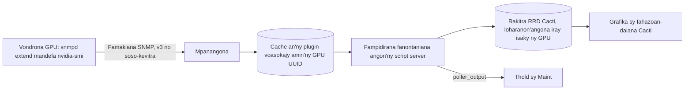

<!-- Source: README.md; SHA256: 126deef1783d64f878bf565f1433c10f31aef828eb9bc313aeff2b0335e54c7c -->

<!-- translations:start -->
[English](../../../README.md) | [简体中文](../zh-CN/README.md) | [हिन्दी](../hi-IN/README.md) | [Español (España)](../es-ES/README.md) | [Español (Latinoamérica)](../es-419/README.md) | [العربية (السعودية)](../ar-SA/README.md) | [Afrikaans](../af-ZA/README.md) | [አማርኛ](../am-ET/README.md) | [العربية (مصر)](../ar-EG/README.md) | [العربية (المغرب)](../ar-MA/README.md) | [বাংলা](../bn-BD/README.md) | [Deutsch](../de-DE/README.md) | [فارسی](../fa-IR/README.md) | [Filipino](../fil-PH/README.md) | [Français](../fr-FR/README.md) | [Français (Maroc)](../fr-MA/README.md) | [Français (Sénégal)](../fr-SN/README.md) | [Hausa](../ha-NG/README.md) | [עברית](../he-IL/README.md) | [Bahasa Indonesia](../id-ID/README.md) | [Igbo](../ig-NG/README.md) | [Italiano](../it-IT/README.md) | [日本語](../ja-JP/README.md) | [한국어](../ko-KR/README.md) | [Malagasy](README.md) | [मराठी](../mr-IN/README.md) | [Bahasa Melayu](../ms-MY/README.md) | [Nederlands](../nl-NL/README.md) | [Polski](../pl-PL/README.md) | [Português (Brasil)](../pt-BR/README.md) | [Русский](../ru-RU/README.md) | [Kinyarwanda](../rw-RW/README.md) | [Soomaali](../so-SO/README.md) | [Svenska](../sv-SE/README.md) | [Kiswahili](../sw-KE/README.md) | [தமிழ்](../ta-IN/README.md) | [తెలుగు](../te-IN/README.md) | [ไทย](../th-TH/README.md) | [Türkçe](../tr-TR/README.md) | [Українська](../uk-UA/README.md) | [اردو](../ur-PK/README.md) | [Tiếng Việt](../vi-VN/README.md) | [isiXhosa](../xh-ZA/README.md) | [Yorùbá](../yo-NG/README.md) | [繁體中文](../zh-TW/README.md) | [isiZulu](../zu-ZA/README.md)
<!-- translations:end -->

# plugin_gpu

Plugin ho an'ny Cacti 1.2 izay mitondra ao amin'ny Cacti ny fampiasana, ny fitadidiana, ny maripana, ny hery, ny hadisoana ECC, ary ny anton'ny fampihenana hafainganam-pandeha isaky ny GPU avy amin'ny fitaovana NVIDIA. Mbola ao anatin'ny drafitra fa tsy mbola voapetraka ny fanohanana ny AMD sy ny fanangonana ny hadisoana XID. Ny GPU tsirairay dia lasa tondro iray amin'ny fanontaniana angona ao amin'ny fitaovan'ny vondronany, ka ny grafikan'ny GPU dia mipetraka eo anilan'ny grafika hafa an'ny vondrona eo ambanin'ny fahazoan-dalana Cacti, ary afaka mandefa fampandrenesana sy manafina azy ireny ny Thold sy ny Maint.

> **Sata: eo am-pamolavolana, tsy mbola navoaka.** Ny Dingana lehibe 4 dia mahatonga ny dingana 1 (NVIDIA amin'ny alalan'ny SNMP extend) ho feno eo amin'ny kaody: fanangonana, famantarana, grafika, famantarana ny fampihenana hafainganam-pandeha sy ny ECC, fampandrenesana Thold sy Maint, ny pejin'ny fahasalamana, ary ny antontan-taratasy ho an'ny mpandraharaha. Tamin'ny `snmpd` tena izy miaraka amin'ny `nvidia-smi` sandoka mamoaka vokatra noforonina ihany no nandramana azy, fa tsy mbola tena nampiasaina tamin'ny fitaovana GPU tena izy mihitsy. Mbola misokatra alohan'ny famoahana: andrana eny amin'ny fitaovana tena izy ([docs/pilot-plan.md](../../pilot-plan.md), #54), famerenana ara-piarovana avy any ivelany ([docs/security-review.md](../../security-review.md)), santionan-angona nalaina avy amin'ny fitaovana tena izy (#14), ary fandrefesana ny fahafaha-miitatra amin'ny fitaovana mitovy habe amin'ny famokarana ([docs/performance.md](../../performance.md)). Ny hadisoana XID dia miandry ny fanapahan-kevitra #8. Aza ampiasaina amin'ny tontolo famokarana.

## Anjara asan'ny fidirana

| Fari-piadidiana | Fidirana |
| --- | --- |
| GPU View | Pejy fanaraha-maso efa misy. |
| GPU Operator | Fanaraha-maso miampy ny pejy Asa sy ny fankatoavana fanasokajiana manokana. |
| GPU Admin | Fidiran'ny Operator miampy ny fikirakirana efa misy sy ny hetsika fitantanana. |

Rehefa avy mandika ny rakitra fanavaozana, sokafy amin'ny maha-mpitantana ny pejy Plugins mba hisoratra anarana ny fari-piadidiana vaovao. Omeo mazava eo ambanin'ny **Configuration > Users** na vondrona mpampiasa ny fari-piadidian'ny Operator.
Ny fanavaozana dia mitazona ny laharan'ny fari-piadidiana sy ny fahazoan-dalana View sy Admin efa misy. Ny fidiran'ny Admin dia mandova ny fidiran'ny Operator, ary ny fidiran'ny Operator dia mandova ny fidiran'ny View isaky ny fangatahana; tsy manampy fahazoan-dalana voatahiry ho an'ny mpampiasa na vondrona izany. Ny fikirakirana ny plugin dia mitaky ihany koa ny fidirana GPU Admin ho fanampin'ny fahazoan-dalana Settings an'ny Cacti.

Ny fahazoan-dalana fitaovana Cacti dia mbola mametra ny andalana sy ny hetsika azon'ny mpampiasa tsirairay ampiasaina; ny zavatra tsy voasoratra an-tsarintany dia mitaky mpitantana.
Ny mombamomba ny fidirana, ny fikirakirana, ny fampifandraisana, ny famafana ary ny fanovana fitantanana hafa dia mijanona ao amin'ny pejy fitantanana. Ny fankatoavana dia tsy maharitra afa-tsy ao amin'ny fotoam-pivorian'ny mpampiasa ankehitriny, mandritra ny adiny iray raha be indrindra ary raha mbola vaovao hatrany izany fandinihana izany ihany. Ny fandinihana vaovao na niova dia manafoana azy ireo. Tsy manamarika fandrefesana tsy nahomby ho salama na manafina fampandrenesana mihitsy izy ireo.

## Nahoana

Ny vondrona GPU dia matetika efa ao amin'ny Cacti ho an'ny CPU, ny fitadidiana, ary ny fampifandraisana. Fanontaniana hafa ny fahasalaman'ny GPU izay tsy voavalin'ny angona SNMP an'ny vondrona: mety ho voafetra noho ny hafanana ny karatra iray, hanangona hadisoana ECC, na hitatitra hadisoana XID raha toa ka hita ho salama ny vondrona. Ny fitaovan'ny mpamokatra no mitatitra izany (`nvidia-smi`, DCGM, `amd-smi`), saingy ny vokatra avoakany dia mitoetra ivelan'ny grafika, ny fahazoan-dalana, ary ny fampandrenesana an'ny Cacti.

Manakatona izany banga izany ny plugin amin'ny alalan'ny fanovana ny vokatry ny fitaovan'ny mpamokatra ho loharanon'angona Cacti, izay tondroina amin'ny alalan'ny famantarana ny GPU tsirairay fa tsy ny toerany, ka ny famerenana mandefa izay manova ny filaharan'ny GPU dia tsy mampifandray ny tantaran'ny karatra iray amin'ny karatra hafa. Mampiasa indray ny grafika, ny fahazoan-dalana, ny mpanangona angona lavitra, ny Thold, ary ny Maint an'ny Cacti izy fa tsy manangana dika mitovy mifanitsy amin'izany.

## Sehatra voalahatra

| Dingana | Sehatra | Dingana lehibe |
|---|---|---|
| 0, fikarohana | Vokatry ny fitaovan'ny mpamokatra, famantarana XID sy ny fampihenana hafainganam-pandeha, famantarana GPU, tombontsoa manokana, fanapahan-kevitra momba ny lalan'ny fanangonana | [M1](https://github.com/somethingwithproof/plugin_gpu/milestone/1) |
| 1, nvidia | Fanangonana `nvidia-smi`, lisitra araka ny UUID, grafika, famantarana fampihenana hafainganam-pandeha, ECC sy XID, Thold sy Maint, pejin'ny fahasalamana | [M2](https://github.com/somethingwithproof/plugin_gpu/milestone/2), [M3](https://github.com/somethingwithproof/plugin_gpu/milestone/3), [M4](https://github.com/somethingwithproof/plugin_gpu/milestone/4) |
| 2, backends | Backend DCGM, backend `amd-smi` | [M5](https://github.com/somethingwithproof/plugin_gpu/milestone/5) |
| 3, mig sy lavitra | Santionan'ny MIG, mpanangona angona lavitra Cacti | [M6](https://github.com/somethingwithproof/plugin_gpu/milestone/6) |

Ivelan'ny sehatra: izay baiko manova GPU na vondrona (famantaranandro, fetran'ny hery, famerenana amin'ny laoniny, fandrindrana MIG), motera fampandrenesana an'ny plugin manokana, daemon na protokolon'ny tambajotra manokana, ary kaonty mpandrindra fotoana na asa. Jereo ny drafitra ho an'ny lisitry ny fikarohana miandry.

## Zavatra ampian'ny dingana lehibe 4

- **Anton'ny fampihenana hafainganam-pandeha ho sandam-pampandrenesana.** Ny saron'ny hetsika famantaranandro dia adika ho tondro 0 na 1 isaky ny antony; ny saron-javatra tsy fantatra dia manome tondro tsy fantatra, fa tsy zero mihitsy, ary ny bit tsy misy tondro dia mijanona ao amin'ny saron-javatra manta, izay asehon'ny GPU Health.
- **ECC ho sandam-pampandrenesana** ([docs/metrics.md](../../metrics.md)). Ny hadisoana vaovao voahitsy sy tsy voahitsy hatramin'ny santionany teo aloha dia kajin'ny plugin avy amin'ny fitambarana roa mifanesy ary tehirizina ho marika fandrefesana: tsy fantatra ho an'ny santionany voalohany, famakiana diso, na famerenana mampiditra mpamily, mba tsy ho vakiana ho zero na ho isa miiba mihitsy ny famerenana amin'ny laoniny. Ny isan'ny pejy nisotro ronono bit tokana sy bit roa ary ny fomba ECC dia vakiana ihany koa. Grafika ECC roa fanampiny isaky ny GPU no mamela ny Cacti hitahiry azy ireo; miaraka amin'ny Power Percent, dia misy grafika iraika ambin'ny folo ny fitambarany. Tsy angonina ny XID: tsy misy loharano mifanaraka amin'ny baiko `nvidia-smi` raikitra (#8).
- **Thold sy Maint** ([docs/alerting.md](../../alerting.md)). Modely Thold natolotra ho an'ny maripana, ny hery miohatra amin'ny fetrany, ny tondron'ny fampihenana hafainganam-pandeha, ny hadisoana ECC tsy voahitsy vaovao, ny fisotroan-drononon'ny pejy miandry, ary ny taonan'ny santionany. Ny sanda tsirairay dia marika fandrefesana, satria tsy mahomby amin'ny mpikajy tsy fantatra ny Thold 1.8.2. Ny fitsapana manomboka hatramin'ny farany miaraka amin'ny Thold 1.8.2 sy ny Maint 1.3 tsy novana dia mampiseho ny fetra tsirairay mipoitra sy miverina amin'ny laoniny, manerana ny famerenana ECC, ary manafina izany ny Maint.
- **GPU Health** (GPU View). Isaky ny vondrona: ny havaozana, ny fomba nifaranan'ny fanangonana farany, ny toetry ny Maint, ny backend, ny dikan-tenin'ny fitaovana sy ny mpamily, ary ny isan'ny GPU; isaky ny GPU: ny fisiana, ny taonan'ny santionany, ny toetry ny ECC, ary ny saron-javatra manta. Ny rakitra voatahiry ihany no vakiany.
- **Fahazoan-dalana.** Ny andiam-pitsapana fahazoan-dalana dia mandrakotra ny rakitra pejy sy ny hetsika rehetra, ny fanafoanana amin'ny fangatahana manaraka, ary ny fandavana izay tsy mamoaka na inona na inona.
- **Fanamarinana ny tsy fahombiazana sy ny famerenana amin'ny laoniny.** Ny fandefasana mandeha ho azy manomboka hatramin'ny farany dia manapaka ny masoivoho, ny mombamomba ny fidirana, ny fitaovana, ny vokatra avoakany, ny fifandraisana amin'ny angon-drakitra, ary ny fanoratana RRD, ary mamerina ny angon-drakitra avy amin'ny dika tahiry, ao anatin'izany ny iray tranainy noho ny rakitra RRD; tsy mandova rakitra RRD an'ny iray hafa mihitsy ny GPU vaovao ([docs/backup.md](../../backup.md)).
- **Fahafaha-miitatra** ([docs/performance.md](../../performance.md)). Ny fitsapana fahafaha-miitatra dia mandrefy ny fotoanan'ny fanangonana, ny fampidirana script server, ny famoronana zavatra Cacti, ny tsingerin'ny poller, ary ny pejin'ny fahasalamana amin'ny isan'ny GPU voafaritra; ny CI dia mandefa azy amin'ny GPU 100. Tsy mbola voarakitra ny fandrefesana GPU 1 000 sy 8 000, ka tsy misy isan'ny GPU tohanana voalaza.
- **Antontan-taratasy ho an'ny mpandraharaha** ([docs/operations.md](../../operations.md)): fametrahana, fanavaozana, fanesorana, tombontsoa kely indrindra, sanda tsy misy, ary famahana olana. Ny fanovana dia voatanisa ao amin'ny [CHANGELOG.md](../../../CHANGELOG.md).

## Zavatra ampian'ny dingana lehibe 3

- **Fanangonana amin'ny alalan'ny SNMP extend** ([ADR 0008](../../decisions/0008-collect-through-snmp-extend.md)). Ny mpitantana ny vondrona dia manampy andalana `extend` roa raikitra ao amin'ny `snmpd.conf` ([docs/node-setup.md](../../node-setup.md)); ny plugin dia mamaky ny NET-SNMP-EXTEND-MIB amin'ny alalan'ny asan'ny SNMP an'ny Cacti miaraka amin'ny mombamomba ny fidirana an'ilay fitaovana, SNMPv3 no soso-kevitra. Tsy mandefa na inona na inona ao amin'ny lohamilina Cacti na ao amin'ny vondrona izy.
- **Famakiana hentitra.** Ny saha dia vakiana araka ny toerany, ny andalana tsirairay dia manonona ny GPU-ny amin'ny alalan'ny UUID, ary ny sata fivoahana tsy zero, ny fahataperan'ny fotoana, ny vokatra tapaka, ny andalana manana isan'ny saha diso, na ny lahatsoratra hadisoana mitambatra dia mahatonga ny fanangonana manontolo ho tsy mahomby: lasa `U` ny sanda, tsy misy GPU voamarika ho tsy eo, ary ny GPU Nodes no mampiseho ny antony.
- **Mpanangona iray aorian'ny tsingerin'ny poller tsirairay.** Mamaky ny masoivohon'ny vondrona mandeha tsirairay izy, manavao ny rakitra famantarana, ary mitahiry ao amin'ny cache ny santionany farany. Ny fampidirana script server dia tsy mamaky afa-tsy izany cache izany, ka tsy miandry vondrona GPU mihitsy ny fanadihadian'ny Cacti.
- **Zavatra Cacti** ([ADR 0010](../../decisions/0010-attach-to-existing-node-devices.md)). Ny modely sy ny fanontaniana angona *GPU - Devices* dia alefa ho XML ary ampidirina mandritra ny fametrahana sy ny fanavaozana. Ny fitehirizana vondrona iray dia mampifandray ny fanontaniana angona amin'ny fitaovany efa misy miaraka amin'ny fomba fanavaozana tondro None; ny GPU Nodes dia tsy afaka mamorona fitaovana raha tsy rehefa tsy manana ny vondrona. Ny GPU tsirairay dia tondro voasokajy amin'ny mpamokatra sy ny UUID, miaraka amin'ny loharanon'angona iray iombonan'ny grafika Utilization, Memory, Temperature, Power, Power Percent, Clocks, Throttle, ECC Errors, New ECC Errors, Retired Pages, ary Sample Age. Ny saha tsirairay ao amin'ny modely dia soritan'ny grafika iray, satria ny saha ampiasain'ny grafika ihany no tehirizin'ny Cacti. Ny plugin dia manavao ny tondro isaky ny fiovan'ny GPU, mitazona ny fanavaozana tondro nolalovan'ny Cacti raha mbola Down na tsy mandeha ny fitaovana ary mandefa izany raha vantany vao Up ny fitaovana, ary mamorona grafika ho an'ny GPU vaovao.
- **Mijanona miaraka amin'ny karatra ny tantara.** Ny GPU tsy eo dia mijanona ho tondro, ka ny grafikany dia mampiseho banga ary mitohy ao amin'ny rakitra RRD mitovy rehefa miverina izy. Ny karatra fanoloana eo amin'ny toerana mitovy dia mahazo ny loharanon'angonany manokana. Ny **Remove from Data Query** ao amin'ny pejin'ny vondrona dia manala GPU tsy eo amin'ny lisitra; tehirizina hatrany ny rakitra RRD sy ny grafikany mandra-pamafanao azy.
- **Fahazoan-dalana fitaovana ao amin'ny GPU Nodes.** Ny GPU Admin dia tsy mahita, manova, manondrana, ary mamindra afa-tsy ny vondrona sy ny GPU eo amin'ny fitaovana azony jerena ao amin'ny Cacti; ny famindrana GPU dia mitaky ny vondrona roa. Azo atsangana tsy handeha na fafana ny vondrona izay voafafa ny fitaovany.
- **Ny modely fandrefesana iraisana** ([ADR 0009](../../decisions/0009-common-metric-core-with-vendor-extensions.md), [docs/metrics.md](../../metrics.md)). Amin'ny bytes ny fitadidiana, ny saron'ny hetsika famantaranandro dia adika ho tondro `thr_*`, ary ny `age` dia ny taonan'ny fotoanan'ny santionan'ny GPU manokana, na `U` rehefa tsy fantatra.

Ny mpampiasa mametraka (lohamilina tranonkala) dia tsy maintsy afaka manoratra ao amin'ny `<cacti>/resource/script_server/`, izay hametrahan'ny plugin ny XML fanontaniana angonany; raha tsy izany dia mijanona miaraka amin'ny hafatra ny fametrahana sy ny fanavaozana ary manandrana indray amin'ny andrana manaraka. Ny fanesorana dia tsy manala ny modely sy ny XML raha tsy rehefa voamarika ny *Remove the plugin's Cacti objects on uninstall*, ary tsy mamafa rakitra RRD, fitaovana, grafika, na loharanon'angona mihitsy ([docs/operations.md](../../operations.md#uninstall)). Ny vondrona eo amin'ny mpanangona angona lavitra dia tsy angonina raha tsy amin'ny dingana 3.

## Zavatra atolotry ny dingana lehibe 2

- **Fametrahana voaaro.** Amin'ny PHP ambanin'ny 8.2, dia lavina ny fametrahana sy ny fampandehanana miaraka amin'ny hafatra manonona ny dikan-teny takiana, ary mitohy miasa ny ambiny amin'ny Cacti. Ny `setup.php` sy ny script an'ny pejy dia azo vakiana amin'ny PHP 8.0.
- **Tsingerim-piainana.** Fametrahana, fanavaozana, fampitsaharana, ary fanesorana amin'ny alalan'ny pejy Plugins an'ny Cacti. Milamina ny filaharan'ny fanavaozana, vita aorian'ny fahatapahana, ary tsy manova ny dikan-teny voarakitra raha tsy rehefa mahomby izy ireo. Ny fanesorana dia mitazona ny latabatry ny plugin raha tsy esorinao ny *Keep Plugin Tables on Uninstall*; tsy mikasika fitaovana Cacti, loharanon'angona, grafika, na rakitra RRD mihitsy izy.
- **Fari-piadidiana misaraka.** Ny *GPU Admin* dia manokatra ny **GPU Nodes**, izay ahafahanao misoratra fitaovana Cacti ho vondrona GPU, manamafy na mandà ny fifindran'ny GPU eo anelanelan'ny vondrona, ary manondrana ny rakitra rehetra ho JSON. Ny *GPU View* dia manokatra ny **GPU Inventory**, izay mitanisa ny GPU eo amin'ny fitaovana azon'ny mpijery jerena ihany. Eo ambanin'ny Management avokoa ny pejy roa, ary POST voamarin'ny csrf-magic avokoa ny fanovana rehetra.
- **Rakitra famantarana ny GPU.** Ny GPU tsirairay dia tondroina amin'ny mpamokatra sy ny UUID. Ny tondro, ny laharan'ny bus PCI, ny anarana, ny mpamily, ary ny fitaovana mitatitra dia toetra miova eo amin'ny toerany. Ny UUID vaovao ao amin'ny toerana efa fantatra dia marihina ho mety ho fanoloana ary manomboka ny tantarany manokana; ny GPU hita eo amin'ny vondrona hafa dia tsy mifindra raha tsy rehefa manamafy ny mpandraharaha; ny GPU tsy hita ao amin'ny fanangonana mahomby dia marihina ho tsy eo aorian'ny isa azo ovaina ary tsy fafana mihitsy. Ny UUID GPU manontolo NVIDIA ihany no ekena amin'izao fotoana izao; miandry ny fanapahan-kevitra #13 ny santionan'ny MIG, ary ny fikarohana #19 ny AMD. Ny fitsipika dia andramana amin'ny filaharana santionan-angona, satria mbola tsy misy mpanangona mamahana azy.
- **Fitsapana sy CI.** Andiam-pitsapana singa sy fitsipiky ny loharano tsy misy GPU na angon-drakitra, fanamarinana ny tsingerim-piainana sy ny fahazoan-dalana pejy amin'ny Cacti 1.2.31 sy ny 1.2.x ankehitriny amin'ny PHP 8.2 hatramin'ny 8.5, asa fandavana PHP 8.1, fanamarinana syntax PHP 8.0 ho an'ny teboka fidirana, PHPStan amin'ny ambaratonga 9, ary REUSE. Vonjimaika ny rafitra fitsapana mandra-panapaka ny #12.

### Fametrahana ho an'ny fanombanana

Ireo dingana ireo dia mametraka ny kaody ankehitriny mba hanandramana azy; ny [docs/operations.md](../../operations.md) no mirakitra ny torolalana feno ho an'ny mpandraharaha. Mitaky Cacti 1.2.31 na vaovao kokoa amin'ny PHP 8.2 na vaovao kokoa izy ireo.

1. Adikao ao amin'ny `plugins/gpu` eo ambanin'ny lahatahiry Cacti-nao ny tahiry. Tsy maintsy atao hoe `gpu` ny anaran'ny lahatahiry.
2. Ao amin'ny Cacti, sokafy ny **Configuration > Plugins**, avy eo apetraho ary alefaso ny **GPU**.
3. Omeo ny mpampiasa ny fari-piadidiana *GPU View*, *GPU Operator*, na *GPU Admin* eo ambanin'ny **Configuration > Users**, arakaraka ny anjara asany. Ny mpampiasa mametraka dia mahazo View sy Admin; ny Admin dia ahitana ny fidiran'ny Operator.
4. Amboary ny masoivoho SNMP an'ny vondrona GPU tsirairay araka ny voalaza ao amin'ny [docs/node-setup.md](../../node-setup.md), avy eo ampio eo ambanin'ny **Management > GPU Nodes** ilay vondrona.
5. Ho an'ny fampandrenesana, ampidiro ny modely Thold natolotra araka ny voalazan'ny [docs/alerting.md](../../alerting.md).
6. Raha tiana dia amboary ny **Configuration > Settings > GPU**: *Mark Absent After* (3 fanangonana mahomby araka ny toerana voalohany, manomboka amin'ny 1 ka hatramin'ny 100), *Stale After* (ny faharetan'ny santionany alohan'ny hamoahan'ny sandany `U`), ary ny *Keep Plugin Tables on Uninstall* (mandeha araka ny toerana voalohany).

## Fomba hahatongavan'ny fandrefesana ao amin'ny Cacti

Ny fanapahan-kevitra [#7](https://github.com/somethingwithproof/plugin_gpu/issues/7) dia nifidy ny SNMP `extend` ([ADR 0008](../../decisions/0008-collect-through-snmp-extend.md)): ny masoivohon'ny vondrona manokana no mandefa baiko `nvidia-smi` raikitra ary ny vokatra ihany no vakian'ny plugin. Mampitaha ireo safidy ny drafitra eo ambanin'ny [Lalan'ny fanangonana](../../PLAN.md#collection-paths).

## Tanjon'ny fifanarahana

| Singa | Tanjona |
|---|---|
| Cacti | 1.2.31 na vaovao kokoa, tsy misy fanovana fototra |
| PHP | 8.2 na vaovao kokoa; ny `setup.php` dia mijanona ho azo vakiana amin'ny 8.0 mba hahazoana fandavana ny tontolo fandefasana tsy tohanana fa tsy Cacti UI simba |
| NVIDIA | Ny andian'ny mpamily sy ny fitaovana dia hofaritana amin'ny fikarohana [#26](https://github.com/somethingwithproof/plugin_gpu/issues/26); ny ID saha DCGM dia voamarina amin'ny v3.3.9 sy v4.7.0 |
| AMD | `amd-smi` amin'ny famoahana ROCm hofaritana amin'ny fikarohana [#26](https://github.com/somethingwithproof/plugin_gpu/issues/26) |
| Thold, Maint | Thold 1.8.2 sy Maint 1.3, tsy novana, voazaha manomboka hatramin'ny farany ([docs/alerting.md](../../alerting.md)) |

## Famolavolana

- [docs/PLAN.md](../../PLAN.md) no drafitra feno: rafitra, zava-misy avy any ambony iankinany (miaraka amin'ny loharano), modely famantarana, sisin-tany ara-piarovana, kajy fahombiazana, fitsapana, ary loza mety hitranga.
- [docs/decisions/](../../decisions) dia mitahiry ny rakitra fanapahan-kevitra ara-drafitra ho an'ny safidy efa vita.
- [docs/REQUIREMENTS.md](../../REQUIREMENTS.md) dia mampifandray ny ID fepetra takiana tsirairay amin'ny olany.

## Fomba fanaraha-maso ny asa

- **Dingana lehibe** dia manaraka ny dingana lehibe ao amin'ny drafitra. Ny tsirairay dia manana olana fototra mitanisa ny zana-olany sy ny porofon'ny fivoahana.
- **Olana** dia sokajiana amin'ny marika: `type: requirement`, `type: research`, `type: decision`, `type: epic`. Ny olana fepetra takiana dia milaza ny fepetra takiana misy laharana sy azo tsapaina (`REQ-AREA-NNN`) sy ny fepetra fanekena.
- **Marika** dia mitondra ihany koa ny `area:`, `phase:`, `priority:`, ary `status:`. Jereo ny [CONTRIBUTING.md](../../../CONTRIBUTING.md#labels).
- Ny [tabilao tetikasa](https://github.com/users/somethingwithproof/projects/9) dia mampiseho ny olana rehetra manerana ny dingana lehibe.

## Fandraisana anjara

Vakio ny [CONTRIBUTING.md](../../../CONTRIBUTING.md). Mila sonia DCO ny commit. Ny fifanakalozan-kevitra momba ny famolavolana dia atao ao amin'ny olana; mitondra ny marika `type: decision` ny fanapahan-kevitra misokatra. Ny vokatra azo avy amin'ny fitaovana GPU tena izy no fandraisana anjara mahasoa indrindra ho an'ny dingana lehibe 1; esory aloha ny anaran'ny mpampiantrano, ny laharan'ny andiany, ary ny UUID.

## Fiarovana

Tatitrao mitokana ny faharefoana; jereo ny [SECURITY.md](../../../SECURITY.md).

## Fahazoan-dalana

GNU General Public License v2.0, mitovy fahazoan-dalana amin'ny Cacti sy ny plugin-ny. Jereo ny [LICENSE](../../../LICENSE).
