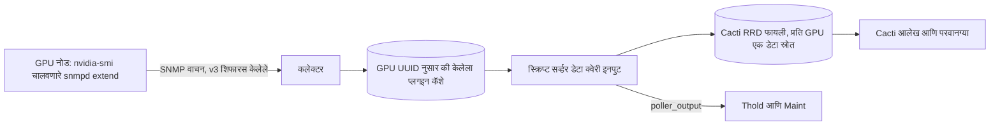

<!-- Source: README.md; SHA256: 97ba37df4a883426d3984ed7d14547ad7367e973411a8abd930409ce259f545b -->

<!-- translations:start -->
[English](../../../README.md) | [简体中文](../zh-CN/README.md) | [हिन्दी](../hi-IN/README.md) | [Español (España)](../es-ES/README.md) | [Español (Latinoamérica)](../es-419/README.md) | [العربية (السعودية)](../ar-SA/README.md) | [Afrikaans](../af-ZA/README.md) | [አማርኛ](../am-ET/README.md) | [العربية (مصر)](../ar-EG/README.md) | [العربية (المغرب)](../ar-MA/README.md) | [বাংলা](../bn-BD/README.md) | [Bosanski](../bs-BA/README.md) | [Deutsch](../de-DE/README.md) | [فارسی](../fa-IR/README.md) | [Filipino](../fil-PH/README.md) | [Français](../fr-FR/README.md) | [Français (Maroc)](../fr-MA/README.md) | [Français (Sénégal)](../fr-SN/README.md) | [Hausa](../ha-NG/README.md) | [עברית](../he-IL/README.md) | [Hrvatski](../hr-HR/README.md) | [Bahasa Indonesia](../id-ID/README.md) | [Igbo](../ig-NG/README.md) | [Italiano](../it-IT/README.md) | [日本語](../ja-JP/README.md) | [한국어](../ko-KR/README.md) | [Malagasy](../mg-MG/README.md) | [मराठी](README.md) | [Bahasa Melayu](../ms-MY/README.md) | [Nederlands](../nl-NL/README.md) | [Polski](../pl-PL/README.md) | [Português (Brasil)](../pt-BR/README.md) | [Русский](../ru-RU/README.md) | [Kinyarwanda](../rw-RW/README.md) | [Soomaali](../so-SO/README.md) | [Српски](../sr-RS/README.md) | [Svenska](../sv-SE/README.md) | [Kiswahili](../sw-KE/README.md) | [தமிழ்](../ta-IN/README.md) | [తెలుగు](../te-IN/README.md) | [ไทย](../th-TH/README.md) | [Türkçe](../tr-TR/README.md) | [Українська](../uk-UA/README.md) | [اردو](../ur-PK/README.md) | [Tiếng Việt](../vi-VN/README.md) | [isiXhosa](../xh-ZA/README.md) | [Yorùbá](../yo-NG/README.md) | [繁體中文](../zh-TW/README.md) | [isiZulu](../zu-ZA/README.md)
<!-- translations:end -->

# plugin_gpu

एक Cacti 1.2 प्लगइन जे NVIDIA साधनांमधून प्रति-GPU वापर, मेमरी, तापमान, वीज वापर, ECC त्रुटी आणि थ्रॉटलिंगची कारणे Cacti मध्ये आणते. AMD समर्थन आणि XID त्रुटी संकलन नियोजित आहेत, अद्याप कार्यान्वित केलेले नाहीत. प्रत्येक GPU हा त्याच्या नोडच्या डिव्हाइसवरील डेटा क्वेरीचा एक इंडेक्स बनतो, त्यामुळे Cacti च्या परवानग्यांखाली नोडच्या इतर आलेखांशेजारी GPU आलेख दिसतात, आणि Thold व Maint त्यावर अलर्ट देऊ शकतात आणि ते दडपू शकतात.

> **स्थिती: विकासाधीन, अद्याप प्रकाशित नाही.** माइलस्टोन 4 मुळे टप्पा 1 (SNMP extend द्वारे NVIDIA) कोडच्या दृष्टीने पूर्ण झाला आहे: संकलन, ओळख, आलेख, थ्रॉटल आणि ECC सिग्नल्स, Thold आणि Maint अलर्टिंग, आरोग्य पृष्ठ आणि ऑपरेटर दस्तऐवजीकरण. हे फक्त एका खऱ्या `snmpd` वर बनावट `nvidia-smi` द्वारे कृत्रिम आउटपुट प्रिंट करून चालवले गेले आहे, खऱ्या GPU हार्डवेअरवर कधीही चालवले गेलेले नाही. प्रकाशनापूर्वी अजून बाकी असलेली कामे: खऱ्या हार्डवेअरवर पायलट चाचण्या ([docs/pilot-plan.md](../../pilot-plan.md), #54), बाह्य सुरक्षा पुनरावलोकन ([docs/security-review.md](../../security-review.md)), खऱ्या साधनांमधून घेतलेले फिक्स्चर (#14), आणि प्रॉडक्शन-आकाराच्या हार्डवेअरवर मोजलेले स्केल ([docs/performance.md](../../performance.md)). XID त्रुटी निर्णय #8 च्या प्रतीक्षेत आहेत. हे प्रॉडक्शनमध्ये चालवू नका.

## प्रवेश भूमिका

| अधिकार क्षेत्र | प्रवेश |
| --- | --- |
| GPU View | विद्यमान देखरेख पृष्ठे. |
| GPU Operator | देखरेख तसेच ऑपरेशन्स पृष्ठ आणि वैयक्तिक ट्रायएज पोचपावत्या. |
| GPU Admin | ऑपरेटर प्रवेश तसेच विद्यमान कॉन्फिगरेशन आणि प्रशासकीय कृती. |

अपग्रेड फायली कॉपी केल्यानंतर, नवीन अधिकार क्षेत्र नोंदणीकृत करण्यासाठी प्रशासक म्हणून Plugins पृष्ठ उघडा. **Configuration > Users** किंवा वापरकर्ता गटांखाली Operator अधिकार क्षेत्र स्पष्टपणे नेमा.
अपग्रेडमध्ये विद्यमान View आणि Admin अधिकार क्षेत्र आयडी आणि अनुदाने कायम राहतात. प्रत्येक विनंतीवर Admin प्रवेशाला Operator प्रवेश आपोआप मिळतो,
आणि Operator प्रवेशाला View प्रवेश आपोआप मिळतो;
यामुळे वापरकर्त्यांना किंवा गटांना साठवलेली अनुदाने जोडली जात नाहीत. प्लगइन सेटिंग्जसाठी
Cacti च्या Settings परवानगीव्यतिरिक्त GPU Admin प्रवेश देखील आवश्यक आहे.

Cacti डिव्हाइस परवानग्या प्रत्येक वापरकर्त्यासाठी उपलब्ध असलेल्या ओळी आणि कृती अजूनही मर्यादित करतात; मॅप न केलेल्या ऑब्जेक्ट्ससाठी प्रशासक आवश्यक असतो.
क्रेडेन्शियल्स, कॉन्फिगरेशन, मॅपिंग, हटवणे आणि इतर प्रशासकीय बदल
प्रशासकीय पृष्ठांवरच राहतात. पोचपावत्या फक्त सध्याच्या
वापरकर्त्याच्या सत्रातच टिकतात, जास्तीत जास्त एक तासासाठी आणि फक्त तेच निरीक्षण ताजे
असेपर्यंतच. नवीन किंवा बदललेले निरीक्षण त्यांना अवैध ठरवते. त्या कधीही अयशस्वी
मोजमापाला निरोगी मानत नाहीत किंवा अलर्ट दडपत नाहीत.

## का आवश्यक आहे

CPU, मेमरी आणि इंटरफेससाठी GPU नोड्स सहसा आधीच Cacti मध्ये असतात. GPU आरोग्य हा एक स्वतंत्र प्रश्न आहे ज्याचे उत्तर नोडचा SNMP डेटा देत नाही: नोड स्वतः निरोगी दिसत असतानाही कार्ड थर्मली थ्रॉटल होऊ शकते, ECC त्रुटी जमा करू शकते किंवा XID दोष नोंदवू शकते. व्हेंडर साधने याची माहिती देतात (`nvidia-smi`, DCGM, `amd-smi`), परंतु त्यांचे आउटपुट Cacti चे आलेख, परवानग्या आणि अलर्टिंग यांच्या बाहेर राहते.

हे प्लगइन प्रत्येक GPU च्या स्थानाऐवजी त्याच्या ओळखीवर आधारित Cacti डेटा स्रोत तयार करून व्हेंडर साधनांच्या आउटपुटमधील ही उणीव भरून काढते, जेणेकरून रीबूटमुळे GPU चा क्रम बदलल्यास एका कार्डचा इतिहास दुसऱ्या कार्डला जोडला जात नाही. समांतर आवृत्त्या तयार करण्याऐवजी ते Cacti चे आलेख, परवानग्या, रिमोट डेटा कलेक्टर्स, Thold आणि Maint यांचाच पुनर्वापर करते.

## नियोजित व्याप्ती

| टप्पा | व्याप्ती | माइलस्टोन |
|---|---|---|
| 0, संशोधन | व्हेंडर साधनांचे आउटपुट, XID आणि थ्रॉटल सिग्नल्स, GPU ओळख, विशेषाधिकार, संकलन मार्गाचा निर्णय | [M1](https://github.com/somethingwithproof/plugin_gpu/milestone/1) |
| 1, nvidia | `nvidia-smi` संकलन, UUID नुसार इन्व्हेंटरी, आलेख, थ्रॉटल, ECC आणि XID सिग्नल्स, Thold आणि Maint, आरोग्य पृष्ठ | [M2](https://github.com/somethingwithproof/plugin_gpu/milestone/2), [M3](https://github.com/somethingwithproof/plugin_gpu/milestone/3), [M4](https://github.com/somethingwithproof/plugin_gpu/milestone/4) |
| 2, बॅकएंड्स | DCGM बॅकएंड, `amd-smi` बॅकएंड | [M5](https://github.com/somethingwithproof/plugin_gpu/milestone/5) |
| 3, mig आणि रिमोट | MIG इन्स्टन्सेस, Cacti रिमोट डेटा कलेक्टर्स | [M6](https://github.com/somethingwithproof/plugin_gpu/milestone/6) |

व्याप्तीबाहेर: GPU किंवा नोडमध्ये बदल करणारी कोणतीही आज्ञा (क्लॉक, वीज मर्यादा, रीसेट, MIG लेआउट), प्लगइन-मालकीचे अलर्टिंग इंजिन, कस्टम डिमन किंवा नेटवर्क प्रोटोकॉल, आणि शेड्युलर किंवा जॉब अकाउंटिंग. संशोधन बॅकलॉगसाठी योजना पहा.

## माइलस्टोन 4 मध्ये काय नवीन आहे

- **अलर्ट मूल्ये म्हणून थ्रॉटल कारणे.** क्लॉक इव्हेंट मास्क प्रत्येक कारणासाठी 0 किंवा 1 सूचकामध्ये डिकोड केला जातो; अज्ञात मास्कमुळे अज्ञात सूचक मिळतात, कधीही शून्य नाहीत, आणि सूचकाशिवाय असलेले बिट्स रॉ मास्कमध्ये राहतात, जे GPU Health दाखवते.
- **अलर्ट मूल्ये म्हणून ECC** ([docs/metrics.md](../../metrics.md)). मागील नमुन्यापासून नवीन दुरुस्त केलेल्या आणि दुरुस्त न केलेल्या त्रुटींची गणना प्लगइनद्वारे सलग दोन एकूण संख्यांवरून केली जाते आणि गेज म्हणून साठवली जाते: पहिल्या नमुन्यासाठी, चुकलेल्या वाचनासाठी किंवा ड्रायव्हर रीलोडसाठी अज्ञात, जेणेकरून रीसेट कधीही शून्य किंवा ऋण संख्या म्हणून वाचला जात नाही. निवृत्त झालेल्या सिंगल-बिट आणि डबल-बिट पृष्ठ संख्या आणि ECC मोड देखील वाचले जातात. प्रति GPU दोन अतिरिक्त ECC आलेख Cacti ला ते साठवू देतात; Power Percent सह, एकूण अकरा आलेख आहेत. XID संकलित केले जात नाही: निश्चित केलेल्या `nvidia-smi` आज्ञांमध्ये कोणताही स्रोत बसत नाही (#8).
- **Thold आणि Maint** ([docs/alerting.md](../../alerting.md)). तापमान, मर्यादेच्या तुलनेत वीज वापर, थ्रॉटल सूचक, नवीन दुरुस्त न झालेल्या ECC त्रुटी, प्रलंबित पृष्ठ निवृत्ती आणि नमुना वय यासाठी सोबत दिलेले Thold टेम्पलेट्स. प्रत्येक मूल्य हे गेज आहे, कारण Thold 1.8.2 अज्ञात काउंटरवर अयशस्वी होते. अपरिवर्तित Thold 1.8.2 आणि Maint 1.3 सह एंड-टू-एंड चाचणी प्रत्येक थ्रेशोल्ड ट्रिगर होताना आणि पूर्ववत होताना, ECC रीसेट दरम्यान, आणि Maint द्वारे ते दडपले जाताना दाखवते.
- **GPU Health** (GPU View). प्रति नोड: ताजेपणा, शेवटचे संकलन कसे संपले, Maint स्थिती, बॅकएंड, साधन आणि ड्रायव्हर आवृत्त्या आणि GPU संख्या; प्रति GPU: उपस्थिती, नमुना वय, ECC स्थिती आणि रॉ मास्क. हे फक्त साठवलेल्या नोंदी वाचते.
- **परवानग्या.** परवानगी संच प्रत्येक पृष्ठ फाइल आणि कृती, पुढील विनंतीवर अधिकार रद्द करणे, आणि कोणतीही माहिती उघड न करणारे नकार तपासतो.
- **अपयश आणि पुनर्संचयित पात्रता.** स्क्रिप्ट केलेल्या एंड-टू-एंड चाचण्या एजंट, क्रेडेन्शियल्स, साधन, त्याचे आउटपुट, डेटाबेस कनेक्शन आणि RRD लेखन खंडित करतात, आणि डंपमधून डेटाबेस पुनर्संचयित करतात, ज्यामध्ये RRD फायलींपेक्षा जुन्या डंपचाही समावेश आहे; नवीन GPU ला कधीही दुसऱ्याची RRD फाइल वारशाने मिळत नाही ([docs/backup.md](../../backup.md)).
- **स्केल** ([docs/performance.md](../../performance.md)). स्केल चाचणी दिलेल्या GPU संख्येवर संकलन, स्क्रिप्ट सर्व्हर इनपुट, Cacti ऑब्जेक्ट निर्मिती, पोलर सायकल आणि आरोग्य पृष्ठाचा वेळ मोजते; CI ही चाचणी 100 GPUs वर चालवते. 1,000 आणि 8,000 GPU मोजमाप अद्याप नोंदवलेले नाहीत, त्यामुळे समर्थित GPU संख्या सांगितलेली नाही.
- **ऑपरेटर दस्तऐवजीकरण** ([docs/operations.md](../../operations.md)): इंस्टॉल, अपग्रेड, अनइंस्टॉल, किमान विशेषाधिकार, अनुपलब्ध मूल्ये आणि समस्यानिवारण. बदल [CHANGELOG.md](../../../CHANGELOG.md) मध्ये सूचीबद्ध आहेत.

## माइलस्टोन 3 मध्ये काय नवीन आहे

- **SNMP extend द्वारे संकलन** ([ADR 0008](../../decisions/0008-collect-through-snmp-extend.md)). नोडचे प्रशासक `snmpd.conf` मध्ये दोन निश्चित `extend` ओळी जोडतात ([docs/node-setup.md](../../node-setup.md)); प्लगइन डिव्हाइसच्या स्वतःच्या क्रेडेन्शियल्ससह Cacti च्या SNMP फंक्शन्सद्वारे NET-SNMP-EXTEND-MIB वाचते, SNMPv3 शिफारस केलेले आहे. ते Cacti सर्व्हरवर किंवा नोडवर काहीही चालवत नाही.
- **कठोर पार्सिंग.** फील्ड स्थानानुसार वाचले जातात, प्रत्येक ओळ तिच्या GPU ला UUID ने नाव देते, आणि शून्येतर एक्झिट स्थिती, टाइमआउट, अपूर्ण आउटपुट, चुकीच्या फील्ड संख्येची ओळ, किंवा एकत्रित त्रुटी मजकूर संपूर्ण संकलन अयशस्वी करतो: मूल्ये `U` होतात, कोणताही GPU अनुपस्थित म्हणून चिन्हांकित केला जात नाही, आणि GPU Nodes त्याचे कारण दाखवते.
- **प्रत्येक पोलर सायकलनंतर एक कलेक्टर.** ते प्रत्येक सक्षम नोडचा एजंट वाचते, ओळख नोंदी अद्यतनित करते आणि नवीनतम नमुना कॅशे करते. स्क्रिप्ट सर्व्हर इनपुट फक्त तो कॅशे वाचते, त्यामुळे Cacti पोल कधीही GPU नोडची वाट पाहत नाही.
- **Cacti ऑब्जेक्ट्स** ([ADR 0010](../../decisions/0010-attach-to-existing-node-devices.md)). टेम्पलेट्स आणि *GPU - Devices* डेटा क्वेरी XML म्हणून पाठवले जातात आणि इंस्टॉल व अपग्रेडवर आयात केले जातात. नोड जतन केल्याने डेटा क्वेरी त्याच्या विद्यमान डिव्हाइसला None या रीइंडेक्स पद्धतीसह जोडली जाते; नोडकडे डिव्हाइस नसतानाच GPU Nodes डिव्हाइस तयार करू शकते. प्रत्येक GPU हा व्हेंडर आणि UUID द्वारे की केलेला एक इंडेक्स असतो, ज्यामध्ये Utilization, Memory, Temperature, Power, Power Percent, Clocks, Throttle, ECC Errors, New ECC Errors, Retired Pages आणि Sample Age आलेखांद्वारे एकच डेटा स्रोत सामायिक केला जातो. प्रत्येक मॉडेल फील्ड कोणत्यातरी आलेखाद्वारे काढले जाते, कारण Cacti फक्त आलेख वापरत असलेले फील्डच साठवते. प्रत्येक GPU बदलानंतर प्लगइन रीइंडेक्स करते, डिव्हाइस Down किंवा अक्षम असताना Cacti ने वगळलेले रीइंडेक्स ठेवते आणि डिव्हाइस Up झाल्यावर ते चालवते, तसेच नवीन GPUs साठी आलेख तयार करते.
- **इतिहास कार्डसोबतच राहतो.** अनुपस्थित GPU एक इंडेक्स म्हणून कायम राहतो, त्यामुळे त्याचे आलेख एक अंतर दाखवतात आणि तो परत आल्यावर त्याच RRD फाइलमध्ये पुन्हा सुरू होतात. त्याच स्लॉटमधील बदललेल्या कार्डला त्याचा स्वतःचा डेटा स्रोत मिळतो. नोडच्या पृष्ठावरील **Remove from Data Query** अनुपस्थित GPU ला सूचीतून काढून टाकते; तुम्ही हटवेपर्यंत त्याच्या RRD फायली आणि आलेख जतन केले जातात.
- **GPU Nodes वर डिव्हाइस परवानग्या.** GPU Admin फक्त Cacti मध्ये त्यांना पाहण्याची परवानगी असलेल्या डिव्हाइसेसवरील नोड्स आणि GPUs पाहू, बदलू, निर्यात करू आणि हलवू शकतात; GPU हलवण्यासाठी दोन्ही नोड्स आवश्यक असतात. ज्या नोडचे डिव्हाइस हटवले गेले आहे तो नोड अक्षम केला जाऊ शकतो किंवा हटवला जाऊ शकतो.
- **सामान्य मेट्रिक मॉडेल** ([ADR 0009](../../decisions/0009-common-metric-core-with-vendor-extensions.md), [docs/metrics.md](../../metrics.md)). मेमरी बाइट्समध्ये असते, क्लॉक इव्हेंट मास्क `thr_*` सूचकांमध्ये डिकोड केला जातो, आणि `age` हे GPU च्या स्वतःच्या नमुना वेळेचे वय असते, किंवा अज्ञात असल्यास `U` असते.

इंस्टॉल करणाऱ्या (वेब सर्व्हर) वापरकर्त्याला `<cacti>/resource/script_server/` मध्ये लिहिता येणे आवश्यक आहे, जिथे प्लगइन त्याची डेटा क्वेरी XML ठेवते; अन्यथा इंस्टॉल आणि अपग्रेड एका संदेशासह थांबतात आणि पुढच्या प्रयत्नात पुन्हा प्रयत्न करतात. अनइंस्टॉल करताना फक्त *Remove the plugin's Cacti objects on uninstall* तपासलेले असल्यास टेम्पलेट्स आणि XML काढले जातात, आणि RRD फायली, डिव्हाइसेस, आलेख किंवा डेटा स्रोत कधीही हटवले जात नाहीत ([docs/operations.md](../../operations.md#uninstall)). टप्पा 3 पर्यंत रिमोट डेटा कलेक्टर्सवरील नोड्स संकलित केले जात नाहीत.

## माइलस्टोन 2 मध्ये काय समाविष्ट आहे

- **संरक्षित इंस्टॉल.** PHP 8.2 पेक्षा कमी आवृत्तीवर, आवश्यक आवृत्तीचे नाव देणाऱ्या संदेशासह इंस्टॉल आणि सक्षम करणे नाकारले जाते, आणि उर्वरित Cacti कार्यरत राहते. `setup.php` आणि पृष्ठ स्क्रिप्ट्स PHP 8.0 वर पार्स होतात.
- **जीवनचक्र.** Cacti च्या Plugins पृष्ठाद्वारे इंस्टॉल, अपग्रेड, अक्षम आणि अनइंस्टॉल करा. अपग्रेड्स क्रमबद्ध असतात, व्यत्ययानंतर पूर्ण होतात आणि यशस्वी झाल्यानंतरच नोंदवलेली आवृत्ती बदलतात. तुम्ही *Keep Plugin Tables on Uninstall* काढून टाकल्याशिवाय अनइंस्टॉल प्लगइनचे टेबल्स जतन करते; ते कधीही Cacti डिव्हाइस, डेटा स्रोत, आलेख किंवा RRD फाइलला हात लावत नाही.
- **स्वतंत्र अधिकार क्षेत्रे.** *GPU Admin* मुळे **GPU Nodes** उघडते, जिथे तुम्ही Cacti डिव्हाइसेसना GPU नोड्स म्हणून नोंदणीकृत करता, नोड्स दरम्यान GPU हलवण्याची पुष्टी करता किंवा ते नाकारता आणि प्रत्येक नोंद JSON म्हणून निर्यात करता. *GPU View* मुळे **GPU Inventory** उघडते, जे फक्त दर्शकाला पाहण्याची परवानगी असलेल्या डिव्हाइसेसवरील GPUs सूचीबद्ध करते. दोन्ही पृष्ठे Management अंतर्गत आहेत, आणि प्रत्येक बदल csrf-magic द्वारे तपासलेला POST आहे.
- **GPU ओळख नोंदी.** प्रत्येक GPU व्हेंडर आणि UUID द्वारे की केलेला असतो. इंडेक्स, PCI बस आयडी, नाव, ड्रायव्हर आणि रिपोर्टिंग साधन हे असे गुणधर्म आहेत जे जागेवरच बदलतात. ज्ञात स्लॉटमधील नवीन UUID ला संभाव्य बदली म्हणून ध्वजांकित केले जाते आणि त्याचा स्वतःचा इतिहास सुरू होतो; दुसऱ्या नोडवर दिसलेला GPU फक्त ऑपरेटरने पुष्टी केल्यावरच हलतो; यशस्वी संकलनांमधून गहाळ झालेला GPU कॉन्फिगर करण्यायोग्य संख्येनंतर अनुपस्थित म्हणून चिन्हांकित केला जातो आणि कधीही हटवला जात नाही. सध्या फक्त NVIDIA पूर्ण-GPU UUIDs स्वीकारले जातात; MIG इन्स्टन्सेस निर्णय #13 च्या प्रतीक्षेत आहेत आणि AMD संशोधन #19 च्या प्रतीक्षेत आहे. अद्याप कोणताही कलेक्टर त्यांना फीड करत नसल्यामुळे, या नियमांचा सराव फिक्स्चर अनुक्रमांद्वारे केला जातो.
- **चाचण्या आणि CI.** GPU किंवा डेटाबेसशिवाय युनिट आणि सोर्स-रूल संच, PHP 8.2 ते 8.5 वर Cacti 1.2.31 आणि सध्याच्या 1.2.x विरुद्ध जीवनचक्र आणि पृष्ठ-परवानगी तपासण्या, PHP 8.1 नकार कार्य, प्रवेश बिंदूंचे PHP 8.0 लिंट, लेव्हल 9 वर PHPStan आणि REUSE. #12 वर निर्णय होईपर्यंत चाचणी प्रणाली तात्पुरती आहे.

### मूल्यांकनासाठी इंस्टॉल करा

ही पावले वापरून पाहण्यासाठी सध्याचा कोड इंस्टॉल करतात; [docs/operations.md](../../operations.md) मध्ये संपूर्ण ऑपरेटर मार्गदर्शक आहे. यासाठी PHP 8.2 किंवा त्यानंतरच्या आवृत्तीवर Cacti 1.2.31 किंवा त्यानंतरची आवृत्ती आवश्यक आहे.

1. तुमच्या Cacti डिरेक्टरीखाली `plugins/gpu` येथे रेपॉझिटरी कॉपी करा. डिरेक्टरीचे नाव `gpu` असणे आवश्यक आहे.
2. Cacti मध्ये **Configuration > Plugins** उघडा, नंतर **GPU** इंस्टॉल आणि सक्षम करा.
3. त्यांच्या भूमिकेनुसार **Configuration > Users** अंतर्गत वापरकर्त्यांना *GPU View*, *GPU Operator* किंवा *GPU Admin* अधिकार क्षेत्र द्या. इंस्टॉल करणाऱ्या वापरकर्त्याला View आणि Admin मिळते; Admin मध्ये Operator प्रवेश समाविष्ट आहे.
4. [docs/node-setup.md](../../node-setup.md) मध्ये वर्णन केल्याप्रमाणे प्रत्येक GPU नोडचा SNMP एजंट सेट करा, नंतर **Management > GPU Nodes** अंतर्गत नोड जोडा.
5. अलर्टसाठी, [docs/alerting.md](../../alerting.md) मध्ये वर्णन केल्याप्रमाणे सोबत दिलेले Thold टेम्पलेट्स आयात करा.
6. वैकल्पिकरित्या **Configuration > Settings > GPU** समायोजित करा: *Mark Absent After* (डीफॉल्ट 3 यशस्वी संकलने, 1 ते 100 पर्यंत), *Stale After* (नमुन्याची मूल्ये `U` प्रिंट होण्यापूर्वी तो किती जुना असू शकतो), आणि *Keep Plugin Tables on Uninstall* (डीफॉल्ट चालू).

## मेट्रिक्स Cacti पर्यंत कसे पोहोचतात

निर्णय [#7](https://github.com/somethingwithproof/plugin_gpu/issues/7) ने SNMP `extend` निवडले ([ADR 0008](../../decisions/0008-collect-through-snmp-extend.md)): नोडचा स्वतःचा एजंट एक निश्चित `nvidia-smi` आज्ञा चालवतो आणि प्लगइन फक्त परिणाम वाचते. योजना [संकलन मार्ग](../../PLAN.md#collection-paths) अंतर्गत पर्यायांची तुलना करते.

## सुसंगतता लक्ष्ये

| घटक | लक्ष्य |
|---|---|
| Cacti | 1.2.31 किंवा त्यानंतरची, कोणतेही कोअर पॅचेस नाहीत |
| PHP | 8.2 किंवा त्यानंतरची; `setup.php` 8.0 वर पार्स करण्यायोग्य राहते जेणेकरून असमर्थित रनटाइमला तुटलेल्या Cacti UI ऐवजी नकार मिळतो |
| NVIDIA | संशोधन [#26](https://github.com/somethingwithproof/plugin_gpu/issues/26) द्वारे निश्चित करावयाच्या ड्रायव्हर आणि साधन ओळी; v3.3.9 आणि v4.7.0 वर तपासलेले DCGM फील्ड आयडी |
| AMD | संशोधन [#26](https://github.com/somethingwithproof/plugin_gpu/issues/26) द्वारे निश्चित करावयाच्या ROCm रिलीझवरील `amd-smi` |
| Thold, Maint | Thold 1.8.2 आणि Maint 1.3, अपरिवर्तित, एंड-टू-एंड चाचणी केलेले ([docs/alerting.md](../../alerting.md)) |

## रचना

- [docs/PLAN.md](../../PLAN.md) ही संपूर्ण योजना आहे: आर्किटेक्चर, ती अवलंबून असलेली अपस्ट्रीम तथ्ये (स्रोतांसह), ओळख मॉडेल, सुरक्षा सीमा, कार्यप्रदर्शन अंकगणित, चाचणी आणि जोखीम.
- [docs/decisions/](../../decisions) मध्ये आधीच घेतलेल्या निवडींसाठी आर्किटेक्चर निर्णय नोंदी आहेत.
- [docs/REQUIREMENTS.md](../../REQUIREMENTS.md) प्रत्येक आवश्यकता आयडीला त्याच्या इश्यूशी जोडते.

## कामाचा मागोवा कसा घेतला जातो

- **माइलस्टोन्स** योजनेच्या माइलस्टोन्सचे अनुसरण करतात. प्रत्येकाकडे त्याचे उप-इश्यू आणि बाहेर पडण्याचे पुरावे सूचीबद्ध करणारा एक एपिक इश्यू असतो.
- **इश्यू** लेबलनुसार प्रकारित केलेले आहेत: `type: requirement`, `type: research`, `type: decision`, `type: epic`. आवश्यकता इश्यू क्रमांकित, चाचणीयोग्य आवश्यकता (`REQ-AREA-NNN`) आणि स्वीकृती निकष नमूद करतात.
- **लेबल्स** मध्ये `area:`, `phase:`, `priority:` आणि `status:` देखील असतात. [CONTRIBUTING.md](../../../CONTRIBUTING.md#labels) पहा.
- [प्रकल्प बोर्ड](https://github.com/users/somethingwithproof/projects/9) सर्व माइलस्टोन्समधील सर्व इश्यू दाखवतो.

## योगदान

[CONTRIBUTING.md](../../../CONTRIBUTING.md) वाचा. कमिट्सना DCO साइन-ऑफ आवश्यक आहे. डिझाइन चर्चा इश्यूजवर होते; खुल्या निर्णयांवर `type: decision` लेबल असते. खऱ्या GPU साधनांमधून घेतलेले आउटपुट हे माइलस्टोन 1 साठी सर्वात उपयुक्त योगदान आहे; प्रथम होस्टनावे, अनुक्रमांक आणि UUIDs काढून टाका.

## सुरक्षा

असुरक्षितता खाजगीरित्या कळवा; [SECURITY.md](../../../SECURITY.md) पहा.

## परवाना

GNU General Public License v2.0, Cacti आणि त्याच्या प्लगइन्ससारखाच परवाना. [LICENSE](../../../LICENSE) पहा.
