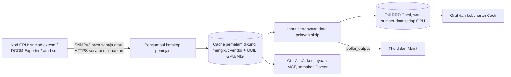

<!-- Source: README.md; SHA256: 97ba37df4a883426d3984ed7d14547ad7367e973411a8abd930409ce259f545b -->

<!-- translations:start -->
[English](../../../README.md) | [简体中文](../zh-CN/README.md) | [हिन्दी](../hi-IN/README.md) | [Español (España)](../es-ES/README.md) | [Español (Latinoamérica)](../es-419/README.md) | [العربية (السعودية)](../ar-SA/README.md) | [Afrikaans](../af-ZA/README.md) | [አማርኛ](../am-ET/README.md) | [العربية (مصر)](../ar-EG/README.md) | [العربية (المغرب)](../ar-MA/README.md) | [Български](../bg-BG/README.md) | [বাংলা](../bn-BD/README.md) | [Bosanski](../bs-BA/README.md) | [Deutsch](../de-DE/README.md) | [Ελληνικά](../el-GR/README.md) | [فارسی](../fa-IR/README.md) | [Filipino](../fil-PH/README.md) | [Français](../fr-FR/README.md) | [Français (Maroc)](../fr-MA/README.md) | [Français (Sénégal)](../fr-SN/README.md) | [Hausa](../ha-NG/README.md) | [עברית](../he-IL/README.md) | [Hrvatski](../hr-HR/README.md) | [Bahasa Indonesia](../id-ID/README.md) | [Igbo](../ig-NG/README.md) | [Italiano](../it-IT/README.md) | [日本語](../ja-JP/README.md) | [ქართული](../ka-GE/README.md) | [한국어](../ko-KR/README.md) | [Latviešu](../lv-LV/README.md) | [Malagasy](../mg-MG/README.md) | [मराठी](../mr-IN/README.md) | [Bahasa Melayu](README.md) | [Nederlands](../nl-NL/README.md) | [Polski](../pl-PL/README.md) | [Português (Brasil)](../pt-BR/README.md) | [Português (Portugal)](../pt-PT/README.md) | [Русский](../ru-RU/README.md) | [Kinyarwanda](../rw-RW/README.md) | [Soomaali](../so-SO/README.md) | [Српски](../sr-RS/README.md) | [Svenska](../sv-SE/README.md) | [Kiswahili](../sw-KE/README.md) | [தமிழ்](../ta-IN/README.md) | [తెలుగు](../te-IN/README.md) | [ไทย](../th-TH/README.md) | [Türkçe](../tr-TR/README.md) | [Українська](../uk-UA/README.md) | [اردو](../ur-PK/README.md) | [Tiếng Việt](../vi-VN/README.md) | [isiXhosa](../xh-ZA/README.md) | [Yorùbá](../yo-NG/README.md) | [繁體中文](../zh-TW/README.md) | [isiZulu](../zu-ZA/README.md)
<!-- translations:end -->

# plugin_gpu

Pemalam Cacti 1.2 yang membawakan penggunaan per-GPU, memori, suhu, kuasa, ralat ECC, dan sebab pendikitan daripada alatan NVIDIA dan AMD ke dalam Cacti. Setiap GPU (atau kejadian MIG) menjadi satu indeks bagi pertanyaan data pada peranti nodnya, jadi graf GPU berada di sebelah graf lain nod tersebut di bawah kebenaran Cacti, serta Thold dan Maint boleh memberi amaran dan menyekatnya.

> **Status: fasa 1 hingga 3 dilaksanakan dalam kod, belum dikeluarkan.** Fasa 1 (`nvidia-smi` NVIDIA melalui sambungan SNMP, penjejakan identiti, graf, isyarat pendikitan dan ECC, amaran Thold dan Maint, halaman kesihatan), Fasa 2 (penghurai/klien HTTP(S) baca sahaja NVIDIA DCGM Exporter dan penghurai `amd-smi` AMD), Fasa 3 (penjejakan identiti kejadian MIG, lajur Schema v4, pelaksanaan pengumpul jauh berskop peninjau, cangkuk `replicate_out` dan `remote_agent`), CLI pengendali CasC (`cli/gpu.php`), dan cangkuk ekosistem (`abilities_register`, `doctor_register_checks`, `casc_register_providers`) telah dilaksanakan serta diliputi oleh ujian unit, keselamatan, dan integrasi Cacti pakai buang. Larian langsung setakat ini menggunakan `snmpd` sintetik dan muatan lekapan bukannya perkakasan GPU fizikal. Masih terbuka sebelum menandakan keluaran: projek rintis pada perkakasan sebenar ([docs/pilot-plan.md](../../pilot-plan.md), #54), semakan keselamatan luaran ([docs/security-review.md](../../security-review.md)), lekapan yang dirakam daripada alatan sebenar (#14), dan ukuran skala pada perkakasan bersaiz pengeluaran ([docs/performance.md](../../performance.md)). Pengumpulan ralat XID kekal terbuka di bawah keputusan #8.

## Peranan akses

| Alam | Akses |
| --- | --- |
| GPU View | Halaman pemantauan sedia ada. |
| GPU Operator | Pemantauan serta halaman Operasi dan pengakuan triaj peribadi. |
| GPU Admin | Akses Operator serta konfigurasi sedia ada dan tindakan pentadbiran. |

Selepas menyalin fail naik taraf, buka halaman Plugins sebagai pentadbir untuk mendaftarkan
alam baharu. Berikan alam Operator secara eksplisit di bawah **Configuration > Users** atau kumpulan pengguna.
Naik taraf mengekalkan ID alam View dan Admin serta pemberian sedia ada. Akses Admin
mewarisi akses Operator, dan akses Operator mewarisi akses View pada setiap permintaan;
ini tidak menambah pemberian tersimpan kepada pengguna atau kumpulan. Tetapan pemalam juga memerlukan
akses GPU Admin sebagai tambahan kepada kebenaran Settings Cacti.

Kebenaran peranti Cacti masih mengehadkan baris dan tindakan yang tersedia kepada setiap pengguna; objek yang tidak dipetakan memerlukan pentadbir.
Bukti kelayakan, konfigurasi, pemetaan, pemadaman dan perubahan pentadbiran lain
kekal dalam halaman pentadbiran. Pengakuan hanya bertahan dalam sesi pengguna
semasa, selama paling lama satu jam dan hanya selagi pemerhatian yang sama kekal
segar. Pemerhatian baharu atau yang berubah akan membatalkannya. Ia tidak pernah menandakan pengukuran
yang gagal sebagai sihat atau menyekat amaran.

## Mengapa

Nod GPU biasanya sudah berada dalam Cacti untuk CPU, memori, dan antara muka. Kesihatan GPU ialah persoalan berasingan yang tidak dijawab oleh data SNMP nod: sesuatu kad boleh mengalami pendikitan terma, mengumpul ralat ECC, atau melaporkan kerosakan XID sedangkan nod itu sendiri kelihatan sihat. Alatan vendor melaporkannya (`nvidia-smi`, DCGM, `amd-smi`), tetapi outputnya berada di luar graf, kebenaran, dan sistem amaran Cacti.

Pemalam ini merapatkan jurang tersebut dengan menukar output alatan vendor menjadi sumber data Cacti, yang dikunci mengikut identiti setiap GPU dan bukannya kedudukannya, supaya but semula yang menyusun semula GPU tidak melampirkan sejarah satu kad kepada kad yang lain. Ia menggunakan semula penggrafan, kebenaran, pengumpul data jauh, Thold, dan Maint milik Cacti daripada membina versi selari baginya.

## Skop yang dirancang

| Fasa | Skop | Status | Pencapaian |
|---|---|---|---|
| 0, penyelidikan | Output alatan vendor, isyarat XID dan pendikitan, identiti GPU, keistimewaan, keputusan laluan pengumpulan | Selesai | [M1](https://github.com/somethingwithproof/plugin_gpu/milestone/1) |
| 1, nvidia | Pengumpulan `nvidia-smi`, inventori mengikut UUID, graf, isyarat pendikitan dan ECC, Thold dan Maint, halaman kesihatan | Dilaksanakan (diuji lekapan) | [M2](https://github.com/somethingwithproof/plugin_gpu/milestone/2), [M3](https://github.com/somethingwithproof/plugin_gpu/milestone/3), [M4](https://github.com/somethingwithproof/plugin_gpu/milestone/4) |
| 2, bahagian belakang | Penghurai/klien HTTP(S) baca sahaja DCGM Exporter (`lib/DcgmExporterParser.php`, `lib/DcgmExporterClient.php`), penghurai `amd-smi` AMD (`lib/AmdSmiParser.php`) | Dilaksanakan (diuji unit) | [M5](https://github.com/somethingwithproof/plugin_gpu/milestone/5) |
| 3, mig, jauh, dan ekosistem | Penjejakan identiti kejadian MIG, pengumpul data jauh (`INFO`, `poller_gpu.php --poller=N`, `replicate_out`, `remote_agent`), CLI CasC (`cli/gpu.php`), cangkuk MCP/Doctor/CasC | Dilaksanakan (diuji unit dan integrasi CI) | [M6](https://github.com/somethingwithproof/plugin_gpu/milestone/6) |

Di luar skop: sebarang arahan yang mengubah GPU atau nod (jam, had kuasa, tetapan semula, susun atur MIG), enjin amaran milik pemalam, daemon tersuai atau protokol rangkaian, serta penjadualan atau perakaunan kerja. Lihat pelan untuk tunggakan penyelidikan.

## Perkara yang ditambah oleh pencapaian 4

- **Pengumpul baca sahaja NVIDIA DCGM Exporter** (`lib/DcgmExporterParser.php`, `lib/DcgmExporterClient.php`). Menghuraikan metrik pendedahan teks Prometheus (`DCGM_FI_DEV_GPU_UTIL`, `DCGM_FI_DEV_FB_USED`, `DCGM_FI_DEV_FB_FREE`, `DCGM_FI_DEV_POWER_USAGE`, `DCGM_FI_DEV_GPU_TEMP`, `DCGM_FI_DEV_ECC_DBE_VOL_TOTAL`, `DCGM_FI_DEV_CLOCK_THROTTLE_REASONS`, serta label MIG `GPU_I_ID` dan `GPU_I_PROFILE`). Klien HTTP(S) menguatkuasakan senarai dibenarkan hos/CIDR titik akhir secara eksplisit, mengesahkan sijil rakan TLS secara lalai, mengehadkan tamat masa dan saiz respons, melumpuhkan ubah hala, dan menolak skema bukan HTTP(S).
- **Penghurai baca sahaja `amd-smi` AMD** (`lib/AmdSmiParser.php`). Menormalkan output JSON/SNMP-extend `amd-smi` (penggunaan, VRAM, kuasa, suhu simpang/pinggir, ECC, metadata pemisahan, dan penumpuk pendikitan berasingan melalui `Reading::$vendorExtensions`) ke dalam model metrik umum di bawah `Vendor::Amd`.
- **Penjejakan kejadian MIG dan Schema v4** (`lib/GpuReport.php`, `lib/GpuSnapshot.php`, `lib/GpuRecord.php`, `lib/Schema.php`, `lib/ScriptServer.php`). Menjejaki UUID kejadian MIG (`MIG-<uuid>` dan `MIG-GPU-<parent>/<gi>/<ci>`), `mig_mode`, `mig_instance_id`, `mig_profile`, `parent_uuid`, dan `partition_info` bersama GPU induk sambil mengekalkan kunci identiti kekal (`vendor`, `uuid`, `parent_uuid`) dilindungi semasa kemas kini dan disahkan sebelum pertanyaan pangkalan data.
- **Pengumpul data jauh** (`INFO`, `poller_gpu.php`, `lib/Poller.php`, `lib/ReplicationRepository.php`, `setup.php`). Mengisytiharkan `remote_collect:1, remote_poller:1` dalam `INFO`, menyokong pelaksanaan berskop peninjau melalui `php plugins/gpu/poller_gpu.php --poller=N`, melangkau penyediaan objek Cacti pada peninjau bukan utama, mereplikasikan jadual berskop peninjau melalui `replicate_out`, dan menjawab tindakan baca sahaja `gpu_health` serta `gpu_inventory` melalui `remote_agent`.
- **CLI Pengendali dan CasC** (`cli/gpu.php`, `lib/CascProvider.php`). Berjalan pada PHP 8.2+ (dihuraikan pada PHP 8.0) tanpa kebergantungan Composer luaran: `php plugins/gpu/cli/gpu.php export [--format=yaml|xml]`, `validate <file> [--format=yaml|xml]`, `plan <file> [--format=yaml|xml] [--output=text|json]`, `apply <file> --confirm=<PLAN_HASH> [--format=yaml|xml]`, dan `health [--format=text|json]`. Pelan mengira cincangan pengesahan SHA-256 yang berketentuan, penggunaan gagal tertutup pada ketidakpadanan cincangan, dan penghuraian XML menolak pengisytiharan `DOCTYPE` dan `ENTITY`.
- **Cangkuk integrasi ekosistem** (`lib/EcosystemIntegration.php`, `setup.php`). Mendaftarkan `abilities_register` (`gpu-list-nodes`, `gpu-list-devices`, `gpu-get-health`; baca sahaja, dikawal oleh alam `GPU View` dan kebenaran peranti Cacti), `doctor_register_checks` (`gpu_schema`, `gpu_poller_freshness`, `gpu_node_health`), dan `casc_register_providers`.
- **Sebab pendikitan dan ECC sebagai nilai amaran** ([docs/metrics.md](../../metrics.md)). Menyahkod topeng peristiwa jam menjadi penunjuk 0/1 dan mengira ralat ECC terbetul/tidak terbetul baharu bagi setiap selang sebagai tolok supaya Thold 1.8.2 dan Maint 1.3 memberi amaran dan menyekat tanpa pembilang negatif atau lonjakan tetapan semula ([docs/alerting.md](../../alerting.md)).
- **GPU Health, kebenaran, kegagalan/pemulihan, dan skala.** GPU Health (GPU View) memaparkan kesegaran tersimpan, hasil pengumpulan terakhir, keadaan Maint, bahagian belakang, versi, dan topeng pendikitan mentah tanpa menghubungi nod. Ujian hujung ke hujung berskrip mengesahkan kebenaran, pemulihan kegagalan ejen/DB/RRD ([docs/backup.md](../../backup.md)), dan larian skala 100-GPU dalam CI ([docs/performance.md](../../performance.md), [docs/operations.md](../../operations.md), [CHANGELOG.md](../../../CHANGELOG.md)).

## Perkara yang ditambah oleh pencapaian 3

- **Pengumpulan melalui sambungan SNMP** ([ADR 0008](../../decisions/0008-collect-through-snmp-extend.md)). Pentadbir nod menambah dua baris `extend` tetap ke dalam `snmpd.conf` ([docs/node-setup.md](../../node-setup.md)); pemalam membaca NET-SNMP-EXTEND-MIB melalui fungsi SNMP Cacti dengan bukti kelayakan peranti itu sendiri, SNMPv3 disyorkan. Ia tidak menjalankan apa-apa pada pelayan Cacti atau nod.
- **Penghuraian ketat.** Medan dibaca mengikut kedudukan, setiap baris menamakan GPU-nya mengikut UUID, dan status keluar bukan sifar, tamat masa, output terpotong, baris dengan kiraan medan yang salah, atau teks ralat yang digabungkan akan menggagalkan keseluruhan pengumpulan: nilai menjadi `U`, tiada GPU ditandakan tidak hadir, dan GPU Nodes menunjukkan sebabnya.
- **Pengumpul selepas setiap kitaran peninjau.** Ia membaca ejen setiap nod yang didayakan, mengemas kini rekod identiti, dan mengcache sampel terkini. Input pelayan skrip hanya membaca cache tersebut, jadi tinjauan Cacti tidak pernah menunggu nod GPU.
- **Objek Cacti** ([ADR 0010](../../decisions/0010-attach-to-existing-node-devices.md)). Templat dan pertanyaan data *GPU - Devices* dibekalkan sebagai XML dan diimport semasa pemasangan dan naik taraf. Menyimpan nod melampirkan pertanyaan data pada peranti sedia ada dengan kaedah pengindeksan semula None; GPU Nodes boleh mencipta peranti hanya apabila nod tiada peranti. Setiap GPU ialah indeks yang dikunci mengikut vendor dan UUID, dengan satu sumber data yang dikongsi oleh graf Utilization, Memory, Temperature, Power, Power Percent, Clocks, Throttle, ECC Errors, New ECC Errors, Retired Pages, dan Sample Age. Setiap medan model dilukis oleh sesuatu graf, kerana Cacti hanya menyimpan medan yang digunakan oleh graf. Pemalam mengindeks semula selepas setiap perubahan GPU, menyimpan pengindeksan semula yang dilangkau oleh Cacti semasa peranti berada dalam keadaan Down atau dinyahdayakan dan menjalankannya sebaik sahaja peranti berada dalam keadaan Up, serta mencipta graf untuk GPU baharu.
- **Sejarah kekal bersama kad.** GPU yang tidak hadir kekal sebagai indeks, jadi grafnya menunjukkan jurang dan bersambung semula dalam fail RRD yang sama apabila ia kembali. Kad gantian dalam slot yang sama mendapat sumber datanya sendiri. **Remove from Data Query** pada halaman nod mengeluarkan GPU yang tidak hadir daripada penyenaraian; fail RRD dan grafnya disimpan sehingga anda memadamkannya.
- **Kebenaran peranti pada GPU Nodes.** GPU Admin melihat, mengubah, mengeksport, dan memindahkan hanya nod dan GPU pada peranti yang boleh mereka lihat dalam Cacti; pemindahan GPU memerlukan kedua-dua nod. Nod yang perantinya telah dipadamkan boleh dinyahdayakan atau dipadamkan.
- **Model metrik umum** ([ADR 0009](../../decisions/0009-common-metric-core-with-vendor-extensions.md), [docs/metrics.md](../../metrics.md)). Memori adalah dalam bait, topeng peristiwa jam dinyahkod menjadi penunjuk `thr_*`, dan `age` ialah umur masa sampel GPU itu sendiri, atau `U` apabila tidak diketahui.

Pengguna yang memasang (pelayan web) mesti boleh menulis ke `<cacti>/resource/script_server/`, tempat pemalam meletakkan XML pertanyaan datanya; pemasangan dan naik taraf berhenti dengan mesej jika tidak dan mencuba semula pada percubaan seterusnya. Penyahpasangan membuang templat dan XML hanya apabila *Remove the plugin's Cacti objects on uninstall* ditandakan, dan tidak pernah memadamkan fail RRD, peranti, graf, atau sumber data ([docs/operations.md](../../operations.md#uninstall)). Nod pada pengumpul data jauh dijalankan berskop mengikut `poller_id` yang ditetapkan kepadanya.

## Perkara yang dibekalkan oleh pencapaian 2

- **Pemasangan terkawal.** Pada PHP di bawah 8.2, pemasangan dan pendayaan ditolak dengan mesej yang menamakan versi yang diperlukan, dan bahagian lain Cacti terus berfungsi. `setup.php` dan skrip halaman dihuraikan pada PHP 8.0.
- **Kitaran hayat.** Pasang, naik taraf, nyahdaya, dan nyahpasang melalui halaman Plugins Cacti. Naik taraf adalah tersusun, selesai selepas gangguan, dan menukar versi yang direkodkan hanya selepas ia berjaya. Penyahpasangan mengekalkan jadual pemalam melainkan anda mengosongkan *Keep Plugin Tables on Uninstall*; ia tidak pernah menyentuh peranti, sumber data, graf, atau fail RRD Cacti.
- **Alam berasingan.** *GPU Admin* membuka **GPU Nodes**, tempat anda mendaftarkan peranti Cacti sebagai nod GPU, mengesahkan atau menolak pemindahan GPU antara nod, dan mengeksport setiap rekod sebagai JSON. *GPU View* membuka **GPU Inventory**, yang menyenaraikan GPU hanya pada peranti yang boleh dilihat oleh penonton. Kedua-dua halaman berada di bawah Management, dan setiap perubahan ialah POST yang disemak oleh csrf-magic.
- **Rekod identiti GPU.** Setiap GPU dikunci mengikut vendor dan UUID. Indeks, ID bas PCI, nama, pemacu, dan alatan pelaporan ialah atribut yang berubah di tempatnya. UUID baharu dalam slot yang diketahui ditandakan sebagai kemungkinan penggantian dan memulakan sejarahnya sendiri; GPU yang dilihat pada nod lain berpindah hanya apabila pengendali mengesahkan; GPU yang hilang daripada pengumpulan yang berjaya ditandakan tidak hadir selepas kiraan boleh dikonfigurasi dan tidak pernah dipadamkan. Hanya UUID keseluruhan GPU NVIDIA diterima buat masa ini; kejadian MIG menunggu keputusan #13, dan AMD pada penyelidikan #19. Peraturan dijalankan oleh jujukan lekapan, memandangkan belum ada pengumpul yang menyuapkannya.
- **Ujian dan CI.** Suit unit dan peraturan sumber tanpa GPU atau pangkalan data, semakan kitaran hayat dan kebenaran halaman terhadap Cacti 1.2.31 dan 1.2.x semasa pada PHP 8.2 hingga 8.5, tugasan penolakan PHP 8.1, lint PHP 8.0 bagi titik masuk, PHPStan pada tahap 9, dan REUSE. Abah-abah adalah sementara sehingga #12 diputuskan.

### Pemasangan untuk penilaian

Langkah-langkah ini memasang kod semasa untuk mencubanya; [docs/operations.md](../../operations.md) mengandungi panduan pengendali penuh. Ia memerlukan Cacti 1.2.31 atau lebih baharu pada PHP 8.2 atau lebih baharu.

1. Salin repositori ke `plugins/gpu` di bawah direktori Cacti anda. Direktori tersebut mestilah dinamakan `gpu`.
2. Dalam Cacti, buka **Configuration > Plugins**, kemudian pasang dan dayakan **GPU**.
3. Berikan pengguna alam *GPU View*, *GPU Operator*, atau *GPU Admin* di bawah **Configuration > Users**, mengikut peranan mereka. Pengguna yang memasang menerima View dan Admin; Admin merangkumi akses Operator.
4. Sediakan ejen SNMP setiap nod GPU seperti yang diterangkan dalam [docs/node-setup.md](../../node-setup.md), kemudian tambah nod di bawah **Management > GPU Nodes**.
5. Untuk amaran, import templat Thold yang dibekalkan seperti yang diterangkan oleh [docs/alerting.md](../../alerting.md).
6. Secara pilihan, laraskan **Configuration > Settings > GPU**: *Mark Absent After* (lalai 3 pengumpulan berjaya, dari 1 hingga 100), *Stale After* (berapa lama sesuatu sampel boleh bertahan sebelum nilainya mencetak `U`), dan *Keep Plugin Tables on Uninstall* (lalai aktif).

## Cara metrik sampai ke Cacti

Keputusan [#7](https://github.com/somethingwithproof/plugin_gpu/issues/7) memilih SNMP `extend` ([ADR 0008](../../decisions/0008-collect-through-snmp-extend.md)): ejen nod itu sendiri menjalankan arahan `nvidia-smi` tetap dan pemalam hanya membaca hasilnya. Pelan ini membandingkan pilihan tersebut di bawah [Laluan pengumpulan](../../PLAN.md#collection-paths).

## Sasaran keserasian

| Komponen | Sasaran |
|---|---|
| Cacti | 1.2.31 atau lebih baharu, tiada tampalan teras |
| PHP | 8.2 atau lebih baharu; `setup.php` kekal boleh dihuraikan pada 8.0 supaya masa jalan yang tidak disokong mendapat penolakan dan bukannya UI Cacti yang rosak |
| NVIDIA | Baris pemacu dan alatan akan ditetapkan oleh penyelidikan [#26](https://github.com/somethingwithproof/plugin_gpu/issues/26); ID medan DCGM disemak pada v3.3.9 dan v4.7.0 |
| AMD | `amd-smi` pada keluaran ROCm akan ditetapkan oleh penyelidikan [#26](https://github.com/somethingwithproof/plugin_gpu/issues/26) |
| Thold, Maint | Thold 1.8.2 dan Maint 1.3, tidak diubah, diuji hujung ke hujung ([docs/alerting.md](../../alerting.md)) |

## Reka bentuk

- [docs/PLAN.md](../../PLAN.md) ialah pelan penuh: seni bina, fakta huluan yang menjadi sandarannya (berserta sumber), model identiti, sempadan keselamatan, aritmetik prestasi, pengujian, dan risiko.
- [docs/decisions/](../../decisions) menyimpan rekod keputusan seni bina bagi pilihan yang telah dibuat.
- [docs/REQUIREMENTS.md](../../REQUIREMENTS.md) memetakan setiap ID keperluan kepada isunya.

## Cara kerja dijejaki

- **Pencapaian** mengikut pencapaian pelan. Setiap satu mempunyai isu epik yang menyenaraikan sub-isu dan bukti keluarannya.
- **Isu** ditaip mengikut label: `type: requirement`, `type: research`, `type: decision`, `type: epic`. Isu keperluan menyatakan keperluan bernombor yang boleh diuji (`REQ-AREA-NNN`) dan kriteria penerimaan.
- **Label** turut membawa `area:`, `phase:`, `priority:`, dan `status:`. Lihat [CONTRIBUTING.md](../../../CONTRIBUTING.md#labels).
- [Papan projek](https://github.com/users/somethingwithproof/projects/9) menunjukkan semua isu merentasi pencapaian.

## Menyumbang

Baca [CONTRIBUTING.md](../../../CONTRIBUTING.md). Komit memerlukan tandatangan DCO. Perbincangan reka bentuk berlaku pada isu; keputusan terbuka membawa label `type: decision`. Output yang dirakam daripada alatan GPU sebenar ialah sumbangan paling berguna kepada pencapaian 1; buang nama hos, nombor siri, dan UUID terlebih dahulu.

## Keselamatan

Laporkan kelemahan secara peribadi; lihat [SECURITY.md](../../../SECURITY.md).

## Lesen

GNU General Public License v2.0, lesen yang sama seperti Cacti dan pemalamnya. Lihat [LICENSE](../../../LICENSE).
