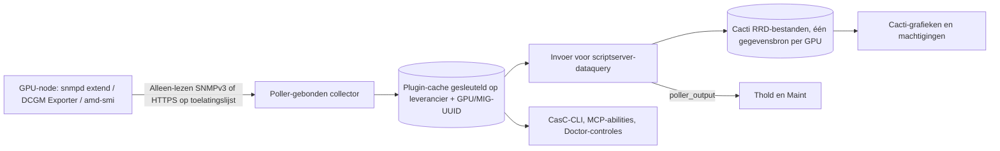

<!-- Source: README.md; SHA256: 97ba37df4a883426d3984ed7d14547ad7367e973411a8abd930409ce259f545b -->

<!-- translations:start -->
[English](../../../README.md) | [简体中文](../zh-CN/README.md) | [हिन्दी](../hi-IN/README.md) | [Español (España)](../es-ES/README.md) | [Español (Latinoamérica)](../es-419/README.md) | [العربية (السعودية)](../ar-SA/README.md) | [Afrikaans](../af-ZA/README.md) | [አማርኛ](../am-ET/README.md) | [العربية (مصر)](../ar-EG/README.md) | [العربية (المغرب)](../ar-MA/README.md) | [বাংলা](../bn-BD/README.md) | [Bosanski](../bs-BA/README.md) | [Deutsch](../de-DE/README.md) | [فارسی](../fa-IR/README.md) | [Filipino](../fil-PH/README.md) | [Français](../fr-FR/README.md) | [Français (Maroc)](../fr-MA/README.md) | [Français (Sénégal)](../fr-SN/README.md) | [Hausa](../ha-NG/README.md) | [עברית](../he-IL/README.md) | [Hrvatski](../hr-HR/README.md) | [Bahasa Indonesia](../id-ID/README.md) | [Igbo](../ig-NG/README.md) | [Italiano](../it-IT/README.md) | [日本語](../ja-JP/README.md) | [한국어](../ko-KR/README.md) | [Malagasy](../mg-MG/README.md) | [मराठी](../mr-IN/README.md) | [Bahasa Melayu](../ms-MY/README.md) | [Nederlands](README.md) | [Polski](../pl-PL/README.md) | [Português (Brasil)](../pt-BR/README.md) | [Русский](../ru-RU/README.md) | [Kinyarwanda](../rw-RW/README.md) | [Soomaali](../so-SO/README.md) | [Српски](../sr-RS/README.md) | [Svenska](../sv-SE/README.md) | [Kiswahili](../sw-KE/README.md) | [தமிழ்](../ta-IN/README.md) | [తెలుగు](../te-IN/README.md) | [ไทย](../th-TH/README.md) | [Türkçe](../tr-TR/README.md) | [Українська](../uk-UA/README.md) | [اردو](../ur-PK/README.md) | [Tiếng Việt](../vi-VN/README.md) | [isiXhosa](../xh-ZA/README.md) | [Yorùbá](../yo-NG/README.md) | [繁體中文](../zh-TW/README.md) | [isiZulu](../zu-ZA/README.md)
<!-- translations:end -->

# plugin_gpu

Een Cacti 1.2-plug-in die per GPU het gebruik, het geheugen, de temperatuur, het vermogen, ECC-fouten en redenen voor throttling vanuit NVIDIA- en AMD-tools naar Cacti brengt. Elke GPU (of MIG-instantie) wordt een index van een dataquery op het apparaat van zijn node, zodat GPU-grafieken naast de andere grafieken van de node onder de machtigingen van Cacti staan en Thold en Maint er meldingen voor kunnen geven en deze kunnen onderdrukken.

> **Status: fasen 1 tot en met 3 zijn in code geïmplementeerd, nog niet uitgebracht.** Fase 1 (NVIDIA `nvidia-smi` via SNMP extend, identiteitstracking, grafieken, throttle- en ECC-signalen, alarmering via Thold en Maint, statuspagina), Fase 2 (alleen-lezen NVIDIA DCGM Exporter HTTP(S)-parser/client en AMD `amd-smi`-parser), Fase 3 (identiteitstracking voor MIG-instanties, Schema v4-kolommen, uitvoering van externe collectors per poller, `replicate_out`- en `remote_agent`-hooks), de CasC-beheerders-CLI (`cli/gpu.php`) en ecosysteemhooks (`abilities_register`, `doctor_register_checks`, `casc_register_providers`) zijn geïmplementeerd en gedekt door unit-, beveiligings- en wegwerp-Cacti-integratietests. Live-runs gebruiken tot nu toe synthetische `snmpd` en fixture-payloads in plaats van fysieke GPU-hardware. Nog openstaand vóór het taggen van een release: pilots op echte hardware ([docs/pilot-plan.md](../../pilot-plan.md), #54), een externe beveiligingsreview ([docs/security-review.md](../../security-review.md)), fixtures vastgelegd van echte tools (#14) en schaalmetingen op hardware van productiegrootte ([docs/performance.md](../../performance.md)). Verzameling van XID-fouten blijft open onder beslissing #8.

## Toegangsrollen

| Realm | Toegang |
| --- | --- |
| GPU View | Bestaande monitoringpagina's. |
| GPU Operator | Monitoring plus de pagina Operations en persoonlijke triage-bevestigingen. |
| GPU Admin | Operator-toegang plus de bestaande configuratie- en beheeracties. |

Open na het kopiëren van de upgradebestanden als beheerder de pagina Plugins om de nieuwe realm te registreren. Wijs de realm Operator expliciet toe onder **Configuration > Users** of gebruikersgroepen.
Upgrades behouden de bestaande realm-ID's en machtigingen voor View en Admin. Admin-toegang
erft Operator-toegang over, en Operator-toegang erft View-toegang over bij elk verzoek;
hiermee worden geen opgeslagen rechten aan gebruikers of groepen toegevoegd. Plug-ininstellingen vereisen naast
de machtiging Settings van Cacti ook GPU Admin-toegang.

Apparaatmachtigingen van Cacti blijven de rijen en acties beperken die voor elke gebruiker beschikbaar zijn; niet-gekoppelde objecten vereisen een beheerder.
Inloggegevens, configuratie, koppelingen, verwijdering en andere beheerwijzigingen
blijven op de beheerpagina's. Bevestigingen blijven alleen behouden in de huidige
gebruikerssessie, gedurende maximaal één uur en alleen zolang dezelfde waarneming
actueel blijft. Nieuwe of gewijzigde waarnemingen maken ze ongeldig. Ze markeren een mislukte
meting nooit als gezond en onderdrukken nooit meldingen.

## Waarom

GPU-nodes staan meestal al in Cacti voor CPU, geheugen en interfaces. De gezondheid van een GPU is een afzonderlijk vraagstuk dat de SNMP-gegevens van de node niet beantwoorden: een kaart kan thermisch worden teruggeschroefd (throttling), ECC-fouten opbouwen of een XID-fout melden terwijl de node zelf gezond oogt. Tools van leveranciers rapporteren dit (`nvidia-smi`, DCGM, `amd-smi`), maar hun uitvoer valt buiten de grafieken, machtigingen en alarmering van Cacti.

De plug-in dicht dat gat door de uitvoer van leverancierstools om te zetten in Cacti-gegevensbronnen, gesleuteld op de identiteit van elke GPU in plaats van de positie, zodat een herstart die GPU's herordent de geschiedenis van de ene kaart niet aan een andere koppelt. De plug-in hergebruikt de grafieken, machtigingen, externe datacollectors, Thold en Maint van Cacti in plaats van daar parallelle versies van te bouwen.

## Geplande scope

| Fase | Scope | Status | Mijlpalen |
|---|---|---|---|
| 0, onderzoek | Uitvoer van leverancierstools, XID- en throttle-signalen, GPU-identiteit, privileges, beslissing over verzamelpad | Voltooid | [M1](https://github.com/somethingwithproof/plugin_gpu/milestone/1) |
| 1, nvidia | `nvidia-smi`-verzameling, inventarisatie op UUID, grafieken, throttle- en ECC-signalen, Thold en Maint, statuspagina | Geïmplementeerd (getest met fixtures) | [M2](https://github.com/somethingwithproof/plugin_gpu/milestone/2), [M3](https://github.com/somethingwithproof/plugin_gpu/milestone/3), [M4](https://github.com/somethingwithproof/plugin_gpu/milestone/4) |
| 2, backends | Alleen-lezen DCGM Exporter HTTP(S)-parser/client (`lib/DcgmExporterParser.php`, `lib/DcgmExporterClient.php`), AMD `amd-smi`-parser (`lib/AmdSmiParser.php`) | Geïmplementeerd (unit-tested) | [M5](https://github.com/somethingwithproof/plugin_gpu/milestone/5) |
| 3, mig, extern en ecosysteem | Identiteitstracking voor MIG-instanties, externe datacollectors (`INFO`, `poller_gpu.php --poller=N`, `replicate_out`, `remote_agent`), CasC-CLI (`cli/gpu.php`), MCP/Doctor/CasC-hooks | Geïmplementeerd (unit- en CI-integratie-tested) | [M6](https://github.com/somethingwithproof/plugin_gpu/milestone/6) |

Buiten de scope: elke opdracht die een GPU of node wijzigt (klokfrequenties, vermogenslimieten, resets, MIG-indeling), een eigen alarmeringsengine in de plug-in, een aangepaste daemon of netwerkprotocol, en scheduler- of job-accounting. Zie het plan voor de onderzoeksbacklog.

## Wat mijlpaal 4 toevoegt

- **NVIDIA DCGM Exporter alleen-lezen collector** (`lib/DcgmExporterParser.php`, `lib/DcgmExporterClient.php`). Parst Prometheus-tekstexpositiemetrieken (`DCGM_FI_DEV_GPU_UTIL`, `DCGM_FI_DEV_FB_USED`, `DCGM_FI_DEV_FB_FREE`, `DCGM_FI_DEV_POWER_USAGE`, `DCGM_FI_DEV_GPU_TEMP`, `DCGM_FI_DEV_ECC_DBE_VOL_TOTAL`, `DCGM_FI_DEV_CLOCK_THROTTLE_REASONS`, en de MIG-labels `GPU_I_ID` en `GPU_I_PROFILE`). De HTTP(S)-client handhaaft een expliciete toelatingslijst van eindpunthosts/CIDR's, verifieert standaard TLS-peercertificaten, begrenst time-outs en responsgrootte, schakelt omleidingen uit en weigert niet-HTTP(S)-schema's.
- **AMD `amd-smi` alleen-lezen parser** (`lib/AmdSmiParser.php`). Normaliseert JSON/SNMP-extend-uitvoer van `amd-smi` (gebruik, VRAM, vermogen, junctie-/randtemperatuur, ECC, partitiemetadata en afzonderlijke throttle-accumulatoren via `Reading::$vendorExtensions`) naar het gemeenschappelijke metriekmodel onder `Vendor::Amd`.
- **Tracking van MIG-instanties en Schema v4** (`lib/GpuReport.php`, `lib/GpuSnapshot.php`, `lib/GpuRecord.php`, `lib/Schema.php`, `lib/ScriptServer.php`). Volgt MIG-instantie-UUID's (`MIG-<uuid>` en `MIG-GPU-<parent>/<gi>/<ci>`), `mig_mode`, `mig_instance_id`, `mig_profile`, `parent_uuid` en `partition_info` naast bovenliggende GPU's, terwijl onveranderlijke identiteitssleutels (`vendor`, `uuid`, `parent_uuid`) beschermd blijven bij updates en worden gevalideerd vóór databasequery's.
- **Externe datacollectors** (`INFO`, `poller_gpu.php`, `lib/Poller.php`, `lib/ReplicationRepository.php`, `setup.php`). Declareert `remote_collect:1, remote_poller:1` in `INFO`, ondersteunt uitvoering per poller via `php plugins/gpu/poller_gpu.php --poller=N`, slaat provisioning van Cacti-objecten over op niet-hoofdpollers, repliceert poller-gebonden tabellen via `replicate_out` en beantwoordt alleen-lezen `gpu_health`- en `gpu_inventory`-acties via `remote_agent`.
- **Beheerders- en CasC-CLI** (`cli/gpu.php`, `lib/CascProvider.php`). Draait op PHP 8.2+ (parsebaar op PHP 8.0) zonder externe Composer-afhankelijkheden: `php plugins/gpu/cli/gpu.php export [--format=yaml|xml]`, `validate <file> [--format=yaml|xml]`, `plan <file> [--format=yaml|xml] [--output=text|json]`, `apply <file> --confirm=<PLAN_HASH> [--format=yaml|xml]` en `health [--format=text|json]`. Plannen berekenen een deterministische SHA-256-bevestigingshash, apply faalt veilig bij een hash-mismatch en XML-parsing weigert `DOCTYPE`- en `ENTITY`-declaraties.
- **Ecosysteem-integratiehooks** (`lib/EcosystemIntegration.php`, `setup.php`). Registreert `abilities_register` (`gpu-list-nodes`, `gpu-list-devices`, `gpu-get-health`; alleen-lezen, afgeschermd op de realm `GPU View` en Cacti-apparaatmachtigingen), `doctor_register_checks` (`gpu_schema`, `gpu_poller_freshness`, `gpu_node_health`) en `casc_register_providers`.
- **Redenen voor throttling en ECC als alarmwaarden** ([docs/metrics.md](../../metrics.md)). Decodeert klokgebeurtenismaskers naar 0/1-indicatoren en berekent nieuwe gecorrigeerde/ongecorrigeerde ECC-fouten per interval als gauges, zodat Thold 1.8.2 en Maint 1.3 waarschuwen en onderdrukken zonder negatieve tellers of reset-pieken ([docs/alerting.md](../../alerting.md)).
- **GPU Health, machtigingen, storing/herstel en schaal.** GPU Health (GPU View) toont opgeslagen actualiteit, het resultaat van de laatste verzameling, Maint-status, backend, versies en ruwe throttle-maskers zonder nodes te benaderen. Gescripte end-to-end-tests verifiëren machtigingen, herstel bij agent-/DB-/RRD-storingen ([docs/backup.md](../../backup.md)) en een schaaltest met 100 GPU's in CI ([docs/performance.md](../../performance.md), [docs/operations.md](../../operations.md), [CHANGELOG.md](../../../CHANGELOG.md)).

## Wat mijlpaal 3 toevoegt

- **Verzameling via SNMP extend** ([ADR 0008](../../decisions/0008-collect-through-snmp-extend.md)). De beheerder van de node voegt twee vaste `extend`-regels toe aan `snmpd.conf` ([docs/node-setup.md](../../node-setup.md)); de plug-in leest NET-SNMP-EXTEND-MIB uit via de SNMP-functies van Cacti met de eigen inloggegevens van het apparaat, bij voorkeur SNMPv3. Er wordt niets uitgevoerd op de Cacti-server of op de node.
- **Strikte parsing.** Velden worden op positie uitgelezen, elke regel benoemt zijn GPU op UUID, en een exitstatus ongelijk aan nul, een time-out, afgekapte uitvoer, een regel met een onjuist aantal velden of samengevoegde fouttekst laat de hele verzameling mislukken: waarden worden `U`, geen enkele GPU wordt als afwezig gemarkeerd en GPU Nodes toont waarom.
- **Een collector na elke pollercyclus.** Deze leest de agent van elke ingeschakelde node uit, werkt de identiteitsrecords bij en slaat de nieuwste meting op in de cache. De scriptserver-invoer leest alleen die cache uit, zodat een Cacti-poll nooit wacht op een GPU-node.
- **Cacti-objecten** ([ADR 0010](../../decisions/0010-attach-to-existing-node-devices.md)). De sjablonen en de dataquery *GPU - Devices* worden als XML meegeleverd en bij installatie en upgrade geïmporteerd. Bij het opslaan van een node wordt de dataquery aan het bestaande apparaat gekoppeld met herindexatiemethode None; GPU Nodes kan alleen een apparaat aanmaken wanneer de node er nog geen heeft. Elke GPU is een index gesleuteld op leverancier en UUID, met één gegevensbron die wordt gedeeld door de grafieken Utilization, Memory, Temperature, Power, Power Percent, Clocks, Throttle, ECC Errors, New ECC Errors, Retired Pages en Sample Age. Elk modelveld wordt door een grafiek getekend, omdat Cacti alleen de velden opslaat die een grafiek gebruikt. De plug-in herindexeert na elke GPU-wijziging, bewaart een herindexatie die Cacti heeft overgeslagen terwijl het apparaat Down of uitgeschakeld was en voert deze uit zodra het apparaat Up is, en maakt grafieken aan voor nieuwe GPU's.
- **Geschiedenis blijft bij de kaart.** Een afwezige GPU blijft een index, zodat de grafieken ervan een onderbreking tonen en in hetzelfde RRD-bestand verdergaan wanneer de kaart terugkeert. Een vervangende kaart in hetzelfde slot krijgt zijn eigen gegevensbron. **Remove from Data Query** op de pagina van de node haalt een afwezige GPU uit het overzicht; de RRD-bestanden en grafieken blijven behouden totdat u ze verwijdert.
- **Apparaatmachtigingen op GPU Nodes.** Een GPU Admin ziet, wijzigt, exporteert en verplaatst alleen nodes en GPU's op apparaten die deze in Cacti mag zien; voor het verplaatsen van een GPU zijn beide nodes vereist. Een node waarvan het apparaat is verwijderd, kan worden uitgeschakeld of verwijderd.
- **Het gemeenschappelijke metriekmodel** ([ADR 0009](../../decisions/0009-common-metric-core-with-vendor-extensions.md), [docs/metrics.md](../../metrics.md)). Geheugen is in bytes, het klokgebeurtenismasker wordt gedecodeerd in `thr_*`-indicatoren en `age` is de leeftijd van het eigen meettijdstip van de GPU, of `U` indien onbekend.

De installerende gebruiker (webserver) moet kunnen schrijven naar `<cacti>/resource/script_server/`, waar de plug-in de XML van zijn dataquery plaatst; anders stoppen installatie en upgrade met een melding en wordt het bij de volgende poging opnieuw geprobeerd. Verwijderen wist de sjablonen en de XML alleen wanneer *Remove the plugin's Cacti objects on uninstall* is aangevinkt, en verwijdert nooit RRD-bestanden, apparaten, grafieken of gegevensbronnen ([docs/operations.md](../../operations.md#uninstall)). Nodes op externe datacollectors draaien binnen het bereik van de aan hen toegewezen `poller_id`.

## Wat mijlpaal 2 levert

- **Een beveiligde installatie.** Op PHP onder 8.2 worden installatie en inschakeling geweigerd met een melding die de vereiste versie noemt, en blijft de rest van Cacti gewoon werken. `setup.php` en de paginascripts worden correct geparseerd op PHP 8.0.
- **Levenscyclus.** Installeren, upgraden, uitschakelen en verwijderen via de pagina Plugins van Cacti. Upgrades verlopen geordend, worden na een onderbreking afgerond en wijzigen de vastgelegde versie pas nadat ze zijn geslaagd. Verwijderen behoudt de tabellen van de plug-in, tenzij u *Keep Plugin Tables on Uninstall* uitvinkt; het raakt nooit een Cacti-apparaat, gegevensbron, grafiek of RRD-bestand aan.
- **Gescheiden realms.** *GPU Admin* opent **GPU Nodes**, waar u Cacti-apparaten als GPU-nodes registreert, GPU-verplaatsingen tussen nodes bevestigt of afwijst en elk record als JSON exporteert. *GPU View* opent **GPU Inventory**, waarin alleen GPU's worden weergegeven op apparaten die de kijker mag zien. Beide pagina's staan onder Management en elke wijziging is een POST die door csrf-magic wordt gecontroleerd.
- **GPU-identiteitsrecords.** Elke GPU is gesleuteld op leverancier en UUID. Index, PCI-bus-ID, naam, driver en de rapporterende tool zijn kenmerken die ter plekke wijzigen. Een nieuwe UUID in een bekend slot wordt gemarkeerd als mogelijke vervanging en begint zijn eigen geschiedenis; een GPU die op een andere node wordt gezien, verhuist pas wanneer een beheerder dit bevestigt; een GPU die ontbreekt in geslaagde verzamelingen wordt na een instelbaar aantal keren als afwezig gemarkeerd en nooit verwijderd. Voorlopig worden alleen volledige NVIDIA-GPU-UUID's geaccepteerd; MIG-instanties wachten op beslissing #13 en AMD wacht op onderzoek #19. De regels worden getest met reeksen fixtures, aangezien er nog geen collector is die ze aanlevert.
- **Tests en CI.** Unit- en bronregelsuites zonder GPU of database, levenscyclus- en paginamachtigingscontroles tegen Cacti 1.2.31 en de huidige 1.2.x op PHP 8.2 tot en met 8.5, een weigeringstest op PHP 8.1, een PHP 8.0-lint van de startpunten, PHPStan op niveau 9 en REUSE. De testharness is voorlopig totdat #12 is beslist.

### Installeren voor evaluatie

Deze stappen installeren de huidige code om deze uit te proberen; [docs/operations.md](../../operations.md) bevat de volledige beheerdershandleiding. Ze vereisen Cacti 1.2.31 of hoger op PHP 8.2 of hoger.

1. Kopieer de repository naar `plugins/gpu` onder uw Cacti-map. De map moet `gpu` heten.
2. Open in Cacti **Configuration > Plugins** en installeer en schakel **GPU** in.
3. Ken gebruikers de realm *GPU View*, *GPU Operator* of *GPU Admin* toe onder **Configuration > Users**, afhankelijk van hun rol. De installerende gebruiker krijgt View en Admin; Admin omvat Operator-toegang.
4. Stel de SNMP-agent van elke GPU-node in zoals beschreven in [docs/node-setup.md](../../node-setup.md) en voeg de node vervolgens toe onder **Management > GPU Nodes**.
5. Importeer voor meldingen de meegeleverde Thold-sjablonen zoals [docs/alerting.md](../../alerting.md) beschrijft.
6. Pas eventueel **Configuration > Settings > GPU** aan: *Mark Absent After* (standaard 3 geslaagde verzamelingen, van 1 tot 100), *Stale After* (hoe oud een meting mag zijn voordat de waarden `U` weergeven) en *Keep Plugin Tables on Uninstall* (standaard ingeschakeld).

## Hoe metingen Cacti bereiken

Beslissing [#7](https://github.com/somethingwithproof/plugin_gpu/issues/7) koos voor SNMP `extend` ([ADR 0008](../../decisions/0008-collect-through-snmp-extend.md)): de eigen agent van de node voert een vaste `nvidia-smi`-opdracht uit en de plug-in leest alleen het resultaat uit. Het plan vergelijkt de opties onder [Verzamelpaden](../../PLAN.md#collection-paths).

## Compatibiliteitsdoelen

| Onderdeel | Doel |
|---|---|
| Cacti | 1.2.31 of hoger, geen wijzigingen aan de core |
| PHP | 8.2 of hoger; `setup.php` blijft parseerbaar op 8.0 zodat een niet-ondersteunde runtime een weigering krijgt in plaats van een kapotte Cacti-UI |
| NVIDIA | Driver- en toolreeksen worden bepaald door onderzoek [#26](https://github.com/somethingwithproof/plugin_gpu/issues/26); DCGM-veld-ID's gecontroleerd op v3.3.9 en v4.7.0 |
| AMD | `amd-smi` op ROCm-releases wordt bepaald door onderzoek [#26](https://github.com/somethingwithproof/plugin_gpu/issues/26) |
| Thold, Maint | Thold 1.8.2 en Maint 1.3, ongewijzigd, end-to-end getest ([docs/alerting.md](../../alerting.md)) |

## Ontwerp

- [docs/PLAN.md](../../PLAN.md) is het volledige plan: architectuur, upstream-feiten waarvan het afhankelijk is (met bronnen), identiteitsmodel, beveiligingsgrenzen, prestatierekenen, testen en risico's.
- [docs/decisions/](../../decisions) bevat architectuurbeslissingsrecords (ADR's) voor reeds gemaakte keuzes.
- [docs/REQUIREMENTS.md](../../REQUIREMENTS.md) koppelt elk vereiste-ID aan het bijbehorende issue.

## Hoe werk wordt bijgehouden

- **Mijlpalen** volgen de mijlpalen van het plan. Elke mijlpaal heeft een epic-issue met de sub-issues en het opleverbewijs.
- **Issues** worden getypeerd via labels: `type: requirement`, `type: research`, `type: decision`, `type: epic`. Vereiste-issues vermelden genummerde, testbare vereisten (`REQ-AREA-NNN`) en acceptatiecriteria.
- **Labels** bevatten ook `area:`, `phase:`, `priority:` en `status:`. Zie [CONTRIBUTING.md](../../../CONTRIBUTING.md#labels).
- Het [projectbord](https://github.com/users/somethingwithproof/projects/9) toont alle issues over de mijlpalen heen.

## Bijdragen

Lees [CONTRIBUTING.md](../../../CONTRIBUTING.md). Commits hebben een DCO sign-off nodig. Ontwerpdiscussies vinden plaats in issues; open beslissingen dragen het label `type: decision`. Vastgelegde uitvoer van echte GPU-tools is de nuttigste bijdrage aan mijlpaal 1; verwijder eerst hostnamen, serienummers en UUID's.

## Beveiliging

Meld kwetsbaarheden privé; zie [SECURITY.md](../../../SECURITY.md).

## Licentie

GNU General Public License v2.0, dezelfde licentie als Cacti en zijn plug-ins. Zie [LICENSE](../../../LICENSE).
