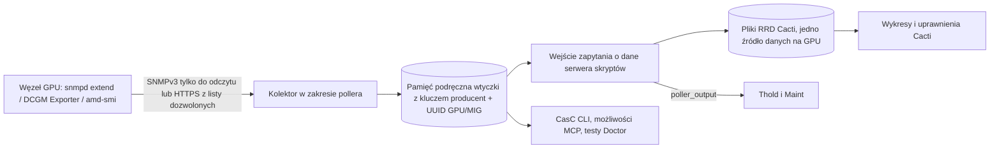

<!-- Source: README.md; SHA256: 97ba37df4a883426d3984ed7d14547ad7367e973411a8abd930409ce259f545b -->

<!-- translations:start -->
[English](../../../README.md) | [简体中文](../zh-CN/README.md) | [हिन्दी](../hi-IN/README.md) | [Español (España)](../es-ES/README.md) | [Español (Latinoamérica)](../es-419/README.md) | [العربية (السعودية)](../ar-SA/README.md) | [Afrikaans](../af-ZA/README.md) | [አማርኛ](../am-ET/README.md) | [العربية (مصر)](../ar-EG/README.md) | [العربية (المغرب)](../ar-MA/README.md) | [বাংলা](../bn-BD/README.md) | [Bosanski](../bs-BA/README.md) | [Deutsch](../de-DE/README.md) | [فارسی](../fa-IR/README.md) | [Filipino](../fil-PH/README.md) | [Français](../fr-FR/README.md) | [Français (Maroc)](../fr-MA/README.md) | [Français (Sénégal)](../fr-SN/README.md) | [Hausa](../ha-NG/README.md) | [עברית](../he-IL/README.md) | [Hrvatski](../hr-HR/README.md) | [Bahasa Indonesia](../id-ID/README.md) | [Igbo](../ig-NG/README.md) | [Italiano](../it-IT/README.md) | [日本語](../ja-JP/README.md) | [한국어](../ko-KR/README.md) | [Malagasy](../mg-MG/README.md) | [मराठी](../mr-IN/README.md) | [Bahasa Melayu](../ms-MY/README.md) | [Nederlands](../nl-NL/README.md) | [Polski](README.md) | [Português (Brasil)](../pt-BR/README.md) | [Русский](../ru-RU/README.md) | [Kinyarwanda](../rw-RW/README.md) | [Soomaali](../so-SO/README.md) | [Српски](../sr-RS/README.md) | [Svenska](../sv-SE/README.md) | [Kiswahili](../sw-KE/README.md) | [தமிழ்](../ta-IN/README.md) | [తెలుగు](../te-IN/README.md) | [ไทย](../th-TH/README.md) | [Türkçe](../tr-TR/README.md) | [Українська](../uk-UA/README.md) | [اردو](../ur-PK/README.md) | [Tiếng Việt](../vi-VN/README.md) | [isiXhosa](../xh-ZA/README.md) | [Yorùbá](../yo-NG/README.md) | [繁體中文](../zh-TW/README.md) | [isiZulu](../zu-ZA/README.md)
<!-- translations:end -->

# plugin_gpu

Wtyczka dla Cacti 1.2 dostarczająca do Cacti informacje o wykorzystaniu poszczególnych układów GPU, pamięci, temperaturze, poborze mocy, błędach ECC oraz przyczynach ograniczania taktowania (throttling) z narzędzi NVIDIA i AMD. Każdy układ GPU (lub instancja MIG) staje się indeksem zapytania o dane w urządzeniu swojego węzła, dzięki czemu wykresy GPU znajdują się obok pozostałych wykresów węzła zgodnie z uprawnieniami Cacti, a wtyczki Thold i Maint mogą generować dla nich alerty oraz wyciszać je.

> **Status: fazy od 1 do 3 zaimplementowane w kodzie, jeszcze niewydane.** Faza 1 (NVIDIA `nvidia-smi` przez SNMP extend, śledzenie tożsamości, wykresy, sygnały throttlingu i ECC, alerty Thold i Maint, strona stanu), Faza 2 (parser/klient HTTP(S) tylko do odczytu dla NVIDIA DCGM Exporter oraz parser AMD `amd-smi`), Faza 3 (śledzenie tożsamości instancji MIG, kolumny Schema v4, wykonywanie zdalnego kolektora w zakresie pollera, hooki `replicate_out` i `remote_agent`), interfejs CasC CLI operatora (`cli/gpu.php`) oraz hooki integracji ekosystemu (`abilities_register`, `doctor_register_checks`, `casc_register_providers`) zostały zaimplementowane i objęte testami jednostkowymi, bezpieczeństwa oraz testami integracyjnymi z jednorazową instancją Cacti. Dotychczasowe uruchomienia na żywo korzystają z syntetycznego `snmpd` i przygotowanych ładunków testowych zamiast fizycznego sprzętu GPU. Przed oznaczeniem wydania pozostają otwarte: testy pilotażowe na rzeczywistym sprzęcie ([docs/pilot-plan.md](../../pilot-plan.md), #54), zewnętrzny przegląd bezpieczeństwa ([docs/security-review.md](../../security-review.md)), dane testowe zarejestrowane z rzeczywistych narzędzi (#14) oraz pomiary skali na sprzęcie klasy produkcyjnej ([docs/performance.md](../../performance.md)). Zbieranie błędów XID pozostaje otwarte w ramach decyzji #8.

## Role dostępu

| Obszar | Dostęp |
| --- | --- |
| GPU View | Istniejące strony monitorowania. |
| GPU Operator | Monitorowanie oraz strona Operations i osobiste potwierdzenia w ramach klasyfikacji incydentów (triage). |
| GPU Admin | Dostęp Operator oraz istniejące działania konfiguracyjne i administracyjne. |

Po skopiowaniu plików aktualizacji należy otworzyć stronę Plugins jako administrator, aby zarejestrować nowy obszar. Obszar Operator należy przypisać jawnie w sekcji **Configuration > Users** lub w grupach użytkowników.
Aktualizacje zachowują istniejące identyfikatory obszarów View i Admin oraz przypisane uprawnienia. Dostęp Admin dziedziczy dostęp Operator, a dostęp Operator dziedziczy dostęp View przy każdym żądaniu; nie dodaje to trwałych uprawnień do użytkowników ani grup. Ustawienia wtyczki wymagają dodatkowo dostępu GPU Admin oprócz uprawnienia Settings w Cacti.

Uprawnienia do urządzeń w Cacti nadal ograniczają wiersze i działania dostępne dla każdego użytkownika; nieprzypisane obiekty wymagają uprawnień administratora.
Poświadczenia, konfiguracja, mapowanie, usuwanie i inne zmiany administracyjne pozostają na stronach administracyjnych. Potwierdzenia obowiązują wyłącznie w bieżącej sesji użytkownika, przez maksymalnie jedną godzinę i tylko tak długo, jak ta sama obserwacja pozostaje aktualna. Nowe lub zmienione obserwacje unieważniają je. Nigdy nie oznaczają błędnego pomiaru jako prawidłowego ani nie tłumią alertów.

## Uzasadnienie

Węzły GPU są zazwyczaj już obecne w Cacti w celu monitorowania CPU, pamięci i interfejsów. Stan GPU to osobna kwestia, na którą dane SNMP węzła nie odpowiadają: karta może podlegać throttlingowi termicznemu, gromadzić błędy ECC lub zgłaszać usterkę XID, podczas gdy sam węzeł wygląda na sprawny. Narzędzia producentów (`nvidia-smi`, DCGM, `amd-smi`) raportują te dane, ale ich wyjście pozostaje poza wykresami, uprawnieniami i systemem alertów Cacti.

Wtyczka wypełnia tę lukę, przekształcając wyjście narzędzi producentów w źródła danych Cacti, identyfikowane za pomocą tożsamości każdego GPU, a nie jego pozycji, dzięki czemu ponowne uruchomienie zmieniające kolejność GPU nie przypisuje historii jednej karty do drugiej. Wykorzystuje ponownie mechanizmy wykresów, uprawnień, zdalnych kolektorów danych, Thold i Maint z Cacti zamiast budowania ich równoległych odpowiedników.

## Planowany zakres

| Faza | Zakres | Status | Kamienie milowe |
|---|---|---|---|
| 0, badania | Wyjście narzędzi producentów, sygnały XID i throttlingu, tożsamość GPU, uprawnienia, wybór ścieżki zbierania danych | Zakończona | [M1](https://github.com/somethingwithproof/plugin_gpu/milestone/1) |
| 1, nvidia | Zbieranie danych przez `nvidia-smi`, inwentaryzacja według UUID, wykresy, sygnały throttlingu i ECC, Thold i Maint, strona stanu | Zaimplementowana (przetestowana na danych testowych) | [M2](https://github.com/somethingwithproof/plugin_gpu/milestone/2), [M3](https://github.com/somethingwithproof/plugin_gpu/milestone/3), [M4](https://github.com/somethingwithproof/plugin_gpu/milestone/4) |
| 2, backendy | Parser/klient HTTP(S) tylko do odczytu dla DCGM Exporter (`lib/DcgmExporterParser.php`, `lib/DcgmExporterClient.php`), parser AMD `amd-smi` (`lib/AmdSmiParser.php`) | Zaimplementowana (przetestowana jednostkowo) | [M5](https://github.com/somethingwithproof/plugin_gpu/milestone/5) |
| 3, mig, zdalne i ekosystem | Śledzenie tożsamości instancji MIG, zdalne kolektory danych (`INFO`, `poller_gpu.php --poller=N`, `replicate_out`, `remote_agent`), CasC CLI (`cli/gpu.php`), hooki MCP/Doctor/CasC | Zaimplementowana (przetestowana jednostkowo i integracyjnie w CI) | [M6](https://github.com/somethingwithproof/plugin_gpu/milestone/6) |

Poza zakresem: wszelkie polecenia modyfikujące stan GPU lub węzła (taktowania, limity mocy, resety, układ MIG), własny silnik alertów wtyczki, niestandardowy demon lub protokół sieciowy oraz rozliczanie zadań lub harmonogramowania. Zobacz plan, aby zapoznać się z listą zaległych prac badawczych.

## Co wprowadza kamień milowy 4

- **Kolektor tylko do odczytu NVIDIA DCGM Exporter** (`lib/DcgmExporterParser.php`, `lib/DcgmExporterClient.php`). Parsuje metryki formatu tekstowego Prometheus (`DCGM_FI_DEV_GPU_UTIL`, `DCGM_FI_DEV_FB_USED`, `DCGM_FI_DEV_FB_FREE`, `DCGM_FI_DEV_POWER_USAGE`, `DCGM_FI_DEV_GPU_TEMP`, `DCGM_FI_DEV_ECC_DBE_VOL_TOTAL`, `DCGM_FI_DEV_CLOCK_THROTTLE_REASONS` oraz etykiety MIG `GPU_I_ID` i `GPU_I_PROFILE`). Klient HTTP(S) wymusza jawną listę dozwolonych hostów/CIDR punktów końcowych, domyślnie weryfikuje certyfikaty peer TLS, ogranicza limity czasu i rozmiar odpowiedzi, wyłącza przekierowania oraz odrzuca schematy inne niż HTTP(S).
- **Parser tylko do odczytu AMD `amd-smi`** (`lib/AmdSmiParser.php`). Normalizuje wyjście JSON/SNMP-extend narzędzia `amd-smi` (wykorzystanie, VRAM, pobór mocy, temperatura złącza/krawędzi, ECC, metadane partycji oraz oddzielne akumulatory throttlingu przez `Reading::$vendorExtensions`) do wspólnego modelu metryk w ramach `Vendor::Amd`.
- **Śledzenie instancji MIG i Schema v4** (`lib/GpuReport.php`, `lib/GpuSnapshot.php`, `lib/GpuRecord.php`, `lib/Schema.php`, `lib/ScriptServer.php`). Śledzi identyfikatory UUID instancji MIG (`MIG-<uuid>` i `MIG-GPU-<parent>/<gi>/<ci>`), `mig_mode`, `mig_instance_id`, `mig_profile`, `parent_uuid` oraz `partition_info` obok nadrzędnych układów GPU, utrzymując jednocześnie niezmienne klucze tożsamości (`vendor`, `uuid`, `parent_uuid`) chronione podczas aktualizacji i walidowane przed zapytaniami do bazy danych.
- **Zdalne kolektory danych** (`INFO`, `poller_gpu.php`, `lib/Poller.php`, `lib/ReplicationRepository.php`, `setup.php`). Deklaruje `remote_collect:1, remote_poller:1` w `INFO`, obsługuje uruchamianie w zakresie pollera przez `php plugins/gpu/poller_gpu.php --poller=N`, pomija tworzenie obiektów Cacti na pollerach innych niż główny, replikuje tabele powiązane z pollerem przez `replicate_out` oraz odpowiada na akcje tylko do odczytu `gpu_health` i `gpu_inventory` przez `remote_agent`.
- **Interfejs CLI operatora i CasC** (`cli/gpu.php`, `lib/CascProvider.php`). Działa w PHP 8.2+ (poprawne składniowo w PHP 8.0) bez zewnętrznych zależności Composer: `php plugins/gpu/cli/gpu.php export [--format=yaml|xml]`, `validate <file> [--format=yaml|xml]`, `plan <file> [--format=yaml|xml] [--output=text|json]`, `apply <file> --confirm=<PLAN_HASH> [--format=yaml|xml]` oraz `health [--format=text|json]`. Polecenie plan oblicza deterministyczny skrót potwierdzający SHA-256, apply bezpiecznie przerywa działanie przy niezgodności skrótu, a parser XML odrzuca deklaracje `DOCTYPE` i `ENTITY`.
- **Hooki integracji ekosystemu** (`lib/EcosystemIntegration.php`, `setup.php`). Rejestruje `abilities_register` (`gpu-list-nodes`, `gpu-list-devices`, `gpu-get-health`; tylko do odczytu, ograniczone obszarem `GPU View` oraz uprawnieniami urządzeń Cacti), `doctor_register_checks` (`gpu_schema`, `gpu_poller_freshness`, `gpu_node_health`) oraz `casc_register_providers`.
- **Przyczyny throttlingu i ECC jako wartości alertów** ([docs/metrics.md](../../metrics.md)). Dekoduje maski zdarzeń zegara na wskaźniki 0/1 i oblicza nowe skorygowane/nieskorygowane błędy ECC dla interwału jako wartości typu gauge, aby wtyczki Thold 1.8.2 i Maint 1.3 mogły generować i wyciszać alerty bez ujemnych liczników czy skoków po resecie ([docs/alerting.md](../../alerting.md)).
- **GPU Health, uprawnienia, awarie/przywracanie i skala.** Strona GPU Health (GPU View) prezentuje zapisaną aktualność danych, wynik ostatniego zbierania, stan Maint, backend, wersje oraz surowe maski throttlingu bez łączenia się z węzłami. Zautomatyzowane testy kompleksowe weryfikują uprawnienia, odzyskiwanie po awariach agenta/bazy danych/RRD ([docs/backup.md](../../backup.md)) oraz uruchomienie w skali 100 GPU w CI ([docs/performance.md](../../performance.md), [docs/operations.md](../../operations.md), [CHANGELOG.md](../../../CHANGELOG.md)).

## Co wprowadza kamień milowy 3

- **Zbieranie danych przez SNMP extend** ([ADR 0008](../../decisions/0008-collect-through-snmp-extend.md)). Administrator węzła dodaje dwa stałe wiersze `extend` do pliku `snmpd.conf` ([docs/node-setup.md](../../node-setup.md)); wtyczka odczytuje NET-SNMP-EXTEND-MIB za pomocą funkcji SNMP w Cacti z użyciem poświadczeń samego urządzenia, przy czym zalecany jest protokół SNMPv3. Nie uruchamia niczego na serwerze Cacti ani na węźle.
- **Ścisłe parsowanie.** Pola są odczytywane pozycyjnie, każdy wiersz identyfikuje swój układ GPU za pomocą UUID, a niezerowy kod wyjścia, przekroczenie limitu czasu, ucięte wyjście, wiersz o błędnej liczbie pól lub dołączony tekst błędu powodują niepowodzenie całego zbierania: wartości przyjmują `U`, żaden układ GPU nie jest oznaczany jako nieobecny, a strona GPU Nodes pokazuje przyczynę.
- **Kolektor po każdym cyklu pollera.** Odczytuje agenta każdego włączonego węzła, aktualizuje rekordy tożsamości i zapisuje najnowszą próbkę w pamięci podręcznej. Wejście serwera skryptów odczytuje wyłącznie tę pamięć podręczną, dzięki czemu odpytywanie w Cacti nigdy nie czeka na węzeł GPU.
- **Obiekty Cacti** ([ADR 0010](../../decisions/0010-attach-to-existing-node-devices.md)). Szablony oraz zapytanie o dane *GPU - Devices* są dostarczane jako pliki XML i importowane podczas instalacji oraz aktualizacji. Zapisanie węzła dołącza zapytanie o dane do jego istniejącego urządzenia z metodą ponownego indeksowania None; strona GPU Nodes może utworzyć urządzenie tylko wtedy, gdy węzeł jeszcze go nie ma. Każdy układ GPU stanowi indeks o kluczu złożonym z producenta i UUID, z jednym źródłem danych współdzielonym przez wykresy Utilization, Memory, Temperature, Power, Power Percent, Clocks, Throttle, ECC Errors, New ECC Errors, Retired Pages oraz Sample Age. Każde pole modelu jest rysowane przez któryś wykres, ponieważ Cacti przechowuje tylko pola używane przez wykresy. Wtyczka wykonuje ponowne indeksowanie po każdej zmianie GPU, przechowuje ponowne indeksowanie pominięte przez Cacti w czasie, gdy urządzenie było w stanie Down lub wyłączone, i uruchamia je, gdy urządzenie powróci do stanu Up, a także tworzy wykresy dla nowych GPU.
- **Historia pozostaje przypisana do karty.** Nieobecny układ GPU pozostaje jako indeks, więc jego wykresy wykazują przerwę i wznawiają zapis w tym samym pliku RRD po powrocie karty. Karta zastępcza w tym samym gnieździe otrzymuje własne źródło danych. Opcja **Remove from Data Query** na stronie węzła usuwa nieobecny układ GPU z listy; jego pliki RRD i wykresy są zachowywane do momentu ręcznego usunięcia.
- **Uprawnienia do urządzeń na stronie GPU Nodes.** Użytkownik z rolą GPU Admin widzi, zmienia, eksportuje i przenosi wyłącznie węzły i układy GPU na urządzeniach, do których ma dostęp w Cacti; przeniesienie GPU wymaga dostępu do obu węzłów. Węzeł, którego urządzenie zostało usunięte, można wyłączyć lub usunąć.
- **Wspólny model metryk** ([ADR 0009](../../decisions/0009-common-metric-core-with-vendor-extensions.md), [docs/metrics.md](../../metrics.md)). Pamięć wyrażana jest w bajtach, maska zdarzeń zegara jest dekodowana do wskaźników `thr_*`, a `age` oznacza wiek własnego znacznika czasu próbki GPU lub `U`, gdy jest nieznany.

Użytkownik instalujący (serwer WWW) musi mieć prawo zapisu w katalogu `<cacti>/resource/script_server/`, w którym wtyczka umieszcza plik XML zapytania o dane; w przeciwnym razie instalacja i aktualizacja przerywają działanie z odpowiednim komunikatem i ponawiają próbę przy kolejnym uruchomieniu. Odinstalowanie usuwa szablony i plik XML wyłącznie wtedy, gdy zaznaczona jest opcja *Remove the plugin's Cacti objects on uninstall*, i nigdy nie usuwa plików RRD, urządzeń, wykresów ani źródeł danych ([docs/operations.md](../../operations.md#uninstall)). Węzły na zdalnych kolektorach danych działają w zakresie przypisanego im identyfikatora `poller_id`.

## Co dostarcza kamień milowy 2

- **Zabezpieczona instalacja.** W przypadku PHP w wersji niższej niż 8.2 instalacja i włączenie wtyczki są odrzucane z komunikatem wskazującym wymaganą wersję, a pozostała część Cacti działa bez zakłóceń. Plik `setup.php` oraz skrypty stron są poprawne składniowo w PHP 8.0.
- **Cykl życia.** Instalacja, aktualizacja, wyłączanie i odinstalowywanie za pośrednictwem strony Plugins w Cacti. Aktualizacje są uporządkowane sekwencyjnie, kończą się po przerwaniu i zmieniają zapisany numer wersji dopiero po pomyślnym zakończeniu. Odinstalowanie zachowuje tabele wtyczki, o ile nie zostanie odznaczona opcja *Keep Plugin Tables on Uninstall*; nigdy nie modyfikuje urządzenia, źródła danych, wykresu ani pliku RRD w Cacti.
- **Oddzielne obszary.** *GPU Admin* otwiera stronę **GPU Nodes**, na której rejestruje się urządzenia Cacti jako węzły GPU, potwierdza lub odrzuca przeniesienia GPU między węzłami oraz eksportuje wszystkie rekordy w formacie JSON. *GPU View* otwiera stronę **GPU Inventory**, wyświetlającą układy GPU wyłącznie na urządzeniach widocznych dla przeglądającego użytkownika. Obie strony znajdują się w sekcji Management, a każda zmiana jest żądaniem POST weryfikowanym przez csrf-magic.
- **Rekordy tożsamości GPU.** Każdy układ GPU jest identyfikowany przez producenta i UUID. Indeks, identyfikator magistrali PCI, nazwa, sterownik oraz narzędzie raportujące to atrybuty aktualizowane na miejscu. Nowy UUID w znanym gnieździe jest oznaczany jako potencjalna wymiana karty i rozpoczyna własną historię; układ GPU wykryty w innym węźle zostaje przeniesiony dopiero po potwierdzeniu przez operatora; układ GPU nieobecny w kolejnych udanych cyklach zbierania danych jest oznaczany jako nieobecny po przekroczeniu konfigurowalnej liczby prób i nigdy nie jest usuwany. Na ten moment akceptowane są wyłącznie pełne identyfikatory UUID układów NVIDIA GPU; instancje MIG oczekują na decyzję #13, a układy AMD na badania #19. Reguły są weryfikowane za pomocą sekwencji danych testowych, ponieważ żaden kolektor jeszcze ich nie zasila.
- **Testy i CI.** Zestawy testów jednostkowych i reguł kodu źródłowego bez użycia GPU i bazy danych, weryfikacja cyklu życia i uprawnień stron w środowiskach Cacti 1.2.31 oraz bieżącego 1.2.x na PHP od 8.2 do 8.5, zadanie weryfikujące odmowę dla PHP 8.1, kontrola składni punktów wejścia dla PHP 8.0, analiza PHPStan na poziomie 9 oraz REUSE. Środowisko testowe ma charakter tymczasowy do czasu podjęcia decyzji #12.

### Instalacja do celów ewaluacyjnych

Poniższe kroki instalują bieżący kod w celu jego przetestowania; pełny przewodnik operatora znajduje się w dokumencie [docs/operations.md](../../operations.md). Wymagają one Cacti 1.2.31 lub nowszego z PHP 8.2 lub nowszym.

1. Skopiuj repozytorium do katalogu `plugins/gpu` w katalogu instalacyjnym Cacti. Katalog musi nosić nazwę `gpu`.
2. W Cacti otwórz **Configuration > Plugins**, a następnie zainstaluj i włącz wtyczkę **GPU**.
3. Przypisz użytkownikom obszar *GPU View*, *GPU Operator* lub *GPU Admin* w sekcji **Configuration > Users** zgodnie z ich rolą. Użytkownik instalujący otrzymuje uprawnienia View oraz Admin; rola Admin obejmuje dostęp Operator.
4. Skonfiguruj agenta SNMP na każdym węźle GPU zgodnie z opisem w [docs/node-setup.md](../../node-setup.md), a następnie dodaj węzeł w sekcji **Management > GPU Nodes**.
5. Aby skonfigurować alerty, zaimportuj dostarczone szablony Thold zgodnie z instrukcją w [docs/alerting.md](../../alerting.md).
6. Opcjonalnie dostosuj ustawienia w sekcji **Configuration > Settings > GPU**: *Mark Absent After* (domyślnie 3 udane cykle zbierania, od 1 do 100), *Stale After* (maksymalny wiek próbki, po którym jej wartości są wypisywane jako `U`) oraz *Keep Plugin Tables on Uninstall* (domyślnie włączone).

## W jaki sposób metryki trafiają do Cacti

Decyzją [#7](https://github.com/somethingwithproof/plugin_gpu/issues/7) wybrano mechanizm SNMP `extend` ([ADR 0008](../../decisions/0008-collect-through-snmp-extend.md)): agent działający na węźle uruchamia stałe polecenie `nvidia-smi`, a wtyczka jedynie odczytuje wynik. W planie porównano dostępne opcje w sekcji [Ścieżki zbierania danych](../../PLAN.md#collection-paths).

## Docelowa zgodność

| Komponent | Wersja docelowa |
|---|---|
| Cacti | 1.2.31 lub nowsza, bez poprawek w kodzie głównym |
| PHP | 8.2 lub nowsza; `setup.php` zachowuje poprawność składniową w wersji 8.0, aby nieobsługiwane środowisko otrzymało komunikat odmowy zamiast uszkodzonego interfejsu Cacti |
| NVIDIA | Linie sterowników i narzędzi zostaną określone w badaniach [#26](https://github.com/somethingwithproof/plugin_gpu/issues/26); identyfikatory pól DCGM zweryfikowane w wersjach v3.3.9 i v4.7.0 |
| AMD | `amd-smi` w wydaniach ROCm zostanie określone w badaniach [#26](https://github.com/somethingwithproof/plugin_gpu/issues/26) |
| Thold, Maint | Thold 1.8.2 i Maint 1.3, bez modyfikacji, przetestowane kompleksowo ([docs/alerting.md](../../alerting.md)) |

## Architektura i projekt

- [docs/PLAN.md](../../PLAN.md) zawiera pełny plan: architekturę, fakty z projektów nadrzędnych, na których opiera się rozwiązanie (wraz ze źródłami), model tożsamości, granice bezpieczeństwa, obliczenia wydajnościowe, testowanie oraz ryzyka.
- [docs/decisions/](../../decisions) zawiera rekordy decyzji architektonicznych dla podjętych już wyborów.
- [docs/REQUIREMENTS.md](../../REQUIREMENTS.md) mapuje każdy identyfikator wymagania na odpowiadające mu zgłoszenie.

## Śledzenie prac

- **Kamienie milowe** odpowiadają kamieniom milowym planu. Każdy z nich ma zgłoszenie nadrzędne zawierające listę podzgłoszeń oraz dowody ukończenia.
- **Zgłoszenia** są klasyfikowane etykietami: `type: requirement`, `type: research`, `type: decision`, `type: epic`. Zgłoszenia wymagań określają numerowane, testowalne wymagania (`REQ-AREA-NNN`) oraz kryteria akceptacji.
- **Etykiety** zawierają również prefiksy `area:`, `phase:`, `priority:` oraz `status:`. Zobacz [CONTRIBUTING.md](../../../CONTRIBUTING.md#labels).
- [Tablica projektu](https://github.com/users/somethingwithproof/projects/9) prezentuje wszystkie zgłoszenia w podziale na kamienie milowe.

## Współpraca

Przeczytaj [CONTRIBUTING.md](../../../CONTRIBUTING.md). Commity wymagają podpisu DCO. Dyskusje projektowe odbywają się w zgłoszeniach; otwarte decyzje są oznaczone etykietą `type: decision`. Zarejestrowane wyjście z rzeczywistych narzędzi GPU jest najbardziej przydatnym wkładem w kamień milowy 1; przed przesłaniem należy usunąć nazwy hostów, numery seryjne oraz identyfikatory UUID.

## Bezpieczeństwo

Zgłaszaj podatności prywatnie; zobacz [SECURITY.md](../../../SECURITY.md).

## Licencja

GNU General Public License v2.0, ta sama licencja co Cacti i jego wtyczki. Zobacz [LICENSE](../../../LICENSE).
