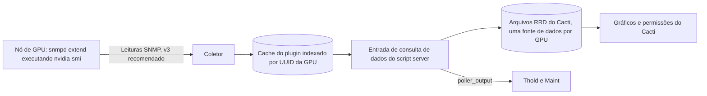

<!-- Source: README.md; SHA256: 126deef1783d64f878bf565f1433c10f31aef828eb9bc313aeff2b0335e54c7c -->

<!-- translations:start -->
[English](../../../README.md) | [简体中文](../zh-CN/README.md) | [हिन्दी](../hi-IN/README.md) | [Español (España)](../es-ES/README.md) | [Español (Latinoamérica)](../es-419/README.md) | [العربية (السعودية)](../ar-SA/README.md) | [Afrikaans](../af-ZA/README.md) | [አማርኛ](../am-ET/README.md) | [العربية (مصر)](../ar-EG/README.md) | [العربية (المغرب)](../ar-MA/README.md) | [বাংলা](../bn-BD/README.md) | [Deutsch](../de-DE/README.md) | [فارسی](../fa-IR/README.md) | [Filipino](../fil-PH/README.md) | [Français](../fr-FR/README.md) | [Français (Maroc)](../fr-MA/README.md) | [Français (Sénégal)](../fr-SN/README.md) | [Hausa](../ha-NG/README.md) | [עברית](../he-IL/README.md) | [Bahasa Indonesia](../id-ID/README.md) | [Igbo](../ig-NG/README.md) | [Italiano](../it-IT/README.md) | [日本語](../ja-JP/README.md) | [한국어](../ko-KR/README.md) | [Malagasy](../mg-MG/README.md) | [मराठी](../mr-IN/README.md) | [Bahasa Melayu](../ms-MY/README.md) | [Nederlands](../nl-NL/README.md) | [Polski](../pl-PL/README.md) | [Português (Brasil)](README.md) | [Русский](../ru-RU/README.md) | [Kinyarwanda](../rw-RW/README.md) | [Soomaali](../so-SO/README.md) | [Svenska](../sv-SE/README.md) | [Kiswahili](../sw-KE/README.md) | [தமிழ்](../ta-IN/README.md) | [తెలుగు](../te-IN/README.md) | [ไทย](../th-TH/README.md) | [Türkçe](../tr-TR/README.md) | [Українська](../uk-UA/README.md) | [اردو](../ur-PK/README.md) | [Tiếng Việt](../vi-VN/README.md) | [isiXhosa](../xh-ZA/README.md) | [Yorùbá](../yo-NG/README.md) | [繁體中文](../zh-TW/README.md) | [isiZulu](../zu-ZA/README.md)
<!-- translations:end -->

# plugin_gpu

Um plugin para Cacti 1.2 que traz utilização, memória, temperatura, potência, erros ECC e motivos de throttling por GPU a partir de ferramentas NVIDIA para o Cacti. O suporte a AMD e a coleta de erros XID estão planejados, não implementados. Cada GPU se torna um índice de uma consulta de dados no dispositivo do seu nó, de modo que os gráficos de GPU ficam ao lado dos demais gráficos do nó sob as permissões do Cacti, e o Thold e o Maint podem gerar alertas e suprimi-los.

> **Status: em desenvolvimento, não lançado.** O marco 4 conclui o código da fase 1 (NVIDIA via SNMP extend): coleta, identidade, gráficos, sinais de throttling e ECC, alertas com Thold e Maint, a página de saúde e a documentação de operação. Ele foi executado apenas contra um `snmpd` real com um `nvidia-smi` simulado imprimindo saída sintética, nunca em hardware de GPU. Ainda pendentes antes de um lançamento: pilotos em hardware real ([docs/pilot-plan.md](../../pilot-plan.md), #54), uma revisão de segurança externa ([docs/security-review.md](../../security-review.md)), fixtures capturadas de ferramentas reais (#14) e escala medida em hardware de porte de produção ([docs/performance.md](../../performance.md)). Os erros XID aguardam a decisão #8. Não execute em produção.

## Papéis de acesso

| Realm | Acesso |
| --- | --- |
| GPU View | Páginas de monitoramento existentes. |
| GPU Operator | Monitoramento, além da página Operations e reconhecimentos pessoais de triagem. |
| GPU Admin | Acesso de Operator, além das ações administrativas e de configuração existentes. |

Após copiar os arquivos de atualização, abra a página Plugins como administrador para registrar
o novo realm. Atribua o realm Operator explicitamente em **Configuration > Users** ou nos grupos de usuários.
As atualizações mantêm os IDs e concessões existentes dos realms View e Admin. O acesso Admin
herda o acesso Operator, e o acesso Operator herda o acesso View em cada requisição;
isso não adiciona concessões armazenadas a usuários ou grupos. As configurações do plugin também exigem
acesso GPU Admin além da permissão Settings do Cacti.

As permissões de dispositivo do Cacti continuam limitando as linhas e ações disponíveis para cada usuário; objetos não mapeados exigem um administrador.
Credenciais, configuração, mapeamento, exclusão e outras alterações administrativas
permanecem nas páginas administrativas. Os reconhecimentos duram apenas na sessão atual
do usuário, por no máximo uma hora e somente enquanto a mesma observação permanecer
recente. Observações novas ou alteradas os invalidam. Eles nunca marcam uma medição
com falha como saudável nem suprimem alertas.

## Por quê

Nós de GPU geralmente já estão no Cacti para CPU, memória e interfaces. A saúde da GPU é uma questão à parte que os dados SNMP do nó não respondem: uma placa pode sofrer limitação térmica (thermal throttling), acumular erros ECC ou relatar uma falha XID enquanto o nó em si parece saudável. As ferramentas dos fabricantes relatam isso (`nvidia-smi`, DCGM, `amd-smi`), mas sua saída fica fora dos gráficos, das permissões e dos alertas do Cacti.

O plugin preenche essa lacuna transformando a saída das ferramentas dos fabricantes em fontes de dados do Cacti, indexadas pela identidade de cada GPU em vez de sua posição, de modo que uma reinicialização que reordene as GPUs não anexe o histórico de uma placa a outra. Ele reutiliza os gráficos, as permissões, os coletores remotos de dados, o Thold e o Maint do Cacti em vez de construir versões paralelas deles.

## Escopo planejado

| Fase | Escopo | Marcos |
|---|---|---|
| 0, pesquisa | Saída das ferramentas dos fabricantes, sinais de XID e throttling, identidade de GPU, privilégios, decisão do caminho de coleta | [M1](https://github.com/somethingwithproof/plugin_gpu/milestone/1) |
| 1, nvidia | Coleta com `nvidia-smi`, inventário por UUID, gráficos, sinais de throttling, ECC e XID, Thold e Maint, página de saúde | [M2](https://github.com/somethingwithproof/plugin_gpu/milestone/2), [M3](https://github.com/somethingwithproof/plugin_gpu/milestone/3), [M4](https://github.com/somethingwithproof/plugin_gpu/milestone/4) |
| 2, backends | Backend DCGM, backend `amd-smi` | [M5](https://github.com/somethingwithproof/plugin_gpu/milestone/5) |
| 3, mig e remoto | Instâncias MIG, coletores remotos de dados do Cacti | [M6](https://github.com/somethingwithproof/plugin_gpu/milestone/6) |

Fora do escopo: qualquer comando que altere uma GPU ou um nó (clocks, limites de potência, reinicializações, layout MIG), um motor de alertas próprio do plugin, um daemon ou protocolo de rede personalizado e contabilização de escalonador ou jobs. Consulte o plano para o backlog de pesquisa.

## O que o marco 4 adiciona

- **Motivos de throttling como valores de alerta.** A máscara de eventos de clock é decodificada em um indicador 0 ou 1 por motivo; uma máscara desconhecida gera indicadores desconhecidos, nunca zeros, e os bits sem indicador permanecem na máscara bruta, exibida pelo GPU Health.
- **ECC como valores de alerta** ([docs/metrics.md](../../metrics.md)). Novos erros corrigidos e não corrigidos desde a amostra anterior são calculados pelo plugin a partir de dois totais consecutivos e armazenados como gauges: desconhecido para uma primeira amostra, uma leitura perdida ou uma recarga de driver, de modo que uma reinicialização nunca seja lida como zero nem como uma contagem negativa. As contagens de páginas aposentadas de bit único e bit duplo e o modo ECC também são lidos. Dois gráficos ECC adicionais por GPU permitem que o Cacti os armazene; com Power Percent, há onze gráficos no total. XID não é coletado: nenhuma fonte se encaixa nos comandos fixos do `nvidia-smi` (#8).
- **Thold e Maint** ([docs/alerting.md](../../alerting.md)). Templates Thold incluídos para temperatura, potência em relação ao limite, indicadores de throttling, novos erros ECC não corrigidos, aposentadoria pendente de páginas e idade da amostra. Todo valor é um gauge, porque o Thold 1.8.2 falha em um contador desconhecido. Um teste ponta a ponta com o Thold 1.8.2 e o Maint 1.3 sem modificações mostra cada limiar disparar e restaurar, inclusive após uma reinicialização de ECC, e o Maint suprimi-lo.
- **GPU Health** (GPU View). Por nó: atualidade, como a última coleta terminou, estado do Maint, backend, versões da ferramenta e do driver e contagens de GPUs; por GPU: presença, idade da amostra, estado de ECC e a máscara bruta. Lê apenas registros armazenados.
- **Permissões.** A suíte de permissões cobre cada arquivo de página e ação, a revogação na requisição seguinte e recusas que não divulgam nada.
- **Qualificação de falha e restauração.** Execuções ponta a ponta automatizadas quebram o agente, as credenciais, a ferramenta, sua saída, a conexão com o banco de dados e as gravações de RRD, e restauram o banco de dados a partir de um dump, inclusive um mais antigo que os arquivos RRD; uma nova GPU nunca herda o arquivo RRD de outra ([docs/backup.md](../../backup.md)).
- **Escala** ([docs/performance.md](../../performance.md)). Um teste de escala cronometra a coleta, a entrada do script server, a criação de objetos no Cacti, um ciclo do poller e a página de saúde em uma determinada contagem de GPUs; o CI o executa com 100 GPUs. As medições com 1.000 e 8.000 GPUs ainda não estão registradas, portanto nenhuma contagem de GPUs suportada é declarada.
- **Documentação de operação** ([docs/operations.md](../../operations.md)): instalação, atualização, desinstalação, privilégio mínimo, valores indisponíveis e solução de problemas. As alterações estão listadas em [CHANGELOG.md](../../../CHANGELOG.md).

## O que o marco 3 adiciona

- **Coleta via SNMP extend** ([ADR 0008](../../decisions/0008-collect-through-snmp-extend.md)). O administrador do nó adiciona duas linhas fixas de `extend` ao `snmpd.conf` ([docs/node-setup.md](../../node-setup.md)); o plugin lê a NET-SNMP-EXTEND-MIB por meio das funções SNMP do Cacti com as credenciais do próprio dispositivo, sendo SNMPv3 recomendado. Ele não executa nada no servidor Cacti nem no nó.
- **Análise estrita.** Os campos são lidos por posição, cada linha identifica sua GPU por UUID, e um código de saída diferente de zero, um timeout, uma saída truncada, uma linha com contagem incorreta de campos ou texto de erro mesclado faz toda a coleta falhar: os valores tornam-se `U`, nenhuma GPU é marcada como ausente e GPU Nodes mostra o motivo.
- **Um coletor após cada ciclo do poller.** Ele lê o agente de cada nó habilitado, atualiza os registros de identidade e armazena em cache a amostra mais recente. A entrada do script server lê apenas esse cache, portanto uma coleta do Cacti nunca espera por um nó de GPU.
- **Objetos do Cacti** ([ADR 0010](../../decisions/0010-attach-to-existing-node-devices.md)). Os templates e a consulta de dados *GPU - Devices* são distribuídos em XML e importados na instalação e na atualização. Salvar um nó anexa a consulta de dados ao seu dispositivo existente com o método de reindexação None; GPU Nodes pode criar um dispositivo apenas quando o nó não possui nenhum. Cada GPU é um índice identificado por fabricante e UUID, com uma fonte de dados compartilhada pelos gráficos Utilization, Memory, Temperature, Power, Power Percent, Clocks, Throttle, ECC Errors, New ECC Errors, Retired Pages e Sample Age. Todo campo do modelo é desenhado por algum gráfico, porque o Cacti armazena apenas os campos que um gráfico utiliza. O plugin reindexa após cada alteração de GPU, mantém uma reindexação que o Cacti pulou enquanto o dispositivo estava Down ou desabilitado e a executa assim que o dispositivo volta a ficar Up, além de criar gráficos para novas GPUs.
- **O histórico permanece com a placa.** Uma GPU ausente continua sendo um índice, de modo que seus gráficos mostram uma lacuna e retomam no mesmo arquivo RRD quando ela retorna. Uma placa substituta no mesmo slot obtém sua própria fonte de dados. **Remove from Data Query** na página do nó remove uma GPU ausente da listagem; seus arquivos RRD e gráficos são mantidos até que você os exclua.
- **Permissões de dispositivo em GPU Nodes.** Um GPU Admin vê, altera, exporta e move apenas nós e GPUs em dispositivos que pode ver no Cacti; uma movimentação de GPU exige ambos os nós. Um nó cujo dispositivo foi excluído pode ser desabilitado ou excluído.
- **O modelo comum de métricas** ([ADR 0009](../../decisions/0009-common-metric-core-with-vendor-extensions.md), [docs/metrics.md](../../metrics.md)). A memória está em bytes, a máscara de eventos de clock é decodificada em indicadores `thr_*` e `age` é a idade do próprio horário de amostra da GPU, ou `U` quando desconhecido.

O usuário que realiza a instalação (servidor web) precisa ter permissão de escrita em `<cacti>/resource/script_server/`, onde o plugin coloca o XML da sua consulta de dados; caso contrário, a instalação e a atualização são interrompidas com uma mensagem e tentam novamente na próxima execução. A desinstalação remove os templates e o XML apenas quando *Remove the plugin's Cacti objects on uninstall* está marcada, e nunca exclui arquivos RRD, dispositivos, gráficos ou fontes de dados ([docs/operations.md](../../operations.md#uninstall)). Nós em coletores remotos de dados só são coletados na fase 3.

## O que o marco 2 entrega

- **Instalação protegida.** No PHP abaixo da versão 8.2, a instalação e a habilitação são recusadas com uma mensagem informando a versão exigida, e o restante do Cacti continua funcionando. `setup.php` e os scripts de página são analisáveis no PHP 8.0.
- **Ciclo de vida.** Instalação, atualização, desabilitação e desinstalação pela página Plugins do Cacti. As atualizações são ordenadas, concluem após uma interrupção e alteram a versão registrada somente após terem sucesso. A desinstalação mantém as tabelas do plugin a menos que você desmarque *Keep Plugin Tables on Uninstall*; ela nunca toca em um dispositivo, fonte de dados, gráfico ou arquivo RRD do Cacti.
- **Realms separados.** *GPU Admin* abre **GPU Nodes**, onde você registra dispositivos do Cacti como nós de GPU, confirma ou rejeita movimentações de GPU entre nós e exporta todos os registros como JSON. *GPU View* abre **GPU Inventory**, que lista GPUs apenas em dispositivos que o visualizador pode ver. Ambas as páginas ficam em Management, e toda alteração é um POST verificado por csrf-magic.
- **Registros de identidade de GPU.** Cada GPU é identificada por fabricante e UUID. Índice, ID do barramento PCI, nome, driver e a ferramenta de relato são atributos que mudam no local. Um novo UUID em um slot conhecido é sinalizado como possível substituição e inicia seu próprio histórico; uma GPU vista em outro nó só é movida quando um operador confirma; uma GPU ausente de coletas bem-sucedidas é marcada como ausente após uma contagem configurável e nunca é excluída. Apenas UUIDs de GPU inteira da NVIDIA são aceitos por enquanto; instâncias MIG aguardam a decisão #13 e AMD aguarda a pesquisa #19. As regras são exercitadas por sequências de fixtures, pois nenhum coletor as alimenta ainda.
- **Testes e CI.** Suítes de testes unitários e de regras de código-fonte sem GPU nem banco de dados, verificações de ciclo de vida e de permissões de página contra o Cacti 1.2.31 e a série atual 1.2.x no PHP 8.2 a 8.5, um job de recusa no PHP 8.1, um lint em PHP 8.0 dos pontos de entrada, PHPStan no nível 9 e REUSE. A estrutura de testes é provisória até que #12 seja decidida.

### Instalação para avaliação

Estas etapas instalam o código atual para testes; [docs/operations.md](../../operations.md) contém o guia completo do operador. Elas exigem Cacti 1.2.31 ou posterior no PHP 8.2 ou posterior.

1. Copie o repositório para `plugins/gpu` dentro do diretório do Cacti. O diretório deve se chamar `gpu`.
2. No Cacti, abra **Configuration > Plugins** e depois instale e habilite **GPU**.
3. Conceda aos usuários o realm *GPU View*, *GPU Operator* ou *GPU Admin* em **Configuration > Users**, de acordo com o seu papel. O usuário que realiza a instalação recebe View e Admin; Admin inclui acesso Operator.
4. Configure o agente SNMP de cada nó de GPU conforme descrito em [docs/node-setup.md](../../node-setup.md) e depois adicione o nó em **Management > GPU Nodes**.
5. Para alertas, importe os templates Thold incluídos conforme descrito em [docs/alerting.md](../../alerting.md).
6. Opcionalmente, ajuste **Configuration > Settings > GPU**: *Mark Absent After* (padrão de 3 coletas bem-sucedidas, de 1 a 100), *Stale After* (quanto tempo uma amostra pode ter antes que seus valores imprimam `U`) e *Keep Plugin Tables on Uninstall* (ativado por padrão).

## Como as métricas alcançam o Cacti

A decisão [#7](https://github.com/somethingwithproof/plugin_gpu/issues/7) escolheu SNMP `extend` ([ADR 0008](../../decisions/0008-collect-through-snmp-extend.md)): o próprio agente do nó executa um comando `nvidia-smi` fixo e o plugin apenas lê o resultado. O plano compara as opções em [Caminhos de coleta](../../PLAN.md#collection-paths).

## Metas de compatibilidade

| Componente | Alvo |
|---|---|
| Cacti | 1.2.31 ou posterior, sem patches no core |
| PHP | 8.2 ou posterior; `setup.php` permanece analisável no PHP 8.0 para que um runtime não suportado receba uma recusa em vez de uma interface do Cacti quebrada |
| NVIDIA | Linhas de driver e ferramentas a serem definidas pela pesquisa [#26](https://github.com/somethingwithproof/plugin_gpu/issues/26); IDs de campo do DCGM verificados nas versões v3.3.9 e v4.7.0 |
| AMD | `amd-smi` em lançamentos ROCm a serem definidos pela pesquisa [#26](https://github.com/somethingwithproof/plugin_gpu/issues/26) |
| Thold, Maint | Thold 1.8.2 e Maint 1.3, sem modificações, testados ponta a ponta ([docs/alerting.md](../../alerting.md)) |

## Design

- [docs/PLAN.md](../../PLAN.md) é o plano completo: arquitetura, fatos de projetos upstream dos quais depende (com fontes), modelo de identidade, limites de segurança, aritmética de desempenho, testes e riscos.
- [docs/decisions/](../../decisions) contém registros de decisões arquiteturais para escolhas já feitas.
- [docs/REQUIREMENTS.md](../../REQUIREMENTS.md) mapeia cada ID de requisito para sua issue.

## Como o trabalho é acompanhado

- **Marcos** seguem os marcos do plano. Cada um possui uma issue épica listando suas sub-issues e evidências de saída.
- **Issues** são tipadas por rótulo: `type: requirement`, `type: research`, `type: decision`, `type: epic`. As issues de requisito definem requisitos numerados e testáveis (`REQ-AREA-NNN`) e critérios de aceitação.
- **Rótulos** também trazem `area:`, `phase:`, `priority:` e `status:`. Veja [CONTRIBUTING.md](../../../CONTRIBUTING.md#labels).
- O [quadro do projeto](https://github.com/users/somethingwithproof/projects/9) mostra todas as issues entre os marcos.

## Contribuição

Leia [CONTRIBUTING.md](../../../CONTRIBUTING.md). Os commits precisam de assinatura DCO. As discussões de design acontecem nas issues; decisões em aberto carregam o rótulo `type: decision`. Saídas capturadas de ferramentas reais de GPU são a contribuição mais útil para o marco 1; remova nomes de host, números de série e UUIDs antes.

## Segurança

Relate vulnerabilidades de forma privada; veja [SECURITY.md](../../../SECURITY.md).

## Licença

GNU General Public License v2.0, a mesma licença do Cacti e de seus plugins. Veja [LICENSE](../../../LICENSE).
