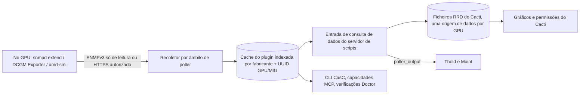

<!-- Source: README.md; SHA256: 97ba37df4a883426d3984ed7d14547ad7367e973411a8abd930409ce259f545b -->

<!-- translations:start -->
[English](../../../README.md) | [简体中文](../zh-CN/README.md) | [हिन्दी](../hi-IN/README.md) | [Español (España)](../es-ES/README.md) | [Español (Latinoamérica)](../es-419/README.md) | [العربية (السعودية)](../ar-SA/README.md) | [Afrikaans](../af-ZA/README.md) | [አማርኛ](../am-ET/README.md) | [العربية (مصر)](../ar-EG/README.md) | [العربية (المغرب)](../ar-MA/README.md) | [Български](../bg-BG/README.md) | [বাংলা](../bn-BD/README.md) | [Bosanski](../bs-BA/README.md) | [Deutsch](../de-DE/README.md) | [Ελληνικά](../el-GR/README.md) | [فارسی](../fa-IR/README.md) | [Filipino](../fil-PH/README.md) | [Français](../fr-FR/README.md) | [Français (Maroc)](../fr-MA/README.md) | [Français (Sénégal)](../fr-SN/README.md) | [Hausa](../ha-NG/README.md) | [עברית](../he-IL/README.md) | [Hrvatski](../hr-HR/README.md) | [Bahasa Indonesia](../id-ID/README.md) | [Igbo](../ig-NG/README.md) | [Italiano](../it-IT/README.md) | [日本語](../ja-JP/README.md) | [ქართული](../ka-GE/README.md) | [한국어](../ko-KR/README.md) | [Latviešu](../lv-LV/README.md) | [Malagasy](../mg-MG/README.md) | [मराठी](../mr-IN/README.md) | [Bahasa Melayu](../ms-MY/README.md) | [Nederlands](../nl-NL/README.md) | [Polski](../pl-PL/README.md) | [Português (Brasil)](../pt-BR/README.md) | [Português (Portugal)](README.md) | [Русский](../ru-RU/README.md) | [Kinyarwanda](../rw-RW/README.md) | [Soomaali](../so-SO/README.md) | [Српски](../sr-RS/README.md) | [Svenska](../sv-SE/README.md) | [Kiswahili](../sw-KE/README.md) | [தமிழ்](../ta-IN/README.md) | [తెలుగు](../te-IN/README.md) | [ไทย](../th-TH/README.md) | [Türkçe](../tr-TR/README.md) | [Українська](../uk-UA/README.md) | [اردو](../ur-PK/README.md) | [Tiếng Việt](../vi-VN/README.md) | [isiXhosa](../xh-ZA/README.md) | [Yorùbá](../yo-NG/README.md) | [繁體中文](../zh-TW/README.md) | [isiZulu](../zu-ZA/README.md)
<!-- translations:end -->

# plugin_gpu

Um plugin para Cacti 1.2 que integra no Cacti a utilização por GPU, memória, temperatura, potência, erros ECC e motivos de limitação de relógio a partir de ferramentas NVIDIA e AMD. Cada GPU (ou instância MIG) torna-se um índice de uma consulta de dados no dispositivo do respetivo nó, para que os gráficos de GPU fiquem junto aos restantes gráficos do nó sob as permissões do Cacti, permitindo ao Thold e ao Maint alertar e suprimir alertas sobre os mesmos.

> **Estado: fases 1 a 3 implementadas em código, ainda sem versão publicada.** A Fase 1 (`nvidia-smi` da NVIDIA via SNMP extend, acompanhamento de identidade, gráficos, sinais de limitação de relógio e ECC, alertas Thold e Maint, página de estado de saúde), a Fase 2 (analisador/cliente HTTP(S) só de leitura para NVIDIA DCGM Exporter e analisador `amd-smi` da AMD), a Fase 3 (acompanhamento de identidade de instâncias MIG, colunas do Esquema v4, execução em recoletores de dados remotos por âmbito de poller, hooks `replicate_out` e `remote_agent`), a CLI de operador CasC (`cli/gpu.php`) e os hooks de ecossistema (`abilities_register`, `doctor_register_checks`, `casc_register_providers`) estão implementados e cobertos por testes unitários, de segurança e de integração numa instância descartável do Cacti. As execuções em direto até agora utilizam `snmpd` sintético e dados de fixture em vez de hardware GPU físico. Ainda em aberto antes de publicar uma versão: pilotos em hardware real ([docs/pilot-plan.md](../../pilot-plan.md), #54), uma revisão externa de segurança ([docs/security-review.md](../../security-review.md)), fixtures capturadas a partir de ferramentas reais (#14) e medições de escala em hardware de dimensão de produção ([docs/performance.md](../../performance.md)). A recolha de erros XID permanece em aberto sob a decisão #8.

## Funções de acesso

| Âmbito | Acesso |
| --- | --- |
| GPU View | Páginas de monitorização existentes. |
| GPU Operator | Monitorização mais a página Operações e reconhecimentos pessoais de triagem. |
| GPU Admin | Acesso de Operador mais a configuração existente e ações administrativas. |

Após copiar os ficheiros de atualização, abra a página Plugins como administrador para registar
o novo âmbito. Atribua explicitamente o âmbito Operator em **Configuration > Users** ou em grupos de utilizadores.
As atualizações mantêm os IDs e concessões existentes dos âmbitos View e Admin. O acesso Admin
herda o acesso Operator e o acesso Operator herda o acesso View em cada pedido;
isto não adiciona concessões armazenadas a utilizadores nem a grupos. As definições do plugin requerem também
acesso GPU Admin além da permissão Settings do Cacti.

As permissões de dispositivos do Cacti continuam a limitar as linhas e ações disponíveis para cada utilizador; objetos não associados requerem um administrador.
Credenciais, configuração, associação, eliminação e outras alterações administrativas
permanecem nas páginas administrativas. Os reconhecimentos duram apenas na sessão atual
do utilizador, no máximo durante uma hora e apenas enquanto a mesma observação permanecer
atual. Observações novas ou alteradas invalidam-nos. Nunca marcam uma medição falhada
como saudável nem suprimem alertas.

## Porquê

Os nós com GPU já costumam estar no Cacti para monitorização de CPU, memória e interfaces. O estado de saúde das GPUs é uma questão distinta a que os dados SNMP do nó não respondem: uma placa pode estar sob limitação térmica, acumular erros ECC ou comunicar uma falha XID enquanto o nó em si aparenta estar saudável. As ferramentas dos fabricantes comunicam esses dados (`nvidia-smi`, DCGM, `amd-smi`), mas a sua saída fica fora dos gráficos, permissões e alertas do Cacti.

O plugin colmata essa lacuna transformando a saída das ferramentas dos fabricantes em origens de dados do Cacti, indexadas pela identidade de cada GPU em vez da sua posição, para que um reinício que reordene GPUs não associe o histórico de uma placa a outra. Reutiliza os gráficos, permissões, recoletores de dados remotos, Thold e Maint do Cacti em vez de construir versões paralelas dos mesmos.

## Âmbito planeado

| Fase | Âmbito | Estado | Marcos |
|---|---|---|---|
| 0, investigação | Saída das ferramentas dos fabricantes, sinais XID e de limitação, identidade da GPU, privilégios, decisão do caminho de recolha | Concluída | [M1](https://github.com/somethingwithproof/plugin_gpu/milestone/1) |
| 1, nvidia | Recolha `nvidia-smi`, inventário por UUID, gráficos, sinais de limitação e ECC, Thold e Maint, página de estado de saúde | Implementada (testada com fixtures) | [M2](https://github.com/somethingwithproof/plugin_gpu/milestone/2), [M3](https://github.com/somethingwithproof/plugin_gpu/milestone/3), [M4](https://github.com/somethingwithproof/plugin_gpu/milestone/4) |
| 2, backends | Analisador/cliente HTTP(S) só de leitura para DCGM Exporter (`lib/DcgmExporterParser.php`, `lib/DcgmExporterClient.php`), analisador AMD `amd-smi` (`lib/AmdSmiParser.php`) | Implementada (testada com testes unitários) | [M5](https://github.com/somethingwithproof/plugin_gpu/milestone/5) |
| 3, mig, remoto e ecossistema | Acompanhamento de identidade de instâncias MIG, recoletores de dados remotos (`INFO`, `poller_gpu.php --poller=N`, `replicate_out`, `remote_agent`), CLI CasC (`cli/gpu.php`), hooks MCP/Doctor/CasC | Implementada (testada com testes unitários e de integração em CI) | [M6](https://github.com/somethingwithproof/plugin_gpu/milestone/6) |

Fora de âmbito: qualquer comando que altere uma GPU ou nó (relógios, limites de potência, reposições, disposição MIG), um motor de alertas próprio do plugin, um daemon ou protocolo de rede personalizado, e contabilidade de escalonador ou de tarefas. Consulte o plano para a lista de investigação pendente.

## O que o marco 4 adiciona

- **Recoletor só de leitura NVIDIA DCGM Exporter** (`lib/DcgmExporterParser.php`, `lib/DcgmExporterClient.php`). Analisa métricas em formato de texto de exposição Prometheus (`DCGM_FI_DEV_GPU_UTIL`, `DCGM_FI_DEV_FB_USED`, `DCGM_FI_DEV_FB_FREE`, `DCGM_FI_DEV_POWER_USAGE`, `DCGM_FI_DEV_GPU_TEMP`, `DCGM_FI_DEV_ECC_DBE_VOL_TOTAL`, `DCGM_FI_DEV_CLOCK_THROTTLE_REASONS`, e etiquetas MIG `GPU_I_ID` e `GPU_I_PROFILE`). O cliente HTTP(S) impõe uma lista explícita de anfitriões/CIDR permitidos, verifica certificados TLS por predefinição, limita tempos limite e tamanho de resposta, desativa redirecionamentos e rejeita esquemas não HTTP(S).
- **Analisador só de leitura AMD `amd-smi`** (`lib/AmdSmiParser.php`). Normaliza a saída JSON/SNMP-extend do `amd-smi` (utilização, VRAM, potência, temperatura de junção/extremidade, ECC, metadados de partição e acumuladores separados de limitação através de `Reading::$vendorExtensions`) para o modelo de métricas comum sob `Vendor::Amd`.
- **Acompanhamento de instâncias MIG e Esquema v4** (`lib/GpuReport.php`, `lib/GpuSnapshot.php`, `lib/GpuRecord.php`, `lib/Schema.php`, `lib/ScriptServer.php`). Acompanha UUIDs de instâncias MIG (`MIG-<uuid>` e `MIG-GPU-<parent>/<gi>/<ci>`), `mig_mode`, `mig_instance_id`, `mig_profile`, `parent_uuid` e `partition_info` a par das GPUs principais, mantendo as chaves de identidade imutáveis (`vendor`, `uuid`, `parent_uuid`) protegidas em atualizações e validadas antes das consultas à base de dados.
- **Recoletores de dados remotos** (`INFO`, `poller_gpu.php`, `lib/Poller.php`, `lib/ReplicationRepository.php`, `setup.php`). Declara `remote_collect:1, remote_poller:1` em `INFO`, suporta execução por âmbito de poller através de `php plugins/gpu/poller_gpu.php --poller=N`, ignora o aprovisionamento de objetos do Cacti em pollers secundários, replica tabelas por âmbito de poller através de `replicate_out` e responde às ações só de leitura `gpu_health` e `gpu_inventory` através de `remote_agent`.
- **CLI de operador e CasC** (`cli/gpu.php`, `lib/CascProvider.php`). Executa em PHP 8.2+ (analisável em PHP 8.0) sem dependências externas do Composer: `php plugins/gpu/cli/gpu.php export [--format=yaml|xml]`, `validate <file> [--format=yaml|xml]`, `plan <file> [--format=yaml|xml] [--output=text|json]`, `apply <file> --confirm=<PLAN_HASH> [--format=yaml|xml]` e `health [--format=text|json]`. Os planos calculam um hash de confirmação SHA-256 determinístico, `apply` falha de forma segura em caso de divergência de hash e a análise XML rejeita declarações `DOCTYPE` e `ENTITY`.
- **Hooks de integração de ecossistema** (`lib/EcosystemIntegration.php`, `setup.php`). Regista `abilities_register` (`gpu-list-nodes`, `gpu-list-devices`, `gpu-get-health`; só de leitura, protegidos pelo âmbito `GPU View` e pelas permissões de dispositivos do Cacti), `doctor_register_checks` (`gpu_schema`, `gpu_poller_freshness`, `gpu_node_health`) e `casc_register_providers`.
- **Motivos de limitação e ECC como valores de alerta** ([docs/metrics.md](../../metrics.md)). Descodifica máscaras de eventos de relógio em indicadores 0/1 e calcula novos erros ECC corrigidos/não corrigidos por intervalo como indicadores (gauges) para que o Thold 1.8.2 e o Maint 1.3 alertem e suprimam sem contadores negativos nem picos de reposição ([docs/alerting.md](../../alerting.md)).
- **Estado de Saúde das GPUs, permissões, falha/restauro e escala.** A página Estado de Saúde das GPUs (GPU View) mostra a atualidade armazenada, o resultado da última recolha, o estado do Maint, o backend, as versões e as máscaras brutas de limitação sem contactar os nós. Testes automatizados de ponta a ponta verificam permissões, recuperação de falhas de agente/base de dados/RRD ([docs/backup.md](../../backup.md)) e uma execução à escala de 100 GPUs em CI ([docs/performance.md](../../performance.md), [docs/operations.md](../../operations.md), [CHANGELOG.md](../../../CHANGELOG.md)).

## O que o marco 3 adiciona

- **Recolha através de SNMP extend** ([ADR 0008](../../decisions/0008-collect-through-snmp-extend.md)). O administrador do nó adiciona duas linhas fixas `extend` ao `snmpd.conf` ([docs/node-setup.md](../../node-setup.md)); o plugin lê NET-SNMP-EXTEND-MIB através das funções SNMP do Cacti com as credenciais do próprio dispositivo, recomendando-se SNMPv3. Não executa nada no servidor Cacti nem no nó.
- **Análise rigorosa.** Os campos são lidos por posição, cada linha identifica a sua GPU por UUID e um código de saída diferente de zero, tempo limite excedido, saída truncada, linha com número errado de campos ou texto de erro misturado faz falhar toda a recolha: os valores passam a `U`, nenhuma GPU é marcada como ausente e Nós GPU mostra o motivo.
- **Um recoletor após cada ciclo do poller.** Lê o agente de cada nó ativado, atualiza os registos de identidade e guarda em cache a amostra mais recente. A entrada do servidor de scripts lê apenas essa cache, pelo que uma sondagem do Cacti nunca fica à espera de um nó GPU.
- **Objetos do Cacti** ([ADR 0010](../../decisions/0010-attach-to-existing-node-devices.md)). Os modelos e a consulta de dados *GPU - Devices* são distribuídos em XML e importados na instalação e atualização. Guardar um nó associa a consulta de dados ao respetivo dispositivo existente com o método de reindexação Nenhum; Nós GPU só pode criar um dispositivo quando o nó ainda não tem nenhum. Cada GPU é um índice identificado por fabricante e UUID, com uma origem de dados partilhada pelos gráficos de Utilização, Memória, Temperatura, Potência, Percentagem de Potência, Relógios, Limitação, Erros ECC, Novos Erros ECC, Páginas Retiradas e Idade da Amostra. Todos os campos do modelo são desenhados por algum gráfico, porque o Cacti armazena apenas os campos usados por gráficos. O plugin reindexa após cada alteração de GPU, guarda uma reindexação ignorada pelo Cacti enquanto o dispositivo estava Inativo ou desativado e executa-a assim que o dispositivo fica Ativo, criando gráficos para novas GPUs.
- **O histórico acompanha a placa.** Uma GPU ausente permanece como índice, pelo que os seus gráficos mostram uma lacuna e retomam no mesmo ficheiro RRD quando regressa. Uma placa de substituição na mesma ranhura obtém a sua própria origem de dados. **Remover da consulta de dados** na página do nó retira uma GPU ausente da listagem; os seus ficheiros RRD e gráficos são mantidos até que os elimine.
- **Permissões de dispositivos em Nós GPU.** Um GPU Admin vê, altera, exporta e move apenas nós e GPUs em dispositivos que pode ver no Cacti; uma mudança de GPU requer acesso a ambos os nós. Um nó cujo dispositivo foi eliminado pode ser desativado ou eliminado.
- **O modelo de métricas comum** ([ADR 0009](../../decisions/0009-common-metric-core-with-vendor-extensions.md), [docs/metrics.md](../../metrics.md)). A memória é expressa em bytes, a máscara de eventos de relógio é descodificada em indicadores `thr_*` e `age` é a idade da hora da própria amostra da GPU, ou `U` quando desconhecida.

O utilizador de instalação (servidor web) tem de poder escrever em `<cacti>/resource/script_server/`, onde o plugin coloca o XML da sua consulta de dados; caso contrário, a instalação e a atualização param com uma mensagem e tentam novamente na tentativa seguinte. A desinstalação remove os modelos e o XML apenas quando *Remover os objetos do Cacti criados pelo plugin ao desinstalar* está selecionado, e nunca elimina ficheiros RRD, dispositivos, gráficos nem origens de dados ([docs/operations.md](../../operations.md#uninstall)). Os nós em recoletores de dados remotos são executados no âmbito do seu `poller_id` atribuído.

## O que o marco 2 disponibiliza

- **Instalação protegida.** Em PHP inferior a 8.2, a instalação e ativação são recusadas com uma mensagem que indica a versão necessária, mantendo o resto do Cacti funcional. `setup.php` e os scripts de páginas são analisáveis em PHP 8.0.
- **Ciclo de vida.** Instalação, atualização, desativação e desinstalação através da página Plugins do Cacti. As atualizações são ordenadas, concluem após uma interrupção e só alteram a versão registada após terem sucesso. A desinstalação mantém as tabelas do plugin salvo se desmarcar *Manter tabelas do plugin ao desinstalar*; nunca toca num dispositivo, origem de dados, gráfico ou ficheiro RRD do Cacti.
- **Âmbitos separados.** *GPU Admin* abre **Nós GPU**, onde regista dispositivos do Cacti como nós GPU, confirma ou rejeita mudanças de GPU entre nós e exporta todos os registos em JSON. *GPU View* abre **Inventário de GPUs**, que lista GPUs apenas nos dispositivos que o utilizador pode ver. Ambas as páginas ficam em Gestão e cada alteração é um POST verificado por csrf-magic.
- **Registos de identidade de GPU.** Cada GPU é identificada por fabricante e UUID. O índice, ID do barramento PCI, nome, controlador e ferramenta de comunicação são atributos que mudam no local. Um novo UUID numa ranhura conhecida é assinalado como possível substituição e inicia o seu próprio histórico; uma GPU vista noutro nó só muda de nó quando um operador confirma; uma GPU em falta em recolhas bem-sucedidas é marcada como ausente após uma contagem configurável e nunca é eliminada. Por agora apenas são aceites UUIDs de GPUs inteiras da NVIDIA; as instâncias MIG aguardam a decisão #13 e a AMD aguarda a investigação #19. As regras são exercitadas com sequências de fixtures, uma vez que ainda nenhum recoletor as alimenta.
- **Testes e CI.** Conjuntos de testes unitários e de regras de código-fonte sem GPU nem base de dados, verificações de ciclo de vida e de permissões de página contra o Cacti 1.2.31 e 1.2.x atual em PHP 8.2 a 8.5, uma tarefa de recusa em PHP 8.1, verificação de sintaxe em PHP 8.0 dos pontos de entrada, PHPStan no nível 9 e REUSE. O ambiente de testes é provisório até que #12 seja decidido.

### Instalação para avaliação

Estes passos instalam o código atual para o experimentar; [docs/operations.md](../../operations.md) contém o guia completo de operações. Requerem Cacti 1.2.31 ou posterior em PHP 8.2 ou posterior.

1. Copie o repositório para `plugins/gpu` dentro do diretório do Cacti. O diretório tem de se chamar `gpu`.
2. No Cacti, abra **Configuration > Plugins** e depois instale e ative **GPU**.
3. Atribua aos utilizadores o âmbito *GPU View*, *GPU Operator* ou *GPU Admin* em **Configuration > Users**, consoante a respetiva função. O utilizador que efetua a instalação recebe View e Admin; Admin inclui acesso Operator.
4. Configure o agente SNMP de cada nó GPU conforme descrito em [docs/node-setup.md](../../node-setup.md) e depois adicione o nó em **Management > GPU Nodes**.
5. Para alertas, importe os modelos Thold distribuídos conforme descrito em [docs/alerting.md](../../alerting.md).
6. Opcionalmente ajuste **Configuration > Settings > GPU**: *Marcar como ausente após* (predefinição: 3 recolhas bem-sucedidas, de 1 a 100), *Desatualizado após* (idade máxima de uma amostra antes de os seus valores devolverem `U`) e *Manter tabelas do plugin ao desinstalar* (ativado por predefinição).

## Como as métricas chegam ao Cacti

A decisão [#7](https://github.com/somethingwithproof/plugin_gpu/issues/7) escolheu SNMP `extend` ([ADR 0008](../../decisions/0008-collect-through-snmp-extend.md)): o próprio agente do nó executa um comando fixo `nvidia-smi` e o plugin apenas lê o resultado. O plano compara as opções em [Caminhos de recolha](../../PLAN.md#collection-paths).

## Alvos de compatibilidade

| Componente | Alvo |
|---|---|
| Cacti | 1.2.31 ou posterior, sem correções ao núcleo |
| PHP | 8.2 ou posterior; `setup.php` mantém-se analisável em 8.0 para que um ambiente não suportado receba uma recusa em vez de partir a interface do Cacti |
| NVIDIA | Linhas de controladores e ferramentas a definir pela investigação [#26](https://github.com/somethingwithproof/plugin_gpu/issues/26); IDs de campos DCGM verificados nas versões v3.3.9 e v4.7.0 |
| AMD | `amd-smi` em versões ROCm a definir pela investigação [#26](https://github.com/somethingwithproof/plugin_gpu/issues/26) |
| Thold, Maint | Thold 1.8.2 e Maint 1.3, sem alterações, testados de ponta a ponta ([docs/alerting.md](../../alerting.md)) |

## Arquitetura

- [docs/PLAN.md](../../PLAN.md) é o plano completo: arquitetura, factos a montante de que depende (com fontes), modelo de identidade, fronteiras de segurança, aritmética de desempenho, testes e riscos.
- [docs/decisions/](../../decisions/) contém registos de decisões de arquitetura para escolhas já efetuadas.
- [docs/REQUIREMENTS.md](../../REQUIREMENTS.md) mapeia cada ID de requisito à respetiva issue.

## Como o trabalho é acompanhado

- Os **Marcos (Milestones)** seguem os marcos do plano. Cada um tem uma issue épica que lista as respetivas sub-issues e evidências de conclusão.
- As **Issues** são tipificadas por etiqueta: `type: requirement`, `type: research`, `type: decision`, `type: epic`. As issues de requisitos especificam requisitos numerados e testáveis (`REQ-AREA-NNN`) e critérios de aceitação.
- As **Etiquetas** incluem também `area:`, `phase:`, `priority:` e `status:`. Consulte [CONTRIBUTING.md](../../../CONTRIBUTING.md#labels).
- O [quadro do projeto](https://github.com/users/somethingwithproof/projects/9) mostra todas as issues ao longo dos marcos.

## Contribuir

Leia [CONTRIBUTING.md](../../../CONTRIBUTING.md). Os commits requerem assinatura DCO. A discussão de arquitetura decorre nas issues; as decisões em aberto utilizam a etiqueta `type: decision`. Saídas capturadas a partir de ferramentas GPU reais são a contribuição mais útil para o marco 1; remova primeiro nomes de anfitrião, números de série e UUIDs.

## Segurança

Comunique vulnerabilidades de forma privada; consulte [SECURITY.md](../../../SECURITY.md).

## Licença

GNU General Public License v2.0, a mesma licença do Cacti e dos seus plugins. Consulte [LICENSE](../../../LICENSE).
