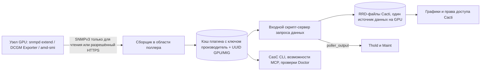

<!-- Source: README.md; SHA256: 97ba37df4a883426d3984ed7d14547ad7367e973411a8abd930409ce259f545b -->

<!-- translations:start -->
[English](../../../README.md) | [简体中文](../zh-CN/README.md) | [हिन्दी](../hi-IN/README.md) | [Español (España)](../es-ES/README.md) | [Español (Latinoamérica)](../es-419/README.md) | [العربية (السعودية)](../ar-SA/README.md) | [Afrikaans](../af-ZA/README.md) | [አማርኛ](../am-ET/README.md) | [العربية (مصر)](../ar-EG/README.md) | [العربية (المغرب)](../ar-MA/README.md) | [Български](../bg-BG/README.md) | [বাংলা](../bn-BD/README.md) | [Bosanski](../bs-BA/README.md) | [Deutsch](../de-DE/README.md) | [Ελληνικά](../el-GR/README.md) | [فارسی](../fa-IR/README.md) | [Filipino](../fil-PH/README.md) | [Français](../fr-FR/README.md) | [Français (Maroc)](../fr-MA/README.md) | [Français (Sénégal)](../fr-SN/README.md) | [Hausa](../ha-NG/README.md) | [עברית](../he-IL/README.md) | [Hrvatski](../hr-HR/README.md) | [Bahasa Indonesia](../id-ID/README.md) | [Igbo](../ig-NG/README.md) | [Italiano](../it-IT/README.md) | [日本語](../ja-JP/README.md) | [ქართული](../ka-GE/README.md) | [한국어](../ko-KR/README.md) | [Latviešu](../lv-LV/README.md) | [Malagasy](../mg-MG/README.md) | [मराठी](../mr-IN/README.md) | [Bahasa Melayu](../ms-MY/README.md) | [Nederlands](../nl-NL/README.md) | [Polski](../pl-PL/README.md) | [Português (Brasil)](../pt-BR/README.md) | [Português (Portugal)](../pt-PT/README.md) | [Русский](README.md) | [Kinyarwanda](../rw-RW/README.md) | [Soomaali](../so-SO/README.md) | [Српски](../sr-RS/README.md) | [Svenska](../sv-SE/README.md) | [Kiswahili](../sw-KE/README.md) | [தமிழ்](../ta-IN/README.md) | [తెలుగు](../te-IN/README.md) | [ไทย](../th-TH/README.md) | [Türkçe](../tr-TR/README.md) | [Українська](../uk-UA/README.md) | [اردو](../ur-PK/README.md) | [Tiếng Việt](../vi-VN/README.md) | [isiXhosa](../xh-ZA/README.md) | [Yorùbá](../yo-NG/README.md) | [繁體中文](../zh-TW/README.md) | [isiZulu](../zu-ZA/README.md)
<!-- translations:end -->

# plugin_gpu

Плагин для Cacti 1.2, передающий в Cacti показатели загрузки, памяти, температуры, энергопотребления, ошибок ECC и причин троттлинга по каждому GPU из инструментов NVIDIA и AMD. Каждый GPU (или экземпляр MIG) становится индексом запроса данных на устройстве своего узла, поэтому графики GPU располагаются рядом с остальными графиками узла в рамках системы прав Cacti, а Thold и Maint могут настраивать для них оповещения и подавление алертов.

> **Статус: фазы с 1 по 3 реализованы в коде, релиз ещё не выпущен.** Фаза 1 (`nvidia-smi` от NVIDIA через SNMP extend, отслеживание идентификаторов, графики, сигналы троттлинга и ECC, оповещения Thold и Maint, страница состояния), фаза 2 (парсер/клиент HTTP(S) только для чтения для NVIDIA DCGM Exporter и парсер `amd-smi` для AMD), фаза 3 (отслеживание идентификаторов экземпляров MIG, столбцы Schema v4, выполнение удалённых сборщиков в области видимости поллера, хуки `replicate_out` и `remote_agent`), операторский CLI CasC (`cli/gpu.php`) и хуки интеграции с экосистемой (`abilities_register`, `doctor_register_checks`, `casc_register_providers`) реализованы и покрыты модульными тестами, тестами безопасности и интеграционными тестами в одноразовой среде Cacti. Живые прогоны до сих пор используют синтетический `snmpd` и тестовые фикстуры вместо физического оборудования GPU. Перед выпуском релиза остаются открытыми: пилотные запуски на реальном оборудовании ([docs/pilot-plan.md](../../pilot-plan.md), #54), внешний аудит безопасности ([docs/security-review.md](../../security-review.md)), эталонные данные, снятые с реальных инструментов (#14), и замеры масштабируемости на оборудовании промышленного масштаба ([docs/performance.md](../../performance.md)). Сбор ошибок XID остаётся открытым согласно решению #8.

## Роли доступа

| Область прав | Доступ |
| --- | --- |
| GPU View | Существующие страницы мониторинга. |
| GPU Operator | Мониторинг, а также страница Operations и персональные подтверждения при первичном разборе. |
| GPU Admin | Доступ Operator, а также существующие настройки и административные действия. |

После копирования файлов обновления откройте страницу Plugins под учётной записью администратора, чтобы зарегистрировать
новую область прав. Назначьте область прав Operator явно в разделе **Configuration > Users** или для групп пользователей.
При обновлении сохраняются существующие идентификаторы областей View и Admin и выданные разрешения. Доступ Admin
наследует доступ Operator, а доступ Operator наследует доступ View при каждом запросе;
при этом пользователям и группам не добавляются сохранённые разрешения. Для доступа к настройкам плагина также требуются
права GPU Admin в дополнение к праву Settings в Cacti.

Права на устройства в Cacti по-прежнему ограничивают строки и действия, доступные каждому пользователю; несопоставленные объекты требуют участия администратора.
Учётные данные, конфигурация, сопоставление, удаление и другие административные изменения
остаются на административных страницах. Подтверждения действуют только в текущей
сессии пользователя, не более одного часа и лишь пока то же самое наблюдение остаётся
актуальным. Новые или изменившиеся наблюдения аннулируют их. Они никогда не помечают неудачное
измерение как исправное и не подавляют оповещения.

## Зачем это нужно

Узлы с GPU обычно уже добавлены в Cacti для мониторинга CPU, памяти и сетевых интерфейсов. Состояние самих GPU является отдельным вопросом, на который данные SNMP узла не отвечают: видеокарта может подвергаться тепловому троттлингу, накапливать ошибки ECC или сообщать о сбое XID, в то время как сам узел выглядит полностью исправным. Инструменты производителей сообщают об этом (`nvidia-smi`, DCGM, `amd-smi`), но их вывод остаётся за пределами графиков, прав доступа и системы оповещений Cacti.

Плагин устраняет этот разрыв, преобразуя вывод инструментов производителей в источники данных Cacti с привязкой к идентификатору каждого GPU, а не к его позиции, чтобы перезагрузка с изменением порядка GPU не привязала историю одной карты к другой. Он переиспользует систему графиков, прав доступа, удалённые сборщики данных, Thold и Maint самого Cacti вместо создания их параллельных аналогов.

## Планируемый охват

| Фаза | Состав работ | Статус | Этапы |
|---|---|---|---|
| 0, исследование | Вывод инструментов производителей, сигналы XID и троттлинга, идентификация GPU, привилегии, выбор способа сбора данных | Завершена | [M1](https://github.com/somethingwithproof/plugin_gpu/milestone/1) |
| 1, nvidia | Сбор через `nvidia-smi`, инвентаризация по UUID, графики, сигналы троттлинга и ECC, Thold и Maint, страница состояния | Реализована (проверена на фикстурах) | [M2](https://github.com/somethingwithproof/plugin_gpu/milestone/2), [M3](https://github.com/somethingwithproof/plugin_gpu/milestone/3), [M4](https://github.com/somethingwithproof/plugin_gpu/milestone/4) |
| 2, бэкенды | Парсер/клиент HTTP(S) только для чтения для DCGM Exporter (`lib/DcgmExporterParser.php`, `lib/DcgmExporterClient.php`), парсер `amd-smi` для AMD (`lib/AmdSmiParser.php`) | Реализована (покрыта модульными тестами) | [M5](https://github.com/somethingwithproof/plugin_gpu/milestone/5) |
| 3, mig, удалённый сбор и экосистема | Отслеживание идентификаторов экземпляров MIG, удалённые сборщики данных (`INFO`, `poller_gpu.php --poller=N`, `replicate_out`, `remote_agent`), CasC CLI (`cli/gpu.php`), хуки MCP/Doctor/CasC | Реализована (покрыта модульными и CI-интеграционными тестами) | [M6](https://github.com/somethingwithproof/plugin_gpu/milestone/6) |

Вне рамок проекта: любые команды, изменяющие состояние GPU или узла (частоты, лимиты мощности, сбросы, разметка MIG), собственный движок оповещений плагина, собственный демон или сетевой протокол, а также учёт планировщика или заданий. Перечень исследовательских задач см. в плане.

## Что добавляет этап 4

- **Сборщик только для чтения для NVIDIA DCGM Exporter** (`lib/DcgmExporterParser.php`, `lib/DcgmExporterClient.php`). Разбирает текстовый формат метрик Prometheus (`DCGM_FI_DEV_GPU_UTIL`, `DCGM_FI_DEV_FB_USED`, `DCGM_FI_DEV_FB_FREE`, `DCGM_FI_DEV_POWER_USAGE`, `DCGM_FI_DEV_GPU_TEMP`, `DCGM_FI_DEV_ECC_DBE_VOL_TOTAL`, `DCGM_FI_DEV_CLOCK_THROTTLE_REASONS`, а также метки MIG `GPU_I_ID` и `GPU_I_PROFILE`). Клиент HTTP(S) применяет явный список разрешённых хостов/CIDR конечных точек, по умолчанию проверяет сертификаты TLS-пиров, ограничивает таймауты и размер ответа, отключает перенаправления и отклоняет схемы, отличные от HTTP(S).
- **Парсер только для чтения для AMD `amd-smi`** (`lib/AmdSmiParser.php`). Нормализует вывод JSON/SNMP-extend утилиты `amd-smi` (загрузка, VRAM, энергопотребление, температура перехода/края кристалла, ECC, метаданные разделов и отдельные аккумуляторы троттлинга через `Reading::$vendorExtensions`) в единую модель метрик под `Vendor::Amd`.
- **Отслеживание экземпляров MIG и Schema v4** (`lib/GpuReport.php`, `lib/GpuSnapshot.php`, `lib/GpuRecord.php`, `lib/Schema.php`, `lib/ScriptServer.php`). Отслеживает UUID экземпляров MIG (`MIG-<uuid>` и `MIG-GPU-<parent>/<gi>/<ci>`), `mig_mode`, `mig_instance_id`, `mig_profile`, `parent_uuid` и `partition_info` наряду с родительскими GPU, сохраняя неизменяемые ключи идентификации (`vendor`, `uuid`, `parent_uuid`) защищёнными при обновлениях и проверяя их перед запросами к базе данных.
- **Удалённые сборщики данных** (`INFO`, `poller_gpu.php`, `lib/Poller.php`, `lib/ReplicationRepository.php`, `setup.php`). Объявляет `remote_collect:1, remote_poller:1` в `INFO`, поддерживает выполнение в области поллера через `php plugins/gpu/poller_gpu.php --poller=N`, пропускает создание объектов Cacti на неосновных поллерах, реплицирует привязанные к поллеру таблицы через `replicate_out` и отвечает на действия только для чтения `gpu_health` и `gpu_inventory` через `remote_agent`.
- **Операторский и CasC CLI** (`cli/gpu.php`, `lib/CascProvider.php`). Работает на PHP 8.2+ (разбирается парсером PHP 8.0) без внешних зависимостей Composer: `php plugins/gpu/cli/gpu.php export [--format=yaml|xml]`, `validate <file> [--format=yaml|xml]`, `plan <file> [--format=yaml|xml] [--output=text|json]`, `apply <file> --confirm=<PLAN_HASH> [--format=yaml|xml]` и `health [--format=text|json]`. Планы вычисляют детерминированный SHA-256 хэш подтверждения, команда apply завершается с ошибкой при несовпадении хэша, а разбор XML отклоняет объявления `DOCTYPE` и `ENTITY`.
- **Хуки интеграции с экосистемой** (`lib/EcosystemIntegration.php`, `setup.php`). Регистрирует `abilities_register` (`gpu-list-nodes`, `gpu-list-devices`, `gpu-get-health`; только для чтения, ограничены областью прав `GPU View` и правами на устройства в Cacti), `doctor_register_checks` (`gpu_schema`, `gpu_poller_freshness`, `gpu_node_health`) и `casc_register_providers`.
- **Причины троттлинга и ECC как значения для оповещений** ([docs/metrics.md](../../metrics.md)). Декодирует битовые маски событий тактирования в индикаторы 0/1 и вычисляет число новых исправленных и неисправленных ошибок ECC за интервал как gauge, чтобы Thold 1.8.2 и Maint 1.3 срабатывали и подавляли оповещения без отрицательных значений счётчиков или скачков при сбросе ([docs/alerting.md](../../alerting.md)).
- **GPU Health, права доступа, сбои/восстановление и масштабируемость.** Страница GPU Health (GPU View) показывает сохранённую актуальность данных, результат последнего сбора, состояние Maint, бэкенд, версии и исходные маски троттлинга без обращения к узлам. Сквозные сценарные тесты проверяют права доступа, восстановление после сбоев агента/БД/RRD ([docs/backup.md](../../backup.md)) и прогон в CI на масштабе 100 GPU ([docs/performance.md](../../performance.md), [docs/operations.md](../../operations.md), [CHANGELOG.md](../../../CHANGELOG.md)).

## Что добавляет этап 3

- **Сбор через SNMP extend** ([ADR 0008](../../decisions/0008-collect-through-snmp-extend.md)). Администратор узла добавляет две фиксированные строки `extend` в `snmpd.conf` ([docs/node-setup.md](../../node-setup.md)); плагин читает NET-SNMP-EXTEND-MIB через SNMP-функции Cacti с использованием собственных учётных данных устройства (рекомендуется SNMPv3). На сервере Cacti и на узле ничего не запускается.
- **Строгий разбор.** Поля считываются по позиции, каждая строка указывает свой GPU по UUID, а ненулевой код возврата, таймаут, обрезанный вывод, строка с неверным числом полей или примешанный текст ошибки приводят к провалу всего сбора: значения становятся `U`, ни один GPU не помечается отсутствующим, а на странице GPU Nodes отображается причина.
- **Сборщик после каждого цикла поллера.** Он опрашивает агента каждого включённого узла, обновляет записи идентификации и кэширует последнюю выборку. Входной скрипт скрипт-сервера читает только этот кэш, поэтому опрос Cacti никогда не ждёт ответа от узла с GPU.
- **Объекты Cacti** ([ADR 0010](../../decisions/0010-attach-to-existing-node-devices.md)). Шаблоны и запрос данных *GPU - Devices* поставляются в виде XML и импортируются при установке и обновлении. Сохранение узла привязывает запрос данных к его существующему устройству с методом переиндексации None; на странице GPU Nodes можно создать устройство только в том случае, если у узла его ещё нет. Каждый GPU является индексом с ключом по производителю и UUID и одним источником данных, общим для его графиков Utilization, Memory, Temperature, Power, Power Percent, Clocks, Throttle, ECC Errors, New ECC Errors, Retired Pages и Sample Age. Каждое поле модели отображается каким-либо графиком, поскольку Cacti хранит только поля, используемые графиками. Плагин выполняет переиндексацию после каждого изменения состава GPU, сохраняет переиндексацию, которую Cacti пропустил, пока устройство было в состоянии Down или отключено, и запускает её после перехода устройства в состояние Up, а также создаёт графики для новых GPU.
- **История остаётся за видеокартой.** Отсутствующий GPU сохраняет свой индекс, поэтому на его графиках отображается пробел, а при возвращении запись продолжается в тот же RRD-файл. Карта, установленная на замену в тот же слот, получает собственный источник данных. Действие **Remove from Data Query** на странице узла убирает отсутствующий GPU из списка; его RRD-файлы и графики сохраняются до тех пор, пока вы не удалите их вручную.
- **Права на устройства в GPU Nodes.** Пользователь с правами GPU Admin видит, изменяет, экспортирует и переносит только те узлы и GPU, которые находятся на доступных ему в Cacti устройствах; перенос GPU требует доступа к обоим узлам. Узел, чьё устройство было удалено, можно отключить или удалить.
- **Общая модель метрик** ([ADR 0009](../../decisions/0009-common-metric-core-with-vendor-extensions.md), [docs/metrics.md](../../metrics.md)). Память измеряется в байтах, битовая маска событий тактирования декодируется в индикаторы `thr_*`, а `age` означает возраст собственного времени выборки GPU или `U`, если оно неизвестно.

Пользователь, выполняющий установку (веб-сервер), должен иметь права на запись в `<cacti>/resource/script_server/`, куда плагин помещает XML-файл запроса данных; в противном случае установка и обновление останавливаются с сообщением и повторяют попытку при следующем запуске. Удаление плагина удаляет шаблоны и XML только в том случае, если установлен флажок *Remove the plugin's Cacti objects on uninstall*, и никогда не удаляет RRD-файлы, устройства, графики или источники данных ([docs/operations.md](../../operations.md#uninstall)). Узлы на удалённых сборщиках данных выполняются в области назначенного им `poller_id`.

## Что включает этап 2

- **Защищённая установка.** При версии PHP ниже 8.2 установка и включение отклоняются с сообщением, указывающим требуемую версию, при этом остальная часть Cacti продолжает работать. `setup.php` и скрипты страниц корректно разбираются парсером PHP 8.0.
- **Жизненный цикл.** Установка, обновление, отключение и удаление выполняются через страницу Plugins в Cacti. Обновления упорядочены, завершаются после прерывания и изменяют записанную версию только после успешного выполнения. При удалении таблицы плагина сохраняются, если не снять флажок *Keep Plugin Tables on Uninstall*; удаление никогда не затрагивает устройства, источники данных, графики и RRD-файлы Cacti.
- **Раздельные области прав.** *GPU Admin* открывает **GPU Nodes**, где регистрируются устройства Cacti в качестве узлов GPU, подтверждаются или отклоняются переносы GPU между узлами и выполняется экспорт всех записей в JSON. *GPU View* открывает **GPU Inventory**, где отображаются GPU только на устройствах, доступных пользователю для просмотра. Обе страницы находятся в разделе Management, и любое изменение выполняется POST-запросом с проверкой через csrf-magic.
- **Записи идентификации GPU.** Каждый GPU идентифицируется по производителю и UUID. Индекс, PCI bus ID, имя, драйвер и используемый инструмент отчётности являются атрибутами, обновляемыми на месте. Новый UUID в известном слоте помечается как возможная замена и начинает собственную историю; GPU, обнаруженный на другом узле, переносится только после подтверждения оператором; GPU, отсутствующий в успешных сборах, помечается как отсутствующий после заданного в настройках числа сборов и никогда не удаляется. Пока принимаются только UUID целых GPU NVIDIA; экземпляры MIG ожидают решения по #13, а AMD ожидает исследования #19. Правила проверяются на последовательностях тестовых данных, так как сборщик ещё не подключён.
- **Тесты и CI.** Модульные тесты и проверки правил исходного кода без GPU и базы данных, проверки жизненного цикла и прав доступа на страницах против Cacti 1.2.31 и текущей ветки 1.2.x на PHP от 8.2 до 8.5, задача проверки отказа на PHP 8.1, синтаксическая проверка точек входа на PHP 8.0, PHPStan на уровне 9 и REUSE. Тестовый стенд остаётся предварительным до принятия решения по #12.

### Установка для ознакомления

Эти шаги устанавливают текущий код для пробного запуска; полное руководство для операторов находится в [docs/operations.md](../../operations.md). Требуется Cacti 1.2.31 или новее на PHP 8.2 или новее.

1. Скопируйте репозиторий в `plugins/gpu` внутри каталога Cacti. Каталог должен называться `gpu`.
2. В Cacti откройте **Configuration > Plugins**, затем установите и включите **GPU**.
3. Назначьте пользователям области прав *GPU View*, *GPU Operator* или *GPU Admin* в разделе **Configuration > Users** в соответствии с их ролями. Устанавливающий пользователь получает права View и Admin; доступ Admin включает доступ Operator.
4. Настройте SNMP-агент на каждом узле GPU согласно [docs/node-setup.md](../../node-setup.md), затем добавьте узел в разделе **Management > GPU Nodes**.
5. Для оповещений импортируйте поставляемые шаблоны Thold, как описано в [docs/alerting.md](../../alerting.md).
6. При необходимости измените параметры в **Configuration > Settings > GPU**: *Mark Absent After* (по умолчанию 3 успешных сбора, от 1 до 100), *Stale After* (возраст выборки, после которого её значения выводятся как `U`) и *Keep Plugin Tables on Uninstall* (по умолчанию включено).

## Как метрики попадают в Cacti

В решении [#7](https://github.com/somethingwithproof/plugin_gpu/issues/7) выбран SNMP `extend` ([ADR 0008](../../decisions/0008-collect-through-snmp-extend.md)): собственный агент узла запускает фиксированную команду `nvidia-smi`, а плагин только считывает результат. Сравнение вариантов приведено в плане в разделе [Пути сбора](../../PLAN.md#collection-paths).

## Целевые параметры совместимости

| Компонент | Целевая версия |
|---|---|
| Cacti | 1.2.31 или новее, без патчей ядра |
| PHP | 8.2 или новее; `setup.php` сохраняет синтаксическую совместимость с 8.0, чтобы неподдерживаемая среда выполнения получала отказ вместо поломки интерфейса Cacti |
| NVIDIA | Поддерживаемые ветки драйверов и инструментов будут определены в исследовании [#26](https://github.com/somethingwithproof/plugin_gpu/issues/26); идентификаторы полей DCGM проверены для v3.3.9 и v4.7.0 |
| AMD | `amd-smi` в релизах ROCm, перечень которых будет определён в исследовании [#26](https://github.com/somethingwithproof/plugin_gpu/issues/26) |
| Thold, Maint | Thold 1.8.2 и Maint 1.3, без изменений, проверены в сквозных тестах ([docs/alerting.md](../../alerting.md)) |

## Архитектура и проектирование

- [docs/PLAN.md](../../PLAN.md) содержит полный план: архитектуру, используемые факты о внешних компонентах (с источниками), модель идентификации, границы безопасности, расчёты производительности, тестирование и риски.
- [docs/decisions/](../../decisions) содержит записи об архитектурных решениях (ADR) по уже принятым вопросам.
- [docs/REQUIREMENTS.md](../../REQUIREMENTS.md) сопоставляет каждый идентификатор требования с его задачей.

## Как отслеживается работа

- **Этапы (Milestones)** соответствуют этапам плана. Для каждого этапа заведена эпик-задача со списком подзадач и критериев приёмки.
- **Задачи (Issues)** типизируются метками: `type: requirement`, `type: research`, `type: decision`, `type: epic`. Задачи-требования содержат пронумерованные, проверяемые требования (`REQ-AREA-NNN`) и критерии приёмки.
- **Метки** также указывают область, фазу, приоритет и статус: `area:`, `phase:`, `priority:` и `status:`. См. [CONTRIBUTING.md](../../../CONTRIBUTING.md#labels).
- Все задачи по этапам показаны на [доске проекта](https://github.com/users/somethingwithproof/projects/9).

## Участие в разработке

Прочитайте [CONTRIBUTING.md](../../../CONTRIBUTING.md). Коммиты должны содержать подпись DCO (`Signed-off-by`). Обсуждение архитектуры ведётся в задачах; открытые решения помечены меткой `type: decision`. Наиболее полезным вкладом в этап 1 являются образцы вывода реальных инструментов GPU; предварительно удалите из них имена хостов, серийные номера и UUID.

## Безопасность

Об уязвимостях сообщайте конфиденциально; подробности см. в [SECURITY.md](../../../SECURITY.md).

## Лицензия

GNU General Public License v2.0, та же лицензия, что и у Cacti и его плагинов. См. [LICENSE](../../../LICENSE).
