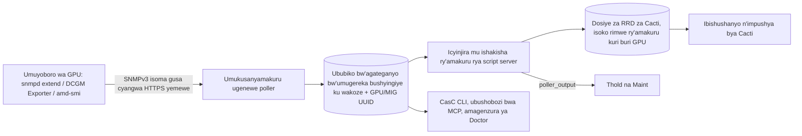

<!-- Source: README.md; SHA256: 97ba37df4a883426d3984ed7d14547ad7367e973411a8abd930409ce259f545b -->

<!-- translations:start -->
[English](../../../README.md) | [简体中文](../zh-CN/README.md) | [हिन्दी](../hi-IN/README.md) | [Español (España)](../es-ES/README.md) | [Español (Latinoamérica)](../es-419/README.md) | [العربية (السعودية)](../ar-SA/README.md) | [Afrikaans](../af-ZA/README.md) | [አማርኛ](../am-ET/README.md) | [العربية (مصر)](../ar-EG/README.md) | [العربية (المغرب)](../ar-MA/README.md) | [Български](../bg-BG/README.md) | [বাংলা](../bn-BD/README.md) | [Bosanski](../bs-BA/README.md) | [Deutsch](../de-DE/README.md) | [Ελληνικά](../el-GR/README.md) | [فارسی](../fa-IR/README.md) | [Filipino](../fil-PH/README.md) | [Français](../fr-FR/README.md) | [Français (Maroc)](../fr-MA/README.md) | [Français (Sénégal)](../fr-SN/README.md) | [Hausa](../ha-NG/README.md) | [עברית](../he-IL/README.md) | [Hrvatski](../hr-HR/README.md) | [Bahasa Indonesia](../id-ID/README.md) | [Igbo](../ig-NG/README.md) | [Italiano](../it-IT/README.md) | [日本語](../ja-JP/README.md) | [ქართული](../ka-GE/README.md) | [한국어](../ko-KR/README.md) | [Latviešu](../lv-LV/README.md) | [Malagasy](../mg-MG/README.md) | [मराठी](../mr-IN/README.md) | [Bahasa Melayu](../ms-MY/README.md) | [Nederlands](../nl-NL/README.md) | [Polski](../pl-PL/README.md) | [Português (Brasil)](../pt-BR/README.md) | [Português (Portugal)](../pt-PT/README.md) | [Русский](../ru-RU/README.md) | [Kinyarwanda](README.md) | [Soomaali](../so-SO/README.md) | [Српски](../sr-RS/README.md) | [Svenska](../sv-SE/README.md) | [Kiswahili](../sw-KE/README.md) | [தமிழ்](../ta-IN/README.md) | [తెలుగు](../te-IN/README.md) | [ไทย](../th-TH/README.md) | [Türkçe](../tr-TR/README.md) | [Українська](../uk-UA/README.md) | [اردو](../ur-PK/README.md) | [Tiếng Việt](../vi-VN/README.md) | [isiXhosa](../xh-ZA/README.md) | [Yorùbá](../yo-NG/README.md) | [繁體中文](../zh-TW/README.md) | [isiZulu](../zu-ZA/README.md)
<!-- translations:end -->

# plugin_gpu

Umugereka wa Cacti 1.2 uzana muri Cacti ibipimo by'ikoreshwa rya buri GPU, ububiko (memory), ubushyuhe, ingufu z'amashanyarazi, amakosa ya ECC, n'impamvu zo kugabanya umuvuduko (throttling) bivuye mu bikoresho bya NVIDIA na AMD. Buri GPU (cyangwa igice cya MIG) iba umubare ndangakarango (index) w'ishakisha ry'amakuru ku gikoresho cy'umuyoboro wayo (node), bityo ibishushanyo bya GPU bikicarana n'ibindi bishushanyo by'uwo muyoboro mu bubasha bw'impushya za Cacti, kandi Thold na Maint bikaba bishobora gutanga integuza no guhagarika izo nteguza kuri byo.

> **Imiterere: ibyiciro 1 kugeza kuri 3 byarashyizwe mu bikorwa muri kode, ntibirashyirwa hanze.** Icyiciro cya 1 (`nvidia-smi` ya NVIDIA binyuze muri SNMP extend, gukurikirana umwirondoro, ibishushanyo, ibimenyetso bya throttle na ECC, integuza za Thold na Maint, urupapuro rw'ubuzima), Icyiciro cya 2 (umusesenguzi/umukiriya wa HTTP(S) usoma gusa wa NVIDIA DCGM Exporter n'umusesenguzi wa `amd-smi` ya AMD), Icyiciro cya 3 (gukurikirana umwirondoro w'ibice bya MIG, inkingi za Schema v4, imikorere y'abakusanya amakuru ba kure igenewe buri poller, imigirire ya `replicate_out` na `remote_agent`), CLI y'umukozi ya CasC (`cli/gpu.php`), n'imigirire ihuza n'izindi serivisi (`abilities_register`, `doctor_register_checks`, `casc_register_providers`) byashyizwe mu bikorwa kandi bigenzurwa n'amasuzuma ya unit, umutekano, n'amasuzuma y'imikoranire kuri Cacti ikoreshwa ikavaho. Igerageza riri gukorwa kugeza ubu rikoresha `snmpd` mpimbano n'amakuru y'icyitegererezo aho kuba ibikoresho nyabyo bya GPU. Ibikibura mbere yo gushyiraho ikirango cyo gusohora: igerageza ku bikoresho nyabyo ([docs/pilot-plan.md](../../pilot-plan.md), #54), isuzuma ry'umutekano rikozwe n'abo hanze ([docs/security-review.md](../../security-review.md)), ingero z'amakuru zafashwe zivuye ku bikoresho nyabyo (#14), n'ipimwa ry'ubushobozi ku bikoresho bingana n'ibyo mu musaruro ([docs/performance.md](../../performance.md)). Ikusanyamakuru ry'amakosa ya XID riracyafunguye munsi y'icyemezo #8.

## Inshingano z'uburenganzira

| Urwego | Uburenganzira |
| --- | --- |
| GPU View | Amapaji asanzwe yo gukurikirana. |
| GPU Operator | Gukurikirana wongeyeho urupapuro rwa Operations n'ibyemezo bwite byo kumenyesha isuzumwa. |
| GPU Admin | Uburenganzira bwa Operator wongeyeho ibikorwa bisanzwe byo gutunganya igenamiterere n'ubuyobozi. |

Nyuma yo gukopera dosiye zivugurura, fungura urupapuro rwa Plugins nk'umuyobozi kugira ngo wandikishe urwego rushya. Tanga urwego rwa Operator ku buryo bweruye munsi ya **Configuration > Users** cyangwa amatsinda y'abakoresha. Kuvugurura bigumana imibare iranga y'inzego za View na Admin zisanzweho hamwe n'uburenganzira bwazo. Uburenganzira bwa Admin buragura ubwa Operator, kandi ubwa Operator bukagura ubwa View kuri buri busabe; ibi ntibyongera impushya zibitse ku bakoresha cyangwa amatsinda. Igenamiterere ry'umugereka na ryo risaba uburenganzira bwa GPU Admin hiyongereyeho uruhushya rwa Settings rwa Cacti.

Uburenganzira bw'ibikoresho bya Cacti bukomeza kugabanya imirongo n'ibikorwa buri mukoresha yemerewe; ibintu bitarahuzwa bisaba umuyobozi. Imyirondoro y'ibanga, igenamiterere, guhuza, gusiba n'izindi mpinduka z'ubuyobozi biguma mu mapaji y'ubuyobozi. Ibyemezo byo kwakira amakosa bimara gusa igihe cy'isession y'umukoresha uriho, bitarengeje isaha imwe kandi gusa igihe icyo gipimo kigifite agaciro gashya. Ibipimo bishya cyangwa byahindutse bibita agaciro. Ntabwo bishobora na rimwe kwerekana igipimo cyananiwe nk'icyiza cyangwa ngo bihagarike integuza.

## Impamvu

Imiyoboro ya GPU ubusanzwe iba isanzwe iri muri Cacti ku bw'isuzuma rya CPU, ububiko, n'imiyoboro y'itumanaho. Ubuzima bwa GPU ni ikibazo cyihariye amakuru ya SNMP y'umuyoboro adasubiza: ikarita ishobora kugabanyirizwa umuvuduko kubera ubushyuhe, ikarundanya amakosa ya ECC, cyangwa ikagaragaza ikosa rya XID mu gihe umuyoboro ubwawo ugaragara nk'umeze neza. Ibikoresho by'abakoze ibyo bikoresho birabigaragaza (`nvidia-smi`, DCGM, `amd-smi`), ariko ibisohoka muri byo biba hanze y'ibishushanyo, impushya, n'integuza za Cacti.

Umugereka uziba icyo cyuho uhindura ibisohoka mu bikoresho by'abakoze ibyo bikoresho mo amasoko y'amakuru ya Cacti, ashingiye ku mwirondoro wa buri GPU aho kuba umwanya wayo, kugira ngo gutangira bundi bushya bihindura urutonde rwa za GPU bitomatanya amateka y'ikarita imwe ku yindi. Ukoresha nanone ubushobozi bwa Cacti bwo gushushanya, impushya, abakusanya amakuru ba kure, Thold, na Maint aho kubaka uburyo bushya busa na byo.

## Ibiteganyijwe gukorwa

| Icyiciro | Ibikubiyemo | Imiterere | Intego |
|---|---|---|---|
| 0, ubushakashatsi | Ibisohoka mu bikoresho by'abakoze ibikoresho, ibimenyetso bya XID na throttle, umwirondoro wa GPU, ububasha, icyemezo cy'inzira y'ikusanyamakuru | Byarangiye | [M1](https://github.com/somethingwithproof/plugin_gpu/milestone/1) |
| 1, nvidia | Ikusanyamakuru rya `nvidia-smi`, urutonde hakoreshejwe UUID, ibishushanyo, ibimenyetso bya throttle na ECC, Thold na Maint, urupapuro rw'ubuzima | Byashyizwe mu bikorwa (byasuzumiwe ku ngero z'amakuru) | [M2](https://github.com/somethingwithproof/plugin_gpu/milestone/2), [M3](https://github.com/somethingwithproof/plugin_gpu/milestone/3), [M4](https://github.com/somethingwithproof/plugin_gpu/milestone/4) |
| 2, backends | Umusesenguzi/umukiriya wa HTTP(S) usoma gusa wa DCGM Exporter (`lib/DcgmExporterParser.php`, `lib/DcgmExporterClient.php`), umusesenguzi wa `amd-smi` ya AMD (`lib/AmdSmiParser.php`) | Byashyizwe mu bikorwa (byasuzumiwe mu masuzuma ya unit) | [M5](https://github.com/somethingwithproof/plugin_gpu/milestone/5) |
| 3, mig, kure, n'isanganyamatsiko | Gukurikirana umwirondoro w'ibice bya MIG, abakusanya amakuru ba kure (`INFO`, `poller_gpu.php --poller=N`, `replicate_out`, `remote_agent`), CasC CLI (`cli/gpu.php`), imigirire ya MCP/Doctor/CasC | Byashyizwe mu bikorwa (byasuzumiwe muri unit no mu mikoranire ya CI) | [M6](https://github.com/somethingwithproof/plugin_gpu/milestone/6) |

Ibiri hanze y'ibiteganyijwe: itegeko iryo ari ryo ryose rihindura GPU cyangwa umuyoboro (umuvuduko w'isaha, imipaka y'ingufu, kongera gutangira, imiterere ya MIG), moteri y'integuza yihariye y'umugereka, serivisi ikora mu ibanga cyangwa porotokole y'umuyoboro yihariye, hamwe no kugena imirimo cyangwa kubara ikoreshwa ry'imirimo. Reba gahunda ku rutonde rw'ubushakashatsi bukomeje.

## Ibyo icyiciro cya 4 cyongeraho

- **Umukusanyamakuru usoma gusa wa NVIDIA DCGM Exporter** (`lib/DcgmExporterParser.php`, `lib/DcgmExporterClient.php`). Asesengura ibipimo by'inyandiko bya Prometheus (`DCGM_FI_DEV_GPU_UTIL`, `DCGM_FI_DEV_FB_USED`, `DCGM_FI_DEV_FB_FREE`, `DCGM_FI_DEV_POWER_USAGE`, `DCGM_FI_DEV_GPU_TEMP`, `DCGM_FI_DEV_ECC_DBE_VOL_TOTAL`, `DCGM_FI_DEV_CLOCK_THROTTLE_REASONS`, hamwe n'ibirango bya MIG `GPU_I_ID` na `GPU_I_PROFILE`). Umukiriya wa HTTP(S) yubahiriza urutonde rweruye rwa seriveri/CIDR zemewe, agenzura ibyemezo bya TLS ku buryo busanzwe, agabanya igihe ntarengwa n'ingano y'igisubizo, ahagarika kuyobya ahandi, kandi akanga uburyo butari HTTP(S).
- **Umusesenguzi usoma gusa wa `amd-smi` ya AMD** (`lib/AmdSmiParser.php`). Ahuza ibisohoka muri JSON/SNMP-extend bya `amd-smi` (ikoreshwa, VRAM, ingufu, ubushyuhe bwa junction/edge, ECC, amakuru y'ibice, n'ibikusanya umuvuduko wagabanyijwe ukubiye muri `Reading::$vendorExtensions`) mu gishushanyo mbonera rusange cy'ibipimo munsi ya `Vendor::Amd`.
- **Gukurikirana ibice bya MIG na Schema v4** (`lib/GpuReport.php`, `lib/GpuSnapshot.php`, `lib/GpuRecord.php`, `lib/Schema.php`, `lib/ScriptServer.php`). Akurikirana za UUID z'ibice bya MIG (`MIG-<uuid>` na `MIG-GPU-<parent>/<gi>/<ci>`), `mig_mode`, `mig_instance_id`, `mig_profile`, `parent_uuid`, na `partition_info` hamwe na GPU nyirizina mu gihe arinda imfunguzo z'umwirondoro zidahinduka (`vendor`, `uuid`, `parent_uuid`) mu ivugurura kandi akazigenzura mbere y'ibibazo byo muri database.
- **Abakusanya amakuru ba kure** (`INFO`, `poller_gpu.php`, `lib/Poller.php`, `lib/ReplicationRepository.php`, `setup.php`). Atangaza `remote_collect:1, remote_poller:1` muri `INFO`, ashyigikira imikorere igenewe poller binyuze kuri `php plugins/gpu/poller_gpu.php --poller=N`, asimbuka kurema ibintu bya Cacti kuri za poller zitari iz'ibanze, yigana imbonerahamwe zigenewe poller binyuze kuri `replicate_out`, kandi asubiza ibikorwa bisoma gusa bya `gpu_health` na `gpu_inventory` binyuze kuri `remote_agent`.
- **CLI y'umukozi na CasC** (`cli/gpu.php`, `lib/CascProvider.php`). Ikora kuri PHP 8.2+ (isomwa kuri PHP 8.0) nta bikoresho byo hanze bya Composer: `php plugins/gpu/cli/gpu.php export [--format=yaml|xml]`, `validate <file> [--format=yaml|xml]`, `plan <file> [--format=yaml|xml] [--output=text|json]`, `apply <file> --confirm=<PLAN_HASH> [--format=yaml|xml]`, na `health [--format=text|json]`. Gahunda zibara umubare w'ikimenyetso cyo kwemeza wa SHA-256 udashidikanywaho, gushyira mu bikorwa guhagarara iyo imibare idahuye, kandi isesengura rya XML ryanga amagambo ya `DOCTYPE` na `ENTITY`.
- **Imigirire yo guhuza n'izindi serivisi** (`lib/EcosystemIntegration.php`, `setup.php`). Yandikisha `abilities_register` (`gpu-list-nodes`, `gpu-list-devices`, `gpu-get-health`; bisoma gusa, bigengwa n'urwego rwa `GPU View` n'uburenganzira bw'ibikoresho bya Cacti), `doctor_register_checks` (`gpu_schema`, `gpu_poller_freshness`, `gpu_node_health`), na `casc_register_providers`.
- **Impamvu za throttle na ECC nk'uduciro tw'integuza** ([docs/metrics.md](../../metrics.md)). Isesengura igipimo cy'ibyabaye ku isaha mo ibimenyetso bya 0/1 kandi ikabara amakosa mashya ya ECC yakosowe n'atashoboye gukosorwa kuri buri gice cy'igihe nka gauges kugira ngo Thold 1.8.2 na Maint 1.3 bitange integuza kandi bihagarike nta mibare iri munsi ya zeru cyangwa izamuka ry'ibipimo mu gihe cyo gusubira kuri zeru ([docs/alerting.md](../../alerting.md)).
- **GPU Health, impushya, amakosa/gusubiza mu buryo, n'ubushobozi ku bwinshi.** GPU Health (GPU View) yerekana amakuru mashya yabitswe, umusaruro w'ikusanyamakuru riheruka, imiterere ya Maint, backend, verisiyo, n'igipimo fatizo cya throttle itavuganye n'imiyoboro. Amasuzuma yanditse kuva ku ntangiriro kugera ku musozo agenzura impushya, gusubira mu buryo kw'amakosa y'umukozi/DB/RRD ([docs/backup.md](../../backup.md)), n'isuzuma kuri GPU 100 muri CI ([docs/performance.md](../../performance.md), [docs/operations.md](../../operations.md), [CHANGELOG.md](../../../CHANGELOG.md)).

## Ibyo icyiciro cya 3 cyongeraho

- **Ikusanyamakuru binyuze muri SNMP extend** ([ADR 0008](../../decisions/0008-collect-through-snmp-extend.md)). Umuyobozi w'umuyoboro yongeramo imirongo ibiri idahinduka ya `extend` muri `snmpd.conf` ([docs/node-setup.md](../../node-setup.md)); umugereka usoma NET-SNMP-EXTEND-MIB binyuze mu mikorere ya SNMP ya Cacti ukoresheje imyirondoro y'ibanga y'igikoresho ubwacyo, SNMPv3 ikaba ari yo igirwa inama. Nta kintu utangiza kuri seriveri ya Cacti cyangwa ku muyoboro.
- **Isesengura rihamye.** Imyanya y'amakuru isomwa hakurikijwe umwanya wayo, buri murongo uvuga GPU yawo ukoresheje UUID, kandi imiterere yo gusohoka itari zeru, kurenza igihe, ibisohoka bituzuye, umurongo ufite umubare utari wo w'imyanya, cyangwa inyandiko z'ikosa zivanze bituma ikusanyamakuru ryose ritsindwa: uduciro duhinduka `U`, nta GPU yandikwa ko idahari, kandi GPU Nodes yerekana impamvu.
- **Umukusanyamakuru nyuma ya buri gikorwa cya poller.** Asoma umukozi wa buri muyoboro ukora, akavugurura inyandiko z'umwirondoro, akanabika mu bubiko bw'agateganyo igipimo giheruka. Icyinjira muri script server gisoma gusa ubwo bubiko bw'agateganyo, kugira ngo igenzura rya Cacti ritazigera ritegereza umuyoboro wa GPU.
- **Ibintu bya Cacti** ([ADR 0010](../../decisions/0010-attach-to-existing-node-devices.md)). Inyandikorugero n'ishakisha ry'amakuru rya *GPU - Devices* bizanwa nka XML kandi bikinjizwa mu gihe cyo gushyiraho no kuvugurura. Kubika umuyoboro bihita bihuza iryo shakisha ry'amakuru n'igikoresho cyacyo gisanzweho hakoreshejwe uburyo bwa reindex None; GPU Nodes ishobora kurema igikoresho gusa iyo umuyoboro nta cyo ufite. Buri GPU ni umubare ndangakarango uhuzwa n'uwayikoze hamwe na UUID, ikagira isoko rimwe ry'amakuru risangiwe n'ibishushanyo byayo bya Utilization, Memory, Temperature, Power, Power Percent, Clocks, Throttle, ECC Errors, New ECC Errors, Retired Pages, na Sample Age. Buri mwanya w'igipimo ushushanywa n'igishushanyo runaka, kuko Cacti ibika gusa imyanya ikoreshwa n'igishushanyo. Umugereka wongera gukora reindex nyuma ya buri mpinduka ya GPU, ukabika reindex Cacti yasimbutse mu gihe igikoresho cyari Down cyangwa gihagaritswe ukayikora igikoresho cyongeye kuba Up, kandi ukarema ibishushanyo kuri za GPU nshya.
- **Amateka agumana n'ikarita.** GPU idahari iguma ari umubare ndangakarango, bityo ibishushanyo byayo byerekana icyuho kandi bigakomeza muri dosiye imwe ya RRD igihe igarutse. Ikarita nshya isimbura iyari mu mwanya umwe ibona isoko ryayo ryihariye ry'amakuru. **Remove from Data Query** ku rupapuro rw'umuyoboro ikura GPU idahari ku rutonde; dosiye zayo za RRD n'ibishushanyo bigumaho kugeza ubyisibiye.
- **Uburenganzira bw'ibikoresho kuri GPU Nodes.** GPU Admin abona, ahindura, asohora hanze, kandi yimura gusa imiyoboro na za GPU ku bikoresho yemerewe kubona muri Cacti; kwimura GPU bisaba imiyoboro yombi. Umuyoboro igikoresho cyawo cyasibwe ushobora guhagarikwa cyangwa gusibwa.
- **Igishushanyo mbonera rusange cy'ibipimo** ([ADR 0009](../../decisions/0009-common-metric-core-with-vendor-extensions.md), [docs/metrics.md](../../metrics.md)). Ububiko bupimwa muri bytes, igipimo cy'ibyabaye ku isaha gisesengurwa mo ibimenyetso bya `thr_*`, kandi `age` ni igihe kimaze ku gihe cy'igipimo cya GPU ubwayo, cyangwa `U` igihe kitazwi.

Umukoresha ushyiraho umugereka agomba kuba ashobora kwandika muri `<cacti>/resource/script_server/`, aho umugereka ushyira XML y'ishakisha ry'amakuru; bitabaye ibyo gushyiraho no kuvugurura bihagarara bitanga ubutumwa kandi bikazongera kugerageza ubutaha. Gukuramo bisiba inyandikorugero na XML gusa iyo *Remove the plugin's Cacti objects on uninstall* ihiswemo, kandi ntibisiba na rimwe dosiye za RRD, ibikoresho, ibishushanyo, cyangwa amasoko y'amakuru ([docs/operations.md](../../operations.md#uninstall)). Imiyoboro iri ku bakusanya amakuru ba kure ikora igenewe `poller_id` yahawe.

## Ibyo icyiciro cya 2 gitanga

- **Gushyiraho kurinzwe.** Kuri PHP iri munsi ya 8.2, gushyiraho no gukoresha birangwa n'ubutumwa buvuga verisiyo ikenewe, kandi igice gisigaye cya Cacti gikomeza gukora. `setup.php` na za script z'amapaji bisomwa neza kuri PHP 8.0.
- **Imikoreshereze y'ubuzima bw'umugereka.** Gushyiraho, kuvugurura, guhagarika, no gukuramo binyuze ku rupapuro rwa Plugins rwa Cacti. Kuvugurura bikurikiza urutonde, birangira nyuma y'ihagarikwa ryabaye hagati, kandi bigahindura verisiyo yanditswe nyuma yo gutsinda gusa. Gukuramo bigumana imbonerahamwe z'umugereka keretse iyo usibye guhitamo *Keep Plugin Tables on Uninstall*; ntibikoraho na rimwe igikoresho cya Cacti, isoko ry'amakuru, igishushanyo, cyangwa dosiye ya RRD.
- **Inzego zitandukanye.** *GPU Admin* ifungura **GPU Nodes**, aho wandikisha ibikoresho bya Cacti nk'imiyoboro ya GPU, ukemeza cyangwa ukanga iyimurwa rya za GPU hagati y'imiyoboro, kandi ugasohora buri nyandiko nka JSON. *GPU View* ifungura **GPU Inventory**, yerekana za GPU gusa ku bikoresho ureba yemerewe kubona. Amapaji yombi ari munsi ya Management, kandi buri mpinduka ni POST igenzurwa na csrf-magic.
- **Inyandiko z'umwirondoro wa GPU.** Buri GPU irangwa n'uwayikoze hamwe na UUID. Umubare ndangakarango, PCI bus ID, izina, driver, n'igikoresho gitanga raporo ni ibiranga bihindukira aho biri. UUID nshya mu mwanya uzwi ishyirwaho ikimenyetso cy'ishoboka ko yasimbuwe kandi igatangira amateka yayo; GPU ibonetse ku wundi muyoboro yimuka gusa iyo umukozi ubishinzwe abyemeje; GPU ibura mu bikusanyamakuru byagenze neza yandikwa ko idahari nyuma y'umubare ushobora guhindurwa kandi ntiyigera isibwa. Kugeza ubu za UUID za NVIDIA za GPU yose gusa ni zo zemerwa; ibice bya MIG bitegereje icyemezo #13, naho AMD igategereza ubushakashatsi #19. Amategeko ageragezwa hakoreshejwe urutonde rw'ingero z'amakuru, kuko nta mukusanyamakuru urayohereza.
- **Isuzuma na CI.** Amasuzuma ya unit na source-rule adakenera GPU cyangwa database, igenzura rya lifecycle n'impushya z'amapaji kuri Cacti 1.2.31 na 1.2.x iriho kuri PHP 8.2 kugeza kuri 8.5, igikorwa cyo kwanga PHP 8.1, isuzuma rya lint rya PHP 8.0 ku mapaji yinjirirwaho, PHPStan ku rwego rwa 9, na REUSE. Ubu buryo bw'isuzuma ni ubw'agateganyo kugeza #12 ifashweho icyemezo.

### Gushyiraho ku bw'isuzuma

Izi ntambwe zishyiraho kode iriho ubu kugira ngo uyigerageze; [docs/operations.md](../../operations.md) ifite umuyoboro wuzuye w'umukoresha w'umwuga. Bisaba Cacti 1.2.31 cyangwa iyisumbuyeho kuri PHP 8.2 cyangwa iyisumbuyeho.

1. Kopera ububiko muri `plugins/gpu` munsi y'ububiko bwawe bwa Cacti. Ububiko bugomba kwitwa `gpu`.
2. Muri Cacti, fungura **Configuration > Plugins**, hanyuma ushyireho kandi ukoreshe **GPU**.
3. Ha abakoresha urwego rwa *GPU View*, *GPU Operator*, cyangwa *GPU Admin* munsi ya **Configuration > Users**, ukurikije inshingano zabo. Umukoresha ushyiraho abona View na Admin; Admin ikubiyemo uburenganzira bwa Operator.
4. Tegura umukozi wa SNMP kuri buri muyoboro wa GPU nk'uko bisobanurwa muri [docs/node-setup.md](../../node-setup.md), hanyuma wongereho umuyoboro munsi ya **Management > GPU Nodes**.
5. Ku nteguza, injiza inyandikorugero za Thold zoherejwe nk'uko [docs/alerting.md](../../alerting.md) ibisobanura.
6. Ubishatse wahindura **Configuration > Settings > GPU**: *Mark Absent After* (bisanzwe ni ibikusanyamakuru 3 byagenze neza, kuva kuri 1 kugeza ku 100), *Stale After* (igihe igipimo gishobora kumara mbere y'uko uduciro twacyo dusohoka nka `U`), na *Keep Plugin Tables on Uninstall* (bisanzwe birakora).

## Uko ibipimo bigera muri Cacti

Icyemezo [#7](https://github.com/somethingwithproof/plugin_gpu/issues/7) cyahisemo SNMP `extend` ([ADR 0008](../../decisions/0008-collect-through-snmp-extend.md)): umukozi w'umuyoboro ubwawo akoresha itegeko ridahinduka rya `nvidia-smi` hanyuma umugereka ugasoma igisubizo gusa. Gahunda igireranya amahitamo munsi ya [Inzira z'ikusanyamakuru](../../PLAN.md#collection-paths).

## Intego z'imikoranire

| Igice | Intego |
|---|---|
| Cacti | 1.2.31 cyangwa iyisumbuyeho, nta mpinduka kuri kode fatizo |
| PHP | 8.2 cyangwa iyisumbuyeho; `setup.php` iguma isomeka kuri 8.0 kugira ngo sisitemu idashyigikiwe ibone kwangwa aho kugira ngo igaragarire ya Cacti yangirike |
| NVIDIA | Imirongo ya driver n'ibikoresho izagenwa n'ubushakashatsi [#26](https://github.com/somethingwithproof/plugin_gpu/issues/26); imibare ndangamirongo y'imyanya ya DCGM yagenzuwe kuri v3.3.9 na v4.7.0 |
| AMD | `amd-smi` kuri za verisiyo za ROCm zizagenwa n'ubushakashatsi [#26](https://github.com/somethingwithproof/plugin_gpu/issues/26) |
| Thold, Maint | Thold 1.8.2 na Maint 1.3, bitahinduwe, byageragejwe mu buryo bwuzuye ([docs/alerting.md](../../alerting.md)) |

## Imiterere y'igishushanyo

- [docs/PLAN.md](../../PLAN.md) ni gahunda yuzuye: imiterere ya sisitemu, amakuru y'ibanze yishingikirijweho (hamwe n'amasoko yayo), igishushanyo mbonera cy'umwirondoro, imipaka y'umutekano, imibare y'imikorere, isuzuma, n'ibyago.
- [docs/decisions/](../../decisions) ibika inyandiko z'ibyemezo by'imiterere ku mahitamo yamaze gukorwa.
- [docs/REQUIREMENTS.md](../../REQUIREMENTS.md) ihuza buri nimero y'ibisabwa n'ikibazo cyayo.

## Uko imirimo ikurikiranwa

- **Intego** zikurikira intego za gahunda. Buri yose ifite ikibazo gikuru kigaragaza ibibazo biyigize n'ibimenyetso byo kuyisoza.
- **Ibibazo** bishyirwa mu byiciro hakoreshejwe ibirango: `type: requirement`, `type: research`, `type: decision`, `type: epic`. Ibibazo by'ibisabwa bivuga ibisabwa bifite nimero kandi bishobora gusuzumwa (`REQ-AREA-NNN`) hamwe n'ibipimo byo kwemerwa.
- **Ibirango** binafite `area:`, `phase:`, `priority:`, na `status:`. Reba [CONTRIBUTING.md](../../../CONTRIBUTING.md#labels).
- [Urubaho rw'umushinga](https://github.com/users/somethingwithproof/projects/9) rwerekana ibibazo byose mu ntego zose.

## Gutanga umusanzu

Soma [CONTRIBUTING.md](../../../CONTRIBUTING.md). Kohereza impinduka bisaba umukono wa DCO. Ibiganiro ku miterere bibera ku bibazo; ibyemezo bitarafatwa bifite ikirango cya `type: decision`. Ibisohoka byafashwe bivuye ku bikoresho nyabyo bya GPU ni byo musanzu w'ingirakamaro cyane ku cyiciro cya 1; banza ukuremo amazina ya seriveri, nimero ziranga ibikoresho, na za UUID.

## Umutekano

Menyesha intege nke z'umutekano mu ibanga; reba [SECURITY.md](../../../SECURITY.md).

## Uruhushya

GNU General Public License v2.0, ari na rwo ruhushya rumwe na Cacti n'imigereka yayo. Reba [LICENSE](../../../LICENSE).
