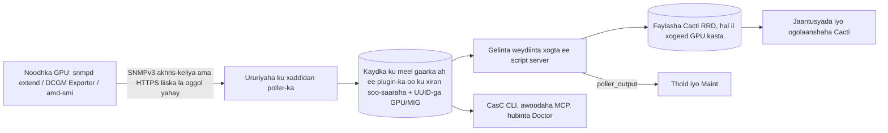

<!-- Source: README.md; SHA256: 97ba37df4a883426d3984ed7d14547ad7367e973411a8abd930409ce259f545b -->

<!-- translations:start -->
[English](../../../README.md) | [简体中文](../zh-CN/README.md) | [हिन्दी](../hi-IN/README.md) | [Español (España)](../es-ES/README.md) | [Español (Latinoamérica)](../es-419/README.md) | [العربية (السعودية)](../ar-SA/README.md) | [Afrikaans](../af-ZA/README.md) | [አማርኛ](../am-ET/README.md) | [العربية (مصر)](../ar-EG/README.md) | [العربية (المغرب)](../ar-MA/README.md) | [বাংলা](../bn-BD/README.md) | [Bosanski](../bs-BA/README.md) | [Deutsch](../de-DE/README.md) | [فارسی](../fa-IR/README.md) | [Filipino](../fil-PH/README.md) | [Français](../fr-FR/README.md) | [Français (Maroc)](../fr-MA/README.md) | [Français (Sénégal)](../fr-SN/README.md) | [Hausa](../ha-NG/README.md) | [עברית](../he-IL/README.md) | [Hrvatski](../hr-HR/README.md) | [Bahasa Indonesia](../id-ID/README.md) | [Igbo](../ig-NG/README.md) | [Italiano](../it-IT/README.md) | [日本語](../ja-JP/README.md) | [한국어](../ko-KR/README.md) | [Malagasy](../mg-MG/README.md) | [मराठी](../mr-IN/README.md) | [Bahasa Melayu](../ms-MY/README.md) | [Nederlands](../nl-NL/README.md) | [Polski](../pl-PL/README.md) | [Português (Brasil)](../pt-BR/README.md) | [Русский](../ru-RU/README.md) | [Kinyarwanda](../rw-RW/README.md) | [Soomaali](README.md) | [Српски](../sr-RS/README.md) | [Svenska](../sv-SE/README.md) | [Kiswahili](../sw-KE/README.md) | [தமிழ்](../ta-IN/README.md) | [తెలుగు](../te-IN/README.md) | [ไทย](../th-TH/README.md) | [Türkçe](../tr-TR/README.md) | [Українська](../uk-UA/README.md) | [اردو](../ur-PK/README.md) | [Tiếng Việt](../vi-VN/README.md) | [isiXhosa](../xh-ZA/README.md) | [Yorùbá](../yo-NG/README.md) | [繁體中文](../zh-TW/README.md) | [isiZulu](../zu-ZA/README.md)
<!-- translations:end -->

# plugin_gpu

Kordhin (plugin) Cacti 1.2 ah oo Cacti keenta isticmaalka GPU-giiba, xusuusta, heerkulka, awoodda korontada, khaladaadka ECC, iyo sababaha xaddidaadda (throttling) ee qalabka NVIDIA iyo AMD. GPU kasta (ama tusaalaha MIG) wuxuu noqdaa tusme (index) weydiin xogeed oo ku jirta aaladda noodhkeeda, si jaantusyada GPU ay ula fadhiistaan jaantusyada kale ee noodhka iyadoo la raacayo ogolaanshaha Cacti, Thold iyo Maint-na ay digniin uga bixin karaan una joojin karaan.

> **Xaaladda: wejiyada 1 ilaa 3 waa lagu hirgeliyay koodhka, weli lama sii deyn.** Wejiga 1 (`nvidia-smi` ee NVIDIA iyada oo loo marayo SNMP extend, dabagalka aqoonsiga, jaantusyada, calaamadaha xaddidaadda iyo ECC, digniinaha Thold iyo Maint, bogga caafimaadka), Wejiga 2 (falanqeeye/macmiil HTTP(S) oo akhris-keliya ah oo loogu talagalay NVIDIA DCGM Exporter iyo falanqeeye `amd-smi` oo loogu talagalay AMD), Wejiga 3 (dabagalka aqoonsiga tusaalooyinka MIG, tiirarka Schema v4, fulinta ururiyaha fog ee ku xaddidan poller-ka, qabsatooyinka `replicate_out` iyo `remote_agent`), CLI-ga hawlwadeenka CasC (`cli/gpu.php`), iyo qabsatooyinka is-dhexgalka nidaamka deegaanka (`abilities_register`, `doctor_register_checks`, `casc_register_providers`) waa la hirgeliyay waxaana lagu daboolay tijaabooyinka unugga, amniga, iyo is-dhexgalka Cacti ee la tuuri karo. Socodsiinta tooska ah ilaa hadda waxay isticmaashaa `snmpd` macmal ah iyo xog tijaabo ah halkii ay ka isticmaali lahayd qalab GPU oo jireed. Waxyaabaha weli furan ka hor calaamadaynta sii deynta: tijaabooyinka qalabka dhabta ah ([docs/pilot-plan.md](../../pilot-plan.md), #54), dib-u-eegista amniga ee dibadda ([docs/security-review.md](../../security-review.md)), xogta tijaabada ee laga qabtay qalab dhab ah (#14), iyo cabbirka lagu sameeyay qalab la mid ah kan wax-soo-saarka ([docs/performance.md](../../performance.md)). Ururinta khaladaadka XID weli way furan tahay iyadoo hoos timaadda go'aanka #8.

## Doorarka gelitaanka

| Aagga (Realm) | Gelitaanka |
| --- | --- |
| GPU View | Boggaga kormeerka ee jira. |
| GPU Operator | Kormeerka iyo bogga Hawlgallada iyo oggolaanshaha kala-soocidda shakhsi ahaaneed. |
| GPU Admin | Gelitaanka hawlwadeenka iyo habaynta jirta iyo tallaabooyinka maamulka. |

Ka dib marka aad koobiyeyso faylasha cusboonaysiinta, u fur bogga Plugins adigoo ah maamule si aad u diiwaangeliso aagga (realm) cusub. Si cad ugu meelalee aagga Operator hoos timaada **Configuration > Users** ama kooxaha isticmaalayaasha. Cusboonaysiintu waxay haystaan aqoonsiyada (IDs) iyo deeqaha aagagga View iyo Admin ee jira. Gelitaanka Admin wuxuu dhaxlaa gelitaanka Operator, gelitaanka Operator-na wuxuu dhaxlaa gelitaanka View codsi kasta; tani kuma darayso deeqo kaydsan isticmaalayaasha ama kooxaha. Dejinta plugin-ka waxay sidoo kale u baahan tahay gelitaanka GPU Admin marka lagu daro ogolaanshaha Settings ee Cacti.

Ogolaanshaha aaladaha Cacti weli waxay xaddidaan safafka iyo tallaabooyinka u furan isticmaale kasta; walxaha aan la khariidadeyn waxay u baahan yihiin maamule. Aqoonsiyada sirta ah, habaynta, khariidadeynta, tirtiridda iyo isbeddellada kale ee maamulka waxay ku sii jiraan boggaga maamulka. Oggolaanshaha (acknowledgments) waxay jiraan oo keliya kalfadhiga hadda ee isticmaalaha, ugu badnaan hal saac iyo inta isla indho-indheyntu ay tahay mid cusub. Indho-indheyn cusub ama isbeddeshay way burisaa iyaga. Weligood cabbir fashilmay uma calaamadeeyaan mid caafimaad qaba mana joojiyaan digniinaha.

## Sababta

Noodhadhka GPU badanaa waxay horay ugu jiraan Cacti si loogu kormeero CPU, xusuusta, iyo is-dhexgallada (interfaces). Caafimaadka GPU waa su'aal gaar ah oo xogta SNMP ee noodhku aanay ka jawaabin: kaarku wuxuu noqon karaa mid heerkul ahaan la xaddiday, urursada khaladaadka ECC, ama soo sheega cillad XID iyadoo noodhka laftiisu u muuqdo mid caafimaad qaba. Qalabka soo-saarayaasha ayaa soo sheega (`nvidia-smi`, DCGM, `amd-smi`), laakiin natiijadoodu waxay ka baxsan tahay jaantusyada, ogolaanshaha, iyo digniinaha Cacti.

Plugin-ku wuxuu buuxiyaa farqigaas isagoo u beddelaya natiijada qalabka soo-saaraha ilo xogeed oo Cacti ah, oo lagu fureeyo aqoonsiga GPU kasta halkii booskiisa lagu furayn lahaa, si dib-u-bilow (reboot) dib u habeynaya GPU-yada uusan taariikhda hal kaar ugu xirin mid kale. Wuxuu dib u isticmaalaa jaantusyada, ogolaanshaha, ururiyayaasha xogta ee fogfog, Thold, iyo Maint ee Cacti halkii uu ka dhisi lahaa noocyo u dhigma oo gaar ah.

## Baaxadda la qorsheeyay

| Weji | Baaxad | Xaaladda | Marxaladaha (Milestones) |
|---|---|---|---|
| 0, cilmi-baaris | Natiijada qalabka soo-saaraha, calaamadaha XID iyo xaddidaadda, aqoonsiga GPU, mudnaanta, go'aanka dariiqa ururinta | Dhammaaday | [M1](https://github.com/somethingwithproof/plugin_gpu/milestone/1) |
| 1, nvidia | Ururinta `nvidia-smi`, liiska agabka ee UUID, jaantusyada, calaamadaha xaddidaadda iyo ECC, Thold iyo Maint, bogga caafimaadka | La hirgeliyay (lagu tijaabiyay xog tijaabo ah) | [M2](https://github.com/somethingwithproof/plugin_gpu/milestone/2), [M3](https://github.com/somethingwithproof/plugin_gpu/milestone/3), [M4](https://github.com/somethingwithproof/plugin_gpu/milestone/4) |
| 2, hababka dambe (backends) | Falanqeeye/macmiil HTTP(S) akhris-keliya ah oo DCGM Exporter (`lib/DcgmExporterParser.php`, `lib/DcgmExporterClient.php`), falanqeeye AMD `amd-smi` (`lib/AmdSmiParser.php`) | La hirgeliyay (lagu tijaabiyay unugga) | [M5](https://github.com/somethingwithproof/plugin_gpu/milestone/5) |
| 3, mig, meel fog, iyo nidaamka deegaanka | Dabagalka aqoonsiga tusaalooyinka MIG, ururiyayaasha xogta ee fogfog (`INFO`, `poller_gpu.php --poller=N`, `replicate_out`, `remote_agent`), CasC CLI (`cli/gpu.php`), qabsatooyinka MCP/Doctor/CasC | La hirgeliyay (lagu tijaabiyay unugga iyo is-dhexgalka CI) | [M6](https://github.com/somethingwithproof/plugin_gpu/milestone/6) |

Waxyaabaha ka baxsan baaxadda: amar kasta oo beddela GPU ama noodh (saacadaha, xadka awoodda, dib-u-dejinta, qaab-dhismeedka MIG), matoor digniin oo plugin-ku leeyahay, daemon gaar ah ama borotokool shabakadeed, iyo jadwaleeye ama xisaabinta shaqooyinka. Eeg qorshaha si aad u aragto hawlaha cilmi-baarista ee dhiman.

## Waxa marxaladda 4 ku darto

- **Ururiyaha akhris-keliya ee NVIDIA DCGM Exporter** (`lib/DcgmExporterParser.php`, `lib/DcgmExporterClient.php`). Wuxuu falanqeeyaa cabbirrada bandhigga qoraalka ee Prometheus (`DCGM_FI_DEV_GPU_UTIL`, `DCGM_FI_DEV_FB_USED`, `DCGM_FI_DEV_FB_FREE`, `DCGM_FI_DEV_POWER_USAGE`, `DCGM_FI_DEV_GPU_TEMP`, `DCGM_FI_DEV_ECC_DBE_VOL_TOTAL`, `DCGM_FI_DEV_CLOCK_THROTTLE_REASONS`, iyo calaamadaha MIG ee `GPU_I_ID` iyo `GPU_I_PROFILE`). Macmiilka HTTP(S) wuxuu dhaqan-geliyaa liis cad oo martigeliye/CIDR ah oo loo oggol yahay barta dhammaadka, wuxuu si caadi ah u hubiyaa shahaadooyinka TLS, wuxuu xaddidaa waqtiga dhammaadka iyo cabbirka jawaabta, wuxuu damiyaa dib-u-hagista, wuuna diidaa nidaamyada aan HTTP(S) ahayn.
- **Falanqeeyaha akhris-keliya ee AMD `amd-smi`** (`lib/AmdSmiParser.php`). Wuxuu u mideeyaa natiijada JSON/SNMP-extend ee `amd-smi` (isticmaalka, VRAM, awoodda, heerkulka isgoyska/geeska, ECC, xogta qaybinta, iyo ururiyayaasha xaddidaadda ee gaarka ah iyada oo loo marayo `Reading::$vendorExtensions`) qaabka cabbirka guud ee hoos yimaada `Vendor::Amd`.
- **Dabagalka tusaalooyinka MIG iyo Schema v4** (`lib/GpuReport.php`, `lib/GpuSnapshot.php`, `lib/GpuRecord.php`, `lib/Schema.php`, `lib/ScriptServer.php`). Wuxuu la socdaa UUID-yada tusaalooyinka MIG (`MIG-<uuid>` iyo `MIG-GPU-<parent>/<gi>/<ci>`), `mig_mode`, `mig_instance_id`, `mig_profile`, `parent_uuid`, iyo `partition_info` oo ay weheliyaan GPU-yada waalidka iyadoo furayaasha aqoonsiga aan isbeddelin (`vendor`, `uuid`, `parent_uuid`) la ilaaliyo marka wax la cusboonaysiinayo lana hubiyo ka hor weydiimaha xogta.
- **Ururiyayaasha xogta ee fogfog** (`INFO`, `poller_gpu.php`, `lib/Poller.php`, `lib/ReplicationRepository.php`, `setup.php`). Wuxuu ku dhawaaqaa `remote_collect:1, remote_poller:1` gudaha `INFO`, wuxuu taageeraa fulinta ku xaddidan poller-ka iyada oo loo marayo `php plugins/gpu/poller_gpu.php --poller=N`, wuxuu ka boodaa samaynta walxaha Cacti ee poller-rada aan ahayn kan ugu muhiimsan, wuxuu ku celceliyaa miisaska ku xaddidan poller-ka iyada oo loo marayo `replicate_out`, wuxuuna uga jawaabaa falalka akhris-keliya ee `gpu_health` iyo `gpu_inventory` iyada oo loo marayo `remote_agent`.
- **CLI-ga Hawlwadeenka iyo CasC** (`cli/gpu.php`, `lib/CascProvider.php`). Wuxuu ku shaqeeyaa PHP 8.2+ (lagu falanqayn karo PHP 8.0) iyada oo aan lahayn ku-tiirsanaan Composer oo dibadda ah: `php plugins/gpu/cli/gpu.php export [--format=yaml|xml]`, `validate <file> [--format=yaml|xml]`, `plan <file> [--format=yaml|xml] [--output=text|json]`, `apply <file> --confirm=<PLAN_HASH> [--format=yaml|xml]`, iyo `health [--format=text|json]`. Qorshayaashu waxay xisaabiyaan hash xaqiijin SHA-256 oo go'an, apply wuxuu si adag u fashilmaa haddii hash-ku iswaafaqi waayo, falanqaynta XML-kuna waxay diiddaa ku dhawaaqista `DOCTYPE` iyo `ENTITY`.
- **Qabsatooyinka is-dhexgalka nidaamka deegaanka** (`lib/EcosystemIntegration.php`, `setup.php`). Wuxuu diiwaangeliyaa `abilities_register` (`gpu-list-nodes`, `gpu-list-devices`, `gpu-get-health`; akhris-keliya, kuna xaddidan aagga `GPU View` iyo ogolaanshaha aaladda Cacti), `doctor_register_checks` (`gpu_schema`, `gpu_poller_freshness`, `gpu_node_health`), iyo `casc_register_providers`.
- **Sababaha xaddidaadda iyo ECC oo ah qiyam digniin** ([docs/metrics.md](../../metrics.md)). Wuxuu u fasiraa maaskiga dhacdada saacadda tilmaamayaasha 0/1 wuxuuna xisaabiyaa khaladaadka ECC ee cusub ee la saxay/aan la sixin muddo kasta sidii cabbirro (gauges) si Thold 1.8.2 iyo Maint 1.3 ay digniin u bixiyaan una joojiyaan iyada oo aan lahayn tiro-koob taban ama koror kedis ah marka dib loo dejiyo ([docs/alerting.md](../../alerting.md)).
- **GPU Health, ogolaanshaha, fashilka/soo-celinta, iyo cabbirka.** GPU Health (GPU View) wuxuu muujiyaa cusboonaanta kaydsan, natiijada ururintii u dambeysay, xaaladda Maint, habka dambe, noocyada, iyo maaskiga cayriin ee xaddidaadda iyada oo aan lala xiriirin noodhadhka. Tijaabooyin qoran oo dhammeystiran waxay xaqiijiyaan ogolaanshaha, ka soo kabashada fashilka wakiilka/DB/RRD ([docs/backup.md](../../backup.md)), iyo socodsiin cabbirkeedu yahay 100-GPU gudaha CI ([docs/performance.md](../../performance.md), [docs/operations.md](../../operations.md), [CHANGELOG.md](../../../CHANGELOG.md)).

## Waxa marxaladda 3 ku darto

- **Ururinta iyada oo loo marayo SNMP extend** ([ADR 0008](../../decisions/0008-collect-through-snmp-extend.md)). Maamulaha noodhku wuxuu ku daraa laba sadar oo `extend` ah oo go'an faylka `snmpd.conf` ([docs/node-setup.md](../../node-setup.md)); plugin-ku wuxuu akhriyaa NET-SNMP-EXTEND-MIB isagoo adeegsanaya hawlaha SNMP ee Cacti oo wata aqoonsiyada sirta ah ee aaladda lafteeda, iyadoo SNMPv3 la door bidayo. Waxba kama socodsiiyo serfarka Cacti ama noodhka.
- **Falanqayn adag (Strict parsing).** Goobaha xogta waxaa loo akhriyaa iyadoo la eegayo booska, sadar kasta wuxuu ku magacaabaa GPU-giisa UUID, waxaana xaalad bixitaan oo aan eber ahayn, waqti-dhammaad, natiijo go'an, sadar leh tiro goobood oo khaldan, ama qoraal khalad ah oo isku dhafan ay fashiliyaan ururinta oo dhan: qiyamku waxay noqdaan `U`, GPU looma calaamadeeyo maqan, GPU Nodes-na wuxuu muujiyaa sababta.
- **Ururiye ka dib wareeg kasta oo poller ah.** Wuxuu akhriyaa wakiilka noodh kasta oo shidan, wuxuu cusboonaysiiyaa diiwaannada aqoonsiga, wuxuuna ku kaydiyaa muunaddii ugu dambeysay kaydka ku meel gaarka ah. Gelinta script server-ku waxay akhridaa kaydkaas ku meel gaarka ah oo keliya, si codeynta (poll) Cacti aanay weligeed u sugin noodh GPU.
- **Walxaha Cacti** ([ADR 0010](../../decisions/0010-attach-to-existing-node-devices.md)). Moodooyinka iyo weydiinta xogta ee *GPU - Devices* waxay ku yimaadaan sidii XML waxaana la soo dejiyaa marka la rakibayo iyo marka la cusboonaysiinayo. Kaydinta noodhku waxay ku xirtaa weydiinta xogta aaladdiisa jirta iyadoo habka dib-u-tusmaynta (reindex) uu yahay None; GPU Nodes wuxuu abuuri karaa aalad oo keliya marka noodhku aanu lahayn midna. GPU kasta waa tusme lagu fureeyay soo-saaraha iyo UUID, iyadoo hal il xogeed ay wadaagaan jaantusyadiisa Utilization, Memory, Temperature, Power, Power Percent, Clocks, Throttle, ECC Errors, New ECC Errors, Retired Pages, iyo Sample Age. Goob kasta oo moodelka ka mid ah waxaa sawira jaantus uun, sababtoo ah Cacti wuxuu kaydiyaa oo keliya goobaha uu jaantus isticmaalo. Plugin-ku wuxuu dib-u-tusmayn sameeyaa isbeddel kasta oo GPU ka dib, wuxuu hayaa dib-u-tusmayn uu Cacti ka booday intii aaladdu ahayd Down ama dansan wuxuuna socodsiiyaa marka aaladdu noqoto Up, wuxuuna jaantusyo u abuuraa GPU-yada cusub.
- **Taariikhdu waxay la joogtaa kaarka.** GPU maqan wuxuu sii ahaadaa tusme, si jaantusyadiisu u muujiyaan farqi oo ay uga sii socdaan isla faylka RRD marka uu soo noqdo. Kaar beddel ah oo ku jira isla booska wuxuu helaa il xogeed u gaar ah. **Remove from Data Query** oo ku taal bogga noodhku waxay ka saartaa GPU maqan liiska; faylashiisa RRD iyo jaantusyadiisa waa la hayaa ilaa aad adigu tirtirto.
- **Ogolaanshaha aaladda ee GPU Nodes.** GPU Admin wuxuu arkaa, beddelaa, dhoofiyaa, oo u dhaqaajiyaa oo keliya noodhadhka iyo GPU-yada ku yaalla aaladaha ay u oggol yihiin inay ku arkaan Cacti; dhaqaajinta GPU waxay u baahan tahay labada noodhba. Noodh aaladdiisa la tirtiray waa la damin karaa ama waa la tirtiri karaa.
- **Moodelka cabbirka guud** ([ADR 0009](../../decisions/0009-common-metric-core-with-vendor-extensions.md), [docs/metrics.md](../../metrics.md)). Xusuustu waxay ku jirtaa bytes, maaskiga dhacdada saacadda waxaa loo fasiraa tilmaamayaasha `thr_*`, `age`-na waa da'da waqtiga muunadda ee GPU-ga laftiisa, ama `U` marka aan la aqoon.

Isticmaalaha rakibaya (web server) waa inuu awoodaa inuu wax ku qoro `<cacti>/resource/script_server/`, halkaas oo plugin-ku dhigo XML-kiisa weydiinta xogta; haddii kale rakibidda iyo cusboonaysiintu way istaagaan iyagoo soo saaraya farriin waxayna isku dayaan mar kale isku dayga xiga. Ka-saaristu waxay tirtirtaa moodooyinka iyo XML-ka oo keliya marka *Remove the plugin's Cacti objects on uninstall* la calaamadeeyo, weligeedna ma tirtirto faylasha RRD, aaladaha, jaantusyada, ama ilaha xogta ([docs/operations.md](../../operations.md#uninstall)). Noodhadhka ku yaalla ururiyayaasha xogta ee fogfog waxay ku shaqeeyaan baaxadda `poller_id`-ga loo qoondeeyay.

## Waxa marxaladda 2 soo saarto

- **Rakibid ilaalin leh.** Marka PHP ka hooseeyo 8.2, rakibidda iyo shididda waa la diidaa iyadoo la soo saarayo farriin magacaabaysa nooca loo baahan yahay, inta kale ee Cacti-na way sii shaqeysaa. `setup.php` iyo qoraallada boggu waxay ku falanqeeyaan PHP 8.0.
- **Wareegga nolosha.** Rakib, cusboonaysii, dami, oo ka saar adigoo adeegsanaya bogga Plugins ee Cacti. Cusboonaysiintu waa kuwo kala horreeya, way dhammaadaan ka dib hakad, waxayna beddelaan nooca diiwaangashan oo keliya ka dib marka ay guuleystaan. Ka-saaristu waxay haysaa miisaska plugin-ka ilaa aad ka saarto calaamadda *Keep Plugin Tables on Uninstall*; weligeed ma taabato aalad Cacti, il xogeed, jaantus, ama fayl RRD.
- **Aagag kala gaar ah.** *GPU Admin* wuxuu furaa **GPU Nodes**, halkaas oo aad ka diiwaangeliso aaladaha Cacti sidii noodhadh GPU, aad ku xaqiijiso ama ku diiddo dhaqaajinta GPU ee u dhexeysa noodhadhka, aadna u dhoofiso diiwaan kasta sidii JSON. *GPU View* wuxuu furaa **GPU Inventory**, kaasoo taxaya GPU-yada ku jira aaladaha daawaduhu arki karo oo keliya. Labada bogguba waxay hoos yimaadaan Management, isbeddel kastaana waa POST ay hubisay csrf-magic.
- **Diiwaannada aqoonsiga GPU.** GPU kasta waxaa lagu fureeyay soo-saaraha iyo UUID. Tusmada, PCI bus ID, magaca, darawalka, iyo qalabka warbixinta soo saaraya waa sifooyin isla meeshooda ku beddelma. UUID cusub oo ku jira boos la yaqaan waxaa loo calaamadeeyaa sidii beddelaad suurtagal ah wuxuuna bilaabaa taariikh u gaar ah; GPU lagu arkay noodh kale wuxuu guuraa oo keliya marka hawlwadeen xaqiijiyo; GPU ka maqan ururinnada guuleystay waxaa loo calaamadeeyaa maqan ka dib tiro la habeyn karo weligiisna lama tirtiro. Kaliya UUID-yada GPU-ga dhammeystiran ee NVIDIA ayaa la aqbalaa hadda; tusaalooyinka MIG waxay sugayaan go'aanka #13, AMD-na cilmi-baarista #19. Xeerarka waxaa lagu tijaabiyaa taxaneyaal xog tijaabo ah, maadaama aanu jirin ururiye weli xog siiya.
- **Tijaabooyinka iyo CI.** Qaybaha tijaabada unugga iyo xeerarka isha iyada oo aan la haysan GPU ama database, hubinta wareegga nolosha iyo ogolaanshaha bogga ee ka dhanka ah Cacti 1.2.31 iyo 1.2.x hadda jira ee PHP 8.2 ilaa 8.5, hawl diidmo ah oo PHP 8.1 ah, hubinta (lint) PHP 8.0 ee meelaha laga galo, PHPStan heerka 9, iyo REUSE. Qalabka tijaabadu waa ku meel gaar ilaa #12 go'aan laga gaaro.

### Rakibidda qiimeynta

Tallaabooyinkani waxay rakibayaan koodhka hadda jira si loo tijaabiyo; [docs/operations.md](../../operations.md) ayaa leh hagaha dhammeystiran ee hawlwadeenka. Waxay u baahan yihiin Cacti 1.2.31 ama ka dambeeya oo ku shaqeynaya PHP 8.2 ama ka dambeeya.

1. U koobiyee kaydka (repository) galka `plugins/gpu` ee hoos yimaada galka Cacti. Galka waa in loo bixiyaa `gpu`.
2. Gudaha Cacti, fur **Configuration > Plugins**, ka dibna rakib oo shid **GPU**.
3. Sii isticmaalayaasha aagga *GPU View*, *GPU Operator*, ama *GPU Admin* hoos timaada **Configuration > Users**, iyadoo loo eegayo doorkooda. Isticmaalaha rakibaya wuxuu helaa View iyo Admin; Admin waxaa ku jira gelitaanka Operator.
4. U diyaari wakiilka SNMP ee noodh kasta oo GPU sida lagu sharraxay [docs/node-setup.md](../../node-setup.md), ka dibna ku dar noodhka hoos timaada **Management > GPU Nodes**.
5. Digniinaha, soo deji moodooyinka Thold ee la soo raaciyay sida [docs/alerting.md](../../alerting.md) ku qeexan.
6. Ikhtiyaar ahaan u hagaaji **Configuration > Settings > GPU**: *Mark Absent After* (caadigu waa 3 ururin oo guuleystay, laga bilaabo 1 ilaa 100), *Stale After* (inta ay da'da muunaddu noqon karto ka hor inta qiyamkeedu daabicin `U`), iyo *Keep Plugin Tables on Uninstall* (caadigu waa shidan).

## Sida cabbirradu u gaaraan Cacti

Go'aanka [#7](https://github.com/somethingwithproof/plugin_gpu/issues/7) wuxuu doortay SNMP `extend` ([ADR 0008](../../decisions/0008-collect-through-snmp-extend.md)): wakiilka noodhka laftiisa ayaa socodsiiya amar go'an oo `nvidia-smi` ah plugin-kuna wuxuu akhriyaa natiijada oo keliya. Qorshuhu wuxuu isbarbar dhigayaa ikhtiyaarrada hoos yimaada [Collection paths](../../PLAN.md#collection-paths).

## Bartilmaameedyada iswaafaqsanaanta

| Qayb | Bartilmaameed |
|---|---|
| Cacti | 1.2.31 ama ka dambeeya, iyada oo aan lahayn wax ka beddel xuddunta ah (core patches) |
| PHP | 8.2 ama ka dambeeya; `setup.php` wuxuu ku sii ahaadaa mid lagu falanqeyn karo 8.0 si nidaamka socodsiinta aan la taageerin uu u helo diidmo halkii uu ka heli lahaa Cacti UI jaban |
| NVIDIA | Noocyada darawalka iyo qalabka waxaa dejin doona cilmi-baarista [#26](https://github.com/somethingwithproof/plugin_gpu/issues/26); aqoonsiyada goobaha DCGM waxaa lagu hubiyay v3.3.9 iyo v4.7.0 |
| AMD | `amd-smi` oo ku saabsan sii-deynta ROCm ee ay dejin doonto cilmi-baarista [#26](https://github.com/somethingwithproof/plugin_gpu/issues/26) |
| Thold, Maint | Thold 1.8.2 iyo Maint 1.3, aan waxba laga beddelin, si dhammeystiran loo tijaabiyay ([docs/alerting.md](../../alerting.md)) |

## Naqshadda

- [docs/PLAN.md](../../PLAN.md) waa qorshaha buuxa: qaab-dhismeedka, xaqiiqooyinka ilaha sare ee uu ku tiirsan yahay (oo wata ilo), moodelka aqoonsiga, xuduudaha amniga, xisaabinta waxqabadka, tijaabinta, iyo khataraha.
- [docs/decisions/](../../decisions) waxay haysaa diiwaannada go'aannada qaab-dhismeedka ee doorashooyinka horay loo sameeyay.
- [docs/REQUIREMENTS.md](../../REQUIREMENTS.md) waxay ku xirtaa aqoonsi shuruudeed kasta arrintiisa (issue).

## Sida shaqada loola socdo

- **Marxaladaha (Milestones)** waxay raacaan marxaladaha qorshaha. Mid kasta wuxuu leeyahay arrin weyn (epic issue) oo taxaysa arrimaha hoose iyo caddaynta bixitaanka.
- **Arrimaha (Issues)** waxaa lagu kala soocaa calaamado: `type: requirement`, `type: research`, `type: decision`, `type: epic`. Arrimaha shuruuduhu waxay sheegaan shuruudo tiro leh oo la tijaabin karo (`REQ-AREA-NNN`) iyo shuruudaha aqbalaadda.
- **Calaamaduhu** waxay sidoo kale sitaan `area:`, `phase:`, `priority:`, iyo `status:`. Eeg [CONTRIBUTING.md](../../../CONTRIBUTING.md#labels).
- [Guddiga mashruuca](https://github.com/users/somethingwithproof/projects/9) wuxuu muujinayaa dhammaan arrimaha marxaladaha oo dhan.

## Wax ku darsashada

Akhri [CONTRIBUTING.md](../../../CONTRIBUTING.md). Gudbinta (commits) waxay u baahan yihiin saxiixa DCO. Doodaha naqshadda waxay ka dhacaan arrimaha (issues); go'aannada furan waxay sitaan calaamadda `type: decision`. Natiijooyinka laga qabtay qalabka GPU ee dhabta ah waa wax ku darsashada ugu faa'iidada badan ee marxaladda 1; marka hore ka saar magacyada martigeliyayaasha (hostnames), lambarada taxanaha ah, iyo UUID-yada.

## Amniga

Ku soo sheeg nuglaanshaha si qarsoodi ah; eeg [SECURITY.md](../../../SECURITY.md).

## Shatiga

GNU General Public License v2.0, isla shatiga ay leeyihiin Cacti iyo plugin-yadiisa. Eeg [LICENSE](../../../LICENSE).
