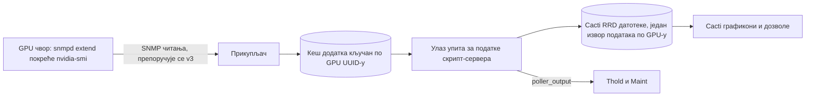

<!-- Source: README.md; SHA256: 126deef1783d64f878bf565f1433c10f31aef828eb9bc313aeff2b0335e54c7c -->

<!-- translations:start -->
[English](../../../README.md) | [简体中文](../zh-CN/README.md) | [हिन्दी](../hi-IN/README.md) | [Español (España)](../es-ES/README.md) | [Español (Latinoamérica)](../es-419/README.md) | [العربية (السعودية)](../ar-SA/README.md) | [Afrikaans](../af-ZA/README.md) | [አማርኛ](../am-ET/README.md) | [العربية (مصر)](../ar-EG/README.md) | [العربية (المغرب)](../ar-MA/README.md) | [বাংলা](../bn-BD/README.md) | [Bosanski](../bs-BA/README.md) | [Deutsch](../de-DE/README.md) | [فارسی](../fa-IR/README.md) | [Filipino](../fil-PH/README.md) | [Français](../fr-FR/README.md) | [Français (Maroc)](../fr-MA/README.md) | [Français (Sénégal)](../fr-SN/README.md) | [Hausa](../ha-NG/README.md) | [עברית](../he-IL/README.md) | [Hrvatski](../hr-HR/README.md) | [Bahasa Indonesia](../id-ID/README.md) | [Igbo](../ig-NG/README.md) | [Italiano](../it-IT/README.md) | [日本語](../ja-JP/README.md) | [한국어](../ko-KR/README.md) | [Malagasy](../mg-MG/README.md) | [मराठी](../mr-IN/README.md) | [Bahasa Melayu](../ms-MY/README.md) | [Nederlands](../nl-NL/README.md) | [Polski](../pl-PL/README.md) | [Português (Brasil)](../pt-BR/README.md) | [Русский](../ru-RU/README.md) | [Kinyarwanda](../rw-RW/README.md) | [Soomaali](../so-SO/README.md) | [Српски](README.md) | [Svenska](../sv-SE/README.md) | [Kiswahili](../sw-KE/README.md) | [தமிழ்](../ta-IN/README.md) | [తెలుగు](../te-IN/README.md) | [ไทย](../th-TH/README.md) | [Türkçe](../tr-TR/README.md) | [Українська](../uk-UA/README.md) | [اردو](../ur-PK/README.md) | [Tiếng Việt](../vi-VN/README.md) | [isiXhosa](../xh-ZA/README.md) | [Yorùbá](../yo-NG/README.md) | [繁體中文](../zh-TW/README.md) | [isiZulu](../zu-ZA/README.md)
<!-- translations:end -->

# plugin_gpu

Додатак за Cacti 1.2 који у Cacti доноси искоришћеност, меморију, температуру, потрошњу енергије, ECC грешке и разлоге пригушивања по GPU-у из NVIDIA алата. Подршка за AMD и прикупљање XID грешака су планирани, али још нису имплементирани. Сваки GPU постаје индекс упита за податке на уређају свог чвора, па се графикони GPU-а налазе поред осталих графикона чвора под Cacti дозволама, а Thold и Maint могу да покрећу упозорења и да их потискују.

> **Статус: у развоју, није објављено.** Прекретница 4 довршава кôд за фазу 1 (NVIDIA путем SNMP extend): прикупљање, идентитет, графиконе, сигнале пригушивања и ECC-а, упозоравање преко додатака Thold и Maint, страницу исправности и документацију за оператере. Додатак је до сада покретан само против стварног `snmpd` сервиса са лажним `nvidia-smi` алатом који исписује синтетички излаз, никада на стварном GPU хардверу. Пре објаве још су отворени: пилот-тестирања на стварном хардверу ([docs/pilot-plan.md](../../pilot-plan.md), #54), спољашњи безбедносни преглед ([docs/security-review.md](../../security-review.md)), тестни узорци снимљени из стварних алата (#14) и мерење скалирања на хардверу продукцијске величине ([docs/performance.md](../../performance.md)). XID грешке чекају одлуку #8. Немојте га користити у продукцији.

## Улоге приступа

| Подручје овлашћења | Приступ |
| --- | --- |
| GPU View | Постојеће странице за надзор. |
| GPU Operator | Надзор плус страница GPU операције и личне потврде тријаже. |
| GPU Admin | Приступ оператера плус постојеће радње конфигурације и администрације. |

Након копирања датотека за надоградњу, отворите страницу Plugins као администратор да региструјете ново подручје овлашћења. Изричито доделите подручје Operator под **Configuration > Users** или корисничким групама. Надоградње задржавају постојеће ID-ове и доделе за подручја View и Admin. Admin приступ наслеђује Operator приступ, а Operator приступ наслеђује View приступ при сваком захтеву; тиме се не додају сачуване доделе корисницима или групама. Подешавања додатка такође захтевају GPU Admin приступ поред Cacti дозволе за Settings.

Cacti дозволе за уређаје и даље ограничавају редове и радње доступне сваком кориснику; немапирани објекти захтевају администратора. Приступни подаци, конфигурација, мапирање, брисање и друге административне измене остају на административним страницама. Потврде трају само у тренутној корисничкој сесији, највише један сат и само док исто запажање остаје свеже. Нова или измењена запажања их поништавају. Оне никада не означавају неуспешно мерење исправним нити потискују упозорења.

## Зашто

GPU чворови су обично већ у Cacti-ју ради праћења CPU-а, меморије и мрежних интерфејса. Исправност GPU-а је посебно питање на које SNMP подаци чвора не дају одговор: картица може бити термички пригушена, нагомилавати ECC грешке или пријавити XID квар док сам чвор делује исправно. Алати произвођача то пријављују (`nvidia-smi`, DCGM, `amd-smi`), али њихов излаз остаје изван Cacti графикона, дозвола и упозоравања.

Додатак затвара тај јаз претварајући излаз алата произвођача у Cacti изворе података, индексиране према идентитету сваког GPU-а уместо према његовом положају, тако да поновно покретање које промени редослед GPU-ова не припаја историју једне картице другој. Поново користи Cacti графиконе, дозволе, удаљене прикупљаче података, Thold и Maint уместо да гради њихове паралелне верзије.

## Планирани обим

| Фаза | Обим | Прекретнице |
|---|---|---|
| 0, истраживање | Излаз алата произвођача, XID и сигнали пригушивања, идентитет GPU-а, привилегије, одлука о путањи прикупљања | [M1](https://github.com/somethingwithproof/plugin_gpu/milestone/1) |
| 1, nvidia | Прикупљање путем `nvidia-smi`, инвентар по UUID-у, графикони, сигнали пригушивања, ECC-а и XID-а, Thold и Maint, страница исправности | [M2](https://github.com/somethingwithproof/plugin_gpu/milestone/2), [M3](https://github.com/somethingwithproof/plugin_gpu/milestone/3), [M4](https://github.com/somethingwithproof/plugin_gpu/milestone/4) |
| 2, позадински системи | DCGM позадински систем, `amd-smi` позадински систем | [M5](https://github.com/somethingwithproof/plugin_gpu/milestone/5) |
| 3, mig и удаљено | MIG инстанце, Cacti удаљени прикупљачи података | [M6](https://github.com/somethingwithproof/plugin_gpu/milestone/6) |

Изван обима: свака команда која мења GPU или чвор (тактови, ограничења снаге, ресетовања, MIG распоред), сопствени систем упозоравања у додатку, прилагођени демон или мрежни протокол и планер послова или обрачун задатака. За списак истраживачких задатака погледајте план.

## Шта доноси прекретница 4

- **Разлози пригушивања као вредности за упозорења.** Маска догађаја такта декодира се у по један индикатор вредности 0 или 1 за сваки разлог; непозната маска даје непознате индикаторе, никада нуле, а битови без индикатора остају у сировој маски коју приказује Исправност GPU-а.
- **ECC као вредности за упозорења** ([docs/metrics.md](../../metrics.md)). Нове исправљене и неисправљене грешке од претходног узорка додатак израчунава из два узастопна укупна броја и чува као мерне вредности (gauge): непознато за први узорак, пропуштено очитавање или поновно учитавање драјвера, тако да се ресетовање никада не очитава као нула или негативан број. Читају се и бројеви повучених једнобитних и двобитних страница меморије, као и ECC режим. Два додатна ECC графикона по GPU-у омогућавају Cacti-ју да их сачува; заједно са Power Percent, укупно има једанаест графикона. XID се не прикупља: ниједан извор не одговара фиксним `nvidia-smi` командама (#8).
- **Thold и Maint** ([docs/alerting.md](../../alerting.md)). Испоручени Thold шаблони за температуру, снагу у односу на ограничење, индикаторе пригушивања, нове неисправљене ECC грешке, странице на чекању за повлачење и старост узорка. Свака вредност је gauge зато што Thold 1.8.2 отказује на непознатом бројачу. Тест од краја до краја са неизмењеним Thold 1.8.2 и Maint 1.3 показује активирање и опоравак сваког прага, укључујући и преко ECC ресетовања, као и потискивање путем додатка Maint.
- **Исправност GPU-а** (GPU View). По чвору: свежина, како се последње прикупљање завршило, стање Maint-а, позадински систем, верзије алата и драјвера и број GPU-ова; по GPU-у: присутност, старост узорка, ECC стање и сирова маска. Страница чита искључиво сачуване записе.
- **Дозволе.** Пакет тестова дозвола покрива сваку датотеку странице и радњу, опозив при следећем захтеву и одбијања која не откривају ништа.
- **Квалификација кварова и опоравка.** Скриптована покретања од краја до краја прекидају агент, приступне податке, алат, његов излаз, везу са базом података и упис у RRD, а затим враћају базу података из резервне копије, укључујући и копију старију од RRD датотека; нови GPU никада не наслеђује RRD датотеку другог GPU-а ([docs/backup.md](../../backup.md)).
- **Скалирање** ([docs/performance.md](../../performance.md)). Тест скалирања мери трајање прикупљања, улаза скрипт-сервера, креирања Cacti објеката, једног циклуса полера и странице исправности при задатом броју GPU-ова; CI га покреће са 100 GPU-ова. Мерења за 1.000 и 8.000 GPU-ова још нису забележена, па се не наводи подржани број GPU-ова.
- **Документација за оператере** ([docs/operations.md](../../operations.md)): инсталација, надоградња, деинсталација, принцип најмањих привилегија, недоступне вредности и решавање проблема. Измене су наведене у [CHANGELOG.md](../../../CHANGELOG.md).

## Шта доноси прекретница 3

- **Прикупљање путем SNMP extend** ([ADR 0008](../../decisions/0008-collect-through-snmp-extend.md)). Администратор чвора додаје две фиксне `extend` линије у `snmpd.conf` ([docs/node-setup.md](../../node-setup.md)); додатак чита NET-SNMP-EXTEND-MIB путем Cacti SNMP функција са сопственим приступним подацима уређаја, при чему се препоручује SNMPv3. Не покреће ништа на Cacti серверу ни на чвору.
- **Строго парсирање.** Поља се читају по позицији, свака линија именује свој GPU преко UUID-а, а излазни статус различит од нуле, истек времена, скраћен излаз, линија са погрешним бројем поља или измешан текст грешке обарају цело прикупљање: вредности постају `U`, ниједан GPU се не означава као одсутан, а GPU чворови приказују разлог.
- **Прикупљач после сваког циклуса полера.** Чита агент сваког омогућеног чвора, ажурира записе идентитета и кешира најновији узорак. Улаз скрипт-сервера чита само тај кеш, тако да Cacti poll никада не чека на GPU чвор.
- **Cacti објекти** ([ADR 0010](../../decisions/0010-attach-to-existing-node-devices.md)). Шаблони и упит за податке *GPU - Devices* испоручују се као XML и увозе при инсталацији и надоградњи. Чување чвора додаје упит за податке на постојећи уређај са методом поновног индексирања None; GPU чворови могу да креирају уређај само када чвор још нема ниједан. Сваки GPU је индекс кључан по произвођачу и UUID-у, са једним извором података који деле графикони Utilization, Memory, Temperature, Power, Power Percent, Clocks, Throttle, ECC Errors, New ECC Errors, Retired Pages и Sample Age. Свако поље модела исцртава неки графикон, јер Cacti чува само поља која неки графикон користи. Додатак поново индексира након сваке промене GPU-а, памти поновно индексирање које је Cacti прескочио док је уређај био Down или онемогућен и покреће га чим уређај буде Up, и креира графиконе за нове GPU-ове.
- **Историја остаје уз картицу.** Одсутан GPU остаје индекс, па његови графикони приказују прекид и настављају у истој RRD датотеци када се врати. Заменска картица у истом слоту добија сопствени извор података. **Remove from Data Query** на страници чвора уклања одсутан GPU са списка; његове RRD датотеке и графикони остају сачувани док их не обришете.
- **Дозволе уређаја на страници GPU чворови.** GPU администратор види, мења, извози и премешта само чворове и GPU-ове на уређајима које сме да види у Cacti-ју; премештање GPU-а захтева дозволу за оба чвора. Чвор чији је уређај обрисан може да се онемогући или обрише.
- **Заједнички модел метрика** ([ADR 0009](../../decisions/0009-common-metric-core-with-vendor-extensions.md), [docs/metrics.md](../../metrics.md)). Меморија је у бајтовима, маска догађаја такта декодира се у `thr_*` индикаторе, а `age` је старост времена узорка самог GPU-а или `U` када је непозната.

Корисник који врши инсталацију (веб-сервер) мора да има право уписа у `<cacti>/resource/script_server/`, где додатак смешта своју XML датотеку упита за податке; у супротном се инсталација и надоградња заустављају са поруком и покушавају поново при следећем покретању. Деинсталација уклања шаблоне и XML датотеку само када је означена опција *Remove the plugin's Cacti objects on uninstall* и никада не брише RRD датотеке, уређаје, графиконе ни изворе података ([docs/operations.md](../../operations.md#uninstall)). Чворови на удаљеним прикупљачима података не прикупљају се до фазе 3.

## Шта испоручује прекретница 2

- **Заштићена инсталација.** На верзијама PHP-а старијим од 8.2 инсталација и омогућавање се одбијају уз поруку која наводи потребну верзију, док остатак Cacti-ја наставља да ради. `setup.php` и скрипте страница пролазе синтаксну проверу на PHP 8.0.
- **Животни циклус.** Инсталација, надоградња, онемогућавање и деинсталација кроз Cacti страницу Plugins. Надоградње су редоследне, довршавају се после прекида и мењају забележену верзију тек након што успеју. Деинсталација задржава табеле додатка осим ако не поништите опцију *Keep Plugin Tables on Uninstall*; никада не дира Cacti уређај, извор података, графикон или RRD датотеку.
- **Одвојена подручја овлашћења.** *GPU Admin* отвара **GPU Nodes**, где региструјете Cacti уређаје као GPU чворове, потврђујете или одбијате премештања GPU-ова између чворова и извозите сваки запис као JSON. *GPU View* отвара **GPU Inventory**, који наводи GPU-ове само на уређајима које корисник сме да види. Обе странице налазе се под Management, а свака промена је POST захтев проверен преко csrf-magic.
- **Записи идентитета GPU-а.** Сваки GPU је кључан по произвођачу и UUID-у. Индекс, ID PCI магистрале, назив, драјвер и алат који шаље извештај су атрибути који се мењају на месту. Нови UUID у познатом слоту означава се као могућа замена и започиње сопствену историју; GPU виђен на другом чвору премешта се тек када оператер то потврди; GPU који недостаје у успешним прикупљањима означава се као одсутан након броја дефинисаног у подешавањима и никада се не брише. За сада се прихватају само NVIDIA UUID-ови целих GPU-ова; MIG инстанце чекају одлуку #13, а AMD истраживање #19. Правила се проверавају секвенцама тестних узорака јер их још не храни ниједан прикупљач.
- **Тестови и CI.** Пакети јединичних и изворних тестова без GPU-а или базе података, провере животног циклуса и дозвола страница против Cacti 1.2.31 и актуелног 1.2.x на PHP-у од 8.2 до 8.5, задатак за одбијање на PHP 8.1, PHP 8.0 lint улазних тачака, PHPStan на нивоу 9 и REUSE. Тестно окружење је привремено док се не одлучи о #12.

### Инсталација за евалуацију

Ови кораци инсталирају тренутни кôд ради испробавања; потпуни водич за оператере налази се у [docs/operations.md](../../operations.md). Потребни су Cacti 1.2.31 или новији на PHP-у 8.2 или новијем.

1. Копирајте репозиторијум у `plugins/gpu` унутар вашег Cacti директоријума. Директоријум мора да се зове `gpu`.
2. У Cacti-ју отворите **Configuration > Plugins**, затим инсталирајте и омогућите **GPU**.
3. Доделите корисницима подручје *GPU View*, *GPU Operator* или *GPU Admin* под **Configuration > Users**, у складу са њиховом улогом. Корисник који врши инсталацију добија View и Admin; Admin укључује и приступ Operator.
4. Конфигуришите SNMP агент сваког GPU чвора како је описано у [docs/node-setup.md](../../node-setup.md), а затим додајте чвор под **Management > GPU Nodes**.
5. За упозорења увезите испоручене Thold шаблоне како је описано у [docs/alerting.md](../../alerting.md).
6. По жељи прилагодите **Configuration > Settings > GPU**: *Mark Absent After* (подразумевано 3 успешна прикупљања, од 1 до 100), *Stale After* (колико стар узорак сме бити пре него што његове вредности испишу `U`) и *Keep Plugin Tables on Uninstall* (подразумевано укључено).

## Како метрике стижу у Cacti

Одлука [#7](https://github.com/somethingwithproof/plugin_gpu/issues/7) изабрала је SNMP `extend` ([ADR 0008](../../decisions/0008-collect-through-snmp-extend.md)): сопствени агент чвора покреће фиксну `nvidia-smi` команду, а додатак само чита резултат. План упоређује опције у одељку [Путање прикупљања](../../PLAN.md#collection-paths).

## Циљеви компатибилности

| Компонента | Циљ |
|---|---|
| Cacti | 1.2.31 или новији, без закрпа за језгро |
| PHP | 8.2 или новији; `setup.php` остаје парсибилан на 8.0 како би неподржано извршно окружење добило одбијање уместо поквареног Cacti интерфејса |
| NVIDIA | Линије драјвера и алата које ће одредити истраживање [#26](https://github.com/somethingwithproof/plugin_gpu/issues/26); DCGM ID-ови поља проверени на v3.3.9 и v4.7.0 |
| AMD | `amd-smi` на ROCm издањима које ће одредити истраживање [#26](https://github.com/somethingwithproof/plugin_gpu/issues/26) |
| Thold, Maint | Thold 1.8.2 и Maint 1.3, неизмењени, тестирани од краја до краја ([docs/alerting.md](../../alerting.md)) |

## Дизајн

- [docs/PLAN.md](../../PLAN.md) је потпуни план: архитектура, чињенице из узводних пројеката од којих зависи (са изворима), модел идентитета, безбедносне границе, рачуница перформанси, тестирање и ризици.
- [docs/decisions/](../../decisions/) садржи записе архитектонских одлука за већ донете изборе.
- [docs/REQUIREMENTS.md](../../REQUIREMENTS.md) повезује сваки ID захтева са његовим задатком.

## Како се прати рад

- **Прекретнице** прате прекретнице из плана. Свака има епски задатак који наводи њене подзадатке и доказе о завршетку.
- **Задаци** су означени по типу ознакама: `type: requirement`, `type: research`, `type: decision`, `type: epic`. Задаци захтева наводе нумерисане, проверљиве захтеве (`REQ-AREA-NNN`) и критеријуме прихватања.
- **Ознаке** такође носе префиксе `area:`, `phase:`, `priority:` и `status:`. Погледајте [CONTRIBUTING.md](../../../CONTRIBUTING.md#labels).
- [Табла пројекта](https://github.com/users/somethingwithproof/projects/9) приказује све задатке кроз прекретнице.

## Доприношење

Прочитајте [CONTRIBUTING.md](../../../CONTRIBUTING.md). Комити захтевају DCO потпис (sign-off). Дискусије о дизајну воде се у задацима; отворене одлуке носе ознаку `type: decision`. Снимљени излаз стварних GPU алата најкориснији је допринос за прекретницу 1; претходно уклоните називе хостова, серијске бројеве и UUID-ове.

## Безбедност

Рањивости пријављујте приватно; погледајте [SECURITY.md](../../../SECURITY.md).

## Лиценца

GNU General Public License v2.0, иста лиценца као Cacti и његови додаци. Погледајте [LICENSE](../../../LICENSE).
