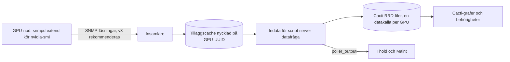

<!-- Source: README.md; SHA256: 126deef1783d64f878bf565f1433c10f31aef828eb9bc313aeff2b0335e54c7c -->

<!-- translations:start -->
[English](../../../README.md) | [简体中文](../zh-CN/README.md) | [हिन्दी](../hi-IN/README.md) | [Español (España)](../es-ES/README.md) | [Español (Latinoamérica)](../es-419/README.md) | [العربية (السعودية)](../ar-SA/README.md) | [Afrikaans](../af-ZA/README.md) | [አማርኛ](../am-ET/README.md) | [العربية (مصر)](../ar-EG/README.md) | [العربية (المغرب)](../ar-MA/README.md) | [বাংলা](../bn-BD/README.md) | [Deutsch](../de-DE/README.md) | [فارسی](../fa-IR/README.md) | [Filipino](../fil-PH/README.md) | [Français](../fr-FR/README.md) | [Français (Maroc)](../fr-MA/README.md) | [Français (Sénégal)](../fr-SN/README.md) | [Hausa](../ha-NG/README.md) | [עברית](../he-IL/README.md) | [Bahasa Indonesia](../id-ID/README.md) | [Igbo](../ig-NG/README.md) | [Italiano](../it-IT/README.md) | [日本語](../ja-JP/README.md) | [한국어](../ko-KR/README.md) | [Malagasy](../mg-MG/README.md) | [मराठी](../mr-IN/README.md) | [Bahasa Melayu](../ms-MY/README.md) | [Nederlands](../nl-NL/README.md) | [Polski](../pl-PL/README.md) | [Português (Brasil)](../pt-BR/README.md) | [Русский](../ru-RU/README.md) | [Kinyarwanda](../rw-RW/README.md) | [Soomaali](../so-SO/README.md) | [Svenska](README.md) | [Kiswahili](../sw-KE/README.md) | [தமிழ்](../ta-IN/README.md) | [తెలుగు](../te-IN/README.md) | [ไทย](../th-TH/README.md) | [Türkçe](../tr-TR/README.md) | [Українська](../uk-UA/README.md) | [اردو](../ur-PK/README.md) | [Tiếng Việt](../vi-VN/README.md) | [isiXhosa](../xh-ZA/README.md) | [Yorùbá](../yo-NG/README.md) | [繁體中文](../zh-TW/README.md) | [isiZulu](../zu-ZA/README.md)
<!-- translations:end -->

# plugin_gpu

Ett tillägg för Cacti 1.2 som hämtar användning, minne, temperatur, effekt, ECC-fel och orsaker till strypning per GPU från NVIDIA-verktyg till Cacti. Stöd för AMD och insamling av XID-fel är planerade men ännu inte implementerade. Varje GPU blir ett index i en datafråga på nodens enhet, så GPU-graferna visas bredvid nodens övriga grafer under Cactis behörighetsmodell, och Thold och Maint kan larma om och undertrycka dem.

> **Status: under utveckling, ej utgiven.** Milstolpe 4 gör fas 1 (NVIDIA via SNMP extend) kodmässigt färdig: insamling, identitet, grafer, strypnings- och ECC-signaler, larm via Thold och Maint, hälsosidan samt operatörsdokumentationen. Koden har endast körts mot en riktig `snmpd` med en simulerad `nvidia-smi` som skriver ut syntetisk utdata, aldrig på riktig GPU-hårdvara. Kvarstår före en release: pilottester på riktig hårdvara ([docs/pilot-plan.md](../../pilot-plan.md), #54), en extern säkerhetsgranskning ([docs/security-review.md](../../security-review.md)), testfixturer insamlade från riktiga verktyg (#14) samt skalmätningar på hårdvara i produktionsstorlek ([docs/performance.md](../../performance.md)). XID-fel inväntar beslut #8. Kör den inte i produktion.

## Åtkomstroller

| Behörighetsområde | Åtkomst |
| --- | --- |
| GPU View | Befintliga övervakningssidor. |
| GPU Operator | Övervakning samt sidan Operations och personliga kvitteringar vid triage. |
| GPU Admin | Operatörsåtkomst samt befintliga konfigurations- och administrationsåtgärder. |

När du har kopierat uppgraderingsfilerna öppnar du sidan Plugins som administratör för att registrera
det nya behörighetsområdet. Tilldela området GPU Operator uttryckligen under **Configuration > Users** eller användargrupper.
Uppgraderingar behåller befintliga behörighets-ID:n och tilldelningar för View och Admin. Admin-åtkomst
ärver Operator-åtkomst, och Operator-åtkomst ärver View-åtkomst vid varje begäran;
detta lägger inte till lagrade behörigheter för användare eller grupper. Tilläggets inställningar kräver även
GPU Admin-åtkomst utöver Cactis behörighet för Settings.

Cactis enhetsbehörigheter begränsar fortfarande vilka rader och åtgärder som är tillgängliga för varje användare; omappade objekt kräver en administratör.
Inloggningsuppgifter, konfiguration, mappning, borttagning och andra administrativa ändringar
finns kvar på administrationssidorna. Kvitteringar gäller endast i den aktuella
användarens session, i högst en timme och endast så länge samma observation förblir
färsk. Nya eller ändrade observationer gör dem ogiltiga. De markerar aldrig en misslyckad
mätning som frisk och undertrycker inte larm.

## Varför

GPU-noder finns vanligtvis redan i Cacti för övervakning av CPU, minne och nätverksgränssnitt. GPU-hälsa är en separat fråga som nodens SNMP-data inte besvarar: ett kort kan vara termiskt strypt, ackumulera ECC-fel eller rapportera ett XID-fel medan själva noden ser frisk ut. Tillverkarnas verktyg rapporterar detta (`nvidia-smi`, DCGM, `amd-smi`), men deras utdata hamnar utanför Cactis grafer, behörigheter och larmhantering.

Tillägget täpper till det gapet genom att omvandla utdata från tillverkarens verktyg till datakällor i Cacti, nycklade på varje GPU:s identitet i stället för dess position, så att en omstart som ändrar ordningen på GPU:erna inte kopplar ett korts historik till ett annat. Det återanvänder Cactis grafer, behörigheter, fjärrinsamlare, Thold och Maint i stället för att bygga parallella motsvarigheter.

## Planerad omfattning

| Fas | Omfattning | Milstolpar |
|---|---|---|
| 0, förstudie | Utdata från tillverkarverktyg, XID- och strypningssignaler, GPU-identitet, behörigheter, beslut om insamlingsväg | [M1](https://github.com/somethingwithproof/plugin_gpu/milestone/1) |
| 1, nvidia | Insamling via `nvidia-smi`, inventering efter UUID, grafer, strypnings-, ECC- och XID-signaler, Thold och Maint, hälsosida | [M2](https://github.com/somethingwithproof/plugin_gpu/milestone/2), [M3](https://github.com/somethingwithproof/plugin_gpu/milestone/3), [M4](https://github.com/somethingwithproof/plugin_gpu/milestone/4) |
| 2, bakändar | Bakände för DCGM, bakände för `amd-smi` | [M5](https://github.com/somethingwithproof/plugin_gpu/milestone/5) |
| 3, mig och fjärrinsamling | MIG-instanser, Cactis fjärrinsamlare | [M6](https://github.com/somethingwithproof/plugin_gpu/milestone/6) |

Utanför omfattningen: alla kommandon som ändrar en GPU eller nod (klockfrekvenser, effektgränser, återställningar, MIG-layout), en egen larmmotor i tillägget, en anpassad daemon eller ett eget nätverksprotokoll samt schemaläggar- eller jobbredovisning. Se planen för förstudie-backloggen.

## Vad milstolpe 4 tillför

- **Strypningsorsaker som larmvärden.** Klockhändelsemasken avkodas till en indikator med värdet 0 eller 1 per orsak; en okänd mask ger okända indikatorer, aldrig nollor, och bitar utan indikator ligger kvar i råmasken, som visas på GPU Health.
- **ECC som larmvärden** ([docs/metrics.md](../../metrics.md)). Nya korrigerade och okorrigerade fel sedan föregående mätning beräknas av tillägget från två på varandra följande totalsummor och lagras som mätarvärden (gauge): okänt vid en första mätning, en missad avläsning eller en omladdning av drivrutinen, så att en återställning aldrig tolkas som noll eller som ett negativt antal. Antal pensionerade enkelbits- och dubbelbitssidor samt ECC-läget läses också in. Två extra ECC-grafer per GPU låter Cacti lagra dem; tillsammans med Power Percent finns det elva grafer totalt. XID samlas inte in: ingen källa passar de fasta `nvidia-smi`-kommandona (#8).
- **Thold och Maint** ([docs/alerting.md](../../alerting.md)). Medföljande Thold-mallar för temperatur, effekt i förhållande till sin gräns, strypningsindikatorer, nya okorrigerade ECC-fel, väntande sidpensionering och mätvärdets ålder. Varje värde är en gauge, eftersom Thold 1.8.2 misslyckas på en okänd räknare. Ett end-to-end-test med oförändrade Thold 1.8.2 och Maint 1.3 visar att varje tröskelvärde löser ut och återställs, även över en ECC-återställning, och att Maint undertrycker det.
- **GPU Health** (GPU View). Per nod: aktualitet, hur den senaste insamlingen avslutades, Maint-status, bakände, verktygs- och drivrutinsversioner samt antal GPU:er; per GPU: närvaro, mätvärdesålder, ECC-tillstånd och råmask. Sidan läser endast lagrade poster.
- **Behörigheter.** Behörighetstestsviten täcker varje sidfil och åtgärd, återkallande vid nästa begäran samt avslag som inte röjer någon information.
- **Kvalificering av fel och återställning.** Skriptade end-to-end-körningar bryter avsiktligt agenten, inloggningsuppgifterna, verktyget, dess utdata, databasanslutningen och RRD-skrivningar, och återställer databasen från en dump, inklusive en dump som är äldre än RRD-filerna; en ny GPU ärver aldrig en annans RRD-fil ([docs/backup.md](../../backup.md)).
- **Skalning** ([docs/performance.md](../../performance.md)). Ett skalningstest mäter tiden för insamling, script server-indata, skapande av Cacti-objekt, en poller-cykel och hälsosidan vid ett givet antal GPU:er; CI kör det med 100 GPU:er. Mätningarna för 1 000 och 8 000 GPU:er är inte registrerade ännu, så inget högsta antal GPU:er som stöds anges.
- **Operatörsdokumentation** ([docs/operations.md](../../operations.md)): installation, uppgradering, avinstallation, minsta möjliga privilegium, otillgängliga värden och felsökning. Ändringar listas i [CHANGELOG.md](../../../CHANGELOG.md).

## Vad milstolpe 3 tillför

- **Insamling via SNMP extend** ([ADR 0008](../../decisions/0008-collect-through-snmp-extend.md)). Nodens administratör lägger till två fasta `extend`-rader i `snmpd.conf` ([docs/node-setup.md](../../node-setup.md)); tillägget läser NET-SNMP-EXTEND-MIB via Cactis SNMP-funktioner med enhetens egna inloggningsuppgifter, där SNMPv3 rekommenderas. Det kör ingenting på Cacti-servern eller noden.
- **Strikt tolkning.** Fält läses efter position, varje rad identifierar sin GPU med UUID, och en slutkod skild från noll, en timeout, trunkerad utdata, en rad med fel antal fält eller sammanblandad feltext gör att hela insamlingen misslyckas: värden blir `U`, ingen GPU markeras som frånvarande och GPU Nodes visar orsaken.
- **En insamlare efter varje poller-cykel.** Den läser varje aktiverad nods agent, uppdaterar identitetsposterna och cachelagrar den senaste mätningen. Script server-indatan läser bara från den cachen, så en Cacti-pollning väntar aldrig på en GPU-nod.
- **Cacti-objekt** ([ADR 0010](../../decisions/0010-attach-to-existing-node-devices.md)). Mallarna och datafrågan *GPU - Devices* levereras som XML och importeras vid installation och uppgradering. När en nod sparas kopplas datafrågan till dess befintliga enhet med omindexeringsmetoden None; GPU Nodes kan endast skapa en enhet när noden saknar en. Varje GPU är ett index nycklat på tillverkare och UUID, med en datakälla som delas av dess grafer för Utilization, Memory, Temperature, Power, Power Percent, Clocks, Throttle, ECC Errors, New ECC Errors, Retired Pages och Sample Age. Varje modellfält ritas i någon graf, eftersom Cacti bara lagrar de fält som en graf använder. Tillägget omindexerar efter varje GPU-ändring, sparar en omindexering som Cacti hoppade över medan enheten var Down eller inaktiverad och kör den så snart enheten är Up, samt skapar grafer för nya GPU:er.
- **Historiken stannar hos kortet.** En frånvarande GPU förblir ett index, så dess grafer visar ett glapp och fortsätter i samma RRD-fil när den återkommer. Ett ersättningskort i samma kortplats får sin egen datakälla. **Remove from Data Query** på nodens sida tar bort en frånvarande GPU ur listan; dess RRD-filer och grafer behålls tills du tar bort dem.
- **Enhetsbehörigheter på GPU Nodes.** En GPU Admin ser, ändrar, exporterar och flyttar endast noder och GPU:er på enheter som användaren får se i Cacti; en GPU-flytt kräver åtkomst till båda noderna. En nod vars enhet har tagits bort kan inaktiveras eller raderas.
- **Den gemensamma mätvärdesmodellen** ([ADR 0009](../../decisions/0009-common-metric-core-with-vendor-extensions.md), [docs/metrics.md](../../metrics.md)). Minne anges i byte, klockhändelsemasken avkodas till `thr_*`-indikatorer och `age` är åldern på GPU:ns egen mättidpunkt, eller `U` om den är okänd.

Den användare som utför installationen (webbservern) måste kunna skriva till `<cacti>/resource/script_server/`, där tillägget placerar sin XML-fil för datafrågan; annars avbryts installationen eller uppgraderingen med ett meddelande och försöker igen vid nästa försök. Avinstallation tar endast bort mallarna och XML-filen om *Remove the plugin's Cacti objects on uninstall* är markerad, och tar aldrig bort RRD-filer, enheter, grafer eller datakällor ([docs/operations.md](../../operations.md#uninstall)). Noder på fjärrinsamlare samlas inte in förrän i fas 3.

## Vad milstolpe 2 levererar

- **Skyddad installation.** På PHP lägre än 8.2 nekas installation och aktivering med ett meddelande som anger den version som krävs, medan resten av Cacti fortsätter att fungera. `setup.php` och sidskripten kan tolkas på PHP 8.0.
- **Livscykel.** Installation, uppgradering, inaktivering och avinstallation sker via Cactis Plugins-sida. Uppgraderingar körs i ordning, slutförs efter ett avbrott och uppdaterar den registrerade versionen först efter att de lyckats. Avinstallation behåller tilläggets tabeller om du inte avmarkerar *Keep Plugin Tables on Uninstall*; den rör aldrig någon Cacti-enhet, datakälla, graf eller RRD-fil.
- **Separata behörighetsområden.** *GPU Admin* öppnar **GPU Nodes**, där du registrerar Cacti-enheter som GPU-noder, bekräftar eller avvisar GPU-flyttar mellan noder och exporterar alla poster som JSON. *GPU View* öppnar **GPU Inventory**, som endast listar GPU:er på enheter som användaren får se. Båda sidorna ligger under Management, och varje ändring är en POST-begäran som kontrolleras med csrf-magic.
- **Identitetsposter för GPU.** Varje GPU är nycklad på tillverkare och UUID. Index, PCI-buss-ID, namn, drivrutin och rapporterande verktyg är attribut som ändras på plats. Ett nytt UUID i en känd kortplats flaggas som ett möjligt utbyte och påbörjar sin egen historik; en GPU som upptäcks på en annan nod flyttas först när en operatör bekräftar det; en GPU som saknas i lyckade insamlingar markeras som frånvarande efter ett konfigurerbart antal och tas aldrig bort. Endast UUID:n för hela NVIDIA-GPU:er accepteras tills vidare; MIG-instanser inväntar beslut #13 och AMD inväntar förstudie #19. Reglerna testas med fixtursekvenser, eftersom ingen insamlare matar dem ännu.
- **Tester och CI.** Enhets- och källregelsviter utan GPU eller databas, livscykel- och sidbehörighetskontroller mot Cacti 1.2.31 och aktuell 1.2.x på PHP 8.2 till 8.5, ett jobb för avvisande av PHP 8.1, en PHP 8.0-lintning av startpunkterna, PHPStan på nivå 9 och REUSE. Testramverket är provisoriskt tills #12 har avgjorts.

### Installation för utvärdering

Dessa steg installerar den aktuella koden för utvärdering; [docs/operations.md](../../operations.md) innehåller den fullständiga operatörsguiden. De kräver Cacti 1.2.31 eller senare på PHP 8.2 eller senare.

1. Kopiera arkivet till `plugins/gpu` under din Cacti-katalog. Katalogen måste heta `gpu`.
2. Öppna **Configuration > Plugins** i Cacti, och installera och aktivera sedan **GPU**.
3. Tilldela användare behörighetsområdet *GPU View*, *GPU Operator* eller *GPU Admin* under **Configuration > Users**, beroende på deras roll. Användaren som installerar får View och Admin; Admin inkluderar Operator-åtkomst.
4. Konfigurera varje GPU-nods SNMP-agent enligt beskrivningen i [docs/node-setup.md](../../node-setup.md), och lägg sedan till noden under **Management > GPU Nodes**.
5. För larm importerar du de medföljande Thold-mallarna enligt beskrivningen i [docs/alerting.md](../../alerting.md).
6. Justera vid behov **Configuration > Settings > GPU**: *Mark Absent After* (standard 3 lyckade insamlingar, från 1 till 100), *Stale After* (hur gammal en mätning får vara innan dess värden skriver ut `U`) och *Keep Plugin Tables on Uninstall* (på som standard).

## Hur mätvärden når Cacti

Beslut [#7](https://github.com/somethingwithproof/plugin_gpu/issues/7) valde SNMP `extend` ([ADR 0008](../../decisions/0008-collect-through-snmp-extend.md)): nodens egen agent kör ett fast `nvidia-smi`-kommando och tillägget läser bara resultatet. Planen jämför alternativen under [Insamlingsvägar](../../PLAN.md#collection-paths).

## Kompatibilitetsmål

| Komponent | Mål |
|---|---|
| Cacti | 1.2.31 eller senare, utan ändringar i kärnan |
| PHP | 8.2 eller senare; `setup.php` förblir tolkbar på 8.0 så att en körmiljö som inte stöds får ett avvisande i stället för ett trasigt Cacti-gränssnitt |
| NVIDIA | Drivrutins- och verktygsversioner fastställs av förstudie [#26](https://github.com/somethingwithproof/plugin_gpu/issues/26); DCGM-fält-ID:n kontrollerade mot v3.3.9 och v4.7.0 |
| AMD | `amd-smi` på ROCm-versioner fastställs av förstudie [#26](https://github.com/somethingwithproof/plugin_gpu/issues/26) |
| Thold, Maint | Thold 1.8.2 och Maint 1.3, oförändrade, testade end-to-end ([docs/alerting.md](../../alerting.md)) |

## Design

- [docs/PLAN.md](../../PLAN.md) är den fullständiga planen: arkitektur, uppströmsfakta som den bygger på (med källor), identitetsmodell, säkerhetsgränser, prestandaberäkningar, testning och risker.
- [docs/decisions/](../../decisions) innehåller arkitekturbeslut (ADR) för val som redan har gjorts.
- [docs/REQUIREMENTS.md](../../REQUIREMENTS.md) mappar varje krav-ID till motsvarande ärende.

## Hur arbetet följs upp

- **Milstolpar** följer planens milstolpar. Var och en har ett övergripande ärende som listar dess delärenden och slutbevis.
- **Ärenden** typas med etiketter: `type: requirement`, `type: research`, `type: decision`, `type: epic`. Kravärenden anger numrerade, testbara krav (`REQ-AREA-NNN`) och acceptanskriterier.
- **Etiketter** innehåller även `area:`, `phase:`, `priority:` och `status:`. Se [CONTRIBUTING.md](../../../CONTRIBUTING.md#labels).
- [Projekttavlan](https://github.com/users/somethingwithproof/projects/9) visar alla ärenden över milstolparna.

## Bidra

Läs [CONTRIBUTING.md](../../../CONTRIBUTING.md). Commits kräver en DCO-signatur. Designdiskussioner sker i ärenden; öppna beslut har etiketten `type: decision`. Insamlad utdata från riktiga GPU-verktyg är det mest värdefulla bidraget till milstolpe 1; rensa bort värdnamn, serienummer och UUID:n först.

## Säkerhet

Rapportera sårbarheter privat; se [SECURITY.md](../../../SECURITY.md).

## Licens

GNU General Public License v2.0, samma licens som Cacti och dess tillägg. Se [LICENSE](../../../LICENSE).
