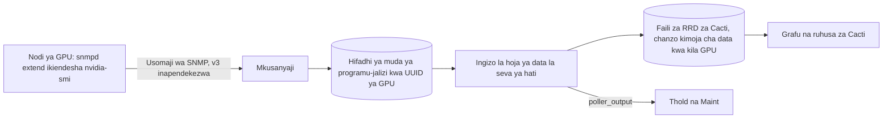

<!-- Source: README.md; SHA256: 126deef1783d64f878bf565f1433c10f31aef828eb9bc313aeff2b0335e54c7c -->

<!-- translations:start -->
[English](../../../README.md) | [简体中文](../zh-CN/README.md) | [हिन्दी](../hi-IN/README.md) | [Español (España)](../es-ES/README.md) | [Español (Latinoamérica)](../es-419/README.md) | [العربية (السعودية)](../ar-SA/README.md) | [Afrikaans](../af-ZA/README.md) | [አማርኛ](../am-ET/README.md) | [العربية (مصر)](../ar-EG/README.md) | [العربية (المغرب)](../ar-MA/README.md) | [বাংলা](../bn-BD/README.md) | [Bosanski](../bs-BA/README.md) | [Deutsch](../de-DE/README.md) | [فارسی](../fa-IR/README.md) | [Filipino](../fil-PH/README.md) | [Français](../fr-FR/README.md) | [Français (Maroc)](../fr-MA/README.md) | [Français (Sénégal)](../fr-SN/README.md) | [Hausa](../ha-NG/README.md) | [עברית](../he-IL/README.md) | [Hrvatski](../hr-HR/README.md) | [Bahasa Indonesia](../id-ID/README.md) | [Igbo](../ig-NG/README.md) | [Italiano](../it-IT/README.md) | [日本語](../ja-JP/README.md) | [한국어](../ko-KR/README.md) | [Malagasy](../mg-MG/README.md) | [मराठी](../mr-IN/README.md) | [Bahasa Melayu](../ms-MY/README.md) | [Nederlands](../nl-NL/README.md) | [Polski](../pl-PL/README.md) | [Português (Brasil)](../pt-BR/README.md) | [Русский](../ru-RU/README.md) | [Kinyarwanda](../rw-RW/README.md) | [Soomaali](../so-SO/README.md) | [Српски](../sr-RS/README.md) | [Svenska](../sv-SE/README.md) | [Kiswahili](README.md) | [தமிழ்](../ta-IN/README.md) | [తెలుగు](../te-IN/README.md) | [ไทย](../th-TH/README.md) | [Türkçe](../tr-TR/README.md) | [Українська](../uk-UA/README.md) | [اردو](../ur-PK/README.md) | [Tiếng Việt](../vi-VN/README.md) | [isiXhosa](../xh-ZA/README.md) | [Yorùbá](../yo-NG/README.md) | [繁體中文](../zh-TW/README.md) | [isiZulu](../zu-ZA/README.md)
<!-- translations:end -->

# plugin_gpu

Programu-jalizi ya Cacti 1.2 inayokusanya matumizi kwa kila GPU, kumbukumbu, halijoto, nishati, hitilafu za ECC, na sababu za kupunguza kasi kutoka kwa zana za NVIDIA hadi kwenye Cacti. Usaidizi wa AMD na ukusanyaji wa hitilafu za XID vimepangwa, bado havijatekelezwa. Kila GPU inakuwa faharisi ya hoja ya data kwenye kifaa cha nodi yake, ili grafu za GPU zikae karibu na grafu nyingine za nodi chini ya ruhusa za Cacti, na Thold na Maint ziweze kutoa tahadhari na kuzinyamazisha.

> **Hali: bado inatengenezwa, haijatolewa.** Hatua ya 4 inakamilisha msimbo wa awamu ya 1 (NVIDIA kupitia SNMP extend): ukusanyaji, utambulisho, grafu, ishara za kupunguza kasi na ECC, tahadhari za Thold na Maint, ukurasa wa afya, na nyaraka za mwendeshaji. Imejaribiwa tu dhidi ya `snmpd` halisi yenye `nvidia-smi` bandia inayochapisha matokeo ya majaribio, haijawahi kuendeshwa kwenye maunzi halisi ya GPU. Bado haijakamilika kabla ya toleo rasmi: majaribio ya awali kwenye maunzi halisi ([docs/pilot-plan.md](../../pilot-plan.md), #54), ukaguzi wa nje wa usalama ([docs/security-review.md](../../security-review.md)), sampuli za data zilizokusanywa kutoka kwa zana halisi (#14), na upimaji wa uwezo kwenye maunzi ya kiwango cha uzalishaji ([docs/performance.md](../../performance.md)). Hitilafu za XID zinasubiri uamuzi #8. Usiiendeshe katika mazingira ya uzalishaji.

## Majukumu ya ufikiaji

| Nyanja | Ufikiaji |
| --- | --- |
| GPU View | Kurasa zilizopo za ufuatiliaji. |
| GPU Operator | Ufuatiliaji pamoja na ukurasa wa Operesheni na uthibitisho wa uchunguzi wa binafsi. |
| GPU Admin | Ufikiaji wa Operator pamoja na usanidi uliopo na vitendo vya kiutawala. |

Baada ya kunakili faili za sasisho, fungua ukurasa wa Plugins kama msimamizi ili kusajili
nyanja mpya. Mpe mtumiaji nyanja ya Operator moja kwa moja chini ya **Configuration > Users** au vikundi vya watumiaji.
Masasisho huhifadhi vitambulisho na ruhusa zilizopo za nyanja za View na Admin. Ufikiaji wa Admin
hurithi ufikiaji wa Operator, na ufikiaji wa Operator hurithi ufikiaji wa View kwa kila ombi;
hii haiongezi ruhusa zilizohifadhiwa kwa watumiaji au vikundi. Mipangilio ya programu-jalizi pia inahitaji
ufikiaji wa GPU Admin pamoja na ruhusa ya Settings ya Cacti.

Ruhusa za vifaa vya Cacti bado zinadhibiti safu na vitendo vinavyopatikana kwa kila mtumiaji; vitu ambavyo havijaunganishwa vinahitaji msimamizi.
Vitambulisho vya siri, usanidi, uunganishaji, ufutaji na mabadiliko mengine ya kiutawala
hubaki katika kurasa za utawala. Uthibitisho hudumu tu katika kipindi cha sasa
cha mtumiaji, kwa muda usiozidi saa moja na tu wakati uchunguzi uleule bado ni
mpya. Uchunguzi mpya au uliobadilika huubatilisha. Kamwe haufanyi kipimo
kilichoshindwa kionekane kuwa kiko sawa au kunyamazisha tahadhari.

## Kwa nini

Nodi za GPU kwa kawaida tayari zimo katika Cacti kwa ajili ya CPU, kumbukumbu, na violesura. Afya ya GPU ni swali tofauti ambalo data ya SNMP ya nodi haijibu: kadi inaweza kupunguzwa kasi kutokana na joto, kukusanya hitilafu za ECC, au kuripoti hitilafu ya XID huku nodi yenyewe ikionekana iko sawa. Zana za watengenezaji huripoti hali hiyo (`nvidia-smi`, DCGM, `amd-smi`), lakini matokeo yake hukaa nje ya grafu, ruhusa, na tahadhari za Cacti.

Programu-jalizi hii inaziba pengo hilo kwa kubadilisha matokeo ya zana za watengenezaji kuwa vyanzo vya data vya Cacti, vikifungwa na utambulisho wa kila GPU badala ya nafasi yake, ili kuanzishwa upya kwa nodi kunakobadilisha mpangilio wa GPU kusiunganishe historia ya kadi moja na nyingine. Inatumia tena grafu za Cacti, ruhusa, wakusanyaji wa data wa mbali, Thold, na Maint badala ya kujenga matoleo sambamba.

## Wigo uliopangwa

| Awamu | Wigo | Hatua muhimu |
|---|---|---|
| 0, utafiti | Matokeo ya zana za watengenezaji, ishara za XID na kupunguza kasi, utambulisho wa GPU, ruhusa, uamuzi wa njia ya ukusanyaji | [M1](https://github.com/somethingwithproof/plugin_gpu/milestone/1) |
| 1, nvidia | Ukusanyaji wa `nvidia-smi`, orodha kwa UUID, grafu, kupunguza kasi, ishara za ECC na XID, Thold na Maint, ukurasa wa afya | [M2](https://github.com/somethingwithproof/plugin_gpu/milestone/2), [M3](https://github.com/somethingwithproof/plugin_gpu/milestone/3), [M4](https://github.com/somethingwithproof/plugin_gpu/milestone/4) |
| 2, mifumo ya nyuma | Mfumo wa nyuma wa DCGM, mfumo wa nyuma wa `amd-smi` | [M5](https://github.com/somethingwithproof/plugin_gpu/milestone/5) |
| 3, mig na mbali | Matukio ya MIG, wakusanyaji wa data wa mbali wa Cacti | [M6](https://github.com/somethingwithproof/plugin_gpu/milestone/6) |

Nje ya wigo: amri yoyote inayobadilisha GPU au nodi (kasi ya saa, vikomo vya nishati, kuanzisha upya, mpangilio wa MIG), mfumo wa tahadhari unaomilikiwa na programu-jalizi, huduma maalum au itifaki ya mtandao, na uhasibu wa mpangilio wa kazi au majukumu. Tazama mpango kwa orodha ya kazi za utafiti zinazosubiri.

## Kinachoongezwa na hatua ya 4

- **Sababu za kupunguza kasi kama thamani za tahadhari.** Kinyago cha matukio ya saa kinatafsiriwa kuwa kiashiria kimoja cha 0 au 1 kwa kila sababu; kinyago kisichojulikana hutoa viashiria visivyojulikana, kamwe si sufuri, na biti zisizo na kiashiria hubaki kwenye kinyago ghafi, ambacho GPU Health huonyesha.
- **ECC kama thamani za tahadhari** ([docs/metrics.md](../../metrics.md)). Hitilafu mpya zilizorekebishwa na zisizorekebishwa tangu sampuli iliyotangulia hukokotolewa na programu-jalizi kutoka kwa jumla mbili mfululizo na kuhifadhiwa kama vipimo vya gauge: visivyojulikana kwa sampuli ya kwanza, usomaji uliokosekana, au upakiaji upya wa kiendeshi, ili kuweka upya kusiwahi kusomeka kama sufuri au hesabu hasi. Hesabu za kurasa zilizostaafishwa za biti moja na biti mbili pamoja na hali ya ECC husomwa pia. Grafu mbili za ziada za ECC kwa kila GPU huruhusu Cacti kuzihifadhi; pamoja na Power Percent, kuna grafu kumi na moja kwa jumla. XID haikusanywi: hakuna chanzo kinacholingana na amri zisizobadilika za `nvidia-smi` (#8).
- **Thold na Maint** ([docs/alerting.md](../../alerting.md)). Violezo vya Thold vilivyoambatanishwa kwa halijoto, nishati dhidi ya kikomo chake, viashiria vya kupunguza kasi, hitilafu mpya za ECC zisizorekebishwa, kustaafishwa kwa kurasa kunakosubiri, na umri wa sampuli. Kila thamani ni gauge, kwa sababu Thold 1.8.2 hushindwa kwenye kihesabu kisichojulikana. Jaribio la mwanzo hadi mwisho na Thold 1.8.2 na Maint 1.3 zisizobadilishwa linaonyesha kila kizingiti kikiwasha tahadhari na kurejea hali ya kawaida, hata baada ya kuweka upya ECC, na Maint ikiinyamazisha.
- **GPU Health** (GPU View). Kwa kila nodi: upya wa data, jinsi ukusanyaji wa mwisho ulivyoisha, hali ya Maint, mfumo wa nyuma, matoleo ya zana na kiendeshi, na idadi ya GPU; kwa kila GPU: uwepo, umri wa sampuli, hali ya ECC, na kinyago ghafi. Inasoma rekodi zilizohifadhiwa pekee.
- **Ruhusa.** Mkusanyiko wa majaribio ya ruhusa unashughulikia kila faili la ukurasa na kitendo, ubatilishaji kwenye ombi linalofuata, na kukataliwa ambako hakufichui chochote.
- **Uthibitishaji wa kushindwa na kurejesha.** Majaribio ya kiotomatiki ya mwanzo hadi mwisho huvunja wakala, vitambulisho vya siri, zana, matokeo yake, muunganisho wa hifadhidata, na uandishi wa RRD, na kurejesha hifadhidata kutoka kwa nakala ya akiba, ikiwemo iliyo ya zamani kuliko faili za RRD; GPU mpya kamwe hairithi faili ya RRD ya nyingine ([docs/backup.md](../../backup.md)).
- **Uwezo wa ukubwa** ([docs/performance.md](../../performance.md)). Jaribio la ukubwa hupima muda wa ukusanyaji, ingizo la seva ya hati, uundaji wa vitu vya Cacti, mzunguko wa poller, na ukurasa wa afya kwa idadi fulani ya GPU; CI huliendesha kwa GPU 100. Vipimo vya GPU 1,000 na 8,000 bado havijarekodiwa, kwa hivyo hakuna idadi ya GPU inayoungwa mkono iliyotajwa.
- **Nyaraka za mwendeshaji** ([docs/operations.md](../../operations.md)): kusakinisha, kusasisha, kuondoa, ruhusa ya chini kabisa, thamani zisizopatikana, na utatuzi wa matatizo. Mabadiliko yameorodheshwa katika [CHANGELOG.md](../../../CHANGELOG.md).

## Kinachoongezwa na hatua ya 3

- **Ukusanyaji kupitia SNMP extend** ([ADR 0008](../../decisions/0008-collect-through-snmp-extend.md)). Msimamizi wa nodi huongeza mistari miwili isiyobadilika ya `extend` kwenye `snmpd.conf` ([docs/node-setup.md](../../node-setup.md)); programu-jalizi husoma NET-SNMP-EXTEND-MIB kupitia vitendakazi vya SNMP vya Cacti kwa kutumia vitambulisho vya kifaa chenyewe, SNMPv3 ikipendekezwa. Haiendeshi chochote kwenye seva ya Cacti au nodi.
- **Uchanganuzi mkali.** Sehemu husomwa kwa nafasi yake, kila mstari hutaja GPU yake kwa UUID, na hali ya kutoka isiyo sufuri, kuisha kwa muda, matokeo yaliyokatwa, mstari wenye idadi isiyo sahihi ya sehemu, au maandishi ya hitilafu yaliyounganishwa hushindisha ukusanyaji wote: thamani zinakuwa `U`, hakuna GPU inayotiwa alama kuwa haipo, na GPU Nodes huonyesha sababu.
- **Mkusanyaji baada ya kila mzunguko wa poller.** Husoma wakala wa kila nodi iliyowezeshwa, husasisha rekodi za utambulisho, na huhifadhi kwa muda sampuli ya hivi punde. Ingizo la seva ya hati husoma hifadhi hiyo ya muda pekee, ili uchunguzi wa Cacti usiwahi kusubiri nodi ya GPU.
- **Vitu vya Cacti** ([ADR 0010](../../decisions/0010-attach-to-existing-node-devices.md)). Violezo na hoja ya data ya *GPU - Devices* huletwa kama XML na kuingizwa wakati wa kusakinisha na kusasisha. Kuhifadhi nodi huambatanisha hoja ya data kwenye kifaa chake kilichopo kwa mbinu ya kupanga upya faharisi ya None; GPU Nodes inaweza kuunda kifaa pale tu nodi haina kifaa. Kila GPU ni faharisi iliyofungwa kwa mtengenezaji na UUID, yenye chanzo kimoja cha data kinachoshirikiwa na grafu zake za Utilization, Memory, Temperature, Power, Power Percent, Clocks, Throttle, ECC Errors, New ECC Errors, Retired Pages, na Sample Age. Kila sehemu ya kielelezo huchorwa na grafu fulani, kwa sababu Cacti huhifadhi sehemu zinazotumiwa na grafu pekee. Programu-jalizi hupanga upya faharisi baada ya kila badiliko la GPU, huhifadhi upangaji upya ambao Cacti iliruka wakati kifaa kilikuwa Down au kimezimwa na kuuendesha mara tu kifaa kinapokuwa Up, na huunda grafu kwa GPU mpya.
- **Historia hubaki na kadi.** GPU isiyokuwepo hubaki kuwa faharisi, ili grafu zake zionyeshe pengo na ziendelee katika faili ileile ya RRD inaporudi. Kadi mbadala katika nafasi ileile hupata chanzo chake cha data. **Remove from Data Query** kwenye ukurasa wa nodi huondoa GPU isiyokuwepo kutoka kwenye orodha; faili zake za RRD na grafu huhifadhiwa hadi utakapozifuta.
- **Ruhusa za vifaa kwenye GPU Nodes.** GPU Admin huona, hubadilisha, huhamisha nje, na huhamisha tu nodi na GPU kwenye vifaa ambavyo anaruhusiwa kuviona katika Cacti; uhamisho wa GPU unahitaji nodi zote mbili. Nodi ambayo kifaa chake kilifutwa inaweza kuzimwa au kufutwa.
- **Kielelezo cha kawaida cha vipimo** ([ADR 0009](../../decisions/0009-common-metric-core-with-vendor-extensions.md), [docs/metrics.md](../../metrics.md)). Kumbukumbu iko katika baiti, kinyago cha matukio ya saa hutafsiriwa kuwa viashiria vya `thr_*`, na `age` ni umri wa muda wa sampuli ya GPU yenyewe, au `U` isipojulikana.

Mtumiaji anayesakinisha (seva ya wavuti) lazima aweze kuandika katika `<cacti>/resource/script_server/`, ambapo programu-jalizi huweka XML yake ya hoja ya data; vinginevyo usakinishaji na usasishaji husimama na ujumbe na kujaribu tena katika jaribio linalofuata. Kuondoa programu-jalizi hufuta violezo na XML pale tu *Remove the plugin's Cacti objects on uninstall* imetiwa tiki, na kamwe hakufuti faili za RRD, vifaa, grafu, au vyanzo vya data ([docs/operations.md](../../operations.md#uninstall)). Nodi zilizo kwenye wakusanyaji wa data wa mbali hazikusanywi hadi awamu ya 3.

## Kinachotolewa na hatua ya 2

- **Usakinishaji uliolindwa.** Kwenye PHP chini ya 8.2, usakinishaji na uwezeshaji hukataliwa kwa ujumbe unaotaja toleo linalohitajika, na sehemu nyingine ya Cacti huendelea kufanya kazi. `setup.php` na hati za kurasa huchanganuliwa kwenye PHP 8.0.
- **Mzunguko wa maisha.** Kusakinisha, kusasisha, kuzima, na kuondoa kupitia ukurasa wa Plugins wa Cacti. Masasisho yamepangwa kwa mpangilio, hukamilika baada ya kukatizwa, na hubadilisha toleo lililorekodiwa baada ya kufanikiwa pekee. Kuondoa huhifadhi majedwali ya programu-jalizi isipokuwa ukiondoa tiki kwenye *Keep Plugin Tables on Uninstall*; kamwe hakugusi kifaa cha Cacti, chanzo cha data, grafu, au faili ya RRD.
- **Nyanja tofauti.** *GPU Admin* hufungua **GPU Nodes**, ambapo unasajili vifaa vya Cacti kama nodi za GPU, unathibitisha au kukataa uhamisho wa GPU kati ya nodi, na kuhamisha kila rekodi kama JSON. *GPU View* hufungua **GPU Inventory**, ambayo huorodhesha GPU tu kwenye vifaa ambavyo mtazamaji anaruhusiwa kuviona. Kurasa zote mbili ziko chini ya Management, na kila badiliko ni POST iliyokaguliwa na csrf-magic.
- **Rekodi za utambulisho wa GPU.** Kila GPU imefungwa kwa mtengenezaji na UUID. Faharisi, PCI bus ID, jina, kiendeshi, na zana inayoripoti ni sifa zinazobadilika papo hapo. UUID mpya katika nafasi inayojulikana huwekewa alama kama uwezekano wa kubadilishwa na huanza historia yake yenyewe; GPU iliyoonekana kwenye nodi nyingine huhamishwa tu pale mwendeshaji anapothibitisha; GPU inayokosekana katika ukusanyaji uliofanikiwa huwekewa alama kuwa haipo baada ya idadi inayoweza kusanidiwa na haifutwi kamwe. Kwa sasa UUID za GPU nzima za NVIDIA pekee ndizo zinazokubaliwa; matukio ya MIG yanasubiri uamuzi #13, na AMD inasubiri utafiti #19. Sheria hizi zinajaribiwa kwa mfuatano wa sampuli za data, kwani bado hakuna mkusanyaji anayezilisha.
- **Majaribio na CI.** Mifumo ya majaribio ya vitengo na sheria za msimbo bila GPU au hifadhidata, ukaguzi wa mzunguko wa maisha na ruhusa za kurasa dhidi ya Cacti 1.2.31 na 1.2.x ya sasa kwenye PHP 8.2 hadi 8.5, kazi ya kukataa PHP 8.1, ukaguzi wa kisintaksia wa PHP 8.0 wa sehemu za kuingilia, PHPStan katika kiwango cha 9, na REUSE. Mfumo huu wa majaribio ni wa muda hadi #12 iamuliwe.

### Sakinisha kwa tathmini

Hatua hizi husakinisha msimbo wa sasa ili kuujaribu; [docs/operations.md](../../operations.md) ina mwongozo kamili wa mwendeshaji. Zinahitaji Cacti 1.2.31 au mpya zaidi kwenye PHP 8.2 au mpya zaidi.

1. Nakili hazina hii hadi `plugins/gpu` chini ya saraka yako ya Cacti. Saraka lazima iitwe `gpu`.
2. Katika Cacti, fungua **Configuration > Plugins**, kisha sakinisha na uwashe **GPU**.
3. Wape watumiaji nyanja ya *GPU View*, *GPU Operator*, au *GPU Admin* chini ya **Configuration > Users**, kulingana na jukumu lao. Mtumiaji anayesakinisha hupokea View na Admin; Admin inajumuisha ufikiaji wa Operator.
4. Sanidi wakala wa SNMP wa kila nodi ya GPU kama ilivyoelezwa katika [docs/node-setup.md](../../node-setup.md), kisha ongeza nodi chini ya **Management > GPU Nodes**.
5. Kwa tahadhari, ingiza violezo vya Thold vilivyoambatanishwa kama [docs/alerting.md](../../alerting.md) inavyoeleza.
6. Kwa hiari rekebisha **Configuration > Settings > GPU**: *Mark Absent After* (chaguo-msingi ni ukusanyaji 3 uliofanikiwa, kuanzia 1 hadi 100), *Stale After* (muda ambao sampuli inaweza kudumu kabla thamani zake kuchapisha `U`), na *Keep Plugin Tables on Uninstall* (chaguo-msingi imewashwa).

## Jinsi vipimo vinavyofikia Cacti

Uamuzi [#7](https://github.com/somethingwithproof/plugin_gpu/issues/7) ulichagua SNMP `extend` ([ADR 0008](../../decisions/0008-collect-through-snmp-extend.md)): wakala wa nodi yenyewe huendesha amri isiyobadilika ya `nvidia-smi` na programu-jalizi husoma matokeo pekee. Mpango unalinganisha chaguo zote chini ya [Collection paths](../../PLAN.md#collection-paths).

## Malengo ya uoanifu

| Sehemu | Lengo |
|---|---|
| Cacti | 1.2.31 au mpya zaidi, bila viraka vya msingi |
| PHP | 8.2 au mpya zaidi; `setup.php` hubaki ikichanganulika kwenye 8.0 ili mazingira yasiyoungwa mkono yapate ujumbe wa kukataliwa badala ya kiolesura cha Cacti kilichoharibika |
| NVIDIA | Matoleo ya kiendeshi na zana yatawekwa na utafiti [#26](https://github.com/somethingwithproof/plugin_gpu/issues/26); vitambulisho vya sehemu za DCGM vimekaguliwa katika v3.3.9 na v4.7.0 |
| AMD | `amd-smi` kwenye matoleo ya ROCm yatawekwa na utafiti [#26](https://github.com/somethingwithproof/plugin_gpu/issues/26) |
| Thold, Maint | Thold 1.8.2 na Maint 1.3, bila mabadiliko, zimejaribiwa mwanzo hadi mwisho ([docs/alerting.md](../../alerting.md)) |

## Muundo

- [docs/PLAN.md](../../PLAN.md) ni mpango kamili: usanifu, ukweli wa mifumo ya juu unaotegemewa (pamoja na vyanzo), kielelezo cha utambulisho, mipaka ya usalama, hesabu za utendaji, majaribio, na hatari.
- [docs/decisions/](../../decisions) ina rekodi za maamuzi ya usanifu kwa chaguo ambazo tayari zimefanywa.
- [docs/REQUIREMENTS.md](../../REQUIREMENTS.md) inaunganisha kila kitambulisho cha hitaji na suala lake.

## Jinsi kazi inavyofuatiliwa

- **Hatua muhimu** zinafuata hatua za mpango. Kila moja ina suala kuu linaloorodhesha masuala yake madogo na ushahidi wa kukamilika.
- **Masuala** yameainishwa kwa lebo: `type: requirement`, `type: research`, `type: decision`, `type: epic`. Masuala ya mahitaji yanaeleza mahitaji yenye nambari yanayoweza kujaribiwa (`REQ-AREA-NNN`) na vigezo vya kukubalika.
- **Lebo** pia hubeba `area:`, `phase:`, `priority:`, na `status:`. Tazama [CONTRIBUTING.md](../../../CONTRIBUTING.md#labels).
- [Ubao wa mradi](https://github.com/users/somethingwithproof/projects/9) unaonyesha masuala yote katika hatua zote.

## Kuchangia

Soma [CONTRIBUTING.md](../../../CONTRIBUTING.md). Ahadi za msimbo zinahitaji sahihi ya DCO. Majadiliano ya muundo hufanyika kwenye masuala; maamuzi yaliyo wazi hubeba lebo ya `type: decision`. Matokeo yaliyokusanywa kutoka kwa zana halisi za GPU ndiyo mchango muhimu zaidi kwa hatua ya 1; ondoa majina ya seva pangishi, nambari za mfululizo, na UUID kwanza.

## Usalama

Ripoti udhaifu wa kiusalama kwa faragha; tazama [SECURITY.md](../../../SECURITY.md).

## Leseni

GNU General Public License v2.0, leseni ileile kama Cacti na programu-jalizi zake. Tazama [LICENSE](../../../LICENSE).
