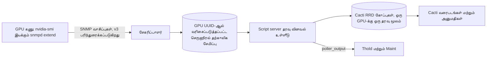

<!-- Source: README.md; SHA256: 126deef1783d64f878bf565f1433c10f31aef828eb9bc313aeff2b0335e54c7c -->

<!-- translations:start -->
[English](../../../README.md) | [简体中文](../zh-CN/README.md) | [हिन्दी](../hi-IN/README.md) | [Español (España)](../es-ES/README.md) | [Español (Latinoamérica)](../es-419/README.md) | [العربية (السعودية)](../ar-SA/README.md) | [Afrikaans](../af-ZA/README.md) | [አማርኛ](../am-ET/README.md) | [العربية (مصر)](../ar-EG/README.md) | [العربية (المغرب)](../ar-MA/README.md) | [বাংলা](../bn-BD/README.md) | [Bosanski](../bs-BA/README.md) | [Deutsch](../de-DE/README.md) | [فارسی](../fa-IR/README.md) | [Filipino](../fil-PH/README.md) | [Français](../fr-FR/README.md) | [Français (Maroc)](../fr-MA/README.md) | [Français (Sénégal)](../fr-SN/README.md) | [Hausa](../ha-NG/README.md) | [עברית](../he-IL/README.md) | [Hrvatski](../hr-HR/README.md) | [Bahasa Indonesia](../id-ID/README.md) | [Igbo](../ig-NG/README.md) | [Italiano](../it-IT/README.md) | [日本語](../ja-JP/README.md) | [한국어](../ko-KR/README.md) | [Malagasy](../mg-MG/README.md) | [मराठी](../mr-IN/README.md) | [Bahasa Melayu](../ms-MY/README.md) | [Nederlands](../nl-NL/README.md) | [Polski](../pl-PL/README.md) | [Português (Brasil)](../pt-BR/README.md) | [Русский](../ru-RU/README.md) | [Kinyarwanda](../rw-RW/README.md) | [Soomaali](../so-SO/README.md) | [Српски](../sr-RS/README.md) | [Svenska](../sv-SE/README.md) | [Kiswahili](../sw-KE/README.md) | [தமிழ்](README.md) | [తెలుగు](../te-IN/README.md) | [ไทย](../th-TH/README.md) | [Türkçe](../tr-TR/README.md) | [Українська](../uk-UA/README.md) | [اردو](../ur-PK/README.md) | [Tiếng Việt](../vi-VN/README.md) | [isiXhosa](../xh-ZA/README.md) | [Yorùbá](../yo-NG/README.md) | [繁體中文](../zh-TW/README.md) | [isiZulu](../zu-ZA/README.md)
<!-- translations:end -->

# plugin_gpu

NVIDIA கருவிகளிலிருந்து ஒவ்வொரு GPU-வின் பயன்பாடு, நினைவகம், வெப்பநிலை, மின்சக்தி, ECC பிழைகள் மற்றும் த்ராட்லிங் (throttling) காரணங்களை Cacti-க்குள் கொண்டு வரும் ஒரு Cacti 1.2 செருகுநிரல். AMD ஆதரவு மற்றும் XID பிழை சேகரிப்பு திட்டமிடப்பட்டுள்ளன, ஆனால் இன்னும் செயல்படுத்தப்படவில்லை. ஒவ்வொரு GPU-வும் அதன் கணுவின் (node) சாதனத்தில் உள்ள ஒரு தரவு வினவலின் (data query) அட்டவணை எண்ணாக (index) மாறுகிறது, இதனால் Cacti-யின் அனுமதிகளின் கீழ் கணுவின் பிற வரைபடங்களுக்கு அருகில் GPU வரைபடங்கள் இடம்பெறும், மேலும் Thold மற்றும் Maint அவற்றின் மீது எச்சரிக்கைகளை எழுப்பவும் அடக்கவும் (suppress) முடியும்.

> **நிலை: உருவாக்கத்தில் உள்ளது, வெளியிடப்படவில்லை.** மைல்கல் 4 (Milestone 4) கட்டம் 1-ஐ (SNMP extend வழியாக NVIDIA) குறியீட்டு ரீதியாக முழுமையாக்குகிறது: சேகரிப்பு, அடையாளம், வரைபடங்கள், த்ராட்டில் மற்றும் ECC சிக்னல்கள், Thold மற்றும் Maint எச்சரிக்கைகள், நலன் (health) பக்கம் மற்றும் இயக்குநர் ஆவணங்கள். இது செயற்கை வெளியீட்டை அச்சிடும் போலி `nvidia-smi` உடன் ஒரு உண்மையான `snmpd`-க்கு எதிராக மட்டுமே இயக்கப்பட்டது, ஒருபோதும் GPU வன்பொருளில் இயக்கப்படவில்லை. வெளியீட்டிற்கு முன் இன்னும் நிலுவையில் உள்ளவை: உண்மையான வன்பொருளில் முன்னோட்ட சோதனைகள் ([docs/pilot-plan.md](../../pilot-plan.md), #54), வெளிப்புற பாதுகாப்பு மதிப்பாய்வு ([docs/security-review.md](../../security-review.md)), உண்மையான கருவிகளிலிருந்து எடுக்கப்பட்ட சோதனைத் தரவுகள் (#14), மற்றும் தயாரிப்பு அளவிலான வன்பொருளில் அளவிடப்பட்ட செயல்திறன் ([docs/performance.md](../../performance.md)). XID பிழைகள் முடிவு #8-க்காகக் காத்திருக்கின்றன. இதைத் தயாரிப்புச் சூழலில் (production) இயக்க வேண்டாம்.

## அணுகல் பாத்திரங்கள்

| அணுகல் வரம்பு (Realm) | அணுகல் |
| --- | --- |
| GPU View | தற்போதுள்ள கண்காணிப்புப் பக்கங்கள். |
| GPU Operator | கண்காணிப்புடன் செயல்பாடுகள் (Operations) பக்கம் மற்றும் தனிப்பட்ட சிக்கல் வகைப்படுத்தல் ஒப்புதல்கள் (triage acknowledgments). |
| GPU Admin | Operator அணுகலுடன் தற்போதுள்ள கட்டமைப்பு மற்றும் நிர்வாக நடவடிக்கைகள். |

மேம்படுத்தல் கோப்புகளை நகலெடுத்த பிறகு, புதிய அணுகல் வரம்பைப் (realm) பதிவு செய்ய நிர்வாகியாக Plugins பக்கத்தைத் திறக்கவும். **Configuration > Users** அல்லது பயனர் குழுக்களின் கீழ் Operator வரம்பை வெளிப்படையாக ஒதுக்கவும். மேம்படுத்தல்கள் தற்போதுள்ள View மற்றும் Admin வரம்பு ஐடிகளையும் அனுமதிகளையும் தக்கவைத்துக் கொள்கின்றன. ஒவ்வொரு கோரிக்கையிலும் Admin அணுகல் Operator அணுகலையும், Operator அணுகல் View அணுகலையும் மரபுரிமையாகப் (inherit) பெறுகிறது; இது பயனர்கள் அல்லது குழுக்களுக்குச் சேமிக்கப்பட்ட அனுமதிகளைச் சேர்க்காது. செருகுநிரல் அமைப்புகளுக்கு Cacti-யின் Settings அனுமதியுடன் கூடுதலாக GPU Admin அணுகலும் தேவை.

Cacti சாதன அனுமதிகள் ஒவ்வொரு பயனருக்கும் கிடைக்கும் வரிசைகளையும் செயல்பாடுகளையும் தொடர்ந்து கட்டுப்படுத்துகின்றன; இணைக்கப்படாத (unmapped) பொருள்களுக்கு நிர்வாகி தேவை. சான்றுகள், கட்டமைப்பு, இணைப்பு (mapping), நீக்குதல் மற்றும் பிற நிர்வாக மாற்றங்கள் நிர்வாகப் பக்கங்களிலேயே உள்ளன. ஒப்புதல்கள் தற்போதைய பயனரின் அமர்வில் (session) மட்டுமே, அதிகபட்சம் ஒரு மணி நேரத்திற்கும், அதே கவனிப்பு (observation) புதியதாக இருக்கும் வரை மட்டுமே நீடிக்கும். புதிய அல்லது மாற்றப்பட்ட கவனிப்புகள் அவற்றைச் செல்லாததாக்கிவிடும். அவை ஒருபோதும் தோல்வியுற்ற அளவீட்டை நலமானதாகக் குறிக்கவோ அல்லது எச்சரிக்கைகளை அடக்கவோ செய்யாது.

## ஏன் தேவை

CPU, நினைவகம் மற்றும் இடைமுகங்களுக்காக GPU கணுக்கள் (nodes) பொதுவாக ஏற்கனவே Cacti-இல் இருக்கும். GPU நலன் என்பது கணுவின் SNMP தரவு பதிலளிக்காத ஒரு தனி கேள்வியாகும்: கணு நலமாகத் தோன்றும் போதே ஒரு அட்டை வெப்பத்தால் த்ராட்டில் (thermal throttle) ஆகலாம், ECC பிழைகளைக் குவிக்கலாம் அல்லது XID பிழையைப் புகாரளிக்கலாம். விற்பனையாளர் கருவிகள் (`nvidia-smi`, DCGM, `amd-smi`) இதைப் புகாரளிக்கின்றன, ஆனால் அவற்றின் வெளியீடு Cacti-யின் வரைபடங்கள், அனுமதிகள் மற்றும் எச்சரிக்கைகளுக்கு வெளியே உள்ளது.

விற்பனையாளர் கருவி வெளியீட்டை Cacti தரவு மூலங்களாக மாற்றுவதன் மூலம் இந்த இடைவெளியை இச்செருகுநிரல் நிரப்புகிறது; இது GPU-வின் இடத்திற்குப் பதிலாக ஒவ்வொரு GPU-வின் அடையாளத்தை அடிப்படையாகக் கொண்டுள்ளது, எனவே GPU-களின் வரிசையை மாற்றும் மறுதொடக்கம் (reboot) ஒரு அட்டையின் வரலாற்றை மற்றொன்றுடன் இணைக்காது. இது இணை பதிப்புகளை உருவாக்குவதற்குப் பதிலாக Cacti-யின் வரைபடங்கள், அனுமதிகள், தொலைநிலைத் தரவு சேகரிப்பாளர்கள், Thold மற்றும் Maint ஆகியவற்றை மீண்டும் பயன்படுத்துகிறது.

## திட்டமிடப்பட்ட வரம்பு

| கட்டம் | வரம்பு | மைல்கற்கள் |
|---|---|---|
| 0, ஆராய்ச்சி | விற்பனையாளர் கருவி வெளியீடு, XID மற்றும் த்ராட்டில் சிக்னல்கள், GPU அடையாளம், சலுகைகள், சேகரிப்புப் பாதை முடிவு | [M1](https://github.com/somethingwithproof/plugin_gpu/milestone/1) |
| 1, nvidia | `nvidia-smi` சேகரிப்பு, UUID அடிப்படையிலான சரக்குப் பட்டியல் (inventory), வரைபடங்கள், த்ராட்டில், ECC மற்றும் XID சிக்னல்கள், Thold மற்றும் Maint, நலன் பக்கம் | [M2](https://github.com/somethingwithproof/plugin_gpu/milestone/2), [M3](https://github.com/somethingwithproof/plugin_gpu/milestone/3), [M4](https://github.com/somethingwithproof/plugin_gpu/milestone/4) |
| 2, பின்புலங்கள் (backends) | DCGM பின்புலம், `amd-smi` பின்புலம் | [M5](https://github.com/somethingwithproof/plugin_gpu/milestone/5) |
| 3, mig மற்றும் தொலைநிலை | MIG நிகழ்வுகள் (instances), Cacti தொலைநிலைத் தரவு சேகரிப்பாளர்கள் | [M6](https://github.com/somethingwithproof/plugin_gpu/milestone/6) |

வரம்பிற்கு அப்பாற்பட்டவை: GPU அல்லது கணுவை மாற்றும் எந்தவொரு கட்டளையும் (clocks, மின் வரம்புகள், மீட்டமைப்புகள், MIG அமைப்பு), செருகுநிரலுக்குச் சொந்தமான எச்சரிக்கை இயந்திரம், தனிப்பயன் டீமான் (daemon) அல்லது பிணைய நெறிமுறை, மற்றும் திட்டமிடுபவர் (scheduler) அல்லது பணி கணக்கியல் (job accounting). ஆராய்ச்சிப் பணிகளின் பட்டியலுக்குத் திட்டத்தைப் பார்க்கவும்.

## மைல்கல் 4 சேர்ப்பவை

- **எச்சரிக்கை மதிப்புகளாகத் த்ராட்டில் காரணங்கள்.** கடிகார நிகழ்வு முகமூடி (clock event mask) ஒவ்வொரு காரணத்திற்கும் ஒரு 0 அல்லது 1 காட்டியாகக் குறியவிழ்க்கப்படுகிறது; தெரியாத முகமூடி தெரியாத காட்டிகளைத் தரும், ஒருபோதும் பூஜ்ஜியங்களைத் தராது, மேலும் காட்டி இல்லாத பிட்கள் மூல முகமூடியில் (raw mask) இருக்கும், அதை GPU Health காண்பிக்கும்.
- **எச்சரிக்கை மதிப்புகளாக ECC** ([docs/metrics.md](../../metrics.md)). முந்தைய மாதிரிக்குப் பிறகு ஏற்பட்ட புதிய திருத்தப்பட்ட மற்றும் திருத்தப்படாத பிழைகள், தொடர்ந்து வரும் இரண்டு மொத்த எண்ணிக்கைகளிலிருந்து செருகுநிரலால் கணக்கிடப்பட்டு அளவிகளாக (gauges) சேமிக்கப்படுகின்றன: முதல் மாதிரி, தவறவிட்ட வாசிப்பு அல்லது இயக்கி மறுஏற்றம் ஆகியவற்றிற்குத் தெரியாதது (unknown) என இருக்கும், இதனால் மீட்டமைப்பு ஒருபோதும் பூஜ்ஜியமாகவோ அல்லது எதிர்மறை எண்ணிக்கையாகவோ படிக்கப்படாது. ஓய்வுபெற்ற ஒற்றை-பிட் மற்றும் இரட்டை-பிட் பக்க எண்ணிக்கைகளும் ECC பயன்முறையும் கூடப் படிக்கப்படுகின்றன. ஒவ்வொரு GPU-க்கும் இரண்டு கூடுதல் ECC வரைபடங்கள் Cacti அவற்றைச் சேமிக்க உதவுகின்றன; Power Percent உடன் சேர்த்து மொத்தம் பதினொரு வரைபடங்கள் உள்ளன. XID சேகரிக்கப்படுவதில்லை: நிலையான `nvidia-smi` கட்டளைகளுக்கு எந்த மூலமும் பொருந்தவில்லை (#8).
- **Thold மற்றும் Maint** ([docs/alerting.md](../../alerting.md)). வெப்பநிலை, வரம்புக்கு எதிரான மின்சக்தி, த்ராட்டில் காட்டிகள், புதிய திருத்தப்படாத ECC பிழைகள், நிலுவையில் உள்ள பக்க ஓய்வு (page retirement) மற்றும் மாதிரி வயது ஆகியவற்றிற்கான Thold வார்ப்புருக்கள் வழங்கப்படுகின்றன. Thold 1.8.2 தெரியாத கவுண்டரில் (counter) தோல்வியடைவதால், ஒவ்வொரு மதிப்பும் ஒரு அளவியாக (gauge) உள்ளது. மாற்றப்படாத Thold 1.8.2 மற்றும் Maint 1.3 உடனான முழுமையான (end-to-end) சோதனை, ECC மீட்டமைப்பின் போதும் ஒவ்வொரு வரம்பும் செயல்பட்டு மீட்கப்படுவதையும், Maint அதை அடக்குவதையும் காட்டுகிறது.
- **GPU Health** (GPU View). ஒவ்வொரு கணுவிற்கும்: புதுமைத் தன்மை (freshness), கடைசி சேகரிப்பு எவ்வாறு முடிந்தது, Maint நிலை, பின்புலம், கருவி மற்றும் இயக்கி பதிப்புகள், மற்றும் GPU எண்ணிக்கைகள்; ஒவ்வொரு GPU-க்கும்: இருப்பு, மாதிரி வயது, ECC நிலை மற்றும் மூல முகமூடி. இது சேமிக்கப்பட்ட பதிவுகளை மட்டுமே படிக்கிறது.
- **அனுமதிகள்.** அனுமதிச் சோதனைத் தொகுப்பு ஒவ்வொரு பக்கக் கோப்பையும் செயலையும், அடுத்த கோரிக்கையில் அனுமதி ரத்து செய்யப்படுவதையும், எதையும் வெளிப்படுத்தாத மறுப்புகளையும் உள்ளடக்கியது.
- **தோல்வி மற்றும் மீட்டெடுப்புத் தகுதிச் சோதனை.** ஸ்கிரிப்ட் செய்யப்பட்ட முழுமையான இயக்கங்கள் முகவர் (agent), சான்றுகள், கருவி, அதன் வெளியீடு, தரவுத்தள இணைப்பு மற்றும் RRD எழுதுதல்களை முறித்து, RRD கோப்புகளை விடப் பழைய தரவுத்தள நகல் உட்பட ஒரு dump-இலிருந்து தரவுத்தளத்தை மீட்டெடுக்கின்றன; ஒரு புதிய GPU ஒருபோதும் மற்றொரு GPU-வின் RRD கோப்பை மரபுரிமையாகப் பெறுவதில்லை ([docs/backup.md](../../backup.md)).
- **அளவீடு** ([docs/performance.md](../../performance.md)). கொடுக்கப்பட்ட GPU எண்ணிக்கையில் சேகரிப்பு, script server உள்ளீடு, Cacti பொருள் உருவாக்கம், ஒரு poller சுழற்சி மற்றும் health பக்கம் ஆகியவற்றின் நேரத்தை ஒரு அளவீட்டுச் சோதனை கணக்கிடுகிறது; CI அதை 100 GPU-களில் இயக்குகிறது. 1,000 மற்றும் 8,000 GPU அளவீடுகள் இன்னும் பதிவு செய்யப்படவில்லை, எனவே ஆதரிக்கப்படும் GPU எண்ணிக்கை எதுவும் குறிப்பிடப்படவில்லை.
- **இயக்குநர் ஆவணங்கள்** ([docs/operations.md](../../operations.md)): நிறுவுதல், மேம்படுத்துதல், நீக்குதல், குறைந்தபட்ச சலுகை, கிடைக்காத மதிப்புகள் மற்றும் சிக்கல் தீர்த்தல். மாற்றங்கள் [CHANGELOG.md](../../../CHANGELOG.md)-இல் பட்டியலிடப்பட்டுள்ளன.

## மைல்கல் 3 சேர்ப்பவை

- **SNMP extend வழியாகச் சேகரிப்பு** ([ADR 0008](../../decisions/0008-collect-through-snmp-extend.md)). கணுவின் நிர்வாகி `snmpd.conf`-இல் இரண்டு நிலையான `extend` வரிகளைச் சேர்க்கிறார் ([docs/node-setup.md](../../node-setup.md)); சாதனத்தின் சொந்த சான்றுகளுடன் (SNMPv3 பரிந்துரைக்கப்படுகிறது) Cacti-யின் SNMP செயல்பாடுகள் மூலம் NET-SNMP-EXTEND-MIB-ஐ செருகுநிரல் படிக்கிறது. இது Cacti சேவையகத்திலோ அல்லது கணுவிலோ எதையும் இயக்குவதில்லை.
- **கடுமையான பாகுபடுத்தல் (Strict parsing).** புலங்கள் (fields) நிலையின் அடிப்படையில் படிக்கப்படுகின்றன, ஒவ்வொரு வரியும் அதன் GPU-வை UUID மூலம் பெயரிடுகிறது, மேலும் பூஜ்ஜியமற்ற வெளியேறும் நிலை, காலாவதி (timeout), துண்டிக்கப்பட்ட வெளியீடு, தவறான புல எண்ணிக்கையைக் கொண்ட வரி அல்லது இணைக்கப்பட்ட பிழை உரை ஆகியவை முழு சேகரிப்பையும் தோல்வியடையச் செய்கின்றன: மதிப்புகள் `U` ஆக மாறும், எந்த GPU-வும் இல்லாததாகக் (absent) குறிக்கப்படாது, மேலும் அதற்கான காரணத்தை GPU Nodes காண்பிக்கும்.
- **ஒவ்வொரு poller சுழற்சிக்குப் பிறகும் ஒரு சேகரிப்பாளர்.** இது செயல்படுத்தப்பட்ட ஒவ்வொரு கணுவின் முகவரையும் படித்து, அடையாளப் பதிவுகளைப் புதுப்பித்து, சமீபத்திய மாதிரியைத் தற்காலிகமாகச் சேமிக்கிறது (cache). script server உள்ளீடு அந்தத் தற்காலிக சேமிப்பை மட்டுமே படிக்கிறது, எனவே ஒரு Cacti poll ஒருபோதும் GPU கணுவிற்காகக் காத்திருக்காது.
- **Cacti பொருள்கள்** ([ADR 0010](../../decisions/0010-attach-to-existing-node-devices.md)). வார்ப்புருக்களும் *GPU - Devices* தரவு வினவலும் XML-ஆக வழங்கப்பட்டு, நிறுவல் மற்றும் மேம்படுத்தலின் போது இறக்குமதி செய்யப்படுகின்றன. ஒரு கணுவைச் சேமிப்பது, மறுஅட்டவணைப்படுத்தல் (reindex) முறை None உடன் அதன் தற்போதைய சாதனத்துடன் தரவு வினவலை இணைக்கிறது; கணுவிற்குச் சாதனம் இல்லாதபோது மட்டுமே GPU Nodes ஒரு சாதனத்தை உருவாக்க முடியும். ஒவ்வொரு GPU-வும் விற்பனையாளர் மற்றும் UUID-ஆல் அடையாளப்படுத்தப்பட்ட ஒரு அட்டவணை எண்ணாகும், இதன் ஒரு தரவு மூலம் அதன் Utilization, Memory, Temperature, Power, Power Percent, Clocks, Throttle, ECC Errors, New ECC Errors, Retired Pages மற்றும் Sample Age வரைபடங்களால் பகிரப்படுகிறது. ஒரு வரைபடம் பயன்படுத்தும் புலங்களை மட்டுமே Cacti சேமிப்பதால், ஒவ்வொரு மாதிரிப் புலமும் ஏதோ ஒரு வரைபடத்தால் வரையப்படுகிறது. ஒவ்வொரு GPU மாற்றத்திற்குப் பிறகும் செருகுநிரல் மறுஅட்டவணைப்படுத்துகிறது, சாதனம் Down ஆகவோ அல்லது முடக்கப்பட்டோ இருந்தபோது Cacti தவிர்த்த மறுஅட்டவணைப்படுத்தலைத் தக்கவைத்து சாதனம் Up ஆனவுடன் அதை இயக்குகிறது, மேலும் புதிய GPU-களுக்கான வரைபடங்களை உருவாக்குகிறது.
- **வரலாறு அட்டையுடனேயே இருக்கும்.** இல்லாத (absent) GPU ஒரு அட்டவணை எண்ணாகவே நீடிக்கும், எனவே அதன் வரைபடங்கள் ஒரு இடைவெளியைக் காட்டி, அது திரும்பும்போது அதே RRD கோப்பில் மீண்டும் தொடங்கும். அதே இடத்தில் பொருத்தப்படும் மாற்று அட்டைக்குத் தனி தரவு மூலம் கிடைக்கும். கணுவின் பக்கத்தில் உள்ள **Remove from Data Query** என்பது இல்லாத GPU-வைப் பட்டியலிலிருந்து நீக்குகிறது; நீங்கள் அவற்றை நீக்கும் வரை அதன் RRD கோப்புகளும் வரைபடங்களும் வைத்திருக்கப்படும்.
- **GPU Nodes-இல் சாதன அனுமதிகள்.** ஒரு GPU Admin, Cacti-இல் தாம் பார்க்க அனுமதிக்கப்பட்ட சாதனங்களில் உள்ள கணுக்கள் மற்றும் GPU-களை மட்டுமே பார்க்கவும், மாற்றவும், ஏற்றுமதி செய்யவும் மற்றும் நகர்த்தவும் முடியும்; ஒரு GPU நகர்த்தலுக்கு இரண்டு கணுக்களும் தேவை. சாதனம் நீக்கப்பட்ட ஒரு கணுவை முடக்கலாம் அல்லது நீக்கலாம்.
- **பொதுவான அளவீட்டு மாதிரி** ([ADR 0009](../../decisions/0009-common-metric-core-with-vendor-extensions.md), [docs/metrics.md](../../metrics.md)). நினைவகம் பைட்டுகளில் (bytes) உள்ளது, கடிகார நிகழ்வு முகமூடி `thr_*` காட்டிகளாகக் குறியவிழ்க்கப்படுகிறது, மற்றும் `age` என்பது GPU-வின் சொந்த மாதிரி நேரத்தின் வயதாகும், அல்லது தெரியாதபோது `U` ஆக இருக்கும்.

நிறுவும் (வலைச் சேவையகம்) பயனருக்கு `<cacti>/resource/script_server/`-இல் எழுதும் அனுமதி இருக்க வேண்டும், அங்குதான் செருகுநிரல் அதன் தரவு வினவல் XML-ஐ வைக்கிறது; இல்லையெனில் நிறுவலும் மேம்படுத்தலும் ஒரு செய்தியுடன் நின்று அடுத்த முயற்சியில் மீண்டும் முயலும். *Remove the plugin's Cacti objects on uninstall* தேர்வு செய்யப்பட்டிருக்கும்போது மட்டுமே நீக்குதல் (uninstall) வார்ப்புருக்களையும் XML-ஐயும் அகற்றும், மேலும் RRD கோப்புகள், சாதனங்கள், வரைபடங்கள் அல்லது தரவு மூலங்களை ஒருபோதும் நீக்காது ([docs/operations.md](../../operations.md#uninstall)). கட்டம் 3 வரை தொலைநிலைத் தரவு சேகரிப்பாளர்களில் உள்ள கணுக்கள் சேகரிக்கப்படாது.

## மைல்கல் 2 வழங்குவவை

- **பாதுகாக்கப்பட்ட நிறுவல்.** PHP 8.2-க்குக் கீழே, தேவையான பதிப்பைக் குறிப்பிடும் செய்தியுடன் நிறுவலும் செயல்படுத்தலும் மறுக்கப்படுகின்றன, மேலும் Cacti-யின் பிற பகுதிகள் தொடர்ந்து செயல்படும். `setup.php` மற்றும் பக்க ஸ்கிரிப்டுகள் PHP 8.0-இல் பாகுபடுத்தப்படும் (parse).
- **வாழ்க்கைச் சுழற்சி.** Cacti-யின் Plugins பக்கம் வழியாக நிறுவுதல், மேம்படுத்துதல், முடக்குதல் மற்றும் நீக்குதல். மேம்படுத்தல்கள் வரிசைப்படுத்தப்பட்டவை, இடையூறுக்குப் பிறகும் முடிவடையும், மேலும் அவை வெற்றிபெற்ற பிறகே பதிவு செய்யப்பட்ட பதிப்பை மாற்றும். *Keep Plugin Tables on Uninstall* என்பதை நீங்கள் நீக்காத வரை, நீக்குதல் (uninstall) செருகுநிரலின் அட்டவணைகளைத் தக்கவைக்கும்; இது ஒருபோதும் Cacti சாதனம், தரவு மூலம், வரைபடம் அல்லது RRD கோப்பைத் தொடாது.
- **தனி அணுகல் வரம்புகள் (Realms).** *GPU Admin* என்பது **GPU Nodes**-ஐத் திறக்கிறது, அங்கு நீங்கள் Cacti சாதனங்களை GPU கணுக்களாகப் பதிவு செய்யலாம், கணுக்களுக்கு இடையிலான GPU நகர்வுகளை உறுதிப்படுத்தலாம் அல்லது நிராகரிக்கலாம், மற்றும் ஒவ்வொரு பதிவையும் JSON-ஆக ஏற்றுமதி செய்யலாம். *GPU View* என்பது **GPU Inventory**-ஐத் திறக்கிறது, இது பார்வையாளர் பார்க்கக்கூடிய சாதனங்களில் உள்ள GPU-களை மட்டுமே பட்டியலிடுகிறது. இரண்டு பக்கங்களும் Management-இன் கீழ் உள்ளன, மேலும் ஒவ்வொரு மாற்றமும் csrf-magic-ஆல் சரிபார்க்கப்படும் POST கோரிக்கையாகும்.
- **GPU அடையாளப் பதிவுகள்.** ஒவ்வொரு GPU-வும் விற்பனையாளர் மற்றும் UUID-ஆல் அடையாளப்படுத்தப்படுகிறது. அட்டவணை எண், PCI பஸ் ஐடி, பெயர், இயக்கி மற்றும் அறிக்கையிடும் கருவி ஆகியவை இடத்திலேயே மாறும் பண்புகளாகும். அறியப்பட்ட இடத்தில் உள்ள ஒரு புதிய UUID சாத்தியமான மாற்றாகக் கொடியிடப்பட்டு அதன் சொந்த வரலாற்றைத் தொடங்குகிறது; மற்றொரு கணுவில் காணப்படும் GPU ஒரு இயக்குநர் உறுதிப்படுத்தும்போது மட்டுமே நகரும்; வெற்றிகரமான சேகரிப்புகளிலிருந்து விடுபட்ட ஒரு GPU கட்டமைக்கக்கூடிய எண்ணிக்கைக்குப் பிறகு இல்லாததாகக் (absent) குறிக்கப்படும் மற்றும் ஒருபோதும் நீக்கப்படாது. தற்போதைக்கு NVIDIA முழு-GPU UUID-கள் மட்டுமே ஏற்கப்படுகின்றன; MIG நிகழ்வுகள் முடிவு #13-க்காகவும், AMD ஆராய்ச்சி #19-க்காகவும் காத்திருக்கின்றன. எந்தச் சேகரிப்பாளரும் இன்னும் இவற்றுக்குத் தரவை வழங்காததால், சோதனைத் தரவு வரிசைகள் மூலம் இந்த விதிகள் சோதிக்கப்படுகின்றன.
- **சோதனைகள் மற்றும் CI.** GPU அல்லது தரவுத்தளம் இல்லாத அலகு (unit) மற்றும் மூல-விதிச் சோதனைத் தொகுப்புகள், PHP 8.2 முதல் 8.5 வரை Cacti 1.2.31 மற்றும் தற்போதைய 1.2.x-க்கு எதிரான வாழ்க்கைச் சுழற்சி மற்றும் பக்க-அனுமதிச் சரிபார்ப்புகள், ஒரு PHP 8.1 மறுப்புப் பணி, நுழைவுப் புள்ளிகளின் PHP 8.0 lint, நிலை 9-இல் PHPStan, மற்றும் REUSE. #12 முடிவு செய்யப்படும் வரை இந்தச் சோதனைக் கட்டமைப்பு தற்காலிகமானது.

### மதிப்பீட்டிற்காக நிறுவுதல்

இப்படிகள் தற்போதைய குறியீட்டை முயற்சித்துப் பார்க்க அதை நிறுவுகின்றன; முழுமையான இயக்குநர் வழிகாட்டி [docs/operations.md](../../operations.md)-இல் உள்ளது. இவற்றுக்கு PHP 8.2 அல்லது அதற்குப் பிந்தைய பதிப்பில் Cacti 1.2.31 அல்லது அதற்குப் பிந்தைய பதிப்பு தேவை.

1. உங்கள் Cacti கோப்பகத்தின் கீழ் உள்ள `plugins/gpu`-இல் களஞ்சியத்தை (repository) நகலெடுக்கவும். கோப்பகத்திற்கு `gpu` என்று பெயரிடப்பட்டிருக்க வேண்டும்.
2. Cacti-இல், **Configuration > Plugins**-ஐத் திறந்து, **GPU**-ஐ நிறுவி செயல்படுத்தவும்.
3. பயனர்களின் பாத்திரத்திற்கு ஏற்ப, **Configuration > Users** கீழ் *GPU View*, *GPU Operator* அல்லது *GPU Admin* அணுகல் வரம்பை அவர்களுக்கு வழங்கவும். நிறுவும் பயனர் View மற்றும் Admin-ஐப் பெறுவார்; Admin என்பது Operator அணுகலையும் உள்ளடக்கியது.
4. [docs/node-setup.md](../../node-setup.md)-இல் விவரிக்கப்பட்டுள்ளபடி ஒவ்வொரு GPU கணுவின் SNMP முகவரையும் அமைத்து, பின்னர் **Management > GPU Nodes** கீழ் கணுவைச் சேர்க்கவும்.
5. எச்சரிக்கைகளுக்கு, [docs/alerting.md](../../alerting.md) விவரிப்பது போல் வழங்கப்பட்டுள்ள Thold வார்ப்புருக்களை இறக்குமதி செய்யவும்.
6. விருப்பப்பட்டால் **Configuration > Settings > GPU**-ஐ மாற்றியமைக்கவும்: *Mark Absent After* (இயல்புநிலை 3 வெற்றிகரமான சேகரிப்புகள், 1 முதல் 100 வரை), *Stale After* (மதிப்புகள் `U` என அச்சிடப்படுவதற்கு முன்பு ஒரு மாதிரி எவ்வளவு பழையதாக இருக்கலாம்), மற்றும் *Keep Plugin Tables on Uninstall* (இயல்புநிலை இயக்கத்தில் உள்ளது).

## அளவீடுகள் Cacti-ஐ எவ்வாறு அடைகின்றன

முடிவு [#7](https://github.com/somethingwithproof/plugin_gpu/issues/7) SNMP `extend`-ஐத் தேர்ந்தெடுத்தது ([ADR 0008](../../decisions/0008-collect-through-snmp-extend.md)): கணுவின் சொந்த முகவர் ஒரு நிலையான `nvidia-smi` கட்டளையை இயக்குகிறது மற்றும் செருகுநிரல் முடிவை மட்டுமே படிக்கிறது. திட்டம் [சேகரிப்புப் பாதைகள்](../../PLAN.md#collection-paths) கீழ் உள்ள விருப்பங்களை ஒப்பிடுகிறது.

## இணக்கத்தன்மை இலக்குகள்

| கூறு | இலக்கு |
|---|---|
| Cacti | 1.2.31 அல்லது அதற்குப் பிந்தையது, மையத் திருத்தங்கள் (core patches) இல்லை |
| PHP | 8.2 அல்லது அதற்குப் பிந்தையது; ஆதரிக்கப்படாத இயக்க நேரம் உடைந்த Cacti பயனர் இடைமுகத்திற்குப் பதிலாக மறுப்பைப் பெறும்படி, `setup.php` 8.0-இல் பாகுபடுத்தக்கூடியதாக (parseable) இருக்கும் |
| NVIDIA | ஆராய்ச்சி [#26](https://github.com/somethingwithproof/plugin_gpu/issues/26)-ஆல் நிர்ணயிக்கப்பட வேண்டிய இயக்கி மற்றும் கருவி வரிசைகள்; DCGM புல ஐடிகள் v3.3.9 மற்றும் v4.7.0-இல் சரிபார்க்கப்பட்டன |
| AMD | ஆராய்ச்சி [#26](https://github.com/somethingwithproof/plugin_gpu/issues/26)-ஆல் நிர்ணயிக்கப்பட வேண்டிய ROCm வெளியீடுகளில் `amd-smi` |
| Thold, Maint | Thold 1.8.2 மற்றும் Maint 1.3, மாற்றப்படாதவை, முழுமையாகச் (end to end) சோதிக்கப்பட்டவை ([docs/alerting.md](../../alerting.md)) |

## வடிவமைப்பு

- [docs/PLAN.md](../../PLAN.md) என்பது முழுமையான திட்டம்: கட்டமைப்பு, அது சார்ந்துள்ள மேல்நிலைத் தகவல்கள் (ஆதாரங்களுடன்), அடையாள மாதிரி, பாதுகாப்பு எல்லைகள், செயல்திறன் கணக்கீடுகள், சோதனை மற்றும் இடர்கள்.
- [docs/decisions/](../../decisions) ஏற்கனவே எடுக்கப்பட்ட தேர்வுகளுக்கான கட்டமைப்பு முடிவுப் பதிவுகளைக் கொண்டுள்ளது.
- [docs/REQUIREMENTS.md](../../REQUIREMENTS.md) ஒவ்வொரு தேவை ஐடியையும் அதன் சிக்கலுடன் (issue) இணைக்கிறது.

## பணி எவ்வாறு கண்காணிக்கப்படுகிறது

- **மைல்கற்கள்** திட்டத்தின் மைல்கற்களைப் பின்பற்றுகின்றன. ஒவ்வொன்றிலும் அதன் துணை-சிக்கல்களையும் வெளியேறும் சான்றுகளையும் பட்டியலிடும் ஒரு எபிக் (epic) சிக்கல் உள்ளது.
- **சிக்கல்கள்** சிட்டைகள் (labels) மூலம் வகைப்படுத்தப்படுகின்றன: `type: requirement`, `type: research`, `type: decision`, `type: epic`. தேவைச் சிக்கல்கள் எண்ணிடப்பட்ட, சோதிக்கக்கூடிய தேவைகள் (`REQ-AREA-NNN`) மற்றும் ஏற்பு அளவுகோல்களைக் குறிப்பிடுகின்றன.
- **சிட்டைகள்** `area:`, `phase:`, `priority:`, மற்றும் `status:` ஆகியவற்றையும் கொண்டுள்ளன. [CONTRIBUTING.md](../../../CONTRIBUTING.md#labels)-ஐப் பார்க்கவும்.
- [திட்டப் பலகை](https://github.com/users/somethingwithproof/projects/9) மைல்கற்கள் முழுவதும் உள்ள அனைத்து சிக்கல்களையும் காட்டுகிறது.

## பங்களித்தல்

[CONTRIBUTING.md](../../../CONTRIBUTING.md)-ஐப் படிக்கவும். கமிட்டுகளுக்கு (commits) DCO கையொப்பம் தேவை. வடிவமைப்பு விவாதம் சிக்கல்களில் நடைபெறுகிறது; திறந்த முடிவுகள் `type: decision` சிட்டையைக் கொண்டுள்ளன. மைல்கல் 1-க்கு உண்மையான GPU கருவிகளிலிருந்து எடுக்கப்பட்ட வெளியீடு மிகவும் பயனுள்ள பங்களிப்பாகும்; முதலில் புரவலன் பெயர்கள் (hostnames), வரிசை எண்கள் மற்றும் UUID-களை நீக்கிவிடவும்.

## பாதுகாப்பு

பாதுகாப்புக் குறைபாடுகளைத் தனிப்பட்ட முறையில் புகாரளிக்கவும்; [SECURITY.md](../../../SECURITY.md)-ஐப் பார்க்கவும்.

## உரிமம்

GNU General Public License v2.0, Cacti மற்றும் அதன் செருகுநிரல்களுக்கான அதே உரிமம். [LICENSE](../../../LICENSE)-ஐப் பார்க்கவும்.
