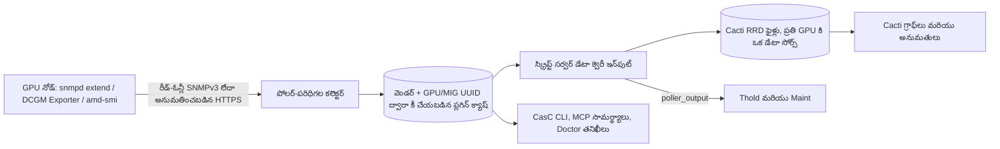

<!-- Source: README.md; SHA256: 97ba37df4a883426d3984ed7d14547ad7367e973411a8abd930409ce259f545b -->

<!-- translations:start -->
[English](../../../README.md) | [简体中文](../zh-CN/README.md) | [हिन्दी](../hi-IN/README.md) | [Español (España)](../es-ES/README.md) | [Español (Latinoamérica)](../es-419/README.md) | [العربية (السعودية)](../ar-SA/README.md) | [Afrikaans](../af-ZA/README.md) | [አማርኛ](../am-ET/README.md) | [العربية (مصر)](../ar-EG/README.md) | [العربية (المغرب)](../ar-MA/README.md) | [Български](../bg-BG/README.md) | [বাংলা](../bn-BD/README.md) | [Bosanski](../bs-BA/README.md) | [Deutsch](../de-DE/README.md) | [Ελληνικά](../el-GR/README.md) | [فارسی](../fa-IR/README.md) | [Filipino](../fil-PH/README.md) | [Français](../fr-FR/README.md) | [Français (Maroc)](../fr-MA/README.md) | [Français (Sénégal)](../fr-SN/README.md) | [Hausa](../ha-NG/README.md) | [עברית](../he-IL/README.md) | [Hrvatski](../hr-HR/README.md) | [Bahasa Indonesia](../id-ID/README.md) | [Igbo](../ig-NG/README.md) | [Italiano](../it-IT/README.md) | [日本語](../ja-JP/README.md) | [ქართული](../ka-GE/README.md) | [한국어](../ko-KR/README.md) | [Latviešu](../lv-LV/README.md) | [Malagasy](../mg-MG/README.md) | [मराठी](../mr-IN/README.md) | [Bahasa Melayu](../ms-MY/README.md) | [Nederlands](../nl-NL/README.md) | [Polski](../pl-PL/README.md) | [Português (Brasil)](../pt-BR/README.md) | [Português (Portugal)](../pt-PT/README.md) | [Русский](../ru-RU/README.md) | [Kinyarwanda](../rw-RW/README.md) | [Soomaali](../so-SO/README.md) | [Српски](../sr-RS/README.md) | [Svenska](../sv-SE/README.md) | [Kiswahili](../sw-KE/README.md) | [தமிழ்](../ta-IN/README.md) | [తెలుగు](README.md) | [ไทย](../th-TH/README.md) | [Türkçe](../tr-TR/README.md) | [Українська](../uk-UA/README.md) | [اردو](../ur-PK/README.md) | [Tiếng Việt](../vi-VN/README.md) | [isiXhosa](../xh-ZA/README.md) | [Yorùbá](../yo-NG/README.md) | [繁體中文](../zh-TW/README.md) | [isiZulu](../zu-ZA/README.md)
<!-- translations:end -->

# plugin_gpu

NVIDIA మరియు AMD సాధనాల నుండి ప్రతి GPU యొక్క వినియోగం, మెమరీ, ఉష్ణోగ్రత, విద్యుత్, ECC లోపాలు మరియు థ్రాట్లింగ్ కారణాలను Cacti లోకి తీసుకువచ్చే Cacti 1.2 ప్లగిన్. ప్రతి GPU (లేదా MIG ఇన్‌స్టాన్స్) దాని నోడ్ యొక్క పరికరంపై డేటా క్వెరీకి ఒక ఇండెక్స్‌గా మారుతుంది, కాబట్టి GPU గ్రాఫ్‌లు Cacti అనుమతుల క్రింద నోడ్ యొక్క ఇతర గ్రాఫ్‌ల పక్కనే ఉంటాయి మరియు Thold మరియు Maint వాటిపై హెచ్చరికలు జారీ చేయగలవు మరియు వాటిని నియంత్రించగలవు.

> **స్థితి: దశలు 1 నుండి 3 వరకు కోడ్‌లో అమలు చేయబడ్డాయి, ఇంకా విడుదల కాలేదు.** దశ 1 (SNMP extend ద్వారా NVIDIA `nvidia-smi`, గుర్తింపు ట్రాకింగ్, గ్రాఫ్‌లు, థ్రాటిల్ మరియు ECC సిగ్నల్స్, Thold మరియు Maint అలర్టింగ్, ఆరోగ్య పేజీ), దశ 2 (రీడ్-ఓన్లీ NVIDIA DCGM Exporter HTTP(S) పార్సర్/క్లయింట్ మరియు AMD `amd-smi` పార్సర్), దశ 3 (MIG ఇన్‌స్టాన్స్ గుర్తింపు ట్రాకింగ్, Schema v4 నిలువు వరుసలు, పోలర్-పరిధిగల రిమోట్ కలెక్టర్ అమలు, `replicate_out` మరియు `remote_agent` హుక్స్), CasC ఆపరేటర్ CLI (`cli/gpu.php`), మరియు ఎకోసిస్టమ్ హుక్స్ (`abilities_register`, `doctor_register_checks`, `casc_register_providers`) అమలు చేయబడ్డాయి మరియు యూనిట్, భద్రత మరియు డిస్పోజబుల్-Cacti ఇంటిగ్రేషన్ పరీక్షల ద్వారా కవర్ చేయబడ్డాయి. ఇప్పటివరకు లైవ్ రన్‌లు భౌతిక GPU హార్డ్‌వేర్ కాకుండా కృత్రిమ `snmpd` మరియు ఫిక్స్చర్ పేలోడ్‌లను మాత్రమే ఉపయోగిస్తున్నాయి. విడుదలను ట్యాగ్ చేయడానికి ముందు ఇంకా తెరిచి ఉన్నవి: నిజమైన హార్డ్‌వేర్‌పై పైలట్ పరీక్షలు ([docs/pilot-plan.md](../../pilot-plan.md), #54), బాహ్య భద్రతా సమీక్ష ([docs/security-review.md](../../security-review.md)), నిజమైన సాధనాల నుండి సేకరించిన ఫిక్స్చర్లు (#14), మరియు ప్రొడక్షన్-స్థాయి హార్డ్‌వేర్‌పై స్కేల్ కొలతలు ([docs/performance.md](../../performance.md)). XID లోపాల సేకరణ నిర్ణయం #8 కింద తెరిచి ఉంది.

## యాక్సెస్ పాత్రలు

| రియల్మ్ | యాక్సెస్ |
| --- | --- |
| GPU View | ప్రస్తుతం ఉన్న పర్యవేక్షణ పేజీలు. |
| GPU Operator | పర్యవేక్షణతో పాటు ఆపరేషన్స్ పేజీ మరియు వ్యక్తిగత ట్రయేజ్ నిర్ధారణలు. |
| GPU Admin | ఆపరేటర్ యాక్సెస్‌తో పాటు ప్రస్తుతం ఉన్న కాన్ఫిగరేషన్ మరియు పరిపాలనా చర్యలు. |

అప్‌గ్రేడ్ ఫైళ్లను కాపీ చేసిన తర్వాత, కొత్త రియల్మ్‌ను నమోదు చేయడానికి అడ్మినిస్ట్రేటర్‌గా Plugins పేజీని తెరవండి. **Configuration > Users** లేదా వినియోగదారు సమూహాల క్రింద Operator రియల్మ్‌ను స్పష్టంగా కేటాయించండి. అప్‌గ్రేడ్‌లు ప్రస్తుతం ఉన్న View మరియు Admin రియల్మ్ IDలు మరియు అనుమతులను అలాగే ఉంచుతాయి. ప్రతి అభ్యర్థనలోనూ Admin యాక్సెస్ Operator యాక్సెస్‌ను వారసత్వంగా పొందుతుంది మరియు Operator యాక్సెస్ View యాక్సెస్‌ను వారసత్వంగా పొందుతుంది; ఇది వినియోగదారులు లేదా సమూహాలకు నిల్వ చేయబడిన అనుమతులను జోడించదు. ప్లగిన్ సెట్టింగ్‌లకు Cacti యొక్క Settings అనుమతితో పాటు GPU Admin యాక్సెస్ కూడా అవసరం.

Cacti పరికర అనుమతులు ఇప్పటికీ ప్రతి వినియోగదారుకు అందుబాటులో ఉన్న వరుసలు మరియు చర్యలను పరిమితం చేస్తాయి; మ్యాప్ చేయని వస్తువులకు అడ్మినిస్ట్రేటర్ అవసరం. క్రెడెన్షియల్స్, కాన్ఫిగరేషన్, మ్యాపింగ్, తొలగింపు మరియు ఇతర పరిపాలనా మార్పులు పరిపాలనా పేజీలలోనే ఉంటాయి. నిర్ధారణలు ప్రస్తుత వినియోగదారు సెషన్‌లో మాత్రమే, గరిష్టంగా ఒక గంట పాటు మరియు అదే పరిశీలన తాజాగా ఉన్నంత వరకు మాత్రమే ఉంటాయి. కొత్త లేదా మారిన పరిశీలనలు వాటిని చెల్లనివిగా చేస్తాయి. అవి విఫలమైన కొలతను ఎప్పటికీ ఆరోగ్యకరమైనదిగా గుర్తించవు లేదా హెచ్చరికలను నియంత్రించవు.

## ఎందుకు

CPU, మెమరీ మరియు ఇంటర్‌ఫేస్‌ల కోసం GPU నోడ్‌లు సాధారణంగా ఇప్పటికే Cacti లో ఉంటాయి. నోడ్ యొక్క SNMP డేటా సమాధానం ఇవ్వని ప్రత్యేక అంశం GPU ఆరోగ్యం: నోడ్ ఆరోగ్యంగా కనిపిస్తున్నప్పటికీ, ఒక కార్డు ఉష్ణపరంగా థ్రాటిల్ కావచ్చు, ECC లోపాలను కూడబెట్టవచ్చు లేదా XID లోపాన్ని నివేదించవచ్చు. వెండర్ సాధనాలు (`nvidia-smi`, DCGM, `amd-smi`) దీనిని నివేదిస్తాయి, కానీ వాటి అవుట్‌పుట్ Cacti యొక్క గ్రాఫ్‌లు, అనుమతులు మరియు అలర్టింగ్‌కు వెలుపల ఉంటుంది.

వెండర్ సాధన అవుట్‌పుట్‌ను ప్రతి GPU యొక్క స్థానం కాకుండా దాని గుర్తింపు ద్వారా కీ చేయబడిన Cacti డేటా సోర్స్‌లుగా మార్చడం ద్వారా ఈ ప్లగిన్ ఆ అంతరాన్ని పూరిస్తుంది, తద్వారా GPUల క్రమాన్ని మార్చే రీబూట్ ఒక కార్డు చరిత్రను మరొక కార్డుకు జోడించదు. ఇది Cacti యొక్క గ్రాఫింగ్, అనుమతులు, రిమోట్ డేటా కలెక్టర్లు, Thold మరియు Maint ల సమాంతర వెర్షన్‌లను నిర్మించకుండా వాటినే తిరిగి ఉపయోగిస్తుంది.

## ప్రణాళికాబద్ధమైన పరిధి

| దశ | పరిధి | స్థితి | మైల్‌స్టోన్‌లు |
|---|---|---|---|
| 0, పరిశోధన | వెండర్ సాధన అవుట్‌పుట్, XID మరియు థ్రాటిల్ సిగ్నల్స్, GPU గుర్తింపు, అధికారాలు, సేకరణ మార్గ నిర్ణయం | పూర్తయింది | [M1](https://github.com/somethingwithproof/plugin_gpu/milestone/1) |
| 1, nvidia | `nvidia-smi` సేకరణ, UUID ద్వారా జాబితా, గ్రాఫ్‌లు, థ్రాటిల్ మరియు ECC సిగ్నల్స్, Thold మరియు Maint, ఆరోగ్య పేజీ | అమలు చేయబడింది (ఫిక్స్చర్-పరీక్షించబడింది) | [M2](https://github.com/somethingwithproof/plugin_gpu/milestone/2), [M3](https://github.com/somethingwithproof/plugin_gpu/milestone/3), [M4](https://github.com/somethingwithproof/plugin_gpu/milestone/4) |
| 2, బ్యాకెండ్‌లు | రీడ్-ఓన్లీ DCGM Exporter HTTP(S) పార్సర్/క్లయింట్ (`lib/DcgmExporterParser.php`, `lib/DcgmExporterClient.php`), AMD `amd-smi` పార్సర్ (`lib/AmdSmiParser.php`) | అమలు చేయబడింది (యూనిట్-పరీక్షించబడింది) | [M5](https://github.com/somethingwithproof/plugin_gpu/milestone/5) |
| 3, mig, రిమోట్ మరియు ఎకోసిస్టమ్ | MIG ఇన్‌స్టాన్స్ గుర్తింపు ట్రాకింగ్, రిమోట్ డేటా కలెక్టర్లు (`INFO`, `poller_gpu.php --poller=N`, `replicate_out`, `remote_agent`), CasC CLI (`cli/gpu.php`), MCP/Doctor/CasC హుక్స్ | అమలు చేయబడింది (యూనిట్ మరియు CI ఇంటిగ్రేషన్ పరీక్షించబడింది) | [M6](https://github.com/somethingwithproof/plugin_gpu/milestone/6) |

పరిధి వెలుపల ఉన్నవి: GPU లేదా నోడ్‌ను మార్చే ఏదైనా కమాండ్ (క్లాక్‌లు, పవర్ పరిమితులు, రీసెట్‌లు, MIG లేఅవుట్), ప్లగిన్ యాజమాన్యంలోని అలర్టింగ్ ఇంజిన్, కస్టమ్ డీమన్ లేదా నెట్‌వర్క్ ప్రోటోకాల్, మరియు షెడ్యూలర్ లేదా జాబ్ అకౌంటింగ్. పరిశోధన బ్యాక్‌లాగ్ కోసం ప్రణాళికను చూడండి.

## మైల్‌స్టోన్ 4 ఏమి జోడిస్తుంది

- **NVIDIA DCGM Exporter రీడ్-ఓన్లీ కలెక్టర్** (`lib/DcgmExporterParser.php`, `lib/DcgmExporterClient.php`). Prometheus టెక్స్ట్ ఎక్స్‌పోజిషన్ మెట్రిక్‌లను (`DCGM_FI_DEV_GPU_UTIL`, `DCGM_FI_DEV_FB_USED`, `DCGM_FI_DEV_FB_FREE`, `DCGM_FI_DEV_POWER_USAGE`, `DCGM_FI_DEV_GPU_TEMP`, `DCGM_FI_DEV_ECC_DBE_VOL_TOTAL`, `DCGM_FI_DEV_CLOCK_THROTTLE_REASONS`, మరియు MIG లేబుల్స్ `GPU_I_ID` మరియు `GPU_I_PROFILE`) పార్స్ చేస్తుంది. HTTP(S) క్లయింట్ స్పష్టమైన ఎండ్‌పాయింట్ హోస్ట్/CIDR అనుమతి జాబితాను అమలు చేస్తుంది, డిఫాల్ట్‌గా TLS పీర్ సర్టిఫికెట్‌లను ధృవీకరిస్తుంది, టైమ్‌అవుట్‌లు మరియు ప్రతిస్పందన పరిమాణాన్ని పరిమితం చేస్తుంది, రీడైరెక్ట్‌లను నిలిపివేస్తుంది మరియు HTTP(S) కాని స్కీమ్‌లను తిరస్కరిస్తుంది.
- **AMD `amd-smi` రీడ్-ఓన్లీ పార్సర్** (`lib/AmdSmiParser.php`). `amd-smi` JSON/SNMP-extend అవుట్‌పుట్‌ను (వినియోగం, VRAM, విద్యుత్, జంక్షన్/ఎడ్జ్ ఉష్ణోగ్రత, ECC, విభజన మెటాడేటా, మరియు `Reading::$vendorExtensions` ద్వారా ప్రత్యేక థ్రాటిల్ అక్యుములేటర్లు) `Vendor::Amd` కింద సాధారణ మెట్రిక్ మోడల్‌లోకి సాధారణీకరిస్తుంది.
- **MIG ఇన్‌స్టాన్స్ ట్రాకింగ్ మరియు Schema v4** (`lib/GpuReport.php`, `lib/GpuSnapshot.php`, `lib/GpuRecord.php`, `lib/Schema.php`, `lib/ScriptServer.php`). పేరెంట్ GPUలతో పాటు MIG ఇన్‌స్టాన్స్ UUIDలను (`MIG-<uuid>` మరియు `MIG-GPU-<parent>/<gi>/<ci>`), `mig_mode`, `mig_instance_id`, `mig_profile`, `parent_uuid`, మరియు `partition_info` ను ట్రాక్ చేస్తుంది మరియు అప్‌డేట్‌ల సమయంలో మార్పులేని గుర్తింపు కీలను (`vendor`, `uuid`, `parent_uuid`) రక్షిస్తుంది మరియు డేటాబేస్ క్వెరీలకు ముందు ధృవీకరిస్తుంది.
- **రిమోట్ డేటా కలెక్టర్లు** (`INFO`, `poller_gpu.php`, `lib/Poller.php`, `lib/ReplicationRepository.php`, `setup.php`). `INFO` లో `remote_collect:1, remote_poller:1` ను ప్రకటిస్తుంది, `php plugins/gpu/poller_gpu.php --poller=N` ద్వారా పోలర్-పరిధిగల అమలుకు మద్దతు ఇస్తుంది, ప్రధానం కాని పోలర్లలో Cacti వస్తువు సృష్టిని దాటవేస్తుంది, `replicate_out` ద్వారా పోలర్-పరిధిగల పట్టికలను ప్రతిరూపం చేస్తుంది మరియు `remote_agent` ద్వారా రీడ్-ఓన్లీ `gpu_health` మరియు `gpu_inventory` చర్యలకు సమాధానమిస్తుంది.
- **ఆపరేటర్ మరియు CasC CLI** (`cli/gpu.php`, `lib/CascProvider.php`). బాహ్య Composer డిపెండెన్సీలు లేకుండా PHP 8.2+ పై నడుస్తుంది (PHP 8.0 పై పార్స్ అవుతుంది): `php plugins/gpu/cli/gpu.php export [--format=yaml|xml]`, `validate <file> [--format=yaml|xml]`, `plan <file> [--format=yaml|xml] [--output=text|json]`, `apply <file> --confirm=<PLAN_HASH> [--format=yaml|xml]`, మరియు `health [--format=text|json]`. ప్రణాళికలు నిర్ణయాత్మక SHA-256 నిర్ధారణ హ్యాష్‌ను గణిస్తాయి, హ్యాష్ సరిపోలకపోతే `apply` సురక్షితంగా విఫలమవుతుంది, మరియు XML పార్సింగ్ `DOCTYPE` మరియు `ENTITY` ప్రకటనలను తిరస్కరిస్తుంది.
- **ఎకోసిస్టమ్ ఇంటిగ్రేషన్ హుక్స్** (`lib/EcosystemIntegration.php`, `setup.php`). `abilities_register` (`gpu-list-nodes`, `gpu-list-devices`, `gpu-get-health`; రీడ్-ఓన్లీ, `GPU View` రియల్మ్ మరియు Cacti పరికర అనుమతులపై ఆధారితమైనవి), `doctor_register_checks` (`gpu_schema`, `gpu_poller_freshness`, `gpu_node_health`), మరియు `casc_register_providers` లను నమోదు చేస్తుంది.
- **అలర్ట్ విలువలుగా థ్రాటిల్ కారణాలు మరియు ECC** ([docs/metrics.md](../../metrics.md)). క్లాక్ ఈవెంట్ మాస్క్‌లను 0/1 సూచికలుగా డీకోడ్ చేస్తుంది మరియు ప్రతి విరామానికి కొత్తగా సరిచేయబడిన/సరిచేయబడని ECC లోపాలను గేజ్‌లుగా గణిస్తుంది, తద్వారా Thold 1.8.2 మరియు Maint 1.3 రుణాత్మక కౌంటర్లు లేదా రీసెట్ స్పైక్‌లు లేకుండా హెచ్చరిస్తాయి మరియు నియంత్రిస్తాయి ([docs/alerting.md](../../alerting.md)).
- **GPU Health, అనుమతులు, వైఫల్యం/పునరుద్ధరణ మరియు స్కేల్.** GPU Health (GPU View) నోడ్‌లను సంప్రదించకుండా నిల్వ చేయబడిన తాజాదనం, చివరి సేకరణ ఫలితం, Maint స్థితి, బ్యాకెండ్, వెర్షన్లు మరియు రా థ్రాటిల్ మాస్క్‌లను చూపుతుంది. స్క్రిప్ట్ చేయబడిన ఎండ్-టు-ఎండ్ పరీక్షలు అనుమతులు, ఏజెంట్/DB/RRD వైఫల్య పునరుద్ధరణ ([docs/backup.md](../../backup.md)), మరియు CI లో 100-GPU స్కేల్ రన్ ([docs/performance.md](../../performance.md), [docs/operations.md](../../operations.md), [CHANGELOG.md](../../../CHANGELOG.md)) ను ధృవీకరిస్తాయి.

## మైల్‌స్టోన్ 3 ఏమి జోడిస్తుంది

- **SNMP extend ద్వారా సేకరణ** ([ADR 0008](../../decisions/0008-collect-through-snmp-extend.md)). నోడ్ యొక్క అడ్మినిస్ట్రేటర్ `snmpd.conf` కు రెండు స్థిరమైన `extend` లైన్లను జోడిస్తారు ([docs/node-setup.md](../../node-setup.md)); ప్లగిన్ పరికరం యొక్క స్వంత క్రెడెన్షియల్స్‌తో Cacti యొక్క SNMP ఫంక్షన్‌ల ద్వారా NET-SNMP-EXTEND-MIB ను చదువుతుంది, SNMPv3 సిఫార్సు చేయబడింది. ఇది Cacti సర్వర్ లేదా నోడ్‌పై దేనినీ అమలు చేయదు.
- **కఠినమైన పార్సింగ్.** ఫీల్డ్‌లు స్థానం ద్వారా చదవబడతాయి, ప్రతి లైన్ దాని GPU ని UUID ద్వారా పేర్కొంటుంది, మరియు సున్నా కాని ఎగ్జిట్ స్థితి, టైమ్‌అవుట్, కత్తిరించబడిన అవుట్‌పుట్, తప్పు ఫీల్డ్ సంఖ్య ఉన్న లైన్, లేదా విలీనమైన లోపం టెక్స్ట్ మొత్తం సేకరణను విఫలం చేస్తాయి: విలువలు `U` గా మారుతాయి, ఏ GPU గైర్హాజరుగా గుర్తించబడదు, మరియు GPU Nodes ఎందుకో చూపుతుంది.
- **ప్రతి పోలర్ సైకిల్ తర్వాత ఒక కలెక్టర్.** ఇది ప్రారంభించబడిన ప్రతి నోడ్ యొక్క ఏజెంట్‌ను చదువుతుంది, గుర్తింపు రికార్డులను నవీకరిస్తుంది మరియు తాజా నమూనాను క్యాష్ చేస్తుంది. స్క్రిప్ట్ సర్వర్ ఇన్‌పుట్ ఆ క్యాష్‌ను మాత్రమే చదువుతుంది, కాబట్టి Cacti పోల్ ఎప్పుడూ GPU నోడ్ కోసం వేచి ఉండదు.
- **Cacti వస్తువులు** ([ADR 0010](../../decisions/0010-attach-to-existing-node-devices.md)). టెంప్లేట్‌లు మరియు *GPU - Devices* డేటా క్వెరీ XML గా అందించబడతాయి మరియు ఇన్‌స్టాల్ మరియు అప్‌గ్రేడ్ సమయంలో దిగుమతి చేయబడతాయి. ఒక నోడ్‌ను సేవ్ చేయడం వలన రీఇండెక్స్ పద్ధతి None తో దాని ప్రస్తుత పరికరానికి డేటా క్వెరీ జోడించబడుతుంది; నోడ్‌కు ఏ పరికరం లేనప్పుడు మాత్రమే GPU Nodes ఒక పరికరాన్ని సృష్టించగలదు. ప్రతి GPU వెండర్ మరియు UUID ద్వారా కీ చేయబడిన ఒక ఇండెక్స్, దీని Utilization, Memory, Temperature, Power, Power Percent, Clocks, Throttle, ECC Errors, New ECC Errors, Retired Pages మరియు Sample Age గ్రాఫ్‌లు ఒకే డేటా సోర్స్‌ను పంచుకుంటాయి. Cacti ఒక గ్రాఫ్ ఉపయోగించే ఫీల్డ్‌లను మాత్రమే నిల్వ చేస్తుంది కాబట్టి ప్రతి మోడల్ ఫీల్డ్ ఏదో ఒక గ్రాఫ్ ద్వారా గీయబడుతుంది. ప్రతి GPU మార్పు తర్వాత ప్లగిన్ రీఇండెక్స్ చేస్తుంది, పరికరం Down లేదా నిలిపివేయబడినప్పుడు Cacti దాటవేసిన రీఇండెక్స్‌ను ఉంచి పరికరం Up అయిన తర్వాత దానిని అమలు చేస్తుంది మరియు కొత్త GPUల కోసం గ్రాఫ్‌లను సృష్టిస్తుంది.
- **చరిత్ర కార్డుతోనే ఉంటుంది.** గైర్హాజరైన GPU ఇండెక్స్‌గా కొనసాగుతుంది, కాబట్టి దాని గ్రాఫ్‌లు ఖాళీని చూపుతాయి మరియు అది తిరిగి వచ్చినప్పుడు అదే RRD ఫైల్‌లో కొనసాగుతాయి. అదే స్లాట్‌లోని ప్రత్యామ్నాయ కార్డుకు దాని స్వంత డేటా సోర్స్ లభిస్తుంది. నోడ్ పేజీలోని **Remove from Data Query** గైర్హాజరైన GPU ని జాబితా నుండి తొలగిస్తుంది; మీరు వాటిని తొలగించే వరకు దాని RRD ఫైళ్లు మరియు గ్రాఫ్‌లు ఉంచబడతాయి.
- **GPU Nodes పై పరికర అనుమతులు.** ఒక GPU Admin Cacti లో చూడగలిగే పరికరాలపై ఉన్న నోడ్‌లు మరియు GPUలను మాత్రమే చూస్తారు, మారుస్తారు, ఎగుమతి చేస్తారు మరియు తరలిస్తారు; GPU తరలింపుకు రెండు నోడ్‌లు అవసరం. పరికరం తొలగించబడిన నోడ్‌ను నిలిపివేయవచ్చు లేదా తొలగించవచ్చు.
- **సాధారణ మెట్రిక్ మోడల్** ([ADR 0009](../../decisions/0009-common-metric-core-with-vendor-extensions.md), [docs/metrics.md](../../metrics.md)). మెమరీ బైట్‌లలో ఉంటుంది, క్లాక్ ఈవెంట్ మాస్క్ `thr_*` సూచికలుగా డీకోడ్ చేయబడుతుంది, మరియు `age` అనేది GPU యొక్క స్వంత నమూనా సమయం యొక్క వయస్సు, లేదా తెలియనప్పుడు `U`.

ఇన్‌స్టాల్ చేసే (వెబ్ సర్వర్) వినియోగదారు `<cacti>/resource/script_server/` లో వ్రాయగలగాలి, అక్కడే ప్లగిన్ తన డేటా క్వెరీ XML ను ఉంచుతుంది; లేకపోతే ఇన్‌స్టాల్ మరియు అప్‌గ్రేడ్ ఒక సందేశంతో ఆగిపోతాయి మరియు తదుపరి ప్రయత్నంలో మళ్లీ ప్రయత్నిస్తాయి. *Remove the plugin's Cacti objects on uninstall* ఎంపిక చేయబడినప్పుడు మాత్రమే అన్‌ఇన్‌స్టాల్ టెంప్లేట్‌లు మరియు XML ను తొలగిస్తుంది, మరియు ఎప్పుడూ RRD ఫైళ్లు, పరికరాలు, గ్రాఫ్‌లు లేదా డేటా సోర్స్‌లను తొలగించదు ([docs/operations.md](../../operations.md#uninstall)). రిమోట్ డేటా కలెక్టర్లలోని నోడ్‌లు వాటికి కేటాయించిన `poller_id` పరిధిలో నడుస్తాయి.

## మైల్‌స్టోన్ 2 ఏమి అందిస్తుంది

- **రక్షిత ఇన్‌స్టాల్.** 8.2 కంటే తక్కువ PHP పై, అవసరమైన వెర్షన్‌ను పేర్కొనే సందేశంతో ఇన్‌స్టాల్ మరియు ఎనేబుల్ తిరస్కరించబడతాయి, మరియు Cacti లోని మిగిలిన భాగం పని చేస్తూనే ఉంటుంది. `setup.php` మరియు పేజీ స్క్రిప్ట్‌లు PHP 8.0 పై పార్స్ అవుతాయి.
- **జీవితచక్రం.** Cacti యొక్క Plugins పేజీ ద్వారా ఇన్‌స్టాల్, అప్‌గ్రేడ్, డిసేబుల్ మరియు అన్‌ఇన్‌స్టాల్. అప్‌గ్రేడ్‌లు క్రమపద్ధతిలో ఉంటాయి, అంతరాయం తర్వాత పూర్తవుతాయి, మరియు అవి విజయవంతమైన తర్వాత మాత్రమే నమోదు చేయబడిన వెర్షన్‌ను మారుస్తాయి. మీరు *Keep Plugin Tables on Uninstall* ను తీసివేయకపోతే అన్‌ఇన్‌స్టాల్ ప్లగిన్ యొక్క పట్టికలను ఉంచుతుంది; ఇది ఎప్పుడూ Cacti పరికరం, డేటా సోర్స్, గ్రాఫ్ లేదా RRD ఫైల్‌ను తాకదు.
- **వేర్వేరు రియల్మ్‌లు.** *GPU Admin* అనేది **GPU Nodes** ను తెరుస్తుంది, అక్కడ మీరు Cacti పరికరాలను GPU నోడ్‌లుగా నమోదు చేస్తారు, నోడ్‌ల మధ్య GPU తరలింపులను నిర్ధారిస్తారు లేదా తిరస్కరిస్తారు మరియు ప్రతి రికార్డును JSON గా ఎగుమతి చేస్తారు. *GPU View* అనేది **GPU Inventory** ను తెరుస్తుంది, ఇది చూసేవారు చూడగలిగే పరికరాలపై ఉన్న GPUలను మాత్రమే జాబితా చేస్తుంది. రెండు పేజీలు Management క్రింద ఉంటాయి, మరియు ప్రతి మార్పు csrf-magic ద్వారా తనిఖీ చేయబడిన POST అవుతుంది.
- **GPU గుర్తింపు రికార్డులు.** ప్రతి GPU వెండర్ మరియు UUID ద్వారా కీ చేయబడుతుంది. Index, PCI bus ID, పేరు, డ్రైవర్ మరియు నివేదించే సాధనం అనేవి ఉన్న చోటనే మారే లక్షణాలు. తెలిసిన స్లాట్‌లోని కొత్త UUID సంభావ్య ప్రత్యామ్నాయంగా ఫ్లాగ్ చేయబడుతుంది మరియు దాని స్వంత చరిత్రను ప్రారంభిస్తుంది; మరొక నోడ్ వద్ద కనిపించే GPU ఒక ఆపరేటర్ నిర్ధారించినప్పుడు మాత్రమే తరలించబడుతుంది; విజయవంతమైన సేకరణల నుండి కనిపించని GPU కాన్ఫిగర్ చేయదగిన సంఖ్య తర్వాత గైర్హాజరుగా గుర్తించబడుతుంది మరియు ఎప్పటికీ తొలగించబడదు. ప్రస్తుతానికి NVIDIA పూర్తి-GPU UUIDలు మాత్రమే ఆమోదించబడతాయి; MIG ఇన్‌స్టాన్స్‌లు నిర్ణయం #13 పై, మరియు AMD పరిశోధన #19 పై వేచి ఉన్నాయి. ఇంకా ఏ కలెక్టర్ వాటిని ఫీడ్ చేయనందున, నియమాలు ఫిక్స్చర్ శ్రేణుల ద్వారా పరీక్షించబడతాయి.
- **పరీక్షలు మరియు CI.** GPU లేదా డేటాబేస్ లేని యూనిట్ మరియు సోర్స్-రూల్ సూట్‌లు, PHP 8.2 నుండి 8.5 పై Cacti 1.2.31 మరియు ప్రస్తుత 1.2.x కు వ్యతిరేకంగా జీవితచక్రం మరియు పేజీ-అనుమతి తనిఖీలు, PHP 8.1 తిరస్కరణ జాబ్, ఎంట్రీ పాయింట్ల PHP 8.0 లింట్, స్థాయి 9 వద్ద PHPStan, మరియు REUSE. #12 నిర్ణయించబడే వరకు హార్నెస్ తాత్కాలికంగా ఉంటుంది.

### మూల్యాంకనం కోసం ఇన్‌స్టాల్ చేయండి

ఈ దశలు దీనిని ప్రయత్నించడానికి ప్రస్తుత కోడ్‌ను ఇన్‌స్టాల్ చేస్తాయి; [docs/operations.md](../../operations.md) లో పూర్తి ఆపరేటర్ గైడ్ ఉంది. వీటికి PHP 8.2 లేదా ఆ తర్వాత వెర్షన్‌పై Cacti 1.2.31 లేదా ఆ తర్వాత వెర్షన్ అవసరం.

1. మీ Cacti డైరెక్టరీ క్రింద `plugins/gpu` కు రిపోజిటరీని కాపీ చేయండి. డైరెక్టరీ పేరు తప్పనిసరిగా `gpu` అని ఉండాలి.
2. Cacti లో, **Configuration > Plugins** తెరిచి, ఆపై **GPU** ను ఇన్‌స్టాల్ చేసి ఎనేబుల్ చేయండి.
3. వినియోగదారులకు వారి పాత్ర ప్రకారం **Configuration > Users** క్రింద *GPU View*, *GPU Operator*, లేదా *GPU Admin* రియల్మ్‌ను ఇవ్వండి. ఇన్‌స్టాల్ చేసే వినియోగదారు View మరియు Admin లను పొందుతారు; Admin లో Operator యాక్సెస్ ఉంటుంది.
4. [docs/node-setup.md](../../node-setup.md) లో వివరించిన విధంగా ప్రతి GPU నోడ్ యొక్క SNMP ఏజెంట్‌ను సెటప్ చేయండి, ఆపై **Management > GPU Nodes** క్రింద నోడ్‌ను జోడించండి.
5. అలర్ట్‌ల కోసం, [docs/alerting.md](../../alerting.md) వివరించిన విధంగా అందించబడిన Thold టెంప్లేట్‌లను దిగుమతి చేయండి.
6. ఐచ్ఛికంగా **Configuration > Settings > GPU** ను సర్దుబాటు చేయండి: *Mark Absent After* (డిఫాల్ట్ 3 విజయవంతమైన సేకరణలు, 1 నుండి 100 వరకు), *Stale After* (దాని విలువలు `U` అని ప్రింట్ చేయడానికి ముందు ఒక నమూనా ఎంత పాతదిగా ఉండవచ్చు), మరియు *Keep Plugin Tables on Uninstall* (డిఫాల్ట్ ఆన్).

## మెట్రిక్స్ Cacti కి ఎలా చేరుతాయి

నిర్ణయం [#7](https://github.com/somethingwithproof/plugin_gpu/issues/7) SNMP `extend` ను ఎంచుకుంది ([ADR 0008](../../decisions/0008-collect-through-snmp-extend.md)): నోడ్ యొక్క స్వంత ఏజెంట్ స్థిరమైన `nvidia-smi` కమాండ్‌ను అమలు చేస్తుంది మరియు ప్లగిన్ ఫలితాన్ని మాత్రమే చదువుతుంది. ప్రణాళిక [సేకరణ మార్గాలు](../../PLAN.md#collection-paths) క్రింద ఎంపికలను పోల్చుతుంది.

## అనుకూలత లక్ష్యాలు

| భాగం | లక్ష్యం |
|---|---|
| Cacti | 1.2.31 లేదా ఆ తర్వాత, కోర్ ప్యాచ్‌లు లేవు |
| PHP | 8.2 లేదా ఆ తర్వాత; మద్దతు లేని రన్‌టైమ్ విరిగిన Cacti UI కి బదులుగా తిరస్కరణను పొందేలా `setup.php` 8.0 పై పార్స్ చేయదగినదిగా ఉంటుంది |
| NVIDIA | పరిశోధన [#26](https://github.com/somethingwithproof/plugin_gpu/issues/26) ద్వారా నిర్ణయించబడే డ్రైవర్ మరియు సాధన లైన్లు; DCGM ఫీల్డ్ IDలు v3.3.9 మరియు v4.7.0 వద్ద తనిఖీ చేయబడ్డాయి |
| AMD | పరిశోధన [#26](https://github.com/somethingwithproof/plugin_gpu/issues/26) ద్వారా నిర్ణయించబడే ROCm విడుదలలపై `amd-smi` |
| Thold, Maint | Thold 1.8.2 మరియు Maint 1.3, మార్పులేనివి, ఎండ్-టు-ఎండ్ పరీక్షించబడ్డాయి ([docs/alerting.md](../../alerting.md)) |

## రూపకల్పన

- [docs/PLAN.md](../../PLAN.md) అనేది పూర్తి ప్రణాళిక: ఆర్కిటెక్చర్, అది ఆధారపడే అప్‌స్ట్రీమ్ వాస్తవాలు (మూలాలతో సహా), గుర్తింపు మోడల్, భద్రతా సరిహద్దులు, పనితీరు గణితం, పరీక్షలు మరియు ప్రమాదాలు.
- [docs/decisions/](../../decisions) ఇప్పటికే తీసుకున్న ఎంపికల కోసం ఆర్కిటెక్చర్ నిర్ణయ రికార్డులను కలిగి ఉంది.
- [docs/REQUIREMENTS.md](../../REQUIREMENTS.md) ప్రతి అవసర ID ని దాని ఇష్యూకు మ్యాప్ చేస్తుంది.

## పని ఎలా ట్రాక్ చేయబడుతుంది

- **మైల్‌స్టోన్‌లు** ప్రణాళిక యొక్క మైల్‌స్టోన్‌లను అనుసరిస్తాయి. ప్రతిదానికి దాని ఉప-ఇష్యూలు మరియు నిష్క్రమణ ఆధారాలను జాబితా చేసే ఎపిక్ ఇష్యూ ఉంటుంది.
- **ఇష్యూలు** లేబుల్ ద్వారా టైప్ చేయబడతాయి: `type: requirement`, `type: research`, `type: decision`, `type: epic`. అవసర ఇష్యూలు సంఖ్యలతో కూడిన, పరీక్షించదగిన అవసరాలు (`REQ-AREA-NNN`) మరియు ఆమోద ప్రమాణాలను పేర్కొంటాయి.
- **లేబుల్స్** కూడా `area:`, `phase:`, `priority:`, మరియు `status:` లను కలిగి ఉంటాయి. [CONTRIBUTING.md](../../../CONTRIBUTING.md#labels) చూడండి.
- [ప్రాజెక్ట్ బోర్డ్](https://github.com/users/somethingwithproof/projects/9) మైల్‌స్టోన్‌ల అంతటా అన్ని ఇష్యూలను చూపుతుంది.

## సహకారం

[CONTRIBUTING.md](../../../CONTRIBUTING.md) చదవండి. కమిట్‌లకు DCO సైన్-ఆఫ్ అవసరం. డిజైన్ చర్చ ఇష్యూలపై జరుగుతుంది; తెరిచి ఉన్న నిర్ణయాలు `type: decision` లేబుల్‌ను కలిగి ఉంటాయి. నిజమైన GPU సాధనాల నుండి సేకరించిన అవుట్‌పుట్ మైల్‌స్టోన్ 1 కి అత్యంత ఉపయోగకరమైన సహకారం; ముందుగా హోస్ట్‌నేమ్‌లు, సీరియల్ నంబర్లు మరియు UUIDలను తీసివేయండి.

## భద్రత

దుర్బలత్వాలను ప్రైవేట్‌గా నివేదించండి; [SECURITY.md](../../../SECURITY.md) చూడండి.

## లైసెన్స్

GNU General Public License v2.0, Cacti మరియు దాని ప్లగిన్‌ల వలె అదే లైసెన్స్. [LICENSE](../../../LICENSE) చూడండి.
