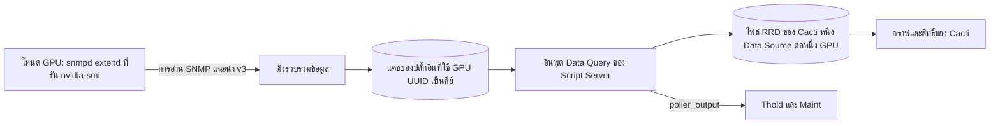

<!-- Source: README.md; SHA256: 126deef1783d64f878bf565f1433c10f31aef828eb9bc313aeff2b0335e54c7c -->

<!-- translations:start -->
[English](../../../README.md) | [简体中文](../zh-CN/README.md) | [हिन्दी](../hi-IN/README.md) | [Español (España)](../es-ES/README.md) | [Español (Latinoamérica)](../es-419/README.md) | [العربية (السعودية)](../ar-SA/README.md) | [Afrikaans](../af-ZA/README.md) | [አማርኛ](../am-ET/README.md) | [العربية (مصر)](../ar-EG/README.md) | [العربية (المغرب)](../ar-MA/README.md) | [বাংলা](../bn-BD/README.md) | [Deutsch](../de-DE/README.md) | [فارسی](../fa-IR/README.md) | [Filipino](../fil-PH/README.md) | [Français](../fr-FR/README.md) | [Français (Maroc)](../fr-MA/README.md) | [Français (Sénégal)](../fr-SN/README.md) | [Hausa](../ha-NG/README.md) | [עברית](../he-IL/README.md) | [Bahasa Indonesia](../id-ID/README.md) | [Igbo](../ig-NG/README.md) | [Italiano](../it-IT/README.md) | [日本語](../ja-JP/README.md) | [한국어](../ko-KR/README.md) | [Malagasy](../mg-MG/README.md) | [मराठी](../mr-IN/README.md) | [Bahasa Melayu](../ms-MY/README.md) | [Nederlands](../nl-NL/README.md) | [Polski](../pl-PL/README.md) | [Português (Brasil)](../pt-BR/README.md) | [Русский](../ru-RU/README.md) | [Kinyarwanda](../rw-RW/README.md) | [Soomaali](../so-SO/README.md) | [Svenska](../sv-SE/README.md) | [Kiswahili](../sw-KE/README.md) | [தமிழ்](../ta-IN/README.md) | [తెలుగు](../te-IN/README.md) | [ไทย](README.md) | [Türkçe](../tr-TR/README.md) | [Українська](../uk-UA/README.md) | [اردو](../ur-PK/README.md) | [Tiếng Việt](../vi-VN/README.md) | [isiXhosa](../xh-ZA/README.md) | [Yorùbá](../yo-NG/README.md) | [繁體中文](../zh-TW/README.md) | [isiZulu](../zu-ZA/README.md)
<!-- translations:end -->

# plugin_gpu

ปลั๊กอินสำหรับ Cacti 1.2 ที่นำข้อมูลการใช้งานต่อ GPU, หน่วยความจำ, อุณหภูมิ, พลังงาน, ข้อผิดพลาด ECC และสาเหตุการลดความเร็ว (throttling) จากเครื่องมือของ NVIDIA เข้าสู่ Cacti ส่วนการรองรับ AMD และการรวบรวมข้อผิดพลาด XID อยู่ในแผนงานแต่ยังไม่ได้พัฒนา GPU แต่ละตัวจะกลายเป็นดัชนีของ Data Query บนอุปกรณ์ของโหนดนั้นๆ ทำให้กราฟ GPU อยู่เคียงข้างกราฟอื่นๆ ของโหนดภายใต้ระบบสิทธิ์ของ Cacti และ Thold กับ Maint สามารถแจ้งเตือนและระงับการแจ้งเตือนได้

> **สถานะ: อยู่ระหว่างการพัฒนา ยังไม่เผยแพร่เวอร์ชันใช้งานจริง** Milestone 4 ทำให้ระยะที่ 1 (NVIDIA ผ่าน SNMP extend) มีโค้ดครบถ้วนแล้ว ได้แก่ การรวบรวมข้อมูล, การระบุตัวตน, กราฟ, สัญญาณ throttle และ ECC, การแจ้งเตือนด้วย Thold และ Maint, หน้าสถานะสุขภาพ (Health) และเอกสารสำหรับผู้ดูแลระบบ ทั้งนี้ระบบเพิ่งถูกทดสอบกับ `snmpd` จริงร่วมกับ `nvidia-smi` จำลองที่พิมพ์ผลลัพธ์สังเคราะห์เท่านั้น ยังไม่เคยรันบนฮาร์ดแวร์ GPU จริง สิ่งที่ยังต้องดำเนินการก่อนเผยแพร่ ได้แก่ การทดสอบนำร่องบนฮาร์ดแวร์จริง ([docs/pilot-plan.md](../../pilot-plan.md), #54), การตรวจสอบความปลอดภัยจากภายนอก ([docs/security-review.md](../../security-review.md)), ชุดข้อมูลตัวอย่างที่เก็บจากเครื่องมือจริง (#14) และการวัดความสามารถในการรองรับขนาดบนฮาร์ดแวร์ระดับใช้งานจริง ([docs/performance.md](../../performance.md)) ส่วนข้อผิดพลาด XID ยังรอการตัดสินใจ #8 ห้ามนำไปใช้งานในสภาพแวดล้อมจริง

## บทบาทการเข้าถึง

| Realm | สิทธิ์การเข้าถึง |
| --- | --- |
| GPU View | หน้ามอนิเตอร์ที่มีอยู่ |
| GPU Operator | การมอนิเตอร์ ร่วมกับหน้า Operations และการรับทราบปัญหาเฉพาะบุคคล |
| GPU Admin | สิทธิ์ของ Operator ร่วมกับการตั้งค่าและการดำเนินการด้านการดูแลระบบที่มีอยู่ |

หลังจากคัดลอกไฟล์อัปเกรดแล้ว ให้เปิดหน้า Plugins ในฐานะผู้ดูแลระบบเพื่อลงทะเบียน Realm ใหม่ กำหนด Realm ของ Operator อย่างชัดเจนภายใต้ **Configuration > Users** หรือกลุ่มผู้ใช้
การอัปเกรดจะคง ID และสิทธิ์ของ View และ Admin Realm เดิมไว้ สิทธิ์ Admin จะสืบทอดสิทธิ์ Operator และสิทธิ์ Operator จะสืบทอดสิทธิ์ View ในแต่ละคำขอโดยอัตโนมัติ โดยไม่ได้เพิ่มสิทธิ์ที่บันทึกไว้ให้ผู้ใช้หรือกลุ่มผู้ใช้ การตั้งค่าปลั๊กอินยังต้องใช้สิทธิ์ GPU Admin เพิ่มเติมจากสิทธิ์ Settings ของ Cacti ด้วย

สิทธิ์ระดับอุปกรณ์ของ Cacti ยังคงจำกัดแถวและการดำเนินการที่ผู้ใช้แต่ละคนสามารถเข้าถึงได้ ส่วนออบเจกต์ที่ยังไม่ได้จับคู่จำเป็นต้องให้ผู้ดูแลระบบจัดการ
ข้อมูลรับรอง, การตั้งค่า, การจับคู่, การลบ และการเปลี่ยนแปลงเชิงบริหารอื่นๆ ยังคงอยู่ในหน้าการดูแลระบบ การรับทราบปัญหาจะมีผลเฉพาะในเซสชันปัจจุบันของผู้ใช้ นานสูงสุดหนึ่งชั่วโมง และเฉพาะตราบใดที่ค่าสังเกตเดิมยังคงใหม่อยู่เท่านั้น ค่าสังเกตใหม่หรือที่เปลี่ยนแปลงจะทำให้การรับทราบเป็นโมฆะ และจะไม่ถือว่าการวัดผลที่ล้มเหลวเป็นสถานะปกติหรือระงับการแจ้งเตือนโดยเด็ดขาด

## เหตุผลความเป็นมา

โดยปกติโหนด GPU มักถูกเพิ่มไว้ใน Cacti อยู่แล้วเพื่อมอนิเตอร์ CPU, หน่วยความจำ และอินเทอร์เฟซต่างๆ แต่สุขภาพของ GPU เป็นอีกเรื่องหนึ่งที่ข้อมูล SNMP ของโหนดไม่ได้ให้คำตอบ การ์ดอาจถูกลดความเร็วเนื่องจากความร้อน สะสมข้อผิดพลาด ECC หรือรายงานข้อผิดพลาด XID ในขณะที่ตัวโหนดเองยังดูปกติดี เครื่องมือของผู้ผลิตสามารถรายงานข้อมูลเหล่านี้ได้ (`nvidia-smi`, DCGM, `amd-smi`) แต่ผลลัพธ์ของเครื่องมือเหล่านั้นอยู่นอกเหนือระบบกราฟ สิทธิ์ และการแจ้งเตือนของ Cacti

ปลั๊กอินนี้ช่วยปิดช่องว่างดังกล่าวโดยแปลงผลลัพธ์จากเครื่องมือของผู้ผลิตให้เป็น Data Source ของ Cacti ที่ผูกกับตัวตนของ GPU แต่ละตัวแทนตำแหน่งที่ติดตั้ง ดังนั้นการรีบูตที่ทำให้ลำดับ GPU เปลี่ยนไปจะไม่นำประวัติของการ์ดใบหนึ่งไปผูกกับอีกใบหนึ่ง และปลั๊กอินยังนำระบบกราฟ สิทธิ์ ตัวรวบรวมข้อมูลระยะไกล, Thold และ Maint ของ Cacti มาใช้ซ้ำแทนที่จะสร้างระบบคู่ขนานขึ้นมาใหม่

## ขอบเขตตามแผนงาน

| ระยะ | ขอบเขต | Milestones |
|---|---|---|
| 0, การวิจัย | ผลลัพธ์จากเครื่องมือผู้ผลิต, สัญญาณ XID และ throttle, ตัวตนของ GPU, สิทธิ์การใช้งาน, การตัดสินใจเลือกเส้นทางการรวบรวมข้อมูล | [M1](https://github.com/somethingwithproof/plugin_gpu/milestone/1) |
| 1, nvidia | การรวบรวมข้อมูลด้วย `nvidia-smi`, รายการอุปกรณ์ตาม UUID, กราฟ, สัญญาณ throttle, ECC และ XID, Thold และ Maint, หน้าสถานะสุขภาพ | [M2](https://github.com/somethingwithproof/plugin_gpu/milestone/2), [M3](https://github.com/somethingwithproof/plugin_gpu/milestone/3), [M4](https://github.com/somethingwithproof/plugin_gpu/milestone/4) |
| 2, backends | แบ็กเอนด์ DCGM, แบ็กเอนด์ `amd-smi` | [M5](https://github.com/somethingwithproof/plugin_gpu/milestone/5) |
| 3, mig และ remote | อินสแตนซ์ MIG, ตัวรวบรวมข้อมูลระยะไกลของ Cacti | [M6](https://github.com/somethingwithproof/plugin_gpu/milestone/6) |

สิ่งที่อยู่นอกขอบเขต: คำสั่งใดๆ ที่เปลี่ยนแปลงค่าของ GPU หรือโหนด (คล็อก, ขีดจำกัดพลังงาน, การรีเซ็ต, เลย์เอาต์ MIG), ระบบแจ้งเตือนที่เป็นของปลั๊กอินเอง, daemon หรือโปรโตคอลเครือข่ายแบบกำหนดเอง และการบัญชีงานหรือตัวจัดตารางงาน โปรดดูรายละเอียดงานวิจัยคงค้างในแผนงาน

## สิ่งที่เพิ่มเข้ามาใน Milestone 4

- **สาเหตุการลดความเร็วในรูปแบบค่าแจ้งเตือน** มาสก์เหตุการณ์คล็อกจะถูกถอดรหัสเป็นตัวบ่งชี้ค่า 0 หรือ 1 แยกตามแต่ละสาเหตุ หากเป็นมาสก์ที่ไม่รู้จัก ตัวบ่งชี้จะเป็นค่าไม่ทราบ (unknown) ไม่ใช่ศูนย์ และบิตที่ไม่มีตัวบ่งชี้จะยังคงอยู่ในมาสก์ดิบซึ่งหน้า GPU Health จะแสดงให้เห็น
- **ECC ในรูปแบบค่าแจ้งเตือน** ([docs/metrics.md](../../metrics.md)) ข้อผิดพลาดแบบแก้ไขได้ (corrected) และแก้ไขไม่ได้ (uncorrected) ที่เกิดขึ้นใหม่นับจากตัวอย่างก่อนหน้าจะถูกคำนวณโดยปลั๊กอินจากผลรวมสะสมสองค่าต่อเนื่องกันและจัดเก็บเป็นค่าเกจ: ค่าจะเป็น unknown สำหรับตัวอย่างแรก การอ่านที่พลาด หรือการโหลดไดรเวอร์ใหม่ เพื่อไม่ให้การรีเซ็ตถูกอ่านเป็นศูนย์หรือเป็นค่าติดลบ นอกจากนี้ยังมีการอ่านจำนวนหน้าที่ถูกปลดระวางแบบ single-bit และ double-bit รวมถึงโหมด ECC ด้วย กราฟ ECC เพิ่มเติมอีกสองกราฟต่อ GPU ช่วยให้ Cacti จัดเก็บค่าเหล่านี้ได้ เมื่อรวมกับ Power Percent แล้วจะมีกราฟทั้งหมดสิบเอ็ดกราฟ ทั้งนี้ยังไม่รวบรวม XID เนื่องจากยังไม่มีแหล่งข้อมูลที่เข้ากับคำสั่ง `nvidia-smi` แบบคงที่ได้ (#8)
- **Thold และ Maint** ([docs/alerting.md](../../alerting.md)) เทมเพลต Thold ที่ให้มาพร้อมปลั๊กอินสำหรับอุณหภูมิ, พลังงานเทียบกับขีดจำกัด, ตัวบ่งชี้การลดความเร็ว, ข้อผิดพลาด ECC แบบแก้ไขไม่ได้ที่เกิดขึ้นใหม่, การปลดระวางหน้าหน่วยความจำที่รอดำเนินการ และอายุของตัวอย่างข้อมูล ทุกค่าเป็นเกจเนื่องจาก Thold 1.8.2 ล้มเหลวเมื่อพบค่า counter ที่เป็น unknown การทดสอบแบบครบวงจรกับ Thold 1.8.2 และ Maint 1.3 ที่ไม่ได้ดัดแปลงแสดงให้เห็นว่าแต่ละเกณฑ์แจ้งเตือนทำงานและคืนค่าปกติได้แม้ข้ามการรีเซ็ต ECC และ Maint สามารถระงับการแจ้งเตือนได้
- **GPU Health** (GPU View) ข้อมูลต่อโหนด: ความสดใหม่ของข้อมูล, ผลลัพธ์ของการรวบรวมครั้งล่าสุด, สถานะ Maint, แบ็กเอนด์, เวอร์ชันของเครื่องมือและไดรเวอร์ และจำนวน GPU; ข้อมูลต่อ GPU: การมีอยู่, อายุของตัวอย่าง, สถานะ ECC และมาสก์ดิบ โดยอ่านจากข้อมูลที่จัดเก็บไว้เท่านั้น
- **สิทธิ์การใช้งาน** ชุดทดสอบสิทธิ์ครอบคลุมไฟล์หน้าเว็บและการดำเนินการทุกอย่าง การเพิกถอนสิทธิ์ในคำขอถัดไป และการปฏิเสธสิทธิ์ที่ไม่เปิดเผยข้อมูลใดๆ
- **การรับรองความทนทานต่อความล้มเหลวและการกู้คืน** การรันทดสอบแบบครบวงจรด้วยสคริปต์จะจำลองความล้มเหลวของเอเจนต์, ข้อมูลรับรอง, เครื่องมือ, ผลลัพธ์ของเครื่องมือ, การเชื่อมต่อฐานข้อมูล และการเขียน RRD รวมถึงการกู้คืนฐานข้อมูลจากไฟล์ dump แม้แต่ไฟล์ที่เก่ากว่าไฟล์ RRD; GPU ใหม่จะไม่สืบทอดไฟล์ RRD ของ GPU อื่นเด็ดขาด ([docs/backup.md](../../backup.md))
- **การรองรับขนาด** ([docs/performance.md](../../performance.md)) การทดสอบความสามารถในการรองรับขนาดจะจับเวลาการรวบรวมข้อมูล, อินพุตของ script server, การสร้างออบเจกต์ของ Cacti, รอบการทำงานของ poller และหน้าสถานะสุขภาพที่จำนวน GPU ที่กำหนด โดย CI รันทดสอบที่ 100 GPU ยังไม่มีการบันทึกผลการวัดที่ 1,000 และ 8,000 GPU จึงยังไม่ได้ระบุจำนวน GPU สูงสุดที่รองรับ
- **เอกสารสำหรับผู้ดูแลระบบ** ([docs/operations.md](../../operations.md)): การติดตั้ง, การอัปเกรด, การถอนการติดตั้ง, หลักสิทธิ์น้อยที่สุด, ค่าที่ไม่พร้อมใช้งาน และการแก้ไขปัญหา รายการเปลี่ยนแปลงแสดงอยู่ใน [CHANGELOG.md](../../../CHANGELOG.md)

## สิ่งที่เพิ่มเข้ามาใน Milestone 3

- **การรวบรวมข้อมูลผ่าน SNMP extend** ([ADR 0008](../../decisions/0008-collect-through-snmp-extend.md)) ผู้ดูแลระบบของโหนดเพิ่มบรรทัด `extend` แบบคงที่สองบรรทัดลงใน `snmpd.conf` ([docs/node-setup.md](../../node-setup.md)) จากนั้นปลั๊กอินจะอ่าน NET-SNMP-EXTEND-MIB ผ่านฟังก์ชัน SNMP ของ Cacti ด้วยข้อมูลรับรองของตัวอุปกรณ์เอง โดยแนะนำให้ใช้ SNMPv3 ปลั๊กอินไม่ได้รันคำสั่งใดๆ บนเซิร์ฟเวอร์ Cacti หรือบนโหนด
- **การแยกวิเคราะห์ที่เข้มงวด** ฟิลด์ต่างๆ จะถูกอ่านตามตำแหน่ง แต่ละบรรทัดจะระบุตัวตน GPU ด้วย UUID และหากมี exit status ที่ไม่ใช่ศูนย์, การหมดเวลา, ผลลัพธ์ถูกตัดทอน, บรรทัดที่มีจำนวนฟิลด์ไม่ถูกต้อง หรือข้อความแสดงข้อผิดพลาดปะปนมา จะทำให้การรวบรวมข้อมูลทั้งหมดล้มเหลว: ค่าทั้งหมดจะกลายเป็น `U` ไม่มี GPU ใดถูกทำเครื่องหมายว่าขาดหาย และหน้า GPU Nodes จะแสดงสาเหตุให้ทราบ
- **ตัวรวบรวมข้อมูลหลังจบรอบการทำงานของ poller แต่ละรอบ** ตัวรวบรวมจะอ่านข้อมูลจากเอเจนต์ของโหนดที่เปิดใช้งานแต่ละโหนด อัปเดตบันทึกตัวตน และแคชตัวอย่างข้อมูลล่าสุด อินพุตของ script server จะอ่านจากแคชนี้เท่านั้น ดังนั้นการ poll ของ Cacti จะไม่ต้องรอโหนด GPU
- **ออบเจกต์ของ Cacti** ([ADR 0010](../../decisions/0010-attach-to-existing-node-devices.md)) เทมเพลตและ Data Query ชื่อ *GPU - Devices* จะมาพร้อมในรูปแบบ XML และถูกนำเข้าเมื่อติดตั้งและอัปเกรด การบันทึกโหนดจะแนบ Data Query เข้ากับอุปกรณ์ที่มีอยู่ด้วยวิธีการ reindex แบบ None โดย GPU Nodes สามารถสร้างอุปกรณ์ใหม่ได้เฉพาะเมื่อโหนดนั้นยังไม่มีอุปกรณ์เท่านั้น GPU แต่ละตัวคือดัชนีที่ระบุด้วยผู้ผลิตและ UUID โดยมี Data Source หนึ่งตัวที่ใช้ร่วมกันสำหรับกราฟ Utilization, Memory, Temperature, Power, Power Percent, Clocks, Throttle, ECC Errors, New ECC Errors, Retired Pages และ Sample Age ทุกฟิลด์ในโมเดลจะถูกนำไปวาดโดยกราฟอย่างน้อยหนึ่งกราฟ เนื่องจาก Cacti จัดเก็บเฉพาะฟิลด์ที่กราฟใช้งานเท่านั้น ปลั๊กอินจะทำ reindex หลังการเปลี่ยนแปลง GPU ทุกครั้ง เก็บการทำ reindex ที่ Cacti ข้ามไปขณะอุปกรณ์ Down หรือถูกปิดใช้งานไว้แล้วสั่งรันเมื่ออุปกรณ์กลับมา Up พร้อมทั้งสร้างกราฟสำหรับ GPU ใหม่
- **ประวัติข้อมูลยังคงอยู่กับการ์ด** GPU ที่ขาดหายไปจะยังคงเป็นดัชนีอยู่ ดังนั้นกราฟของมันจะแสดงช่วงที่ขาดหายและบันทึกต่อในไฟล์ RRD เดิมเมื่อกลับมาใช้งานได้ ส่วนการ์ดทดแทนในสล็อตเดียวกันจะได้ Data Source ของตัวเอง การใช้ **Remove from Data Query** บนหน้าของโหนดจะนำ GPU ที่ขาดหายออกจากรายการ แต่ไฟล์ RRD และกราฟจะยังคงถูกเก็บไว้จนกว่าคุณจะลบออกเอง
- **สิทธิ์ระดับอุปกรณ์บนหน้า GPU Nodes** ผู้ใช้ที่มีสิทธิ์ GPU Admin จะมองเห็น เปลี่ยนแปลง ส่งออก และย้ายได้เฉพาะโหนดและ GPU บนอุปกรณ์ที่ตนมีสิทธิ์มองเห็นใน Cacti เท่านั้น โดยการย้าย GPU ต้องมีสิทธิ์ทั้งสองโหนด ส่วนโหนดที่อุปกรณ์ถูกลบไปแล้วสามารถปิดใช้งานหรือลบออกได้
- **โมเดลเมตริกกลาง** ([ADR 0009](../../decisions/0009-common-metric-core-with-vendor-extensions.md), [docs/metrics.md](../../metrics.md)) หน่วยความจำมีหน่วยเป็นไบต์ มาสก์เหตุการณ์คล็อกถูกถอดรหัสเป็นตัวบ่งชี้ `thr_*` และ `age` คืออายุของเวลาตัวอย่างข้อมูลของ GPU เอง หรือ `U` เมื่อไม่ทราบค่า

ผู้ใช้ที่ทำการติดตั้งต้องสามารถเขียนลงใน `<cacti>/resource/script_server/` ซึ่งเป็นตำแหน่งที่ปลั๊กอินวางไฟล์ XML ของ Data Query ไว้ มิฉะนั้นการติดตั้งและการอัปเกรดจะหยุดลงพร้อมข้อความแจ้งเตือนและลองใหม่ในการดำเนินการครั้งถัดไป การถอนการติดตั้งจะลบเทมเพลตและไฟล์ XML เฉพาะเมื่อเลือกตัวเลือก *Remove the plugin's Cacti objects on uninstall* เท่านั้น และจะไม่ลบไฟล์ RRD, อุปกรณ์, กราฟ หรือ Data Source เด็ดขาด ([docs/operations.md](../../operations.md#uninstall)) สำหรับโหนดบนตัวรวบรวมข้อมูลระยะไกลจะยังไม่ถูกรวบรวมข้อมูลจนกว่าจะถึงระยะที่ 3

## สิ่งที่รวมอยู่ใน Milestone 2

- **การติดตั้งที่มีการตรวจสอบป้องกัน** บน PHP เวอร์ชันต่ำกว่า 8.2 การติดตั้งและเปิดใช้งานจะถูกปฏิเสธพร้อมข้อความระบุเวอร์ชันที่ต้องการ และส่วนอื่นๆ ของ Cacti จะยังคงทำงานได้ตามปกติ โดย `setup.php` และสคริปต์หน้าเว็บต่างๆ สามารถ parse บน PHP 8.0 ได้
- **วงจรชีวิตปลั๊กอิน** ติดตั้ง อัปเกรด ปิดใช้งาน และถอนการติดตั้งผ่านหน้า Plugins ของ Cacti การอัปเกรดจะทำงานตามลำดับ สามารถทำงานต่อจนเสร็จได้หลังถูกขัดจังหวะ และจะเปลี่ยนเลขเวอร์ชันที่บันทึกไว้หลังจากอัปเกรดสำเร็จแล้วเท่านั้น การถอนการติดตั้งจะเก็บตารางของปลั๊กอินไว้ เว้นแต่คุณจะยกเลิกการเลือก *Keep Plugin Tables on Uninstall* และจะไม่แตะต้องอุปกรณ์, Data Source, กราฟ หรือไฟล์ RRD ใดๆ ของ Cacti
- **Realm ที่แยกจากกัน** *GPU Admin* ใช้เปิดหน้า **GPU Nodes** ซึ่งคุณสามารถลงทะเบียนอุปกรณ์ Cacti เป็นโหนด GPU ยืนยันหรือปฏิเสธการย้าย GPU ระหว่างโหนด และส่งออกบันทึกทั้งหมดเป็น JSON ได้ ส่วน *GPU View* ใช้เปิดหน้า **GPU Inventory** ซึ่งแสดงรายการ GPU เฉพาะบนอุปกรณ์ที่ผู้ชมมีสิทธิ์มองเห็น ทั้งสองหน้าอยู่ภายใต้เมนู Management และการเปลี่ยนแปลงทุกอย่างใช้ POST ที่ตรวจสอบด้วย csrf-magic
- **บันทึกตัวตนของ GPU** GPU แต่ละตัวถูกระบุด้วยผู้ผลิตและ UUID ส่วน Index, PCI bus ID, ชื่อ, ไดรเวอร์ และเครื่องมือที่รายงานเป็นแอตทริบิวต์ที่เปลี่ยนแปลงแทนที่เดิมได้ หากพบ UUID ใหม่ในสล็อตที่รู้จักอยู่แล้ว จะถูกทำเครื่องหมายว่าอาจเป็นการเปลี่ยนการ์ดและเริ่มต้นประวัติใหม่ของตัวเอง; GPU ที่พบในโหนดอื่นจะถูกย้ายก็ต่อเมื่อผู้ปฏิบัติงานยืนยัน; GPU ที่หายไปจากการรวบรวมข้อมูลที่สำเร็จจะถูกทำเครื่องหมายว่าขาดหายหลังจากครบจำนวนครั้งที่กำหนดและจะไม่ถูกลบ สำหรับตอนนี้รองรับเฉพาะ UUID ของ GPU ทั้งใบของ NVIDIA เท่านั้น ส่วนอินสแตนซ์ MIG รอการตัดสินใจ #13 และ AMD รอการวิจัย #19 กฎเหล่านี้ถูกทดสอบด้วยลำดับข้อมูลจำลองเนื่องจากยังไม่มีตัวรวบรวมข้อมูลป้อนให้ในระยะนี้
- **การทดสอบและ CI** ชุดทดสอบยูนิตและกฎของซอร์สโค้ดโดยไม่ต้องใช้ GPU หรือฐานข้อมูล, การตรวจสอบวงจรชีวิตและสิทธิ์ของหน้าเว็บกับ Cacti 1.2.31 และ 1.2.x ปัจจุบันบน PHP 8.2 ถึง 8.5, งานทดสอบการปฏิเสธบน PHP 8.1, การตรวจ lint บน PHP 8.0 ของจุดเข้าใช้งานหลัก, PHPStan ที่ level 9 และ REUSE ทั้งนี้ชุดทดสอบชั่วคราวยังเป็นแบบเบื้องต้นจนกว่าจะมีการตัดสินใจ #12

### การติดตั้งเพื่อทดลองใช้งาน

ขั้นตอนเหล่านี้ใช้ติดตั้งโค้ดปัจจุบันเพื่อทดลองใช้งาน โปรดดูคู่มือสำหรับผู้ดูแลระบบฉบับเต็มที่ [docs/operations.md](../../operations.md) โดยจำเป็นต้องใช้ Cacti 1.2.31 ขึ้นไป บน PHP 8.2 ขึ้นไป

1. คัดลอกรีโพซิทอรีไปยัง `plugins/gpu` ภายใต้ไดเรกทอรี Cacti ของคุณ ไดเรกทอรีนี้ต้องตั้งชื่อว่า `gpu`
2. ใน Cacti ให้เปิด **Configuration > Plugins** จากนั้นติดตั้งและเปิดใช้งาน **GPU**
3. มอบสิทธิ์ Realm *GPU View*, *GPU Operator* หรือ *GPU Admin* ให้ผู้ใช้ภายใต้ **Configuration > Users** ตามบทบาทของแต่ละคน โดยผู้ใช้ที่ทำการติดตั้งจะได้รับ View และ Admin ซึ่ง Admin จะรวมสิทธิ์การเข้าถึงของ Operator อยู่แล้ว
4. ตั้งค่าเอเจนต์ SNMP ของโหนด GPU แต่ละโหนดตามที่อธิบายไว้ใน [docs/node-setup.md](../../node-setup.md) จากนั้นเพิ่มโหนดภายใต้ **Management > GPU Nodes**
5. สำหรับการแจ้งเตือน ให้นำเข้าเทมเพลต Thold ที่ให้มาพร้อมปลั๊กอินตามที่อธิบายไว้ใน [docs/alerting.md](../../alerting.md)
6. ปรับแต่งค่าเพิ่มเติมได้ตามต้องการที่ **Configuration > Settings > GPU**: *Mark Absent After* (ค่าเริ่มต้นคือการรวบรวมที่สำเร็จ 3 ครั้ง ตั้งแต่ 1 ถึง 100), *Stale After* (ระยะเวลาความเก่าของตัวอย่างข้อมูลก่อนที่ค่าจะแสดงเป็น `U`) และ *Keep Plugin Tables on Uninstall* (ค่าเริ่มต้นคือเปิด)

## วิธีที่เมตริกส่งไปถึง Cacti

การตัดสินใจ [#7](https://github.com/somethingwithproof/plugin_gpu/issues/7) เลือกใช้ SNMP `extend` ([ADR 0008](../../decisions/0008-collect-through-snmp-extend.md)): เอเจนต์ของตัวโหนดเองจะรันคำสั่ง `nvidia-smi` แบบคงที่ และปลั๊กอินทำหน้าที่อ่านผลลัพธ์เท่านั้น แผนงานได้เปรียบเทียบทางเลือกต่างๆ ไว้ภายใต้ [เส้นทางการรวบรวมข้อมูล](../../PLAN.md#collection-paths)

## เป้าหมายความเข้ากันได้

| องค์ประกอบ | เป้าหมาย |
|---|---|
| Cacti | 1.2.31 ขึ้นไป โดยไม่ต้องแก้โค้ดแกนหลัก |
| PHP | 8.2 ขึ้นไป; `setup.php` ยังคง parse บน 8.0 ได้ เพื่อให้รันไทม์ที่ไม่รองรับได้รับข้อความปฏิเสธแทนที่ UI ของ Cacti จะเสียหาย |
| NVIDIA | รุ่นของไดรเวอร์และเครื่องมือจะถูกกำหนดจากการวิจัย [#26](https://github.com/somethingwithproof/plugin_gpu/issues/26); ตรวจสอบ DCGM field ID ที่เวอร์ชัน v3.3.9 และ v4.7.0 |
| AMD | `amd-smi` บนรุ่น ROCm ที่จะถูกกำหนดจากการวิจัย [#26](https://github.com/somethingwithproof/plugin_gpu/issues/26) |
| Thold, Maint | Thold 1.8.2 และ Maint 1.3 โดยไม่ดัดแปลง ทดสอบแบบครบวงจรแล้ว ([docs/alerting.md](../../alerting.md)) |

## การออกแบบ

- [docs/PLAN.md](../../PLAN.md) คือแผนงานฉบับเต็ม: สถาปัตยกรรม, ข้อเท็จจริงต้นน้ำที่อ้างอิง (พร้อมแหล่งที่มา), โมเดลตัวตน, ขอบเขตความปลอดภัย, การคำนวณประสิทธิภาพ, การทดสอบ และความเสี่ยง
- [docs/decisions/](../../decisions) เก็บบันทึกการตัดสินใจเชิงสถาปัตยกรรมสำหรับทางเลือกที่ตัดสินใจไปแล้ว
- [docs/REQUIREMENTS.md](../../REQUIREMENTS.md) จับคู่รหัสข้อกำหนดแต่ละข้อเข้ากับ issue ของข้อกำหนดนั้นๆ

## วิธีติดตามงาน

- **Milestones** อ้างอิงตาม milestones ในแผนงาน แต่ละ milestone มี epic issue ที่ระบุรายการ sub-issue และหลักฐานการปิดงาน
- **Issues** ถูกจัดประเภทด้วยป้ายกำกับ: `type: requirement`, `type: research`, `type: decision`, `type: epic` โดย issue ข้อกำหนดจะระบุข้อกำหนดที่มีหมายเลขและทดสอบได้ (`REQ-AREA-NNN`) พร้อมเกณฑ์การยอมรับ
- **Labels** ยังระบุข้อมูล `area:`, `phase:`, `priority:` และ `status:` ดูเพิ่มเติมที่ [CONTRIBUTING.md](../../../CONTRIBUTING.md#labels)
- [บอร์ดโปรเจกต์](https://github.com/users/somethingwithproof/projects/9) แสดง issue ทั้งหมดในทุก milestone

## การมีส่วนร่วม

โปรดอ่าน [CONTRIBUTING.md](../../../CONTRIBUTING.md) คอมมิตจำเป็นต้องมี DCO sign-off การอภิปรายด้านการออกแบบเกิดขึ้นใน issues โดยการตัดสินใจที่ยังเปิดอยู่จะมีป้ายกำกับ `type: decision` ผลลัพธ์ที่จับได้จากเครื่องมือ GPU จริงคือการมีส่วนร่วมที่มีประโยชน์มากที่สุดสำหรับ milestone 1 ทั้งนี้โปรดลบชื่อโฮสต์ หมายเลขซีเรียล และ UUID ออกก่อนส่ง

## ความปลอดภัย

โปรดรายงานช่องโหว่แบบส่วนตัว ดูรายละเอียดที่ [SECURITY.md](../../../SECURITY.md)

## สัญญาอนุญาต

GNU General Public License v2.0 ซึ่งเป็นสัญญาอนุญาตเดียวกับ Cacti และปลั๊กอินของ Cacti ดูรายละเอียดที่ [LICENSE](../../../LICENSE)
