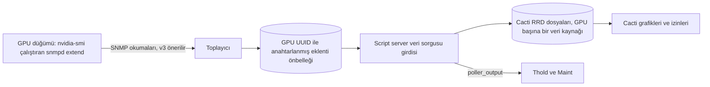

<!-- Source: README.md; SHA256: 126deef1783d64f878bf565f1433c10f31aef828eb9bc313aeff2b0335e54c7c -->

<!-- translations:start -->
[English](../../../README.md) | [简体中文](../zh-CN/README.md) | [हिन्दी](../hi-IN/README.md) | [Español (España)](../es-ES/README.md) | [Español (Latinoamérica)](../es-419/README.md) | [العربية (السعودية)](../ar-SA/README.md) | [Afrikaans](../af-ZA/README.md) | [አማርኛ](../am-ET/README.md) | [العربية (مصر)](../ar-EG/README.md) | [العربية (المغرب)](../ar-MA/README.md) | [বাংলা](../bn-BD/README.md) | [Deutsch](../de-DE/README.md) | [فارسی](../fa-IR/README.md) | [Filipino](../fil-PH/README.md) | [Français](../fr-FR/README.md) | [Français (Maroc)](../fr-MA/README.md) | [Français (Sénégal)](../fr-SN/README.md) | [Hausa](../ha-NG/README.md) | [עברית](../he-IL/README.md) | [Bahasa Indonesia](../id-ID/README.md) | [Igbo](../ig-NG/README.md) | [Italiano](../it-IT/README.md) | [日本語](../ja-JP/README.md) | [한국어](../ko-KR/README.md) | [Malagasy](../mg-MG/README.md) | [मराठी](../mr-IN/README.md) | [Bahasa Melayu](../ms-MY/README.md) | [Nederlands](../nl-NL/README.md) | [Polski](../pl-PL/README.md) | [Português (Brasil)](../pt-BR/README.md) | [Русский](../ru-RU/README.md) | [Kinyarwanda](../rw-RW/README.md) | [Soomaali](../so-SO/README.md) | [Svenska](../sv-SE/README.md) | [Kiswahili](../sw-KE/README.md) | [தமிழ்](../ta-IN/README.md) | [తెలుగు](../te-IN/README.md) | [ไทย](../th-TH/README.md) | [Türkçe](README.md) | [Українська](../uk-UA/README.md) | [اردو](../ur-PK/README.md) | [Tiếng Việt](../vi-VN/README.md) | [isiXhosa](../xh-ZA/README.md) | [Yorùbá](../yo-NG/README.md) | [繁體中文](../zh-TW/README.md) | [isiZulu](../zu-ZA/README.md)
<!-- translations:end -->

# plugin_gpu

NVIDIA araçlarından alınan GPU başına kullanım, bellek, sıcaklık, güç, ECC hataları ve kısma (throttling) nedenlerini Cacti'ye aktaran bir Cacti 1.2 eklentisi. AMD desteği ve XID hata toplama planlanmıştır, henüz uygulanmamıştır. Her GPU, düğümünün cihazında bir veri sorgusunun (data query) dizini haline gelir; böylece GPU grafikleri Cacti izinleri altında düğümün diğer grafiklerinin yanında yer alır ve Thold ile Maint bunlar üzerinde uyarı verip uyarıları bastırabilir.

> **Durum: geliştirme aşamasında, henüz yayınlanmadı.** Kilometre taşı 4, faz 1'i (SNMP extend üzerinden NVIDIA) kod açısından tamamlar: veri toplama, kimlik, grafikler, kısma ve ECC sinyalleri, Thold ve Maint uyarıları, sağlık sayfası ve operatör dokümantasyonu. Yalnızca sentetik çıktı yazdıran sahte bir `nvidia-smi` ile gerçek bir `snmpd` üzerinde çalıştırılmıştır; gerçek GPU donanımında hiç denenmemiştir. Sürüm öncesinde hâlâ açık olan konular: gerçek donanımda pilot uygulamalar ([docs/pilot-plan.md](../../pilot-plan.md), #54), harici bir güvenlik incelemesi ([docs/security-review.md](../../security-review.md)), gerçek araçlardan yakalanmış test verileri (#14) ve üretim boyutundaki donanımda ölçülmüş ölçek ([docs/performance.md](../../performance.md)). XID hataları #8 numaralı kararı beklemektedir. Üretim ortamında çalıştırmayın.

## Erişim rolleri

| Yetki Alanı (Realm) | Erişim |
| --- | --- |
| GPU View | Mevcut izleme sayfaları. |
| GPU Operator | İzleme sayfalarına ek olarak Operations sayfası ve kişisel önceliklendirme (triage) onayları. |
| GPU Admin | Operator erişimine ek olarak mevcut yapılandırma ve yönetimsel işlemler. |

Yükseltme dosyalarını kopyaladıktan sonra yeni yetki alanını kaydetmek için yönetici olarak Plugins sayfasını açın. Operator yetki alanını **Configuration > Users** veya kullanıcı grupları altından açıkça atayın.
Yükseltmeler mevcut View ve Admin yetki alanı kimliklerini ve izinlerini korur. Admin erişimi her istekte Operator erişimini, Operator erişimi ise View erişimini devralır; bu işlem kullanıcılara veya gruplara kalıcı olarak depolanmış izinler eklemez. Eklenti ayarları, Cacti'nin Settings iznine ek olarak GPU Admin erişimi de gerektirir.

Cacti cihaz izinleri her kullanıcının görebileceği satırları ve yapabileceği işlemleri sınırlamaya devam eder; eşleştirilmemiş nesneler için bir yönetici gerekir.
Kimlik bilgileri, yapılandırma, eşleştirme, silme ve diğer yönetimsel değişiklikler yönetim sayfalarında kalır. Onaylar (acknowledgments) yalnızca mevcut kullanıcının oturumunda, en fazla bir saat boyunca ve yalnızca aynı gözlem güncel kaldığı sürece geçerlidir. Yeni veya değişen gözlemler onayları geçersiz kılar. Başarısız bir ölçümü hiçbir zaman sağlıklı olarak işaretlemezler veya uyarıları bastırmazlar.

## Neden

GPU düğümleri genellikle CPU, bellek ve arayüzler için zaten Cacti'dedir. GPU sağlığı, düğümün SNMP verilerinin yanıtlamadığı ayrı bir konudur: düğümün kendisi sağlıklı görünürken bir kart termal olarak kısılmış (thermally throttled) olabilir, ECC hataları biriktirebilir veya bir XID arızası bildirebilir. Üretici araçları bunu raporlar (`nvidia-smi`, DCGM, `amd-smi`), ancak çıktıları Cacti'nin grafiklerinin, izinlerinin ve uyarı mekanizmalarının dışında kalır.

Eklenti, üretici aracı çıktılarını konumu yerine her GPU'nun kimliğiyle anahtarlanan Cacti veri kaynaklarına dönüştürerek bu boşluğu kapatır; böylece GPU'ları yeniden sıralayan bir yeniden başlatma, bir kartın geçmişini başka bir karta bağlamaz. Paralel sürümler oluşturmak yerine Cacti'nin kendi grafik oluşturma, izin, uzak veri toplayıcı (remote data collector), Thold ve Maint özelliklerini yeniden kullanır.

## Planlanan kapsam

| Faz | Kapsam | Kilometre Taşları |
|---|---|---|
| 0, araştırma | Üretici aracı çıktıları, XID ve kısma sinyalleri, GPU kimliği, ayrıcalıklar, toplama yolu kararı | [M1](https://github.com/somethingwithproof/plugin_gpu/milestone/1) |
| 1, nvidia | `nvidia-smi` ile toplama, UUID'ye göre envanter, grafikler, kısma, ECC ve XID sinyalleri, Thold ve Maint, sağlık sayfası | [M2](https://github.com/somethingwithproof/plugin_gpu/milestone/2), [M3](https://github.com/somethingwithproof/plugin_gpu/milestone/3), [M4](https://github.com/somethingwithproof/plugin_gpu/milestone/4) |
| 2, arka uçlar | DCGM arka ucu, `amd-smi` arka ucu | [M5](https://github.com/somethingwithproof/plugin_gpu/milestone/5) |
| 3, mig ve uzak | MIG örnekleri, Cacti uzak veri toplayıcıları | [M6](https://github.com/somethingwithproof/plugin_gpu/milestone/6) |

Kapsam dışı olanlar: bir GPU'yu veya düğümü değiştiren herhangi bir komut (saat hızları, güç limitleri, sıfırlamalar, MIG düzeni), eklentiye özgü bir uyarı motoru, özel bir arka plan servisi (daemon) veya ağ protokolü ve zamanlayıcı veya iş muhasebesi (job accounting). Araştırma iş listesi için plana bakın.

## Kilometre taşı 4 neler ekliyor

- **Uyarı değeri olarak kısma nedenleri.** Saat olayı maskesi (clock event mask), her neden için 0 veya 1 olan bir göstergeye çözülür; bilinmeyen bir maske hiçbir zaman sıfır değil bilinmeyen göstergeler verir ve göstergesi olmayan bitler GPU Health sayfasının gösterdiği ham maskede kalır.
- **Uyarı değeri olarak ECC** ([docs/metrics.md](../../metrics.md)). Önceki örnekten bu yana oluşan yeni düzeltilmiş ve düzeltilmemiş hatalar, eklenti tarafından ardışık iki toplamdan hesaplanır ve gauge olarak saklanır: ilk örnek, kaçırılan bir okuma veya sürücü yeniden yüklemesi durumunda bilinmeyen değer alır, böylece bir sıfırlama hiçbir zaman sıfır veya negatif bir sayı olarak okunmaz. Emekliye ayrılmış (retired) tek bit ve çift bit sayfa sayıları ile ECC modu da okunur. GPU başına iki ek ECC grafiği Cacti'nin bunları saklamasını sağlar; Power Percent ile birlikte toplam on bir grafik vardır. XID toplanmaz: sabit `nvidia-smi` komutlarına uyan bir kaynak yoktur (#8).
- **Thold ve Maint** ([docs/alerting.md](../../alerting.md)). Sıcaklık, limitine göre güç, kısma göstergeleri, yeni düzeltilmemiş ECC hataları, bekleyen sayfa emekliliği (pending page retirement) ve örnek yaşı için hazır Thold şablonları. Thold 1.8.2 bilinmeyen bir sayaçta (counter) başarısız olduğu için her değer bir gauge'dur. Değiştirilmemiş Thold 1.8.2 ve Maint 1.3 ile yapılan uçtan uca bir test, bir ECC sıfırlaması boyunca her eşiğin tetiklenip düzeldiğini ve Maint'in bunu bastırdığını gösterir.
- **GPU Health** (GPU View). Düğüm başına: güncellik (freshness), son toplamanın nasıl sonuçlandığı, Maint durumu, arka uç, araç ve sürücü sürümleri ile GPU sayıları; GPU başına: mevcut olma durumu, örnek yaşı, ECC durumu ve ham maske. Yalnızca depolanmış kayıtları okur.
- **İzinler.** İzin test paketi her sayfa dosyasını ve eylemi, bir sonraki istekte yetki geri alımını ve hiçbir bilgi sızdırmayan ret yanıtlarını kapsar.
- **Arıza ve geri yükleme doğrulaması.** Betikli uçtan uca çalıştırmalar aracıyı, kimlik bilgilerini, aracı, çıktısını, veritabanı bağlantısını ve RRD yazma işlemlerini bozar ve RRD dosyalarından daha eski bir yedek de dahil olmak üzere veritabanını bir dökümden geri yükler; yeni bir GPU hiçbir zaman başka bir GPU'nun RRD dosyasını devralmaz ([docs/backup.md](../../backup.md)).
- **Ölçek** ([docs/performance.md](../../performance.md)). Bir ölçek testi belirli bir GPU sayısında toplama, script server girdisi, Cacti nesnesi oluşturma, bir poller döngüsü ve sağlık sayfası sürelerini ölçer; CI bunu 100 GPU ile çalıştırır. 1.000 ve 8.000 GPU ölçümleri henüz kaydedilmediğinden desteklenen bir GPU sayısı belirtilmemektedir.
- **Operatör dokümantasyonu** ([docs/operations.md](../../operations.md)): kurulum, yükseltme, kaldırma, en az ayrıcalık, kullanılamayan değerler ve sorun giderme. Değişiklikler [CHANGELOG.md](../../../CHANGELOG.md) dosyasında listelenmiştir.

## Kilometre taşı 3 neler ekliyor

- **SNMP extend üzerinden toplama** ([ADR 0008](../../decisions/0008-collect-through-snmp-extend.md)). Düğüm yöneticisi `snmpd.conf` dosyasına iki sabit `extend` satırı ekler ([docs/node-setup.md](../../node-setup.md)); eklenti, cihazın kendi kimlik bilgileriyle Cacti'nin SNMP işlevleri üzerinden NET-SNMP-EXTEND-MIB'i okur (SNMPv3 önerilir). Cacti sunucusunda veya düğümde hiçbir şey çalıştırmaz.
- **Katı ayrıştırma.** Alanlar konuma göre okunur, her satır GPU'sunu UUID ile adlandırır ve sıfır olmayan bir çıkış durumu, zaman aşımı, kesilmiş çıktı, yanlış alan sayısına sahip bir satır veya birleştirilmiş hata metni tüm toplamayı başarısız kılar: değerler `U` olur, hiçbir GPU yok olarak işaretlenmez ve GPU Nodes bunun nedenini gösterir.
- **Her poller döngüsünden sonra çalışan bir toplayıcı.** Etkinleştirilmiş her düğümün aracısını okur, kimlik kayıtlarını günceller ve en son örneği önbelleğe alır. Script server girdisi yalnızca bu önbelleği okur; böylece bir Cacti yoklaması hiçbir zaman bir GPU düğümünü beklemez.
- **Cacti nesneleri** ([ADR 0010](../../decisions/0010-attach-to-existing-node-devices.md)). Şablonlar ve *GPU - Devices* veri sorgusu XML olarak gelir ve kurulum ile yükseltme sırasında içe aktarılır. Bir düğümü kaydetmek, veri sorgusunu mevcut cihazına None yeniden dizinleme yöntemiyle ekler; GPU Nodes yalnızca düğümün cihazı yoksa yeni bir cihaz oluşturabilir. Her GPU, Utilization, Memory, Temperature, Power, Power Percent, Clocks, Throttle, ECC Errors, New ECC Errors, Retired Pages ve Sample Age grafiklerinin paylaştığı tek bir veri kaynağıyla, üretici ve UUID ile anahtarlanmış bir dizindir. Cacti yalnızca bir grafiğin kullandığı alanları sakladığından, her model alanı bir grafik tarafından çizilir. Eklenti her GPU değişikliğinden sonra yeniden dizinleme yapar; cihaz Down veya devre dışı durumdayken Cacti'nin atladığı bir yeniden dizinlemeyi saklar ve cihaz Up durumuna geçtiğinde çalıştırır, ayrıca yeni GPU'lar için grafikler oluşturur.
- **Geçmiş kartla birlikte kalır.** Mevcut olmayan bir GPU dizin olarak kalır; böylece grafikleri bir boşluk gösterir ve kart geri döndüğünde aynı RRD dosyasında devam eder. Aynı yuvadaki yeni bir yedek kart kendi veri kaynağını alır. Düğümün sayfasındaki **Remove from Data Query** seçeneği mevcut olmayan bir GPU'yu listeden çıkarır; siz silene kadar RRD dosyaları ve grafikleri saklanır.
- **GPU Nodes üzerinde cihaz izinleri.** Bir GPU Admin, yalnızca Cacti'de görme yetkisine sahip olduğu cihazlardaki düğümleri ve GPU'ları görür, değiştirir, dışa aktarır ve taşır; bir GPU taşıma işlemi her iki düğüm için de yetki gerektirir. Cihazı silinmiş bir düğüm devre dışı bırakılabilir veya silinebilir.
- **Ortak metrik modeli** ([ADR 0009](../../decisions/0009-common-metric-core-with-vendor-extensions.md), [docs/metrics.md](../../metrics.md)). Bellek bayt cinsindendir, saat olayı maskesi `thr_*` göstergelerine çözülür ve `age` GPU'nun kendi örnek zamanının yaşıdır veya bilinmediğinde `U` olur.

Kurulumu yapan (web sunucusu) kullanıcı, eklentinin veri sorgusu XML'ini yerleştirdiği `<cacti>/resource/script_server/` dizinine yazabilmelidir; aksi takdirde kurulum ve yükseltme bir mesajla durur ve bir sonraki denemede yeniden dener. Kaldırma işlemi, şablonları ve XML'i yalnızca *Remove the plugin's Cacti objects on uninstall* işaretliyse siler; RRD dosyalarını, cihazları, grafikleri veya veri kaynaklarını hiçbir zaman silmez ([docs/operations.md](../../operations.md#uninstall)). Uzak veri toplayıcılar üzerindeki düğümler faz 3'e kadar toplanmaz.

## Kilometre taşı 2 neler sunuyor

- **Korumalı kurulum.** 8.2'nin altındaki PHP sürümlerinde kurulum ve etkinleştirme, gerekli sürümü belirten bir mesajla reddedilir ve Cacti'nin geri kalanı çalışmaya devam eder. `setup.php` ve sayfa betikleri PHP 8.0 üzerinde ayrıştırılabilir.
- **Yaşam döngüsü.** Cacti'nin Plugins sayfası üzerinden kurulum, yükseltme, devre dışı bırakma ve kaldırma. Yükseltmeler sıralıdır, bir kesintiden sonra tamamlanır ve kayıtlı sürümü yalnızca başarılı olduktan sonra değiştirir. Kaldırma işlemi, *Keep Plugin Tables on Uninstall* seçeneğinin işaretini kaldırmadığınız sürece eklenti tablolarını korur; hiçbir zaman bir Cacti cihazına, veri kaynağına, grafiğe veya RRD dosyasına dokunmaz.
- **Ayrı yetki alanları.** *GPU Admin*, Cacti cihazlarını GPU düğümleri olarak kaydettiğiniz, düğümler arasındaki GPU taşımalarını onayladığınız veya reddettiğiniz ve her kaydı JSON olarak dışa aktardığınız **GPU Nodes** sayfasını açar. *GPU View*, yalnızca izleyicinin görebileceği cihazlardaki GPU'ları listeleyen **GPU Inventory** sayfasını açar. Her iki sayfa da Management altındadır ve her değişiklik csrf-magic tarafından doğrulanan bir POST isteğidir.
- **GPU kimlik kayıtları.** Her GPU üretici ve UUID ile anahtarlanır. Dizin, PCI veri yolu kimliği, ad, sürücü ve raporlama aracı yerinde değişen özniteliklerdir. Bilinen bir yuvadaki yeni bir UUID olası bir değişiklik olarak işaretlenir ve kendi geçmişini başlatır; başka bir düğümde görülen bir GPU yalnızca bir operatör onayladığında taşınır; başarılı toplamalarda eksik olan bir GPU yapılandırılabilir bir sayıdan sonra yok olarak işaretlenir ve hiçbir zaman silinmez. Şimdilik yalnızca NVIDIA tam-GPU UUID'leri kabul edilmektedir; MIG örnekleri #13 numaralı kararı, AMD ise #19 numaralı araştırmayı beklemektedir. Henüz onları besleyen bir toplayıcı olmadığından kurallar test verisi dizileriyle sınanmaktadır.
- **Testler ve CI.** GPU veya veritabanı gerektirmeyen birim ve kaynak kuralı test paketleri, PHP 8.2 ile 8.5 üzerinde Cacti 1.2.31 ve güncel 1.2.x sürümlerine karşı yaşam döngüsü ve sayfa izni kontrolleri, PHP 8.1 ret işi, giriş noktalarının PHP 8.0 sözdizimi denetimi, seviye 9'da PHPStan ve REUSE. Test altyapısı #12 numaralı karar verilene kadar geçicidir.

### Değerlendirme için kurulum

Bu adımlar denemek amacıyla mevcut kodu kurar; tam operatör kılavuzu [docs/operations.md](../../operations.md) içindedir. PHP 8.2 veya üzeri üzerinde Cacti 1.2.31 veya daha yeni bir sürüm gerektirir.

1. Depoyu Cacti dizininizin altındaki `plugins/gpu` konumuna kopyalayın. Dizinin adı `gpu` olmalıdır.
2. Cacti'de **Configuration > Plugins** sayfasını açın, ardından **GPU** eklentisini kurup etkinleştirin.
3. Kullanıcılara rollerine göre **Configuration > Users** altından *GPU View*, *GPU Operator* veya *GPU Admin* yetki alanını verin. Kurulumu yapan kullanıcı View ve Admin yetkilerini alır; Admin, Operator erişimini içerir.
4. Her GPU düğümünün SNMP aracısını [docs/node-setup.md](../../node-setup.md) belgesinde açıklandığı gibi kurun, ardından düğümü **Management > GPU Nodes** altından ekleyin.
5. Uyarılar için, gönderilen Thold şablonlarını [docs/alerting.md](../../alerting.md) belgesinde açıklandığı şekilde içe aktarın.
6. İsteğe bağlı olarak **Configuration > Settings > GPU** ayarlarını düzenleyin: *Mark Absent After* (varsayılan 3 başarılı toplama, 1 ile 100 arası), *Stale After* (değerlerin `U` yazdırmasından önce bir örneğin ne kadar eski olabileceği) ve *Keep Plugin Tables on Uninstall* (varsayılan olarak açık).

## Metrikler Cacti'ye nasıl ulaşır

[#7](https://github.com/somethingwithproof/plugin_gpu/issues/7) numaralı karar SNMP `extend` yöntemini seçti ([ADR 0008](../../decisions/0008-collect-through-snmp-extend.md)): düğümün kendi aracısı sabit bir `nvidia-smi` komutu çalıştırır ve eklenti yalnızca sonucu okur. Plan, seçenekleri [Toplama yolları](../../PLAN.md#collection-paths) başlığı altında karşılaştırmaktadır.

## Uyumluluk hedefleri

| Bileşen | Hedef |
|---|---|
| Cacti | 1.2.31 veya üzeri, çekirdek yaması olmadan |
| PHP | 8.2 veya üzeri; desteklenmeyen bir çalışma zamanının bozuk bir Cacti arayüzü yerine ret yanıtı alması için `setup.php` 8.0 üzerinde ayrıştırılabilir kalır |
| NVIDIA | Sürücü ve araç sürümleri [#26](https://github.com/somethingwithproof/plugin_gpu/issues/26) numaralı araştırma ile belirlenecektir; DCGM alan kimlikleri v3.3.9 ve v4.7.0 üzerinde kontrol edilmiştir |
| AMD | ROCm sürümlerindeki `amd-smi`, [#26](https://github.com/somethingwithproof/plugin_gpu/issues/26) numaralı araştırma ile belirlenecektir |
| Thold, Maint | Değiştirilmemiş Thold 1.8.2 ve Maint 1.3, uçtan uca test edilmiştir ([docs/alerting.md](../../alerting.md)) |

## Tasarım

- [docs/PLAN.md](../../PLAN.md) tam plandır: mimari, bağlı olduğu yukarı akış gerçekleri (kaynaklarıyla birlikte), kimlik modeli, güvenlik sınırları, performans aritmetiği, testler ve riskler.
- [docs/decisions/](../../decisions) halihazırda alınmış seçimler için mimari karar kayıtlarını içerir.
- [docs/REQUIREMENTS.md](../../REQUIREMENTS.md) her gereksinim kimliğini ilgili sorun (issue) ile eşleştirir.

## İş takibi nasıl yapılır

- **Kilometre Taşları** planın kilometre taşlarını takip eder. Her birinin alt sorunlarını ve çıkış kanıtlarını listeleyen bir epik sorunu (epic issue) vardır.
- **Sorunlar** etiketlere göre sınıflandırılır: `type: requirement`, `type: research`, `type: decision`, `type: epic`. Gereksinim sorunları numaralandırılmış, test edilebilir gereksinimleri (`REQ-AREA-NNN`) ve kabul ölçütlerini belirtir.
- **Etiketler** ayrıca `area:`, `phase:`, `priority:` ve `status:` bilgilerini taşır. Bkz. [CONTRIBUTING.md](../../../CONTRIBUTING.md#labels).
- [Proje panosu](https://github.com/users/somethingwithproof/projects/9) kilometre taşları genelindeki tüm sorunları gösterir.

## Katkıda bulunma

[CONTRIBUTING.md](../../../CONTRIBUTING.md) dosyasını okuyun. Commit'ler için DCO imzası (sign-off) gereklidir. Tasarım tartışmaları sorunlar (issues) üzerinde yapılır; açık kararlar `type: decision` etiketini taşır. Gerçek GPU araçlarından yakalanan çıktılar 1. kilometre taşına yapılabilecek en yararlı katkıdır; önce ana bilgisayar adlarını, seri numaralarını ve UUID'leri temizleyin.

## Güvenlik

Güvenlik açıklarını özel olarak bildirin; bkz. [SECURITY.md](../../../SECURITY.md).

## Lisans

Cacti ve eklentileriyle aynı lisans olan GNU General Public License v2.0. Bkz. [LICENSE](../../../LICENSE).
