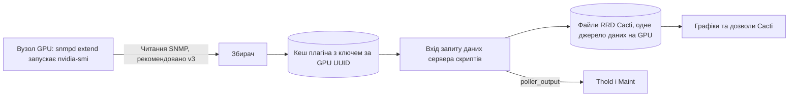

<!-- Source: README.md; SHA256: 126deef1783d64f878bf565f1433c10f31aef828eb9bc313aeff2b0335e54c7c -->

<!-- translations:start -->
[English](../../../README.md) | [简体中文](../zh-CN/README.md) | [हिन्दी](../hi-IN/README.md) | [Español (España)](../es-ES/README.md) | [Español (Latinoamérica)](../es-419/README.md) | [العربية (السعودية)](../ar-SA/README.md) | [Afrikaans](../af-ZA/README.md) | [አማርኛ](../am-ET/README.md) | [العربية (مصر)](../ar-EG/README.md) | [العربية (المغرب)](../ar-MA/README.md) | [বাংলা](../bn-BD/README.md) | [Bosanski](../bs-BA/README.md) | [Deutsch](../de-DE/README.md) | [فارسی](../fa-IR/README.md) | [Filipino](../fil-PH/README.md) | [Français](../fr-FR/README.md) | [Français (Maroc)](../fr-MA/README.md) | [Français (Sénégal)](../fr-SN/README.md) | [Hausa](../ha-NG/README.md) | [עברית](../he-IL/README.md) | [Hrvatski](../hr-HR/README.md) | [Bahasa Indonesia](../id-ID/README.md) | [Igbo](../ig-NG/README.md) | [Italiano](../it-IT/README.md) | [日本語](../ja-JP/README.md) | [한국어](../ko-KR/README.md) | [Malagasy](../mg-MG/README.md) | [मराठी](../mr-IN/README.md) | [Bahasa Melayu](../ms-MY/README.md) | [Nederlands](../nl-NL/README.md) | [Polski](../pl-PL/README.md) | [Português (Brasil)](../pt-BR/README.md) | [Русский](../ru-RU/README.md) | [Kinyarwanda](../rw-RW/README.md) | [Soomaali](../so-SO/README.md) | [Српски](../sr-RS/README.md) | [Svenska](../sv-SE/README.md) | [Kiswahili](../sw-KE/README.md) | [தமிழ்](../ta-IN/README.md) | [తెలుగు](../te-IN/README.md) | [ไทย](../th-TH/README.md) | [Türkçe](../tr-TR/README.md) | [Українська](README.md) | [اردو](../ur-PK/README.md) | [Tiếng Việt](../vi-VN/README.md) | [isiXhosa](../xh-ZA/README.md) | [Yorùbá](../yo-NG/README.md) | [繁體中文](../zh-TW/README.md) | [isiZulu](../zu-ZA/README.md)
<!-- translations:end -->

# plugin_gpu

Плагін для Cacti 1.2, який передає до Cacti показники завантаження кожного GPU, використання пам'яті, температури, енергоспоживання, помилок ECC і причин тротлінгу з інструментів NVIDIA. Підтримку AMD та збір помилок XID заплановано, але ще не реалізовано. Кожен GPU стає індексом запиту даних на пристрої свого вузла, тож графіки GPU розташовуються поруч з іншими графіками вузла відповідно до дозволів Cacti, а Thold і Maint можуть створювати для них сповіщення й приглушувати їх.

> **Стан: у розробці, реліз ще не вийшов.** Віха 4 завершує програмну реалізацію фази 1 (NVIDIA через SNMP extend): збір даних, ідентифікацію, графіки, сигнали тротлінгу та ECC, сповіщення Thold і Maint, сторінку стану й документацію оператора. Плагін запускався лише зі справжнім `snmpd` та імітатором `nvidia-smi`, що друкує синтетичний вивід, і ніколи — на реальному обладнанні з GPU. До випуску релізу залишаються відкритими: пілотні запуски на реальному обладнанні ([docs/pilot-plan.md](../../pilot-plan.md), #54), зовнішній аудит безпеки ([docs/security-review.md](../../security-review.md)), тестові дані, зняті зі справжніх інструментів (#14), і вимірювання масштабованості на обладнанні виробничого масштабу ([docs/performance.md](../../performance.md)). Збір помилок XID очікує на рішення #8. Не використовуйте плагін у промисловій експлуатації.

## Ролі доступу

| Область доступу | Доступ |
| --- | --- |
| GPU View | Наявні сторінки моніторингу. |
| GPU Operator | Моніторинг, а також сторінка операцій і персональні підтвердження під час первинного розбору інцидентів. |
| GPU Admin | Доступ Operator, а також наявна конфігурація та адміністративні дії. |

Після копіювання файлів оновлення відкрийте сторінку **Плагіни** як адміністратор, щоб зареєструвати
нову область доступу. Призначте область доступу Operator явно в розділі **Конфігурація > Користувачі** або для груп користувачів.
Оновлення зберігають наявні ідентифікатори та права областей доступу View і Admin. Доступ Admin
успадковує доступ Operator, а доступ Operator успадковує доступ View під час кожного запиту;
це не додає збережених прав користувачам або групам. Налаштування плагіна також потребують
доступу GPU Admin на додачу до дозволу Settings у Cacti.

Дозволи на пристрої в Cacti й надалі обмежують рядки та дії, доступні кожному користувачеві; для незіставлених об'єктів потрібен адміністратор.
Облікові дані, конфігурація, зіставлення, видалення та інші адміністративні зміни
залишаються на адміністративних сторінках. Підтвердження діють лише в поточній
сесії користувача, щонайбільше одну годину й лише доки те саме спостереження залишається
актуальним. Нові або змінені спостереження роблять їх недійсними. Вони ніколи не позначають невдале
вимірювання як справне й не приглушують сповіщення.

## Навіщо

Вузли з GPU зазвичай уже додані до Cacti для моніторингу CPU, пам'яті та мережевих інтерфейсів. Стан GPU — це окреме питання, на яке дані SNMP самого вузла не дають відповіді: відеокарта може зазнавати теплового тротлінгу, накопичувати помилки ECC або повідомляти про збій XID, тоді як сам вузол здається справним. Інструменти виробників повідомляють про це (`nvidia-smi`, DCGM, `amd-smi`), але їхній вивід залишається поза межами графіків, дозволів і сповіщень Cacti.

Плагін усуває цю прогалину, перетворюючи вивід інструментів виробників на джерела даних Cacti з прив'язкою до ідентифікатора кожного GPU, а не його позиції, тому перезавантаження, яке змінює порядок GPU, не прив'яже історію однієї карти до іншої. Він повторно використовує графіки, дозволи, віддалені збирачі даних, Thold і Maint у Cacti замість створення їхніх паралельних аналогів.

## Запланований обсяг

| Етап | Обсяг робіт | Віхи |
|---|---|---|
| 0, дослідження | Вивід інструментів виробників, сигнали XID і тротлінгу, ідентифікація GPU, привілеї, вибір способу збору | [M1](https://github.com/somethingwithproof/plugin_gpu/milestone/1) |
| 1, nvidia | Збір даних через `nvidia-smi`, інвентаризація за UUID, графіки, сигнали тротлінгу, ECC та XID, Thold і Maint, сторінка стану | [M2](https://github.com/somethingwithproof/plugin_gpu/milestone/2), [M3](https://github.com/somethingwithproof/plugin_gpu/milestone/3), [M4](https://github.com/somethingwithproof/plugin_gpu/milestone/4) |
| 2, бекенди | Бекенд DCGM, бекенд `amd-smi` | [M5](https://github.com/somethingwithproof/plugin_gpu/milestone/5) |
| 3, mig та віддалений збір | Екземпляри MIG, віддалені збирачі даних Cacti | [M6](https://github.com/somethingwithproof/plugin_gpu/milestone/6) |

Поза межами проєкту: будь-які команди, що змінюють стан GPU або вузла (частоти, ліміти живлення, скидання, конфігурація MIG), власний рушій сповіщень плагіна, власний демон або мережевий протокол, а також облік завдань чи планувальник. Перелік невирішених дослідницьких завдань дивіться в плані.

## Що додає віха 4

- **Причини тротлінгу як значення для сповіщень.** Маска подій тактової частоти декодується в один індикатор зі значенням 0 або 1 для кожної причини; невідома маска дає невідомі індикатори, а не нулі, а біти без окремого індикатора залишаються в сирій масці, яку показує GPU Health.
- **ECC як значення для сповіщень** ([docs/metrics.md](../../metrics.md)). Плагін обчислює нові виправлені та невиправлені помилки з часу попередньої вибірки на основі двох послідовних сумарних значень і зберігає їх як показники типу gauge: невідоме значення для першої вибірки, пропущеного читання або перезавантаження драйвера, тому скидання ніколи не зчитується як нуль або від'ємне число. Також зчитуються кількість вилучених однобітових і двобітових сторінок пам'яті та режим ECC. Два додаткові графіки ECC на кожен GPU дають Cacti змогу зберігати ці дані; разом із графіком відсотка потужності (Power Percent) це загалом одинадцять графіків. XID не збираються: жодне джерело не вписується у фіксовані команди `nvidia-smi` (#8).
- **Thold і Maint** ([docs/alerting.md](../../alerting.md)). Постачаються шаблони Thold для температури, споживаної потужності відносно її ліміту, індикаторів тротлінгу, нових невиправлених помилок ECC, очікуваного вилучення сторінок і віку вибірки. Кожне значення є показником типу gauge, оскільки Thold 1.8.2 завершується помилкою на невідомому значенні лічильника. Наскрізний тест із незміненими Thold 1.8.2 та Maint 1.3 демонструє спрацювання і відновлення кожного порогу, включно з проходженням крізь скидання ECC, а також приглушення сповіщень у Maint.
- **GPU Health** (GPU View). Для кожного вузла: актуальність даних, як завершився останній збір, стан Maint, бекенд, версії інструмента та драйвера, кількість GPU; для кожного GPU: наявність, вік вибірки, стан ECC та сира маска. Сторінка читає лише збережені записи.
- **Дозволи.** Набір тестів перевірки дозволів охоплює кожен файл сторінки й кожну дію, відкликання прав на наступному запиті та відмови, які не розкривають жодної інформації.
- **Перевірка збоїв і відновлення.** Скриптовані наскрізні прогони порушують роботу агента, облікові дані, інструмент, його вивід, з'єднання з базою даних і запис у RRD, а також відновлюють базу даних із дампа, зокрема старішого за файли RRD; новий GPU ніколи не успадковує файл RRD іншого GPU ([docs/backup.md](../../backup.md)).
- **Масштабування** ([docs/performance.md](../../performance.md)). Тест масштабування вимірює тривалість збору, роботу вхідного скрипта сервера скриптів, створення об'єктів Cacti, циклу опитувача та сторінки стану за заданої кількості GPU; у CI він запускається для 100 GPU. Вимірювання для 1 000 та 8 000 GPU ще не зафіксовані, тому підтримувана кількість GPU поки не заявлена.
- **Документація оператора** ([docs/operations.md](../../operations.md)): встановлення, оновлення, видалення, принцип найменших привілеїв, недоступні значення та усунення несправностей. Зміни перелічено в [CHANGELOG.md](../../../CHANGELOG.md).

## Що додає віха 3

- **Збір через SNMP extend** ([ADR 0008](../../decisions/0008-collect-through-snmp-extend.md)). Адміністратор вузла додає два фіксовані рядки `extend` до `snmpd.conf` ([docs/node-setup.md](../../node-setup.md)); плагін зчитує NET-SNMP-EXTEND-MIB через функції SNMP у Cacti з власними обліковими даними пристрою, рекомендовано SNMPv3. Нічого не запускається ані на сервері Cacti, ані на самому вузлі.
- **Суворий розбір виводу.** Поля зчитуються за позицією, кожен рядок ідентифікує свій GPU за UUID, а ненульовий код завершення, тайм-аут, обрізаний вивід, рядок із неправильною кількістю полів або змішаний текст помилки призводять до провалу всього збору: значення стають `U`, жоден GPU не позначається як відсутній, а сторінка GPU Nodes показує причину.
- **Збирач після кожного циклу опитувача.** Він опитує агента кожного ввімкненого вузла, оновлює записи ідентифікації та кешує останню вибірку. Вхід сервера скриптів читає лише цей кеш, тому опитування Cacti ніколи не чекає на вузол із GPU.
- **Об'єкти Cacti** ([ADR 0010](../../decisions/0010-attach-to-existing-node-devices.md)). Шаблони та запит даних *GPU - Devices* постачаються у форматі XML і імпортуються під час встановлення та оновлення. Збереження вузла прив'язує запит даних до його наявного пристрою з методом переіндексації None; GPU Nodes може створити пристрій лише тоді, коли у вузла його ще немає. Кожен GPU є індексом із ключем за виробником і UUID, з одним спільним джерелом даних для графіків Utilization, Memory, Temperature, Power, Power Percent, Clocks, Throttle, ECC Errors, New ECC Errors, Retired Pages та Sample Age. Кожне поле моделі відображається якимось графіком, оскільки Cacti зберігає лише ті поля, які використовуються графіками. Плагін виконує переіндексацію після кожної зміни GPU, зберігає відкладену переіндексацію, яку Cacti пропустив, поки пристрій був Down або вимкнений, і виконує її, щойно пристрій переходить у стан Up, а також створює графіки для нових GPU.
- **Історія залишається за картою.** Відсутній GPU залишається індексом, тому його графіки показують розрив і продовжують запис у той самий файл RRD після повернення. Карта на заміну в тому самому слоті отримує власне джерело даних. Дія **Вилучити із запиту даних** на сторінці вузла прибирає відсутній GPU зі списку; його файли RRD і графіки зберігаються, доки ви їх не видалите.
- **Дозволи на пристрої на сторінці GPU Nodes.** GPU Admin бачить, змінює, експортує та переміщує лише вузли й GPU на пристроях, які йому дозволено бачити в Cacti; для переміщення GPU потрібен доступ до обох вузлів. Вузол, чий пристрій було видалено, можна вимкнути або видалити.
- **Спільна модель метрик** ([ADR 0009](../../decisions/0009-common-metric-core-with-vendor-extensions.md), [docs/metrics.md](../../metrics.md)). Пам'ять вимірюється в байтах, маска подій тактової частоти декодується в індикатори `thr_*`, а `age` — це вік власного часу вибірки GPU або `U`, якщо він невідомий.

Користувач, який виконує встановлення (вебсервер), повинен мати права запису в `<cacti>/resource/script_server/`, куди плагін розміщує XML-файл запиту даних; інакше встановлення та оновлення зупиняються з повідомленням і повторюють спробу під час наступного запуску. Видалення плагіна прибирає шаблони та XML-файл лише тоді, коли позначено параметр *Видаляти об'єкти Cacti плагіна під час видалення*, і ніколи не видаляє файли RRD, пристрої, графіки чи джерела даних ([docs/operations.md](../../operations.md#uninstall)). Вузли на віддалених збирачах даних не опитуватимуться до етапу 3.

## Що постачає віха 2

- **Захищене встановлення.** На PHP версії нижче 8.2 встановлення та ввімкнення відхиляються з повідомленням про необхідну версію, а решта Cacti продовжує працювати. `setup.php` і скрипти сторінок проходять синтаксичний розбір на PHP 8.0.
- **Життєвий цикл.** Встановлення, оновлення, вимкнення та видалення через сторінку Плагіни у Cacti. Оновлення впорядковані, завершуються після переривання й змінюють зафіксовану версію лише після успішного виконання. Видалення зберігає таблиці плагіна, якщо ви не знімете прапорець *Зберігати таблиці плагіна під час видалення*; воно ніколи не зачіпає пристрої, джерела даних, графіки або файли RRD у Cacti.
- **Окремі області доступу.** *GPU Admin* відкриває **GPU Nodes**, де ви реєструєте пристрої Cacti як вузли GPU, підтверджуєте або відхиляєте переміщення GPU між вузлами й експортуєте всі записи у форматі JSON. *GPU View* відкриває **GPU Inventory**, де перелічені GPU лише на тих пристроях, які дозволено бачити користувачеві. Обидві сторінки розташовані в розділі Керування (Management), і кожна зміна є POST-запитом із перевіркою csrf-magic.
- **Записи ідентифікації GPU.** Кожен GPU має ключ за виробником і UUID. Індекс, ідентифікатор шини PCI, назва, драйвер та інструмент звітування є атрибутами, що змінюються на місці. Новий UUID у відомому слоті позначається як можлива заміна й починає власну історію; GPU, виявлений на іншому вузлі, переміщується лише після підтвердження оператором; GPU, відсутній в успішних зборах даних, позначається як відсутній після заданої кількості циклів і ніколи не видаляється. Наразі приймаються лише UUID цілих GPU NVIDIA; екземпляри MIG чекають на рішення #13, а AMD — на дослідження #19. Правила перевіряються на послідовностях тестових фікстур, оскільки збирач даних поки не передає їм реальні дані.
- **Тести та CI.** Набори модульних тестів і тестів правил вихідного коду без GPU чи бази даних, перевірки життєвого циклу й дозволів сторінок на Cacti 1.2.31 і поточній гілці 1.2.x на PHP від 8.2 до 8.5, завдання перевірки відмови на PHP 8.1, перевірка синтаксису точок входу на PHP 8.0, PHPStan рівня 9 та REUSE. Тестовий стенд є тимчасовим до ухвалення рішення #12.

### Встановлення для ознайомлення

Ці кроки встановлюють поточний код для тестування; повний посібник оператора міститься в [docs/operations.md](../../operations.md). Потрібен Cacti 1.2.31 або новішої версії на PHP 8.2 або новішої версії.

1. Скопіюйте репозиторій у каталог `plugins/gpu` у вашій директорії Cacti. Каталог має називатися `gpu`.
2. У Cacti відкрийте **Конфігурація > Плагіни**, а потім встановіть і ввімкніть **GPU**.
3. Надайте користувачам область доступу *GPU View*, *GPU Operator* або *GPU Admin* у розділі **Конфігурація > Користувачі** відповідно до їхньої ролі. Користувач, який виконує встановлення, отримує права View та Admin; Admin включає доступ Operator.
4. Налаштуйте SNMP-агент кожного вузла з GPU, як описано в [docs/node-setup.md](../../node-setup.md), а потім додайте вузол у розділі **Керування > GPU Nodes**.
5. Для сповіщень імпортуйте шаблони Thold, що постачаються в комплекті, як описано в [docs/alerting.md](../../alerting.md).
6. За потреби налаштуйте параметри в розділі **Конфігурація > Налаштування > GPU**: *Позначати відсутнім після* (типово 3 успішні збори, від 1 до 100), *Вважати застарілим після* (скільки часу вибірка може залишатися актуальною, перш ніж її значення почнуть виводитися як `U`) та *Зберігати таблиці плагіна під час видалення* (типово ввімкнено).

## Як метрики потрапляють до Cacti

Рішення [#7](https://github.com/somethingwithproof/plugin_gpu/issues/7) обрало SNMP `extend` ([ADR 0008](../../decisions/0008-collect-through-snmp-extend.md)): власний агент вузла запускає фіксовану команду `nvidia-smi`, а плагін лише зчитує результат. Порівняння варіантів наведено в плані в розділі [Шляхи збору даних](../../PLAN.md#collection-paths).

## Цільова сумісність

| Компонент | Ціль |
|---|---|
| Cacti | 1.2.31 або новіша, без патчів ядра |
| PHP | 8.2 або новіша; `setup.php` залишається синтаксично сумісним із 8.0, щоб непідтримуване середовище виконання видало відмову замість поломки інтерфейсу Cacti |
| NVIDIA | Лінійки драйверів та інструментів мають бути визначені в межах дослідження [#26](https://github.com/somethingwithproof/plugin_gpu/issues/26); ідентифікатори полів DCGM перевірено на версіях v3.3.9 і v4.7.0 |
| AMD | `amd-smi` у випусках ROCm, які мають бути визначені в межах дослідження [#26](https://github.com/somethingwithproof/plugin_gpu/issues/26) |
| Thold, Maint | Thold 1.8.2 і Maint 1.3, без змін, протестовані наскрізно ([docs/alerting.md](../../alerting.md)) |

## Архітектура та проєктування

- [docs/PLAN.md](../../PLAN.md) — це повний план: архітектура, факти про зовнішні компоненти, на які він спирається (із джерелами), модель ідентифікації, межі безпеки, розрахунки продуктивності, тестування та ризики.
- [docs/decisions/](../../decisions) містить записи архітектурних рішень для вже зроблених виборів.
- [docs/REQUIREMENTS.md](../../REQUIREMENTS.md) зіставляє кожен ідентифікатор вимоги з відповідним issue.

## Як відстежується робота

- **Віхи** відповідають віхам плану. Кожна з них має епік-завдання із переліком підзавдань і доказів виконання.
- **Завдання** типізовано мітками: `type: requirement`, `type: research`, `type: decision`, `type: epic`. Завдання-вимоги містять нумеровані тестовані вимоги (`REQ-AREA-NNN`) і критерії приймання.
- **Мітки** також позначають `area:`, `phase:`, `priority:` та `status:`. Див. [CONTRIBUTING.md](../../../CONTRIBUTING.md#labels).
- [Дошка проєкту](https://github.com/users/somethingwithproof/projects/9) показує всі завдання за віхами.

## Участь у розробці

Ознайомтеся з [CONTRIBUTING.md](../../../CONTRIBUTING.md). Коміти потребують підпису DCO. Обговорення проєктних рішень відбувається в issues; відкриті рішення мають мітку `type: decision`. Збережений вивід реальних інструментів GPU є найкориснішим внеском до віхи 1; перед надсиланням видаліть імена хостів, серійні номери та UUID.

## Безпека

Повідомляйте про вразливості приватно; див. [SECURITY.md](../../../SECURITY.md).

## Ліцензія

GNU General Public License v2.0 — та сама ліцензія, що й у Cacti та його плагінів. Див. [LICENSE](../../../LICENSE).
