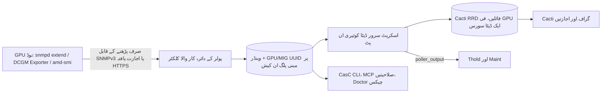

<!-- Source: README.md; SHA256: 97ba37df4a883426d3984ed7d14547ad7367e973411a8abd930409ce259f545b -->

<!-- translations:start -->
[English](../../../README.md) | [简体中文](../zh-CN/README.md) | [हिन्दी](../hi-IN/README.md) | [Español (España)](../es-ES/README.md) | [Español (Latinoamérica)](../es-419/README.md) | [العربية (السعودية)](../ar-SA/README.md) | [Afrikaans](../af-ZA/README.md) | [አማርኛ](../am-ET/README.md) | [العربية (مصر)](../ar-EG/README.md) | [العربية (المغرب)](../ar-MA/README.md) | [Български](../bg-BG/README.md) | [বাংলা](../bn-BD/README.md) | [Bosanski](../bs-BA/README.md) | [Deutsch](../de-DE/README.md) | [Ελληνικά](../el-GR/README.md) | [فارسی](../fa-IR/README.md) | [Filipino](../fil-PH/README.md) | [Français](../fr-FR/README.md) | [Français (Maroc)](../fr-MA/README.md) | [Français (Sénégal)](../fr-SN/README.md) | [Hausa](../ha-NG/README.md) | [עברית](../he-IL/README.md) | [Hrvatski](../hr-HR/README.md) | [Bahasa Indonesia](../id-ID/README.md) | [Igbo](../ig-NG/README.md) | [Italiano](../it-IT/README.md) | [日本語](../ja-JP/README.md) | [ქართული](../ka-GE/README.md) | [한국어](../ko-KR/README.md) | [Latviešu](../lv-LV/README.md) | [Malagasy](../mg-MG/README.md) | [मराठी](../mr-IN/README.md) | [Bahasa Melayu](../ms-MY/README.md) | [Nederlands](../nl-NL/README.md) | [Polski](../pl-PL/README.md) | [Português (Brasil)](../pt-BR/README.md) | [Português (Portugal)](../pt-PT/README.md) | [Русский](../ru-RU/README.md) | [Kinyarwanda](../rw-RW/README.md) | [Soomaali](../so-SO/README.md) | [Српски](../sr-RS/README.md) | [Svenska](../sv-SE/README.md) | [Kiswahili](../sw-KE/README.md) | [தமிழ்](../ta-IN/README.md) | [తెలుగు](../te-IN/README.md) | [ไทย](../th-TH/README.md) | [Türkçe](../tr-TR/README.md) | [Українська](../uk-UA/README.md) | [اردو](README.md) | [Tiếng Việt](../vi-VN/README.md) | [isiXhosa](../xh-ZA/README.md) | [Yorùbá](../yo-NG/README.md) | [繁體中文](../zh-TW/README.md) | [isiZulu](../zu-ZA/README.md)
<!-- translations:end -->

# plugin_gpu

Cacti 1.2 کا ایک پلگ ان جو NVIDIA اور AMD ٹولز سے فی GPU استعمال، میموری، درجہ حرارت، پاور، ECC غلطیاں، اور تھروٹلنگ کی وجوہات Cacti میں لاتا ہے۔ ہر GPU (یا MIG انسٹینس) اپنے نوڈ کے ڈیوائس پر ڈیٹا کوئیری کا ایک انڈیکس بن جاتا ہے، چنانچہ Cacti کی اجازتوں کے تحت GPU گراف نوڈ کے دیگر گراف کے ساتھ موجود رہتے ہیں، اور Thold اور Maint ان پر الرٹ جاری کر سکتے ہیں اور انہیں دبا سکتے ہیں۔

> **حیثیت: فیز 1 تا 3 کوڈ میں نافذ ہو چکے ہیں، ابھی ریلیز نہیں کیے گئے۔** فیز 1 (SNMP extend کے ذریعے NVIDIA `nvidia-smi`، شناختی ٹریکنگ، گراف، تھروٹل اور ECC سگنلز، Thold اور Maint الرٹنگ، ہیلتھ پیج)، فیز 2 (صرف پڑھنے کے قابل NVIDIA DCGM Exporter HTTP(S) پارسر/کلائنٹ اور AMD `amd-smi` پارسر)، فیز 3 (MIG انسٹینس شناختی ٹریکنگ، Schema v4 کالمز، پولر کے دائرہ کار میں ریموٹ کلکٹر عمل درآمد، `replicate_out` اور `remote_agent` ہکس)، CasC آپریٹر CLI (`cli/gpu.php`)، اور ایکو سسٹم ہکس (`abilities_register`، `doctor_register_checks`، `casc_register_providers`) نافذ ہو چکے ہیں اور یونٹ، سیکیورٹی، اور عارضی Cacti انٹیگریشن ٹیسٹس کے ذریعے جانچے جا چکے ہیں۔ اب تک لائیو رنز میں فزیکل GPU ہارڈویئر کے بجائے مصنوعی `snmpd` اور فکسچر پے لوڈز استعمال کیے گئے ہیں۔ ریلیز ٹیگ کرنے سے پہلے ابھی یہ کام باقی ہیں: حقیقی ہارڈویئر پر پائلٹ ٹیسٹ ([docs/pilot-plan.md](../../pilot-plan.md)، #54)، ایک بیرونی سیکیورٹی جائزہ ([docs/security-review.md](../../security-review.md))، حقیقی ٹولز سے حاصل کردہ فکسچرز (#14)، اور پروڈکشن کے حجم کے ہارڈویئر پر اسکیل کی پیمائش ([docs/performance.md](../../performance.md))۔ XID غلطیوں کا مجموعہ فیصلہ #8 کے تحت کھلا ہے۔

## رسائی کے کردار

| دائرہ کار | رسائی |
| --- | --- |
| GPU View | موجودہ مانیٹرنگ صفحات۔ |
| GPU Operator | مانیٹرنگ بمع آپریشنز صفحہ اور ذاتی ٹرائیج تصدیقات۔ |
| GPU Admin | آپریٹر رسائی بمع موجودہ کنفیگریشن اور انتظامی اقدامات۔ |

اپ گریڈ فائلیں کاپی کرنے کے بعد، نیا دائرہ کار رجسٹر کرنے کے لیے بطور ایڈمنسٹریٹر Plugins صفحہ کھولیں۔ **Configuration > Users** یا یوزر گروپس کے تحت Operator کا دائرہ کار واضح طور پر تفویض کریں۔
اپ گریڈز موجودہ View اور Admin دائرہ کار کی آئی ڈیز اور اجازتوں کو برقرار رکھتے ہیں۔ Admin رسائی ہر درخواست پر Operator رسائی وراثت میں لیتی ہے، اور Operator رسائی View رسائی وراثت میں لیتی ہے؛ اس سے صارفین یا گروپس میں محفوظ شدہ اجازتیں شامل نہیں ہوتیں۔ پلگ ان کی ترتیبات کے لیے Cacti کی Settings اجازت کے علاوہ GPU Admin رسائی بھی درکار ہوتی ہے۔

Cacti ڈیوائس کی اجازتیں اب بھی ہر صارف کے لیے دستیاب قطاروں اور اقدامات کو محدود کرتی ہیں؛ غیر میپ شدہ آبجیکٹس کے لیے ایڈمنسٹریٹر درکار ہوتا ہے۔
اسناد، کنفیگریشن، میپنگ، حذف کرنا اور دیگر انتظامی تبدیلیاں انتظامی صفحات ہی میں رہتی ہیں۔ تصدیقات صرف موجودہ صارف کے سیشن میں، زیادہ سے زیادہ ایک گھنٹے کے لیے اور صرف اس وقت تک برقرار رہتی ہیں جب تک وہی مشاہدہ تازہ رہے۔ نئے یا تبدیل شدہ مشاہدات انہیں کالعدم کر دیتے ہیں۔ وہ کبھی بھی ناکام پیمائش کو صحت مند قرار نہیں دیتیں اور نہ ہی الرٹس کو دباتی ہیں۔

## کیوں

GPU نوڈز عموماً CPU، میموری، اور انٹرفیسز کے لیے پہلے ہی Cacti میں موجود ہوتے ہیں۔ GPU کی صحت ایک الگ سوال ہے جس کا جواب نوڈ کا SNMP ڈیٹا نہیں دیتا: ایک کارڈ تھرمل طور پر تھروٹل ہو سکتا ہے، ECC غلطیاں جمع کر سکتا ہے، یا XID خرابی کی اطلاع دے سکتا ہے جبکہ نوڈ خود صحت مند دکھائی دیتا ہے۔ وینڈر ٹولز (`nvidia-smi`، DCGM، `amd-smi`) اس کی اطلاع دیتے ہیں، لیکن ان کا آؤٹ پٹ Cacti کے گراف، اجازتوں، اور الرٹنگ سے باہر رہتا ہے۔

یہ پلگ ان وینڈر ٹول کے آؤٹ پٹ کو Cacti ڈیٹا سورسز میں تبدیل کر کے اس خلا کو پُر کرتا ہے، جن کی شناخت ہر GPU کی پوزیشن کے بجائے اس کی اصل شناخت سے کی جاتی ہے، تاکہ ریبوٹ جو GPUs کی ترتیب بدل دے، ایک کارڈ کی تاریخ کو دوسرے سے نہ جوڑے۔ یہ متوازی نظام بنانے کے بجائے Cacti کی گرافنگ، اجازتوں، ریموٹ ڈیٹا کلکٹرز، Thold، اور Maint کو دوبارہ استعمال کرتا ہے۔

## منصوبہ بند دائرہ کار

| فیز | دائرہ کار | حیثیت | سنگِ میل |
|---|---|---|---|
| 0، تحقیق | وینڈر ٹول آؤٹ پٹ، XID اور تھروٹل سگنلز، GPU شناخت، مراعات، کلیکشن کے راستے کا فیصلہ | مکمل | [M1](https://github.com/somethingwithproof/plugin_gpu/milestone/1) |
| 1، nvidia | `nvidia-smi` کلیکشن، UUID کے ذریعے انوینٹری، گراف، تھروٹل اور ECC سگنلز، Thold اور Maint، ہیلتھ پیج | نافذ شدہ (فکسچر پر ٹیسٹ شدہ) | [M2](https://github.com/somethingwithproof/plugin_gpu/milestone/2), [M3](https://github.com/somethingwithproof/plugin_gpu/milestone/3), [M4](https://github.com/somethingwithproof/plugin_gpu/milestone/4) |
| 2، بیک اینڈز | صرف پڑھنے کے قابل DCGM Exporter HTTP(S) پارسر/کلائنٹ (`lib/DcgmExporterParser.php`، `lib/DcgmExporterClient.php`)، AMD `amd-smi` پارسر (`lib/AmdSmiParser.php`) | نافذ شدہ (یونٹ ٹیسٹ شدہ) | [M5](https://github.com/somethingwithproof/plugin_gpu/milestone/5) |
| 3، mig، ریموٹ، اور ایکو سسٹم | MIG انسٹینس شناختی ٹریکنگ، ریموٹ ڈیٹا کلکٹرز (`INFO`، `poller_gpu.php --poller=N`، `replicate_out`، `remote_agent`)، CasC CLI (`cli/gpu.php`)، MCP/Doctor/CasC ہکس | نافذ شدہ (یونٹ اور CI انٹیگریشن ٹیسٹ شدہ) | [M6](https://github.com/somethingwithproof/plugin_gpu/milestone/6) |

دائرہ کار سے باہر: کوئی بھی کمانڈ جو GPU یا نوڈ کو تبدیل کرے (کلاکس، پاور کی حدود، ری سیٹس، MIG لے آؤٹ)، پلگ ان کا اپنا الرٹنگ انجن، کسٹم ڈیمون یا نیٹ ورک پروٹوکول، اور شیڈولر یا جاب اکاؤنٹنگ۔ تحقیقی بیک لاگ کے لیے منصوبہ دیکھیں۔

## سنگِ میل 4 کیا شامل کرتا ہے

- **NVIDIA DCGM Exporter صرف پڑھنے کے قابل کلکٹر** (`lib/DcgmExporterParser.php`، `lib/DcgmExporterClient.php`)۔ Prometheus ٹیکسٹ ایکسپوزیشن میٹرکس (`DCGM_FI_DEV_GPU_UTIL`، `DCGM_FI_DEV_FB_USED`، `DCGM_FI_DEV_FB_FREE`، `DCGM_FI_DEV_POWER_USAGE`، `DCGM_FI_DEV_GPU_TEMP`، `DCGM_FI_DEV_ECC_DBE_VOL_TOTAL`، `DCGM_FI_DEV_CLOCK_THROTTLE_REASONS`، اور MIG لیبلز `GPU_I_ID` اور `GPU_I_PROFILE`) کو پارس کرتا ہے۔ HTTP(S) کلائنٹ واضح اینڈ پوائنٹ ہوسٹ/CIDR اجازت فہرست نافذ کرتا ہے، بطور ڈیفالٹ TLS پیئر سرٹیفکیٹس کی تصدیق کرتا ہے، ٹائم آؤٹس اور جواب کے حجم کو محدود کرتا ہے، ری ڈائریکٹس کو غیر فعال کرتا ہے، اور غیر HTTP(S) اسکیمز کو مسترد کرتا ہے۔
- **AMD `amd-smi` صرف پڑھنے کے قابل پارسر** (`lib/AmdSmiParser.php`)۔ `amd-smi` JSON/SNMP-extend آؤٹ پٹ (استعمال، VRAM، پاور، جنکشن/ایج درجہ حرارت، ECC، پارٹیشن میٹا ڈیٹا، اور `Reading::$vendorExtensions` کے ذریعے الگ تھروٹل جمع کار) کو `Vendor::Amd` کے تحت مشترکہ میٹرک ماڈل میں نارملائز کرتا ہے۔
- **MIG انسٹینس ٹریکنگ اور Schema v4** (`lib/GpuReport.php`، `lib/GpuSnapshot.php`، `lib/GpuRecord.php`، `lib/Schema.php`، `lib/ScriptServer.php`)۔ پیرنٹ GPUs کے ساتھ MIG انسٹینس UUIDs (`MIG-<uuid>` اور `MIG-GPU-<parent>/<gi>/<ci>`)، `mig_mode`، `mig_instance_id`، `mig_profile`، `parent_uuid`، اور `partition_info` کو ٹریک کرتا ہے جبکہ اپ ڈیٹس کے دوران ناقابلِ تبدیلی شناختی کلیدوں (`vendor`، `uuid`، `parent_uuid`) کو محفوظ رکھتا ہے اور ڈیٹا بیس کوئیریز سے پہلے ان کی توثیق کرتا ہے۔
- **ریموٹ ڈیٹا کلکٹرز** (`INFO`، `poller_gpu.php`، `lib/Poller.php`، `lib/ReplicationRepository.php`، `setup.php`)۔ `INFO` میں `remote_collect:1, remote_poller:1` کا اعلان کرتا ہے، `php plugins/gpu/poller_gpu.php --poller=N` کے ذریعے پولر کے دائرہ کار میں عمل درآمد کو سپورٹ کرتا ہے، غیر مرکزی پولرز پر Cacti آبجیکٹ پروویژننگ کو نظر انداز کرتا ہے، `replicate_out` کے ذریعے پولر کے دائرہ کار کی ٹیبلز کی نقل بناتا ہے، اور `remote_agent` کے ذریعے صرف پڑھنے کے قابل `gpu_health` اور `gpu_inventory` اقدامات کا جواب دیتا ہے۔
- **آپریٹر اور CasC CLI** (`cli/gpu.php`، `lib/CascProvider.php`)۔ بغیر کسی بیرونی Composer انحصار کے PHP 8.2+ پر چلتا ہے (PHP 8.0 پر پارس ہوتا ہے): `php plugins/gpu/cli/gpu.php export [--format=yaml|xml]`، `validate <file> [--format=yaml|xml]`، `plan <file> [--format=yaml|xml] [--output=text|json]`، `apply <file> --confirm=<PLAN_HASH> [--format=yaml|xml]`، اور `health [--format=text|json]`۔ پلانز ایک قطعی SHA-256 تصدیقی ہیش کا حساب لگاتے ہیں، ہیش کی عدم مطابقت پر `apply` محفوظ طور پر ناکام ہو جاتا ہے، اور XML پارسنگ `DOCTYPE` اور `ENTITY` اعلانات کو مسترد کرتی ہے۔
- **ایکو سسٹم انٹیگریشن ہکس** (`lib/EcosystemIntegration.php`، `setup.php`)۔ `abilities_register` (`gpu-list-nodes`، `gpu-list-devices`، `gpu-get-health`؛ صرف پڑھنے کے قابل، `GPU View` دائرہ کار اور Cacti ڈیوائس اجازتوں کے پابند)، `doctor_register_checks` (`gpu_schema`، `gpu_poller_freshness`، `gpu_node_health`)، اور `casc_register_providers` کو رجسٹر کرتا ہے۔
- **بطور الرٹ ویلیوز تھروٹل وجوہات اور ECC** ([docs/metrics.md](../../metrics.md))۔ کلاک ایونٹ ماسکس کو 0/1 انڈیکیٹرز میں ڈیکوڈ کرتا ہے اور فی وقفہ نئی درست شدہ/غیر درست شدہ ECC غلطیوں کو بطور گیج حساب کرتا ہے تاکہ Thold 1.8.2 اور Maint 1.3 منفی کاؤنٹرز یا ری سیٹ اسپائکس کے بغیر الرٹ دیں اور انہیں دبائیں ([docs/alerting.md](../../alerting.md))۔
- **GPU Health، اجازتیں، خرابی/بحالی، اور اسکیل۔** GPU Health (GPU View) نوڈز سے رابطہ کیے بغیر محفوظ شدہ تازگی، آخری کلیکشن کا نتیجہ، Maint کی حالت، بیک اینڈ، ورژنز، اور خام تھروٹل ماسکس دکھاتا ہے۔ اسکرپٹڈ اینڈ ٹو اینڈ ٹیسٹس اجازتوں، ایجنٹ/DB/RRD خرابی کی بحالی ([docs/backup.md](../../backup.md))، اور CI میں 100-GPU اسکیل رن ([docs/performance.md](../../performance.md)، [docs/operations.md](../../operations.md)، [CHANGELOG.md](../../../CHANGELOG.md)) کی تصدیق کرتے ہیں۔

## سنگِ میل 3 کیا شامل کرتا ہے

- **SNMP extend کے ذریعے کلیکشن** ([ADR 0008](../../decisions/0008-collect-through-snmp-extend.md))۔ نوڈ کا ایڈمنسٹریٹر `snmpd.conf` میں دو مقررہ `extend` لائنیں شامل کرتا ہے ([docs/node-setup.md](../../node-setup.md))؛ پلگ ان ڈیوائس کی اپنی اسناد کے ساتھ Cacti کے SNMP فنکشنز کے ذریعے NET-SNMP-EXTEND-MIB پڑھتا ہے، SNMPv3 کی سفارش کی جاتی ہے۔ یہ Cacti سرور یا نوڈ پر کچھ بھی نہیں چلاتا۔
- **سخت پارسنگ۔** فیلڈز کو پوزیشن کے لحاظ سے پڑھا جاتا ہے، ہر لائن اپنے GPU کا نام UUID سے بتاتی ہے، اور غیر صفر ایگزٹ اسٹیٹس، ٹائم آؤٹ، کٹا ہوا آؤٹ پٹ، غلط فیلڈ گنتی والی لائن، یا ضم شدہ ایرر ٹیکسٹ پوری کلیکشن کو ناکام بنا دیتا ہے: ویلیوز `U` ہو جاتی ہیں، کسی GPU کو غیر حاضر قرار نہیں دیا جاتا، اور GPU Nodes وجہ دکھاتا ہے۔
- **ہر پولر سائیکل کے بعد ایک کلکٹر۔** یہ ہر فعال نوڈ کے ایجنٹ کو پڑھتا ہے، شناختی ریکارڈز کو اپ ڈیٹ کرتا ہے، اور تازہ ترین نمونے کو کیش کرتا ہے۔ اسکرپٹ سرور ان پٹ صرف اسی کیش کو پڑھتا ہے، اس لیے Cacti پول کبھی GPU نوڈ کا انتظار نہیں کرتا۔
- **Cacti آبجیکٹس** ([ADR 0010](../../decisions/0010-attach-to-existing-node-devices.md))۔ ٹیمپلیٹس اور *GPU - Devices* ڈیٹا کوئیری XML کے طور پر آتے ہیں اور انسٹال اور اپ گریڈ پر امپورٹ ہوتے ہیں۔ نوڈ کو محفوظ کرنے سے ڈیٹا کوئیری اس کے موجودہ ڈیوائس کے ساتھ رینڈیکس میتھڈ None پر منسلک ہو جاتی ہے؛ GPU Nodes صرف اس وقت ڈیوائس بنا سکتا ہے جب نوڈ کے پاس کوئی نہ ہو۔ ہر GPU وینڈر اور UUID کی بنیاد پر ایک انڈیکس ہے، جس میں ایک ڈیٹا سورس اس کے Utilization، Memory، Temperature، Power، Power Percent، Clocks، Throttle، ECC Errors، New ECC Errors، Retired Pages، اور Sample Age گراف کے ذریعے شیئر کیا جاتا ہے۔ ماڈل کی ہر فیلڈ کسی نہ کسی گراف کے ذریعے بنائی جاتی ہے، کیونکہ Cacti صرف وہی فیلڈز محفوظ کرتا ہے جو کوئی گراف استعمال کرتا ہے۔ پلگ ان ہر GPU تبدیلی کے بعد رینڈیکس کرتا ہے، اس رینڈیکس کو محفوظ رکھتا ہے جسے Cacti نے ڈیوائس کے Down یا غیر فعال ہونے کے دوران چھوڑ دیا تھا اور ڈیوائس کے Up ہوتے ہی اسے چلاتا ہے، اور نئے GPUs کے لیے گراف بناتا ہے۔
- **تاریخ کارڈ کے ساتھ رہتی ہے۔** ایک غیر حاضر GPU بطور انڈیکس برقرار رہتا ہے، اس لیے اس کے گراف خلا دکھاتے ہیں اور واپس آنے پر اسی RRD فائل میں دوبارہ شروع ہو جاتے ہیں۔ اسی سلاٹ میں متبادل کارڈ کو اپنا الگ ڈیٹا سورس ملتا ہے۔ نوڈ کے صفحے پر **Remove from Data Query** کسی غیر حاضر GPU کو فہرست سے ہٹا دیتا ہے؛ اس کی RRD فائلیں اور گراف اس وقت تک محفوظ رہتے ہیں جب تک آپ انہیں حذف نہ کر دیں۔
- **GPU Nodes پر ڈیوائس کی اجازتیں۔** ایک GPU Admin صرف ان ڈیوائسز پر موجود نوڈز اور GPUs کو دیکھ، تبدیل، ایکسپورٹ، اور منتقل کر سکتا ہے جنہیں وہ Cacti میں دیکھ سکتا ہے؛ GPU کی منتقلی کے لیے دونوں نوڈز درکار ہوتے ہیں۔ جس نوڈ کا ڈیوائس حذف ہو چکا ہو اسے غیر فعال یا حذف کیا جا سکتا ہے۔
- **مشترکہ میٹرک ماڈل** ([ADR 0009](../../decisions/0009-common-metric-core-with-vendor-extensions.md)، [docs/metrics.md](../../metrics.md))۔ میموری بائٹس میں ہے، کلاک ایونٹ ماسک کو `thr_*` انڈیکیٹرز میں ڈیکوڈ کیا جاتا ہے، اور `age` خود GPU کے نمونے کے وقت کی عمر ہے، یا نامعلوم ہونے پر `U` ہے۔

انسٹال کرنے والے (ویب سرور) صارف کے پاس `<cacti>/resource/script_server/` میں لکھنے کی صلاحیت ہونی چاہیے، جہاں پلگ ان اپنی ڈیٹا کوئیری XML رکھتا ہے؛ بصورت دیگر انسٹال اور اپ گریڈ ایک پیغام کے ساتھ رک جاتے ہیں اور اگلی کوشش پر دوبارہ کوشش کرتے ہیں۔ ان انسٹال ٹیمپلیٹس اور XML کو صرف اس وقت ہٹاتا ہے جب *Remove the plugin's Cacti objects on uninstall* پر نشان لگا ہو، اور کبھی RRD فائلیں، ڈیوائسز، گراف، یا ڈیٹا سورسز حذف نہیں کرتا ([docs/operations.md](../../operations.md#uninstall))۔ ریموٹ ڈیٹا کلکٹرز پر موجود نوڈز اپنے تفویض کردہ `poller_id` کے دائرہ کار میں چلتے ہیں۔

## سنگِ میل 2 کیا فراہم کرتا ہے

- **محفوظ انسٹالیشن۔** PHP 8.2 سے کم پر، انسٹال اور فعال کرنے سے مطلوبہ ورژن بتانے والے پیغام کے ساتھ انکار کر دیا جاتا ہے، اور باقی Cacti کام کرتا رہتا ہے۔ `setup.php` اور پیج اسکرپٹس PHP 8.0 پر پارس ہو جاتے ہیں۔
- **لائف سائیکل۔** Cacti کے Plugins صفحے کے ذریعے انسٹال، اپ گریڈ، غیر فعال، اور ان انسٹال کریں۔ اپ گریڈز ترتیب وار ہوتے ہیں، رکاوٹ کے بعد مکمل ہوتے ہیں، اور ریکارڈ شدہ ورژن صرف کامیاب ہونے کے بعد تبدیل کرتے ہیں۔ ان انسٹال پلگ ان کی ٹیبلز کو برقرار رکھتا ہے جب تک آپ *Keep Plugin Tables on Uninstall* کو صاف نہ کر دیں؛ یہ کبھی کسی Cacti ڈیوائس، ڈیٹا سورس، گراف، یا RRD فائل کو نہیں چھوتا۔
- **الگ دائرہ کار۔** *GPU Admin* **GPU Nodes** کھولتا ہے، جہاں آپ Cacti ڈیوائسز کو GPU نوڈز کے طور پر رجسٹر کرتے ہیں، نوڈز کے درمیان GPU کی منتقلی کی تصدیق یا مسترد کرتے ہیں، اور ہر ریکارڈ کو JSON کے طور پر ایکسپورٹ کرتے ہیں۔ *GPU View* **GPU Inventory** کھولتا ہے، جو صرف ان ڈیوائسز پر موجود GPUs کی فہرست دکھاتا ہے جنہیں دیکھنے والا دیکھ سکتا ہے۔ دونوں صفحات Management کے تحت ہیں، اور ہر تبدیلی csrf-magic کے ذریعے چیک کی گئی POST ہے۔
- **GPU شناختی ریکارڈز۔** ہر GPU کی شناخت وینڈر اور UUID سے کی جاتی ہے۔ انڈیکس، PCI بس آئی ڈی، نام، ڈرائیور، اور رپورٹنگ ٹول وہ صفات ہیں جو اپنی جگہ پر تبدیل ہوتی رہتی ہیں۔ کسی معلوم سلاٹ میں نیا UUID ممکنہ تبدیلی کے طور پر نشان زد ہوتا ہے اور اپنی تاریخ خود شروع کرتا ہے؛ دوسرے نوڈ پر نظر آنے والا GPU صرف اس وقت منتقل ہوتا ہے جب آپریٹر تصدیق کرے؛ کامیاب کلیکشنز سے غائب رہنے والا GPU قابلِ ترتیب گنتی کے بعد غیر حاضر قرار دیا جاتا ہے اور کبھی حذف نہیں ہوتا۔ فی الحال صرف NVIDIA کے مکمل GPU UUIDs قبول کیے جاتے ہیں؛ MIG انسٹینسز فیصلہ #13 کے منتظر ہیں، اور AMD تحقیق #19 کا منتظر ہے۔ قوانین کو فکسچر تسلسل کے ذریعے آزمایا گیا ہے، کیونکہ ابھی کوئی کلکٹر انہیں ڈیٹا فراہم نہیں کرتا۔
- **ٹیسٹس اور CI۔** بغیر GPU یا ڈیٹا بیس کے یونٹ اور سورس رول سویٹس، PHP 8.2 سے 8.5 پر Cacti 1.2.31 اور موجودہ 1.2.x کے خلاف لائف سائیکل اور پیج پرمیشن چیکس، PHP 8.1 انکار کا کام، انٹری پوائنٹس کا PHP 8.0 لنٹ، لیول 9 پر PHPStan، اور REUSE۔ #12 کا فیصلہ ہونے تک ہارنس عارضی ہے۔

### جانچ کے لیے انسٹالیشن

یہ مراحل اسے آزمانے کے لیے موجودہ کوڈ انسٹال کرتے ہیں؛ مکمل آپریٹر گائیڈ [docs/operations.md](../../operations.md) میں موجود ہے۔ ان کے لیے PHP 8.2 یا اس کے بعد کے ورژن پر Cacti 1.2.31 یا اس سے نیا ورژن درکار ہے۔

1. ریپوزٹری کو اپنی Cacti ڈائریکٹری کے تحت `plugins/gpu` میں کاپی کریں۔ ڈائریکٹری کا نام `gpu` ہونا ضروری ہے۔
2. Cacti میں، **Configuration > Plugins** کھولیں، پھر **GPU** کو انسٹال اور فعال کریں۔
3. **Configuration > Users** کے تحت صارفین کو ان کے کردار کے مطابق *GPU View*، *GPU Operator*، یا *GPU Admin* دائرہ کار دیں۔ انسٹال کرنے والے صارف کو View اور Admin ملتا ہے؛ Admin میں Operator رسائی شامل ہے۔
4. ہر GPU نوڈ کا SNMP ایجنٹ سیٹ اپ کریں جیسا کہ [docs/node-setup.md](../../node-setup.md) میں بیان کیا گیا ہے، پھر **Management > GPU Nodes** کے تحت نوڈ شامل کریں۔
5. الرٹس کے لیے، فراہم کردہ Thold ٹیمپلیٹس امپورٹ کریں جیسا کہ [docs/alerting.md](../../alerting.md) بیان کرتا ہے۔
6. اختیاری طور پر **Configuration > Settings > GPU** کو ایڈجسٹ کریں: *Mark Absent After* (ڈیفالٹ 3 کامیاب کلیکشنز، 1 سے 100 تک)، *Stale After* (اس کی ویلیوز `U` پرنٹ کرنے سے پہلے کوئی نمونہ کتنا پرانا ہو سکتا ہے)، اور *Keep Plugin Tables on Uninstall* (ڈیفالٹ آن)۔

## میٹرکس Cacti تک کیسے پہنچتے ہیں

فیصلے [#7](https://github.com/somethingwithproof/plugin_gpu/issues/7) نے SNMP `extend` ([ADR 0008](../../decisions/0008-collect-through-snmp-extend.md)) کا انتخاب کیا: نوڈ کا اپنا ایجنٹ ایک مقررہ `nvidia-smi` کمانڈ چلاتا ہے اور پلگ ان صرف نتیجہ پڑھتا ہے۔ منصوبہ [مجموعہ کے راستے](../../PLAN.md#collection-paths) کے تحت متبادلات کا موازنہ کرتا ہے۔

## مطابقت کے اہداف

| جزو | ہدف |
|---|---|
| Cacti | 1.2.31 یا نیا، کوئی کور پیچز نہیں |
| PHP | 8.2 یا نیا؛ `setup.php` 8.0 پر پارس ہونے کے قابل رہتا ہے تاکہ غیر سپورٹ شدہ رن ٹائم کو ٹوٹے ہوئے Cacti UI کے بجائے انکار کا پیغام ملے |
| NVIDIA | ڈرائیور اور ٹول لائنز کا تعین تحقیق [#26](https://github.com/somethingwithproof/plugin_gpu/issues/26) کے ذریعے کیا جائے گا؛ DCGM فیلڈ آئی ڈیز v3.3.9 اور v4.7.0 پر چیک کی گئیں |
| AMD | ROCm ریلیزز پر `amd-smi` کا تعین تحقیق [#26](https://github.com/somethingwithproof/plugin_gpu/issues/26) کے ذریعے کیا جائے گا |
| Thold، Maint | Thold 1.8.2 اور Maint 1.3، غیر تبدیل شدہ، اینڈ ٹو اینڈ ٹیسٹ شدہ ([docs/alerting.md](../../alerting.md)) |

## ڈیزائن

- [docs/PLAN.md](../../PLAN.md) مکمل منصوبہ ہے: آرکیٹیکچر، اپ اسٹریم حقائق جن پر یہ منحصر ہے (مآخذ کے ساتھ)، شناختی ماڈل، سیکیورٹی حدود، کارکردگی کا حساب، ٹیسٹنگ، اور خطرات۔
- [docs/decisions/](../../decisions) میں پہلے سے کیے گئے انتخاب کے لیے آرکیٹیکچر ڈسیژن ریکارڈز موجود ہیں۔
- [docs/REQUIREMENTS.md](../../REQUIREMENTS.md) ہر ریکوائرمنٹ آئی ڈی کو اس کے ایشو سے میپ کرتا ہے۔

## کام کو کیسے ٹریک کیا جاتا ہے

- **سنگِ میل** منصوبے کے سنگِ میل کی پیروی کرتے ہیں۔ ہر ایک میں ایک ایپک ایشو ہوتا ہے جو اس کے ذیلی ایشوز اور اختتامی شواہد کی فہرست دیتا ہے۔
- **ایشوز** لیبل کے ذریعے ٹائپ کیے جاتے ہیں: `type: requirement`، `type: research`، `type: decision`، `type: epic`۔ ریکوائرمنٹ ایشوز نمبر شدہ، قابلِ جانچ تقاضے (`REQ-AREA-NNN`) اور قبولیت کے معیارات بیان کرتے ہیں۔
- **لیبلز** میں `area:`، `phase:`، `priority:`، اور `status:` بھی شامل ہوتے ہیں۔ [CONTRIBUTING.md](../../../CONTRIBUTING.md#labels) دیکھیں۔
- [پروجیکٹ بورڈ](https://github.com/users/somethingwithproof/projects/9) تمام سنگِ میل میں تمام ایشوز دکھاتا ہے۔

## شراکت

[CONTRIBUTING.md](../../../CONTRIBUTING.md) پڑھیں۔ کمٹس کے لیے DCO سائن آف درکار ہے۔ ڈیزائن پر گفتگو ایشوز پر ہوتی ہے؛ کھلے فیصلوں پر `type: decision` لیبل ہوتا ہے۔ حقیقی GPU ٹولز سے حاصل کردہ آؤٹ پٹ سنگِ میل 1 کے لیے سب سے مفید شراکت ہے؛ پہلے ہوسٹ نیمز، سیریل نمبرز، اور UUIDs ہٹا دیں۔

## سیکیورٹی

کمزوریوں کی اطلاع نجی طور پر دیں؛ [SECURITY.md](../../../SECURITY.md) دیکھیں۔

## لائسنس

GNU General Public License v2.0، وہی لائسنس جو Cacti اور اس کے پلگ انز کا ہے۔ [LICENSE](../../../LICENSE) دیکھیں۔
